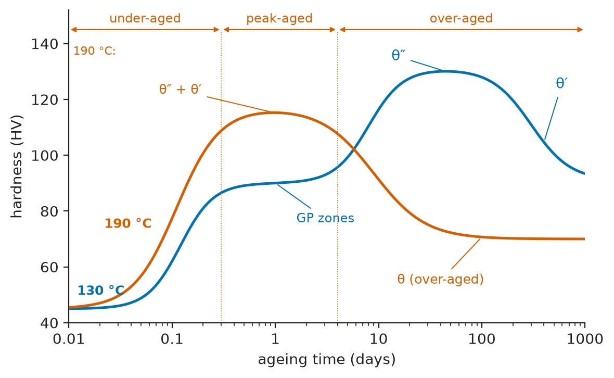
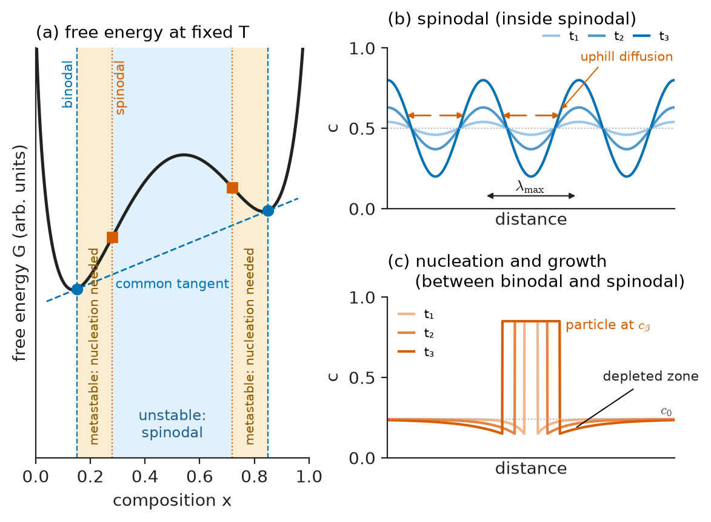
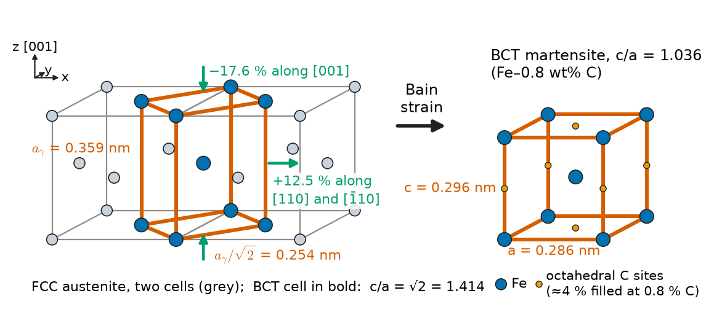
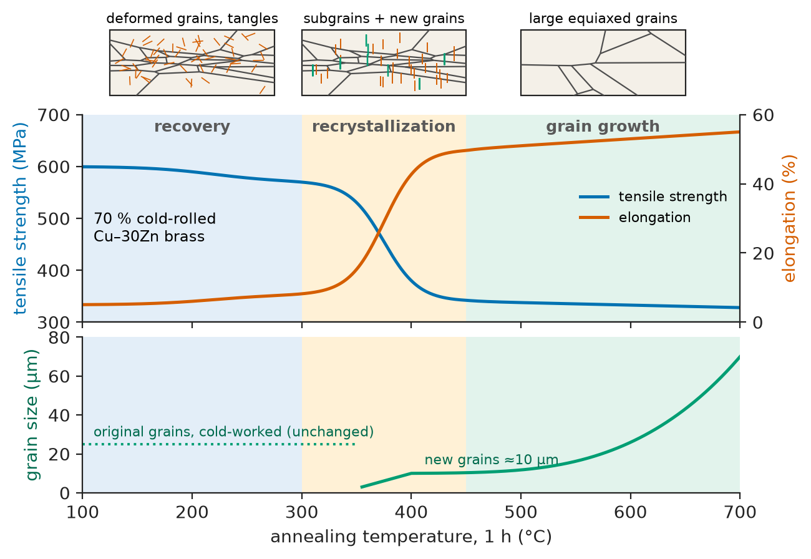
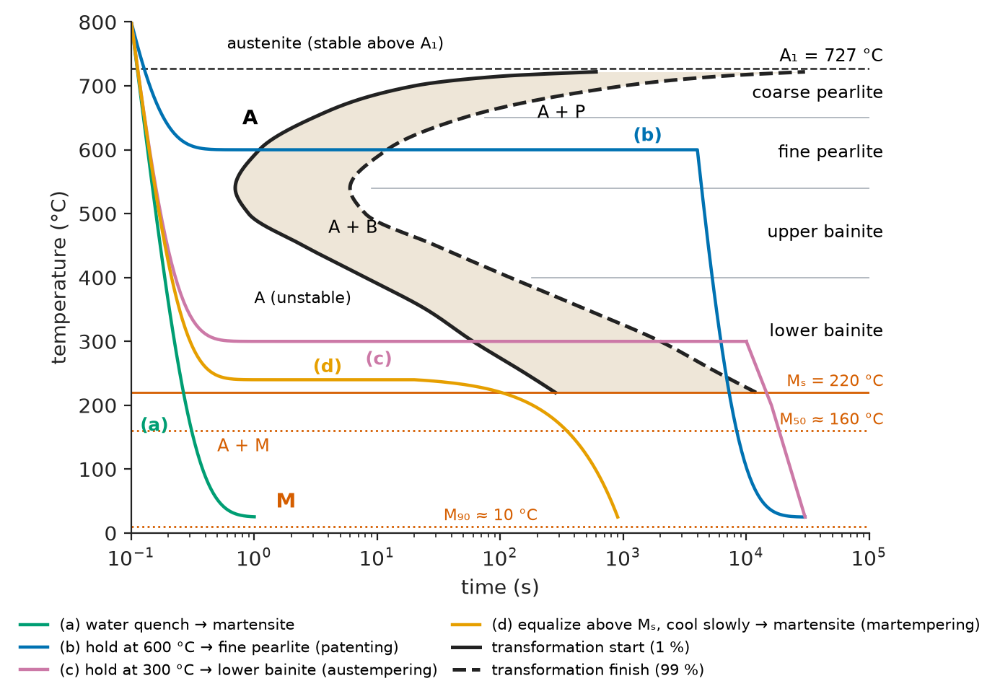
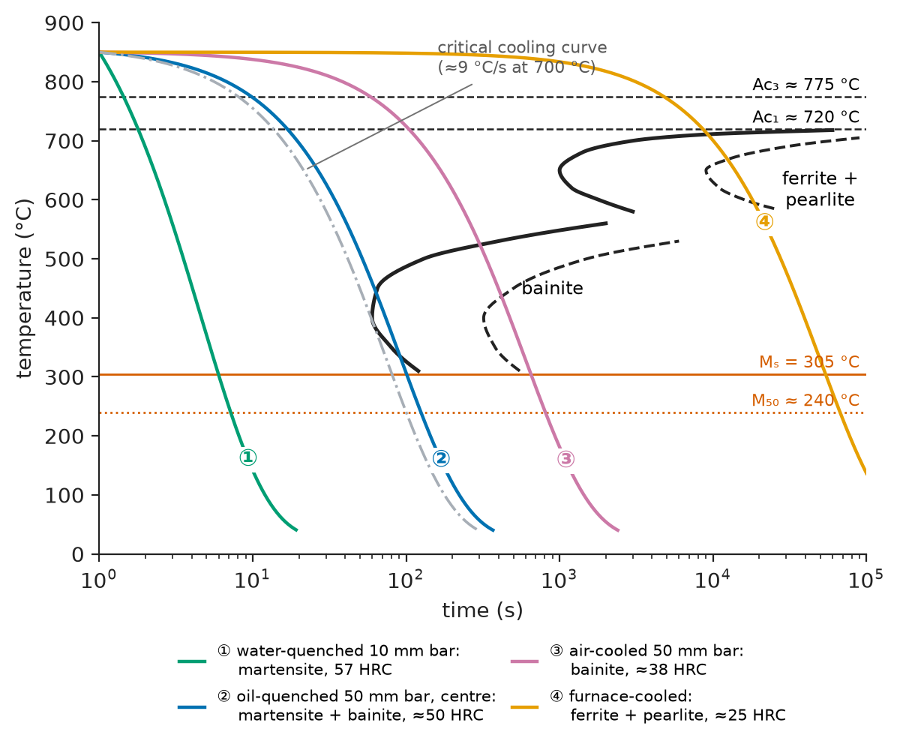

# Chapter 10 — Phase Transformations in Solids

*Part II · Thermodynamics and Kinetics*

A batch of aluminium-alloy wing ribs arrives at an aircraft assembly line with the right chemistry, the right dimensions and a yield strength 30 % below specification. The fault is traced to a furnace controller that ran the ageing treatment 25 °C too hot. Nothing melted and the parts look identical to good ones; what changed was the size and nature of particles a few nanometres across, formed inside the solid aluminium. Elsewhere, a railway replaces rail that wore out in five years with a head-hardened grade of almost the same chemistry that lasts fifteen, the difference lying in how fast the rail head was cooled through 700–500 °C; and a nickel–titanium stent crimped onto a catheter at room temperature springs open at body temperature. All three are phase transformations in the solid state — the transformations heat treatment exploits, and the source of most of the metallurgist's control over properties. This chapter applies the nucleation and growth ideas of Chapter 9 to them.

> **How can a solid change its crystal structure or composition without melting, and what decides whether it does so by diffusion or by a coordinated shear of the lattice?**
> **Why do fine, metastable precipitates and non-equilibrium phases such as martensite give the highest strengths, and how are time and temperature chosen to produce them?**

| Concept | Engineering destination |
|---|---|
| Classification of transformations | Choosing heat treatments; predicting whether a quench "freezes in" a phase |
| Precipitation and age hardening | Aircraft aluminium alloys, maraging steels, nickel superalloys, Cu–Be springs |
| Ostwald ripening (LSW) | Creep life of turbine blades, over-ageing, stability of dispersions |
| Spinodal decomposition | 475 °C embrittlement of duplex stainless steel, Cu–Ni–Sn springs, porous Vycor glass |
| Pearlite and bainite | Rails, bridge-cable and tyre-cord wire, austempered components |
| Martensite and shape memory | Hardened tools and gears, NiTi stents and actuators, zirconia toughening |
| Recovery, recrystallization, grain growth | Annealing of sheet and wire, grain-oriented electrical steel, weld HAZ grain size |
| Massive and discontinuous transformations | Brass and TiAl processing, unwanted cellular precipitates in Mg and Ni alloys |
| TTT and CCT diagrams | Quench design, hardenability, austempering, glass and titanium processing |

**Roadmap.** Classification (10.1) → diffusional precipitation and age hardening (10.2) → coarsening (10.3) → spinodal decomposition as the nucleation-free alternative (10.4) → the eutectoid products of steel, pearlite and bainite (10.5) → diffusionless martensite and shape memory (10.6) → transformations driven by stored defects: recovery, recrystallization, grain growth (10.7) → massive and discontinuous reactions (10.8) → TTT and CCT diagrams as engineering tools (10.9).

---

## 10.1 Classifying solid-state transformations

A phase transformation in a solid needs a driving force (Chapter 6) and a kinetic path (Chapters 8 and 9), as solidification does. What differs is the cost of the path: atoms move only by vacancy or interstitial jumps whose rate falls exponentially on cooling, and every new particle must fit inside a crystal that resists its change of shape and volume. Slow diffusion and elastic constraint explain most of what is distinctive here.

### Diffusional and diffusionless

The most useful single division is by how atoms move:

- **Diffusional (reconstructive) transformations** need long-range atomic transport, so composition can change and the product can have any structure. Precipitation, pearlite, recrystallization and grain growth belong here; their rates follow the Arrhenius temperature dependence of diffusion.
- **Diffusionless transformations** move every atom by less than one interatomic spacing, in a coordinated way, so the product keeps the parent composition. Martensite is the prime example; it can proceed where diffusion is frozen, at speeds approaching that of sound.

### Displacive and order–disorder

A second division is by what happens to the lattice. In a **displacive** transformation the lattice is homogeneously deformed by a small strain plus small atomic shuffles. The coordinated motion produces a macroscopic shape change, and the parent–product interface is glissile, gliding like a dislocation array. Martensite is displacive; so, in most researchers' view, is the ferrite in bainite. Christian called the two extremes *civilian* (atoms move individually, like a crowd dispersing) and *military* (atoms move in step, like soldiers changing formation).

In an **order–disorder** transformation the lattice sites stay put but the atomic species rearrange among them. β-brass orders from random BCC to the CsCl-type B2 structure below about 460 °C; Cu₃Au orders to L1₂ below 390 °C; γ′ in nickel superalloys is L1₂-ordered Ni₃Al. Ordering may be continuous (second-order, as in β-brass) or first-order (with latent heat, as in Cu₃Au). Chapters 3 and 6 gave the structures and thermodynamics.

### Nucleated versus continuous

Most transformations need nucleation: a small region of new phase must overcome a barrier before it grows (Chapter 9). Some proceed **continuously**, by the growth of small fluctuations present everywhere from the start; spinodal decomposition (Section 10.4) and continuous ordering are of this type.

**Table 10.1 — A practical classification of solid-state transformations.**

| Transformation | Atom movement | Nucleation | Composition change | Rate controlled by | Example |
|---|---|---|---|---|---|
| Precipitation | Long-range diffusion | Yes | Yes | Bulk diffusion | Al–Cu ageing, γ′ in superalloys |
| Spinodal decomposition | Long-range (uphill) diffusion | No | Yes | Bulk diffusion | Fe–Cr at 475 °C, Cu–Ni–Sn |
| Eutectoid (pearlite) | Diffusion at the interface | Yes | Yes (cooperative) | Volume or boundary diffusion | Fe–0.8C at 550–700 °C |
| Bainite | Displacive plus carbon diffusion | Yes | Carbon only | Carbon partitioning | Austempered steels |
| Martensite | Coordinated shear, under one spacing | Yes (heterogeneous, athermal) | No | Undercooling below $M_s$ | Quenched steel, NiTi |
| Massive | Short-range jumps across the interface | Yes | No | Interface mobility | Cu–Zn β→α, γ-TiAl |
| Order–disorder | Short-range exchange | Sometimes | No | Short-range diffusion | β-brass, Cu₃Au, Ni₃Al |
| Recrystallization, grain growth | Short-range jumps across boundaries | Recrystallization yes; growth no | No | Boundary mobility | Annealing of cold-worked sheet |

Real heat treatments combine rows: a quenched-and-tempered steel forms martensite without diffusion, then precipitates carbides from it by diffusion.

---

## 10.2 Precipitation and age hardening

### Supersaturation and the barrier in a solid

Aluminium with 4 wt% copper dissolves all its copper in FCC α above about 500 °C, but at room temperature the equilibrium solubility is a small fraction of a percent and the rest should be θ (Al₂Cu). **Solution-treated** at 540 °C and **quenched**, the alloy becomes a **supersaturated solid solution** (SSSS) with many quenched-in vacancies. On holding at room or modestly elevated temperature it precipitates and hardens: **age hardening**, discovered by Wilm in 1906 in the alloy that became Duralumin.

The nucleation theory of Chapter 9 carries over with one new term. Forming a precipitate of volume $V$ releases chemical free energy $V\Delta G_v$ but costs interfacial energy $A\gamma$ and, because the precipitate rarely fits its hole exactly, an elastic **misfit strain energy** $V\Delta G_s$:

$$
\Delta G=-V(\Delta G_v-\Delta G_s)+A\gamma
$$

For a spherical nucleus the critical barrier becomes

$$
\Delta G^*=\frac{16\pi\gamma^3}{3(\Delta G_v-\Delta G_s)^2}
$$

The strain energy subtracts directly from the driving force. A precipitate that matches the matrix lattice closely has small $\Delta G_s$ and, more importantly, can keep a **coherent** interface — one in which lattice planes run continuously from matrix into precipitate — with an interfacial energy of only 5–200 mJ/m², compared with 500–1000 mJ/m² for an incoherent interface. Because $\Delta G^*$ scales as $\gamma^3$, this matters enormously.

> **Status of the principle: Classical nucleation barrier with misfit strain**
> *Approximate.* Extends the capillarity model of Chapter 9 by adding an elastic term; it treats the nucleus as a uniform particle with a sharp interface and bulk properties, which is questionable for nuclei of a few tens of atoms, but it orders the competing phases correctly.

### Coherent, semicoherent and incoherent precipitates

The three interface types of Chapter 5 decide which phase forms first. A **coherent** precipitate shares the matrix lattice with a small misfit $\delta=(a_p-a_m)/a_m$; its **coherency strain** field extends beyond the particle and makes it an effective obstacle to dislocations (Chapter 13). Because strain energy grows with volume and the cost of misfit dislocations only with area, a growing particle eventually becomes **semicoherent**. An unrelated structure gives an **incoherent** interface, high in energy but free of long-range strain.

### The precipitation sequence in Al–Cu

The equilibrium θ phase (tetragonal, $I4/mcm$) cannot fit coherently into FCC aluminium, so its nucleation barrier is enormous at low ageing temperatures. The alloy takes a staircase of metastable steps, each with a lower barrier than the next:

$$
\text{SSSS}\;\rightarrow\;\text{GP zones}\;\rightarrow\;\theta''\;\rightarrow\;\theta'\;\rightarrow\;\theta\ (\mathrm{Al_2Cu})
$$

**Guinier–Preston (GP) zones**, detected by X-rays in 1938, are fully coherent copper-rich monolayers on $\{100\}_{\alpha}$, forming within hours at room temperature with the help of quenched-in vacancies. **θ″** is a coherent ordered phase with large coherency strains; **θ′** is semicoherent, often nucleated on dislocations; **θ** is incoherent and coarse (Table 10.2). This is the Ostwald step rule: the phase that forms first is the easiest to nucleate, not the most stable. Each metastable phase has its own solvus; the GP-zone solvus for Al–4Cu lies at about 150–200 °C, so ageing above it skips the zones.

**Table 10.2 — The precipitation sequence in Al–4 wt% Cu (typical).**

| Stage | Structure | Interface | Typical size | Where it nucleates | Effect on hardness |
|---|---|---|---|---|---|
| GP zones | Cu monolayers on $\{100\}$ | Coherent | 2–10 nm diameter, 1–2 atoms thick | Homogeneously (vacancy-assisted) | Rises from ~40 to ~90 HV |
| θ″ | Ordered tetragonal, coherent | Coherent, large strain | 10–100 nm plates | On or from GP zones | Peak, ~130 HV |
| θ′ | Tetragonal Al₂Cu | Semicoherent | 0.1–1 μm plates | Dislocations, θ″ | Declining from peak |
| θ | Tetragonal Al₂Cu ($I4/mcm$) | Incoherent | Micrometres | Grain boundaries, θ′ | Over-aged, ~60–70 HV |

<!-- FIGURE 10.1 | figures/ch10/fig-10-1-al-cu-ageing-curves.png | plot | Hardness versus ageing time for Al–4 wt% Cu at 130 °C and 190 °C, with the dominant precipitate labelled along each curve. | Content: x-axis ageing time, log scale, 0.01 to 1000 days; y-axis hardness 40–140 HV. Curve at 130 °C: rises from ~45 HV, shoulder at ~90 HV labelled "GP zones" around 0.5–2 days, peak ~130 HV at ~30–50 days labelled "θ″", then decline labelled "θ′". Curve at 190 °C: no GP plateau, faster rise to a lower peak ~115 HV at ~1 day labelled "θ″ + θ′", falling to ~70 HV by 100 days labelled "θ (over-aged)". Annotate "under-aged", "peak-aged", "over-aged" regions above the 190 °C curve. -->

*Figure 10.1 — Hardness versus ageing time for Al–4 wt% Cu at 130 °C and 190 °C, with the dominant precipitate labelled along each curve.*

Figure 10.1 shows the consequence. At a low ageing temperature hardness rises in two steps to a high peak that takes weeks; at a higher temperature the zones never form and a lower peak arrives within about a day, because fewer, coarser nuclei form. Beyond the peak the alloy **over-ages**: precipitates coarsen, lose coherency and become so widely spaced that dislocations loop around them (Orowan bypass, Chapter 13).

### Other precipitation-hardening systems

The same logic drives every age-hardenable alloy: Al–Mg–Si (6xxx, β″ needles, hardened during automotive paint baking at about 180 °C); Al–Zn–Mg–Cu (7xxx, η′, 7075-T6 at about 500 MPa yield for wing spars); nickel superalloys (coherent L1₂ γ′ with misfit 0.1–0.5 % at up to 70 vol% in turbine blades); maraging steels (Ni₃(Ti,Mo) in carbon-free Fe–Ni martensite, 1.7–2.4 GPa, for rocket-motor cases and landing gear); Cu–2Be springs above 1 GPa; and 17-4PH stainless steel for pump shafts.

Grain boundaries complicate the picture. Solute and vacancies drain to them, leaving a soft **precipitate-free zone** 0.1–1 μm wide, and coarse boundary precipitates can provide paths for intergranular fracture and corrosion. Some alloys show **quench sensitivity**: in a slow quench, solute precipitates coarsely on the way down and is lost to ageing, which is why thick 7xxx plate uses 7050 rather than 7075. Aluminium tempers encode these steps: T4 (naturally aged), T6 (artificially aged to peak), T7 (over-aged for stress-corrosion resistance, Chapter 43), T8 (cold-worked before ageing so that dislocations nucleate a finer precipitate).

**Worked example — Shifting an ageing schedule.** Alloy 6061 reaches peak strength (T6) in about 8 h at 175 °C. A heat-treater wants to know the equivalent time at 160 °C, 190 °C and 205 °C. If the rate-limiting step is diffusion of Mg and Si with an activation energy $Q\approx130$ kJ/mol, the time to reach the same microstructural state scales as $t\propto\exp(Q/RT)$:

$$
t_2=t_1\exp\!\left[\frac{Q}{R}\left(\frac1{T_2}-\frac1{T_1}\right)\right]
$$

With $T_1=448.15$ K and $t_1=8$ h:

- At 160 °C ($T_2=433.15$ K): $\frac{Q}{R}\left(\frac1{433.15}-\frac1{448.15}\right)=15\,636\times7.73\times10^{-5}=1.21$, so $t_2=8e^{1.21}=27$ h.
- At 190 °C ($T_2=463.15$ K): exponent $=15\,636\times(-7.23\times10^{-5})=-1.13$, so $t_2=8e^{-1.13}=2.6$ h.
- At 205 °C ($T_2=478.15$ K): exponent $=-2.19$, so $t_2=0.90$ h.

The estimate brackets practice (published T6 schedules include about 18 h at 160 °C). The scaling assumes the *same* precipitate sequence at both temperatures, so it fails across a solvus, and a one-hour treatment at 205 °C gives a lower peak, not the same one. Further, a 25 °C overshoot (200 °C instead of 175 °C) cuts the time to peak by a factor of about six ($e^{-1.84}=0.16$), so a part held for the nominal time spends most of it over-ageing — exactly the 30 % strength loss observed.

---

## 10.3 Coarsening: Ostwald ripening and LSW theory

### The Gibbs–Thomson driving force

Even when the precipitate has reached its lever-rule volume fraction, the microstructure still carries excess interfacial energy, which falls if small particles dissolve and large ones grow. By the **Gibbs–Thomson effect** (Chapter 6), the solubility next to a particle of radius $r$ exceeds the flat-interface value $c_\infty$:

$$
c(r)=c_\infty\exp\!\left(\frac{2\gamma V_m}{rRT}\right)\approx c_\infty\left(1+\frac{2\gamma V_m}{rRT}\right)
$$

where $V_m$ is the molar volume of the precipitate. Solute diffuses from small particles to large ones: **Ostwald ripening**, which operates in every dispersion, from alloy precipitates to liquid-phase-sintered ceramics (Chapter 17) and emulsions.

### LSW theory

Lifshitz and Slyozov (1961) and Wagner (1961) solved the problem for a dilute dispersion of spherical particles whose coarsening is controlled by diffusion through the matrix. Their **LSW theory** predicts that, after a transient, the system reaches a self-similar state in which the size distribution keeps a fixed shape while the mean radius $\bar r$ grows as

$$
\bar r^{\,3}-\bar r_0^{\,3}=k\,t,\qquad k=\frac{8\gamma D c_\infty V_m}{9RT}
$$

for a precipitate that is almost pure solute, with $c_\infty$ here the equilibrium mole fraction of solute in the matrix and $D$ the solute diffusivity. The number of particles falls as $t^{-1}$, and the distribution is cut off sharply at $1.5\,\bar r$. When the controlling step is transfer across the interface rather than diffusion through the matrix, $\bar r^2\propto t$ instead.

> **Status of the principle: LSW coarsening law**
> *Approximate.* Derived exactly for a vanishing volume fraction of spherical, stress-free particles with diffusion-controlled growth; the $t^{1/3}$ law is widely obeyed, but at finite volume fractions the rate constant rises (by a factor of 2–3 at 30 % volume fraction) and the size distribution broadens, and elastic interactions in coherent systems alter particle shapes and rates.

### Designing against coarsening

The rate constant identifies the levers available to an alloy designer. Each factor in $k$ can be made small:

- **Low interfacial energy.** Coherent, low-misfit precipitates coarsen slowly; this is a principal reason γ′ in nickel superalloys survives thousands of hours at 1000 °C.
- **Low solubility** $c_\infty$. Oxide dispersions in oxide-dispersion-strengthened (ODS) alloys have practically zero solubility in the metal matrix and do not coarsen even near the melting point; Y₂O₃ in ODS steels for fission and fusion reactors (Chapter 41) is the example.
- **Slow diffusion.** Adding slowly diffusing elements — Re, W and Ta in superalloys, Sc and Zr in aluminium (Al₃Sc and Al₃Zr precipitates stay a few nanometres in size up to about 300 °C) — slows the step that controls $k$.

**Worked example — How long does γ′ take to coarsen?** Estimate the coarsening of γ′ in a binary Ni–Al alloy at 1000 °C (1273 K). Take the diffusivity of Al in Ni as $D=D_0\exp(-Q/RT)$ with $D_0=1.87\times10^{-4}$ m²/s and $Q=268$ kJ/mol; the γ/γ′ interfacial energy $\gamma=0.02$ J/m²; the equilibrium Al mole fraction in γ, $c_\infty=0.15$; and $V_m=7.0\times10^{-6}$ m³/mol.

Diffusivity: $Q/RT=268\,000/(8.314\times1273)=25.32$, so $D=1.87\times10^{-4}\times e^{-25.32}=1.88\times10^{-15}$ m²/s.

Rate constant:

$$
k=\frac{8\times0.02\times1.88\times10^{-15}\times0.15\times7.0\times10^{-6}}{9\times8.314\times1273}=3.3\times10^{-27}\ \mathrm{m^3/s}
$$

Time for the mean radius to grow from 0.20 μm to 0.40 μm:

$$
t=\frac{(0.40\times10^{-6})^3-(0.20\times10^{-6})^3}{3.3\times10^{-27}}=\frac{5.6\times10^{-20}}{3.3\times10^{-27}}=1.7\times10^{7}\ \mathrm s\approx4700\ \mathrm h
$$

At 900 °C (1173 K), $D=2.2\times10^{-16}$ m²/s and $k=4.2\times10^{-28}$ m³/s, so the same coarsening takes about eight times longer: an engine run 100 K hotter consumes microstructural life roughly an order of magnitude faster. The cube law is self-limiting — at fixed $k$, growing from $r$ to $2r$ takes seven times as long as growing from zero to $r$ — and real superalloys coarsen more slowly still because slow diffusers (Ta, W, Re) control the rate. The absolute number is an order-of-magnitude estimate; the scaling is the robust part. Under stress, γ′ coarsens directionally into plates (**rafting**), which changes creep behaviour (Chapter 14).

---

## 10.4 Spinodal decomposition

### Decomposition without nucleation

A solution with a miscibility gap (Chapter 6) has a central region where $\partial^2G/\partial c^2<0$, bounded by the inflection points, the **chemical spinodal**. Between spinodal and binodal the solution is metastable and a new phase must nucleate; inside the spinodal any fluctuation lowers $G$ and grows, with no barrier. Growth is by **uphill diffusion** (Chapter 8): the effective interdiffusion coefficient $\tilde D\propto\partial^2G/\partial c^2$ is negative, so solute flows towards regions already rich in it.

### The Cahn–Hilliard picture

If the effective diffusivity is negative, why do fluctuations not grow infinitely sharp, at the atomic scale? Cahn and Hilliard (1958) answered that a sharp composition gradient carries an energy of its own. They wrote the free energy of an inhomogeneous solution as

$$
F=\int_V\left[f(c)+\kappa\,(\nabla c)^2\right]dV
$$

where $f(c)$ is the free energy per unit volume of homogeneous material and $\kappa>0$ is the **gradient-energy coefficient**, representing the extra bonds broken across a composition gradient. Taking the variational derivative gives a generalized chemical potential $\mu=f'(c)-2\kappa\nabla^2c$, and requiring that flux follow $-\nabla\mu$ gives the **Cahn–Hilliard equation**

$$
\frac{\partial c}{\partial t}=\nabla\cdot\left[M\,\nabla\!\left(f'(c)-2\kappa\nabla^2c\right)\right]
$$

with $M$ an atomic mobility. Linearizing about the mean composition $c_0$ and inserting a sinusoidal fluctuation of wavenumber $\beta=2\pi/\lambda$, $c-c_0\propto e^{R(\beta)t}\cos\beta x$, gives the amplification factor

$$
R(\beta)=-M\beta^2\left(f''+2\kappa\beta^2\right)
$$

Inside the spinodal ($f''<0$), long wavelengths grow, short ones decay because of the gradient term, and the fastest growth is at

$$
\lambda_{\max}=\sqrt2\,\lambda_c,\qquad \lambda_c=\sqrt{\frac{8\pi^2\kappa}{-f''}}
$$

where $\lambda_c$ is the shortest wavelength that can grow at all. Deep inside the spinodal $-f''$ is large and the wavelength is short, typically 2–10 nm in metals. In a crystal the lattice parameter usually changes with composition, which adds an elastic energy and shifts the instability to a lower **coherent spinodal**; the elastic anisotropy also aligns the modulations along elastically soft directions, $\langle100\rangle$ in most cubic metals.

> **Status of the principle: Cahn–Hilliard theory**
> *Derived.* Follows from a gradient expansion of the free energy and linear irreversible thermodynamics; the linearized solution describes only the early stage, while later coarsening needs the full nonlinear equation, which is now the basis of phase-field modelling (Chapter 56).

<!-- FIGURE 10.2 | figures/ch10/fig-10-2-spinodal-vs-nucleation.png | schematic | Spinodal decomposition compared with nucleation and growth: free-energy curve with binodal and spinodal points, and the evolution of composition profiles in each regime. | Content: Left panel: G versus composition x from 0 to 1, symmetric double-well curve; common tangent touching at binodal compositions (x ≈ 0.15, 0.85, marked with dots and dashed verticals); inflection points (x ≈ 0.3, 0.7) marked as spinodal; shaded region between labelled "metastable: nucleation needed", central region labelled "unstable: spinodal". Right panels: composition c versus distance x for three successive times. Top right "spinodal (inside spinodal)": low-amplitude sine wave of wavelength λ_max growing in amplitude with time, uphill-diffusion arrows. Bottom right "nucleation and growth (between binodal and spinodal)": an isolated particle at full equilibrium composition from the start, growing in width, with a depleted zone around it. -->

*Figure 10.2 — Spinodal decomposition compared with nucleation and growth: free-energy curve with binodal and spinodal points, and the evolution of composition profiles in each regime.*

Figure 10.2 contrasts the paths: nucleation makes a sharp-edged particle of final composition that grows in size; spinodal decomposition makes a diffuse periodic modulation that grows in amplitude.

### Where spinodal decomposition matters

- **Fe–Cr and duplex stainless steels.** Ferrite with more than about 15 % Cr decomposes into Fe-rich α and Cr-rich α′ at 300–500 °C. The nanometre modulation hardens and embrittles it — **475 °C embrittlement** — limiting duplex steels in chemical and nuclear plant to about 250–300 °C.
- **Cu–Ni–Sn spring alloys** (Cu–15Ni–8Sn) reach yield strengths over 1 GPa as a beryllium-free replacement for Cu–Be in aerospace bearings and connectors.
- **Alnico magnets** owe their coercivity to Fe–Co-rich rods formed spinodally in a magnetic field (Chapter 29).
- **Glasses and polymer blends.** Sodium borosilicate glass separates into interconnected silica-rich and borate-rich networks; leaching the borate leaves the porous silica of the Vycor process. Quenched polymer blends give co-continuous morphologies for membranes (Chapter 20).

Near the spinodal line the nucleation barrier becomes very small, so in practice the two regimes merge.

---

## 10.5 Pearlite and bainite

### The eutectoid reaction and pearlite

At the eutectoid point of the Fe–C diagram (727 °C, 0.76 wt% C; Chapter 7), austenite (FCC γ) decomposes into almost carbon-free ferrite (BCC α) and cementite (Fe₃C, 6.67 wt% C). The two products grow **cooperatively**: alternating lamellae advance together into the austenite, with carbon diffusing sideways over about half the lamellar spacing from the ferrite front to the cementite front. The product, **pearlite**, nucleates at austenite grain boundaries and grows as nodules until they impinge.

The **interlamellar spacing** $\lambda$ is set by a balance. A finer spacing shortens the diffusion distance and speeds growth, but it creates more ferrite–cementite interface, whose energy must be paid out of the driving force. Zener's analysis gives a minimum possible spacing at which all the driving force is consumed by interface,

$$
\lambda_{\min}=\frac{2\gamma_{\alpha\theta}V_m T_E}{\Delta H\,\Delta T}
$$

where $T_E$ is the eutectoid temperature, $\Delta T$ the undercooling below it and $\Delta H$ the enthalpy of transformation; the observed spacing is typically about twice $\lambda_{\min}$, near the spacing that maximizes the growth rate. The essential result is

$$
\lambda\propto\frac1{\Delta T}
$$

> **Status of the principle: Zener–Hillert spacing and growth of pearlite**
> *Approximate.* From a steady-state diffusion analysis with a maximum-growth-rate (or maximum entropy-production) criterion; the inverse dependence of spacing on undercooling is well confirmed, but absolute rates need the right mix of volume and interface diffusion and the effect of alloying elements partitioning at the front.

Pearlite formed just below 727 °C is **coarse** (spacing about 0.5–1 μm, hardness about 180–220 HB); formed at 550–600 °C it is **fine** (0.1–0.2 μm, 300–400 HB). Yield strength rises roughly as $\lambda^{-1/2}$, a Hall–Petch relation with spacing in place of grain size (Chapter 13). Head-hardened **rails** are cooled with forced air or water mist to spacings near 0.1 μm and 350–400 HB (standard grades 260–300 HB), multiplying wear life in heavy-haul curves. **Patented wire** is transformed at about 550 °C to fine pearlite and cold-drawn to true strains of 3–4, reaching 1770–1960 MPa for bridge cables and over 3500 MPa for tyre cord.

### Bainite

Below about 550 °C in a eutectoid steel, austenite transforms instead to **bainite** (described by Davenport and Bain in 1930), a non-lamellar aggregate of ferrite plates or laths and carbides. In **upper bainite** (about 550–400 °C), carbon rejected by parallel ferrite laths precipitates as cementite films between them, which limits toughness. In **lower bainite** (about 400–250 °C), finer plates contain fine carbides at 55–60° to the plate axis, giving strength with good toughness, often better than tempered martensite of equal hardness.

The mechanism is still debated: surface relief and a martensite-like orientation relationship suggest displacive growth with carbon partitioning afterwards (Bhadeshia's view); others argue for diffusional ledge growth controlled by carbon (Aaronson's school). The engineering behaviour is well established either way.

The bainite-start temperature is estimated by empirical formulae such as that of Steven and Haynes,

$$
B_s(^\circ\mathrm{C})=830-270\,\mathrm{C}-90\,\mathrm{Mn}-37\,\mathrm{Ni}-70\,\mathrm{Cr}-83\,\mathrm{Mo}
$$

with compositions in weight percent. For a 4340 steel (0.40 C, 0.70 Mn, 1.80 Ni, 0.80 Cr, 0.25 Mo) it gives $B_s\approx516$ °C.

> **Status of the principle: Empirical $B_s$ and $M_s$ formulae**
> *Empirical.* Linear regressions on measured start temperatures for low-alloy steels; accurate to about ±25 °C inside the composition range of the data, unreliable outside it.

Silicon (1.5–2 wt%) suppresses cementite, so rejected carbon stabilizes the austenite between the laths. This **carbide-free bainite** is used in rail crossings, automotive steels (Chapter 15) and, transformed at 200–250 °C for days, "nanostructured" bainite with 20–40 nm plates and 2.3–2.5 GPa strength for armour. **Austempering** (quench to a salt bath above $M_s$, hold until bainite forms) is used for springs and for austempered ductile iron (ADI) gears and crankshafts.

---

## 10.6 Martensitic transformations

### A transformation without diffusion

Quench a 0.4 % carbon steel from 850 °C into water and the austenite has no time to form pearlite or bainite. Below the **martensite start** temperature $M_s$, regions of the crystal shear into a new structure in microseconds, without change of composition. The product, **martensite**, is a supersaturated solution of carbon in body-centred tetragonal (BCT) iron, the hardest constituent of steel and the basis of every quenched-and-tempered gear, axle, bolt and tool.

The features that define a martensitic transformation are:

1. **Diffusionless.** The product inherits the parent composition and the order of the atoms; neighbours remain neighbours.
2. **Displacive, with a shape change.** A polished surface tilts where a martensite plate forms. The lattice change is a homogeneous deformation that the surrounding parent must accommodate.
3. **Crystallographically specific.** Each plate has a definite **habit plane** (the parent plane on which it lies) and a definite **orientation relationship** with the parent.
4. **Athermal in most steels.** The amount of martensite depends on how far below $M_s$ the material is cooled, not on how long it is held there. Transformation stops if cooling stops, and finishes at the **martensite finish** $M_f$.

### The Bain correspondence

How can FCC become BCC by a small homogeneous strain? Bain (1924) noticed that an FCC lattice already contains a body-centred tetragonal cell: two adjacent FCC cells share a BCT cell with axes $a_\gamma/\sqrt2$, $a_\gamma/\sqrt2$, $a_\gamma$ and axial ratio $\sqrt2$. Compressing this cell by about 17–20 % along its $c$ axis and expanding it by about 12–13 % along the other two converts it into the BCC (or, with carbon trapped in octahedral sites along $c$, the slightly tetragonal BCT) lattice of martensite. This is the **Bain strain** (Figure 10.3), and it requires the smallest atomic movements of any FCC → BCC correspondence.

<!-- FIGURE 10.3 | figures/ch10/fig-10-3-bain-correspondence.png | crystal | The Bain correspondence: a body-centred tetragonal cell outlined within two FCC austenite cells is compressed along c and expanded along a to give the BCT martensite cell, with interstitial carbon on octahedral sites along c. | Content: Left: two adjacent FCC cells (edge a_γ = 0.359 nm) with corner and face atoms; the BCT cell with edges a_γ/√2 = 0.254 nm, 0.254 nm, a_γ = 0.359 nm highlighted in bold, c/a = 1.414. Arrows: compression ~ -17.6 % along [001], expansion ~ +12.5 % along [110] and [1-10] directions of the FCC cell. Right: resulting martensite cell a = 0.286 nm, c = 0.296 nm (c/a = 1.036 for 0.8 wt% C), with carbon atoms (small, different colour) at octahedral sites on c-axis edges and face centres. Caption note: lattice parameters for Fe–0.8 wt% C. -->

*Figure 10.3 — The Bain correspondence: a body-centred tetragonal cell outlined within two FCC austenite cells is compressed along c and expanded along a to give the BCT martensite cell, with interstitial carbon on octahedral sites along c.*

**Worked example — Bain strains and volume change in a 0.8 % C steel.** The lattice parameters vary approximately linearly with carbon content $w$ (wt%): $a_\gamma=0.3555+0.0044w$ nm for austenite, and for martensite $c=0.2866+0.0116w$ nm and $a=0.2866-0.0013w$ nm. At $w=0.8$:

$a_\gamma=0.3590$ nm, $c=0.2959$ nm, $a=0.2856$ nm; tetragonality $c/a=1.036$.

The Bain cell has edges $a_\gamma/\sqrt2=0.2539$ nm (twice) and $a_\gamma=0.3590$ nm. The principal Bain stretches are therefore

$$
\eta_3=\frac{c}{a_\gamma}=\frac{0.2959}{0.3590}=0.824,\qquad \eta_1=\eta_2=\frac{\sqrt2\,a}{a_\gamma}=\frac{1.4142\times0.2856}{0.3590}=1.125
$$

a compression of 17.6 % and two expansions of 12.5 %. The volume per iron atom changes from $a_\gamma^3/4=0.01157$ nm³ in austenite to $ca^2/2=0.01207$ nm³ in martensite, a ratio of $1.043$: an expansion of about 4.3 %.

Strains of 12–18 % cannot be accommodated elastically, so the transformation must keep the macroscopic shape change small (below). The 4 % volume expansion produces large stresses when the surface of a quenched part transforms before its core; this is why water-quenched high-carbon parts crack and why alloy steels are quenched in oil or polymer.

### Invariant planes, habit planes and orientation relationships

The Bain strain leaves no plane of the parent undistorted and unrotated, yet a martensite plate needs such an **invariant plane** as its interface. The **phenomenological theory of martensite crystallography** (Wechsler, Lieberman and Read; Bowles and Mackenzie, 1953–54) resolved this: the shape deformation is the Bain strain plus a **lattice-invariant shear** (slip or twinning inside the plate) plus a rigid rotation, which together give an **invariant-plane strain** — a shear of about 0.2 parallel to the habit plane with a small normal dilatation. From lattice parameters alone, with no adjustable constants, the theory predicts habit plane, orientation relationship and shape change in good agreement with measurement.

Orientation relationships in steels are close to **Kurdjumov–Sachs**, $\{111\}_\gamma\parallel\{110\}_{\alpha'}$ with $\langle110\rangle_\gamma\parallel\langle111\rangle_{\alpha'}$, or **Nishiyama–Wassermann** (rotated by about 5°). Habit planes depend on carbon content:

**Table 10.3 — Martensite morphologies in Fe–C and Fe–Ni steels (typical).**

| Carbon content (wt%) | Morphology | Habit plane | Lattice-invariant shear | $M_s$ (°C) | Character |
|---|---|---|---|---|---|
| < 0.6 | Lath (packets of parallel laths, ~0.2 μm thick) | $\{557\}_\gamma$ (near $\{111\}_\gamma$) | Slip, high dislocation density | 350–520 | Tough after tempering |
| 0.6–1.0 | Mixed lath and plate | — | — | 200–350 | Intermediate |
| > 1.0 (or Fe–30Ni) | Lenticular plate with midrib | $\{225\}_\gamma$, $\{259\}_\gamma$ | Fine internal twins | < 200 | Hard, brittle, microcracks |

### The start temperature and the amount of martensite

Alloying elements that stabilize austenite lower $M_s$. Andrews' widely used linear formula is

$$
M_s(^\circ\mathrm{C})=539-423\,\mathrm{C}-30.4\,\mathrm{Mn}-17.7\,\mathrm{Ni}-12.1\,\mathrm{Cr}-7.5\,\mathrm{Mo}
$$

Carbon dominates. Since the transformation is athermal, the fraction transformed depends on the undercooling below $M_s$; for steels the **Koistinen–Marburger** relation fits well:

$$
f=1-\exp\left[-0.011\,(M_s-T)\right]
$$

> **Status of the principle: Koistinen–Marburger relation**
> *Empirical.* Fitted to measured martensite fractions in plain-carbon and low-alloy steels; the rate constant 0.011 K⁻¹ varies somewhat with composition, and the relation does not describe isothermal martensite or the burst transformations of some Fe–Ni alloys.

**Worked example — Retained austenite after quenching.** For 4340 steel (0.40 C, 0.70 Mn, 1.80 Ni, 0.80 Cr, 0.25 Mo):

$M_s=539-169.2-21.3-31.9-9.7-1.9=305$ °C.

Quenched to 25 °C: $f=1-\exp(-0.011\times280)=1-e^{-3.08}=0.954$. About 95 % martensite and 4.6 % **retained austenite**, which is acceptable for a structural shaft.

Now a bearing steel, 52100 (1.0 C, 0.35 Mn, 1.45 Cr), hardened from a temperature at which about 0.6 % C is in solution (the rest remains as undissolved carbides that resist wear). Taking 0.6 C and 1.0 Cr in the austenite: $M_s=539-253.8-10.6-12.1=262$ °C. At 25 °C, $f=1-\exp(-0.011\times237)=0.927$: about 7 % retained austenite. In a precision bearing this austenite can transform slowly in service, expanding by 4 % and changing dimensions. A **sub-zero treatment** to −80 °C raises the martensite fraction to 0.977, and to −196 °C to 0.994, which is why gauge blocks and aerospace bearings are cryogenically treated before tempering. Had all 1.0 % C dissolved, $M_s$ would fall to about 88 °C and about half the austenite would survive the quench — the reason high-carbon steels are hardened with some carbide left undissolved.

### Why martensite is hard

Fresh martensite is strong because trapped carbon produces an extreme tetragonal distortion that interacts with every dislocation, the laths or plates are very fine, and the lattice-invariant shear leaves $10^{15}$–$10^{16}$ m⁻² of dislocations or fine twins. As-quenched hardness rises steeply with carbon — about 50 HRC at 0.2 % C, 57–58 HRC at 0.4 %, 64–65 HRC at 0.6 % and above — and hardly depends on alloy content: alloying makes martensite easier to form (Section 10.9), not harder. It is **tempered** at 150–650 °C to restore toughness (Chapter 15).

Martensite is widespread beyond steel: hexagonal α′ in quenched titanium alloys, FCC → HCP cobalt near 420 °C, and the tetragonal → monoclinic transformation of zirconia, whose 4–5 % volume increase, triggered at a crack tip, gives **transformation toughening** (Chapter 14).

### Shape memory and superelasticity

In some alloys the transformation is **thermoelastic**: the interface is highly mobile, the transformation strain is accommodated elastically, and the transformation reverses crystallographically on heating. The prime example is equiatomic **NiTi** (Nitinol), B2 austenite ↔ monoclinic B19′ martensite; others are Cu–Zn–Al, Cu–Al–Ni and Fe–Mn–Si.

- **Shape-memory effect.** Below $M_f$, martensite forms as self-accommodating twin variants with almost no shape change. Deformation reorients the variants by moving twin boundaries, giving up to about 8 % recoverable strain in NiTi. Heating above the austenite finish $A_f$ restores the single-orientation parent and the original shape.
- **Superelasticity.** Just above $A_f$, stress induces martensite. The material deforms at a nearly constant plateau stress (400–600 MPa for NiTi at body temperature) to 6–8 % strain, and recovers on unloading.

The stress needed to induce martensite rises with temperature according to a **Clausius–Clapeyron relation**,

$$
\frac{d\sigma}{dT}=-\frac{\Delta H}{T\,\varepsilon_{tr}}
$$

with $\Delta H$ the transformation enthalpy per unit volume (negative for austenite → martensite) and $\varepsilon_{tr}$ the transformation strain. For NiTi, $\Delta H\approx20$ J/g (multiplied by the density 6450 kg/m³, $1.3\times10^8$ J/m³), $T\approx300$ K and $\varepsilon_{tr}\approx0.06$ give about 7 MPa/K, in line with measured slopes of 5–8 MPa/K.

> **Status of the principle: Clausius–Clapeyron relation for stress-induced martensite**
> *Fundamental.* Follows from equating the Gibbs energies of parent and martensite under stress (thermodynamics of a first-order transformation with stress and strain as conjugate variables); real materials deviate because of hysteresis and texture.

Superelastic NiTi is used for self-expanding stents and orthodontic arch wires; the shape-memory effect for pipe couplings, thermal actuators and deployable space structures (Chapters 37 and 39).

---

## 10.7 Recovery, recrystallization and grain growth

### Stored energy as a driving force

Not every solid-state transformation changes phase. When a metal is cold-worked, most of the mechanical work becomes heat, but 1–10 % is stored as dislocations and point defects. The energy per unit volume stored by a dislocation density $\rho$ is about $\tfrac12\rho Gb^2$ (the line energy of Chapter 12 times the length per unit volume). For copper ($G=48$ GPa, $b=0.256$ nm) cold-worked to $\rho=10^{15}$ m⁻²,

$$
\tfrac12\rho Gb^2=\tfrac12\times10^{15}\times48\times10^{9}\times(0.256\times10^{-9})^2\approx1.6\times10^{6}\ \mathrm{J/m^3}
$$

about 1.6 MJ/m³, or 11 J/mol — tiny compared with chemical driving forces, but enough to drive a complete reconstruction of the grain structure when atoms become mobile. On heating, the stored energy is released in three overlapping stages (Figure 10.4).

### Recovery

**Recovery** annihilates and rearranges dislocations without moving high-angle boundaries: excess vacancies anneal out, opposite dislocations annihilate, and the rest form low-energy walls by glide and climb — **polygonization** into subgrains. Hardness falls only slightly, but resistivity and residual stress fall substantially, which is why stress-relief anneals of welded structures and cold-formed springs are recovery treatments. High-stacking-fault-energy metals (aluminium, ferritic iron) recover easily because their dislocations climb and cross-slip readily (Chapter 12); in copper, brass and austenitic steel recovery is limited.

### Recrystallization

**Recrystallization** replaces deformed grains with new, nearly dislocation-free grains bounded by high-angle boundaries that sweep through the deformed matrix. Its "nuclei" are pre-existing subgrains at sites of high misorientation (grain boundaries, deformation bands, large particles). The fraction recrystallized follows the **JMAK equation** of Chapter 9, $X=1-\exp(-kt^n)$, with $n$ typically 1–3. For a half-time of 10 min and $n=2$, $k=\ln2/t_{0.5}^2$, so 5 % takes $(-\ln0.95/k)^{1/2}=2.7$ min and 95 % takes 20.8 min; curves at other temperatures shift by an Arrhenius factor.

Empirically, recrystallization needs a minimum strain of a few percent; more strain lowers the temperature needed and refines the new grains; purity lowers the temperature, and solutes and fine particles raise it. The **recrystallization temperature** (complete in one hour) is roughly 0.3–0.5 of the absolute melting temperature for heavily deformed commercial metals.

**Table 10.4 — Approximate recrystallization temperatures after heavy cold work (1 h anneal, commercial purity).**

| Metal | $T_m$ (°C) | Recrystallization temperature (°C) | Consequence |
|---|---|---|---|
| Lead, tin | 327, 232 | Below room temperature | Cannot be work-hardened at 20 °C |
| Aluminium | 660 | 150–300 | Annealed (O temper) at 345–415 °C |
| Copper | 1085 | 200–300 | Wire annealed in-line at 400–600 °C |
| Brass (Cu–30Zn) | ~930 | 350–450 | Cold-rolled and annealed in cycles |
| Low-carbon steel | 1538 (Fe) | 450–600 | Batch or continuous annealing of sheet |
| Tungsten | 3422 | ~1200–1400 | Lamp filament grain structure stabilized by K dopant |

**Hot** and **cold working** are defined by recrystallization, not absolute temperature: rolling lead at room temperature is hot working, rolling tungsten at 1000 °C is not (Chapter 46).

### Grain growth

After recrystallization the grain boundaries themselves still store energy (0.3–1 J/m² for metals). Boundaries migrate toward their centres of curvature, large grains with many sides grow at the expense of small ones, and the mean grain size increases. The driving pressure on a boundary of radius of curvature $R$ is about $2\gamma_{gb}/R$: for $\gamma_{gb}=0.6$ J/m² and $R=10$ μm it is $1.2\times10^5$ J/m³, an order of magnitude below the recrystallization driving force computed above, which is why grain growth is slower. If the boundary velocity is proportional to the driving pressure and $R$ is proportional to the mean grain size $d$, then

$$
d^2-d_0^2=k_g\,t
$$

> **Status of the principle: Parabolic grain-growth law**
> *Approximate.* Derived for curvature-driven migration with a constant mobility (Burke and Turnbull); real metals usually give $d^n-d_0^n=kt$ with $n$ between 2 and 4, because solutes and particles slow boundaries as they move.

Grain growth matters wherever metal is held hot: weld heat-affected zones (Chapter 47), austenitizing before quenching, and sintering of ceramics, where it competes with pore removal (Chapter 17).

### Zener pinning

Fine second-phase particles resist boundary migration. A boundary that meets a particle of radius $r$ loses the area it would otherwise have, and must pull free of it to move on; the maximum restraining force per particle is $\pi r\gamma_{gb}$. Summed over the particles that intersect a unit area of boundary for a volume fraction $f$ of randomly distributed particles, the **Zener pinning pressure** is

$$
P_Z=\frac{3f\gamma_{gb}}{2r}
$$

Grain growth stops when the curvature driving force falls to this value. With a driving pressure of $\sim2\gamma_{gb}/R$ and $R$ related to grain size, Zener's classic estimate of the limiting grain size is

$$
d_Z=\frac{4r}{3f}
$$

> **Status of the principle: Zener pinning and limiting grain size**
> *Approximate.* From a simple force balance with randomly placed spherical particles and a planar boundary; the numerical prefactor varies between models and simulations (from about 0.2 to 1.3 times Zener's), but the proportionality to $r/f$ is robust.

**Worked example — Grain-size control in a microalloyed steel.** A plate steel contains a volume fraction $f=0.001$ of NbC precipitates of radius $r=10$ nm. The limiting austenite grain size is

$$
d_Z=\frac{4\times10\times10^{-9}}{3\times0.001}=1.33\times10^{-5}\ \mathrm m\approx13\ \mu\mathrm m
$$

The pinning pressure is $P_Z=3\times0.001\times0.6/(2\times10\times10^{-9})=9.0\times10^4$ J/m³, comparable to the grain-growth driving pressure but more than an order of magnitude below the stored energy of heavy deformation ($\sim10^6$ J/m³). The particles that stop grain growth therefore cannot stop recrystallization after heavy rolling (though NbC precipitating on dislocations during rolling retards it, the basis of controlled rolling). If the particles coarsen to $r=50$ nm at the same $f$ (Section 10.3), $d_Z$ rises to 67 μm; if they dissolve, as NbC does near the fusion line of a weld, pinning vanishes, which is why the more stable TiN is used in steels for high-heat-input welding. Only 0.05–0.1 wt% Nb, Ti or V is needed — the "micro" in microalloyed.

### Abnormal grain growth

When most boundaries are pinned, a few grains with an advantage — larger size, high-mobility boundaries, a local absence of particles — can escape and consume the fine matrix. This **abnormal grain growth** usually harms toughness and fatigue strength (in carburized gears, for example). It is exploited in **grain-oriented electrical steel** (Fe–3 % Si) for transformer cores: MnS and AlN inhibitors pin normal growth, and Goss-oriented $\{110\}\langle001\rangle$ grains grow abnormally to centimetre size, aligning the easy magnetization direction with the rolling direction and roughly halving core losses (Chapter 29).

<!-- FIGURE 10.4 | figures/ch10/fig-10-4-annealing-stages.png | plot | Changes in properties and microstructure during annealing of a cold-worked metal: recovery, recrystallization and grain growth. | Content: x-axis annealing temperature (1 h) for 70 % cold-rolled brass (Cu–30Zn) from 100 to 700 °C. Left y-axis tensile strength 300–700 MPa (falling from ~600 to ~330 MPa, steep drop between 300 and 450 °C) and ductility 0–60 % elongation (rising from ~5 to ~55 %, inverse shape). Right y-axis grain size 0–80 μm (constant cold-worked structure until ~350 °C, new grains ~10 μm at 400 °C, rising to ~70 μm at 700 °C). Shaded bands labelled "recovery" (100–300 °C), "recrystallization" (300–450 °C), "grain growth" (above 450 °C). Small schematic microstructure insets above each band: deformed grains with tangled dislocations; subgrains plus new equiaxed grains; large equiaxed grains. -->

*Figure 10.4 — Changes in properties and microstructure during annealing of a cold-worked metal: recovery, recrystallization and grain growth.*

Figure 10.4 brings the three stages together for cold-rolled brass, showing why a recrystallization anneal is the tool that resets strength and ductility between cold-rolling passes.

---

## 10.8 Massive and discontinuous transformations

### Massive transformations

Some alloys, cooled quickly enough to suppress long-range diffusion but not fast enough (or not with the right crystallography) to form martensite, transform by a third route. The product has the **same composition** as the parent but a different crystal structure, and it grows by the rapid thermally activated migration of an incoherent interface, with atoms jumping individually across it. This is a **massive transformation**: diffusional in its atomic mechanism (civilian), but without long-range diffusion and therefore without composition change. Growth rates can reach centimetres per second.

A massive transformation can occur only below the temperature $T_0$ at which parent and product of the same composition have equal Gibbs energy (Chapter 6). Examples: β brass quenched from about 850 °C transforms to blocky "massive α" (FCC) of the same composition; rapidly cooled very-low-carbon steels form massive ferrite; and in γ-TiAl alloys for low-pressure turbine blades a massive α → γ transformation on fast cooling refines the microstructure and improves ductility.

### Discontinuous (cellular) precipitation

In ordinary, **continuous** precipitation, particles form throughout each grain and the matrix composition falls gradually everywhere. In **discontinuous** or **cellular precipitation**, a grain boundary migrates into the supersaturated grain and leaves behind a two-phase lamellar colony of depleted matrix and precipitate, much like pearlite. The matrix composition changes abruptly ("discontinuously") at the moving boundary, and solute diffuses along that boundary rather than through the lattice, which is why the reaction can run at temperatures where volume diffusion is slow:

$$
\alpha'\;\rightarrow\;\alpha+\beta\quad\text{(at a moving grain boundary)}
$$

where $\alpha'$ is the supersaturated matrix and $\alpha$ the depleted one. It is common in Mg–Al (Mg₁₇Al₁₂ lamellae in AZ91 die castings), Cu–Ag, Ni–In and Pb–Sn, and is usually undesirable: the coarse colonies are weaker than a fine continuous dispersion and can lower creep and corrosion resistance.

---

## 10.9 Transformation diagrams in practice

### Isothermal transformation (TTT) diagrams

A **time–temperature–transformation (TTT)** diagram shows, for a given composition and starting condition, how long transformation takes to start and finish at each constant temperature. Small specimens are quenched from the austenitizing temperature into baths at different temperatures, held, quenched again and examined by metallography or dilatometry. The start (1 %) and finish (99 %) lines form **C-curves**: near the equilibrium temperature the driving force is small, at low temperature diffusion is slow, and in between lies a **nose** of fastest transformation (Chapter 9).

<!-- FIGURE 10.5 | figures/ch10/fig-10-5-ttt-eutectoid.png | plot | TTT diagram for a eutectoid (0.77 wt% C) plain-carbon steel with pearlite and bainite regions, martensite lines and four cooling paths. | Content: x-axis time, log scale 0.1 s to 10^5 s; y-axis temperature 0–800 °C. Horizontal dashed line at 727 °C labelled "A1". Start and finish C-curves: nose at ~540 °C, start ~0.7 s, finish ~6 s; at 700 °C start ~20 s, finish ~1000 s; at 300 °C start ~60 s, finish ~2000 s. Regions labelled "coarse pearlite" (650–727 °C), "fine pearlite" (540–650 °C), "upper bainite" (400–540 °C), "lower bainite" (230–400 °C). Horizontal lines Ms = 220 °C, M50 ≈ 160 °C, M90 ≈ 10 °C (Koistinen–Marburger). Paths: (a) water quench → martensite, (b) quench to 600 °C, hold → fine pearlite, (c) quench to 300 °C, hold → lower bainite (austempering), (d) quench to just above Ms, equalize, then cool slowly through Ms (martempering). -->

*Figure 10.5 — TTT diagram for a eutectoid (0.77 wt% C) plain-carbon steel with pearlite and bainite regions, martensite lines and four cooling paths.*

Figure 10.5 is the TTT diagram for a plain eutectoid steel. Its nose lies at about 540 °C and less than one second, which is why only thin sections of plain-carbon steel can be quenched fast enough to miss it and form martensite throughout. The paths drawn on it are standard treatments: **patenting** (hold above the nose for fine pearlite), **austempering** (hold in the bainite range; low distortion, high toughness) and **martempering** (equalize just above $M_s$, then cool slowly so the whole section transforms together, reducing distortion and quench cracking).

Alloying elements that must partition between ferrite and carbide (Cr, Mo, Mn, Ni) shift the pearlite C-curve to longer times by factors of 10–1000, and Mo and Cr separate pearlite and bainite into distinct C's. Coarser austenite grains delay transformation (fewer boundary sites), and 10–30 ppm boron, segregated to austenite boundaries, delays ferrite nucleation strongly.

### Continuous-cooling transformation (CCT) diagrams

Real parts cool continuously, at different rates at different depths. A **continuous-cooling transformation (CCT)** diagram, usually measured by dilatometry, gives start and finish lines for a range of cooling curves. Its curves lie at lower temperatures and longer times than the TTT curves, because the steel spends only part of the time near the nose.

<!-- FIGURE 10.6 | figures/ch10/fig-10-6-cct-4340.png | plot | Continuous-cooling transformation diagram for 4340 steel with cooling curves for different section sizes and the resulting microstructures and hardnesses. | Content: x-axis time from 1 s to 10^5 s, log scale; y-axis temperature 0–900 °C. Ac3 ≈ 775 °C and Ac1 ≈ 720 °C dashed. Ferrite+pearlite region upper right with start curve nose at ~650 °C, ~1000 s; bainite region with nose at ~450 °C, ~60–100 s; Ms = 305 °C horizontal line, M50 ~ 240 °C. Four cooling curves from 850 °C: (1) water-quenched 10 mm bar, reaches Ms in ~5 s → "martensite, 57 HRC"; (2) oil-quenched 50 mm bar centre, ~60 s → "martensite + bainite, ~50 HRC"; (3) air-cooled 50 mm bar, crosses bainite region → "bainite, ~38 HRC"; (4) furnace-cooled, crosses ferrite/pearlite → "ferrite + pearlite, ~25 HRC". Critical cooling rate curve tangent to the bainite nose, labelled. -->

*Figure 10.6 — Continuous-cooling transformation diagram for 4340 steel with cooling curves for different section sizes and the resulting microstructures and hardnesses.*

The most important reading of a CCT diagram is the **critical cooling rate**: the slowest cooling curve that misses all the diffusional transformation curves and therefore gives fully martensitic structure. For a plain eutectoid steel it is of the order of 100–200 °C/s at 700 °C, attainable only at the surface of small parts with a brine or water quench; for 4340 (Figure 10.6) it is of the order of 1–10 °C/s, attainable in the centre of an oil-quenched bar several centimetres across. The ability of a steel to form martensite at depth is its **hardenability**, measured by the Jominy end-quench test and developed in Chapter 15. Hardenability is what alloying elements are mainly for: they are added not to make martensite harder but to make it possible in thick sections with gentle quenches that avoid cracking.

### Transformation diagrams beyond steel

The same tools appear wherever a transformation competes with cooling: quench-sensitivity C-curves limit the furnace-to-tank transfer of 7075 sheet to about 10–15 s; CCT diagrams of Ti–6Al–4V show when cooling from the β field gives α′ martensite, basket-weave α or colony α, which matters for forged and additively manufactured aerospace parts (Chapter 48); crystallization TTT curves set critical cooling rates for glasses and bulk metallic glasses (Chapter 9); and weld-cycle CCT diagrams predict heat-affected-zone hardness and hydrogen-cracking risk (Chapter 47).

**Table 10.5 — Reading a transformation diagram: questions and answers.**

| Engineering question | What to read on the diagram |
|---|---|
| Will this section harden through? | Compare the centre cooling curve with the nose of the diffusional curves (CCT) |
| What hardness will the core have? | Hardness values printed at the end of each cooling curve |
| How long can a part wait before quenching? | Time to the start curve at the transfer temperature (C-curve for quench sensitivity) |
| At what temperature should I austemper, and for how long? | Bainite region of the TTT diagram; hold beyond its finish curve |
| How much retained austenite to expect? | Position of $M_s$ and $M_f$ relative to the final temperature (Koistinen–Marburger) |
| Is the diagram valid for my material? | Composition, austenitizing temperature and grain size stated with the diagram |

> **Status of the principle: TTT and CCT diagrams**
> *Empirical.* Measured for a specific composition, austenitizing temperature and grain size; they are reliable for interpolation within a steel grade but must not be transferred between grades or used outside their stated starting conditions. Computed diagrams from CALPHAD-based kinetic models are increasingly used for screening but are calibrated against the same kind of data.

---

## What remains open

| Open question | Where it is answered |
|---|---|
| How exactly do coherent precipitates, GP zones and over-aged particles impede dislocations, and what are cutting and Orowan bypass? | Chapter 13 |
| How do dislocations climb, cross-slip and arrange into walls during recovery, and why does stacking-fault energy matter? | Chapter 12 |
| How are steels heat-treated in practice: tempering stages, hardenability, Jominy, alloy and advanced high-strength steels? | Chapter 15 |
| Which aluminium, titanium, nickel and copper alloys use these transformations, and in which tempers? | Chapter 16 |
| How does γ′ coarsening and rafting set the creep life of turbine blades? | Chapters 14 and 41 |
| How is transformation toughening used in zirconia and how does it give R-curves? | Chapter 14 |
| How are shape-memory and superelastic alloys designed as actuators and medical devices? | Chapters 37 and 39 |
| How do Goss texture and grain size control losses in electrical steels? | Chapter 29 |
| How are recrystallization and grain growth used in rolling, forging and thermomechanical processing, and in welds? | Chapters 46 and 47 |
| How are precipitates and spinodal modulations a few nanometres across actually observed? | Chapters 52 and 53 (TEM, atom-probe tomography) |
| How are Cahn–Hilliard and microstructure evolution simulated quantitatively? | Chapter 56 (phase-field modelling) |
| How were the driving forces, nucleation barriers and JMAK kinetics used here derived? | Chapters 6 and 9 (back references) |

**Next:** Chapter 11 opens Part III by asking how a solid responds to force — from the elastic stretching of bonds to the tests that measure yield, strength, hardness and toughness — the properties these transformations exist to control.
