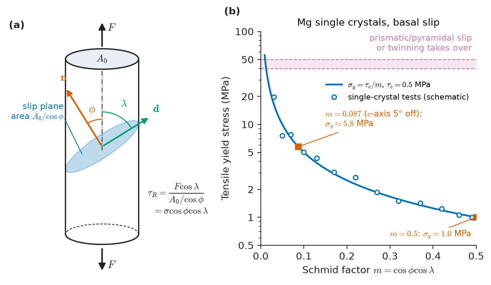
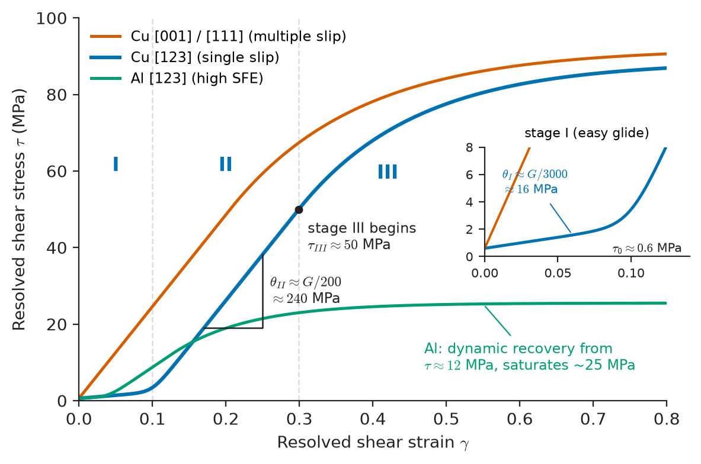
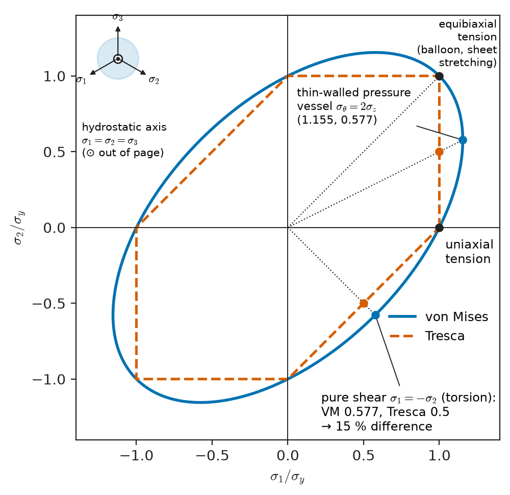
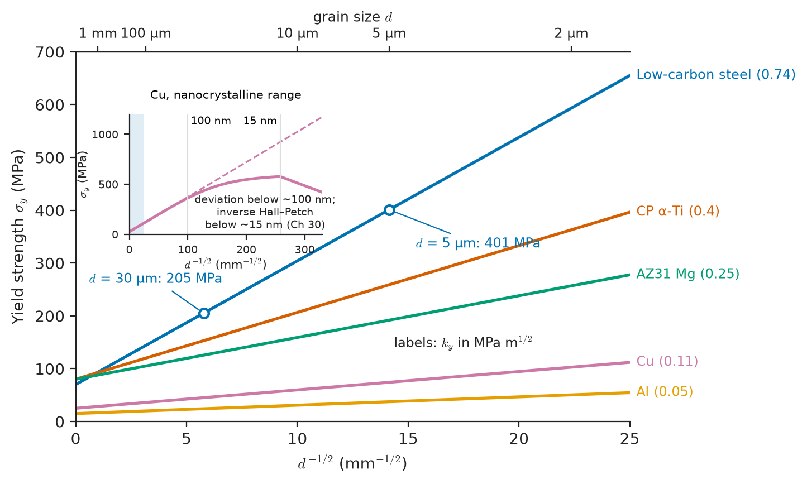
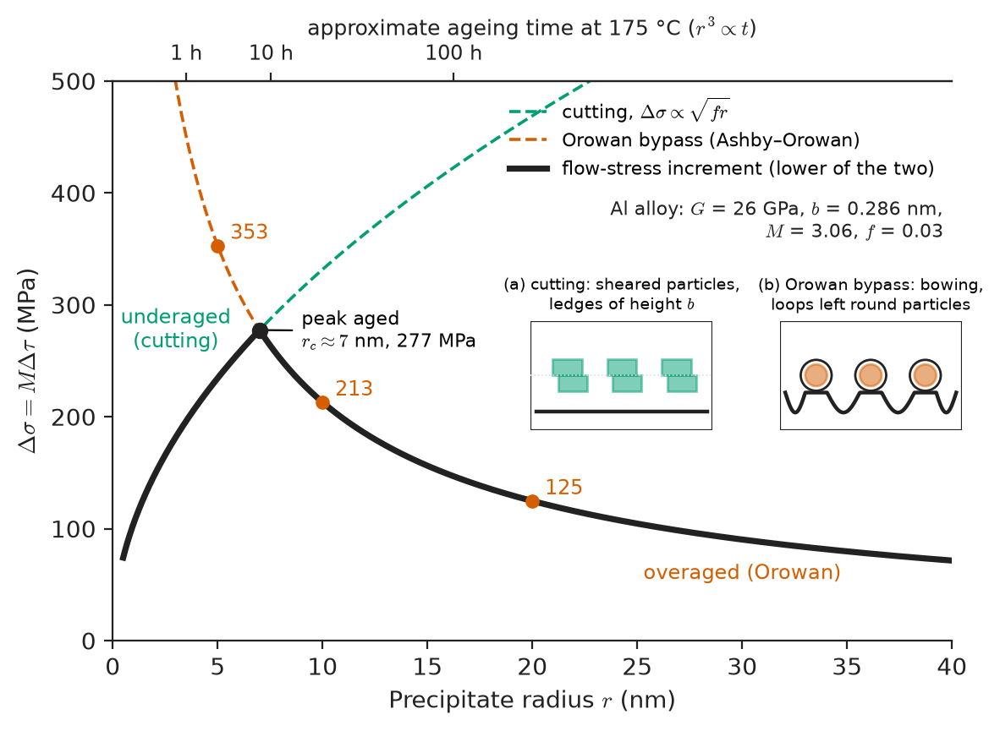
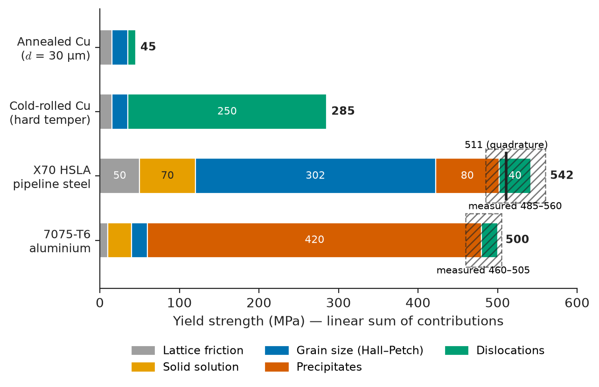

# Chapter 13 — Plasticity and Strengthening Mechanisms

*Part III · Mechanical Behaviour*

A car maker wants to take 40 kg out of a body-in-white without losing crash performance. The request to the materials group is one line: "same part, thinner sheet, 50 % more yield strength, and it must still press-form." The materials group has four levers, and each costs something. Cold work raises strength but eats the ductility the press needs. Solute raises strength a little and weldability problems a lot. Grain refinement raises strength and, unusually, toughness too, but a rolling mill can only make grains so fine. Fine precipitates raise strength strongly, but only at the right size, and they coarsen if the part is heated. The same levers set the strength of a 7075 aluminium wing spar, a nickel turbine disc, a titanium bone plate, a gas pipeline and a copper connector spring.

Chapter 12 built the theory of a single dislocation. This chapter scales it up to the yield strength and work hardening of real crystals and polycrystals, and to the yield criteria engineers use when stresses are multiaxial.

> **Why does a metal crystal yield at a stress a thousand times below its theoretical strength, and why does that stress depend on the direction of loading?**
> **How do solutes, grain boundaries, precipitates and other dislocations raise the yield strength, by how much, and how do their contributions combine in a real alloy?**

| Concept | Engineering destination |
|---|---|
| Slip systems, Schmid's law, CRSS | Single-crystal turbine blades, texture effects in rolled sheet, magnesium formability |
| Stages I–III hardening | Formability, cold rolling schedules, springback |
| Taylor factor, von Mises criterion for slip | Why HCP metals are hard to form; texture design in sheet |
| Tresca and von Mises yield criteria | Design of shafts, pressure vessels, pipelines, bolted joints |
| Taylor work-hardening equation | Cold-drawn wire, cold-rolled strip, temper designations |
| Solid-solution strengthening | Brasses, Al–Mg marine alloys, interstitial strengthening of steel, strain ageing |
| Hall–Petch grain-boundary strengthening | Controlled-rolled pipeline and ship steels, fine-grained Ti bone plates |
| Precipitate cutting and Orowan bypass | Age-hardened Al aircraft alloys, maraging steels, Ni superalloy discs |
| Twinning | Magnesium sheet, TWIP steels, low-temperature deformation of BCC and HCP metals |
| Superplasticity | Superplastic forming of Ti fan blades and Al car panels |
| Combining mechanisms | Alloy design for automotive, pipeline, aerospace and electrical conductors |

**Roadmap.** Slip systems and Schmid's law (13.1) → single-crystal hardening stages (13.2) → from one crystal to many: Taylor factor and the five-slip-system condition (13.3) → yield criteria for multiaxial stress (13.4) → work hardening (13.5) → solid-solution (13.6), grain-boundary (13.7) and precipitate strengthening (13.8) → twinning and superplasticity (13.9) → adding the mechanisms together in real alloys (13.10).

---

## 13.1 Slip systems, Schmid's law and the critical resolved shear stress

### Slip planes and slip directions

Plastic deformation of a crystalline metal at ordinary temperatures proceeds by the glide of dislocations (Chapter 12). Glide is shear on a particular crystallographic plane in a particular direction. The combination of a **slip plane** and a **slip direction** lying in it is a **slip system**. Two rules select them, both consequences of the Peierls stress discussed in Section 12.8:

1. **The slip direction is the shortest lattice translation**, because the Burgers vector is a lattice vector, the line energy scales with $b^2$, and the shortest $\mathbf b$ is the cheapest dislocation.
2. **The slip plane is usually the most densely packed plane** containing that direction, because widely spaced, atomically smooth planes give the lowest Peierls barrier.

In FCC metals these rules give unambiguous answers: slip on $\{111\}$ planes along $\langle110\rangle$ directions, with $\mathbf b=\tfrac a2\langle110\rangle$. There are four $\{111\}$ planes, each containing three $\langle110\rangle$ directions, for twelve slip systems. In BCC metals the slip direction is always the close-packed $\langle111\rangle$, but no plane is as densely packed as $\{111\}$ in FCC, and slip occurs on $\{110\}$, $\{112\}$ and $\{123\}$; the screw dislocations have non-planar cores (Section 12.8), so slip lines are often wavy ("pencil glide"). In HCP metals the close-packed direction is $\langle11\bar20\rangle$ in the basal plane, and whether the easiest plane is the basal plane (Mg, Zn, Cd, Co) or the prism plane (Ti, Zr) depends on the axial ratio $c/a$ and on the electronic structure.

**Table 13.1 — Principal slip systems and typical critical resolved shear stresses (high-purity single crystals, room temperature).**

| Structure | Example metals | Slip system | Number of systems | CRSS (MPa) |
|---|---|---|---|---|
| FCC | Cu, Al, Ni, Ag, Au, γ-Fe | $\{111\}\langle1\bar10\rangle$ | 12 | Cu 0.5–1.0; Al 0.5–1.0; Ni 3–7; Ag 0.4–0.6 |
| BCC | α-Fe, Mo, W, Nb, Ta | $\{110\}\langle\bar111\rangle$, $\{112\}\langle11\bar1\rangle$, $\{123\}\langle11\bar1\rangle$ | 12 + 12 + 24 | α-Fe 15–30; Mo 50–70; strongly temperature-dependent |
| HCP basal | Mg, Zn, Cd, Co | $(0001)\langle11\bar20\rangle$ | 3 (2 independent) | Mg 0.5–0.8; Zn 0.2–0.9; Cd 0.6 |
| HCP prismatic | Ti, Zr | $\{10\bar10\}\langle11\bar20\rangle$ | 3 (2 independent) | Ti 15–90 (O-dependent); Mg 40–50 |
| HCP pyramidal ⟨c+a⟩ | Mg, Ti, Zn | $\{11\bar22\}\langle11\bar2\bar3\rangle$ | 6 (5 independent) | Mg 40–100+; Ti several hundred |
| Rock salt | NaCl, LiF, MgO | $\{110\}\langle1\bar10\rangle$ | 6 (2 independent) | LiF 1–6; MgO ~100 (high purity) |

These CRSS values measure a nearly perfect lattice; engineering alloys are one or two orders of magnitude stronger, and the rest of this chapter is about where that extra strength comes from.

### Resolving the applied stress

A rod-shaped single crystal is pulled with a force $F$ along its axis. Let the slip-plane normal make an angle $\phi$ with the tensile axis and the slip direction an angle $\lambda$ with it. The force component in the slip direction is $F\cos\lambda$; the area of the slip plane is $A_0/\cos\phi$. The **resolved shear stress** on the slip system is therefore

$$
\tau_R=\frac{F\cos\lambda}{A_0/\cos\phi}=\sigma\cos\phi\cos\lambda=m\,\sigma
$$

where $m=\cos\phi\cos\lambda$ is the **Schmid factor** (Figure 13.1). Its maximum value is 0.5, reached when $\phi=\lambda=45°$; it vanishes when the slip plane is parallel or perpendicular to the load.

<!-- FIGURE 13.1 | figures/ch13/fig-13-1-schmid-geometry.png | schematic | Geometry of Schmid's law: a cylindrical single crystal under tension, with the slip-plane normal at angle phi and the slip direction at angle lambda to the tensile axis; inset of yield stress versus Schmid factor for magnesium basal slip. | Content: left panel — cylinder with axis vertical, force F at both ends, an inclined elliptical slip plane shaded, normal vector n at angle φ to axis, slip direction d in the plane at angle λ to axis, cross-section A0 and slip-plane area A0/cos φ labelled. Right panel — plot of tensile yield stress (MPa, 0–12) versus Schmid factor m (0–0.5) for Mg basal slip, curve σy = τc/m with τc = 0.5 MPa, data-like points scattered on the curve; mark m = 0.5 (σy = 1.0 MPa) and m = 0.087 (σy ≈ 5.8 MPa); dashed horizontal band at ~40–50 MPa labelled "prismatic/pyramidal slip takes over". -->

*Figure 13.1 — Geometry of Schmid's law: a cylindrical single crystal under tension, with the slip-plane normal at angle phi and the slip direction at angle lambda to the tensile axis; inset of yield stress versus Schmid factor for magnesium basal slip.*

### Schmid's law

Experiments on single crystals of zinc, cadmium, magnesium and copper in the 1920s and 1930s showed that the tensile yield stress varies by orders of magnitude with orientation, but the resolved shear stress on the active system at yield is almost constant. That constant is the **critical resolved shear stress** $\tau_c$ (CRSS). Yielding begins on the system with the largest Schmid factor when

$$
\sigma_y=\frac{\tau_c}{m_{\max}}
$$

> **Status of the principle: Schmid's law**
> *Approximate.* It follows from the fact that only the shear stress resolved on the slip plane in the slip direction does work on a planar-core dislocation; it holds well for FCC and basal-slip HCP crystals, but fails for BCC metals at low temperature, where the non-planar screw cores make the yield stress depend on the sense of shear and on stress components other than $\tau_R$ (non-Schmid effects).

Behind it is the Peach–Koehler glide force $\tau_R b$ per unit length (Section 12.4); normal stress does no work on a gliding dislocation, so hydrostatic pressure does not cause yield (Section 13.4).

**Worked example — Orientation and yield of a copper and a magnesium crystal.** A copper single crystal ($\tau_c=0.6$ MPa) is loaded in tension along $[123]$. The Schmid factors of the twelve $\{111\}\langle110\rangle$ systems are found from $m=(\hat{\mathbf t}\cdot\hat{\mathbf n})(\hat{\mathbf t}\cdot\hat{\mathbf d})$ with $\hat{\mathbf t}=[123]/\sqrt{14}$. For the system $(\bar111)[101]$:

$$
\cos\phi=\frac{-1+2+3}{\sqrt{14}\sqrt3}=\frac{4}{6.481}=0.617,\qquad \cos\lambda=\frac{1+0+3}{\sqrt{14}\sqrt2}=\frac{4}{5.292}=0.756
$$

so $m=0.617\times0.756=0.467$ ($\phi=51.9°$, $\lambda=40.9°$). Checking all twelve systems shows this is the largest; the next largest is 0.350. Yield begins on $(\bar111)[101]$ alone at

$$
\sigma_y=\frac{0.6}{0.467}=1.29\ \mathrm{MPa}
$$

— about 130 g hung from each square millimetre of cross-section, two hundred times less than the yield strength of annealed polycrystalline copper. Along $[001]$, eight systems share the Schmid factor $1/\sqrt6=0.408$, so yield occurs at 1.47 MPa on many systems at once.

For a magnesium crystal with basal CRSS 0.5 MPa, loading at $\phi=\lambda=45°$ gives $\sigma_y=0.5/0.5=1.0$ MPa. Loading with the $c$-axis tilted only $5°$ from the tensile axis ($\phi=5°$, $\lambda=85°$, $m=\cos5°\cos85°=0.087$) would need $\sigma_y=5.8$ MPa for basal slip; before that is reached in a polycrystal, other mechanisms — twinning or prismatic slip, with CRSS some 50–100 times higher — must operate instead. This is the origin of the strong texture dependence of magnesium sheet (Section 13.9) and the reason single-crystal turbine blades are cast with a controlled $\langle001\rangle$ orientation (Chapter 16).

---

## 13.2 Single-crystal stress–strain curves: stages I–III

### The resolved shear stress–shear strain curve

If a single crystal is deformed and the results are plotted as resolved shear stress $\tau_R$ against resolved shear strain $\gamma$, curves from crystals of very different orientation collapse onto a characteristic shape. For an FCC crystal oriented for single slip (such as $[123]$), the curve has three stages (Figure 13.2).

<!-- FIGURE 13.2 | figures/ch13/fig-13-2-single-crystal-stages.png | plot | Resolved shear stress versus resolved shear strain for FCC single crystals: stages I (easy glide), II (linear hardening) and III (dynamic recovery), for copper in single-slip and multiple-slip orientations and for aluminium. | Content: x-axis resolved shear strain γ 0–0.8; y-axis resolved shear stress τ 0–100 MPa. Curve 1: Cu [123] orientation — yield ~0.6 MPa, stage I to γ ≈ 0.1 with slope ~G/3000 (≈ 16 MPa), stage II linear to τ ≈ 50 MPa with slope θII ≈ G/200 ≈ 240 MPa, then stage III with decreasing slope, reaching ~85 MPa at γ = 0.8. Curve 2: Cu [001] or [111] multiple-slip orientation — no stage I, stage II from the start. Curve 3: Al [123] — shorter stage II, stage III beginning at τ ≈ 10–15 MPa, flattening near 25 MPa (high stacking-fault energy). Label stages I, II, III on curve 1 and annotate slopes θI and θII. -->

*Figure 13.2 — Resolved shear stress versus resolved shear strain for FCC single crystals: stages I (easy glide), II (linear hardening) and III (dynamic recovery), for copper in single-slip and multiple-slip orientations and for aluminium.*

**Stage I — easy glide.** Only the primary system is active; dislocations glide long distances on parallel planes, interact little, and many leave at the surface. The hardening rate $\theta_I=d\tau/d\gamma$ is of order $10^{-4}$–$3\times10^{-4}\,G$ (about 5–16 MPa for copper). Stage I is longest for orientations such as $[123]$ deep inside the stereographic triangle and absent for $[001]$ and $[111]$, where several systems are equally stressed. As a crystal in single slip stretches, it rotates toward the slip direction until a second ("conjugate") system catches up.

**Stage II — linear hardening.** Once two or more slip systems operate, dislocations on intersecting planes react to form sessile junctions (Lomer–Cottrell locks in FCC, Section 12.5), forests thread every slip plane, and the mean free path of a gliding dislocation shrinks as the dislocation density rises. The hardening rate is high and remarkably constant, $\theta_{II}\approx G/200$ to $G/300$, nearly independent of temperature, metal and orientation. For copper ($G\approx48$ GPa) this is about 160–240 MPa per unit shear strain.

**Stage III — dynamic recovery.** At higher stress, screw dislocations can cross-slip around obstacles and annihilate with screws of opposite sign. The hardening rate falls progressively, and the stress at which stage III begins, $\tau_{III}$, falls with rising temperature and with rising stacking-fault energy. Cross-slip requires that the partial dislocations of a dissociated screw be recombined into a perfect dislocation over a short length (Section 12.7); the wider the stacking fault, the harder this is. Aluminium (stacking-fault energy about 160 mJ/m²) enters stage III almost at once and work-hardens weakly; copper (about 45 mJ/m²) has a long stage II; silver and austenitic stainless steels (about 15–20 mJ/m²) harden strongly and for a long time. At still larger strains a stage IV of low, constant hardening and a stage V of saturation are sometimes distinguished, but these matter mainly for severe deformation processes such as wire drawing to high reduction.

> **Status of the principle: Three-stage hardening of FCC single crystals**
> *Empirical.* The stages are robust observations explained qualitatively by dislocation theory; the hardening rates, and especially the onset of stage III, depend on stacking-fault energy, temperature, strain rate and purity and are not predicted quantitatively by simple models.

BCC and HCP crystals show less clear stages. BCC crystals at room temperature have a high, temperature-dependent yield stress set by the Peierls barrier for screw dislocations, followed by relatively low hardening. HCP crystals in basal slip can show stage I extending to shear strains of several hundred percent: a zinc crystal can be drawn into a ribbon because a single slip system operates with almost no hardening.

Stacking-fault energy is therefore one of the most useful single numbers in physical metallurgy. Low-stacking-fault-energy metals (austenitic stainless steel, 70/30 brass) work-harden strongly, form planar slip bands and twin easily; high-stacking-fault-energy metals (aluminium, nickel, ferrite) recover easily and form dislocation cells. The deep-drawn stainless kitchen sink and the drawn-and-ironed aluminium can are both stacking-fault-energy decisions.

---

## 13.3 Polycrystal plasticity: the Taylor factor and the von Mises criterion

### Compatibility between grains

If each grain of a polycrystal slipped only on its own favoured system, grains would open gaps or overlap at their boundaries. Instead each grain must undergo, approximately, the shape change of the whole specimen. An arbitrary shape change has six strain components; volume conservation leaves five independent ones, and each slip system supplies one shear. Von Mises showed in 1928 that a crystal can accommodate an arbitrary plastic shape change only if it possesses at least **five independent slip systems**.

> **Status of the principle: Von Mises (Taylor) criterion for polycrystal ductility**
> *Derived.* A geometric consequence of volume-conserving plastic strain having five independent components; a polycrystal whose grains have fewer independent slip systems cannot deform homogeneously and is usually brittle or strongly anisotropic, unless twinning, grain-boundary sliding or diffusion supplies the missing modes.

FCC and BCC metals, with twelve or more systems each yielding five independent ones, satisfy the criterion easily and are ductile as polycrystals. HCP metals with only basal slip have two independent systems; adding prismatic slip gives four; only the pyramidal $\langle c+a\rangle$ systems (or twinning) supply strain along the $c$-axis. This is why polycrystalline magnesium is difficult to form at room temperature but forms well above about 200 °C, where $\langle c+a\rangle$ slip becomes easy; why zinc sheet cracks if bent across the wrong direction; and why titanium alloys, in which $\langle c+a\rangle$ slip and twinning are available at room temperature, are much more formable than magnesium. Ionic crystals with rock-salt structure slip on $\{110\}\langle1\bar10\rangle$, which gives only two independent systems: a single crystal of MgO or LiF can be bent, but a polycrystal is brittle.

### The Taylor factor

In a polycrystal, each grain must activate at least five systems, and not all of them have a large Schmid factor. G. I. Taylor (1938) assumed every grain undergoes the macroscopic strain and chose, among all combinations of five systems that achieve it, the one minimizing the total slip $\sum\lvert\gamma_i\rvert$. The average over random orientations gives

$$
\sigma_y=M\,\tau_c,\qquad d\sigma=M\,d\tau,\qquad d\varepsilon=\frac{d\gamma}{M}
$$

with the **Taylor factor** $M=3.06$ for FCC polycrystals with random texture and about 2.75–3.0 for BCC (depending on the assumed slip planes). An alternative lower-bound estimate (Sachs), which lets each grain slip on its single most favoured system, gives $M\approx2.2$; real behaviour lies close to the Taylor value. The hardening rate transforms as $d\sigma/d\varepsilon=M^2\,d\tau/d\gamma$, so the stage II rate of $G/200$ becomes about $9.4\times G/200\approx G/21$ in tensile terms — about 2.3 GPa for copper.

> **Status of the principle: Taylor factor**
> *Approximate.* An upper-bound estimate from the iso-strain assumption; it neglects grain-to-grain stress variations and boundary effects, but reproduces the ratio of polycrystal to single-crystal flow stress for cubic metals within about 10 %.

### Texture and plastic anisotropy

The Taylor factor depends on texture, so a rolled sheet whose grains share a few orientations yields and thins differently in different directions. The **Lankford coefficient** $r=\varepsilon_w/\varepsilon_t$ (width to thickness strain in a sheet tensile test) measures this: interstitial-free deep-drawing steels with a strong $\{111\}$ texture reach $r\approx1.8$–$2.5$ and draw deeply, while aluminium can stock has $r<1$ and forms "ears" around a drawn cup. Texture control returns in Chapters 46 and 56.

---

## 13.4 Yield criteria: Tresca and von Mises

### The problem

A tensile test gives $\sigma_y$ under uniaxial stress, but a drive shaft is in torsion and bending, a pressure vessel is biaxial, and a weld root is triaxial. A **yield criterion** predicts yielding under principal stresses $\sigma_1\ge\sigma_2\ge\sigma_3$ from $\sigma_y$ alone. For isotropic crystalline metals it must be shear-driven, insensitive to hydrostatic stress, and symmetric in tension and compression.

### The Tresca criterion

The simplest criterion follows directly from Schmid's law: yield occurs when the largest shear stress anywhere in the material reaches a critical value. The maximum shear stress is $(\sigma_1-\sigma_3)/2$; in uniaxial tension it equals $\sigma_y/2$. Hence

$$
\sigma_1-\sigma_3=\sigma_y
$$

The **Tresca** (maximum shear stress) criterion predicts a shear yield strength $k=\tau_y=\sigma_y/2$.

### The von Mises criterion

A smoother criterion uses all three principal shear stresses. Yield occurs when the **von Mises equivalent stress** reaches $\sigma_y$:

$$
\sigma_{\mathrm{eq}}=\sqrt{\tfrac12\left[(\sigma_1-\sigma_2)^2+(\sigma_2-\sigma_3)^2+(\sigma_3-\sigma_1)^2\right]}=\sigma_y
$$

In terms of the general (non-principal) components,

$$
\sigma_{\mathrm{eq}}=\sqrt{\tfrac12\left[(\sigma_{xx}-\sigma_{yy})^2+(\sigma_{yy}-\sigma_{zz})^2+(\sigma_{zz}-\sigma_{xx})^2\right]+3\left(\tau_{xy}^2+\tau_{yz}^2+\tau_{zx}^2\right)}
$$

The criterion has three equivalent interpretations: yield when the second invariant of the deviatoric stress $J_2=\sigma_{\mathrm{eq}}^2/3$ reaches a critical value; when the elastic distortion (shape-change) energy reaches a critical value (Hencky); and when the shear stress on the octahedral planes reaches a critical value. It predicts $k=\sigma_y/\sqrt3=0.577\sigma_y$ in pure shear.

> **Status of the principle: Tresca and von Mises yield criteria**
> *Approximate.* Both encode pressure-independent, isotropic, tension–compression-symmetric yielding; von Mises fits experiments on most ductile metals better (measured $k/\sigma_y$ is typically 0.55–0.60), Tresca is slightly conservative and easier to use by hand. Neither applies to textured sheet (anisotropic criteria such as Hill's are needed), to polymers and soils (pressure-dependent criteria such as Drucker–Prager or Mohr–Coulomb) or to brittle materials, which fail by the largest principal tensile stress.

### Yield surfaces

In principal stress space, the von Mises criterion is a circular cylinder whose axis is the hydrostatic line $\sigma_1=\sigma_2=\sigma_3$; the Tresca criterion is a regular hexagonal prism inscribed in it. Cutting at $\sigma_3=0$ (plane stress, as in thin sheet and thin-walled tubes) gives an ellipse and an inscribed hexagon (Figure 13.3). The two agree in uniaxial tension and equibiaxial tension, and differ most in pure shear, by $2/\sqrt3=1.155$.

<!-- FIGURE 13.3 | figures/ch13/fig-13-3-yield-surfaces.png | plot | Tresca hexagon and von Mises ellipse in the plane-stress section (sigma3 = 0), normalized by the uniaxial yield strength, with characteristic loading paths. | Content: axes σ1/σy and σ2/σy, both from −1.4 to 1.4, equal aspect. Von Mises ellipse σ1² − σ1σ2 + σ2² = σy² (solid), Tresca hexagon with vertices (1,0), (1,1), (0,1), (−1,0), (−1,−1), (0,−1) (dashed). Radial lines and labelled points: uniaxial tension (1,0); equibiaxial tension (1,1) labelled "balloon, sheet stretching"; pure shear σ1 = −σ2 at von Mises point (0.577, −0.577) and Tresca point (0.5, −0.5), label "torsion: 15 % difference"; thin-walled pressure vessel σθ = 2σz (point on ellipse at (1.155, 0.577) for von Mises). Inset arrow showing the hydrostatic axis perpendicular to the page in 3-D. -->

*Figure 13.3 — Tresca hexagon and von Mises ellipse in the plane-stress section (sigma3 = 0), normalized by the uniaxial yield strength, with characteristic loading paths.*

**Worked example — A drive shaft in combined bending and torsion.** A solid steel shaft for a wind-turbine yaw drive carries, at its most stressed surface point, a bending stress $\sigma=150$ MPa and a torsional shear stress $\tau=100$ MPa. The steel is a quenched-and-tempered 42CrMo4 with $\sigma_y=350$ MPa at the elevated-temperature, large-section condition the designer uses. Is the shaft safe against yield, and by what factor?

For a state with one normal and one shear component, the principal stresses are $\sigma/2\pm\sqrt{(\sigma/2)^2+\tau^2}$:

$$
\sigma_{1,3}=75\pm\sqrt{75^2+100^2}=75\pm125\ \mathrm{MPa}\quad\Rightarrow\quad \sigma_1=200,\ \sigma_2=0,\ \sigma_3=-50\ \mathrm{MPa}
$$

Tresca: $\sigma_1-\sigma_3=250$ MPa; safety factor $350/250=1.40$.

Von Mises: $\sigma_{\mathrm{eq}}=\sqrt{\sigma^2+3\tau^2}=\sqrt{150^2+3\times100^2}=\sqrt{52\,500}=229.1$ MPa; safety factor $350/229.1=1.53$.

The 9 % difference is Tresca's conservatism in shear-dominated loading. For a fatigue-loaded shaft this static check is only a first step (Section 14.8).

### Plastic flow after yield

A yield criterion also fixes the *direction* of plastic flow. With plastic strain increments normal to the yield surface (the **associated flow rule**), von Mises gives the Lévy–Mises equations $d\varepsilon^p_{ij}=d\lambda\,s_{ij}$, with $s_{ij}$ the deviatoric stress; in uniaxial tension they give a plastic Poisson's ratio of exactly 0.5. Crash, forming and pipeline finite-element codes implement exactly this: a von Mises (or anisotropic Hill) surface, an associated flow rule and a hardening law from Section 13.5.

---

## 13.5 Work hardening: the Taylor equation

### Flow stress and dislocation density

Cold rolling copper strip from the annealed to the hard temper roughly triples its yield strength without changing its composition. What changes is the dislocation density $\rho$ (total line length per unit volume): from about $10^{10}$–$10^{12}$ m⁻² in a well-annealed metal to $10^{14}$–$10^{16}$ m⁻² after heavy cold work. A moving dislocation must cut through or bow between the forest of dislocations threading its slip plane, whose mean spacing is $\rho^{-1/2}$. The stress to bow a dislocation segment of length $L$ is of order $Gb/L$ (Section 12.3); with $L\propto\rho^{-1/2}$,

$$
\tau=\tau_0+\alpha\,G\,b\,\sqrt{\rho}
$$

This is the **Taylor equation**. The constant $\alpha$ is about 0.2–0.5 and absorbs the junction strengths and geometry; $\tau_0$ is the flow stress in the absence of forest dislocations (lattice friction plus solute). For a polycrystal, multiplying by the Taylor factor,

$$
\sigma=\sigma_0+M\alpha\,G\,b\,\sqrt{\rho}
$$

> **Status of the principle: Taylor work-hardening equation**
> *Approximate.* Derived from the line-tension bowing of dislocations between forest obstacles, with $\alpha$ fitted; the $\sqrt\rho$ dependence is confirmed over five decades of dislocation density in FCC and BCC metals, but it lumps all junction types together and ignores dislocation patterning into cells and walls.

**Worked example — Dislocation density in cold-worked copper.** Take $M=3.06$, $\alpha=0.3$, $G=48$ GPa and $b=0.256$ nm. The forest-hardening term $M\alpha Gb\sqrt\rho$ is

| $\rho$ (m⁻²) | $M\alpha Gb\sqrt\rho$ (MPa) | Condition |
|---|---|---|
| $10^{10}$ | 1.1 | Well-annealed single crystal |
| $10^{12}$ | 11 | Annealed polycrystal |
| $10^{14}$ | 113 | Lightly to moderately cold worked |
| $5\times10^{14}$ | 252 | Hard temper strip |
| $10^{15}$ | 357 | Heavily drawn wire |

With $\sigma_0\approx25$–$40$ MPa from lattice friction and grain size, the hard-temper value of about 280–290 MPa matches the measured yield strength of half-hard to hard copper. The $\sqrt\rho$ law also explains why the same cold-work strengthening is lost by annealing: recovery and recrystallization (Section 10.7) reduce $\rho$ by four orders of magnitude, and the strength falls back by a factor of ten in the forest term.

### Evolution of dislocation density: the Kocks–Mecking picture

How $\rho$ grows with strain decides the shape of the curve. The Kocks–Mecking model writes storage minus dynamic recovery,

$$
\frac{d\rho}{d\gamma}=k_1\sqrt\rho-k_2\,\rho
$$

with $k_2$ rising with temperature and stacking-fault energy. With the Taylor equation it gives a hardening rate falling linearly with stress, $\theta=\theta_0(1-\sigma/\sigma_s)$: stage III and a saturation stress $\sigma_s$.

### Phenomenological hardening laws

Engineers fitting tensile data more often use empirical forms: the **Hollomon** law $\sigma_T=K\varepsilon_T^{\,n}$ (Chapter 11), the **Swift** law $\sigma=K(\varepsilon_0+\varepsilon)^n$ for pre-strained sheet, and the saturating **Voce** law. With Hollomon hardening the Considère criterion places necking at $\varepsilon_T=n$, so $n$ is the uniform true strain.

**Table 13.2 — Typical strain-hardening exponents and their engineering consequences (room temperature).**

| Material | $n$ | Consequence |
|---|---|---|
| Austenitic stainless steel 304, annealed | 0.40–0.50 | Deep drawing (sinks, pans); severe galling in machining |
| Copper C11000, annealed | 0.35–0.50 | Tube bending, wire drawing |
| TWIP steel (Fe–22Mn–0.6C) | 0.40–0.60 | Crash-absorbing automotive parts (Chapter 15) |
| Low-carbon steel (DC04), annealed | 0.20–0.25 | Car body panels |
| Aluminium 6061-T6 | 0.05–0.10 | Little forming after ageing; formed in T4 |
| Ti–6Al–4V, mill annealed | 0.05–0.10 | Hot or superplastic forming instead |

### Bauschinger effect

A metal loaded beyond yield in tension and then reversed yields in compression at a lower stress, because pile-ups and cell walls built during forward loading exert back stresses that assist reverse flow. This **Bauschinger effect** governs springback, cyclic plasticity in low-cycle fatigue (Section 14.8) and the collapse strength of UOE-formed line pipe; models represent it by **kinematic hardening**, a translation of the yield surface, alongside the isotropic expansion of the Taylor picture.

---

## 13.6 Solid-solution strengthening

### Solute atoms as obstacles

Adding 30 wt% zinc to copper roughly doubles the annealed yield strength; adding 4.5 wt% magnesium to aluminium (alloy 5083) raises it from about 30 MPa to 145 MPa. Dissolved solute atoms obstruct glide through four interactions with the dislocation's stress field and core:

1. **Size misfit**, a local dilatation attracted to the tensile or compressive side of an edge dislocation, measured by $\delta=d\ln a/dc$.
2. **Modulus misfit**, a locally stiffer or softer region that changes the line energy, $\eta=d\ln G/dc$; it acts on screws as well as edges.
3. **Chemical (Suzuki) interaction**, segregation of solute to the stacking fault between partials in FCC metals.
4. **Tetragonal distortion** by interstitial C and N in BCC iron (Section 5.1), which interacts very strongly with both edge and screw dislocations.

### How strength scales with concentration

Two limiting statistical models combine these interactions into a flow stress. In the **Fleischer** model, appropriate for dilute, strong obstacles, a dislocation bows between discrete solute atoms and breaks away one at a time; the result is

$$
\Delta\tau\propto G\,\varepsilon_s^{3/2}\,c^{1/2}
$$

where $\varepsilon_s=\lvert\eta'-\beta\delta\rvert$ combines modulus and size misfit ($\beta\approx3$ for screws, larger for edges, and $\eta'=\eta/(1+\tfrac12\lvert\eta\rvert)$). In the **Labusch** model, appropriate for concentrated, weak obstacles, the dislocation is a flexible line in a random field of many small forces, and

$$
\Delta\tau\propto G\,\varepsilon_s^{4/3}\,c^{2/3}
$$

> **Status of the principle: Fleischer and Labusch solid-solution scaling**
> *Approximate.* Statistical line-tension models with fitted prefactors; the $c^{1/2}$ law fits dilute alloys and interstitials, the $c^{2/3}$ law fits concentrated substitutional alloys better, and modern Varvenne–Curtin theory extends the Labusch picture to high-entropy alloys. None predicts absolute values without measured or computed misfit parameters.

**Table 13.3 — Solid-solution strengthening rates in common alloy systems (polycrystals, room temperature, typical).**

| Host–solute | Misfit character | Approximate yield-strength increase | Example alloy |
|---|---|---|---|
| Cu–Zn | Small size, small modulus | ~4–5 MPa per wt% Zn (concentrated) | Brass C26000: σy 75–100 MPa annealed vs ~35 for Cu |
| Cu–Ni | Very small size misfit | ~2–3 MPa per wt% Ni | Cupronickel 90/10 for seawater pipe |
| Cu–Sn | Large size misfit | ~10–15 MPa per wt% Sn | Phosphor bronze springs |
| Al–Mg | Large size misfit (12 %) | ~15–20 MPa per wt% Mg | 5083 (4.5Mg) for ship hulls and LNG tanks |
| Fe–Mn (ferrite) | Moderate | ~30–35 MPa per wt% Mn | Structural and pipeline steels |
| Fe–Si (ferrite) | Moderate | ~80–85 MPa per wt% Si | Electrical steels, spring steels |
| Fe–P (ferrite) | Strong | ~600–700 MPa per wt% P | Rephosphorized automotive sheet |
| Fe–C,N (ferrite, interstitial) | Tetragonal, very strong | ~5000 MPa per wt% in solution (solubility is tiny) | Strain ageing; bake hardening |
| Ti–O (α, interstitial) | Strong | ~800–1000 MPa per wt% O | Commercially pure Ti grades 1–4 |

Table 13.3 explains a practical fact about titanium: commercially pure grades 1 to 4 differ chiefly in oxygen content (about 0.18 to 0.40 wt%), and their yield strengths rise from about 170 to 480 MPa. Oxygen is the cheapest strengthener titanium has. It is also why titanium welding needs rigorous argon shielding: oxygen picked up from the air embrittles the weld.

### Yield points, strain ageing and Lüders bands

Interstitial carbon and nitrogen in ferritic steel do more than raise the flow stress. Given time and a modest temperature, they diffuse to the tensile region below edge dislocations, forming **Cottrell atmospheres** that lock the dislocations in place. When the steel is loaded, the stress rises to an **upper yield point** at which dislocations break free (or new ones are generated), then drops to a **lower yield point**. Deformation propagates as a band of yielded material — a **Lüders band** — across the specimen at constant stress, producing a yield plateau of 1–3 % strain. On a pressed car panel, Lüders bands appear as unsightly "stretcher strains". Steelmakers prevent them by temper rolling (a 1 % skin pass that introduces fresh, unpinned dislocations), by stabilizing carbon and nitrogen with Ti or Nb in interstitial-free steels, or by exploiting them: **bake-hardening** steels keep a controlled 10–30 ppm of free carbon, which pins dislocations during the 170 °C paint-bake cycle and raises the yield strength of the finished panel by 30–60 MPa, improving dent resistance after forming has already been done in the soft condition.

When solute atmospheres can keep up with moving dislocations, repeatedly pinning and releasing them, **dynamic strain ageing** produces serrated flow (the **Portevin–Le Chatelier** effect) in Al–Mg alloys at room temperature and in steels at 200–300 °C ("blue brittleness"). The surface bands it leaves are why 5xxx alloys are used for inner, not outer, car body panels.

---

## 13.7 Grain-boundary strengthening: Hall–Petch from pile-ups

### Why grain boundaries obstruct slip

A slip plane does not continue across a high-angle grain boundary: the neighbouring grain has a different orientation, and a dislocation reaching the boundary cannot simply glide on. It stops, and the dislocations behind it, emitted from the same source, stack up behind it in a **pile-up**. Slip can propagate into the next grain only when the stress concentration at the head of the pile-up is high enough to activate a source in that grain, or to push the lead dislocation through the boundary with a residual dislocation left behind.

### The pile-up derivation

Consider a source in the centre of a grain of diameter $d$ that emits dislocations on a slip plane under resolved shear stress $\tau$. The dislocations pile up against the boundary over a length $L\approx d/2$. Eshelby, Frank and Nabarro showed that the number of dislocations that fit in a pile-up of length $L$ under an effective stress $\tau-\tau_i$ (where $\tau_i$ is the lattice friction stress) is

$$
n=\frac{\pi(1-\nu)\,L\,(\tau-\tau_i)}{G\,b}
$$

for edge dislocations, and that the stress at the head is magnified by the number of dislocations: $\tau_{\text{head}}=n(\tau-\tau_i)$. Slip is transmitted when $\tau_{\text{head}}$ reaches a critical value $\tau^*$, a property of the boundary and of the neighbouring grain. Substituting $L=d/2$:

$$
\frac{\pi(1-\nu)\,d\,(\tau-\tau_i)^2}{2Gb}=\tau^*\quad\Rightarrow\quad \tau=\tau_i+\sqrt{\frac{2Gb\tau^*}{\pi(1-\nu)}}\;d^{-1/2}
$$

Multiplying by the Taylor factor gives the **Hall–Petch relation**,

$$
\sigma_y=\sigma_0+k_y\,d^{-1/2}
$$

discovered empirically by Hall (1951) and Petch (1953) for mild steel.

> **Status of the principle: Hall–Petch relation**
> *Empirical.* The $d^{-1/2}$ form follows from the pile-up model (and also from alternative models based on geometrically necessary dislocations or boundary sources), but $\sigma_0$ and $k_y$ are fitted; it holds from roughly 1 μm to a few hundred μm, weakens below about 100 nm as pile-ups contain too few dislocations to be continuous, and inverts below about 10–20 nm, where grain-boundary sliding dominates (Chapter 38).

**Table 13.4 — Hall–Petch parameters (room temperature, typical).**

| Material | $\sigma_0$ (MPa) | $k_y$ (MPa m$^{1/2}$) | $\sigma_y$ at $d=50$ μm | $\sigma_y$ at $d=5$ μm |
|---|---|---|---|---|
| Copper | ~25 | ~0.11 | ~41 | ~74 |
| Aluminium (pure) | ~15 | ~0.04–0.07 | ~21–25 | ~33–46 |
| Nickel | ~20 | ~0.16 | ~43 | ~92 |
| Low-carbon (ferritic) steel | ~70 | ~0.6–0.75 | ~155–175 | ~340–405 |
| α-titanium (CP) | ~80 | ~0.4 | ~137 | ~260 |
| Magnesium alloy AZ31 | ~80 | ~0.2–0.3 | ~110–120 | ~170–215 |
| Molybdenum | ~400 | ~1.8 | ~650 | ~1200 |

The striking contrast in $k_y$ between BCC iron (about 0.7) and FCC aluminium or copper (about 0.05–0.11) has a physical reason: in FCC metals slip is transmitted easily across boundaries by cross-slip and the many available slip systems, so the critical head stress $\tau^*$ is small; in BCC iron, interstitial atmospheres lock the sources in the next grain and $\tau^*$ is large. Grain refinement is therefore a modest strengthener for aluminium but a major one for steel and magnesium (Figure 13.4).

<!-- FIGURE 13.4 | figures/ch13/fig-13-4-hall-petch.png | plot | Hall–Petch plots of yield strength versus inverse square root of grain size for low-carbon steel, alpha-titanium, AZ31 magnesium, copper and aluminium, with the nanocrystalline deviation indicated. | Content: x-axis d^(-1/2) in mm^(-1/2) from 0 to 25 (secondary top axis showing grain size 1 mm, 100 μm, 10 μm, 5 μm, 2 μm); y-axis yield strength 0–700 MPa. Straight lines: low-carbon steel σ0 = 70, ky = 0.74 MPa·m^1/2 (i.e. 23.4 MPa·mm^1/2); CP-Ti σ0 = 80, ky = 0.4; AZ31 σ0 = 80, ky = 0.25; Cu σ0 = 25, ky = 0.11; Al σ0 = 15, ky = 0.05. Mark worked-example points on the steel line: d = 30 μm (205 MPa) and 5 μm (401 MPa). Dashed extension at very small d (right edge) bending over, labelled "below ~100 nm: deviation; below ~15 nm: inverse Hall–Petch (Ch 38)". -->

*Figure 13.4 — Hall–Petch plots of yield strength versus inverse square root of grain size for low-carbon steel, alpha-titanium, AZ31 magnesium, copper and aluminium, with the nanocrystalline deviation indicated.*

**Worked example — Grain refinement of a structural steel.** A plate steel has $\sigma_0=70$ MPa and $k_y=0.74$ MPa m$^{1/2}$. Conventional hot rolling with air cooling gives a ferrite grain size of 30 μm; controlled rolling with Nb microalloying followed by accelerated cooling gives 5 μm (Chapter 15).

At $d=30$ μm: $k_yd^{-1/2}=0.74/\sqrt{3\times10^{-5}}=0.74/0.005477=135$ MPa, so $\sigma_y=205$ MPa.

At $d=5$ μm: $k_yd^{-1/2}=0.74/\sqrt{5\times10^{-6}}=0.74/0.002236=331$ MPa, so $\sigma_y=401$ MPa.

Grain refinement alone nearly doubles the yield strength with no added alloy cost and no loss of weldability. It does something else no other mechanism does: it *lowers* the ductile–brittle transition temperature, because cleavage fracture stress rises with $d^{-1/2}$ faster than the yield strength does (Section 14.7). Refining a ship-plate steel from 30 to 5 μm can lower its Charpy transition by some 40–60 °C. This combination — stronger and tougher at once — is why controlled rolling became the backbone of pipeline, offshore-platform and shipbuilding steels from the 1970s onward.

Hall–Petch-like behaviour also appears in fine-grained ceramics such as sub-micrometre alumina and WC tool grades, and nanocrystalline nickel and copper alloys reach 1–2 GPa before the trend reverses below about 10–20 nm (Chapter 38).

---

## 13.8 Precipitate strengthening: cutting versus Orowan bypass

### The obstacles

The strongest aluminium, nickel and maraging-steel alloys owe most of their strength to fine precipitates (Chapter 10). A dislocation meeting one can **cut** through it or **bypass** it by bowing between particles, and takes whichever path needs less stress — set by particle size, coherency, structure and volume fraction.

### Particle cutting

A dislocation can shear a particle only if the particle is coherent (or nearly so) with the matrix, so that its slip planes continue those of the matrix. Cutting costs energy through several mechanisms:

- **Coherency and modulus strengthening**: the misfit strain field and the different shear modulus of the particle interact with the dislocation.
- **Chemical (surface) strengthening**: shearing creates new interface on the two ledges where the particle is offset by $b$.
- **Order strengthening**: shearing an ordered particle such as $\gamma'$-Ni₃Al or δ′-Al₃Li creates an **antiphase boundary** (Section 3.7) costing $\gamma_{\mathrm{APB}}\approx0.1$–$0.3$ J/m², so dislocations travel in pairs, the second restoring the order the first destroyed.

For small particles each gives a strengthening that grows with radius $r$ and volume fraction $f$ as

$$
\Delta\tau_{\mathrm{cut}}\propto\sqrt{f\,r}
$$

The physics is the same for all: the resisting force per particle grows with its size, and the dislocation samples particles with a spacing set by its line tension.

### The Orowan mechanism

If the particles are incoherent, or large, the dislocation does not cut them. Instead, under increasing stress, it bows between neighbouring particles until the bowed segments meet behind each particle, annihilate, and leave a loop around it while the dislocation moves on (Figure 13.5, inset). The stress required is the stress to bow a segment of length $\lambda$ (the free spacing between particles) into a semicircle, which by the line-tension argument of Section 12.3 is

$$
\Delta\tau_{\mathrm{Or}}\approx\frac{G\,b}{\lambda}
$$

A more careful treatment accounting for the different line energies of edge and screw segments and for the interaction between the arms gives the **Ashby–Orowan** form

$$
\Delta\tau_{\mathrm{Or}}=\frac{0.4\,G\,b}{\pi\sqrt{1-\nu}\;\lambda}\,\ln\frac{2\bar r}{b}
$$

with $\bar r=\sqrt{2/3}\,r$ the mean radius of the particle sections intersected by a random slip plane. For particles of radius $r$ at volume fraction $f$, the centre-to-centre spacing in the slip plane is about $L=r\sqrt{2\pi/3f}$ and $\lambda=L-2\bar r$. At fixed $f$, $\lambda\propto r$, so the Orowan stress *falls* as particles grow.

> **Status of the principle: Orowan bypass stress**
> *Derived.* Follows from the line-tension model of a dislocation bowing between impenetrable obstacles; the simple form $Gb/\lambda$ overestimates by a factor of about 1.5–2, and the Ashby–Orowan correction brings it within about 20 % of measurement for dispersion-strengthened alloys with known particle statistics.

### The crossover and peak ageing

Cutting stress rises with $r$; Orowan stress falls with $r$. At small sizes the particles are cut; at large sizes they are bypassed. The flow stress is the lower of the two, so it peaks at the radius $r_c$ where they cross — typically 5–30 nm for Al alloys and superalloys (Figure 13.5). This is the microstructural explanation of the age-hardening curve of Chapter 10: underaged alloys contain small, cut particles and are relatively soft; peak-aged alloys sit near $r_c$; overaged alloys contain coarsened, bypassed particles, and they soften as Ostwald ripening (LSW theory, Section 10.3) increases $\lambda$.

<!-- FIGURE 13.5 | figures/ch13/fig-13-5-cutting-orowan.png | plot | Precipitation strengthening versus particle radius at fixed volume fraction: rising cutting curve, falling Orowan curve, and the resulting peak strength, with insets of a dislocation shearing and bowing around particles. | Content: x-axis particle radius r 0–40 nm (linear); y-axis increment in polycrystal yield strength Δσ = M Δτ, 0–500 MPa, for an Al alloy with G = 26 GPa, b = 0.286 nm, M = 3.06, f = 0.03. Orowan curve from the Ashby–Orowan equation: passes through ~353 MPa at r = 5 nm, ~213 MPa at 10 nm, ~125 MPa at 20 nm. Cutting curve rising as C·sqrt(f r), scaled to cross the Orowan curve at r ≈ 7 nm and ~280 MPa. Bold envelope = minimum of the two, labelled "underaged (cutting)", "peak aged", "overaged (Orowan)". Top secondary axis: approximate ageing time at 175 °C (log, 0.1 h to 100 h). Insets: (a) dislocation passing through sheared coherent particles with offset ledges; (b) dislocation bowing between particles leaving Orowan loops. -->

*Figure 13.5 — Precipitation strengthening versus particle radius at fixed volume fraction: rising cutting curve, falling Orowan curve, and the resulting peak strength, with insets of a dislocation shearing and bowing around particles.*

**Worked example — Orowan strengthening in an overaged aluminium alloy.** An Al–Cu–Mg alloy overaged at 220 °C contains semicoherent $\theta'$-type precipitates which we idealize as spheres of radius $r=10$ nm at volume fraction $f=0.03$. Take $G=26$ GPa, $b=0.286$ nm, $\nu=0.33$, $M=3.06$.

Centre-to-centre spacing: $L=r\sqrt{2\pi/3f}=10\ \mathrm{nm}\times\sqrt{2\pi/0.09}=10\times8.355=83.6$ nm.
Mean planar radius: $\bar r=\sqrt{2/3}\times10=8.16$ nm. Free spacing $\lambda=83.6-16.3=67.2$ nm.

Simple Orowan estimate: $\Delta\tau=Gb/\lambda=26\times10^9\times0.286\times10^{-9}/67.2\times10^{-9}=111$ MPa, so $\Delta\sigma=M\Delta\tau=338$ MPa.

Ashby–Orowan: $\ln(2\bar r/b)=\ln(16.3/0.286)=\ln57.1=4.04$, and

$$
\Delta\tau=\frac{0.4\times26\times10^9\times0.286\times10^{-9}}{\pi\times\sqrt{0.67}\times67.2\times10^{-9}}\times4.04=69.6\ \mathrm{MPa},\qquad \Delta\sigma=213\ \mathrm{MPa}
$$

If overageing coarsens the particles to $r=20$ nm at the same $f$, all lengths double, $\lambda=134$ nm, and the Ashby–Orowan increment falls to $\Delta\sigma=125$ MPa. At $r=5$ nm, if the particles were not cut, it would be 353 MPa. The numbers explain both the 400–500 MPa yield strengths of peak-aged 2xxx and 7xxx aircraft alloys (precipitation strengthening plus a 50–100 MPa matrix and grain contribution) and the loss of strength in components exposed to elevated temperatures, such as an aluminium piston crown or a supersonic airframe skin at 120–150 °C.

### Engineering consequences

Precipitate strengthening is the most powerful mechanism, with constraints. Peak-aged alloys soften if heated above their ageing temperature, so Al alloys are limited to about 150–200 °C and welded Al structures have a soft heat-affected zone. Cuttable particles promote planar slip — a cut particle is easier to cut again — which concentrates strain in slip bands and can lower fatigue resistance; non-shearable dispersoids homogenize slip. **Oxide-dispersion-strengthened** (ODS) alloys use 0.5–2 % of incoherent Y₂O₃ particles that neither dissolve nor coarsen, so their Orowan strengthening survives to 1000 °C or more in reactor steels (Chapter 41). Nickel superalloys use 40–70 % of ordered, coherent $\gamma'$ cut in pairs, which is why their yield strength *rises* with temperature up to about 700–800 °C (Chapter 16).

---

## 13.9 Twinning and superplasticity

### Deformation twinning

Slip is not the only way a crystal can shear. In **deformation twinning**, a region of the crystal shears homogeneously so that its lattice becomes a mirror image of the parent across a twin plane (Section 5.4). Every atomic plane parallel to the twin plane moves by an amount proportional to its distance from it. The twinned region has a definite, fixed shear — 0.707 for $\{111\}\langle11\bar2\rangle$ twins in FCC and BCC metals, 0.129 for the $\{10\bar12\}$ tension twin in magnesium — and the lattice reorientation is large (for example 86° about $\langle11\bar20\rangle$ in that magnesium twin).

Twinning differs from slip in four engineering-relevant ways:

1. **It is polar.** The $\{10\bar12\}$ twin in magnesium extends the crystal along its $c$-axis and operates under $c$-axis tension but not compression. Extruded AZ31 bar with a basal texture therefore yields at about 200 MPa in tension but only about 100 MPa in compression — a **tension–compression asymmetry** that magnesium structures must be designed for.
2. **It supplies missing deformation modes**, giving HCP metals the $c$-axis strain that slip alone cannot (Section 13.3).
3. **It is favoured by low temperature, high strain rate and low stacking-fault energy**: ferrite twins under impact or at cryogenic temperature (Neumann bands).
4. **Twin boundaries block slip.** Twins that subdivide grains during straining shorten the dislocation mean free path — a "dynamic Hall–Petch effect" exploited in **twinning-induced plasticity** (TWIP) steels, Fe–(15–30)Mn–C with stacking-fault energy of 20–40 mJ/m², which reach tensile strengths near 1000 MPa with 50–60 % uniform elongation (Chapter 15). Nanotwinned copper reaches about 900 MPa yield while keeping its conductivity, because coherent twin boundaries scatter electrons very little.

Closely related displacive shears produce martensite, and in shape-memory alloys the reversible motion of twin and variant boundaries gives the shape-memory and superelastic effects (Sections 10.6 and 37.2).

### Superplasticity

Some fine-grained alloys, deformed slowly at about half their absolute melting temperature, stretch by several hundred to over a thousand percent without necking. This **superplasticity** is used to form and diffusion-bond (SPF/DB) Ti–6Al–4V fan blades and airframe panels at about 900 °C and to blow-form 5083 aluminium car panels at 450–500 °C.

The key property is **strain-rate sensitivity**. Writing the flow stress at fixed strain and temperature as

$$
\sigma=K\,\dot\varepsilon^{\,m}
$$

the exponent $m=\partial\ln\sigma/\partial\ln\dot\varepsilon$ is 0.01–0.1 for ordinary cold-working metals and 0.3–0.8 for superplastic materials. A large $m$ resists necking: if a neck begins to form, its local strain rate rises, and with high $m$ the local flow stress rises steeply enough to transfer deformation back to the rest of the specimen. With $m=0.5$, a tenfold increase in local strain rate raises the flow stress by a factor $10^{0.5}=3.2$; with $m=0.1$, only by $10^{0.1}=1.26$. Hart's analysis gives the condition for stable uniform elongation as $n+m\ge1$ in rate-dependent form, and elongation to failure rises steeply with $m$.

> **Status of the principle: Strain-rate sensitivity and neck stabilization**
> *Approximate.* The constitutive law $\sigma=K\dot\varepsilon^m$ is an empirical fit over one or two decades of strain rate; the conclusion that high $m$ suppresses neck growth is a derived stability result, but elongation to failure is also limited by cavitation at grain boundaries, which the simple analysis ignores.

The mechanism is **grain-boundary sliding accommodated by diffusion and dislocation activity**, as in the low-stress creep regime of Chapter 14. It requires a fine grain size (below about 10 μm) that is stable at temperature — a two-phase structure (α/β in Ti–6Al–4V) or pinning dispersoids (Al₃Zr, Mn-bearing particles in 5083) — a temperature above about $0.5T_m$, and strain rates of about $10^{-4}$–$10^{-2}$ s⁻¹. That slow rate confines superplastic forming to complex, low-volume, high-value parts.

---

## 13.10 Combining mechanisms in real alloys

### How contributions add

A real engineering alloy is strengthened by several mechanisms at once. The simplest model adds the contributions linearly:

$$
\sigma_y=\sigma_i+\Delta\sigma_{\mathrm{ss}}+\Delta\sigma_{\mathrm{gb}}+\Delta\sigma_{\mathrm{ppt}}+\Delta\sigma_{\mathrm{dis}}
$$

with $\sigma_i$ the lattice friction stress. Linear addition suits obstacles on very different length scales (grain boundaries over micrometres, solutes over nanometres), which a dislocation overcomes in series. Point-like obstacles of similar strength mixed on one slip plane (forest dislocations and precipitates) are sampled together, and a **root-sum-square** rule fits better:

$$
\Delta\sigma_{\mathrm{ppt+dis}}=\sqrt{\Delta\sigma_{\mathrm{ppt}}^2+\Delta\sigma_{\mathrm{dis}}^2}
$$

More generally $\Delta\sigma^k=\sum\Delta\sigma_i^k$ with $1\le k\le2$.

> **Status of the principle: Superposition of strengthening contributions**
> *Approximate.* Linear addition holds for obstacles of very different strengths or length scales, quadratic addition for comparable point-like obstacles of similar density; real alloys fall between, and the choice of exponent is often fitted. The individual terms are themselves empirical or approximate, so the sum is reliable to perhaps 10–15 %.

**Worked example — Yield strength of a microalloyed HSLA steel.** A controlled-rolled X70 pipeline steel contains 0.06 C, 1.4 Mn, 0.3 Si, 0.04 Nb and 0.05 V (wt%), has a ferrite grain size of 6 μm, fine Nb(C,N) and VC precipitates, and some dislocation substructure from finishing in the two-phase region. Estimate its yield strength.

| Contribution | Basis | Value (MPa) |
|---|---|---|
| Lattice friction, $\sigma_i$ | Pure ferrite | 50 |
| Solid solution, Mn | 32 MPa per wt% × 1.4 | 45 |
| Solid solution, Si | 83 MPa per wt% × 0.3 | 25 |
| Grain size, $k_yd^{-1/2}$ | $0.74/\sqrt{6\times10^{-6}}$ | 302 |
| Precipitation (Nb, V carbonitrides) | Orowan, few-nm particles, $f\approx0.001$ | 80 |
| Dislocations | Taylor, $\rho\approx10^{14}$ m⁻² | 40 |

Linear sum: $50+45+25+302+80+40=542$ MPa. Taking precipitates and dislocations in quadrature: $50+70+302+\sqrt{80^2+40^2}=50+70+302+89=511$ MPa. Measured X70 yield strengths lie around 485–560 MPa, so both estimates are in range. More than half the strength comes from grain size, the one mechanism that also raises toughness; the precipitates are there mainly to pin austenite grains during rolling (Chapter 15), and carbon is kept low for weldability (Chapter 47).

<!-- FIGURE 13.6 | figures/ch13/fig-13-6-strength-contributions.png | plot | Stacked contributions to yield strength in four engineering alloys: annealed copper, cold-rolled copper, X70 HSLA pipeline steel and peak-aged 7075-T6 aluminium. | Content: horizontal stacked bars, x-axis yield strength 0–600 MPa. Annealed Cu (d = 30 μm): friction 15, Hall–Petch 20, dislocations 10 → ~45. Cold-rolled Cu (hard temper): friction 15, Hall–Petch 20, dislocations 250 → ~285. X70: friction 50, solid solution 70, grain size 302, precipitates 80, dislocations 40 → 542 (marker at 511 for quadrature sum and shaded band 485–560 "measured"). 7075-T6: friction 10, solid solution 30, grain/subgrain 20, precipitates ~420, dislocations ~20 → ~500 (band 460–505 measured). Distinct colours per mechanism, consistent legend. -->

*Figure 13.6 — Stacked contributions to yield strength in four engineering alloys: annealed copper, cold-rolled copper, X70 HSLA pipeline steel and peak-aged 7075-T6 aluminium.*

### Patterns across alloy families

Figure 13.6 and Table 13.5 show how differently the same mechanisms are used in different industries.

**Table 13.5 — Dominant strengthening mechanisms in engineering alloys (room temperature, typical yield strengths).**

| Alloy and condition | $\sigma_y$ (MPa) | Dominant mechanisms | Why this choice |
|---|---|---|---|
| Copper C11000, annealed | 40–70 | Grain size, small forest term | Maximum conductivity for building wire |
| Copper C11000, hard | 280–340 | Work hardening | Busbars; conductivity kept near 97 % IACS |
| Cu–Be C17200, aged | 1000–1200 | Precipitation (GP zones, γ′′) | Connector springs, non-sparking tools |
| Al 5083-O | 125–150 | Solid solution (Mg) | Weldable marine hulls, LNG tanks; no ageing to lose in the weld |
| Al 7075-T6 | 460–505 | Precipitation (η′) | Aircraft wing and fuselage structure |
| X70 pipeline steel | 485–560 | Grain refinement + microalloy precipitates | Strength, toughness and weldability at low carbon |
| AISI 4340, Q&T 200 °C | 1500–1650 | Martensite: carbon in solution, dislocations, fine carbides | Landing gear, shafts |
| Maraging 300 | 1900–2000 | Precipitation (Ni₃Mo, Ni₃Ti) in low-C martensite | Rocket motor cases, tooling |
| Ti–6Al–4V, annealed | 830–900 | Solid solution (Al, O), α/β grain size | Airframes, implants |
| Inconel 718, aged | 1030–1170 | Precipitation (γ′′, γ′) | Turbine discs, cryogenic tanks |
| 304 stainless, annealed | 205–240 | Solid solution (N, C, Cr), low SFE hardening | Process vessels, food plant |
| TWIP steel | 450–600 (UTS ~1000) | Twinning, dislocations | Crash structures |

The design logic in each row starts from what else the alloy must do. A welded marine hull cannot keep its strength in precipitates that dissolve in the heat-affected zone: Al–Mg solid solution. A conductor must conduct: cold work and precipitates that have removed solute from the matrix (Chapter 25). A field-welded pipeline must resist running fractures at −20 °C: grain refinement. A riveted aircraft wing needs the highest specific strength: precipitation. A turbine disc at 650 °C needs ordered precipitates that coarsen slowly.

Every mechanism that blocks dislocations also limits local plasticity, so strength and ductility trade against each other (the "banana curve" of Figure 15.6); grain refinement is the exception, and twinning and transformation-induced plasticity (Chapter 15) restore hardening at high strength. The mechanisms are also thermally fragile in a definite order: work hardening goes first (recovery and recrystallization at $0.3$–$0.5T_m$), then precipitates coarsen and grains grow, while solid solution survives longest. That order, and the diffusion-controlled mechanisms that take over at high temperature, lead into the next chapter.

---

## What remains open

| Open question | Where it is answered |
|---|---|
| How does a metal deform under constant load at high temperature, and which mechanism dominates where? | Chapter 14 (creep, deformation-mechanism maps) |
| How does plastic deformation at a crack tip set fracture toughness, and why does grain size lower the ductile–brittle transition? | Chapter 14 (fracture mechanics, DBTT) |
| How are cyclic plasticity, the Bauschinger effect and slip bands linked to fatigue? | Chapter 14 (fatigue) |
| How are grain size, precipitates and transformation products controlled in steels by heat treatment and rolling? | Chapter 15 |
| How are precipitation and solid-solution strengthening exploited in Al, Ti, Ni and Cu alloys? | Chapter 16 |
| Why do polymers yield by shear banding and crazing instead of slip? | Chapter 21 |
| What happens to Hall–Petch strengthening in nanocrystalline metals? | Chapter 38 |
| How do texture and plastic anisotropy control sheet formability and forming limits? | Chapter 46 |
| How is the strength of a weld heat-affected zone lost and recovered? | Chapter 47 |
| How are dislocations and plastic slip simulated with discrete dislocation dynamics and crystal-plasticity FEM? | Chapter 56 |

**Next:** Chapter 14 follows these mechanisms to high temperature, long times and sharp cracks — creep, viscoelasticity, fracture mechanics and fatigue — where strength alone stops being the right measure of a material.
