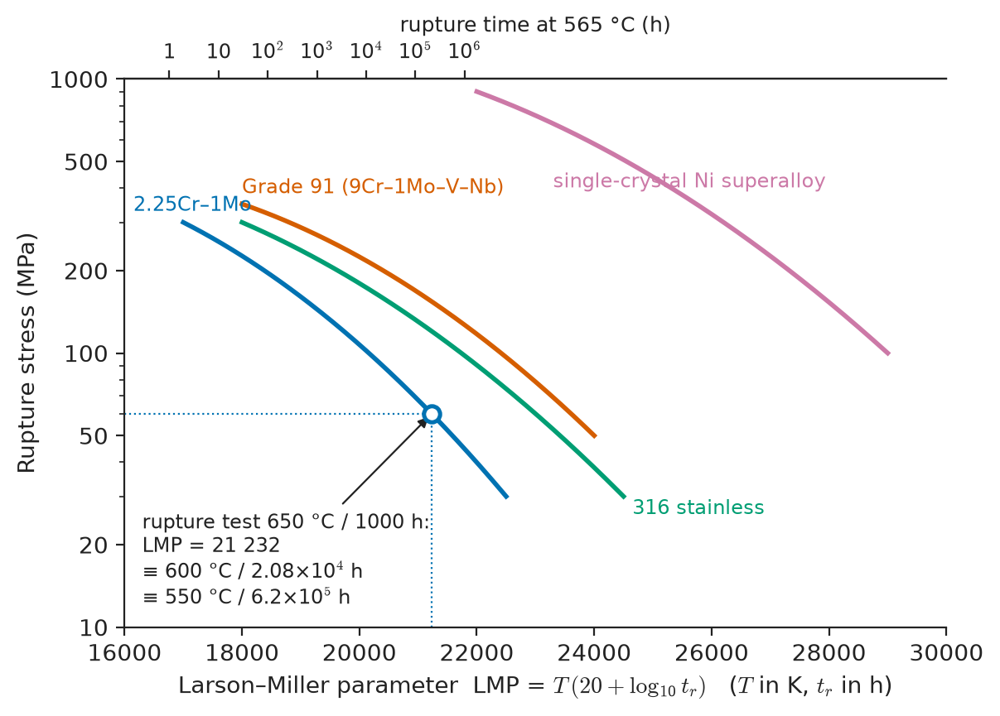
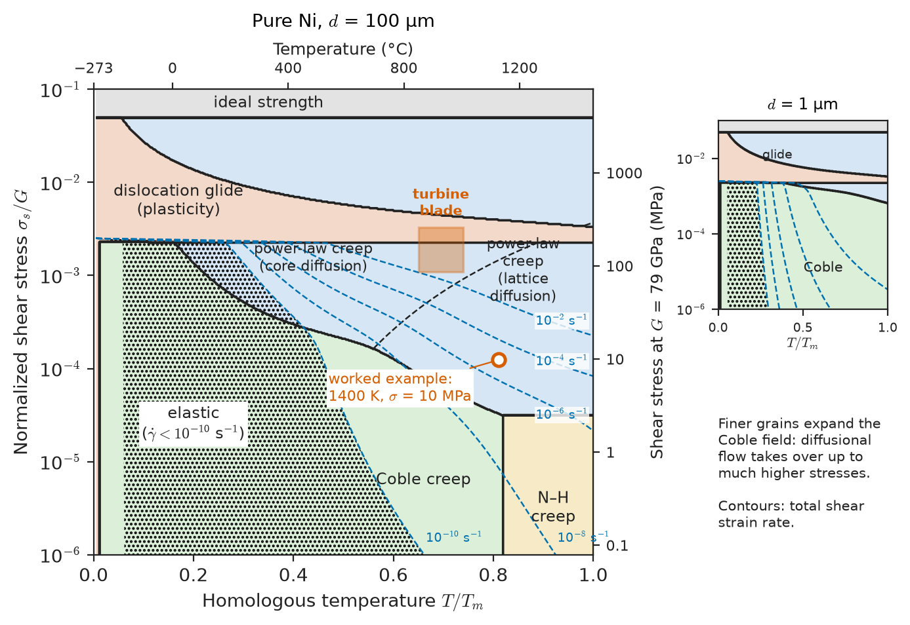
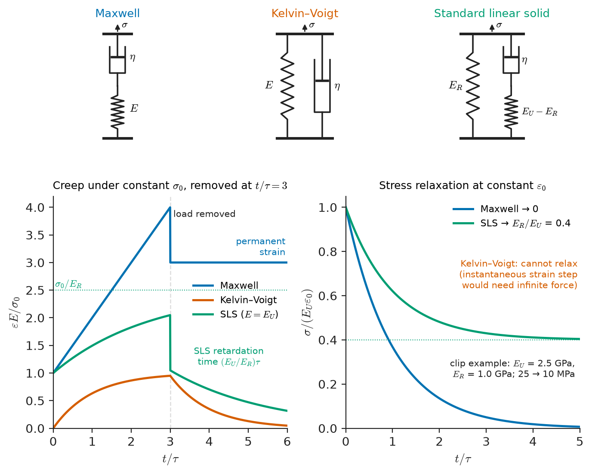
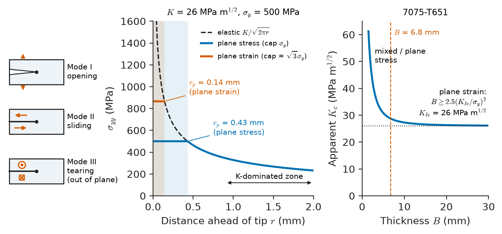
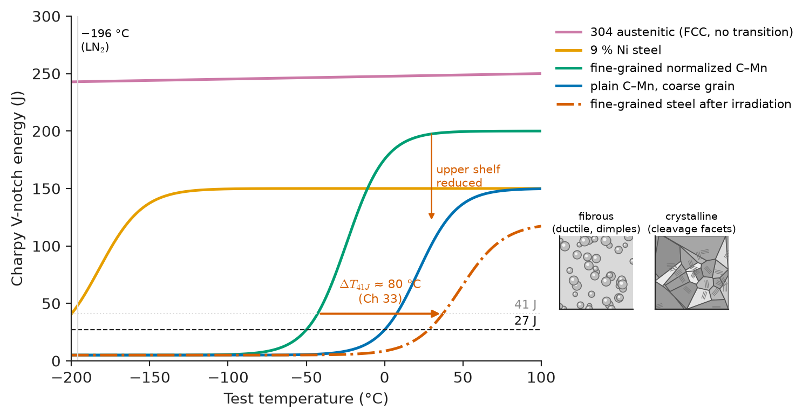
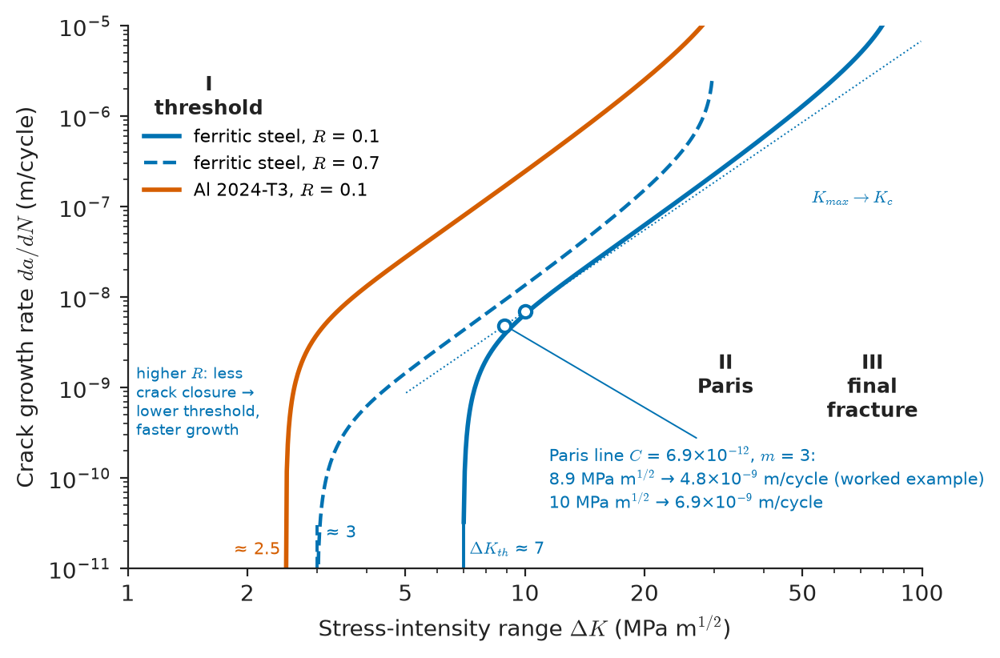

# Chapter 14 — Creep, Viscoelasticity and Fracture

*Part III · Mechanical Behaviour*

Three failures reach a materials laboratory in the same month. A steam header in a power plant, operated for twelve years at 565 °C and well below its yield strength, has bulged and cracked along a weld: it crept. A polyethylene gas-distribution fitting, clamped tightly at installation, is found leaking because the clamp force has drained away: it relaxed viscoelastically. And a forged steel crane hook has snapped in two at a stress the design said it could carry for ever: a fatigue crack had grown from a forging lap, cycle by cycle, until the remaining section was too small. None of these failures is explained by the yield strength of Chapter 13. Each involves time, temperature, or a crack — and in each case the material property that mattered was a rate or a toughness, not a strength.

This chapter treats the three ways a material fails when strength alone is not the right measure: time-dependent deformation at high homologous temperature (creep); time-dependent deformation of polymers at ordinary temperatures (viscoelasticity); and the growth of cracks, suddenly (fracture) or progressively (fatigue).

> **Why do metals and ceramics flow slowly at high temperature under stresses far below yield, and how can a 30-year life be predicted from a 3000-hour test?**
> **How large a crack can a structure tolerate, why do some steels shatter in winter, and how fast does a fatigue crack grow?**

| Concept | Engineering destination |
|---|---|
| Diffusional and dislocation creep | Turbine blades, steam pipework, solder joints, glacier and ice mechanics |
| Power-law creep, Larson–Miller | Design lives of boilers, reformer tubes, jet-engine discs |
| Deformation-mechanism maps | Choosing alloys and grain sizes for high-temperature service |
| Viscoelastic models, time–temperature superposition | Plastic pipes and clips, seals, bridge bearings, polymer composites |
| LEFM: Griffith, K, G | Aircraft damage tolerance, pressure vessels, glass and ceramic parts |
| J-integral and CTOD | Pipeline girth-weld assessment, nuclear vessel integrity |
| Ductile–brittle transition | Ship plates, bridges, cryogenic tanks, arctic pipelines |
| S–N, strain–life, Paris law | Shafts, springs, airframes, welded bridges, implants |
| Ceramic toughening and R-curves | Zirconia implants and dies, Si₃N₄ bearings, CMC turbine parts |
| Weibull statistics | Ceramic component design, glass panels, fibre strength |

**Roadmap.** Creep mechanisms (14.1) → power-law creep and life extrapolation (14.2) → deformation-mechanism maps (14.3) → viscoelasticity (14.4) → linear-elastic fracture mechanics (14.5) → elastic–plastic fracture (14.6) → the ductile–brittle transition (14.7) → fatigue (14.8) → toughening of ceramics (14.9) → Weibull statistics (14.10).

---

## 14.1 Creep mechanisms

### The creep curve and homologous temperature

**Creep** is time-dependent plastic deformation under constant load. A creep test holds a specimen at constant load (or stress) and temperature and records strain against time. After the instantaneous elastic (and possibly plastic) loading strain, the curve shows a decelerating **primary** stage, in which the material work-hardens; a **secondary** or **steady-state** stage, in which hardening and recovery balance and the rate is a minimum $\dot\varepsilon_{ss}$; and an accelerating **tertiary** stage ending in rupture, driven by cavitation on grain boundaries, necking, or microstructural degradation such as carbide coarsening.

The controlling variable is the **homologous temperature** $T/T_m$ in kelvin. Creep becomes important in metals above about $0.3$–$0.4\,T_m$ and in ceramics above about $0.4$–$0.5\,T_m$, because that is where diffusion becomes fast enough to let dislocations climb and atoms migrate. The threshold is a ratio, not a temperature: lead roofing ($T_m=600$ K) creeps at room temperature ($0.50\,T_m$); tin–silver–copper solder at 25 °C is at $0.61\,T_m$; ice at −10 °C is at $0.96\,T_m$, which is why glaciers flow; a nickel superalloy turbine blade at 1050 °C is at about $0.8\,T_m$; while tungsten ($T_m=3695$ K) at 1000 °C is only at $0.34\,T_m$.

### The mechanisms

Four distinct atomic mechanisms produce creep. Each has its own dependence on stress, grain size and temperature, and the one with the highest rate dominates.

**Nabarro–Herring creep (lattice diffusional creep).** In a polycrystal under stress, grain boundaries normal to a tensile stress are better sources of vacancies than boundaries parallel to it, because the stress lowers the energy to create a vacancy there by about $\sigma\Omega$ ($\Omega$ the atomic volume). Vacancies flow through the grain interiors from tensile to compressive boundaries, atoms flow the other way, and the grain elongates along the tensile axis. The rate is

$$
\dot\varepsilon_{\mathrm{NH}}=A_{\mathrm{NH}}\,\frac{D_L\,\sigma\,\Omega}{k_BT\,d^2}
$$

with $D_L$ the lattice self-diffusion coefficient, $d$ the grain size and $A_{\mathrm{NH}}\approx10$–$40$ depending on grain shape and boundary conditions.

**Coble creep (grain-boundary diffusional creep).** The same vacancy flux can travel along the grain boundaries, a slab of width $\delta\approx0.5$ nm with a much higher diffusivity $D_{gb}$ and a lower activation energy (Section 8.6). Because the cross-section of the path scales with $\delta d$ rather than $d^2$,

$$
\dot\varepsilon_{\mathrm{C}}=A_{\mathrm{C}}\,\frac{\delta D_{gb}\,\sigma\,\Omega}{k_BT\,d^3}
$$

Coble creep dominates at lower temperatures and finer grain sizes; both diffusional mechanisms are **Newtonian** (rate proportional to stress, $n=1$).

**Dislocation (power-law) creep.** At higher stresses, dislocations glide until blocked by obstacles and then climb around them by absorbing or emitting vacancies. Climb is diffusion-controlled, so the rate has the activation energy of lattice (or, at lower temperature, core) diffusion, but the dependence on stress is steep, $\dot\varepsilon\propto\sigma^n$ with $n=3$–$8$, because both the dislocation density and the climb velocity rise with stress. In particle-strengthened alloys, apparent exponents can reach 10–40, reflecting a threshold stress below which dislocations cannot detach from the particles.

**Grain-boundary sliding.** Grains slide past one another along their boundaries. Sliding must be accommodated by diffusion or dislocation motion near triple junctions, otherwise wedge cracks open. Sliding accompanies diffusional creep, is the mechanism of superplasticity (Section 13.9), and its cavitation is the main cause of intergranular creep rupture.

> **Status of the principle: Diffusional creep equations (Nabarro–Herring, Coble)**
> *Derived.* They follow from the stress dependence of vacancy concentration and Fick's first law over a grain; the prefactors depend on grain geometry, and the equations assume that boundaries are perfect sources and sinks, which fails at very low stresses (threshold stresses are observed) and in particle-pinned boundaries.

**Worked example — Which diffusional mechanism controls in nickel?** For pure nickel ($T_m=1728$ K) take $\Omega=1.09\times10^{-29}$ m³, $D_L=1.9\times10^{-4}\exp(-284\ \mathrm{kJ\,mol^{-1}}/RT)$ m²/s and $\delta D_{gb}=3.5\times10^{-15}\exp(-115\ \mathrm{kJ\,mol^{-1}}/RT)$ m³/s, and use $A_{\mathrm{NH}}=42$, $A_{\mathrm C}=42\pi$. Compare the rates at $\sigma=10$ MPa and $d=100$ μm at $T=1400$ K ($0.81\,T_m$).

$D_L=1.9\times10^{-4}\exp(-284\,000/(8.314\times1400))=1.9\times10^{-4}\times e^{-24.40}=4.75\times10^{-15}$ m²/s; $\delta D_{gb}=3.5\times10^{-15}\times e^{-9.88}=1.78\times10^{-19}$ m³/s.

$$
\dot\varepsilon_{\mathrm{NH}}=\frac{42\times10^7\times1.09\times10^{-29}\times4.75\times10^{-15}}{1.381\times10^{-23}\times1400\times10^{-8}}=1.1\times10^{-7}\ \mathrm{s^{-1}}
$$

$$
\dot\varepsilon_{\mathrm C}=\dot\varepsilon_{\mathrm{NH}}\times\frac{\pi\,\delta D_{gb}}{D_L\,d}=1.1\times10^{-7}\times\frac{\pi\times1.78\times10^{-19}}{4.75\times10^{-15}\times10^{-4}}=1.3\times10^{-7}\ \mathrm{s^{-1}}
$$

The two are nearly equal: the crossover grain size $d^*=\pi\delta D_{gb}/D_L$ is 117 μm at this temperature. At 1000 K ($0.58\,T_m$) the lower activation energy of boundary diffusion makes $d^*$ about 39 mm, so Coble creep dominates any practical grain size; at 1600 K, $d^*$ falls to 19 μm. (This compares only the two diffusional paths: at 10 MPa and 1400 K, the full map of Figure 14.2 shows power-law creep running faster still.) Both rates, about $10^{-7}$ s⁻¹, would accumulate 1 % strain in a day. This is why turbine blades are made with very coarse grains or none at all: directionally solidified blades eliminate transverse boundaries and single-crystal blades eliminate boundaries entirely, removing Coble creep and boundary cavitation together (Chapter 16).

---

## 14.2 Power-law creep and the Larson–Miller parameter

### The Norton–Arrhenius law

Over the stress range of most engineering service, steady-state creep follows

$$
\dot\varepsilon_{ss}=A\,\sigma^{n}\exp\!\left(-\frac{Q_c}{RT}\right)
$$

with $Q_c$ close to the activation energy for lattice self-diffusion at $T>0.5\,T_m$. Dimensionless forms normalize stress by the shear modulus, $\dot\varepsilon_{ss}=A'(D_L Gb/k_BT)(\sigma/G)^n$, which collapses data for different metals of the same crystal structure. At very high stresses ($\sigma/G>10^{-3}$) the power law breaks down into an exponential dependence, and a Garofalo form $\dot\varepsilon\propto[\sinh(\alpha\sigma)]^n$ covers both regimes.

> **Status of the principle: Power-law (Norton) creep**
> *Empirical.* Motivated by climb-controlled dislocation models but fitted: $A$, $n$ and $Q_c$ change with microstructure and regime, and extrapolation outside the tested stress and temperature window is unreliable when the mechanism changes.

**Table 14.1 — Creep parameters and design temperatures of high-temperature materials (typical).**

| Material | $T_m$ (K) | $n$ | $Q_c$ (kJ/mol) | Typical maximum service temperature | Application |
|---|---|---|---|---|---|
| Pure Al | 933 | 4.4 | 142 | — | Reference |
| Al alloy 2618 | ~910 | 5–20 | 140–200 | 150–200 °C | Pistons, Concorde skin |
| Carbon steel | ~1790 | 5–7 | 250–300 | 400–425 °C | Boiler drums |
| 2.25Cr–1Mo steel | ~1790 | 4–8 | 300–400 | 550–580 °C | Steam headers, hydrocrackers |
| Grade 91 (9Cr–1Mo–V–Nb) | ~1780 | 6–12 | 400–600 (apparent) | 600–620 °C | Ultra-supercritical boiler pipe |
| 316H stainless | ~1670 | 5–8 | 280–380 | 650–700 °C | Reactor internals, superheaters |
| Single-crystal Ni superalloy | ~1600 | 5–10 | 400–600 | 1050–1100 °C (metal) | Turbine blades |
| Polycrystalline alumina | 2345 | 1–2 (fine grain) | 400–600 | 1200–1400 °C | Furnace tubes |
| Ice | 273 | 3 | 60–80 | — | Glaciers, ice sheets |

**Worked example — Sensitivity of creep rate to temperature.** For a 2.25Cr–1Mo steam header with $Q_c=300$ kJ/mol, compare operation at 565 °C (838 K) with the design temperature 550 °C (823 K):

$$
\frac{\dot\varepsilon(838\ \mathrm K)}{\dot\varepsilon(823\ \mathrm K)}=\exp\!\left[\frac{300\,000}{8.314}\left(\frac{1}{823}-\frac{1}{838}\right)\right]=\exp(0.784)=2.19
$$

A 15 °C overtemperature more than doubles the creep rate and roughly halves the life. With $n=5$, a 10 % stress increase from wall thinning multiplies the rate by $1.1^5=1.61$. Steam temperature control and wall-thickness monitoring are therefore the two main creep-life management tools in power stations and refineries.

### Rupture life and the Monkman–Grant relation

Designers usually need time to rupture, $t_r$, rather than strain rate. For many alloys $\dot\varepsilon_{ss}\,t_r\approx C_{\mathrm{MG}}$, a constant of order 0.01–0.1 (the **Monkman–Grant relation**), so rupture life scales inversely with the minimum creep rate.

### The Larson–Miller parameter

Plant components are designed for 100 000 to 250 000 hours — 11 to 29 years — but laboratory tests last at most a few years, and typically a few thousand hours. Tests are therefore run at higher temperature (or stress) and extrapolated. The **Larson–Miller parameter** combines time and temperature:

$$
\mathrm{LMP}=T\,(C+\log_{10}t_r)
$$

with $T$ in kelvin, $t_r$ in hours and $C\approx20$ for steels and many other alloys. It follows from the Arrhenius form: if $t_r\propto\exp(Q/RT)$ at fixed stress, then $\log t_r=\log t_0+Q/(2.303RT)$, and $T(\log t_r-\log t_0)$ is a function of stress only. A plot of stress against LMP — a **master curve** — collapses rupture data at all temperatures (Figure 14.1).

> **Status of the principle: Larson–Miller parameter**
> *Empirical.* A time–temperature trade-off derived from a single Arrhenius activation energy that varies with stress; the constant $C$ is fitted, and extrapolation is unsafe if the long-term mechanism or microstructure (precipitate coarsening, sigma-phase formation) differs from that in the short tests.

<!-- FIGURE 14.1 | figures/ch14/fig-14-1-larson-miller.png | plot | Larson–Miller master curves of stress-rupture strength for 2.25Cr–1Mo steel, Grade 91 steel, 316 stainless steel and a single-crystal nickel superalloy. | Content: x-axis LMP = T(20 + log10 t_r), T in K, t_r in h, range 16 000–30 000 (secondary top axis showing rupture time at 565 °C); y-axis stress 10–1000 MPa (log). Curves: 2.25Cr–1Mo from ~300 MPa at LMP 17 000 down to ~30 MPa at 22 500; Grade 91 from ~350 MPa at 18 000 to ~50 MPa at 24 000; 316 stainless from ~300 MPa at 18 000 to ~30 MPa at 24 500; single-crystal superalloy from ~900 MPa at 22 000 to ~100 MPa at 29 000. Mark the worked example: a test point at 650 °C/1000 h (LMP 21 232) and the arrow to 600 °C / 20 800 h on the same curve. -->

*Figure 14.1 — Larson–Miller master curves of stress-rupture strength for 2.25Cr–1Mo steel, Grade 91 steel, 316 stainless steel and a single-crystal nickel superalloy.*

**Worked example — Extrapolating a rupture test.** A batch of 2.25Cr–1Mo pipe ruptures in 1000 h at 650 °C under the design stress. What life does the Larson–Miller parameter predict at 600 °C and at 550 °C under the same stress?

$\mathrm{LMP}=923.15\times(20+3)=21\,232$.

At 600 °C (873.15 K): $\log_{10}t_r=21\,232/873.15-20=4.317$, so $t_r=2.08\times10^4$ h (2.4 years).

At 550 °C (823.15 K): $\log_{10}t_r=21\,232/823.15-20=5.794$, so $t_r=6.2\times10^5$ h (71 years).

A 100 °C reduction buys a factor of 620 in life — but that prediction extrapolates 620-fold in time, during which the bainitic microstructure will coarsen in ways the 1000 h test never saw. Codes therefore limit extrapolation to roughly a factor of three to ten and require long-term data; remaining-life assessment of operating plant adds hardness measurements, surface replicas of cavitation and wall-thickness surveys.

---

## 14.3 Deformation-mechanism maps

A material at a given temperature, stress and grain size deforms by whichever mechanism is fastest. Ashby and Frost (1972–1982) built **deformation-mechanism maps** by evaluating the rate equation of each mechanism over the whole range of normalized stress $\sigma_s/G$ and homologous temperature $T/T_m$, and labelling each region by the dominant mechanism (Figure 14.2). Contours of constant strain rate are superimposed. The fields are:

- **Ideal shear strength** at $\sigma_s/G\approx0.05$–$0.1$, above which the perfect lattice fails.
- **Plasticity (dislocation glide)**: above the yield stress at low temperature, rate-insensitive.
- **Power-law creep**: intermediate stress at $T/T_m>0.3$–$0.4$, subdivided into low-temperature (core-diffusion-controlled) and high-temperature (lattice-diffusion-controlled) regions.
- **Diffusional flow**: low stress, high temperature, split into Coble (lower $T$) and Nabarro–Herring (higher $T$) fields.
- **Elastic**: below a chosen minimum strain rate, typically $10^{-10}$ s⁻¹, nothing significant happens.

<!-- FIGURE 14.2 | figures/ch14/fig-14-2-deformation-map.png | map | Deformation-mechanism map for pure nickel of grain size 100 μm, showing fields of plasticity, power-law creep, Coble and Nabarro–Herring diffusional creep, with strain-rate contours. | Content: x-axis homologous temperature T/Tm 0–1.0 (top axis temperature in °C from −273 to 1455); y-axis normalized shear stress σs/G from 1e-6 to 1e-1 (log), right axis shear stress in MPa at room-temperature G ≈ 79 GPa. Fields: "ideal strength" above ~5e-2; "dislocation glide" above ~2e-3 at low T; "power-law creep" between ~1e-4 and 2e-3 for T/Tm > 0.3 (dashed internal line splitting core- and lattice-diffusion-controlled); "Coble creep" at low stress for T/Tm 0.4–0.8; "Nabarro–Herring creep" at low stress above T/Tm ≈ 0.8 (boundary consistent with the 117 μm crossover at 1400 K); "elastic" region below 1e-10 s⁻¹ contour at low T. Strain-rate contours 1e-10, 1e-8, 1e-6, 1e-4, 1e-2 s⁻¹. Mark the worked-example point (T/Tm 0.81, σ = 10 MPa → σs/G ≈ 1e-4 taking σs ≈ σ/√3 at reduced G) and a shaded box labelled "turbine blade". Inset: a smaller map at d = 1 μm with the Coble field expanded. -->

*Figure 14.2 — Deformation-mechanism map for pure nickel of grain size 100 μm, showing fields of plasticity, power-law creep, Coble and Nabarro–Herring diffusional creep, with strain-rate contours.*

The maps make engineering conclusions visible at once. Finer grains enlarge the diffusional fields ($\dot\varepsilon\propto d^{-2}$ or $d^{-3}$), so materials that are excellent at room temperature can be poor at high temperature — a 1 μm-grained ceramic creeps faster than a 20 μm one. Solid-solution and precipitate strengthening push the power-law field to higher stress. Maps exist for metals, ceramics, ice and mantle rocks; each assumes a fixed microstructure.

> **Status of the principle: Deformation-mechanism maps**
> *Approximate.* They are only as good as the constitutive equations and diffusion data behind them and assume that mechanisms act independently and in parallel; boundaries are typically uncertain by a factor of two in stress or 5–10 % in $T/T_m$, but the topology is robust.

---

## 14.4 Viscoelasticity

### Why polymers need a different description

A polymer at room temperature is already in its own "creep regime", with the glass transition $T_g$ playing the role of $T_m$: polycarbonate ($T_g\approx150$ °C) at 23 °C is at $0.70\,T_g$ in kelvin, and polypropylene ($T_g\approx-10$ °C) is above its $T_g$. Its response mixes instantaneous elasticity (bond stretching), delayed recoverable elasticity (chain segments uncoiling) and irrecoverable viscous flow (chains sliding). This **viscoelasticity** governs polyethylene pipe designed for 50 years, clips that lose their grip, and rubber bridge bearings that must yield to slow thermal movement but resist sudden braking forces.

In **linear viscoelasticity**, stress and strain histories are related linearly: doubling the stress history doubles the strain history, and responses to successive loadings superpose (the **Boltzmann superposition principle**). This holds for most polymers below about 0.5–1 % strain.

### Spring-and-dashpot models

Linear viscoelasticity is represented by combinations of Hookean springs ($\sigma=E\varepsilon$) and Newtonian dashpots ($\sigma=\eta\dot\varepsilon$).

**The Maxwell model** — spring and dashpot in series. The strain rates add:

$$
\dot\varepsilon=\frac{\dot\sigma}{E}+\frac{\sigma}{\eta}
$$

Under a constant strain $\varepsilon_0$ imposed at $t=0$, the stress relaxes exponentially, $\sigma(t)=E\varepsilon_0\exp(-t/\tau)$, with **relaxation time** $\tau=\eta/E$. Under constant stress it creeps linearly without limit. It captures stress relaxation and flow but not recoverable creep.

**The Kelvin–Voigt model** — spring and dashpot in parallel. The stresses add:

$$
\sigma=E\varepsilon+\eta\dot\varepsilon
$$

Under constant stress it creeps toward $\sigma_0/E$ as $\varepsilon(t)=(\sigma_0/E)[1-\exp(-t/\tau)]$, with **retardation time** $\tau=\eta/E$, and recovers fully on unloading. It cannot relax stress at constant strain, because the dashpot would need infinite force to move instantly.

**The standard linear solid** (Zener model) — a spring in parallel with a Maxwell element — is the simplest model with instantaneous elasticity, bounded creep and relaxation to a finite stress (Figure 14.3). At constant strain it relaxes from the **unrelaxed modulus** $E_U$ to the **relaxed modulus** $E_R$:

$$
\sigma(t)=\varepsilon_0\left[E_R+(E_U-E_R)\,e^{-t/\tau}\right]
$$

> **Status of the principle: Spring–dashpot models of viscoelasticity**
> *Approximate.* Exact for the idealized mechanical analogues; real polymers have a broad spectrum of relaxation times, so a single Maxwell or Zener element fits only over about one decade of time, and none of them applies beyond the linear range (large strains, yielding, damage).

<!-- FIGURE 14.3 | figures/ch14/fig-14-3-viscoelastic-models.png | plot | Creep and stress-relaxation responses of the Maxwell, Kelvin–Voigt and standard linear solid models, with their spring–dashpot diagrams. | Content: top row: three small spring–dashpot schematics (Maxwell series, Kelvin–Voigt parallel, SLS spring parallel to Maxwell arm). Middle panel: creep under constant stress σ0 applied at t = 0 and removed at t/τ = 3; normalized strain ε E/σ0 vs t/τ from 0 to 6; Maxwell: jump to 1, linear rise, drop by 1 on unloading leaving permanent strain; Kelvin–Voigt: 1 − exp(−t/τ) rise, exponential recovery; SLS: jump to σ0/EU, approach σ0/ER, recovery. Bottom panel: stress relaxation at constant strain; σ/(EU ε0) vs t/τ 0–5; Maxwell decays to zero; SLS decays from 1 to ER/EU = 0.4 (match worked example: EU = 2.5 GPa, ER = 1.0 GPa); Kelvin–Voigt marked "cannot relax (instantaneous step impossible)". -->

*Figure 14.3 — Creep and stress-relaxation responses of the Maxwell, Kelvin–Voigt and standard linear solid models, with their spring–dashpot diagrams.*

**Worked example — Clamp force in a polymer clip.** A moulded polymer clip is pushed onto a pipe and held at a constant strain of 1 %. Its behaviour at 23 °C is represented by a standard linear solid with $E_U=2.5$ GPa, $E_R=1.0$ GPa and $\tau=1\times10^5$ s (about 28 h).

At $t=0$: $\sigma=0.01\times2500=25.0$ MPa.
After 1 hour: $\sigma=0.01\,[1000+1500\,e^{-0.036}]=24.5$ MPa.
After 1 day ($8.64\times10^4$ s): $\sigma=0.01\,[1000+1500\times e^{-0.864}]=0.01\times(1000+1500\times0.4215)=16.3$ MPa.
After a year: $\sigma\to0.01\times1000=10.0$ MPa.

The clip loses 60 % of its grip force within weeks. If it sits in a 60 °C engine compartment where, for this polymer, the relaxation time is shortened by a shift factor of $10^{-2}$ to $10^3$ s, the clamp force falls to 10.4 MPa within an hour. Designers specify the long-term (relaxed) modulus, not the datasheet tensile modulus, for snap fits, press fits, bolted polymer flanges and gaskets.

### Relaxation spectra

Real polymers relax over many decades of time because chain segments of many lengths relax at different rates. The **generalized Maxwell model** places many Maxwell elements in parallel, giving a relaxation modulus

$$
E(t)=E_\infty+\sum_{i=1}^{N}E_i\,e^{-t/\tau_i}
$$

a **Prony series**; its continuous limit defines the **relaxation spectrum** $H(\tau)$. Under sinusoidal loading at angular frequency $\omega$ the same material shows a **storage modulus** $E'(\omega)$ (in phase) and a **loss modulus** $E''(\omega)$ (out of phase), with loss tangent $\tan\delta=E''/E'$. For a single Maxwell element, $E'=E\omega^2\tau^2/(1+\omega^2\tau^2)$ and $E''=E\omega\tau/(1+\omega^2\tau^2)$, so the loss peaks at $\omega\tau=1$. Dynamic mechanical analysis (Chapter 52) measures these against temperature and frequency; the loss peak defines $T_g$, and vibration-damping materials (constrained layers on car floor pans, viscoelastic dampers in tall buildings) are chosen to have their loss peak at the service temperature and frequency.

### Time–temperature superposition

Raising the temperature speeds up all relaxation processes in an amorphous polymer by the same factor $a_T$. A relaxation curve measured at temperature $T$ can therefore be shifted along the log-time axis onto the curve at a reference temperature $T_r$:

$$
E(t,T)=E\!\left(\frac{t}{a_T},T_r\right)
$$

Short tests at several temperatures, each covering two or three decades of time, are shifted to build a **master curve** spanning ten or fifteen decades at the reference temperature. Above $T_g$ the shift factor follows the **Williams–Landel–Ferry (WLF)** equation,

$$
\log_{10}a_T=\frac{-C_1\,(T-T_r)}{C_2+(T-T_r)}
$$

with "universal" constants $C_1=17.44$ and $C_2=51.6$ K when $T_r=T_g$; Chapter 20 derives it from free-volume theory. Below $T_g$, and for semicrystalline polymers, an Arrhenius shift is more appropriate.

> **Status of the principle: Time–temperature superposition and the WLF equation**
> *Empirical.* Superposition holds for thermorheologically simple polymers (one dominant relaxation mechanism, no structural change with temperature) and the WLF constants are fitted; it fails across $T_g$ for physically ageing glasses, for multiphase blends and for semicrystalline polymers near their melting range.

For polystyrene with $T_g=100$ °C, the WLF equation gives $\log a_T=-17.44\times10/61.6=-2.83$ at 110 °C: every relaxation is 680 times faster than at $T_g$. At $T_g+30$ K it is $2.6\times10^6$ times faster. This steepness is why thermoforming and the annealing of moulded-in stress are done within a few tens of degrees above $T_g$, and why a polymer's long-term behaviour at service temperature can be inferred from tests of a few hours at elevated temperature — the basis of the hydrostatic design basis of plastic pressure pipe (Chapter 21).

---

## 14.5 Linear-elastic fracture mechanics

### Griffith's energy balance

The theoretical cleavage strength of a solid is about $E/10$, but glass rods break at $E/1000$ and large steel structures have failed at a fraction of their yield strength. Griffith (1921) explained the discrepancy for glass: real solids contain cracks, and a crack grows if the elastic energy released by its extension exceeds the energy needed to create new surface. For a through-crack of length $2a$ in a large plate of unit thickness under remote stress $\sigma$, the released strain energy is $\pi\sigma^2a^2/E$ and the surface energy is $4a\gamma_s$. The energy passes through a maximum at

$$
\sigma_f=\sqrt{\frac{2E\gamma_s}{\pi a}}
$$

For glass ($E=70$ GPa, $\gamma_s\approx0.5$ J/m²) with a 2 μm surface crack ($a=2$ μm), $\sigma_f=\sqrt{2\times70\times10^9\times0.5/(\pi\times2\times10^{-6})}=106$ MPa, close to the strength of ordinary window glass.

> **Status of the principle: Griffith criterion**
> *Derived.* Exact for an ideally brittle linear-elastic solid with a sharp crack, from energy conservation; for real materials $2\gamma_s$ must be replaced by the measured fracture energy, which includes plastic and other dissipative work.

### Irwin's modification and the energy release rate

For metals Griffith's prediction is low by orders of magnitude, because a plastic zone forms at the crack tip and absorbs far more energy than the surface creation. Irwin and Orowan (1948–1957) replaced $2\gamma_s$ by a **fracture energy** $G_c$ including plastic work, and defined the **energy release rate** $G=-\partial\Pi/\partial A$, the potential energy released per unit area of crack extension. Fracture occurs when

$$
G=G_c
$$

For the Griffith crack, $G=\pi\sigma^2a/E'$, with $E'=E$ in plane stress and $E'=E/(1-\nu^2)$ in plane strain.

### Crack-tip fields and the stress intensity factor

Irwin also showed that the stress field near any crack tip in a linear-elastic body has a universal form. In polar coordinates $(r,\theta)$ centred on the tip,

$$
\sigma_{ij}=\frac{K}{\sqrt{2\pi r}}\,f_{ij}(\theta)+\text{(terms finite at }r\to0)
$$

The $r^{-1/2}$ singularity is the same for every geometry and load; only the amplitude $K$, the **stress intensity factor**, depends on them. There are three loading modes: **mode I** (opening, tensile stress normal to the crack plane), **mode II** (in-plane sliding) and **mode III** (out-of-plane tearing), each with its own $K$. For mode I,

$$
K_I=Y\sigma\sqrt{\pi a}
$$

with $Y$ a geometry factor (1.0 for a central crack of length $2a$ in an infinite plate, 1.12 for a shallow edge crack of depth $a$, about 0.64–0.73 for a semicircular surface crack at its deepest point). $K$ and $G$ are related, for mode I, by

$$
G=\frac{K_I^2}{E'}
$$

so the stress and energy criteria are equivalent: fracture occurs when $K_I$ reaches the **fracture toughness** $K_{Ic}$, a material property in MPa m$^{1/2}$.

> **Status of the principle: LEFM fracture criterion $K_I=K_{Ic}$**
> *Derived.* Follows from linear elasticity of a sharp crack and the equivalence $G=K^2/E'$; valid only under small-scale yielding, when the plastic zone is small compared with the crack length, the ligament and the thickness.

### The plastic zone and plane strain

Close to the tip the elastic stresses exceed the yield strength. Setting $\sigma_{yy}=\sigma_y$ on the crack plane gives the (uncorrected) plastic-zone size

$$
r_p=\frac{1}{2\pi}\left(\frac{K_I}{\sigma_y}\right)^2\ \text{(plane stress)},\qquad r_p\approx\frac{1}{6\pi}\left(\frac{K_I}{\sigma_y}\right)^2\ \text{(plane strain)}
$$

In a thick section the surrounding elastic material constrains the tip, a triaxial stress develops and the zone is small: **plane strain**. In a thin sheet the through-thickness stress relaxes, the zone is larger and the apparent toughness $K_c$ is higher (Figure 14.4). The lowest, geometry-independent value is the **plane-strain fracture toughness** $K_{Ic}$, which is valid (ASTM E399) when the thickness $B$ and crack length satisfy

$$
B,\ a\ \ge\ 2.5\left(\frac{K_{Ic}}{\sigma_y}\right)^2
$$

<!-- FIGURE 14.4 | figures/ch14/fig-14-4-crack-tip-field.png | schematic | Crack-tip stress field: the three loading modes, the K-dominated elastic singularity and the plastic zone, and the variation of apparent fracture toughness with specimen thickness. | Content: left: three small blocks showing mode I (opening), mode II (sliding), mode III (tearing) displacements. Centre: plot of σyy versus distance r ahead of the tip (0–2 mm) for K = 26 MPa·m^1/2: elastic curve K/√(2πr) (dashed), truncated at σy = 500 MPa with plastic zone of size rp = 0.43 mm (plane stress) and 0.14 mm (plane strain) marked; label "K-dominated zone" further out. Right: apparent toughness Kc versus thickness B (0–30 mm) for 7075-T651: high (~50 MPa·m^1/2) at 2 mm falling to a plateau 26 MPa·m^1/2 beyond B = 6.8 mm; label "plane strain: B ≥ 2.5 (K/σy)²". -->

*Figure 14.4 — Crack-tip stress field: the three loading modes, the K-dominated elastic singularity and the plastic zone, and the variation of apparent fracture toughness with specimen thickness.*

**Table 14.2 — Fracture toughness of engineering materials (room temperature, typical).**

| Material | $K_{Ic}$ (MPa m$^{1/2}$) | $\sigma_y$ or $\sigma_f$ (MPa) | Note |
|---|---|---|---|
| Soda-lime glass | 0.7–0.8 | 50–100 (σf) | Window and container glass |
| Single-crystal silicon | 0.8–1.0 | — | Wafers, MEMS |
| Concrete (normal strength) | 0.2–1.4 | 2–5 (tensile) | Size-dependent |
| Epoxy | 0.5–1.0 | 60–90 | Composite matrices |
| PMMA | 1.0–1.5 | 60–75 | Glazing |
| Alumina | 3–5 | 300–400 (σf) | Insulators, wear parts |
| Silicon carbide | 3–4.5 | 400–550 (σf) | Seals, armour |
| Silicon nitride | 5–8 | 700–1000 (σf) | Bearings, turbocharger rotors |
| 3Y-TZP zirconia | 6–10 | 900–1200 (σf) | Dental crowns, femoral heads |
| Al 7075-T651 | 24–29 | 500 | Wing structure |
| Al 2024-T351 | 32–37 | 325 | Fuselage skin (damage tolerant) |
| Ti–6Al–4V, mill annealed | 55–75 | 880 | Airframe, implants |
| AISI 4340, tempered 200 °C | 45–55 | 1600 | High strength, low toughness |
| Pressure-vessel steel A533B (upper shelf) | 150–200+ | 480 | Reactor vessels (EPFM needed) |
| Austenitic stainless steel | >200 | 250 | Cryogenic vessels |

**Worked example — Critical crack in an aircraft wing plate.** A 7075-T651 aluminium plate in a wing stringer ($K_{Ic}=26$ MPa m$^{1/2}$, $\sigma_y=500$ MPa, $E=71$ GPa, $\nu=0.33$) carries a limit tensile stress of 200 MPa. What edge-crack depth will cause fracture, and does LEFM apply?

Critical depth with $Y=1.12$:

$$
a_c=\frac1\pi\left(\frac{K_{Ic}}{Y\sigma}\right)^2=\frac1\pi\left(\frac{26}{1.12\times200}\right)^2=\frac{(0.1161)^2}{\pi}=4.3\times10^{-3}\ \mathrm m
$$

A crack 4.3 mm deep is critical. Validity: $2.5(K_{Ic}/\sigma_y)^2=2.5\times(0.052)^2=6.8\times10^{-3}$ m, so plates thicker than about 7 mm are in plane strain. The plane-strain plastic zone at fracture is $(1/6\pi)(0.052)^2=0.14$ mm, small compared with the 4.3 mm crack, so LEFM is valid. The critical energy release rate is $G_{Ic}=K_{Ic}^2(1-\nu^2)/E=(26\times10^6)^2\times0.891/71\times10^9=8.5$ kJ/m², several thousand times the $2\gamma_s\approx2$ J/m² of a bare aluminium surface — the plastic work Griffith's original analysis missed. This millimetre-scale critical crack is why airframes are designed on **damage tolerance** principles: inspection intervals are chosen so that a crack below the detectable size (about 1–2 mm by eddy current) cannot grow to $a_c$ before the next inspection (Section 14.8). It is also why the lower wing skin is usually the tougher 2024 or 2x24 alloy, while 7075 is used in the compression-loaded upper skin.

---

## 14.6 Elastic–plastic fracture: the J-integral and CTOD

### When LEFM fails

For tough steels, the plastic zone at fracture can be comparable with the crack or the section. A pressure-vessel steel with $K\approx200$ MPa m$^{1/2}$ and $\sigma_y=480$ MPa would need specimens $2.5\times(200/480)^2=0.43$ m thick for a valid $K_{Ic}$ test. Elastic–plastic fracture mechanics (EPFM) provides parameters that remain meaningful when the plasticity is extensive.

### The J-integral

Rice (1968) defined a contour integral around the crack tip,

$$
J=\int_\Gamma\left(W\,dy-T_i\frac{\partial u_i}{\partial x}\,ds\right)
$$

with $W$ the strain energy density, $T_i$ the traction on the contour and $u_i$ the displacement. For a nonlinear elastic material (and for a plastic material under monotonic, proportional loading, which behaves like one) $J$ is **path independent**, so it can be evaluated far from the tip where stresses are easy to compute. It equals the energy release rate in the nonlinear elastic body, and reduces to $J=G=K^2/E'$ in the linear-elastic limit. Hutchinson, Rice and Rosengren (HRR) showed that $J$ also characterizes the amplitude of the crack-tip stress and strain fields in a power-law hardening material, just as $K$ does for a linear-elastic one. Fracture initiates at $J=J_{Ic}$, which can be measured on specimens a factor of 20–50 smaller than those required for $K_{Ic}$.

> **Status of the principle: J-integral as a fracture parameter**
> *Derived.* Path independence follows rigorously for nonlinear elasticity (deformation plasticity); for real elastic–plastic materials it is valid under monotonic loading with limited crack growth, and fails under unloading or large amounts of stable crack extension, where J-resistance curves and constraint corrections are used.

### Crack-tip opening displacement

Wells (1961), working on welded steel structures, proposed that a crack in a ductile material grows when the opening of its blunted tip, the **crack-tip opening displacement** $\delta$ (CTOD), reaches a critical value. In small-scale yielding,

$$
\delta=\frac{K_I^2}{m\,\sigma_y\,E'}=\frac{J}{m\,\sigma_y}
$$

with $m\approx1$ in plane stress and about 2 in plane strain. CTOD is the dominant parameter in welding and offshore codes because it can be measured on full-thickness weld specimens.

**Worked example — From K to J and CTOD.** A girth weld in an offshore X65 pipeline ($\sigma_y=450$ MPa, $E=207$ GPa, $\nu=0.3$) sees an applied $K_I$ of 150 MPa m$^{1/2}$ at a flaw. In plane strain,

$$
J=\frac{K^2(1-\nu^2)}{E}=\frac{(150\times10^6)^2\times0.91}{207\times10^9}=9.9\times10^4\ \mathrm{J/m^2}\approx99\ \mathrm{kJ/m^2}
$$

$$
\delta=\frac{J}{2\sigma_y}=\frac{9.9\times10^4}{2\times450\times10^6}=1.1\times10^{-4}\ \mathrm m=0.11\ \mathrm{mm}
$$

A specified minimum weld-metal CTOD of 0.10–0.25 mm at the design temperature is typical of pipeline codes, so this flaw is close to the limit. In a real **engineering critical assessment** (ECA, using BS 7910 or API 579), the applied CTOD or $J$ is computed with plasticity corrections and residual stresses, and plotted on a **failure assessment diagram** that interpolates between fracture (toughness-controlled) and plastic collapse (strength-controlled). ECAs set the acceptable flaw sizes for automated ultrasonic inspection of pipeline welds, and for the remaining-life assessment of nuclear pressure vessels.

### Resistance curves in ductile materials

Ductile metals do not fracture at a single $J$: a crack grows stably by void nucleation, growth and coalescence (Chapter 44), and its resistance rises with extension $\Delta a$ along a **J–R curve**. Instability occurs when the applied $J$ rises faster with $\Delta a$ than the resistance — the tearing criterion behind leak-before-break arguments for piping.

---

## 14.7 The ductile–brittle transition

### The phenomenon

In January 1943 the T-2 tanker *Schenectady*, lying at her fitting-out dock in calm water at about −3 °C, broke in two with a noise heard a mile away. Of the roughly 2700 welded Liberty ships built in the Second World War, several hundred suffered serious brittle fractures, a dozen or so broke completely. The steels were ductile in a room-temperature tensile test. They were brittle at the service temperature.

BCC metals — ferritic and martensitic steels, molybdenum, tungsten, chromium — and many HCP metals show a **ductile–brittle transition** (Figure 14.5). Measured by the absorbed energy in a notched-bar impact (Charpy) test, the behaviour changes over a temperature range of 30–80 °C from a high **upper shelf** (ductile tearing, fibrous fracture surface) to a low **lower shelf** (cleavage, crystalline fracture surface). The **ductile-to-brittle transition temperature** (DBTT) is defined conventionally at an energy level (27 J or 40 J for structural steels), at 50 % shear fracture appearance, or by a lateral expansion criterion. FCC metals — austenitic stainless steels, aluminium, copper, nickel — show no transition and remain tough down to liquid-helium temperature, which is why they are used for LNG tanks (9 % Ni ferritic steels being the notable exception, made tough by fine grains and retained austenite) and cryogenic propellant tanks.

<!-- FIGURE 14.5 | figures/ch14/fig-14-5-charpy-transition.png | plot | Charpy V-notch impact energy versus temperature for a low-carbon structural steel, a fine-grained normalized steel, the same steel after irradiation, a 9 % Ni steel and an austenitic stainless steel. | Content: x-axis temperature −200 to +100 °C; y-axis Charpy energy 0–300 J. Curves (tanh shape): plain C–Mn steel, coarse grain (lower shelf ~5 J, upper shelf ~150 J, 27 J transition at ~0 °C); fine-grained normalized steel (upper shelf 200 J, 27 J at ~ −50 °C); irradiated pressure-vessel steel shifted +80 °C with upper shelf reduced to ~120 J (arrow "ΔT41J shift, Ch 41"); 9 % Ni steel (27 J at below −196 °C, high shelf ~150 J); 304 austenitic (flat ~250 J, no transition). Horizontal dashed line at 27 J. Insets: fibrous (ductile) and crystalline (cleavage) fracture surface sketches. -->

*Figure 14.5 — Charpy V-notch impact energy versus temperature for a low-carbon structural steel, a fine-grained normalized steel, the same steel after irradiation, a 9 % Ni steel and an austenitic stainless steel.*

### The physical origin

The transition is a competition between yielding and cleavage. The yield strength of BCC metals rises steeply on cooling because the Peierls stress for screw dislocations is thermally activated (Section 12.8), whereas the **cleavage fracture stress** $\sigma_f$ — the local stress needed to propagate a microcrack nucleated at a cracked carbide or a dislocation pile-up across a grain — is almost independent of temperature. At a notch tip, plastic constraint raises the maximum tensile stress to about $2.5$–$3\,\sigma_y$. At high temperature the material yields and blunts before this reaches $\sigma_f$; below a critical temperature, constraint brings the local stress to $\sigma_f$ first and the steel cleaves (the Yoffe or Davidenkov diagram). FCC metals lack the steep temperature dependence of yield, and their dislocations remain mobile.

Anything that raises $\sigma_y$ relative to $\sigma_f$, or raises constraint, raises the DBTT: higher strain rate (impact), thicker sections, sharper notches, higher carbon and phosphorus, coarse grains, neutron irradiation (which raises $\sigma_y$ by forming defect clusters, shifting the DBTT of reactor-vessel steels by tens to over 100 °C, Chapter 41) and temper embrittlement (phosphorus segregation to grain boundaries, Chapter 15). Grain refinement is the one strengthening mechanism that *lowers* it, because $\sigma_f$ scales with $d^{-1/2}$ more strongly than $\sigma_y$ does; the Cottrell–Petch analysis gives the DBTT falling roughly linearly with $\ln d^{-1/2}$. Nickel also lowers the DBTT by easing cross-slip of screw dislocations.

> **Status of the principle: Yield–cleavage competition for the DBTT**
> *Approximate.* A qualitative to semi-quantitative model; it correctly predicts the effects of strain rate, constraint, grain size and irradiation, but the DBTT itself depends on the test (Charpy energy level, specimen size), and transfer from Charpy to structural fracture needs empirical correlations such as the master-curve method (ASTM E1921).

### Engineering control

The lessons of the Liberty ships and later bridge and offshore failures are written into today's specifications. Structural and ship steels are graded by guaranteed Charpy energy at a test temperature (for example S355J2: 27 J at −20 °C; S355ML: 27 J at −50 °C; ship grade EH36: 34 J at −40 °C); welding procedures are qualified for HAZ and weld-metal toughness (Chapter 47); reactor-vessel steels are monitored by surveillance capsules. Polymers have their own analogue: below $T_g$, or at high rates, PVC, PMMA and polystyrene fail in a brittle manner, and impact-modified grades (ABS, high-impact polystyrene, rubber-toughened nylon) contain dispersed rubber particles that cavitate and promote shear yielding (Chapter 21).

---

## 14.8 Fatigue

### Stress-based approach: S–N curves

**Fatigue** is failure under cyclic loading at stresses well below the static strength, by the initiation and growth of a crack. It is the most common mechanical failure in service, in axles, springs, welded bridge details, wing attachments, offshore nodes, hip stems and wind-turbine blades.

The classical data are **S–N curves** of stress amplitude $\sigma_a$ against cycles to failure $N_f$, obtained on smooth specimens. In the high-cycle regime (nominally elastic, $N_f>10^4$) they follow **Basquin's law**

$$
\sigma_a=\sigma_f'\,(2N_f)^{b}
$$

with $b\approx-0.05$ to $-0.12$. Many steels and titanium alloys show an apparent **fatigue (endurance) limit** at about $10^6$–$10^7$ cycles, typically 0.4–0.5 of the UTS for steels below about 1400 MPa UTS; aluminium, copper and magnesium alloys show none. Even steels can fail beyond $10^7$ cycles from internal inclusions ("very-high-cycle" or gigacycle fatigue), which matters for rail wheels, bearing races and high-frequency components.

> **Status of the principle: Basquin relation and the endurance limit**
> *Empirical.* Power-law fits to smooth-specimen data; they do not include mean stress, notch, size, surface or environment effects, which must be applied as corrections, and the "infinite life" endurance limit disappears in corrosive environments and in the gigacycle regime.

The corrections are substantial. A tensile **mean stress** shortens life (Goodman line $\sigma_a/\sigma_{e}+\sigma_m/\sigma_u=1$, or the less conservative Gerber parabola). A **notch** reduces fatigue strength by $K_f$, smaller than the elastic $K_t$ because of local yielding and the stress gradient. Compressive surface residual stress from shot peening or thread rolling lengthens life greatly; seawater can halve the fatigue strength of steel. **Variable-amplitude** loading is handled by rainflow counting and the Palmgren–Miner sum $D=\sum n_i/N_i$.

### Strain-based approach: strain–life

When cyclic loads produce plastic strain at a notch root, strain, not stress, controls life. The total strain amplitude is the sum of elastic (Basquin) and plastic (**Coffin–Manson**) parts:

$$
\frac{\Delta\varepsilon}{2}=\frac{\sigma_f'}{E}(2N_f)^{b}+\varepsilon_f'(2N_f)^{c}
$$

with fatigue ductility coefficient $\varepsilon_f'$ and exponent $c\approx-0.5$ to $-0.7$. Plastic strain dominates at short lives and elastic strain at long lives; the two lines cross at the **transition life** $2N_t$, which is short (hundreds of cycles) for high-strength steels and long (tens of thousands) for ductile, soft metals. Hence a strong material is better for high-cycle fatigue and a ductile one for low-cycle fatigue. Combined with Neuber's rule for local notch strains and a cyclic stress–strain curve (which shows cyclic hardening of annealed metals and cyclic softening of cold-worked ones), the strain–life method is the standard for automotive suspension parts, turbine discs, pressure-vessel nozzles and the thermal fatigue of solder joints and exhaust manifolds.

> **Status of the principle: Strain–life (Coffin–Manson–Basquin) relation**
> *Empirical.* A sum of two power-law fits that describes uniaxial low- and high-cycle fatigue of metals well; constants depend on temperature, frequency and environment, and multiaxial, non-proportional and creep–fatigue loading need extensions.

### Damage tolerance: the Paris law

The S–N and strain–life approaches treat life as crack-free until failure. Large welded and aircraft structures cannot assume this: welds and forgings contain defects from the start. The **damage-tolerance** approach assumes a crack of the largest size that inspection could miss and calculates how long it takes to grow to critical size. The driving force is the stress-intensity range $\Delta K=Y\Delta\sigma\sqrt{\pi a}$. Fatigue crack growth data (Figure 14.6) show three regimes: a **threshold** $\Delta K_{th}$ (typically 2–8 MPa m$^{1/2}$ for steels, 1–3 for Al alloys) below which cracks do not grow measurably; a **Paris regime** of power-law growth,

$$
\frac{da}{dN}=C\,(\Delta K)^m
$$

with $m\approx2$–$4$ for metals; and a final regime of accelerating growth as $K_{\max}$ approaches $K_c$.

> **Status of the principle: Paris law**
> *Empirical.* A power-law fit to stable fatigue crack growth in the intermediate $\Delta K$ regime; it does not describe the threshold or final-fracture regimes, short cracks, or load-sequence (overload retardation) effects without modification.

<!-- FIGURE 14.6 | figures/ch14/fig-14-6-paris-law.png | plot | Fatigue crack growth rate versus stress-intensity range showing threshold, Paris and final-fracture regimes for a ferritic steel and an aluminium alloy, with the effect of load ratio. | Content: log-log axes; x-axis ΔK 1–100 MPa·m^1/2; y-axis da/dN 1e-11 to 1e-5 m/cycle. Ferritic steel R = 0.1: threshold ~7 MPa·m^1/2, Paris line C = 6.9e-12, m = 3 (passing through 4.8e-9 m/cycle at ΔK = 8.9 — worked-example start point — and 6.9e-9 at 10 MPa·m^1/2), rising steeply near Kc ~100. Aluminium 2024-T3 R = 0.1: threshold ~2.5, Paris line about 30× faster than steel at equal ΔK, final fracture near 35. Dashed curves for steel at R = 0.7 showing lower threshold (~3) and slightly higher rates (crack closure effect). Label regimes I (threshold), II (Paris), III (final fracture). -->

*Figure 14.6 — Fatigue crack growth rate versus stress-intensity range showing threshold, Paris and final-fracture regimes for a ferritic steel and an aluminium alloy, with the effect of load ratio.*

**Worked example — Fatigue life of a cracked crane hook.** A steel crane component contains a surface-breaking forging lap that behaves as an edge crack of initial depth $a_0=2$ mm. It sees a stress range $\Delta\sigma=100$ MPa (zero to 100 MPa) at every lift. Take $Y=1.12$ (assumed constant), $C=6.9\times10^{-12}$ m/cycle with $\Delta K$ in MPa m$^{1/2}$, and $m=3$, typical for ferritic steel. Inspection rules require repair before the crack reaches 20 mm. How many lifts does that take?

Initial $\Delta K=1.12\times100\times\sqrt{\pi\times0.002}=8.9$ MPa m$^{1/2}$, just above threshold; initial growth rate $6.9\times10^{-12}\times8.9^3=4.8\times10^{-9}$ m/cycle. Integrating the Paris law with $m=3$,

$$
N=\int_{a_0}^{a_f}\frac{da}{C(Y\Delta\sigma\sqrt{\pi a})^{3}}=\frac{2}{C\,(Y\Delta\sigma\sqrt\pi)^{3}}\left(\frac{1}{\sqrt{a_0}}-\frac{1}{\sqrt{a_f}}\right)
$$

$Y\Delta\sigma\sqrt\pi=1.12\times100\times1.7725=198.5$; cubed, $7.82\times10^6$. With $a_0=0.002$ m and $a_f=0.020$ m, $1/\sqrt{a_0}-1/\sqrt{a_f}=22.36-7.07=15.29$ m$^{-1/2}$:

$$
N=\frac{2\times15.29}{6.9\times10^{-12}\times7.82\times10^6}=5.7\times10^5\ \text{cycles}
$$

At 200 lifts a day, the crack grows from 2 to 20 mm in about eight years. Reducing $\Delta\sigma$ to 80 MPa raises the life by $(100/80)^3=1.95$, to $1.1\times10^6$ cycles. Two points stand out. Most of the life is spent while the crack is small (half of the integral comes from the first few millimetres), so initial flaw size, set by manufacturing quality and inspection sensitivity, is decisive. And because the hook is steel with a high $K_c$, final fracture would occur only at a crack of more than 200 mm at this stress — so the safe-life limit comes from the inspection rule, not from fracture.

### Crack closure

Elber (1970) observed that fatigue cracks close before the load reaches its minimum: plastically stretched wake material, oxide debris and rough fracture surfaces prop the faces apart. Only the open part of the cycle drives growth, so $\Delta K_{\mathrm{eff}}=K_{\max}-K_{\mathrm{op}}=U\Delta K$, with $U\approx0.5$–$0.8$ at low load ratios. **Crack closure** explains why growth rates rise with load ratio $R=K_{\min}/K_{\max}$, why a tensile overload retards later growth, why short cracks (no closure wake yet) grow faster than long ones at equal $\Delta K$, and why rough, coarse-grained fracture paths raise the threshold. Aircraft spectrum codes include closure-based retardation models.

### Fatigue in practice

At a weld toe — a sharp notch with tensile residual stress and pre-existing flaws — fatigue strength is almost independent of parent-steel strength, so codes (Eurocode 3, BS 7608, IIW) assign fixed S–N curves by detail category, and high-strength steel helps only with toe grinding or peening. Coronary stents, which see about $4\times10^7$ heartbeat cycles a year, are designed with Goodman-type margins (Chapter 39).

---

## 14.9 Toughening of ceramics

### Intrinsic and extrinsic toughening

A ceramic's toughness has two components. **Intrinsic** toughness is the resistance of the material ahead of the crack tip to bond rupture; for ionic and covalent solids without dislocation plasticity it is low, $K_0\approx1$–$3$ MPa m$^{1/2}$, and difficult to change. **Extrinsic** toughening comes from mechanisms that act behind or around the crack tip to reduce the local driving force, **shielding** the tip. Shielding builds up as the crack grows, giving a rising **resistance curve** (**R-curve**): $K_R$ increases with crack extension $\Delta a$ until the shielding zone is fully developed.

### Transformation toughening

Zirconia doped with yttria (3Y-TZP) or magnesia (Mg-PSZ) can be retained at room temperature in the **tetragonal** phase, metastable with respect to monoclinic (Chapter 17). The high tensile stress ahead of a crack tip triggers the martensitic t→m transformation, which carries a volume expansion of about 4 % and a shear. A **transformation zone** of height $h$ forms along the crack flanks, and the dilatant particles compress the crack tip. The shielding is approximately

$$
\Delta K_{\mathrm{tr}}\approx\frac{0.22\,E\,e^T\,V_f\sqrt h}{1-\nu}
$$

with $e^T$ the volumetric transformation strain and $V_f$ the fraction of transformable particles in the zone. For Mg-PSZ with $E=200$ GPa, $e^T=0.04$, $V_f=0.5$, $h=20$ μm and $\nu=0.3$, $\Delta K_{\mathrm{tr}}=0.22\times200\times10^9\times0.04\times0.5\times\sqrt{2\times10^{-5}}/0.7=5.6$ MPa m$^{1/2}$ — more than doubling a matrix toughness of about 3 MPa m$^{1/2}$.

> **Status of the principle: Transformation-toughening shielding estimate**
> *Approximate.* From the McMeeking–Evans continuum analysis of a dilatant zone of uniform height in steady state; it ignores the shear component of the transformation and zone-shape details, and the estimate can be off by a factor of about two.

Transformation toughening makes zirconia the toughest single-phase oxide ceramic, used in femoral heads, dental crowns, wire-drawing dies and oxygen-sensor electrolytes. The same metastability allows **low-temperature degradation**, slow surface transformation in water at body temperature, which caused failures of a batch of zirconia femoral heads in 2001; zirconia-toughened alumina is now preferred for hip bearings (Chapter 39).

### Crack bridging and other mechanisms

- **Grain bridging.** In coarse or elongated-grain alumina and in self-reinforced silicon nitride (grown with rod-like β-grains), intact grains span the crack behind its tip and must be pulled out by friction. Silicon nitride reaches 6–10 MPa m$^{1/2}$ this way and is used for bearing balls, cutting tools and diesel-engine parts.
- **Fibre bridging and pull-out.** In ceramic-matrix composites (SiC fibres in SiC, oxide fibres in alumina), a weak fibre–matrix interface coating (pyrolytic carbon or BN) deflects cracks along the fibres, which then bridge and pull out. Toughness rises to 20–30 MPa m$^{1/2}$ and the stress–strain curve becomes "graceful", so CMC shrouds and combustor liners now fly in jet engines (Chapters 23 and 41).
- **Crack deflection and microcracking.** Particles or platelets tilt and twist the crack, and stress-induced microcracks dissipate energy around it; both give modest gains.
- **Ductile-phase toughening.** Metal particles (cobalt in WC–Co cemented carbides, nickel in alumina) bridge cracks and deform plastically; WC–Co reaches 10–20 MPa m$^{1/2}$.

### R-curves and design

R-curve behaviour has a counter-intuitive consequence: for small flaws the toughness that matters is the low initial value $K_0$, so a ceramic with a rising R-curve is not stronger against small natural flaws, but it tolerates damage, is less sensitive to flaw size, and shows less strength scatter (higher Weibull modulus, Section 14.10). Instability occurs where the applied $K$ curve is tangent to the R-curve, so the strength depends on the shape of the R-curve, not only its plateau. Toughening mechanisms that need a large shielding zone (bridging over millimetres) help large cracks; those with small zones (transformation) help short cracks.

---

## 14.10 Weibull statistics

### Weakest-link failure

Because a brittle part fails from its largest flaw, and flaw sizes vary from part to part, strength is a statistical quantity. Weibull (1939) proposed, for a body of volume $V$ under uniform tensile stress, the failure probability

$$
P_f(\sigma)=1-\exp\!\left[-\frac{V}{V_0}\left(\frac{\sigma}{\sigma_0}\right)^{m}\right]
$$

where $\sigma_0$ is the characteristic strength of reference volume $V_0$ (where $P_f=63.2$ %) and $m$ is the **Weibull modulus**. The form follows from a weakest-link chain of independent volume elements with a power-law distribution of flaw strengths; a three-parameter form with a threshold stress $\sigma_u$ below which $P_f=0$ is sometimes used, but rarely justified by data.

> **Status of the principle: Weibull distribution**
> *Empirical.* The weakest-link argument makes the form plausible, but $m$ and $\sigma_0$ are fitted, and extrapolation from a few tens of tests to failure probabilities of $10^{-4}$ to $10^{-6}$ relies on the assumed form holding far into the tail; bimodal flaw populations (surface and volume) produce kinked Weibull plots and need separate treatment.

### Fitting and typical values

Writing $\ln\ln[1/(1-P_f)]=m\ln\sigma-m\ln\sigma_0+\ln(V/V_0)$ gives a straight line of slope $m$. Test results ranked in order of strength are assigned $P_f=(i-0.5)/N$ and fitted by maximum likelihood (EN 843-5, ASTM C1239), with at least 30 specimens for a meaningful $m$. Typical values: glass and as-fired ceramics 5–10; technical ceramics 10–20; silicon nitride bearing grades and polished silicon wafers 15–25; carbon fibres 4–10 (strength measured per fibre length); concrete 8–12; ductile metals effectively 50–100, which is why they can be designed with deterministic strengths.

### The size effect and effective volume

At equal failure probability, $\sigma\propto V^{-1/m}$: a larger part is weaker. Under non-uniform stress the volume is replaced by an **effective volume** $V_{\mathrm{eff}}=\int(\sigma/\sigma_{\max})^m\,dV$, the volume that would have the same failure probability at uniform $\sigma_{\max}$. For a beam in three-point bending, $V_{\mathrm{eff}}=V/[2(m+1)^2]$; in four-point bending with quarter-point loading, $V_{\mathrm{eff}}=V(m+2)/[4(m+1)^2]$. Bend tests stress only a tiny volume, so bend strengths overstate the tensile strength of large parts.

**Worked example — From test bars to a ceramic component.** Silicon carbide bend bars of $3\times4$ mm section are tested in three-point bending over a 40 mm span. Their median strength is 400 MPa and $m=10$. A component — a pump-seal ring — will see uniform tension over a stressed volume of 10 cm³. What stress gives a failure probability of $10^{-4}$?

Stressed volume of the test bar within the span: $V=3\times4\times40$ mm³ $=4.8\times10^{-7}$ m³. Effective volume: $V_{\mathrm{eff}}=4.8\times10^{-7}/(2\times11^2)=1.98\times10^{-9}$ m³ (about 2 mm³).

Size scaling to $V_c=1\times10^{-5}$ m³: $(V_{\mathrm{eff}}/V_c)^{1/m}=(1.98\times10^{-4})^{0.1}=0.426$. The component median strength is $0.426\times400=171$ MPa.

From median ($P_f=0.5$) to $P_f=10^{-4}$: $\sigma\propto[\ln(1/(1-P_f))]^{1/m}$, so the factor is $(1.0\times10^{-4}/0.693)^{0.1}=0.413$, giving

$$
\sigma(P_f=10^{-4})=171\times0.413=70\ \mathrm{MPa}
$$

A material whose bend strength appears to be 400 MPa must be designed at 70 MPa in this component. Raising $m$ to 20 by better process control would, with the effective volume recomputed, more than double the allowable stress to about 160 MPa — which is why ceramic producers compete on Weibull modulus, not mean strength. **Proof testing** — loading every part to a stress above service and discarding those that break — truncates the flaw distribution and is used for glass aircraft windows, ceramic hip heads and optical fibre.

### Weibull beyond ceramics

The same statistics describe fibre strength in composites (Chapter 22), component lifetimes in reliability engineering (Chapter 44), glass façade panels and the size effect in concrete beams: when failure is governed by the worst of many independent defects, bigger is weaker and scatter must be designed for.

---

## What remains open

| Open question | Where it is answered |
|---|---|
| How are carbide-strengthened ferritic steels and stainless steels designed for creep and toughness? | Chapter 15 |
| How do γ′ precipitates and single-crystal casting make nickel superalloys creep-resistant? | Chapter 16 |
| How are zirconia, silicon nitride and glass toughened and strengthened in practice? | Chapter 17 |
| Where does the WLF equation come from, and how does $T_g$ depend on molecular structure? | Chapter 20 |
| How do polymers craze and crack under long-term load, and how is the design life of plastic pipe set? | Chapter 21 |
| How do fibres and laminates fail, and what is compression after impact? | Chapters 22 and 23 |
| How do irradiation, hydrogen and high temperature shift the DBTT and creep life? | Chapters 40 and 41 |
| How do corrosion and environment interact with fatigue and cracking? | Chapter 43 |
| How are fracture surfaces read to identify fatigue, cleavage and creep in a failure investigation? | Chapter 44 |
| How are welds assessed for toughness and fatigue? | Chapter 47 |
| How are creep and fracture simulated across scales? | Chapter 56 |

**Next:** Chapter 15 opens Part IV with the most important engineering alloy family of all, steel, where every mechanism of Chapters 9–14 — transformation, precipitation, grain refinement, martensite, the ductile–brittle transition — is put to work through composition and heat treatment.
