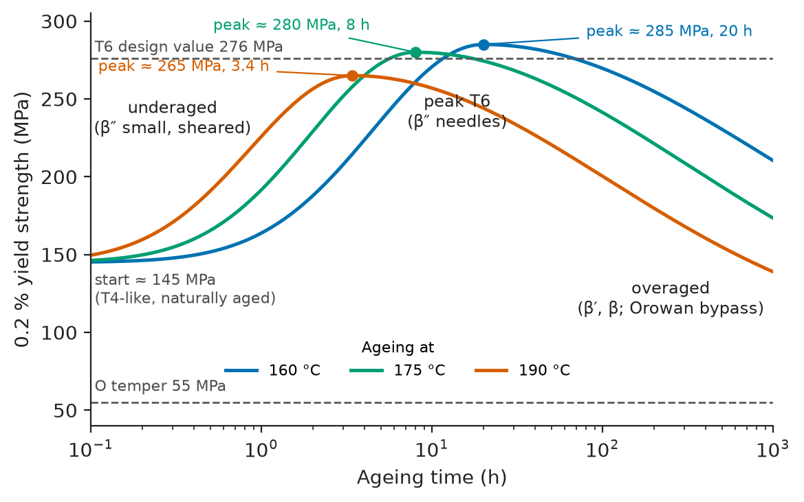
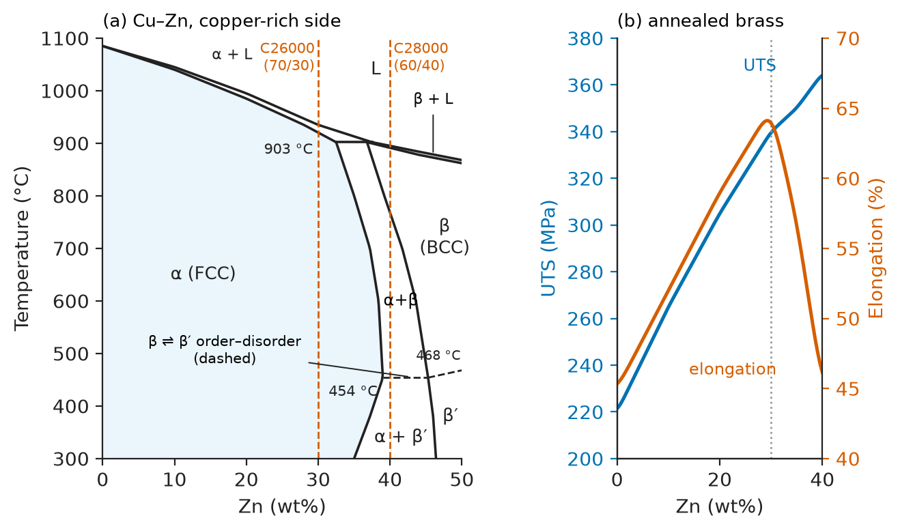
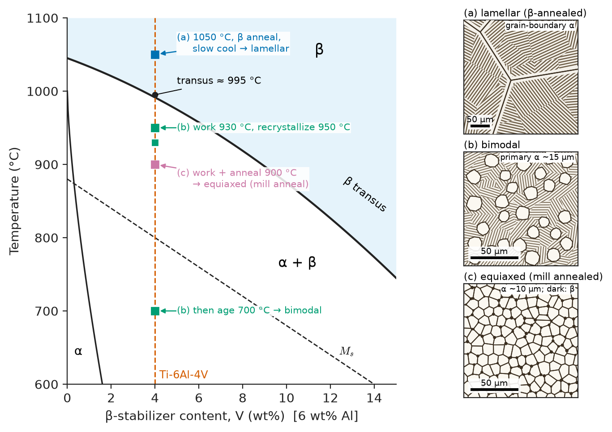
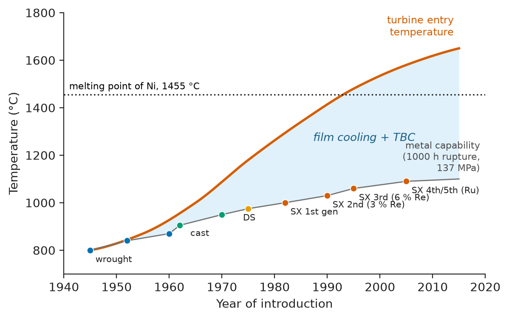
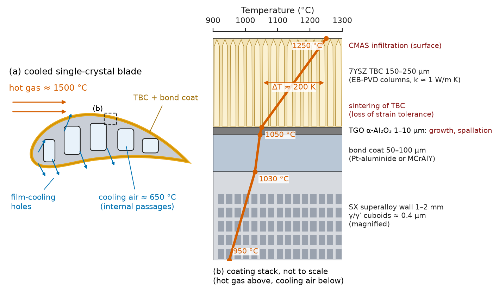
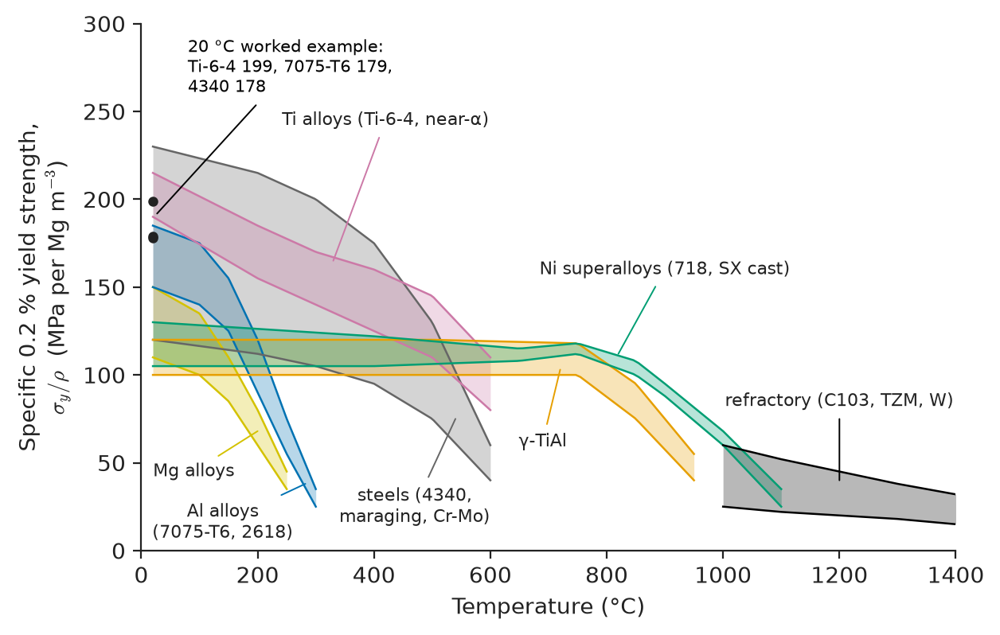

# Chapter 16 — Non-Ferrous Alloys

*Part IV · Metals, Ceramics and Construction Materials*

A pedestrian bridge over a railway is assembled from welded aluminium trusses. The extrusions are 6061-T6, with a certified yield strength of 276 MPa, and the designer sized the members with that number. In the proof-load test the truss deflects more than predicted and a diagonal yields permanently next to a weld, at a nominal stress of barely 120 MPa. Nothing was wrong with the extrusions. The weld itself was sound. What changed was the alloy's *temper*: the heat of welding dissolved and coarsened the nanometre-scale Mg–Si precipitates that gave 6061-T6 its strength, and a band of metal a few centimetres wide on each side of every weld was returned to something close to the annealed state. Design codes for aluminium structures know this and specify a reduced "heat-affected" strength; the designer had used a steel habit.

The same lesson repeats across the non-ferrous metals. A titanium fan disc is only as good as the forging temperature relative to its β transus; a single-crystal turbine blade is only as good as the volume fraction and coherency of its γ′ precipitates; a beryllium-copper connector spring loses its force if it is overaged in service. Non-ferrous alloys are, almost all of them, metallurgically *engineered* structures, and the name of the alloy is never enough without the name of its condition.

> **Why does each non-ferrous metal have its own family of alloys and heat treatments, and what does each family do better than steel?**
> **How do processing and temper designations encode the microstructure, and how does an engineer choose among aluminium, copper, titanium, nickel, magnesium, zinc, refractory, precious and intermetallic alloys?**

| Concept | Engineering destination |
|---|---|
| Aluminium designations and tempers | Airframes, car bodies, extrusions, cans, welded structures, heat-sink design |
| Age hardening (GP zones, β″, η′, θ′) | Heat-treatment specifications, weld HAZ strength, overaging in service |
| Copper alloys and conductivity–strength trade-off | Busbars, windings, connector springs, heat exchangers, marine hardware |
| Titanium α, α+β, β alloys | Fan blades and discs, landing gear, implants, chemical plant |
| Nickel superalloys, γ/γ′, single crystals, coatings | Gas-turbine blades and discs, rocket engines, power generation |
| Magnesium and zinc alloys | Lightweight castings, steering wheels, die-cast housings, biodegradable implants |
| Refractory and precious metals | Furnace hardware, rocket nozzles, X-ray targets, catalysts, thermocouples |
| Intermetallics and high-entropy alloys | Low-pressure turbine blades, heating elements, cryogenic and high-temperature research alloys |
| Selection indices | Choosing the lightest, cheapest or most conductive alloy for a given duty |

**Roadmap.** Aluminium: designations, tempers and age hardening (16.1) → copper and its conductivity–strength trade-off (16.2) → titanium and its two crystal structures (16.3) → nickel superalloys and the γ/γ′ structure (16.4) → magnesium and zinc (16.5) → refractory and precious metals (16.6) → intermetallics and high-entropy alloys (16.7) → putting it together: selection (16.8).

---

## 16.1 Aluminium alloys

### Why aluminium

Aluminium is FCC to its melting point (660 °C), with a density of 2.70 Mg/m³ and a modulus of about 70 GPa (each a third of steel's), about 62 % of copper's conductivity, and a self-healing Al₂O₃ film. Twelve slip systems and no ductile–brittle transition make it formable and suitable for cryogenic tanks. Its weaknesses are softening above about 150–200 °C, a modulus that alloying cannot raise, no true fatigue endurance limit, and pitting where chlorides break the film (Chapter 43). Its specific stiffness $E/\rho\approx26$ GPa/(Mg/m³) equals steel's, so its advantage in stiff designs comes from thicker sections (Section 16.8); in strong designs it comes from metallurgy, which raises yield strength from 10–30 MPa (pure) to above 550 MPa.

### The designation system

Wrought alloys (shaped by rolling, extrusion or forging) carry a four-digit number in the International Alloy Designation System; casting alloys carry a three-digit number with a decimal. The first digit names the principal alloying element and, with it, the strengthening mechanism.

| Series | Main alloying | Strengthened by | Typical alloy and temper | Yield / UTS (MPa, typical) | Uses |
|---|---|---|---|---|---|
| 1xxx | ≥ 99.0 % Al | Cold work | 1100-H14; 1350-H19 | 117 / 124; 165 / 186 | Foil, chemical plant, conductors (1350: ~61 % IACS) |
| 2xxx | Cu (± Mg, Li) | Age hardening | 2024-T3 | 345 / 483 | Fuselage skins, damage-tolerant structure |
| 3xxx | Mn | Cold work, dispersoids | 3003-H14 | 145 / 150 | Beverage-can bodies (3004), heat exchangers |
| 4xxx | Si | — (filler, brazing) | 4043 | — | Welding wire, brazing sheet clad |
| 5xxx | Mg | Solid solution + cold work | 5083-H116 | 228 / 317 | Ship hulls, LNG tanks, welded structures |
| 6xxx | Mg + Si | Age hardening | 6061-T6; 6063-T6 | 276 / 310; 214 / 241 | Extrusions, frames, automotive, architecture |
| 7xxx | Zn + Mg (± Cu) | Age hardening | 7075-T6; 7050-T7451 | 503 / 572; 469 / 524 | Wing spars, forgings, high-strength sport goods |
| 8xxx | Others (Li, Fe) | Various | 8090, 2099/2195 (Al–Li) | 450–560 / 500–600 | Lighter, stiffer aerospace plate and extrusions |

Casting alloys (1xx.x to 8xx.x) are dominated by **Al–Si** alloys: the eutectic at 12.6 wt% Si and 577 °C (Chapter 7) gives high fluidity and low shrinkage. A356 (Al–7Si–0.3Mg) is the standard alloy for wheels and suspension parts (about 185 MPa yield and 262 MPa UTS as permanent-mould T6); A380 (Al–8.5Si–3.5Cu) is the die-casting workhorse for housings (about 160 / 320 MPa, but only 3–4 % elongation because of porosity). Sr or Na **modify** the plate-like eutectic Si to a fine fibrous form, and Ti–B additions refine the grains by heterogeneous nucleation (Chapter 9).

### Tempers

The temper letter that follows the alloy number tells the engineer how the microstructure was produced. Without it the alloy number is close to meaningless: 6061 ranges from 55 MPa yield (O) to 276 MPa (T6), and 7075 from about 100 MPa to more than 500 MPa.

| Temper | Meaning | Microstructural state |
|---|---|---|
| F | As fabricated | Uncontrolled |
| O | Annealed | Recrystallized, softest; precipitates coarse and incoherent |
| H1x, H2x, H3x | Strain hardened (only), strain hardened and partially annealed, strain hardened and stabilized; x = 2, 4, 6, 8 for ¼, ½, ¾ and full hard | Dislocation density raised (Chapter 13) |
| W | Solution heat treated, unstable | Supersaturated solid solution, ageing at room temperature |
| T3 | Solution treated, cold worked, naturally aged | GP zones plus dislocations |
| T4 | Solution treated, naturally aged | GP zones / clusters |
| T5 | Cooled from hot working, artificially aged | Precipitates without a separate solution treatment |
| T6 | Solution treated, artificially aged to peak strength | Fine coherent or semicoherent precipitates (β″, η′, θ″/θ′) |
| T7 | Solution treated, overaged | Coarser η or θ′; lower strength, better stress-corrosion and exfoliation resistance |
| T8 | Solution treated, cold worked, artificially aged | Precipitates nucleated on dislocations (Al–Li, 2xxx) |
| Txx51 | Additional digit(s): stress relieved by stretching 1–3 % | Low residual stress for machining |

The T7 tempers deserve a word. In the 1960s, 7075-T6 aircraft forgings failed by intergranular stress-corrosion cracking. Overageing to T73 (later T76, T7451) costs 10–15 % of the strength but raises the stress-corrosion threshold severalfold: one property traded for another by heat treatment rather than by a new alloy.

### Age hardening in practice

The physics of precipitation was set out in Chapter 10 for Al–Cu: solution treatment in the single-phase α field, a quench to retain a supersaturated solid solution and a high vacancy concentration, and ageing that produces a sequence of metastable phases of increasing size and decreasing coherency. The sequences for the commercial families are:

$$
\text{Al–Cu (2xxx)}:\ \mathrm{SSSS}\rightarrow\mathrm{GP\ zones}\rightarrow\theta''\rightarrow\theta'\rightarrow\theta\ (\mathrm{Al_2Cu})
$$

$$
\text{Al–Mg–Si (6xxx)}:\ \mathrm{SSSS}\rightarrow\mathrm{clusters}\rightarrow\mathrm{GP}\rightarrow\beta''\rightarrow\beta'\rightarrow\beta\ (\mathrm{Mg_2Si})
$$

$$
\text{Al–Zn–Mg(–Cu) (7xxx)}:\ \mathrm{SSSS}\rightarrow\mathrm{GP}\rightarrow\eta'\rightarrow\eta\ (\mathrm{MgZn_2})
$$

The peak strength corresponds to a dense dispersion of shearable or just-unshearable particles a few nanometres across, with a spacing of tens of nanometres, at the crossover between the cutting and Orowan mechanisms (Chapter 13). Underaged material is weaker because the particles are small and easily cut; overaged material is weaker because the particles have coarsened (Ostwald ripening, Chapter 10) and dislocations bow between them.

<!-- FIGURE 16.1 | figures/ch16/fig-16-1-6061-ageing-curves.png | plot | Yield strength of 6061 versus artificial ageing time at 160, 175 and 190 °C after solution treatment at 530 °C and water quench, showing underageing, peak (T6) and overageing. | Content: x-axis ageing time 0.1–1000 h (log); y-axis 0.2 % yield strength 40–305 MPa. Starting value at short time ~145 MPa (T4-like, naturally aged). Curve at 175 °C peaking at ~280 MPa at ~8 h; curve at 160 °C peaking slightly higher (~285 MPa) at ~20 h; curve at 190 °C peaking lower (~265 MPa) at ~3.4 h and falling to ~200 MPa by 100 h. Label regions "underaged (β″ small, sheared)", "peak T6 (β″ needles)", "overaged (β′, β; Orowan bypass)". Horizontal dashed line at 276 MPa labelled "T6 design value", another at 55 MPa labelled "O temper". -->

*Figure 16.1 — Yield strength of 6061 versus artificial ageing time at 160, 175 and 190 °C after solution treatment at 530 °C and water quench, showing underageing, peak (T6) and overageing.*

Figure 16.1 shows the practical consequence: the peak shifts to shorter times and lower values as the ageing temperature rises. Lower temperatures give a higher, broader peak, because the driving force for nucleation is larger and the precipitates finer, but the treatment takes longer. Heat-treaters exploit the thermal activation of the process to convert one schedule into another.

**Worked example — Transferring an ageing schedule.** A shop ages 6061 for 8 h at 175 °C. A new furnace can hold only 160 °C uniformly. Treating the time to peak strength as controlled by a single diffusion-limited process with an apparent activation energy of $Q\approx100$ kJ/mol, the times at two temperatures scale as

$$
\frac{t_2}{t_1}=\exp\left[\frac{Q}{R}\left(\frac{1}{T_2}-\frac{1}{T_1}\right)\right]
$$

With $T_1=448.15$ K and $T_2=433.15$ K, $1/T_2-1/T_1=7.73\times10^{-5}$ K⁻¹, and $Q/R=12\,030$ K, so the ratio is $\exp(0.929)=2.53$ and $t_2\approx20$ h. The published alternative schedule for 6061-T6 is 18 h at 160 °C, close to this estimate. Going the other way, to 190 °C, gives $t_2\approx3.4$ h, but the peak strength is lower (Figure 16.1). The estimate fails when the precipitation sequence itself changes with temperature (for instance if ageing is so hot that β′ forms directly), and it ignores the time to heat the load, which for thick sections can be hours.

> **Status of the principle: Arrhenius time–temperature equivalence for ageing**
> *Approximate.* Valid when one thermally activated process controls the kinetics and the same precipitate sequence operates at both temperatures; it breaks down across changes in the precipitate phases or when nucleation and growth have different activation energies.

### Natural ageing, quench sensitivity and welding

Some alloys age at room temperature: 2024 reaches its T3/T4 strength about four days after quenching, so 2024 rivets were kept in a freezer until driven ("icebox rivets"). Thick 7075 plate is **quench sensitive** (its centre precipitates coarse η on cooling), which is why thick-plate alloys like 7050 use a less quench-sensitive chemistry.

Welding is the reverse problem. In the heat-affected zone, peak temperatures of 250–500 °C dissolve β″ and overage what remains. The as-welded heat-affected zone of 6061-T6 has a design tensile strength of about 165 MPa, compared with 290 MPa minimum for the parent metal, and a yield strength nearer 100–110 MPa. This is the bridge of the opening paragraph. The remedies are to place welds at low-stress locations, to use friction-stir welding with its lower peak temperature (Chapter 47), to re-solution-treat and age small welded assemblies, or to choose a 5xxx alloy, whose strength comes from Mg in solution and cold work and which loses only the cold-work increment on welding.

> **Boundary.** Corrosion of aluminium (pitting, intergranular corrosion, exfoliation, stress-corrosion cracking) is treated in Chapters 42–43; the electrochemistry behind the passive film belongs to Advanced Chemistry.

### Aluminium–lithium alloys

Each 1 wt% of lithium lowers the density of aluminium by about 3 % and raises its modulus by about 6 %, the only common element that raises $E$ appreciably. After early generations troubled by anisotropy and low toughness, third-generation alloys (2195, 2099, 2050; 0.7–1.8 % Li, strengthened by T1, Al₂CuLi, in T8 tempers) are used in launch-vehicle tanks and airliner structure, competing with carbon-fibre composites (Chapter 22).

---

## 16.2 Copper alloys

### Why copper

Copper (FCC, 1085 °C, 8.96 Mg/m³, $E$ 110–130 GPa) has a conductivity of 58–59 MS/m (resistivity $1.72\times10^{-8}\ \Omega\,\mathrm{m}$, defined as 100 % IACS) and a thermal conductivity of about 400 W m⁻¹ K⁻¹, second only to silver. It resists atmospheric and fresh-water corrosion and is easily formed and brazed; its density and a price three to four times aluminium's are its handicaps.

Almost anything that strengthens copper reduces its conductivity, because solutes and defects scatter electrons. By **Matthiessen's rule** the resistivity is a thermal part plus a residual defect part, and by **Nordheim's rule** the solute part scales as $x(1-x)$ (Chapter 25). Solute in solution costs much (0.1 wt% P removes about 30 % of the conductivity; the same Ag almost nothing); the same solute precipitated costs little. This is the logic of every high-conductivity copper alloy.

### Brasses

Brasses are copper–zinc alloys. Zinc is soluble in FCC copper up to about 35–39 wt% (the α phase); beyond that the BCC β phase (ordered as β′, CuZn, B2, below about 460 °C) appears (Figure 16.2). The strength of α brass rises and its ductility *also* rises up to about 30 % Zn, an unusual combination that comes from the falling stacking-fault energy, which promotes planar slip and deformation twinning and sustains work hardening (Chapters 12–13). **Cartridge brass** (70Cu–30Zn, C26000) has the best combination for deep drawing, as its name records; annealed it has a yield of about 100 MPa, a UTS of about 340 MPa and elongation above 60 %. **Muntz metal** (60Cu–40Zn, C28000) is α+β, stiffer at high temperatures and hot-workable, and is used for condenser plates, architectural extrusions and fasteners. Small lead additions (free-cutting brass, C36000) give the best machinability of any common alloy, but lead in potable-water fittings is now restricted and is being replaced by Bi or Si additions.

<!-- FIGURE 16.2 | figures/ch16/fig-16-2-cu-zn-diagram.png | plot | Copper-rich part of the Cu–Zn phase diagram with the compositions of cartridge brass and Muntz metal, and the variation of tensile strength and elongation of annealed α brass with zinc content. | Content: main panel x-axis Zn 0–50 wt%, y-axis temperature 300–1100 °C. Liquidus from 1085 °C (pure Cu) falling to ~903 °C at the peritectic near 32.5–37.5 wt% Zn; α field boundary at ~32.5 wt% Zn at 903 °C, ~39 wt% at ~454 °C, returning to ~35 wt% at 300 °C; α+β field; β field above ~454 °C and β′ (ordered) below, separated by a dashed order–disorder line at ~454–468 °C. Vertical dashed lines at 30 wt% (C26000 cartridge brass) and 40 wt% (C28000 Muntz). Inset: x-axis Zn 0–40 wt%; left y-axis UTS 200–380 MPa rising from ~220 (pure Cu) to ~340 at 30 % Zn; right y-axis elongation 40–70 % rising from ~45 to ~65 % at 30 % Zn then falling. -->

*Figure 16.2 — Copper-rich part of the Cu–Zn phase diagram with the compositions of cartridge brass and Muntz metal, and the variation of tensile strength and elongation of annealed α brass with zinc content.*

Brasses have two classic corrosion failures (Chapter 43). **Dezincification**, selective leaching of Zn in stagnant or chloride-bearing water, is suppressed in α brasses by 0.02–0.06 % As but not in β. **Season cracking**, the original stress-corrosion cracking, struck cold-drawn cartridge cases stored in ammonia-bearing air and was cured by a stress-relief anneal.

### Bronzes and cupronickels

**Tin bronzes** and **phosphor bronzes** (C51000: Cu–5Sn–0.2P) are solid-solution strengthened by tin; cold-rolled phosphor bronze reaches 550 MPa yield and is a standard connector-spring material, and cast leaded bronzes are bearing materials. **Aluminium bronzes** (5–11 % Al with Fe and Ni) reach 500–700 MPa UTS and are the standard alloy for ship propellers and seawater pumps. **Cupronickels** exploit the complete solubility of Cu and Ni (Chapter 7): 90Cu–10Ni and 70Cu–30Ni resist seawater flow and biofouling in condenser and desalination tubing, and are chosen for corrosion, not conduction.

### High-conductivity and high-strength coppers

**Electrolytic tough-pitch** copper (ETP, C11000) contains 200–400 ppm O as Cu₂O and is embrittled when heated in hydrogen (steam blisters its grain boundaries); **oxygen-free** grades (C10200, C10100) are used for brazed assemblies and vacuum electronics. Cold work raises the yield of ETP copper from about 70 to 300–350 MPa at a cost of only 2–3 % IACS, because dislocations scatter electrons weakly.

When a conductor needs more strength, especially at temperature, precipitation is used:

| Alloy | Composition (wt%) | Condition | Yield (MPa, typical) | Conductivity (% IACS) | Uses |
|---|---|---|---|---|---|
| C11000 ETP | 99.9 Cu | Annealed / hard | 70 / 320 | 101 / 97 | Busbars, wire, windings |
| C18150 CuCrZr | 1 Cr, 0.1 Zr | Solution treated, aged | 400–450 | 80 | Resistance-welding electrodes, fusion heat sinks, rocket combustion liners |
| C70250 CuNiSi | 3 Ni, 0.65 Si | Aged | 550–650 | 40 | Leadframes, high-current connectors |
| C17200 CuBe | 1.9 Be, 0.2 Co | Peak aged | 1000–1200 | 22 | High-reliability springs, non-sparking tools, downhole tools |
| C51000 phosphor bronze | 5 Sn, 0.2 P | Spring temper | 550 | 15 | Contacts, bellows, springs |
| C26000 cartridge brass | 30 Zn | Annealed | 100 | 28 | Deep-drawn shells, radiator cores |
| C70600 cupronickel | 10 Ni, 1.5 Fe | Annealed | 110–140 | 9 | Seawater tubing |

Beryllium copper is the strongest copper alloy and the reference for spring performance, but beryllium dust is toxic and machining and grinding of CuBe require controls; CuNiSi and Cu–Ni–Sn spinodal alloys (Chapter 10) are its main replacements.

**Worked example — Copper or aluminium busbar?** A switchboard needs a busbar carrying 2000 A. A copper bar of 100 mm × 10 mm ($A=1000$ mm²) has a resistance per metre of $\rho/A=1.72\times10^{-8}/10^{-3}=1.72\times10^{-5}\ \Omega/\mathrm{m}$ and dissipates $I^2R=2000^2\times1.72\times10^{-5}=68.8$ W/m at 20 °C. An aluminium bar of grade 1350 ($\rho=2.82\times10^{-8}\ \Omega\,\mathrm{m}$) with the same resistance must have an area larger by the resistivity ratio, $2.82/1.72=1.64$, i.e. 1640 mm². Its mass per metre is $1.64\times10^{-3}\times2700=4.43$ kg/m, against $10^{-3}\times8960=8.96$ kg/m for copper: the aluminium bar is 0.49 times as heavy. At representative prices of about 9.5 USD/kg for copper and 2.6 USD/kg for aluminium, the metal costs about 85 and 12 USD per metre. Aluminium wins on mass and cost for the same losses; copper wins on volume and on joint reliability (aluminium creeps under bolts and forms an insulating oxide). Hence overhead lines and large busbars are aluminium, while motor windings and circuit conductors are copper.

> **Boundary.** The electron-scattering physics behind Matthiessen's and Nordheim's rules, and EEE-specific conductor and connector materials, are treated in Chapter 25.

---

## 16.3 Titanium alloys

### Two crystal structures

Titanium has a density of 4.51 Mg/m³, a modulus of about 105–120 GPa, a melting point of 1668 °C and a passive TiO₂ film that makes it practically immune to seawater, chlorides and oxidizing acids at ambient temperatures. It exists in two forms: **α**, hexagonal close-packed ($c/a=1.587$, slightly below ideal) up to 882 °C, and **β**, body-centred cubic from 882 °C to the melting point. The whole of titanium metallurgy is the manipulation of these two phases.

Alloying elements are classified by which phase they stabilize, that is, whether they raise or lower the α/β transition temperature (the **β transus**):

| Class | Elements | Effect |
|---|---|---|
| α stabilizers | Al, O, N, C | Raise the β transus; strengthen α by solid solution (O and N are potent interstitial strengtheners and embrittlers) |
| β isomorphous | V, Mo, Nb, Ta | Lower the β transus; complete solubility in β |
| β eutectoid | Fe, Cr, Mn, Ni, Cu, Si, H | Lower the β transus; can form intermetallic compounds by eutectoid decomposition |
| Neutral | Sn, Zr | Little effect on the transus; strengthen both phases |

An aluminium equivalent, roughly $\mathrm{Al}+\tfrac13\mathrm{Sn}+\tfrac16\mathrm{Zr}+10(\mathrm{O}+\mathrm{C}+2\mathrm{N})$ in wt%, is kept below about 9 to avoid embrittling Ti₃Al (α₂). Commercially pure Grades 1–4 differ mainly in oxygen, which raises the yield strength from about 170 MPa (Grade 1) to 480 MPa (Grade 4).

### Alloy classes

| Class | Example | Yield / UTS (MPa, typical) | Key features | Applications |
|---|---|---|---|---|
| CP titanium | Grade 2 | 275 min / 345 min | Formable, weldable, best corrosion resistance | Heat-exchanger tubes, chemical vessels, desalination |
| α and near-α | Ti-5Al-2.5Sn; Ti-6242S; IMI 834 | 800–1000 / 860–1050 | HCP, best creep resistance; not heat-treatable to high strength | Compressor discs and blades to 540–600 °C |
| α+β | Ti-6Al-4V (Ti-6-4) | 880 / 950 annealed; 1100 / 1170 STA | Versatile, heat-treatable, weldable; about half of all titanium used | Fan blades, airframe fittings, implants, bicycle and automotive parts |
| Metastable β | Ti-10V-2Fe-3Al; Ti-5553; Ti-15V-3Cr-3Sn-3Al | 1100–1300 / 1200–1400 | BCC, cold formable, deep hardenable, high strength; lower modulus | Landing-gear beams, springs, fasteners |
| β (biomedical) | Ti-13Nb-13Zr; Ti-29Nb-13Ta-4.6Zr | 500–900 | Low modulus (55–80 GPa), Al- and V-free | Hip stems, spinal rods (Chapter 39) |

### Processing and microstructure

Because the β transus of Ti-6-4 lies at about 995 °C, a forging or heat treatment above it makes the whole part β, and on cooling α forms as plates on {110} planes of the β (the Burgers orientation relationship) in colonies or as basketweave. This gives a **lamellar** (Widmanstätten) structure: good creep strength and fracture toughness and slow fatigue-crack growth, but lower ductility and lower high-cycle fatigue strength. Working below the transus, in the α+β field, breaks up the plates and recrystallizes them into **equiaxed** primary α grains; a subsequent treatment just below the transus gives a **bimodal** structure of equiaxed primary α in a matrix of transformed β lamellae, a common compromise for rotating parts (Figure 16.3). Solution treating high in the α+β field and quenching retains β (or forms α′ martensite); ageing at 480–600 °C precipitates fine α and gives the STA (solution treated and aged) condition.

<!-- FIGURE 16.3 | figures/ch16/fig-16-3-ti64-microstructures.png | schematic | Pseudo-binary section through Ti-6Al-4V with the β transus and the processing routes that produce lamellar, bimodal and equiaxed microstructures. | Content: left panel: pseudo-binary diagram, x-axis β-stabilizer content (V, wt%) 0–15, y-axis temperature 600–1100 °C; β field at top; β transus line falling from ~1045 °C at 0 % to below 800 °C at 15 %; α+β field below; vertical dashed line at 4 % V meeting transus at ~995 °C; Ms line dashed. Three arrows from the 4 % V line: (a) heat to 1050 °C, slow cool → lamellar; (b) work at ~930 °C, recrystallize at ~950 °C, age 700 °C → bimodal; (c) work and anneal at ~900 °C → equiaxed (mill annealed). Right: three micrograph-style sketches, 50 μm scale bars: (a) prior-β grains ~500 μm with α colonies and grain-boundary α; (b) ~30 % equiaxed primary α (~15 μm) in lamellar transformed β; (c) equiaxed α ~10 μm with intergranular β. -->

*Figure 16.3 — Pseudo-binary section through Ti-6Al-4V with the β transus and the processing routes that produce lamellar, bimodal and equiaxed microstructures.*

Titanium is expensive not because it is rare but because it is reactive. The batch **Kroll process** reduces TiCl₄ with magnesium to sponge, which is vacuum-arc remelted two or three times for rotating parts; a nitrogen-rich hard-α inclusion caused the 1989 Sioux City DC-10 fan-disc failure and led to cold-hearth melting. Above about 500 °C titanium picks up oxygen and forms a brittle **α case** that must be removed; it must be welded under full inert shielding, galls in sliding contact, and machines slowly because its low thermal conductivity (about 7 W m⁻¹ K⁻¹) concentrates heat at the tool. Processing dominates cost, which makes near-net-shape forging and additive manufacturing (Chapter 48) attractive.

Titanium wins where specific strength matters at 150–600 °C, where it is joined to carbon-fibre composites (galvanically compatible, and its expansion of about 9 × 10⁻⁶ K⁻¹ is closer to the laminate's than aluminium's 23 × 10⁻⁶ K⁻¹), where chloride corrosion resistance is essential, and in the body (Chapter 39).

> **Status of the principle: β-stabilizer and α-stabilizer classification**
> *Empirical.* The classification summarizes measured binary phase diagrams; equivalence formulae combining several elements are linear fits that work for commercial composition ranges but not for highly alloyed or multicomponent β alloys, where CALPHAD calculations are used (Chapter 7).

---

## 16.4 Nickel-base superalloys

### Why nickel

The first high-pressure turbine stage of a jet engine sees gas at 1500–1700 °C while its blades carry centrifugal stresses of 150–250 MPa for thousands of hours, the metal running at 950–1100 °C, a higher homologous temperature than any other structural metal endures for so long. Nickel is the base because it is FCC with no allotropic change up to its melting point (1455 °C), dissolves large amounts of Cr, Co, Mo, W, Re and Ta, and with Cr and Al forms a protective Cr₂O₃ or Al₂O₃ scale.

### The γ/γ′ microstructure

The secret of the superalloys is a two-phase microstructure. The matrix, **γ**, is a disordered FCC nickel solid solution. Within it sits **γ′**, the ordered intermetallic Ni₃(Al,Ti,Ta) with the L1₂ structure: an FCC lattice in which Al (or Ti, Ta) occupies the cube corners and Ni the face centres (Chapter 3). The two lattices differ by only a few tenths of a percent in parameter (the **misfit** $\delta=2(a_{\gamma'}-a_\gamma)/(a_{\gamma'}+a_\gamma)$ is typically between −0.5 % and +0.5 %), so the γ′ precipitates are coherent cubes 0.3–0.5 μm across, aligned along ⟨100⟩, and they can occupy 60–70 % of the volume in modern cast alloys.

A matrix dislocation ($\tfrac a2\langle110\rangle$) entering an ordered L1₂ particle leaves an **antiphase boundary** (APB) of 0.1–0.3 J/m² behind it (Chapters 3, 12), so dislocations must travel in pairs as **superdislocations**, the second restoring the order. Better still, Ni₃Al shows the **yield-strength anomaly**: its yield strength *rises* up to about 700–800 °C, because screw superdislocations cross-slip onto {100} planes of lower APB energy and form immobile Kear–Wilsdorf locks. The superalloy inherits part of this anomaly and keeps most of its strength to about 800 °C.

At still higher temperatures the alloy fails by creep (Chapter 14): γ′ cubes coarsen directionally into plates (**rafting**) and dislocations climb around them. Re, W, Ta and Ru slow diffusion in γ; rhenium is the signature element of second- and third-generation single crystals (3 and 6 wt%). Too much refractory alloying precipitates brittle **topologically close-packed** phases (σ, μ), so alloy design is a balance guided today by CALPHAD.

### From wrought to single crystals

| Class | Example | γ′ (vol %) | Typical use and limit | Notes |
|---|---|---|---|---|
| Solid-solution | Inconel 625, Hastelloy X, Haynes 230 | — | Combustor liners, ducts; oxidation to ~1100 °C | Weldable sheet, strengthened by Mo, W, Nb |
| Wrought γ″/γ′ | Inconel 718 | ~20 (mainly γ″ Ni₃Nb) | Discs, shafts, cryogenic and rocket-engine parts; to ~650 °C | Yield ~1035 MPa; weldable; the most-used superalloy |
| Wrought γ′ | Waspaloy, Udimet 720Li | 25–45 | Discs, rings to ~750 °C | Powder-metallurgy discs (René 88DT, RR1000) for higher γ′ |
| Cast equiaxed | IN-713C, Mar-M247 | 45–65 | Blades and vanes; grain-boundary carbides and B, Zr, Hf | Grain boundaries limit creep and thermal fatigue |
| Directionally solidified | Mar-M247 DS, CM247LC | ~60 | Blades; columnar grains along the axis | No transverse boundaries; Hf added to resist boundary cracking |
| Single crystal (1st–4th gen.) | PWA 1480, CMSX-4, René N5, CMSX-10, TMS-138 | 60–70 | High-pressure turbine blades, metal to ~1100 °C | No boundaries, no C/B/Zr; Re 0–6 %, Ru in 4th gen. |

**Directional solidification** withdraws the mould from a hot zone into a chill so that grains grow as columns along the blade axis, in the fast-growing ⟨100⟩ direction (Chapter 9). Removing transverse boundaries, where creep cavities form, raised creep and thermal-fatigue life; and ⟨100⟩ has a low modulus (about 125 GPa versus about 220 GPa for a polycrystal, Chapter 4), so thermal strains produce lower stresses. A **single-crystal** blade adds a helical grain selector that lets only one grain through; with no boundaries, C, B, Zr and Hf can be removed, raising the incipient melting point and allowing a fuller solution treatment. Each step has bought tens of kelvin of metal temperature (Figure 16.4).

<!-- FIGURE 16.4 | figures/ch16/fig-16-4-turbine-temperature-history.png | plot | Temperature capability of turbine-blade alloys and turbine entry temperature versus year, showing the contributions of wrought, cast, directionally solidified and single-crystal alloys, cooling and thermal barrier coatings. | Content: x-axis year 1940–2020; y-axis temperature 700–1800 °C. Lower series (metal capability, temperature for 1000 h rupture life at 137 MPa): wrought alloys ~800 °C in 1945 rising to ~870 °C by 1960; conventionally cast ~900–950 °C (1960–1970); DS ~975 °C (1975); 1st-gen SX ~1000 °C (1982); 2nd-gen SX (3 % Re) ~1030 °C (1990); 3rd-gen SX (6 % Re) ~1060 °C (1995); 4th/5th-gen (Ru) ~1080–1100 °C (2005). Upper curve: turbine entry temperature rising from ~800 °C in 1945 to ~1600–1700 °C by 2015. Shade the gap between the curves and label it "film cooling + TBC". Mark the melting point of Ni (1455 °C) as a horizontal dotted line. -->

*Figure 16.4 — Temperature capability of turbine-blade alloys and turbine entry temperature versus year, showing the contributions of wrought, cast, directionally solidified and single-crystal alloys, cooling and thermal barrier coatings.*

**Worked example — What 50 K of metal temperature is worth.** For a given alloy and stress, the Larson–Miller parameter $P=T(C+\log_{10}t_r)$ with $C\approx20$ (Chapter 14) is constant along a line of equal stress. A single-crystal blade that ruptures after 100 h at a metal temperature of 1050 °C (1323 K) has $P=1323\times(20+2)=29\,106$. If a better coating or cooling scheme lowers the metal temperature by 50 K to 1273 K at the same stress, the rupture life becomes

$$
\log_{10}t_r=\frac{29\,106}{1273}-20=2.864,\qquad t_r\approx731\ \mathrm{h}
$$

a factor of about seven. Raising the metal temperature by 50 K to 1373 K cuts the life to about 16 h. This steep sensitivity is why engine designers count gains in "degrees of metal temperature" and why the coating systems below are as important as the alloy.

> **Status of the principle: Larson–Miller parameter**
> *Empirical.* A time–temperature parameter that collapses creep-rupture data onto one master curve for a given alloy; the constant $C$ is fitted (15–25), and extrapolation beyond a few times the longest test, or across a change of creep mechanism, is unsafe.

### Coatings

Even a perfect single crystal cannot survive bare in a combustion gas at 1100 °C for long. Turbine blades carry a coating system with up to four layers (Figure 16.5):

- a **bond coat**, either a Pt-modified **aluminide** diffusion coating (NiAl, 30–80 μm) or an **MCrAlY overlay** (M = Ni, Co), which is an aluminium reservoir;
- the **thermally grown oxide** (TGO), a slow-growing α-Al₂O₃ scale 1–10 μm thick (Chapter 42);
- a **thermal barrier coating** (TBC) of 7–8 wt% Y₂O₃-stabilized zirconia (7YSZ), 100–300 μm thick, with a conductivity of about 1 W m⁻¹ K⁻¹, across which an internally cooled blade sustains a drop of 100–200 K or more (Chapter 24). EB-PVD gives a columnar, strain-tolerant structure for blades.

<!-- FIGURE 16.5 | figures/ch16/fig-16-5-blade-coating-stack.png | schematic | Cross-section of a cooled single-crystal turbine blade with its thermal barrier coating system and the temperature profile through it. | Content: left: blade cross-section with internal cooling passages and film-cooling holes, hot gas at ~1500 °C outside, cooling air ~650 °C inside. Right: magnified layer stack (not to scale): 7YSZ TBC 150–250 μm with columnar EB-PVD structure; TGO α-Al2O3 1–10 μm; Pt-aluminide or MCrAlY bond coat 50–100 μm; single-crystal superalloy wall 1–2 mm with γ/γ′ cuboids (~0.4 μm). Overlay a temperature profile: gas side ~1250 °C at TBC surface, falling steeply to ~1050 °C at the TBC/bond-coat interface (ΔT ~200 K across TBC), gently to ~950 °C at the inner wall. Label failure modes: TGO growth and spallation, CMAS infiltration, sintering of TBC. -->

*Figure 16.5 — Cross-section of a cooled single-crystal turbine blade with its thermal barrier coating system and the temperature profile through it.*

TBCs fail mainly by spallation near the TGO as the oxide thickens during thermal cycles, and by **CMAS** attack: molten silicate deposits from ingested sand and volcanic ash infiltrate the columns and destroy their strain tolerance. The longer-term successor in the hottest parts is the SiC/SiC ceramic-matrix composite (Chapters 23 and 41).

> **Boundary.** High-temperature oxidation kinetics and hot corrosion are developed in Chapter 42; extreme-environment materials as a system in Chapter 41; heat flow through coatings in Chapter 24.

---

## 16.5 Magnesium and zinc alloys

### Magnesium: the lightest structural metal

Magnesium has a density of 1.74 Mg/m³, a modulus of about 45 GPa and a melting point of 650 °C. It is HCP ($c/a=1.624$), and at room temperature only basal ⟨a⟩ slip is easy; non-basal systems need tens of times higher resolved shear stress. Strain along $c$ requires $\{10\bar12\}$ twinning to satisfy the von Mises criterion (Chapter 13), so wrought magnesium has limited cold formability, strong basal texture and a **tension–compression asymmetry**: an extruded bar twins easily in axial compression, whose yield strength can be half the tensile. Sheet is therefore formed warm, above about 200–250 °C.

Most magnesium is used as castings. ASTM designations give the two main alloying elements by letter (A = Al, Z = Zn, M = Mn, K = Zr, E = rare earths, W = Y) and their rounded percentages:

| Alloy | Composition (wt%) | Process | Yield / UTS (MPa), elongation (typical) | Uses |
|---|---|---|---|---|
| AZ91D | 9 Al, 0.7 Zn, 0.2 Mn | Die cast | 160 / 240, 3 % | Housings, brackets, power-tool bodies |
| AM60B | 6 Al, 0.3 Mn | Die cast | 130 / 220, 6–8 % | Steering wheels, instrument panels, seat frames (crash energy) |
| AZ31B | 3 Al, 1 Zn | Sheet, H24 | 220 / 290, 15 % | Laptop and camera cases, panels |
| ZK60A | 6 Zn, 0.5 Zr | Extruded, T5 | 255–285 / 330–360, 10 % | Bicycle and sports components, aerospace extrusions |
| WE43 | 4 Y, 3 RE, 0.5 Zr | Cast or wrought, T6 | 180–200 / 250–270, 6–7 % | Helicopter gearboxes to ~250 °C; bioresorbable implants |

The Mg–Al alloys are strengthened by solid solution and by Mg₁₇Al₁₂ (β) at grain boundaries, which softens above about 120 °C and limits creep resistance in powertrain applications; rare-earth and yttrium alloys form stable precipitates and are used for hotter components. Zirconium is a powerful grain refiner for Al-free alloys.

Magnesium's other weakness is corrosion. It is the most electronegative structural metal, its hydroxide film is not protective in chlorides, and it corrodes galvanically against steel, copper and even aluminium; Fe, Ni and Cu impurities are capped in "high-purity" alloys (the D in AZ91D). The same corrosion becomes a virtue in **bioresorbable implants**: WE43-based scaffolds and bone screws dissolve over months in the body (Chapter 39). Its fire reputation concerns fine chips and powders; bulk castings are hard to ignite.

### Zinc: the die-caster's metal

Zinc melts at only 419.5 °C (density 7.14 Mg/m³), ideal for **hot-chamber die casting** with dies lasting millions of shots, sub-millimetre walls and platable surfaces. The Zamak alloys (Zn–4Al with 0–3 % Cu and a trace of Mg; UTS about 280 MPa for Zamak 3, 330 MPa for Zamak 5) make locks, handles and connector shells; ZA alloys (8–27 % Al) reach 400–430 MPa. The weakness of zinc is creep: at 20 °C it is already at a homologous temperature of 0.42 (table below), so loaded clips and bosses relax, and long-term allowable stresses are much lower than short-term ones. Most zinc is used not for castings but to **galvanize** steel (Chapter 43).

| Metal | Melting point (°C) | Homologous temperature at 20 °C ($T/T_m$) | Practical consequence |
|---|---|---|---|
| Tin | 232 | 0.58 | Solders creep at room temperature |
| Lead | 327 | 0.49 | Creeps under self-weight (roofs, cable sheaths) |
| Zinc | 420 | 0.42 | Room-temperature creep of die castings |
| Magnesium | 650 | 0.32 | Creep above ~120 °C in Mg–Al alloys |
| Aluminium | 660 | 0.31 | Precipitates coarsen above ~150 °C |
| Copper | 1085 | 0.22 | Softening of cold-worked conductors above ~200 °C |
| Nickel | 1455 | 0.17 | Creep-resistant to 0.8 $T_m$ when alloyed |
| Titanium | 1668 | 0.15 | Usable to ~600 °C (limited by oxidation and α case) |
| Tungsten | 3422 | 0.08 | Brittle at room temperature, strong to > 2000 °C |

---

## 16.6 Refractory and precious metals

### Refractory metals

The **refractory metals** are conventionally the BCC metals of groups 5 and 6 with melting points above about 2400 °C, plus HCP rhenium:

| Metal | Melting point (°C) | Density (Mg/m³) | $E$ (GPa) | Room-temperature behaviour | Typical uses |
|---|---|---|---|---|---|
| Niobium | 2477 | 8.57 | 105 | Ductile, formable | Superconducting wire (Nb–Ti, Nb₃Sn), rocket-nozzle extensions (C103), steel microalloying |
| Molybdenum | 2623 | 10.2 | 329 | Ductile–brittle transition near room temperature | Furnace elements and shields, glass-melting electrodes, TZM forging dies, steel alloying |
| Tantalum | 3017 | 16.7 | 186 | Very ductile | Capacitors, chemical-plant linings, surgical implants |
| Tungsten | 3422 | 19.3 | 411 | Brittle below ~200–400 °C (polycrystal) | Lamp filaments, X-ray targets, welding electrodes, fusion divertors, heavy alloys |
| Rhenium | 3186 | 21.0 | 463 | Ductile but strongly work-hardening | Thermocouples, rocket thrusters, superalloy additions |

Three problems limit their use. **Oxidation**: MoO₃ sublimes above about 700 °C and Nb and Ta absorb oxygen, so all need vacuum, inert gas or silicide coatings. **Low-temperature brittleness**: a high Peierls stress (Chapter 12) and boundary-segregated interstitials give W and Mo a ductile–brittle transition that depends sharply on purity and working; worked tungsten wire is ductile, recrystallized tungsten is not. **Density**: W and Ta are more than twice as dense as steel.

Because their melting points are so high, refractory metals are made by **powder metallurgy** (Chapter 46): tungsten powder is pressed, sintered by resistance heating, then swaged and drawn; potassium-bubble "doping" pins the grain boundaries of lamp filaments against sag at 2700 °C. **Tungsten heavy alloys** (90–97 % W, liquid-phase sintered with Ni–Fe) serve as balance weights and radiation shielding, and carbide-strengthened **TZM** (Mo–0.5Ti–0.08Zr–C) as forging dies. Tungsten is also the leading plasma-facing material for fusion reactors (Chapter 41).

### Precious metals

The **precious metals** (gold, silver and the platinum-group metals Pt, Pd, Rh, Ir, Ru, Os) are FCC (Ru and Os are HCP) and are used for what their electronic structure gives them: nobility (no stable oxide at ambient temperature for Au and Pt; Ag tarnishes in sulfur), electrical conductivity (Ag has the lowest resistivity of any metal, $1.59\times10^{-8}\ \Omega\,\mathrm{m}$), catalytic activity and high melting points for the platinum group (Pt 1768 °C, Rh 1964 °C, Ir 2446 °C).

- **Catalysis**: Pt, Pd and Rh nanoparticles in automotive three-way catalysts; Pt and Ir in fuel cells and electrolysers (Chapter 40).
- **High-temperature hardware**: Pt–Rh bushings for drawing glass fibres (Chapter 17), crystal-growth crucibles, and type R, S and B thermocouples to about 1700 °C.
- **Electronics and joining**: gold bond wires and platings, silver pastes, silver brazing alloys.
- **Medicine and jewellery**: gold alloyed with Ag, Cu and Pd for hardness (18-carat is 75 wt% Au); Pt–Ir pacemaker electrodes.

Precious-metal engineering is largely about **using less**: thin platings, high-surface-area nanoparticles and recycling (Chapter 59).

---

## 16.7 Intermetallics and high-entropy alloys

### Ordered intermetallics

An **intermetallic compound** is a phase with an ordered crystal structure and a narrow or moderate composition range, formed when unlike-atom bonds are favoured (Chapter 6). The same features that make the γ′ in superalloys a strong obstacle (ordering, APB energy, high melting points, and often Al or Si for oxidation resistance) also make intermetallics attractive as structural materials in their own right. Their common weakness is low ductility and toughness at room temperature: few independent slip systems, large Burgers vectors, and in some cases grain-boundary weakness.

| Intermetallic | Structure | $T_m$ (°C) | Density (Mg/m³) | Status |
|---|---|---|---|---|
| γ-TiAl (Ti-48Al-2Cr-2Nb, TNM) | L1₀ (tetragonal) + α₂ Ti₃Al | ~1460 | 3.9–4.2 | In service: low-pressure turbine blades in GEnx and LEAP engines; turbocharger wheels |
| Ni₃Al | L1₂ | ~1395 | 7.5 | γ′ in superalloys; B-doped alloys (IC-series) for furnace hardware |
| NiAl | B2 | 1638 | 5.9 | Bond coats; bulk use limited by brittleness |
| Fe₃Al, FeAl | D0₃, B2 | ~1500 | 6.7 | Sulfidation-resistant hardware |
| MoSi₂ | C11b | 2030 | 6.3 | Heating elements to 1800 °C (self-healing SiO₂ scale) |
| NiTi | B2 / B19′ martensite | ~1310 | 6.45 | Shape-memory alloys (Chapter 37) |

The γ-TiAl blade is the success story. At half the density of a superalloy, with adequate creep and oxidation resistance to about 750 °C, γ-TiAl low-pressure turbine blades halve blade mass and, through lighter discs, save hundreds of kilograms per engine. It took three decades because room-temperature ductility is only 1–2 % and toughness 10–20 MPa m$^{1/2}$, so design, casting (now also electron-beam powder-bed fusion, Chapter 48) and inspection had to adapt. Boron segregated to grain boundaries famously made polycrystalline Ni₃Al ductile, a reminder that boundary chemistry can matter more than the bulk crystal.

### High-entropy alloys

Conventional alloys have one principal element. In 2004 Cantor and Yeh independently showed that an alloy of five elements in equal proportions, CrMnFeCoNi, could form a single FCC solid solution rather than a mixture of intermetallics. The original rationale was configurational entropy. For an ideal random solution of $N$ components in equal proportions the molar configurational entropy is (Chapter 6)

$$
\Delta S_{\mathrm{conf}}=-R\sum_{i}x_i\ln x_i=R\ln N
$$

which is $5.76$ J mol⁻¹ K⁻¹ for $N=2$ and $13.38$ J mol⁻¹ K⁻¹ for $N=5$, hence the name **high-entropy alloy** (HEA), usually reserved for $\Delta S_{\mathrm{conf}}\geq1.5R$.

**Worked example — How much can entropy do?** At a typical homogenization temperature of 1000 °C (1273 K), the entropy term in the Gibbs energy of mixing of an equiatomic five-component solution is $-T\Delta S_{\mathrm{conf}}=-1273\times13.38=-17.0$ kJ/mol, compared with $-7.3$ kJ/mol for an equiatomic binary. This is comparable with the formation enthalpies of many intermetallic compounds between transition metals (typically −10 to −40 kJ/mol, and much more negative for aluminides and silicides). Entropy can therefore stabilize a solid solution at high temperature when the competing compounds are only weakly bonded, as among Cr, Mn, Fe, Co and Ni, but not when strong compounds can form, as soon as Al, Ti or Si are added in large amounts. At 500 °C (773 K) the entropy term falls to −10.3 kJ/mol, and indeed the Cantor alloy decomposes into Cr-rich σ, an L1₀ NiMn phase and a BCC Cr phase after long anneals at 500–700 °C. Configurational entropy is one contribution among several, not a guarantee.

> **Status of the principle: Ideal configurational entropy of mixing**
> *Derived.* Follows from Boltzmann's entropy for a random arrangement of atoms on one lattice; real alloys have short-range order, vibrational and magnetic entropy and non-zero mixing enthalpy, so the ideal value is an upper bound on the configurational term, not a prediction of phase stability.

Of the four proposed "core effects" (high entropy, lattice distortion, sluggish diffusion, a "cocktail" of properties), experiments support lattice distortion, while sluggish diffusion is not generally true and enthalpy matters as much as entropy. The field has therefore broadened into **multi-principal-element alloys**, designed with CALPHAD and machine learning (Chapters 56–57). Two families are of engineering interest:

- **FCC 3d-transition-metal alloys** (CrMnFeCoNi, CrCoNi) become *stronger and tougher* on cooling: the Cantor alloy exceeds 1 GPa UTS and 200 MPa m$^{1/2}$ toughness at 77 K, because a low stacking-fault energy activates nanotwinning (as in TWIP steels, Chapter 15), a candidate for cryogenic and hydrogen service (Chapter 41).
- **Refractory HEAs** such as NbMoTaW keep yield strengths of several hundred MPa at 1600 °C, but most are brittle at room temperature and oxidize catastrophically.

---

## 16.8 Selecting non-ferrous alloys

### A comparison

Selection starts with the property profile of each family.

| Family | Density (Mg/m³) | $E$ (GPa) | Yield strength range (MPa) | Maximum service temperature (°C, typical) | Relative price per kg (steel = 1) | Distinctive strengths |
|---|---|---|---|---|---|---|
| Carbon and low-alloy steel (reference) | 7.85 | 210 | 250–2000 | 400–550 | 1 | Cheap, strong, stiff, weldable |
| Aluminium alloys | 2.7–2.8 | 70–80 | 30–600 | 150–200 | 3–4 | Light, formable, conductive, recyclable |
| Magnesium alloys | 1.74–1.85 | 45 | 100–300 | 120–250 | 4–6 | Lightest structural metal, castable |
| Titanium alloys | 4.4–4.8 | 105–120 | 275–1400 | 400–600 | 15–40 | Specific strength to 600 °C, corrosion, biocompatibility |
| Copper alloys | 8.4–8.9 | 110–130 | 70–1200 | 200–300 | 8–12 | Electrical and thermal conductivity, corrosion, bearings |
| Nickel superalloys | 7.8–9.0 | 200–220 | 300–1300 | 650–1100 | 30–100+ | Creep and oxidation resistance at high homologous temperature |
| Zinc alloys | 6.6–7.1 | 85–100 | 200–380 | 50–100 (creep) | 3–4 | Precision die castings, galvanizing |
| Refractory metals | 8.6–21 | 105–460 | 300–1500 | 1000–2500 (protected) | 30–100 | Highest melting points |

The prices are indicative only and move with markets; for components the cost of processing often dominates the cost of metal, especially for titanium and superalloys.

### Performance indices

Selection compares materials through **performance indices** that combine properties according to the loading and the objective (Chapter 58). For minimum mass:

| Component and constraint | Index to maximize |
|---|---|
| Tie in tension, given stiffness | $E/\rho$ |
| Tie in tension, given strength | $\sigma_y/\rho$ |
| Beam in bending, given stiffness (section shape free) | $E^{1/2}/\rho$ |
| Panel in bending, given stiffness (thickness free) | $E^{1/3}/\rho$ |
| Panel in bending, given strength | $\sigma_y^{1/2}/\rho$ |
| Beam in bending, given strength | $\sigma_y^{2/3}/\rho$ |

The indices explain why light alloys dominate some designs and are irrelevant to others. For a tie, aluminium, titanium, magnesium and steel all have $E/\rho\approx25$–$27$ GPa/(Mg/m³), so a stiffness-limited tie weighs the same in any of them. For a panel, the exponent of $E$ is $\tfrac13$, and the low-density metal wins.

**Worked example — The lightest stiff panel.** A floor panel of given area must not deflect more than a given amount under a given load. Its bending stiffness is proportional to $Et^3$, so the required thickness scales as $t\propto E^{-1/3}$, and its mass as $m\propto\rho t\propto\rho/E^{1/3}$. With typical values:

| Material | $E$ (GPa) | $\rho$ (Mg/m³) | $E^{1/3}/\rho$ | Thickness relative to steel | Mass relative to steel |
|---|---|---|---|---|---|
| Steel | 210 | 7.85 | 0.757 | 1.00 | 1.00 |
| Ti-6Al-4V | 114 | 4.43 | 1.09 | 1.23 | 0.69 |
| Al 6061 | 69 | 2.70 | 1.52 | 1.45 | 0.50 |
| Mg AZ31 | 45 | 1.77 | 2.01 | 1.67 | 0.38 |
| Quasi-isotropic CFRP | 60 | 1.55 | 2.53 | 1.52 | 0.30 |

The aluminium panel is 45 % thicker than the steel panel but half its mass; the magnesium panel is two-thirds thicker and weighs 38 % as much. This is why car-body closures, laptop lids and aircraft floors use aluminium, magnesium or composites. For a strength-limited tie, by contrast, $\sigma_y/\rho$ is about 200 MPa/(Mg/m³) for Ti-6Al-4V, 180 for 7075-T6 and 180 for a quenched-and-tempered 4340 steel at 1400 MPa yield: the three are nearly equal, and the choice is decided by temperature, corrosion, fatigue, toughness, available section size, joining and cost.

### Beyond the index

A real selection screens with hard constraints (temperature, environment, conductivity, biocompatibility, approvals), ranks the survivors by an index, then examines the leaders for fatigue and fracture (Chapter 14), galvanic compatibility (Chapter 43), joinability (Chapter 47), product forms, supply risk (cobalt, rhenium, platinum-group metals and rare earths are critical, Chapter 59) and recyclability; remelting aluminium needs only about 5 % of the energy of primary production.

<!-- FIGURE 16.6 | figures/ch16/fig-16-6-specific-strength-temperature.png | map | Specific yield strength versus temperature for the main non-ferrous alloy families and steel, showing the temperature windows in which each family is the lightest choice. | Content: x-axis temperature 0–1400 °C; y-axis specific 0.2 % yield strength σy/ρ, 0–300 MPa/(Mg/m³). Bands (shaded, labelled): Mg alloys ~110–150 at 20 °C falling to ~40 by 250 °C; Al alloys (7075-T6, 2618) ~180 at 20 °C falling to ~30 by 300 °C; Ti alloys (Ti-6-4, near-α) ~200 at 20 °C falling to ~110 at 500 °C and ~80 at 600 °C; steels (4340, maraging, Cr-Mo) ~180 at 20 °C falling to ~50 by 600 °C; γ-TiAl ~110 flat to 750 °C then falling; Ni superalloys (718 wrought, SX cast) ~120–130 at 20 °C, nearly flat to 750 °C, ~90 at 900 °C, ~30 at 1100 °C; refractory (C103 Nb, TZM, W) ~30–60 from 1000 to 1400 °C. Mark the worked-example points: Ti-6-4 at 199, 7075-T6 at 179, 4340 at 178 MPa/(Mg/m³) at 20 °C. -->

*Figure 16.6 — Specific yield strength versus temperature for the main non-ferrous alloy families and steel, showing the temperature windows in which each family is the lightest choice.*

Figure 16.6 adds temperature: by $\sigma_y/\rho$ titanium leads from room temperature to about 550 °C, while aluminium and magnesium win below about 150–200 °C only for bending-dominated indices ($\sigma_y^{1/2}/\rho$, $E^{1/3}/\rho$) and on cost; above that come nickel superalloys (with γ-TiAl around 600–750 °C), and beyond 1100 °C only refractory metals and ceramics. Each boundary reflects a structural limit met in this chapter: precipitate coarsening, oxygen pick-up, γ′ dissolution.

---

## What remains open

| Open question | Where it is answered |
|---|---|
| How were the precipitation sequences, coarsening and recrystallization used here derived? | Chapter 10 (back reference) |
| How do cutting and Orowan bypass set the peak-aged strength? | Chapter 13 (back reference) |
| How are creep rupture, Larson–Miller data and fatigue used in design? | Chapter 14 (back reference); Chapter 44 |
| How do steels compare in heat treatment and microstructure? | Chapter 15 (back reference) |
| How do zirconia thermal barrier coatings and ceramic-matrix composites work as materials? | Chapters 17, 23 and 41 |
| What sets the conductivity of alloys, and how are superconductors such as Nb–Ti made? | Chapters 25 and 30 |
| How do NiTi shape-memory alloys work? | Chapter 37 |
| Which titanium, cobalt and magnesium alloys are used in the body, and how do they corrode there? | Chapter 39 |
| How do aluminium, magnesium and copper alloys corrode, and how are they protected? | Chapters 42–43 |
| How are these alloys cast, forged, extruded, welded and additively manufactured? | Chapters 46–48 |
| How are performance indices derived and used systematically? | Chapter 58 |
| How do recycling and critical-material constraints change alloy choice? | Chapter 59 |

**Next:** Chapter 17 leaves metals for materials held together by ionic and covalent bonds, explaining why ceramics and glasses are hard, stiff, refractory and brittle, and how powder processing, glass forming and toughening turn those properties into engineering components.
