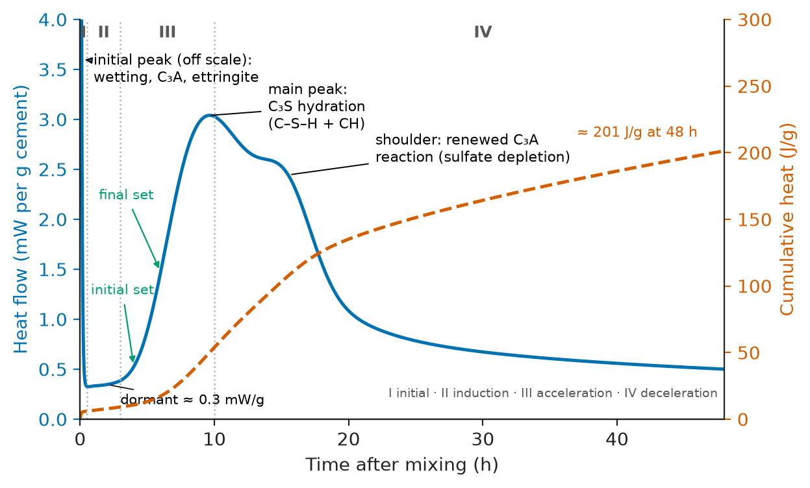
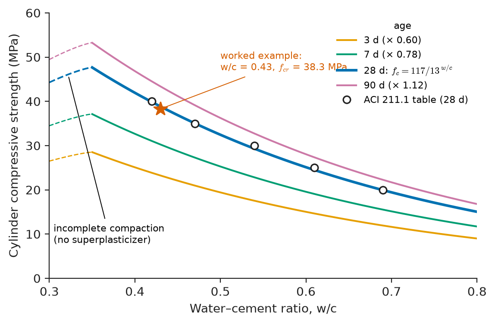
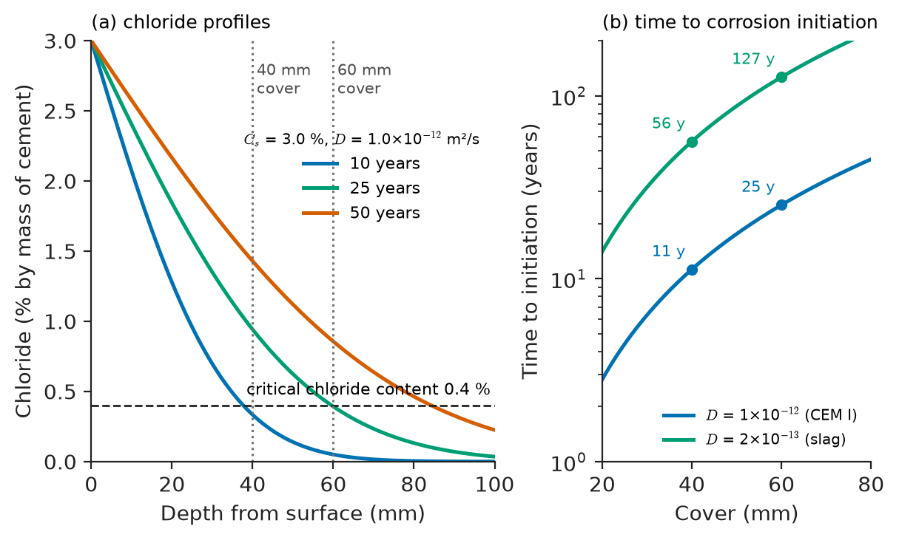
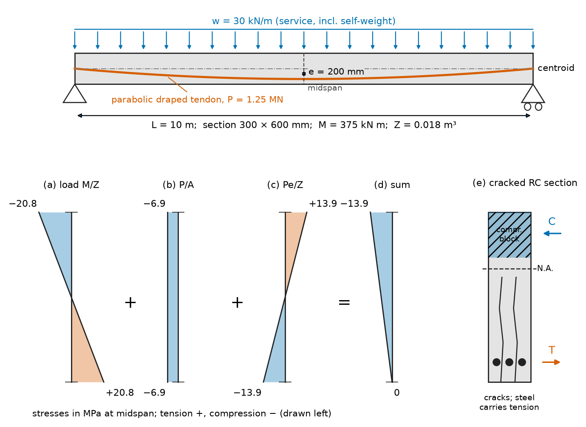
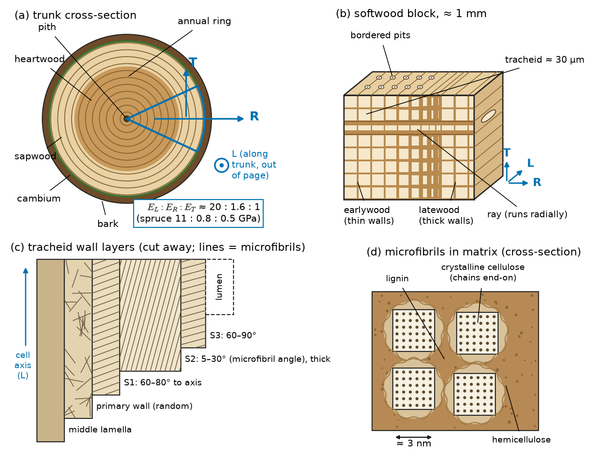
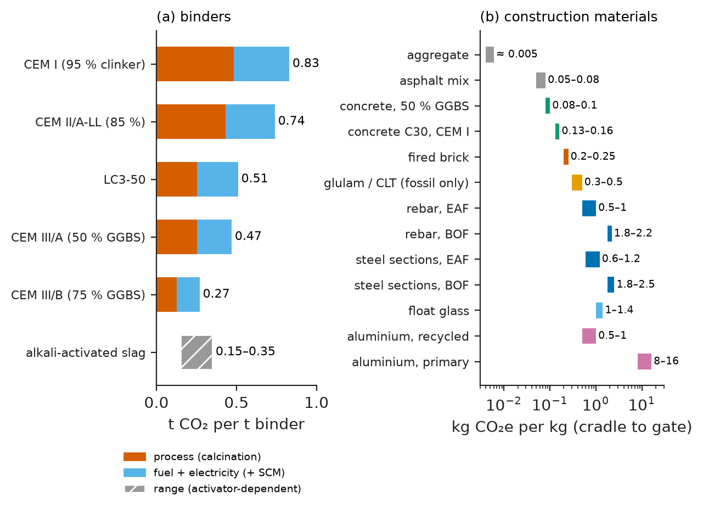

# Chapter 18 — Cement, Concrete and Construction Materials

*Part IV · Metals, Ceramics and Construction Materials*

A multi-storey car park built in the late 1960s is inspected after a winter in which pieces of concrete fell from the soffit of an upper deck. Behind the spalls the reinforcing bars are rusted, in places down to half their original diameter; brown streaks run from cracks along the lines of the bars; a hammer sounds hollow over large areas. Laboratory tests on cores show that the concrete is still as strong in compression as the day it was cast. The problem lies elsewhere: forty winters of de-icing salt carried in on car tyres have soaked chloride into the deck, the chloride has reached the steel through a cover of only 25 mm of rather porous concrete, and the steel, no longer protected by the alkalinity of the cement paste, has corroded. Rust occupies several times the volume of the steel it replaces, so the corroding bars have split the concrete off from inside.

The structure did not fail because a strength was exceeded. It failed because a *transport property* (how fast chloride moves through a porous ceramic) and an *electrochemical* one (when steel in that ceramic stops being passive) were ignored when the water–cement ratio and cover were chosen. Construction materials are used in quantities that dwarf all others (about 30 billion tonnes of concrete a year), made from local, variable raw materials, cured outdoors and expected to last 50–120 years: the materials science of large volumes, long times and real environments.

> **How does a powder mixed with water become a stone, and what decides the strength and durability of that stone?**
> **How do steel, timber, asphalt and masonry complement concrete, and how can construction cut its carbon footprint?**

| Concept | Engineering destination |
|---|---|
| Clinker phases and hydration chemistry | Cement type selection, heat of hydration in massive pours, setting time |
| Water–cement ratio, mix design, curing | Strength class, workability, specification of concrete for any structure |
| Pore structure and transport | Cover depth, durability class, service-life design |
| Carbonation, chlorides, ASR, freeze–thaw | Bridge decks, marine structures, car parks, dams, pavements |
| Reinforced and prestressed concrete | Beams, slabs, bridges, tanks, towers |
| Structural steel grades and specifications | Frames, bridges, rebar, prestressing strand, toughness at low temperature |
| Wood anatomy, moisture, engineered wood | Timber frames, glulam and CLT buildings, joinery |
| Bitumen rheology and asphalt mix design | Road pavements, runways, waterproofing |
| Brick, mortar and stone | Masonry walls, heritage conservation |
| Embodied carbon and low-carbon binders | Specifying and designing for net-zero construction |

**Roadmap.** Portland cement and its hydration (18.1) → concrete as an engineered composite: mix design, strength and curing (18.2) → durability (18.3) → reinforced and prestressed concrete (18.4) → structural steel (18.5) → timber (18.6) → asphalt (18.7) → masonry and stone (18.8) → low-carbon cements and sustainability (18.9).

---

## 18.1 Portland cement

### Making clinker

Portland cement is made by heating a finely ground mixture of limestone (about 80 %) and clay or shale (about 20 %), with small corrections of sand, iron ore or bauxite, to about 1450 °C in a rotary kiln. In the preheater and calciner the limestone decomposes,

$$
\mathrm{CaCO_3}\rightarrow\mathrm{CaO}+\mathrm{CO_2}
$$

and the lime reacts with the silica, alumina and iron oxide, helped by 20–30 % of melt as in liquid-phase sintering (Chapter 17). The **clinker** nodules are cooled rapidly and ground with 3–5 % gypsum (CaSO₄·2H₂O) to a powder of 300–500 m²/kg (particles mostly 1–50 μm).

Cement chemistry uses a shorthand for the oxides: C = CaO, S = SiO₂, A = Al₂O₃, F = Fe₂O₃, H = H₂O, $\bar{\mathrm{S}}$ = SO₃. The clinker consists of four main phases:

| Phase (mineral name) | Formula | Typical content (wt%) | Rate of hydration | Contribution |
|---|---|---|---|---|
| C₃S (alite) | Ca₃SiO₅ | 50–70 | Fast (hours to weeks) | Early and most of the 28-day strength |
| C₂S (belite) | Ca₂SiO₄ | 15–30 | Slow (weeks to years) | Late strength, low heat |
| C₃A (aluminate) | Ca₃Al₂O₆ | 5–10 | Very fast (minutes) | Flash set if uncontrolled; sulfate-attack susceptibility |
| C₄AF (ferrite) | Ca₂(Al,Fe)₂O₅ | 5–15 | Moderate | Little strength; grey colour |

The real phases are impure solid solutions measured by quantitative XRD (Chapter 52), but the phase content is still estimated routinely from the oxide analysis by the **Bogue calculation**, which assumes ideal phase compositions.

**Worked example — Bogue phase composition.** A clinker-based cement has the oxide analysis CaO 64.5 %, SiO₂ 21.0 %, Al₂O₃ 5.5 %, Fe₂O₃ 3.0 %, SO₃ 2.8 % (free lime neglected). With the Bogue equations for $\mathrm{Al_2O_3/Fe_2O_3}>0.64$,

$$
\mathrm{C_3S}=4.071\,\mathrm{C}-7.600\,\mathrm{S}-6.718\,\mathrm{A}-1.430\,\mathrm{F}-2.852\,\bar{\mathrm{S}}
$$

$$
\mathrm{C_2S}=2.867\,\mathrm{S}-0.7544\,\mathrm{C_3S},\qquad \mathrm{C_3A}=2.650\,\mathrm{A}-1.692\,\mathrm{F},\qquad \mathrm{C_4AF}=3.043\,\mathrm{F}
$$

we obtain C₃S $=262.6-159.6-36.9-4.3-8.0=53.8$ %, C₂S $=60.2-40.6=19.7$ %, C₃A $=14.6-5.1=9.5$ %, C₄AF $=9.1$ %, totalling 92 % (the rest is gypsum, MgO, alkalis and minor phases). This is an ordinary CEM I / ASTM Type I cement. Taking typical heats of complete hydration of 500 J/g for C₃S, 260 J/g for C₂S, 870 J/g for C₃A and 420 J/g for C₄AF, its ultimate heat of hydration is about 440 J/g, roughly 300–350 J/g of it in the first week. In a 2 m thick raft the core can heat by 40–60 K and later crack against the cooler surface, so massive pours use low-heat cements, slag or fly ash, chilled water or cooling pipes.

> **Status of the principle: Bogue calculation**
> *Approximate.* Exact stoichiometry if the four phases had their ideal compositions and formed at equilibrium; real solid-solution phases and non-equilibrium cooling make it typically underestimate alite and overestimate belite by several percent.

### Hydration chemistry

When cement is mixed with water, its anhydrous phases dissolve and less soluble hydrates precipitate. The idealized reactions are:

$$
2\,\mathrm{C_3S}+6\,\mathrm{H}\rightarrow\mathrm{C_3S_2H_3}+3\,\mathrm{CH}
$$

$$
2\,\mathrm{C_2S}+4\,\mathrm{H}\rightarrow\mathrm{C_3S_2H_3}+\mathrm{CH}
$$

$$
\mathrm{C_3A}+3\,\mathrm{C\bar{S}H_2}+26\,\mathrm{H}\rightarrow\mathrm{C_6A\bar{S}_3H_{32}}\ \text{(ettringite)}
$$

$$
2\,\mathrm{C_3A}+\mathrm{C_6A\bar{S}_3H_{32}}+4\,\mathrm{H}\rightarrow3\,\mathrm{C_4A\bar{S}H_{12}}\ \text{(monosulfate)}
$$

Here CH is portlandite, Ca(OH)₂, and "C₃S₂H₃" stands for **calcium silicate hydrate**, written C–S–H because its composition varies. Without gypsum, C₃A causes a "flash set" within minutes; gypsum coats it with ettringite and gives hours of working time.

Isothermal calorimetry shows the stages of hydration (Figure 18.1): a brief initial peak; an **induction period** of 1–3 h in which the concrete stays workable; an **acceleration period** in which C₃S hydrates, C–S–H and CH grow, and the paste sets; and a **deceleration period**, lasting weeks to years, as hydration becomes diffusion-limited.

<!-- FIGURE 18.1 | figures/ch18/fig-18-1-hydration-calorimetry.png | plot | Rate of heat release during hydration of a Portland cement paste at 20 °C, measured by isothermal calorimetry, with the cumulative heat. | Content: x-axis time after mixing 0–48 h; left y-axis heat flow 0–4 mW per g cement; right y-axis cumulative heat 0–300 J/g. Heat flow curve: sharp initial peak (off-scale, labelled "wetting, C3A dissolution, ettringite") in the first minutes; low dormant period 1–3 h (~0.3 mW/g); main peak (C3S hydration) rising to ~3 mW/g at ~9–10 h; shoulder at ~14–18 h labelled "renewed C3A reaction (sulfate depletion)"; decay to ~0.5 mW/g at 48 h. Cumulative curve rising to ~200 J/g at 48 h. Mark stages I–IV: initial, induction, acceleration, deceleration; mark initial and final set with arrows at ~4 h and ~6 h. -->

*Figure 18.1 — Rate of heat release during hydration of a Portland cement paste at 20 °C, measured by isothermal calorimetry, with the cumulative heat.*

### C–S–H and the pore structure

C–S–H, 50–60 % of a mature paste, is the glue of concrete: a poorly crystalline, layered calcium silicate hydrate (Ca/Si about 1.7, related to tobermorite and jennite) formed as nanometre globules with a specific surface of 100–700 m²/g and an intrinsic **gel porosity** of about 28 % in 0.5–10 nm pores. CH forms large crystals that add little strength but buffer the pore solution at pH 12.5–13.5, which keeps reinforcing steel passive.

Hydrates occupy about 2.1 times the volume of the cement they replace, so they progressively fill the water-filled space between grains; what remains is **capillary porosity**, pores from about 10 nm to 10 μm. Powers' classic model of paste volumes gives the capillary porosity of a paste with water–cement ratio $w/c$ at degree of hydration $\alpha$ approximately as

$$
\phi_{\mathrm{cap}}\approx\frac{w/c-0.36\,\alpha}{w/c+0.32}
$$

For $w/c=0.45$, $\phi_{\mathrm{cap}}$ is about 26 % at $\alpha=0.7$ and about 16 % at $\alpha=0.9$; for $w/c=0.60$ and $\alpha=0.9$ it is 30 %. Complete hydration needs $w/c\approx0.38$–$0.42$; below that some cement never hydrates (and acts as a stiff filler), while above it the excess water leaves capillary pores. When the capillary porosity falls below roughly 20 %, the pores lose their connectivity and the paste becomes much less permeable. Almost every property of concrete follows from this one picture: strength from the solid fraction, durability from the connectivity of capillary pores.

> **Status of the principle: Powers' model of paste volumes**
> *Approximate.* A volume balance using average densities and water contents of hydrates measured in the 1940s; it gives porosity and its trends with $w/c$ and hydration well for Portland cement pastes, but not for blended cements with different hydrates or for the microstructure near aggregates.

### Types of cement

Adjusting the phase balance and fineness gives the standard types: ordinary (CEM I, ASTM Type I), moderate and high sulfate resistance (low C₃A; Types II and V), high early strength (finer, more C₃S; Type III) and low heat (more C₂S; Type IV). Blended cements (EN CEM II–V) replace 6–95 % of the clinker with limestone, fly ash, slag or pozzolana (Section 18.9).

> **Boundary.** The thermodynamics of the clinkering reactions and hydration equilibria belong to Advanced Chemistry; phase relations in CaO–SiO₂–Al₂O₃ are treated with ternary diagrams in Chapter 7.

---

## 18.2 Concrete

### Constituents

Concrete is a particulate composite: hydrated cement paste binding coarse aggregate (gravel or crushed rock, 4–20 mm or larger) and sand. Per cubic metre it typically contains 300–450 kg of cement, 150–200 kg of water and about 1700–1900 kg of aggregate, which fills 65–75 % of the volume and reduces the amount of paste, the part that is expensive, shrinks and generates heat.

**Superplasticizers** (today polycarboxylate ethers with comb-like side chains) disperse cement particles by electrostatic and steric repulsion (Chapter 37) and cut the water needed by 10–40 %; **air-entraining agents** stabilize bubbles for frost resistance; **retarders** and **accelerators** adjust setting. **Supplementary cementitious materials** (SCMs) replace part of the cement: **fly ash** and **silica fume** are pozzolans whose silica reacts with CH to form more C–S–H, and **ground granulated blast-furnace slag** (GGBS) is latently hydraulic. SCMs refine the pores and cut heat and CO₂, at the cost of slower early strength.

### The water–cement ratio

The single most important number in concrete technology is the **water–cement ratio** by mass (or water–binder ratio when SCMs are included). In 1918 Duff Abrams found that, for workable, fully compacted concrete made with given materials, the compressive strength depends almost only on $w/c$:

$$
f_c=\frac{A}{B^{\,w/c}}
$$

where $A$ and $B$ are empirical constants for given materials, age and curing. Fitting the 28-day cylinder strengths that ACI 211.1 tabulates for non-air-entrained concrete gives $A\approx117$ MPa and $B\approx13$: then $w/c=0.42$ gives 40 MPa, $w/c=0.54$ gives 29 MPa and $w/c=0.69$ gives 20 MPa (Figure 18.2). The physics is Powers' porosity: less water means less capillary space and a denser, stronger paste. Powers expressed this through the **gel–space ratio**, the volume of hydration products divided by the volume available to them, $X=0.68\alpha/(0.32\alpha+w/c)$, finding that mortar strength scales roughly as $X^3$; strength depends on solid fraction just as for porous ceramics (Chapter 17).

> **Status of the principle: Abrams' law**
> *Empirical.* A fit for fully compacted concrete of given materials and curing; it fails for incompletely compacted mixes (too little water to place the concrete properly), for very high-strength concrete where the aggregate or the interfacial zone limits strength, and the constants must be recalibrated for each set of materials.

Without admixtures, a mix with $w/c=0.35$ is too stiff to compact, and its voids make it weaker. Superplasticizers removed this limit: $w/c$ of 0.25–0.35 with silica fume gives 80–120 MPa, and ultra-high-performance concretes ($w/b$ about 0.2, steel fibres) reach 150–200 MPa.

<!-- FIGURE 18.2 | figures/ch18/fig-18-2-strength-wc-ratio.png | plot | Compressive strength of concrete versus water–cement ratio (Abrams' law) at 3, 7, 28 and 90 days, with the low-w/c limit set by compaction. | Content: x-axis w/c ratio 0.30–0.80; y-axis cylinder compressive strength 0–60 MPa. 28-day curve fc = 117/13^(w/c): 47.7 MPa at 0.35, 39.8 at 0.42, 32.4 at 0.50, 25.1 at 0.60, 19.4 at 0.70. Curves at other ages scaled by exp{0.25[1 − (28/t)^0.5]}: 3 d ×0.60, 7 d ×0.78, 90 d ×1.12. ACI 211.1 tabulated points (0.42, 40), (0.47, 35), (0.54, 30), (0.61, 25), (0.69, 20) as open circles on the 28-day curve. Dashed line bending down below w/c ≈ 0.35 labelled "incomplete compaction (no superplasticizer)". Mark the worked-example point w/c = 0.43, fcr = 38.3 MPa. -->

*Figure 18.2 — Compressive strength of concrete versus water–cement ratio (Abrams' law) at 3, 7, 28 and 90 days, with the low-w/c limit set by compaction.*

### Mix design

Mix design chooses proportions to reach a required strength, workability and durability at least cost. Durability usually sets a maximum $w/c$ and a minimum cement content for each **exposure class** (in EN 206, for example, $w/c\leq0.45$ for concrete exposed to seawater or de-icing salts); strength sets a target $w/c$ from Abrams' relation; workability sets the water content per cubic metre; and the remaining volume is filled with aggregate.

**Worked example — Proportioning a C30 concrete.** A bridge pier needs a specified cylinder strength $f_c'=30$ MPa, a slump of 75–100 mm and 20 mm maximum aggregate, and will be exposed to moderate freezing without de-icing salts. Following the absolute-volume method of ACI 211.1:

1. *Target mean strength.* With no production records, ACI adds 8.3 MPa to cover variability: $f_{cr}=38.3$ MPa.
2. *Water–cement ratio.* Inverting Abrams' fit, $w/c=\ln(117/38.3)/\ln13=1.117/2.565=0.435$; take 0.43.
3. *Water.* For 75–100 mm slump and 20 mm aggregate, about 190 kg/m³ (2 % entrapped air).
4. *Cement.* $190/0.43=442$ kg/m³.
5. *Coarse aggregate.* For a sand of fineness modulus 2.8 and 20 mm aggregate, 0.62 m³ of dry-rodded coarse aggregate per cubic metre; at a rodded density of 1600 kg/m³ this is 992 kg.
6. *Sand by absolute volume.* With specific gravities of 3.15 (cement), 2.68 (coarse) and 2.64 (sand), the volumes are water 0.190 m³, cement $442/3150=0.140$ m³, coarse aggregate $992/2680=0.370$ m³ and air 0.020 m³, total 0.720 m³. Sand fills the remaining 0.280 m³: $0.280\times2640=738$ kg.

The batch is 442 kg cement, 190 kg water, 738 kg sand and 992 kg gravel per cubic metre, a fresh density of about 2360 kg/m³, to be corrected for aggregate moisture and trial-batched. For freezing exposure about 5 % entrained air would be added, its strength penalty (roughly 5 % per 1 % air) offset by a lower $w/c$; in practice part of the cement would also be replaced by slag or fly ash (Section 18.9).

### Strength development and curing

Concrete gains strength as long as hydration continues, quickly at first, then more slowly. A common model (fib Model Code) for normal cement at 20 °C is

$$
f_c(t)=f_c(28)\exp\left\{s\left[1-\left(\frac{28}{t}\right)^{1/2}\right]\right\}
$$

with $t$ in days and $s=0.25$ for normal-hardening cement (0.20 for rapid-hardening, 0.38 for slow cements). It predicts 60 % of the 28-day strength at 3 days, 78 % at 7 days and 112 % at 90 days. Temperature accelerates hydration, and the **maturity method** combines time and temperature into an equivalent age (by a Nurse–Saul temperature–time sum, or an Arrhenius equivalent age with an apparent activation energy of 30–45 kJ/mol), so that the in-place strength of a slab can be estimated from embedded temperature loggers and the formwork stripped safely.

Hydration needs water. **Curing** keeps the concrete moist for typically 3–7 days (longer with slag and fly ash); if the surface dries, hydration stops there and the outer 20–50 mm, the cover that protects the steel, stays porous. Steam curing of precast at 50–70 °C speeds stripping, but above about 70 °C risks expansive **delayed ettringite formation**.

Concrete also changes volume: **drying shrinkage** of typically 300–800 microstrain, **autogenous shrinkage** at low $w/c$, and **creep** under sustained load of 1.5–3 times the elastic strain. These viscoelastic responses of C–S–H (Chapter 14) set crack-control reinforcement and prestress losses (Section 18.4).

---

## 18.3 Durability

### Transport is the key

Nearly all deterioration requires water, CO₂, chloride, sulfate or oxygen to enter by permeation, diffusion (Chapter 8) or capillary suction, at rates set by the connectivity of the capillary pores; **low $w/c$, good curing, SCMs and sufficient cover** are the generic defences. Typical chloride diffusion coefficients are $10^{-11}$ m²/s for poor concrete, $10^{-12}$ m²/s for good CEM I concrete at $w/c$ around 0.4–0.45, and $10^{-13}$–$3\times10^{-13}$ m²/s for slag or fly-ash concretes.

### Steel in concrete: passivation and its loss

Above pH about 11.5, steel in concrete carries a nanometre-thick passive film (Chapter 42). Two processes destroy it.

**Carbonation.** Atmospheric CO₂ diffuses into the concrete and reacts with CH and C–S–H:

$$
\mathrm{Ca(OH)_2}+\mathrm{CO_2}\rightarrow\mathrm{CaCO_3}+\mathrm{H_2O}
$$

The pH drops from about 13 to below 9 behind a front that advances as $x=K\sqrt t$, since CO₂ must diffuse through the carbonated layer. $K$ is 1–2 mm/yr$^{1/2}$ for dense concrete and 3–6 for ordinary concrete; with $K=4$ the front reaches 25 mm in $(25/4)^2=39$ years and 40 mm in 100 years.

**Chloride attack.** Chlorides from seawater or de-icing salts break the passive film locally once they exceed a **critical chloride content** at the steel, typically 0.2–0.5 % by mass of cement (often 0.4 %), even at high pH, causing pitting (Chapter 43). Ingress is commonly modelled with the error-function solution of Fick's second law for a constant surface concentration $C_s$:

$$
C(x,t)=C_s\left[1-\operatorname{erf}\left(\frac{x}{2\sqrt{D\,t}}\right)\right]
$$

> **Status of the principle: Error-function model of chloride ingress**
> *Approximate.* Fick's second law is exact for diffusion with constant $D$ and $C_s$, but chloride transport in concrete combines diffusion, convection and binding, $D$ decreases with age (especially for SCM concretes), and $C_s$ builds up over years; service-life codes add an empirical ageing exponent and probabilistic inputs.

**Worked example — Time to corrosion of a car-park deck.** A deck exposed to de-icing salts has a surface chloride content of $C_s=3.0$ % by mass of cement, a critical content of $C_{\mathrm{crit}}=0.4$ %, and an apparent diffusion coefficient $D=1.0\times10^{-12}$ m²/s. When does chloride reach the critical level at a cover of 40 mm?

Corrosion initiates when $C(x,t)/C_s=0.4/3.0=0.133$, i.e. when $\operatorname{erf}(z)=0.867$ with $z=x/(2\sqrt{Dt})$. The inverse error function gives $z=1.061$. Hence

$$
t=\frac{1}{D}\left(\frac{x}{2z}\right)^2=\frac{1}{10^{-12}}\left(\frac{0.040}{2\times1.061}\right)^2=3.55\times10^{8}\ \mathrm{s}\approx11\ \mathrm{years}
$$

With 60 mm cover it is about 25 years; with a slag concrete of $D=2\times10^{-13}$ m²/s, about 56 years at 40 mm and 127 years at 60 mm (Figure 18.3). The time to initiation scales with the square of the cover and inversely with $D$, the two levers of durability design; in the car park of the opening, with 25 mm of porous cover, it took only a few years.

<!-- FIGURE 18.3 | figures/ch18/fig-18-3-chloride-profiles.png | plot | Chloride content versus depth in concrete after 10, 25 and 50 years for a surface content of 3.0 % by mass of cement and D = 1.0e-12 m²/s, with the critical threshold and two cover depths. | Content: x-axis depth 0–100 mm; y-axis chloride content 0–3.0 % by mass of cement. Three erf curves: 10 y (2.07 % at 10 mm, 1.28 at 20 mm, 0.33 at 40 mm, 0.05 at 60 mm), 25 y (2.40, 1.84, 0.94 at 40 mm, 0.39 at 60 mm, 0.13 at 80 mm), 50 y (2.58, 2.17, 1.43 at 40 mm, 0.86 at 60 mm, 0.46 at 80 mm). Horizontal dashed line at 0.4 % labelled "critical chloride content". Vertical dotted lines at 40 mm and 60 mm cover labelled "cover". Inset or second panel: time to initiation (years, log axis 1–200) versus cover 20–80 mm for D = 1e-12 (11 y at 40 mm, 25 y at 60 mm) and D = 2e-13 (56 y at 40 mm, 127 y at 60 mm). -->

*Figure 18.3 — Chloride content versus depth in concrete after 10, 25 and 50 years for a surface content of 3.0 % by mass of cement and D = 1.0e-12 m²/s, with the critical threshold and two cover depths.*

Rust occupies two to six times the volume of the steel consumed, so 0.02–0.1 mm of section loss cracks the cover, which then spalls. Protection is, in order of preference: good concrete and cover (EN 1992 asks 40–55 mm for de-icing and marine exposure over 50 years), SCMs, silane impregnation, inhibitors, coated or stainless bars, and cathodic protection (Chapter 43).

### Sulfate attack and alkali–silica reaction

**Sulfate attack**: sulfates from soil or seawater react with monosulfate and CH to form expansive ettringite and gypsum (or, cold and wet, **thaumasite**, which destroys C–S–H). Defences are low-C₃A cements, slag, fly ash and low $w/c$.

**Alkali–silica reaction** (ASR), identified by Stanton in 1940, attacks aggregates with poorly crystalline or strained silica (opal, chert, volcanic glass). The alkaline pore solution dissolves it into a gel that absorbs water and swells, map-cracking dams, bridges and pavements over decades. ASR needs reactive aggregate, alkali above about 3 kg/m³ Na₂O-equivalent, and relative humidity above about 80 %; removing any one prevents it.

### Freeze–thaw

Water expands by 9 % on freezing; in saturated paste, ice in larger pores drives water through fine pores and builds hydraulic pressure (Powers' mechanism), cracking the paste and scaling the surface, worse with de-icing salts. The cure, found empirically in the 1930s, is **air entrainment**: 4–7 % by volume of 10–1000 μm bubbles, with no point in the paste more than about 0.2 mm (the **spacing factor**) from an empty bubble into which water can escape.

> **Boundary.** The electrochemistry of steel corrosion in concrete (passivity, pitting, cathodic protection) is developed in Chapters 42–43; degradation of concrete compared with other materials, and failure investigation, in Chapter 44.

---

## 18.4 Reinforced and prestressed concrete as a composite

### Why reinforce

Concrete is strong in compression (20–100 MPa) but its tensile strength is only about a tenth of that, $f_{ctm}=0.30f_{ck}^{2/3}$ in Eurocode 2, or 2.9 MPa for C30/37, and it breaks at about 0.01 % tensile strain. Steel bars carry the tension once the concrete has cracked. The composite works because of four coincidences: **compatible expansion** (both about 10–12 × 10⁻⁶ K⁻¹); **bond** of paste to the ribs of deformed bars; **chemical protection** of steel by the alkaline paste; and **complementary failure**, ductile steel yielding before the concrete crushes in an under-reinforced section, giving warning before collapse.

Before cracking, the section is analysed as a composite with **modular ratio** $n=E_s/E_c$; with $E_{cm}=22[(f_{ck}+8)/10]^{0.3}$ GPa $=32.8$ GPa for C30/37, $n\approx6$, and the steel is replaced by $n$ times its area of concrete (the **transformed section**). After cracking, the steel carries all the tension across each crack; crack widths are limited to about 0.3 mm by using many small bars, and at the ultimate limit state the steel yields while the concrete reaches a crushing strain of 0.35 %.

### Prestressed concrete

Cracking can be avoided by putting the concrete into compression *before* it is loaded: **prestressing**, made practical by Freyssinet in the 1930s. Tendons of 1860 MPa strand are tensioned against abutments before casting and released after hardening (**pre-tensioning**: hollow-core slabs, sleepers, girders) or jacked through ducts in hardened concrete and grouted (**post-tensioning**: long-span bridges, slabs, tanks). Placed below the centroid, the tendon applies an axial compression and a moment opposing the load.

Only high-strength steel works, because elastic shortening, creep and shrinkage of the concrete, steel relaxation and friction cause **losses** of typically 15–25 %. A creep-plus-shrinkage strain of 0.8 ‰ costs $200\,000\times0.0008=160$ MPa of prestress: most of the 250 MPa yield of mild steel, but only about 12 % of the 1395 MPa initial stress in a strand.

**Worked example — Prestressing a beam to eliminate tension.** A simply supported beam spans 10 m with a rectangular section 300 mm wide and 600 mm deep, and carries a total uniform service load of 30 kN/m (including its self-weight). The midspan moment is $M=wL^2/8=30\times10^2/8=375$ kN m. The section has $A=0.18$ m² and elastic section modulus $Z=bh^2/6=0.018$ m³, so the bending stress at the bottom fibre is $M/Z=20.8$ MPa in tension. That is seven times the tensile strength of C30/37 concrete; without reinforcement the beam would crack at about 14 % of the service load.

Now apply a prestress force $P$ at an eccentricity $e=200$ mm below the centroid. The bottom-fibre stress at midspan is

$$
\sigma_{\mathrm{bot}}=-\frac{P}{A}-\frac{Pe}{Z}+\frac{M}{Z}
$$

(tension positive). For zero tension, $P(1/A+e/Z)=M/Z$, i.e. $P(5.56+11.11)\ \mathrm{m^{-2}}=20.8$ MPa, so $P=1.25$ MN. The top fibre is then at $-P/A+Pe/Z-M/Z=-6.9+13.9-20.8=-13.9$ MPa, a compression below the usual service limit of $0.6f_{ck}=18$ MPa. If the strand is stressed initially to $0.75\times1860=1395$ MPa and 20 % is lost over time, the effective stress is 1116 MPa, and the strand area needed is $1.25\times10^6/1116=1120$ mm², eight 15.2 mm strands of 140 mm² each. There is a catch at transfer, before the full load acts: with only the self-weight of 4.5 kN/m, the top fibre would be in *tension* of about 3.8 MPa, above $f_{ctm}$. Designers handle this by draping the tendon (reducing $e$ towards the supports), adding top reinforcement, or staging the prestress (Figure 18.4).

> **Status of the principle: Elastic superposition of prestress and load stresses**
> *Approximate.* Valid for an uncracked, linearly elastic section under service loads; it ignores creep redistribution with time and does not describe the ultimate limit state, where the section is cracked and the tendon stress rises towards its strength.

<!-- FIGURE 18.4 | figures/ch18/fig-18-4-prestress-stresses.png | schematic | Stress distributions at midspan of the worked-example beam: load alone, prestress alone and combined, plus a reinforced (cracked) section for comparison. | Content: elevation of a 10 m simply supported beam with a parabolic draped tendon (e = 200 mm at midspan, ~0 at supports) and uniform load 30 kN/m. Below, four stress-block diagrams over the 600 mm depth: (a) load only: +20.8 MPa bottom (tension), −20.8 top; (b) axial prestress P/A: −6.9 uniform; (c) prestress bending Pe/Z: +13.9 top, −13.9 bottom; (d) sum: 0 at bottom, −13.9 MPa top. Separate small panel (e): cracked reinforced section with compression block at top, neutral axis, tension crack below, steel force T at the bars. Sign convention: compression negative, drawn to the left. -->

*Figure 18.4 — Stress distributions at midspan of the worked-example beam: load alone, prestress alone and combined, plus a reinforced (cracked) section for comparison.*

Prestressed concrete is crack-free in service and spans 30–50 m as girders and over 200 m in segmental box-girder bridges. Its vulnerability is the tendon: highly stressed high-strength steel suffers stress-corrosion cracking and hydrogen embrittlement (Chapter 43) where grouting is incomplete, a cause of several bridge collapses.

---

## 18.5 Structural steels and their specifications

Steel is the second structural material of the built environment, in the frames of buildings and bridges, as reinforcement and as prestressing tendons. The physical metallurgy of steels (ferrite, pearlite, quenching and tempering, microalloying) is the subject of Chapter 15; here we look at how construction steels are specified, which is where materials science meets building codes.

### Hot-rolled structural steels

Structural steels are low-carbon (≤ 0.20–0.24 % C), carbon–manganese or microalloyed steels whose strength comes from ferrite grain size, solid solution and fine Nb, V or Ti carbonitride precipitates (Chapter 13). They are specified not by composition but by guaranteed mechanical properties and weldability.

| Grade | Standard | Minimum yield (MPa, $t\leq16$ mm) | Tensile strength (MPa) | Charpy impact requirement | Notes |
|---|---|---|---|---|---|
| S235JR | EN 10025-2 | 235 | 360–510 | 27 J at +20 °C | General, non-critical |
| S275J0 | EN 10025-2 | 275 | 410–560 | 27 J at 0 °C | Building frames |
| S355J2 | EN 10025-2 | 355 | 470–630 | 27 J at −20 °C | The standard bridge and building grade |
| S355K2 | EN 10025-2 | 355 | 470–630 | 40 J at −20 °C | Thicker or more critical members |
| S460M | EN 10025-4 | 460 | 540–720 | 40 J at −20 °C | Thermomechanically rolled; low carbon equivalent |
| S355J2W | EN 10025-5 | 355 | 470–630 | 27 J at −20 °C | Weathering steel (Cu, Cr, Ni, P) |
| ASTM A36 | ASTM | 250 | 400–550 | Supplementary | US general grade |
| ASTM A992 | ASTM | 345–450 | ≥ 450 | Supplementary | US wide-flange sections; yield-to-tensile ratio ≤ 0.85 |

The designation encodes the design data. "S355" is the minimum yield strength in MPa, which falls with thickness (345 MPa for 16–40 mm) because thick sections cool slowly and have coarser grains. "J2" and "K2" guarantee Charpy energy at a temperature, the codified response to the ductile–brittle transition of BCC iron (Chapter 14) and to the brittle fractures of welded ships and bridges in the 1940s–50s; EN 1993-1-10 tabulates permissible thickness by grade and service temperature. "M" and "N" denote thermomechanically rolled and normalized steels, "Z" grades guarantee through-thickness ductility, and a maximum carbon equivalent keeps welds from cracking (Chapter 47). **Weathering steels** form a protective patina in wet–dry cycles. Seismic frames need steel that work hardens after yield and does not greatly exceed its nominal yield, hence the cap on yield-to-tensile ratio in A992.

### Reinforcing and prestressing steels

| Product | Typical grade | Strength (MPa) | Ductility requirement | Notes |
|---|---|---|---|---|
| Reinforcing bar | B500B (EN 10080 / EN 1992) | $f_{yk}=500$ | $f_t/f_y\geq1.08$, uniform elongation $\geq5$ % | Quenched and self-tempered (Tempcore: martensitic rim, ferrite–pearlite core) or microalloyed |
| Reinforcing bar, seismic | B500C | $f_{yk}=500$ | $1.15\leq f_t/f_y<1.35$, uniform elongation $\geq7.5$ % | High ductility class for seismic regions |
| Reinforcing bar (US) | ASTM A615 Grade 60; A706 | $f_y=420$ | A706: controlled chemistry for welding and seismic use | |
| Prestressing strand | 7-wire, ASTM A416 Grade 270 / EN 10138 Y1860 | $f_{pu}=1860$ | Low relaxation (≤ 2.5 % at 70 % UTS after 1000 h) | Cold-drawn pearlitic eutectoid steel, stress-relieved |

Prestressing wire is eutectoid steel, patented to fine pearlite and cold drawn until the ferrite lamellae are tens of nanometres thick, giving 1700–2000 MPa.

### Fire

By Eurocode 3, structural steel keeps about 60 % of its yield strength at 550 °C and 47 % at 600 °C, so a member loaded to about 60 % of capacity fails near 550 °C, reached by an unprotected section in 10–20 minutes of a standard fire; intumescent paints, boards or encasement protect it. Dense high-strength concrete can spall explosively as steam builds in its pores, countered by polypropylene fibres that melt and open escape paths.

---

## 18.6 Timber

### Wood structure

Wood is a natural cellular, fibre-reinforced polymer composite. Seasonal growth at the cambium produces **annual rings** of thin-walled **earlywood** and dense **latewood**, made of long hollow cells aligned with the trunk. In **softwoods** (spruce, pine, fir) about 90 % of the volume is **tracheids**, cells 2–5 mm long and 20–50 μm across; **hardwoods** (oak, beech, eucalyptus, and also balsa: the term is botanical) have wide **vessels** for conduction and thick-walled **fibres** for strength.

The cell wall is itself a composite (Figure 18.5): partly crystalline **cellulose** microfibrils, 3–4 nm across with an axial modulus of about 130 GPa, in a matrix of **hemicellulose** and **lignin**. In the thick S2 layer they wind at only 5–30° to the cell axis (the **microfibril angle**), which controls stiffness as ply angle does in a laminate (Chapter 22): juvenile wood near the pith, with large angles, is compliant and shrinks lengthwise.

<!-- FIGURE 18.5 | figures/ch18/fig-18-5-wood-hierarchy.png | schematic | Hierarchical structure of softwood from the trunk to the cellulose microfibril, with the principal axes L, R and T. | Content: four linked panels. (a) Log cross-section showing pith, heartwood, sapwood, cambium, bark, annual rings; principal axes L (along trunk), R (radial), T (tangential) drawn on a cut wedge. (b) Cube of softwood (~1 mm) showing tracheids (rectangular cells 30 μm wide) in earlywood (thin walls, large lumens) and latewood (thick walls), a ray running radially, and bordered pits. (c) Single tracheid cell-wall layers: middle lamella, primary wall, S1 (microfibrils near 60–80° to axis), S2 (thick, 5–30°, labelled "microfibril angle"), S3. (d) Microfibril: crystalline cellulose core (~3 nm) with hemicellulose and lignin matrix. Annotate stiffness ratios E_L : E_R : E_T ≈ 20 : 1.6 : 1. -->

*Figure 18.5 — Hierarchical structure of softwood from the trunk to the cellulose microfibril, with the principal axes L, R and T.*

### Anisotropy and strength

The tubular, aligned structure makes wood strongly anisotropic. For clear (defect-free) spruce at 12 % moisture content and a density of about 450 kg/m³, typical values are: modulus along the grain $E_L\approx11$ GPa, radial $E_R\approx0.8$ GPa and tangential $E_T\approx0.5$ GPa; tensile strength along the grain 80–100 MPa; compressive strength along the grain 40–45 MPa (cell walls buckle and kink); compression perpendicular to the grain only 4–6 MPa (cells collapse); and tensile strength across the grain only 2–3 MPa. Along the grain, wood is efficient: the specific stiffness of spruce, $11\,000/450=24$ MPa per kg/m³, almost equals that of steel ($210\,000/7850=27$), and its specific tensile strength (about 180 MPa per Mg/m³ clear) is four times that of S355 steel (45). Density is the single best predictor of the mechanical properties of wood, as for any cellular solid: stiffness and strength along the grain scale roughly linearly with density.

Knots, grain deviation and juvenile wood cut the strength of structural timber to a third or half of clear wood, with large scatter, so timber is **strength graded** (visually or by machine-measured stiffness) into classes with 5th-percentile values: C24 softwood has a characteristic bending strength of 24 MPa, a mean modulus of 11 GPa and a characteristic density of 350 kg/m³.

### Moisture

Wood is hygroscopic. Water is bound in the cell walls up to the **fibre saturation point** (about 25–30 % moisture content by dry mass) and free in the cavities above it. In service wood reaches an **equilibrium moisture content** of about 12 % at 20 °C and 65 % RH, 8–10 % in heated buildings. Losing bound water shrinks the wood very anisotropically: from green to oven-dry, typically 0.1–0.3 % longitudinally, 3–6 % radially and 6–10 % tangentially, which makes boards cup. Drying below the fibre saturation point also raises strength, by roughly 2–5 % per percent of moisture. Decay fungi need moisture contents above about 20 %, so keeping timber dry is its main protection.

**Worked example — Movement of a timber board.** A flat-sawn softwood board 200 mm wide (the width is tangential to the rings) is installed at 20 % moisture content in a heated building where it will reach 10 %. Its total tangential shrinkage from the fibre saturation point (take 28 %) to oven-dry is 7.5 %, so in the bound-water range it shrinks by about $7.5/28=0.27$ % of its width per percent of moisture content. The change of 10 percentage points gives a shrinkage of 2.7 %, or $0.027\times200=5.4$ mm. Its length changes by only millimetres over 4 m. Floors and connections must let boards move across their width; restrained shrinkage splits the wood.

> **Status of the principle: Linear shrinkage below the fibre saturation point**
> *Empirical.* Shrinkage is approximately proportional to the change in moisture content below the fibre saturation point, with species-dependent coefficients; it neglects hysteresis between wetting and drying and the gradients that develop in thick sections.

Wood also **creeps** under sustained load, especially when moisture content changes (mechano-sorptive creep); design codes multiply deflections by creep factors ($k_{\mathrm{def}}$ in Eurocode 5, 0.6–2.0 depending on service class) and reduce strengths for long-duration loads ($k_{\mathrm{mod}}$). In fire, wood **chars** at a predictable rate, about 0.65 mm/min for softwood, and the char layer insulates the core, so large timber sections retain their load capacity for a calculable time.

### Engineered wood

Engineered wood products overcome the size limits, defects and anisotropy of sawn timber by cutting the wood into smaller pieces and bonding them with adhesives (phenol–resorcinol–formaldehyde, melamine, polyurethane):

| Product | Construction | Advantages | Uses |
|---|---|---|---|
| Plywood | Thin veneers, alternate layers crossed at 90° | Near-isotropic in-plane, dimensionally stable | Sheathing, formwork, boats |
| Oriented strand board (OSB) | Strands in cross-oriented layers | Uses small, fast-growing logs | Sheathing, I-joist webs |
| Laminated veneer lumber (LVL) | Veneers, all parallel | High strength, defects dispersed | Beams, flanges |
| Glued-laminated timber (glulam) | Graded lamellae (~40 mm) bonded parallel | Large, long and curved members; high grades on the outside | Arches, portal frames, bridges |
| Cross-laminated timber (CLT) | Layers of boards crossed at 90° | Load-bearing wall and floor panels, two-way spanning | Mass-timber buildings |

Defects in each lamella or veneer fall at random positions, so engineered products are stronger and more uniform than the sawn timber they are made from: a classic weakest-link argument (Chapter 14). CLT and glulam have made **mass-timber buildings** of 18–25 storeys possible (Mjøstårnet in Norway, 85 m; Ascent in Milwaukee, 87 m), with low embodied carbon, factory prefabrication and fast erection (Section 18.9).

---

## 18.7 Asphalt and bituminous materials

### Bitumen

Most of the world's paved roads are surfaced with **asphalt concrete**: aggregate bound by **bitumen**, the vacuum-distillation residue of crude oil. Bitumen is separated into four **SARA** fractions (saturates, aromatics, resins, asphaltenes); in the **colloidal model**, nanometre clusters of polar asphaltenes are dispersed in the oily medium and stabilized by resins, and more aggregated asphaltenes give stiffer, more elastic bitumen. It is **thermoplastic and viscoelastic** (Chapter 14): a viscous liquid when hot or slowly loaded, a brittle glass ($T_g$ about −20 to −30 °C) when cold or quickly loaded, and time–temperature master curves underpin pavement design.

Bitumens are graded by empirical consistency tests or by performance:

- **Penetration**: the depth, in tenths of a millimetre, that a standard needle penetrates in 5 s at 25 °C under 100 g. Penetration grades such as 40/60, 50/70 and 70/100 cover hot to cold climates.
- **Softening point** (ring-and-ball): the temperature at which a disc of bitumen softens enough for a steel ball to sink through it, typically 43–58 °C for paving grades, corresponding to a viscosity of about 1200 Pa s and a penetration of roughly 800.
- **Penetration Index** (PI): a measure of temperature susceptibility derived from these two, assuming log(penetration) is linear in temperature. With $A=[\log_{10}800-\log_{10}\mathrm{pen}_{25}]/(T_{R\&B}-25)$, $\mathrm{PI}=(20-500A)/(1+50A)$. For a 50/70 bitumen with penetration 60 and softening point 49 °C, $A=(2.903-1.778)/24=0.0469$ and PI $=-1.03$. Paving bitumens have PI between about −1.5 and +1; more negative values mean higher temperature susceptibility (soft in summer, brittle in winter).
- **Performance grade** (Superpave PG, e.g. PG 64-22): the binder meets rheological criteria (dynamic shear rheometer, bending-beam rheometer) up to a high pavement temperature of 64 °C and down to a low temperature of −22 °C, after simulated short- and long-term ageing.

> **Status of the principle: Penetration Index**
> *Empirical.* Derived from two single-point consistency tests and the assumption that log penetration varies linearly with temperature; it ranks temperature susceptibility of unmodified bitumens but is unreliable for polymer-modified binders, for which rheological (PG) grading is used.

### Asphalt mixtures

A dense-graded hot-mix asphalt contains about 94–95 % aggregate and 5–6 % bitumen by mass, with 3–5 % air voids after compaction. The aggregate skeleton carries the load by interlock and friction; the binder glues the skeleton and fills the voids. Mix design (Marshall, or Superpave volumetric design with a gyratory compactor) chooses the aggregate grading and binder content to balance two competing failure modes:

| Distress | Mechanism | Favoured by | Remedies |
|---|---|---|---|
| Rutting (permanent deformation) | Viscous flow and densification of the mix in hot weather under slow, heavy wheels | Too much or too soft binder; rounded aggregate; low air voids | Stiffer or polymer-modified binder, angular stone skeleton (stone-mastic asphalt) |
| Fatigue cracking | Repeated tensile strain at the bottom of the asphalt layer | Too little or too stiff (aged) binder; thin layers; weak support | Thicker layers, more binder, softer or modified binder, perpetual-pavement design |
| Thermal (low-temperature) cracking | Contraction stresses exceed tensile strength when the binder is glassy | Hard, aged, high-$T_g$ binder; cold climate | Softer binder grade, polymer modification |
| Moisture damage (stripping) | Water displaces bitumen from hydrophilic (siliceous) aggregate | Acidic aggregates, poor drainage | Hydrated lime or amine anti-strip additives |
| Ageing | Oxidation and loss of light fractions stiffen and embrittle the binder | Sun, air voids, hot mixing | Lower air voids, rejuvenators, warm-mix technology |

**Polymer-modified bitumens** (3–7 % SBS block copolymer forming a swollen elastic network, Chapter 20) widen the window between rutting and cracking; **warm-mix asphalt** is produced 20–40 K cooler; and **reclaimed asphalt pavement** is reused at 20–50 % or more, making asphalt one of the most recycled construction materials.

---

## 18.8 Masonry, brick and stone

### Bricks and blocks

**Fired-clay bricks** are traditional ceramics (Chapter 17) extruded or pressed from clays and shales and fired at 900–1150 °C, where fluxes form a glass that partly **vitrifies** the body. Hotter firing gives lower porosity, higher strength (10 MPa for soft common bricks to over 100 MPa for engineering bricks) and lower water absorption (about 20 % down to below 5 %). Bricks fail mainly through moisture: **frost damage**, **efflorescence** of soluble salts, and irreversible **moisture expansion** (up to about 0.1 %) that requires movement joints. Concrete and calcium silicate units shrink rather than expand.

### Mortar and masonry

**Mortar** beds the units and seals the joints; cement–lime–sand mixes (1:1:6, 1:½:4½) are classed M2.5 to M12. Lime adds workability and deformability so that movement cracks form in the replaceable joints: **the mortar should be weaker than the units**. Repairing historic lime-mortar masonry with strong, impermeable cement mortar traps moisture and concentrates stress in the old units, a well-known conservation error.

Under compression the more deformable mortar tries to expand laterally, is confined by the units and puts them into lateral tension, so masonry fails by vertical splitting at a strength between those of mortar and units. Eurocode 6 expresses this empirically:

$$
f_k=K\,f_b^{0.7}f_m^{0.3}
$$

where $f_b$ and $f_m$ are the normalized unit and mortar strengths and $K$ depends on the unit type (0.55 for solid clay units with general-purpose mortar). For units of 20 MPa and mortar of 10 MPa, $f_k=0.55\times20^{0.7}\times10^{0.3}=0.55\times8.14\times2.00=8.9$ MPa. Masonry is strong in compression and very weak in tension and shear, which is why unreinforced masonry performs badly in earthquakes and why it is often reinforced, confined by concrete ties, or post-tensioned in seismic regions.

> **Status of the principle: Masonry compressive-strength formula**
> *Empirical.* A power-law fit to wallette tests for common unit and mortar types; it does not apply to unusual geometries, thin-layer or lightweight mortars outside the calibrated range, or to masonry with voids and poor workmanship.

### Natural stone

Building stones are classified by origin. **Igneous** stones (granite, basalt) crystallized from melts; they are hard, dense (porosity below 1–2 %), strong (granite 100–250 MPa in compression) and durable. **Sedimentary** stones (sandstone, limestone) formed from deposited grains or shells cemented by silica, calcite or clay; their porosity (2–30 %) and strength (20–200 MPa) vary enormously with the cement and the degree of compaction. **Metamorphic** stones (marble, slate, quartzite) were recrystallized by heat and pressure; slate splits along its cleavage into thin roofing slates.

Stone decays mostly by the action of water and salts. **Salt crystallization** in pores generates crystallization pressure as salts precipitate from evaporating solutions, the main cause of decay of porous sandstones and limestones in coastal and polluted environments. **Frost** acts as in concrete. **Acid deposition** dissolves calcite: sulfur dioxide in polluted air converts the surface of limestone and marble to gypsum, $\mathrm{CaCO_3}+\mathrm{SO_2}+\tfrac12\mathrm{O_2}+2\mathrm{H_2O}\rightarrow\mathrm{CaSO_4\cdot2H_2O}+\mathrm{CO_2}$, which forms black crusts in sheltered areas and washes away from exposed ones. The selection of stone for durability is based on porosity, pore-size distribution (fine pores retain water and concentrate crystallization pressure), and salt-crystallization and freeze–thaw tests.

---

## 18.9 Low-carbon cements and construction sustainability

### The carbon problem

Concrete is the most-used material after water, and its environmental burden comes almost entirely from the cement. About 4 billion tonnes of cement are produced each year, and cement manufacture accounts for roughly 7–8 % of global anthropogenic CO₂ emissions. About 60 % of those emissions are **process emissions** from the decarbonation of limestone, which cannot be avoided by switching fuel: from the reaction $\mathrm{CaCO_3}\rightarrow\mathrm{CaO}+\mathrm{CO_2}$, each tonne of CaO releases $44.0/56.1=0.785$ t of CO₂, and since clinker contains about 65 % CaO, the process emission is about 0.51 t CO₂ per tonne of clinker. Fuel combustion adds roughly 0.3 t and electricity for grinding a little more, giving 0.8–0.9 t CO₂ per tonne of clinker in a modern plant.

**Worked example — Carbon in the C30 concrete.** Taking 0.87 t CO₂ per tonne of clinker and a CEM I with 95 % clinker, the cement carries about 0.83 t CO₂/t. The mix of Section 18.2 with 442 kg/m³ of cement then embodies about $0.442\times0.83=0.37$ t CO₂ per cubic metre from the cement alone (aggregates, transport and mixing typically add another 20–40 kg). Replacing half the cement with GGBS (whose allocated footprint is of order 0.07 t CO₂/t, mainly from grinding) reduces the binder emissions to $0.221\times0.83+0.221\times0.07=0.199$ t/m³, a cut of 46 %. A useful figure of merit is the **binder intensity**, kilograms of binder per cubic metre per MPa of strength: here $442/30=14.7$ kg m⁻³ MPa⁻¹; good practice with optimized grading, superplasticizers and SCMs approaches 5–8.

### Strategies

| Strategy | How it works | Typical CO₂ reduction (per tonne of binder vs CEM I) | Limits |
|---|---|---|---|
| Clinker substitution with GGBS (CEM III/A–B) | Latent hydraulic slag replaces 36–80 % of clinker | 40–70 % | Slow early strength; slag supply limited and shrinking as steel moves to electric-arc furnaces |
| Fly ash (CEM II/B-V, CEM IV) | Pozzolanic reaction with CH | 15–35 % | Coal plants closing; supply falling |
| Limestone calcined clay cement (LC3) | ~50 % clinker, ~30 % calcined kaolinitic clay (calcined at ~800 °C), ~15 % limestone, gypsum | ~40 % (about 0.51 vs 0.83 t/t) | Needs suitable clays; widely available in tropical regions |
| Portland-limestone cement (CEM II/A-LL, ASTM Type IL) | 6–20 % fine limestone filler | ~10–15 % | Moderate gain; filler effect only |
| Alkali-activated materials, geopolymers | Slag or metakaolin activated by sodium silicate/hydroxide; no clinker | 40–80 % (depends on activator) | Activator cost and carbon, handling, durability standards still developing |
| Belite-rich and calcium sulfoaluminate cements | Less CaCO₃ per tonne, lower kiln temperature | 20–35 % | Cost, raw materials, different durability profile |
| Carbon capture at the kiln; recarbonation | Oxyfuel and post-combustion capture; CO₂ uptake by carbonating concrete or by CO₂-cured precast | Up to 90 % for capture | Cost and energy; large-scale plants only now being built |
| Using less concrete | Optimized structural forms, higher strength where efficient, longer service life, reuse of elements | Proportional to material saved | Requires design and code change |

<!-- FIGURE 18.6 | figures/ch18/fig-18-6-binder-carbon.png | plot | Cradle-to-gate CO₂ intensity of cementitious binders, and embodied carbon of common construction materials per kilogram. | Content: two panels. (a) Horizontal bars, x-axis t CO2 per t binder 0–1.0: CEM I (95 % clinker) 0.83; CEM II/A-LL (85 % clinker) 0.74; LC3-50 0.51; CEM III/A (50 % GGBS) 0.47; CEM III/B (75 % GGBS) 0.27; alkali-activated slag 0.15–0.35 (range bar). Split each bar into "process (calcination)" and "fuel + electricity" shades where applicable (process ≈ 0.51 × clinker fraction). (b) Horizontal bars on log x-axis, kg CO2e per kg, 0.01–20, typical ranges: aggregate 0.005; concrete C30 CEM I 0.13–0.16; concrete with 50 % GGBS 0.08–0.10; asphalt mix 0.05–0.08; fired brick 0.2–0.25; glulam/CLT (fossil only) 0.3–0.5; rebar (EAF) 0.5–1.0 and (BOF) 1.8–2.2; structural steel sections (EAF) 0.6–1.2 and (BOF) 1.8–2.5; float glass 1.0–1.4; aluminium recycled 0.5–1.0 and primary 8–16. -->

*Figure 18.6 — Cradle-to-gate CO₂ intensity of cementitious binders, and embodied carbon of common construction materials per kilogram.*

### Construction as a whole

Typical cradle-to-gate footprints (Figure 18.6, right panel) are 0.13–0.16 kg CO₂e/kg for CEM I concrete (300–400 kg/m³), 0.2–0.25 for brick, 0.5–1.0 for scrap-based (EAF) steel against about 2 for blast-furnace steel, and 0.3–0.5 of fossil emissions for glulam and CLT, which also store about 1.6 kg of biogenic CO₂ per kg in use. They vary with plant and energy mix and must be compared per functional unit, such as a square metre of floor, not per kilogram (Chapter 59).

Three conclusions follow. Because concrete is used in such quantity, blended cements and lower binder intensity are the largest immediate lever, and the durability science of Section 18.3 mostly supports them. Steel's footprint falls sharply with scrap-based production, and reinforcement and sections are among the most recycled products in the economy. Timber stores carbon, which explains the growth of mass timber, subject to sustainable forestry, fire and moisture design. And durability is itself sustainability: a car park demolished after 40 years must be built, and its carbon spent, twice within the life of one designed with deeper cover and a slag concrete.

> **Boundary.** Life-cycle assessment methodology, critical materials and the circular economy are developed in Chapter 59; this section gives only the materials data and levers specific to construction.

---

## What remains open

| Open question | Where it is answered |
|---|---|
| How are ternary phase relations used to understand clinker formation? | Chapter 7 (back reference) |
| What laws govern the diffusion of chloride and CO₂ through porous solids? | Chapter 8 (back reference) |
| How are the ferrite–pearlite and quenched-and-tempered structures of construction steels produced? | Chapter 15 (back reference) |
| How do creep, viscoelasticity and the ductile–brittle transition enter concrete, asphalt, timber and steel design? | Chapter 14 (back reference) |
| How do fibre-reinforced polymers compare with steel as reinforcement and with timber as a cellulose composite? | Chapters 22–23 |
| How do steel reinforcement and prestressing tendons corrode, and how is cathodic protection sized? | Chapters 42–43 |
| How are deteriorated concrete, masonry and timber structures diagnosed? | Chapter 44 |
| How are construction steels welded without cracking? | Chapter 47 |
| How are cement phases and hydration products characterized? | Chapters 52–53 |
| How are materials selected for minimum embodied carbon at the design stage? | Chapter 58 |
| How are life-cycle assessment and circular-economy strategies applied to construction? | Chapter 59 |

**Next:** Chapter 19 begins Part V with the third great class of materials, explaining how polymers are synthesized from small molecules and how their chain length, architecture and chemistry set the properties of plastics, rubbers and fibres.
