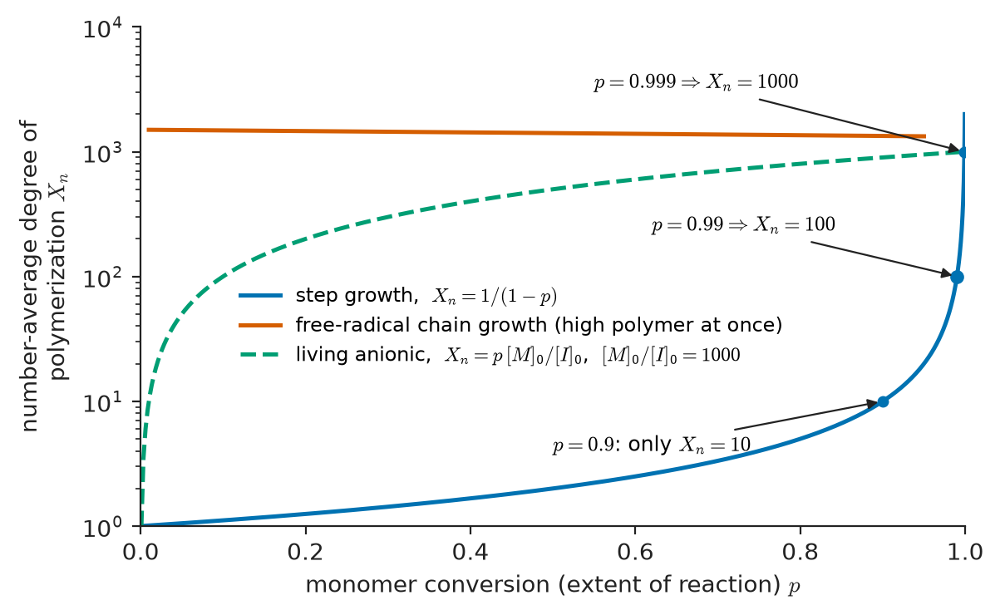
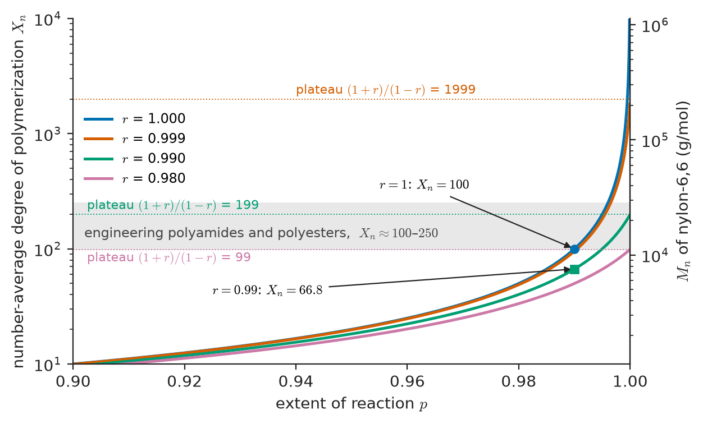
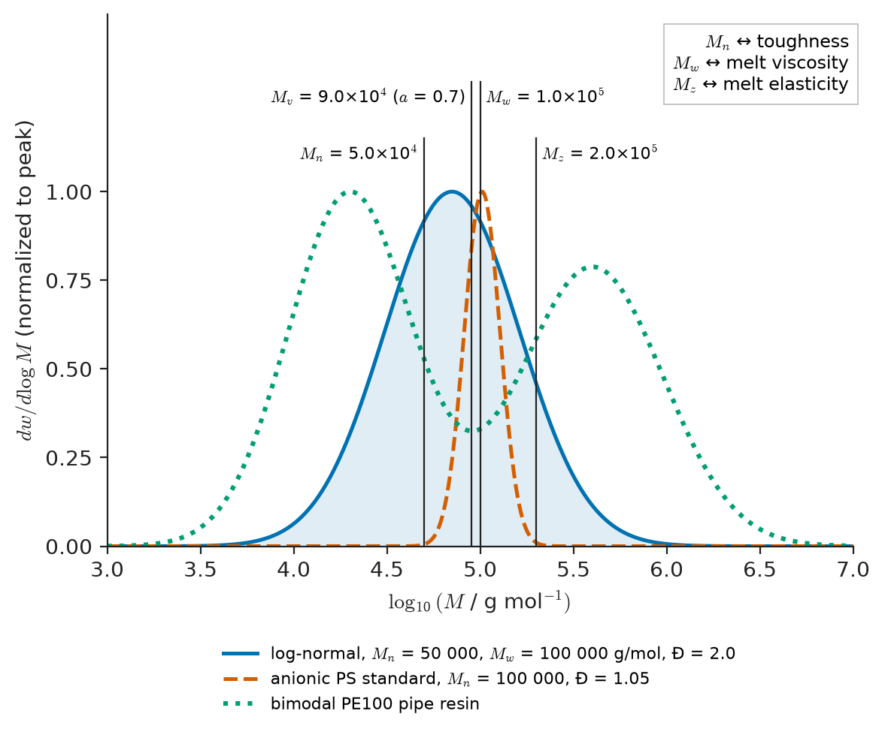
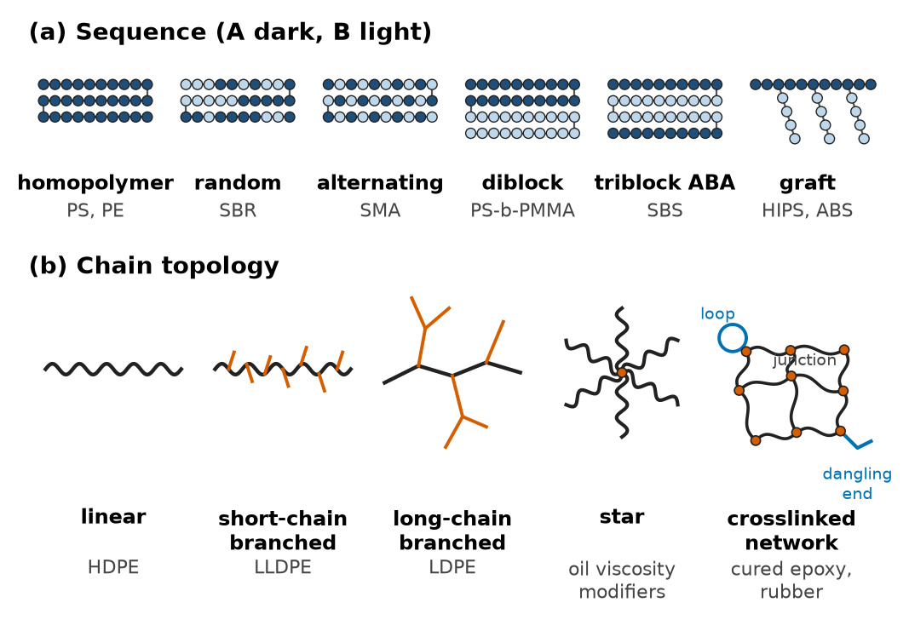
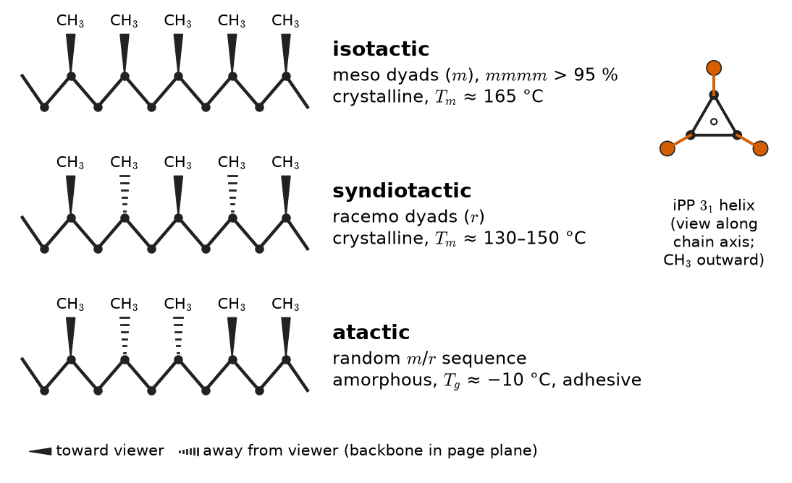
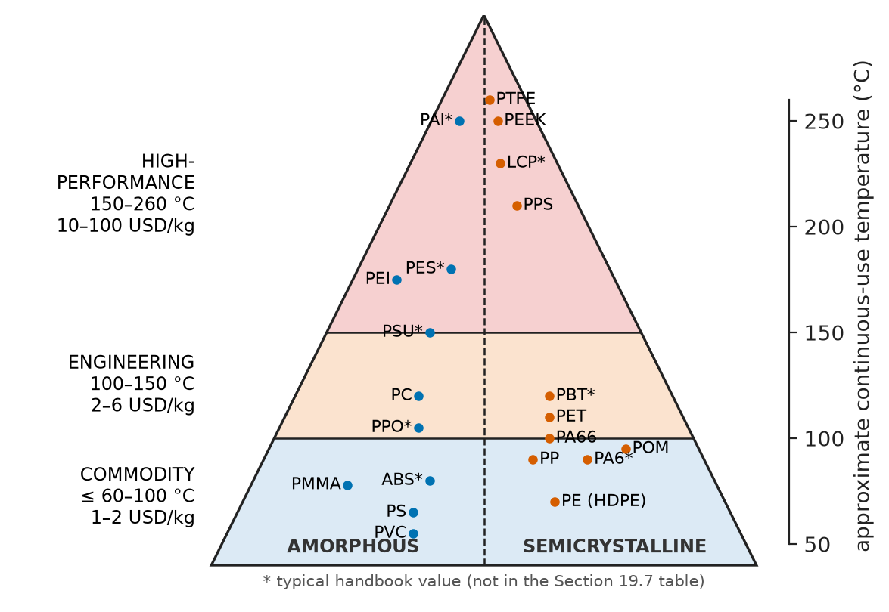

# Chapter 19 — Polymer Synthesis and Molecular Structure

*Part V · Polymers and Composites*

A maintenance crew fitting a new wiring harness into a regional airliner finds that the nylon-6,6 cable ties from one carton snap when they are pulled tight, while ties from the next carton, same part number, same supplier, same mould, survive being bent double. Tensile tests confirm the difference: the bad ties break at a few percent strain with almost no necking; the good ones draw out to more than 50 %. The chemistry is identical, the crystallinity is similar, and the dimensions are within tolerance. The difference shows up only when the two batches are dissolved and run through a size-exclusion chromatograph: the brittle ties have a number-average molecular weight of about 9,000 g/mol, the good ones about 18,000 g/mol. The resin for the bad batch had been moulded without drying. At 280 °C, a tenth of a percent of absorbed water was enough to hydrolyse one amide bond in every chain, halve the chain length and remove the entanglements that let the plastic draw rather than crack.

The episode contains the whole subject of this chapter. A polymer is not defined by its chemistry alone: the length of its chains, the spread of those lengths, the sequence of different units along a chain, the way side groups are arranged in space, and whether chains are branched or joined into networks all matter as much as the repeat unit. All of these features are fixed during synthesis, and many can be changed again during processing.

> **How are long chains built from small molecules, and what determines how long they become?**
> **Which molecular features — chain length and its distribution, copolymer sequence, tacticity, branching, crosslinking — does synthesis control, and how are they measured?**

| Concept | Engineering destination |
|---|---|
| Repeat unit and nomenclature | Reading datasheets, resin codes, regulatory and recycling labels |
| Step-growth and the Carothers equation | Polyamide, polyester and polyurethane production; drying specifications for moulding |
| Free-radical and ionic chain growth | Polystyrene, PMMA, PVC, LDPE; adhesives and dental resins cured in situ |
| Coordination catalysis | HDPE pipe, LLDPE film, isotactic PP for car bumpers and medical syringes |
| Ring-opening polymerization | Nylon-6, PLA sutures and implants, epoxy and silicone networks |
| Molecular-weight averages and dispersity | Melt flow index, toughness, stress-crack resistance, solution viscosity |
| Copolymers | ABS housings, SBS shoe soles, EVA solar-cell encapsulants, nitrile gloves |
| Tacticity, branching, networks | Stiffness of PP, density grades of PE, cured epoxies and rubber |
| Polymer families | Selecting commodity, engineering or high-performance grades |

**Roadmap.** Monomers and how polymers are named (19.1) → the two ways of growing a chain: step growth with its Carothers limit (19.2) and chain growth by radical, ionic, coordination and ring-opening routes (19.3) → why the product is a distribution and how it is measured (19.4) → what happens when two monomers are combined (19.5) → the spatial and topological architecture of chains (19.6) → the families of polymers that result (19.7).

---

## 19.1 Monomers, repeat units and nomenclature

### From monomer to macromolecule

A **polymer** is a molecule made by linking many small molecules, the **monomers**, through covalent bonds. The part of the chain that repeats is the **repeat unit** (or constitutional repeating unit). In polyethylene the monomer is ethylene, $\mathrm{CH_2{=}CH_2}$, and the repeat unit is $-\mathrm{CH_2CH_2}-$; opening the double bond turns each monomer into a two-carbon segment of a saturated backbone. The number of repeat units in a chain is the **degree of polymerization** $X$ (also written $DP$ or $N$), and the molar mass of the chain is

$$
M = X\,M_0
$$

where $M_0$ is the molar mass of the repeat unit (end groups are negligible for long chains). A commercial high-density polyethylene with $M\approx 2\times10^5$ g/mol contains about 7,000 repeat units; an ultra-high-molecular-weight polyethylene (UHMWPE) for hip and knee bearings, with $M\approx5\times10^6$ g/mol, contains about 180,000. Molecules with $X$ below about 10–20 are **oligomers**: they are waxes, oils or brittle solids, because they are too short to entangle.

The two necessary features of a monomer are reactivity and **functionality** $f$, the number of bonds it can form in the polymerization. A monomer with $f=2$ (a vinyl double bond, which opens to give two bonds, or a molecule with two reactive groups such as a diacid) gives linear chains. A monomer with $f\ge3$ (glycerol, with three hydroxyl groups; divinylbenzene, with two double bonds and hence $f=4$) gives branches and, eventually, a network (Section 19.6).

### Naming polymers

Three naming systems coexist, and an engineer meets all three.

- **Source-based names** put "poly" before the monomer name: polyethylene, polystyrene, poly(vinyl chloride), poly(methyl methacrylate). Parentheses are used when the monomer name has more than one word.
- **Structure-based (IUPAC) names** name the repeat unit: polyethylene is poly(methylene), polystyrene is poly(1-phenylethylene). They are unambiguous but rarely used outside chemistry.
- **Trade names and abbreviations** dominate engineering drawings and datasheets: PE, PP, PS, PVC, PMMA (Perspex, Plexiglas), PA66 (nylon-6,6), PET, PC, PTFE (Teflon), PEEK, POM (acetal, Delrin), ABS, PU.

Condensation polymers are often named by their linkage: polyamides contain $-\mathrm{CO{-}NH}-$, polyesters $-\mathrm{CO{-}O}-$, polyurethanes $-\mathrm{NH{-}CO{-}O}-$, polycarbonates $-\mathrm{O{-}CO{-}O}-$, polyimides a cyclic imide. Polyamide numbers count carbon atoms: nylon-6 is made from caprolactam (six carbons in the repeat unit); nylon-6,6 from hexamethylenediamine (six carbons) and adipic acid (six carbons); nylon-6,10 and nylon-12 follow the same rule. The number of methylene groups between amide links controls hydrogen-bond density and therefore melting point and water uptake: nylon-6,6 absorbs about 2.5 % water at 50 % relative humidity, nylon-12 under 1 %, which is why fuel lines are made of the latter.

> **Boundary.** The organic chemistry of functional groups and reaction mechanisms (nucleophilic acyl substitution, radical chemistry) belongs to Advanced Chemistry. This chapter uses the reactions only to explain what molecular structure they produce.

### Two families of growth

Polymerizations fall into two kinetic families, distinguished not by chemistry but by how chain length grows with conversion (Figure 19.1).

- In **step-growth** polymerization any two molecules carrying complementary groups can react: monomer with monomer, dimer with trimer, chain with chain. Monomer disappears early, but long chains appear only at the very end.
- In **chain-growth** polymerization an active centre (radical, ion or metal–carbon bond) adds monomers one at a time. Each chain grows to full length within seconds or less; at any moment the reactor contains monomer and finished polymer, with very few growing chains.

The older classification into *condensation* (a small molecule such as water is released) and *addition* (no by-product) polymers overlaps but is not identical: polyurethanes are made by step growth without a by-product, and nylon-6 is made by ring-opening chain growth even though its repeat unit is that of a condensation polymer.

<!-- FIGURE 19.1 | figures/ch19/fig-19-1-step-vs-chain-growth.png | plot | Number-average degree of polymerization versus monomer conversion for step-growth, free-radical chain-growth and living chain-growth polymerization. | Content: x-axis conversion p from 0 to 1 (linear); y-axis Xn logarithmic from 1 to 10^4. Curve 1 "step growth" Xn = 1/(1-p), staying below 10 until p = 0.9 and rising steeply to 1000 at p = 0.999. Curve 2 "free-radical chain growth" nearly horizontal at Xn ≈ 1500 from low conversion onward (high polymer present immediately). Curve 3 "living anionic" straight line Xn = p·[M]0/[I]0 with [M]0/[I]0 = 1000, reaching 1000 at p = 1. Annotate p = 0.99 → Xn = 100 on curve 1. -->

*Figure 19.1 — Number-average degree of polymerization versus monomer conversion for step-growth, free-radical chain-growth and living chain-growth polymerization.*

Figure 19.1 explains a practical difference. A chain-growth reactor can be stopped at 50 % conversion and still deliver high polymer (the unreacted monomer is stripped off and recycled). A step-growth reactor must be driven to almost complete conversion, because, as the next section shows, the chains are short until the last fraction of a percent of reaction.

---

## 19.2 Step-growth polymerization and the Carothers equation

### The Carothers argument

Consider a stoichiometric mixture of difunctional monomers, for example a diacid and a diamine, with $N_0$ molecules in total and therefore $2N_0$ reactive groups, half of each kind. Define the **extent of reaction** $p$ as the fraction of functional groups that have reacted. Each reaction between two groups joins two molecules into one, so the number of molecules falls by one per bond formed. After $p N_0$ bonds have formed (each bond consumes one acid and one amine group, and there are $N_0$ acid groups), the number of molecules is $N=N_0(1-p)$. The number-average degree of polymerization, counting monomer residues, is

$$
X_n = \frac{N_0}{N} = \frac{1}{1-p}
$$

This is the **Carothers equation**, published by Wallace Carothers at DuPont in 1929, in the work that led to nylon-6,6.

> **Status of the principle: Carothers equation**
> *Derived.* It follows from counting molecules, assuming exact stoichiometry, no side reactions, no cyclization and equal reactivity of all groups regardless of chain length (Flory's equal-reactivity principle, which is well supported experimentally for chains longer than a few units).

The consequence is severe. At 90 % conversion, which would count as a good yield in most organic syntheses, $X_n=10$: a waxy oligomer. At 99 %, $X_n=100$; at 99.5 %, 200. The useful properties of nylon and polyester require $X_n$ of order 100–200, so the reaction must be driven beyond 99 %. Two practical consequences follow. First, the equilibrium must be pushed hard toward the polymer: polycondensation reactors run at high temperature under vacuum to strip the water or glycol that is released (equilibrium constants for amidation are only about 100–400, and for esterification of order 1). Second, the stoichiometry must be essentially exact.

### Stoichiometric imbalance and chain stoppers

If one monomer is in excess, the chains end up capped with the excess group and growth stops. With $N_A$ groups of type A and $N_B\ge N_A$ of type B, define $r=N_A/N_B\le1$. Repeating the counting gives

$$
X_n=\frac{1+r}{1+r-2rp}
$$

At complete conversion of the minority group ($p=1$), $X_n=(1+r)/(1-r)$. A monofunctional impurity has the same effect and is counted in $r$ with a factor of two. Manufacturers exploit this deliberately: a small, metered excess of one monomer or a few tenths of a percent of a monofunctional acid (acetic acid in nylon) caps the chains and fixes the final molecular weight, so that the melt viscosity does not drift during later processing. The industrial trick for nylon-6,6 is to make the 1:1 "nylon salt" (hexamethylene diammonium adipate) first, crystallize it to exact stoichiometry, and then polymerize the salt.

**Worked example — molecular weight of nylon-6,6 by step growth.** The repeat unit of nylon-6,6, $-\mathrm{NH(CH_2)_6NH{-}CO(CH_2)_4CO}-$, has $M=226.32$ g/mol and contains two monomer residues, so the mean residue mass is $M_0=113.16$ g/mol. With exact stoichiometry and $p=0.99$, $X_n=1/(1-0.99)=100$ residues and $M_n=100\times113.16\approx11{,}300$ g/mol. Pushing to $p=0.995$ doubles this to $X_n=200$, $M_n\approx22{,}600$ g/mol, a typical injection-moulding grade. Now suppose the diamine is weighed 1 % short, $r=0.99$. At $p=0.99$, $X_n=(1.99)/(1.99-2\times0.99\times0.99)=1.99/0.0298=66.8$, giving $M_n\approx7{,}600$ g/mol; even at complete conversion, $X_n=1.99/0.01=199$, $M_n\approx22{,}500$ g/mol. A 1 % weighing error therefore costs a third of the chain length at a realistic conversion and caps it permanently. In the cable-tie failure of the opening, the reverse reaction did the damage: a resin with $M_n=18{,}100$ g/mol ($X_n=160$) contains $1000/18{,}100\approx0.055$ mol of chains per kg. Cutting each chain once requires $0.055$ mol, or about 1.0 g, of water per kilogram of resin: 0.1 wt %. Polyamide moulding specifications therefore require moisture below about 0.2 %, against an equilibrium uptake of 2–3 % in humid air.

<!-- FIGURE 19.2 | figures/ch19/fig-19-2-carothers.png | plot | Carothers equation: number-average degree of polymerization versus extent of reaction for exact stoichiometry and for small stoichiometric imbalances. | Content: x-axis extent of reaction p from 0.90 to 1.00; y-axis Xn logarithmic from 10 to 10^4. Curves for r = 1.000 (diverging as p → 1), r = 0.999 (plateau at 1999), r = 0.99 (plateau at 199), r = 0.98 (plateau at 99). Horizontal band labelled "engineering polyamides and polyesters, Xn ≈ 100–250". Marked points: p = 0.99, r = 1 → 100; p = 0.99, r = 0.99 → 66.8. Secondary right-hand axis Mn for nylon-6,6 (Xn × 113.16 g/mol). -->

*Figure 19.2 — Carothers equation: number-average degree of polymerization versus extent of reaction for exact stoichiometry and for small stoichiometric imbalances.*

### The most probable distribution

Because any two chains can react, step growth produces a statistical spread of lengths. Flory showed that, with equal reactivity, the number fraction of chains containing $x$ residues is

$$
n_x = (1-p)\,p^{\,x-1}
$$

and the weight fraction is $w_x = x(1-p)^2p^{\,x-1}$. This **most probable** (or Flory–Schulz) distribution has $X_n=1/(1-p)$, a weight average $X_w=(1+p)/(1-p)$ and therefore a dispersity $X_w/X_n=1+p$, which approaches 2 at high conversion. The number distribution falls monotonically (single residues are always the most numerous species), while the weight distribution peaks at $x\approx-1/\ln p$, about 100 for $p=0.99$. The dispersity of about 2 is a signature of step-growth polymers such as nylon, PET and polycarbonate, and it is a good check on the measurements of Section 19.4.

> **Status of the principle: Most probable (Flory) distribution**
> *Derived.* Follows from equal reactivity and random linking of linear chains; it is distorted by cyclization, by interchange reactions in the melt (which actually restore it) and by side reactions that branch the chain.

### Step-growth polymers in engineering

| Polymer | Monomers | Linkage | By-product | Typical use |
|---|---|---|---|---|
| Nylon-6,6 (PA66) | Hexamethylenediamine + adipic acid | Amide | Water | Gears, cable ties, radiator tanks, airbag fabric |
| PET | Ethylene glycol + terephthalic acid | Ester | Water (or methanol) | Bottles, fibre, film, food trays |
| Polycarbonate (PC) | Bisphenol A + diphenyl carbonate (or phosgene) | Carbonate | Phenol (or HCl) | Glazing, helmets, lenses, enclosures |
| Polyurethane (PU) | Diisocyanate + polyol | Urethane | None | Foams, elastomers, coatings, catheters |
| Epoxy | Diepoxide + diamine (or anhydride) | Ether/amine | None | Adhesives, composite matrices, encapsulants |
| Phenol–formaldehyde | Phenol + formaldehyde | Methylene | Water | Brake pads, laminates, electrical parts |
| Polyimide (Kapton) | Dianhydride + diamine | Imide | Water | Flexible circuits, wire insulation, aerospace films |
| PEEK | Bisfluorobenzophenone + hydroquinone salt | Ether, ketone | Salt | Aerospace brackets, spinal implants, pump parts |

PET is a useful case study in what processing does to the chain. Bottle-grade PET needs an intrinsic viscosity of about 0.75–0.85 dL/g ($M_n$ about 25,000 g/mol), higher than fibre grade (0.6 dL/g). The melt reactor cannot reach this because the melt becomes too viscous to release glycol, so the pellets are crystallized and then held for hours at 200–220 °C under nitrogen in **solid-state polymerization**, where the reaction continues in the amorphous regions of the solid. The same equilibrium runs backward during melt recycling, which is why mechanically recycled PET loses molecular weight with each pass unless it is dried and re-solid-stated (Chapter 21).

---

## 19.3 Chain-growth polymerization

Chain growth needs three steps: **initiation** of an active centre, **propagation** by repeated monomer addition, and **termination** or **transfer** that ends a chain. The four industrial families differ in the nature of the active centre.

### Free-radical polymerization

An **initiator** decomposes thermally or photochemically into radicals: azobisisobutyronitrile (AIBN) and benzoyl peroxide are common thermal initiators; camphorquinone with an amine is the blue-light photoinitiator used to cure dental fillings in seconds. The radical adds to the double bond of a vinyl monomer, $\mathrm{CH_2{=}CHX}$, creating a new radical on the chain end, which adds the next monomer, and so on. Two growing radicals meeting each other terminate by **combination** (forming one dead chain) or **disproportionation** (a hydrogen transfer that yields two dead chains). Radicals can also transfer their activity to monomer, solvent, polymer or a deliberately added **chain-transfer agent** (a thiol), which ends one chain and starts another.

The kinetics follow from the **steady-state assumption**: after a short induction period, radicals are created as fast as they are destroyed. With initiator decomposition rate constant $k_d$, initiator efficiency $f$ (the fraction of radicals that actually start chains, typically 0.5–0.8), propagation rate constant $k_p$ and termination rate constant $k_t$, the rate of initiation is $R_i=2fk_d[I]$, the radical concentration is $[M^\bullet]=(R_i/2k_t)^{1/2}$, and the rate of polymerization is

$$
R_p = k_p[M][M^\bullet] = k_p[M]\left(\frac{fk_d[I]}{k_t}\right)^{1/2}
$$

The **kinetic chain length** $\nu$, the average number of monomers added per radical before it terminates, is

$$
\nu = \frac{R_p}{R_i} = \frac{k_p[M]}{2\,(fk_dk_t[I])^{1/2}}
$$

so that $X_n=2\nu$ for termination by combination and $X_n=\nu$ for disproportionation (in the absence of transfer).

> **Status of the principle: Steady-state free-radical kinetics**
> *Approximate.* Valid at low to moderate conversion with constant rate coefficients. At high conversion in bulk the viscosity rises, $k_t$ (a diffusion-limited reaction between two chain ends) collapses and the rate accelerates sharply — the Trommsdorff or gel effect — which broadens the distribution and can cause a thermal runaway.

The square-root dependence on initiator is the central trade-off: more initiator speeds the reaction as $[I]^{1/2}$ but shortens the chains as $[I]^{-1/2}$. Fast and long cannot both be had by adjusting the initiator; they are reconciled by emulsion polymerization (radicals isolated in separate latex particles, so termination is slow) or by controlled radical methods.

**Worked example — chain length in bulk polystyrene.** Styrene is polymerized in bulk at 60 °C ($[M]=8.7$ mol/L) with AIBN at $[I]=0.010$ mol/L. Take $k_d=8.5\times10^{-6}$ s⁻¹, $f=0.6$, $k_p=341$ L mol⁻¹ s⁻¹ and $k_t=7\times10^{7}$ L mol⁻¹ s⁻¹ (representative literature values). The initiation rate is $R_i=2\times0.6\times8.5\times10^{-6}\times0.010=1.02\times10^{-7}$ mol L⁻¹ s⁻¹. The radical concentration is $(1.02\times10^{-7}/(2\times7\times10^{7}))^{1/2}=2.70\times10^{-8}$ mol/L — about one growing chain per 300 million monomer molecules. The polymerization rate is $R_p=341\times8.7\times2.70\times10^{-8}=8.0\times10^{-5}$ mol L⁻¹ s⁻¹, or about 3.3 % conversion per hour. The kinetic chain length is $\nu=R_p/R_i=785$; styrene radicals terminate mainly by combination, so $X_n\approx1570$ and $M_n\approx1570\times104.15\approx1.6\times10^5$ g/mol. Cutting the initiator to a quarter, 0.0025 mol/L, doubles $\nu$ to 1570 but halves the rate to 1.7 % per hour. In practice transfer to monomer caps $X_n$ at a few thousand, and the reaction is run at higher temperature with staged heating to finish in hours rather than days.

Free-radical chemistry produces polystyrene, PMMA, PVC, poly(vinyl acetate), polyacrylonitrile, PTFE and **low-density polyethylene** (LDPE). LDPE is made at 1,500–3,000 bar and 200–300 °C, conditions under which the growing radical frequently bites back on its own chain (intramolecular transfer), producing short butyl branches, and transfers to other chains, producing long branches. Those branches, 15–30 per 1,000 carbons, frustrate crystallization and give LDPE its low density (0.91–0.93 g/cm³), flexibility and the strain-hardening melt behaviour that makes it easy to blow into film.

**Controlled (reversible-deactivation) radical polymerization** — atom-transfer radical polymerization (ATRP), reversible addition–fragmentation chain transfer (RAFT) and nitroxide-mediated polymerization (NMP) — keeps most chains in a dormant state that is reactivated briefly and repeatedly. Termination is suppressed, all chains grow together and dispersities of 1.1–1.3 are reached with ordinary vinyl monomers. These methods are used to make block copolymers for drug delivery, dispersants and lithographic resists.

### Ionic polymerization

In **anionic** polymerization the active centre is a carbanion, typically started by butyllithium. With monomers such as styrene, butadiene and isoprene, in carefully purified solvents, there is no termination step: the chain ends remain active until a terminating agent is added. This is **living polymerization**. If all chains start at once and grow at the same rate, the degree of polymerization is set by stoichiometry, $X_n=p[M]_0/[I]_0$, and the distribution is a Poisson distribution with dispersity $1+1/X_n$, below 1.05 in practice. Adding a second monomer to the living chains produces a block copolymer; this is how styrene–butadiene–styrene (SBS) thermoplastic elastomers and the narrow polystyrene standards used to calibrate chromatographs are made.

> **Status of the principle: Living polymerization yields a Poisson distribution**
> *Derived.* Follows from simultaneous initiation and identical, irreversible propagation of all chains with no termination or transfer; slow initiation or traces of water and oxygen broaden it.

**Cationic** polymerization uses a carbocation, initiated by Lewis acids (BF₃, AlCl₃) with a proton source. It suits monomers with electron-donating substituents, such as isobutylene and vinyl ethers. Carbocations are so reactive that transfer is rapid unless the reaction is run cold: butyl rubber (isobutylene with 1–3 % isoprene for later vulcanization) is made at about −100 °C. Butyl rubber's tightly packed chains give it the lowest gas permeability of common elastomers, which is why it lines every tubeless tyre and seals pharmaceutical vials.

### Coordination polymerization: Ziegler–Natta and metallocene catalysts

In 1953 Karl Ziegler found that titanium chlorides combined with aluminium alkyls polymerize ethylene at atmospheric pressure and modest temperature to give a linear, high-density polyethylene; in 1954 Giulio Natta used similar catalysts to make crystalline, **isotactic** polypropylene. In **coordination** polymerization the monomer first coordinates to a vacant site on a transition-metal centre and is then inserted into the metal–carbon bond of the growing chain (the Cossee–Arlman mechanism). Because insertion happens at a geometrically constrained site, the catalyst controls the orientation of each incoming monomer — and therefore the tacticity (Section 19.6) — and branching by back-biting is almost eliminated.

Modern **Ziegler–Natta** catalysts are TiCl₄ supported on MgCl₂ with internal and external electron donors, activated by triethylaluminium. They are heterogeneous: the catalyst particle contains several kinds of active site, each producing polymer of a different length and comonomer content, so the product has dispersity 4–8. Particle morphology replicates from catalyst to polymer, so 50 µm catalyst grains grow into millimetre-scale polymer granules ready for the extruder. Phillips catalysts (chromium oxide on silica) produce much of the world's HDPE for blow-moulded bottles and pipes.

**Metallocene** (single-site) catalysts, developed in the 1980s by Kaminsky and others, are zirconium or hafnium complexes sandwiched between cyclopentadienyl rings and activated by methylaluminoxane (MAO). Every site is identical, so the dispersity is close to 2 (the most probable distribution) and comonomer is incorporated uniformly along all chains. By changing the ligand symmetry the same metal produces isotactic, syndiotactic or atactic polypropylene. Metallocene LLDPE (ethylene with 1-hexene or 1-octene comonomer giving controlled short branches) makes thinner, tougher food-packaging film with better clarity and heat-seal behaviour than Ziegler–Natta grades, and metallocene polyolefin elastomers have replaced plasticized PVC in many automotive and medical tubes.

| Catalyst family | Active site | Typical dispersity | Characteristic products |
|---|---|---|---|
| Free radical (high pressure) | Radical | 3–20 | LDPE, PS, PVC, PMMA |
| Ziegler–Natta (MgCl₂/TiCl₄) | Ti–C, several site types | 4–8 | HDPE, isotactic PP, LLDPE |
| Phillips (Cr/SiO₂) | Cr–C | 8–30 | HDPE for blow moulding and pipe |
| Metallocene, single-site | Zr or Hf–C, one site type | 2.0–2.5 | mLLDPE, syndiotactic PS, polyolefin elastomers |
| Living anionic | Carbanion | 1.02–1.1 | SBS, solution SBR for tyres, calibration standards |

The engineering value of a broad distribution should not be underestimated. Pipe-grade bimodal HDPE (PE100) is deliberately made in two reactors in series: one produces short chains that give easy processing, the other long chains carrying a little comonomer that tie the crystals together and give resistance to slow crack growth over a 50-year design life.

### Ring-opening polymerization

Cyclic monomers polymerize by opening the ring, driven by the release of ring strain (and, for some, by entropy). Ring-opening is chain growth: an active centre attacks a ring and regenerates itself at the new chain end. The important engineering examples are:

- **Nylon-6** from caprolactam, opened by water (hydrolytic) or by anionic initiators. Anionic casting of caprolactam directly in a mould ("cast nylon") produces large bearings, sheaves and liners.
- **Poly(lactic acid)** (PLA) and **poly(glycolic acid)** (PGA) from the cyclic dimers lactide and glycolide, opened by tin(II) octoate. These are the resorbable sutures, bone screws and drug-eluting matrices of Chapter 39, and PLA is the most widely used bio-based packaging polymer.
- **Poly(ε-caprolactone)** (PCL), a low-melting (60 °C), slowly resorbing polyester for long-term implants and 3D-printed scaffolds.
- **Polyacetal** (POM) from trioxane, and **poly(ethylene oxide)** from ethylene oxide.
- **Silicones** (polydimethylsiloxane, PDMS) from cyclic siloxanes such as D4, used in sealants, medical tubing and soft lithography.
- **Epoxy** resins cure by opening the strained three-membered epoxide ring with an amine or anhydride, a step-growth network formation (Section 19.6).

---

## 19.4 Molecular weight: averages, dispersity and measurement

### Why a distribution needs averages

Every synthetic polymer is a mixture of chains of different lengths. If a sample contains $N_i$ molecules of molar mass $M_i$, the mass of that fraction is $w_i\propto N_iM_i$, and several averages are needed to describe the distribution:

$$
M_n=\frac{\sum N_iM_i}{\sum N_i},\qquad
M_w=\frac{\sum N_iM_i^2}{\sum N_iM_i}=\frac{\sum w_iM_i}{\sum w_i},\qquad
M_z=\frac{\sum N_iM_i^3}{\sum N_iM_i^2}
$$

The **number average** $M_n$ is the total mass divided by the number of molecules; it is what colligative properties and end-group counts measure. The **weight average** $M_w$ weights each chain by its mass, so long chains count more. The **z-average** weights still more heavily toward the longest chains. Always $M_n\le M_w\le M_z$, with equality only for a perfectly uniform sample. The **dispersity**

$$
Đ=\frac{M_w}{M_n}
$$

(formerly the polydispersity index, PDI) measures the breadth.

Different properties depend on different averages. Brittle-to-ductile behaviour, tensile strength and the glass-transition temperature of short chains depend mainly on $M_n$, because chain ends act as defects and their number is set by $M_n$. Melt viscosity scales with $M_w$ (Chapter 21). Melt elasticity, die swell and the strain hardening that stabilizes a blown film bubble depend on $M_z$ and the high-molar-mass tail. A processor can therefore buy two resins with the same melt flow index ($M_w$) and get very different toughness ($M_n$) or blow-moulding behaviour ($M_z$).

<!-- FIGURE 19.3 | figures/ch19/fig-19-3-mw-distribution.png | plot | A molecular-weight distribution plotted as weight fraction versus log molar mass, with the number-, viscosity-, weight- and z-average molar masses marked. | Content: x-axis log10(M / g mol^-1) from 3 to 7; y-axis dw/dlogM (normalized). Solid curve: log-normal distribution with Mn = 50,000 and Mw = 100,000 g/mol (Đ = 2.0). Vertical lines labelled Mn (5.0×10^4), Mv (about 9.0×10^4 for a = 0.7), Mw (1.0×10^5), Mz (2.0×10^5). Dashed second curve: narrow anionic standard Mn = 100,000, Đ = 1.05. Dotted third curve: bimodal PE100 pipe resin with peaks near 2×10^4 and 4×10^5 g/mol. Small annotation: "Mn ↔ toughness, Mw ↔ melt viscosity, Mz ↔ melt elasticity". -->

*Figure 19.3 — A molecular-weight distribution plotted as weight fraction versus log molar mass, with the number-, viscosity-, weight- and z-average molar masses marked.*

**Worked example — averages of a blended resin.** A compounder mixes 10 g of polymer with $M=20{,}000$ g/mol, 10 g with $M=100{,}000$ g/mol and 5 g with $M=500{,}000$ g/mol (each fraction taken as uniform). The numbers of moles are $10/20{,}000=5.0\times10^{-4}$, $10/100{,}000=1.0\times10^{-4}$ and $5/500{,}000=1.0\times10^{-5}$ mol, totalling $6.1\times10^{-4}$ mol for 25 g. Thus $M_n=25/6.1\times10^{-4}=41{,}000$ g/mol. The weight average is $M_w=(10\times20{,}000+10\times100{,}000+5\times500{,}000)/25=148{,}000$ g/mol, and $M_z=\sum w_iM_i^2/\sum w_iM_i=(10\times4\times10^{8}+10\times10^{10}+5\times2.5\times10^{11})/(3.7\times10^{6})=3.66\times10^{5}$ g/mol. The dispersity is $148{,}000/41{,}000=3.6$. Although the heavy fraction is only one-fifth of the mass and under 2 % of the molecules, it contributes 68 % of $M_w$ and dominates $M_z$, which is exactly why a small amount of very long chains changes melt elasticity so much. Conversely, the light fraction, 40 % of the mass, makes up 82 % of the molecules and pulls $M_n$ — and hence toughness — down.

### Measurement methods

| Method | Average measured | Range (g/mol) | Principle | Remarks |
|---|---|---|---|---|
| End-group analysis (titration, NMR) | $M_n$ | below about 25,000 | Count chain ends per unit mass | Needs known end groups; standard for nylon and PET |
| Membrane osmometry | $M_n$ | 20,000–1,000,000 | Osmotic pressure $\Pi/c\to RT/M_n$ | Absolute; small molecules permeate the membrane |
| Vapour-pressure osmometry | $M_n$ | below about 20,000 | Vapour-pressure lowering | For oligomers and resins |
| Static light scattering | $M_w$ (and $R_g$) | $10^4$–$10^7$ | Scattered intensity, Zimm plot | Absolute; needs refractive-index increment $dn/dc$ |
| Dilute-solution viscometry | $M_v$ | $10^3$–$10^7$ | Intrinsic viscosity, Mark–Houwink | Fast and cheap; calibration needed |
| Size-exclusion chromatography (SEC/GPC) | Whole distribution | $10^2$–$10^7$ | Separation by hydrodynamic volume | Relative unless coupled to light scattering or viscometry |
| MALDI-TOF mass spectrometry | Whole distribution | up to about $10^5$ (narrow samples) | Mass of individual ions | Resolves individual oligomers and end groups |
| Melt rheology (melt flow index) | Correlates with $M_w$ | Industrial grades | Flow through a standard die | Quality control, not an absolute method |

**Osmometry.** For a dilute solution of concentration $c$ (mass per volume), the osmotic pressure obeys the van 't Hoff relation $\Pi/c=RT/M_n$ in the limit $c\to0$, with a correction from the second virial coefficient $A_2$: $\Pi/c=RT(1/M_n+A_2c+\dots)$. The pressures are small: 5 g/L of a polymer with $M_n=10^5$ g/mol at 25 °C gives $\Pi=(5/100)\ \mathrm{mol/m^3}\times8.314\times298\approx124$ Pa, the height of a 13 mm column of water. That is still measurable, which is why osmometry was historically the reference method; the same measurement on a 1 % sugar solution would give a signal several hundred times larger.

**Light scattering.** A polymer coil scatters light in proportion to the square of its mass, so the scattered intensity weights molecules by mass and gives $M_w$. Measurement at several angles also yields the radius of gyration $R_g$ (Chapter 20), and extrapolating to zero angle and zero concentration (the Zimm plot) gives $M_w$, $R_g$ and $A_2$ together. The second virial coefficient vanishes in a theta solvent, a link developed in Chapter 20.

**Viscometry.** A dissolved polymer coil raises the solution viscosity in proportion to its volume. The **intrinsic viscosity** $[\eta]$, the specific viscosity per unit concentration extrapolated to zero concentration, follows the **Mark–Houwink–Sakurada** relation

$$
[\eta]=K\,M_v^{\,a}
$$

where $M_v$ (the viscosity average) lies between $M_n$ and $M_w$, closer to $M_w$. The exponent $a$ is 0.5 in a theta solvent and 0.7–0.8 in a good solvent for flexible coils, and approaches 1.8 for rigid rods. For polystyrene in tetrahydrofuran at 25 °C, $K\approx0.0114$ mL/g and $a\approx0.716$, so a chain of $10^5$ g/mol has $[\eta]\approx43$ mL/g; a measured $[\eta]=60$ mL/g implies $M_v\approx1.6\times10^5$ g/mol. The PET industry specifies resin entirely by "IV" for this reason.

> **Status of the principle: Mark–Houwink–Sakurada relation**
> *Empirical.* The power law is fitted for each polymer–solvent–temperature combination; its exponent has a physical interpretation (coil swelling, Chapter 20), but $K$ and $a$ must be measured and apply only over the calibrated molecular-weight range.

**Size-exclusion chromatography.** SEC (or GPC) pumps a dilute solution through columns packed with porous beads. Small coils diffuse into the pores and are delayed; large coils are excluded and elute first. The column separates by hydrodynamic volume, not by mass, so a conventional calibration with narrow polystyrene standards gives "polystyrene-equivalent" molecular weights. **Universal calibration** uses the fact that hydrodynamic volume is proportional to $[\eta]M$, which allows conversion between polymers if their Mark–Houwink constants are known; adding an online multi-angle light-scattering detector removes the need for calibration altogether. Polyethylene and polypropylene must be run at 140–160 °C in trichlorobenzene because they dissolve in nothing at room temperature, a direct consequence of their crystallinity (Chapter 20). SEC is the workhorse of failure analysis: in the cable-tie case it was SEC that showed the halved $M_n$.

---

## 19.5 Copolymers: random, alternating, block and graft

### Sequence architectures

A **copolymer** contains two or more kinds of repeat unit. The way they are arranged along the chain changes the properties as much as the overall composition does (Figure 19.4).

- **Random (statistical) copolymers** have units distributed according to the statistics of the polymerization: $\cdots$AABABBBAAB$\cdots$. Properties are roughly intermediate between those of the homopolymers, and crystallization is usually disrupted. Examples: styrene–butadiene rubber (SBR) for tyres, ethylene–vinyl acetate (EVA) for solar-module encapsulants and running-shoe midsoles, ethylene–propylene rubber (EPR/EPDM) for car door seals and roofing membranes, and LLDPE itself (ethylene with a few percent of an α-olefin).
- **Alternating copolymers** have strict ABAB order. They arise when each radical prefers to add the other monomer, as in styrene–maleic anhydride (used as a compatibilizer and in sizing agents).
- **Block copolymers** consist of long sequences of A joined to long sequences of B: diblock A–B, triblock A–B–A, or multiblock. Because the blocks are long and usually immiscible, they phase-separate on the scale of the chain, 10–100 nm, while remaining bonded (Chapter 20). SBS thermoplastic elastomers have glassy polystyrene end blocks that form physical crosslinks within a rubbery polybutadiene matrix; above 100 °C the domains soften and the material can be moulded, below it behaves as a rubber. Thermoplastic polyurethanes (TPU) and copolyester elastomers use hard and soft multiblocks in the same way, in ski boots, hydraulic seals and catheters.
- **Graft copolymers** have side chains of B attached to a backbone of A. High-impact polystyrene (HIPS) and acrylonitrile–butadiene–styrene (ABS) are made by polymerizing styrene (with acrylonitrile, for ABS) in the presence of polybutadiene: some of the growing chains graft onto the rubber, which anchors micron-sized rubber particles in the glassy matrix. The particles initiate crazes and shear bands that absorb energy (Chapter 21), turning a brittle glass into a material for helmets, luggage and appliance housings.

<!-- FIGURE 19.4 | figures/ch19/fig-19-4-copolymer-architectures.png | schematic | Copolymer sequence architectures and chain topologies. | Content: two rows of bead-chain drawings with beads of two colours (A dark, B light). Row 1, sequence: homopolymer (all A), random copolymer (irregular A/B), alternating (ABAB), diblock (20 A then 20 B), triblock (ABA, e.g. SBS), graft (A backbone with three B side chains). Row 2, topology: linear chain, short-chain branched (LLDPE, short pendant stubs), long-chain branched (LDPE, branches of branches), star, crosslinked network (several chains joined by junction points, one dangling end and one loop marked). Each drawing labelled with an engineering example (SBR, SMA, SBS, ABS, HDPE, LDPE, cured epoxy). -->

*Figure 19.4 — Copolymer sequence architectures and chain topologies.*

### Copolymer composition: the Mayo–Lewis equation

In chain-growth copolymerization the composition of the chain differs in general from that of the monomer feed, because each type of chain end prefers one monomer. The four propagation reactions $\sim\!A^\bullet+A$, $\sim\!A^\bullet+B$, $\sim\!B^\bullet+A$ and $\sim\!B^\bullet+B$ are characterized by two **reactivity ratios**, $r_1=k_{AA}/k_{AB}$ and $r_2=k_{BB}/k_{BA}$. With mole fractions $f_1$ and $f_2$ of the monomers in the feed, the mole fraction $F_1$ of A incorporated into the chain is

$$
F_1=\frac{r_1f_1^2+f_1f_2}{r_1f_1^2+2f_1f_2+r_2f_2^2}
$$

> **Status of the principle: Mayo–Lewis copolymer equation**
> *Approximate.* Derived from the terminal model, which assumes only the last unit on the chain end affects reactivity and that the steady state holds; penultimate-unit effects and reversible propagation cause measurable deviations in some systems.

Limiting cases make the meaning clear. If $r_1r_2=1$, the copolymer is ideal and random. If $r_1\approx r_2\approx0$, each radical adds only the other monomer and the product alternates. If both $r_1>1$ and $r_2>1$, long runs of each unit form (rare in radical systems). If $r_1<1$ and $r_2<1$, there is an **azeotropic** composition at which $F_1=f_1$, given by $f_1^{az}=(1-r_2)/(2-r_1-r_2)$. For styrene (1) with methyl methacrylate (2) at 60 °C, $r_1\approx0.52$ and $r_2\approx0.46$: a 50:50 feed gives $F_1=0.51$, nearly equal, and the azeotrope is at $f_1=0.53$. Away from the azeotrope the feed drifts as the reaction proceeds, so a batch reactor produces chains of different composition early and late (composition drift); commercial reactors feed the more reactive monomer continuously to keep the copolymer uniform, which matters in transparent copolymers where composition differences cause haze.

---

## 19.6 Tacticity, branching, crosslinking and networks

### Tacticity

In a vinyl polymer $-\mathrm{CH_2{-}CHX}-$ every second backbone carbon carries a substituent X and is a stereocentre. The relative configuration of successive stereocentres, the **tacticity**, is fixed at the moment of insertion and cannot be changed afterward without breaking bonds (Figure 19.5).

- **Isotactic**: all X groups on the same side when the backbone is drawn as a planar zig-zag (meso dyads, *m*).
- **Syndiotactic**: X groups alternate (racemo dyads, *r*).
- **Atactic**: random placement.

Tacticity is not a cosmetic detail; it decides whether a polymer can crystallize. Isotactic polypropylene (iPP) packs into a $3_1$ helix and crystallizes to 40–70 %, giving a stiff, tough plastic that melts at about 165 °C and is used for car bumpers, battery cases, living hinges and medical syringes. Atactic polypropylene cannot crystallize, has a glass transition near −10 °C, and is a sticky material useful only in hot-melt adhesives. Atactic polystyrene is an amorphous glass (Tg about 100 °C, the clear material of CD cases and disposable cups); syndiotactic polystyrene, made with metallocene catalysts, crystallizes and melts at 270 °C, and is used in under-the-bonnet connectors. Tacticity is measured by ¹³C nuclear magnetic resonance, which resolves the chemical shift of methyl groups in different triad (*mm*, *mr*, *rr*) and pentad environments; commercial iPP has an isotactic pentad content *mmmm* of 90–98 %.

<!-- FIGURE 19.5 | figures/ch19/fig-19-5-tacticity.png | schematic | Isotactic, syndiotactic and atactic polypropylene drawn as planar zig-zag backbones, with the consequence for crystallinity. | Content: three stacked zig-zag carbon backbones (10 backbone carbons each) with methyl groups drawn as wedge (up) or dash (down) bonds. Top: isotactic, all methyls on one side, labelled "meso dyads (m), mmmm > 95 %, crystalline, Tm ≈ 165 °C". Middle: syndiotactic, alternating, labelled "racemo dyads (r), crystalline, Tm ≈ 130–150 °C". Bottom: atactic, random sequence, labelled "amorphous, Tg ≈ −10 °C, adhesive". Small inset at right: 3_1 helix of iPP viewed along the chain axis. -->

*Figure 19.5 — Isotactic, syndiotactic and atactic polypropylene drawn as planar zig-zag backbones, with the consequence for crystallinity.*

### Branching

Branches are side chains of the same polymer type grafted onto the backbone during synthesis. Their length and number determine density, crystallinity and melt behaviour, as the polyethylene family shows clearly.

| Polyethylene grade | Synthesis | Branching | Density (g/cm³) | Crystallinity (typical) | Tm (°C) | Typical uses |
|---|---|---|---|---|---|---|
| LDPE | High-pressure radical | Long branches and 15–30 short branches per 1000 C | 0.910–0.930 | 40–55 % | 105–115 | Film, squeeze bottles, cable insulation |
| LLDPE | Ziegler–Natta or metallocene, α-olefin comonomer | 10–30 short branches per 1000 C, no long branches | 0.915–0.940 | 40–55 % | 120–125 | Stretch film, liners, rotomoulded tanks |
| HDPE | Ziegler–Natta or Phillips | Fewer than 5 branches per 1000 C | 0.940–0.970 | 60–80 % | 130–137 | Pipes, bottles, fuel tanks, crates |
| UHMWPE | Ziegler–Natta | Essentially linear, $M$ 3–6×10⁶ g/mol | 0.930–0.945 | 40–60 % | 130–138 | Joint-replacement bearings, Dyneema fibre, liners |

Short branches act as defects that cannot enter the crystal, so they lower crystallinity, density, stiffness and melting point, while improving toughness, clarity and resistance to slow crack growth (because they also generate the tie molecules between crystals; Chapter 20). Long branches, as long as the backbone, change melt rheology: they entangle more effectively and give strong strain hardening in extension, which is why LDPE is often blended into LLDPE to stabilize the bubble in film blowing (Chapter 21). Highly branched architectures — stars, combs and dendrimers — have small coil sizes and low viscosity for their molar mass and are used as viscosity-index improvers in engine oils and as drug carriers.

### Crosslinking and networks

When monomers of functionality greater than two take part in step growth, chains branch, branches join, and at a sharply defined conversion a single molecule spans the whole sample: the **gel point**. Before it the material is a viscous liquid of growing branched molecules (the sol); at the gel point the weight-average molecular weight diverges and the viscosity becomes infinite; beyond it an insoluble **gel** coexists with a shrinking sol fraction until, at full cure, the material is a single crosslinked network — a **thermoset**.

Carothers extended his counting argument by defining an average functionality $f_{av}$, the total number of functional groups divided by the number of monomer molecules. For stoichiometric mixtures,

$$
p_c=\frac{2}{f_{av}}
$$

Flory and Stockmayer treated the problem statistically, recognizing that gelation requires only that, on average, each branch unit leads to at least one more branch unit; for a trifunctional monomer A₃ reacting with a difunctional B₂ at stoichiometry their result is $p_c=1/\sqrt{f-1}=1/\sqrt2=0.707$.

> **Status of the principle: Gel-point predictions (Carothers and Flory–Stockmayer)**
> *Approximate.* The Carothers estimate counts molecules as if gelation required infinite $X_n$ and overestimates $p_c$; the Flory–Stockmayer mean-field theory ignores intramolecular loops and slightly underestimates it. Measured gel points lie between the two.

For a classical alkyd resin made from 2 mol glycerol ($f=3$) and 3 mol phthalic anhydride ($f=2$), $f_{av}=(2\times3+3\times2)/5=2.4$ and the Carothers estimate is $p_c=0.833$; Flory–Stockmayer gives 0.707; the measured value is about 0.77. The engineering consequence is the **pot life**: a two-part epoxy adhesive or a composite resin must be applied, laid up or injected before it reaches the gel point, after which it can no longer flow or wet fibres. Gelation is followed by **vitrification** when the rising glass-transition temperature of the network passes the cure temperature and the reaction slows to a crawl; this is why aerospace epoxies need a post-cure above their service Tg (Chapter 23).

The density of crosslinks is described by the average molar mass between junctions, $M_c$, or by the crosslink density $\nu=\rho/M_c$ (moles of network chains per unit volume). It ranges over three orders of magnitude and sets the class of material:

| Network | Typical $M_c$ (g/mol) | Character | Example |
|---|---|---|---|
| Lightly vulcanized rubber | 3,000–10,000 | Soft, extensible elastomer | Tyre tread, seals, gloves |
| Hydrogel | 5,000–50,000 (swollen in water) | Soft, wet, permeable | Contact lenses, wound dressings |
| Toughened epoxy, polyurethane | 500–2,000 | Tough thermoset | Adhesives, coatings |
| Aerospace epoxy (TGDDM/DDS) | 300–500 | Stiff, high-Tg, brittle | CFRP matrices |
| Phenolic, melamine | Below 300 | Very stiff, hard, brittle | Brake linings, worktops, circuit-breaker housings |

The rubber elasticity theory of Chapter 20 links $M_c$ to the modulus of an elastomer, and the swelling equilibrium of Chapter 21 provides a simple way to measure it. Thermosets cannot be remelted, which has consequences for recycling (Chapter 21 and Chapter 59); covalent adaptable networks (vitrimers) with exchangeable bonds are being developed to make thermosets reprocessable.

---

## 19.7 Commodity, engineering and high-performance polymers

### The polymer pyramid

The several hundred commercial polymers are conventionally sorted into a pyramid by volume, price and temperature capability (Figure 19.6). At the base, **commodity** polymers — PE, PP, PVC, PS and PET — make up about 70–75 % of world production (which exceeds 400 million tonnes per year), cost roughly 1–2 USD/kg, and serve up to about 60–100 °C (PET, at 100–120 °C, straddles the boundary with the engineering tier). In the middle, **engineering** polymers — polyamides, polycarbonate, acetal, PBT, ABS, PMMA and modified PPO — offer higher stiffness, toughness or service temperature (100–150 °C) at 2–6 USD/kg. At the top, **high-performance** polymers — PEEK, PEI, PPS, PSU, PAI, polyimides, LCPs and fluoropolymers — survive 150–260 °C, aggressive chemicals and fire, at 10–100 USD/kg or more. A parallel division separates amorphous polymers (transparent, isotropic shrinkage, poor chemical resistance) from semicrystalline ones (opaque, chemically resistant, retain stiffness up to near Tm) at every level of the pyramid.

<!-- FIGURE 19.6 | figures/ch19/fig-19-6-polymer-pyramid.png | schematic | The thermoplastic pyramid: commodity, engineering and high-performance polymers ranked by continuous-use temperature and price, split into amorphous and semicrystalline families. | Content: triangle divided horizontally into three tiers (base: commodity, up to about 100 °C, 1–2 USD/kg; middle: engineering, about 100–150 °C, 2–6 USD/kg; top: high-performance, 150–260 °C, 10–100 USD/kg). Vertical line splits left (amorphous: PS, PVC, PMMA, ABS, PC, PPO, PSU, PES, PEI, PAI) from right (semicrystalline: PE, PP, PET, PA6, PA66, POM, PBT, PPS, PEEK, LCP, PTFE). Each polymer placed at the height of its continuous-use temperature as given in the property table of Section 19.7. Right-hand axis "approximate continuous-use temperature, °C" from 50 to 260. -->

*Figure 19.6 — The thermoplastic pyramid: commodity, engineering and high-performance polymers ranked by continuous-use temperature and price, split into amorphous and semicrystalline families.*

### Representative properties

The table gives typical, unfilled, room-temperature properties. Values vary with grade, moisture (for polyamides especially) and processing; they illustrate how structure moves properties.

| Polymer | Structure | Tg (°C) | Tm (°C) | Density (g/cm³) | E (GPa) | Tensile strength (MPa) | Typical continuous use (°C) |
|---|---|---|---|---|---|---|---|
| HDPE | Semicrystalline | about −120 | 130–137 | 0.95–0.97 | 0.8–1.4 | 20–35 | 60–80 |
| PP (isotactic) | Semicrystalline | about −10 | 160–170 | 0.90–0.91 | 1.2–1.8 | 30–40 | 80–100 |
| PVC (rigid) | Amorphous | 80–85 | — | 1.38–1.42 | 2.5–3.5 | 45–55 | 50–60 |
| PS (atactic) | Amorphous | about 100 | — | 1.04–1.05 | 3.0–3.4 | 35–50 | 60–70 |
| PMMA | Amorphous | 105–115 | — | 1.18–1.19 | 2.8–3.3 | 60–75 | 65–90 |
| PET | Semicrystalline | 70–80 | 250–260 | 1.33–1.40 | 2.5–3.2 | 50–75 | 100–120 |
| PA66 (dry) | Semicrystalline | 50–60 (dry) | 255–265 | 1.13–1.15 | 2.8–3.3 | 75–85 | 80–120 |
| POM (acetal) | Semicrystalline | about −60 | 165–175 | 1.41–1.42 | 2.8–3.2 | 60–70 | 90–100 |
| PC | Amorphous | about 145–150 | — | 1.20 | 2.2–2.4 | 60–70 | 115–125 |
| PPS | Semicrystalline | about 90 | 280–285 | 1.35 | 3.5–4.0 | 65–85 | 200–220 |
| PEI (Ultem) | Amorphous | about 215–217 | — | 1.27 | 3.0–3.3 | 100–110 | 170–180 |
| PEEK | Semicrystalline | about 143 | 340–345 | 1.30–1.32 | 3.6–4.1 | 90–100 | 240–260 |
| PTFE | Semicrystalline | about 115 (debated) | 327 | 2.15–2.20 | 0.4–0.6 | 20–35 | 260 |
| Kapton polyimide film | Amorphous (no melt) | 360–410 | — | 1.42 | 2.5–3.0 | 170–230 (film) | 240–400 |

Three structural trends run through the table, and Chapter 20 explains each.

1. **Stiff backbones raise Tg.** Aromatic rings in the main chain (PET, PC, PEEK, PEI, polyimide) restrict rotation and lift Tg and Tm far above those of aliphatic chains. Ether and ketone links between rings (PEEK) keep enough flexibility for melt processing; a fully aromatic, rigid polyimide never melts and must be processed from a soluble precursor.
2. **Strong interchain forces raise Tm and stiffness.** Hydrogen bonding in polyamides and dipole interactions in PVC and PET raise melting points relative to polyethylene; fluorine sheathing in PTFE gives chemical inertness and the lowest friction of any solid polymer.
3. **Regularity enables crystallinity.** Linear, stereoregular chains (HDPE, iPP, POM, PEEK) crystallize; branched, atactic or bulky chains (LDPE, aPS, PMMA, PC) do not, or do so only partially. Crystallinity converts a soft polymer above Tg into a useful solid up to near Tm, which is why polyethylene, with a Tg of −120 °C, is a structural material at room temperature.

### Thermoplastics, thermosets and elastomers

Cutting across the pyramid is the division by network topology. **Thermoplastics** (all the polymers in the table) are linear or branched chains that soften on heating and can be remelted and reshaped, which allows high-rate processing and mechanical recycling. **Thermosets** (epoxies, phenolics, unsaturated polyesters, vinyl esters, cyanate esters, bismaleimides, cured polyurethanes and polyimides) are crosslinked during processing and cannot be remelted; they offer dimensional stability, creep resistance and chemical resistance, and dominate as composite matrices (Chapters 22–23), adhesives and coatings. **Elastomers** are lightly crosslinked networks above their Tg: natural rubber (cis-polyisoprene, Tg about −70 °C), SBR, EPDM, nitrile (NBR, oil resistant), chloroprene (CR), silicone and fluoroelastomers (FKM). Thermoplastic elastomers, such as SBS and TPU, borrow physical crosslinks from block-copolymer microphase separation, combining rubbery behaviour with thermoplastic processing.

### Choosing a family: three short cases

- **Civil.** A water distribution pipe must last 50 years under 10–16 bar pressure with no maintenance. Bimodal HDPE (PE100), with a broad, engineered molecular-weight distribution and short-chain branches on the long chains, gives slow-crack-growth resistance no unimodal grade can match; the pipe classification itself is based on extrapolated 50-year hoop stress (Chapter 21).
- **Biomedical.** A knee-replacement tibial insert needs wear resistance against a cobalt-chromium femoral component for 20 years. UHMWPE, with chains so long ($M$ above $3\times10^6$ g/mol) that the material cannot be melt-processed and is compression-moulded instead, provides it; radiation crosslinking further reduces wear, at a cost in toughness that is partly recovered by adding vitamin E as an antioxidant (Chapters 21 and 39).
- **Aerospace.** A cabin-interior duct or a bracket near an engine must meet stringent flame, smoke and toxicity rules and survive 150–200 °C. PEI and PEEK, with aromatic backbones that char rather than drip, meet the rules without halogenated flame retardants, at twenty to fifty times the price of polypropylene.

---

## What remains open

| Open question | Where it is answered |
|---|---|
| How big is a chain coil, and why does rubber elasticity come from entropy? | Chapter 20 |
| Why do most polymer pairs not mix, and how do block copolymers form nanostructures? | Chapter 20 |
| How do tacticity and branching control crystallinity, lamellae and spherulites? | Chapter 20 |
| What sets Tg in molecular terms, and how does it change with molecular weight and copolymer composition? | Chapter 20 |
| How does molecular weight control melt viscosity, and why do entanglements give the 3.4-power law? | Chapter 21 |
| How are elastomers vulcanized, and how is crosslink density measured by swelling? | Chapter 21 |
| How do hydrolysis, oxidation and UV cut chains in service, and how can polymers be recycled? | Chapters 21 and 44 |
| Which matrices and fibres make composites, and how do they share load? | Chapter 22 |
| How are epoxy matrices cured in composite manufacture? | Chapter 23 |
| What are the viscoelastic models behind polymer creep and relaxation? | Chapter 14 |
| How are DSC, FTIR, NMR and Raman used to characterize polymers? | Chapter 52 |
| Which polymers are used in implants and drug delivery? | Chapter 39 |
| How are chain conformations simulated by molecular dynamics and Monte Carlo? | Chapter 56 |
| What is the life-cycle and circular-economy picture for plastics? | Chapter 59 |

**Next:** Chapter 20 takes the chains made here and asks how they coil, stretch, mix, crystallize and freeze into glasses — the physics that turns a molecular structure into a material.
