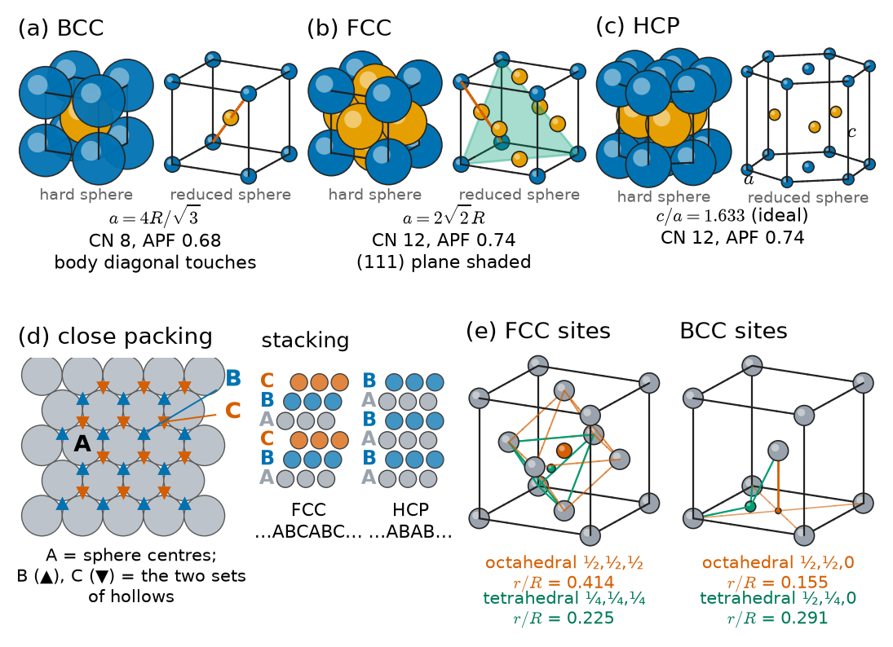
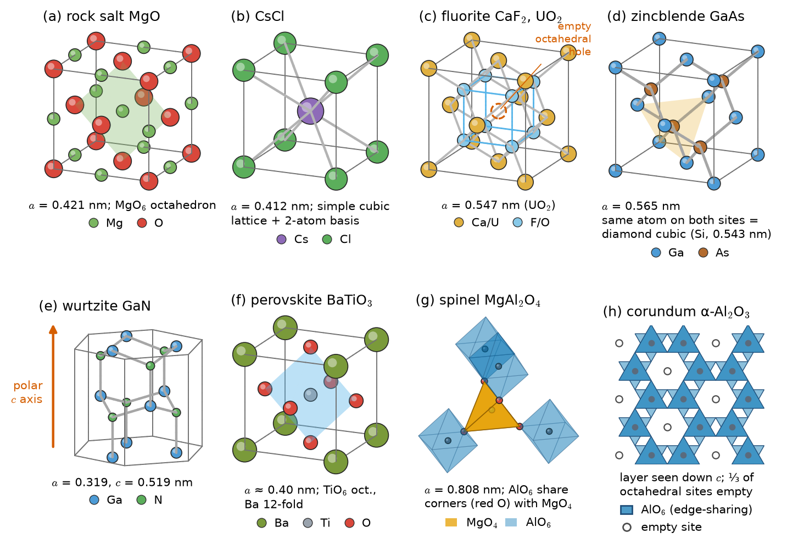
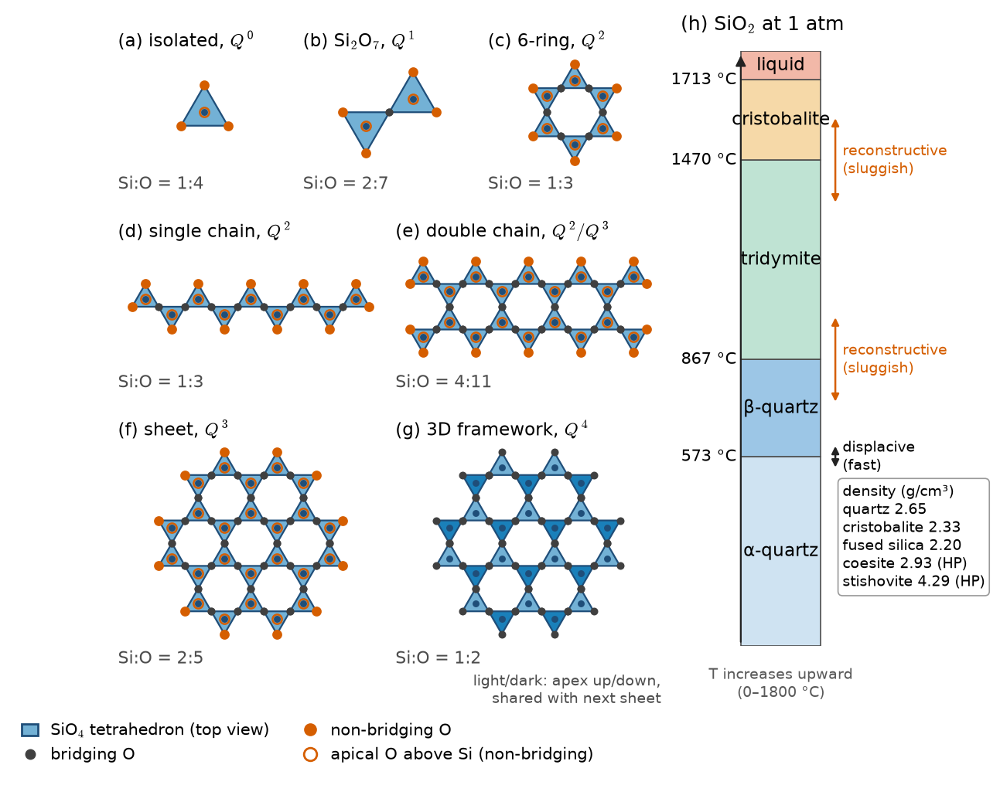
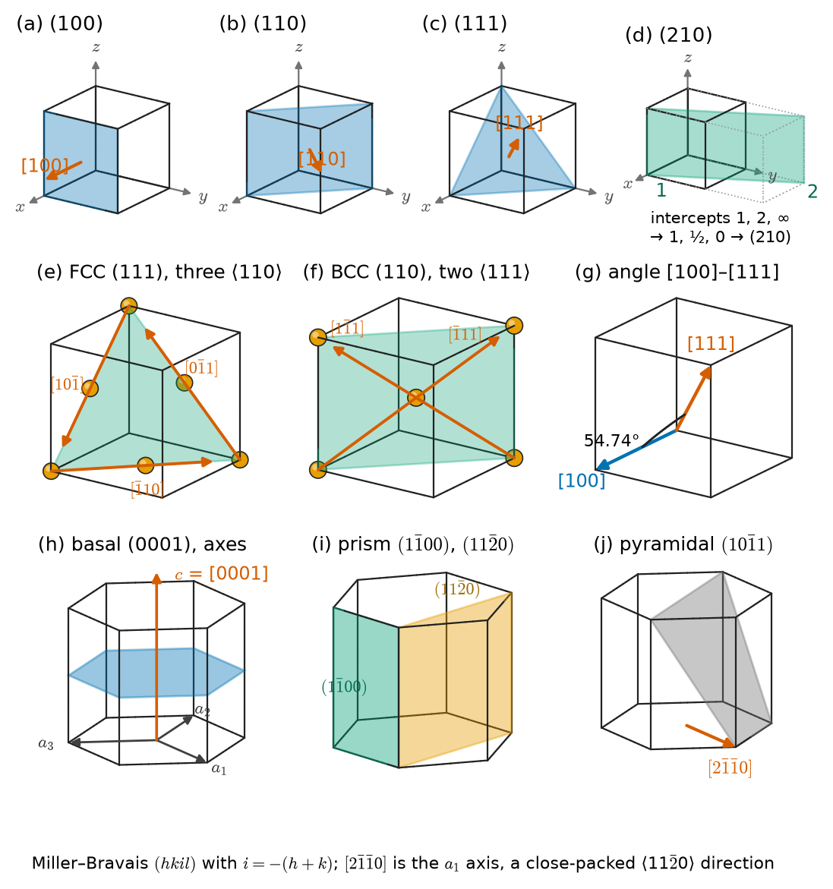
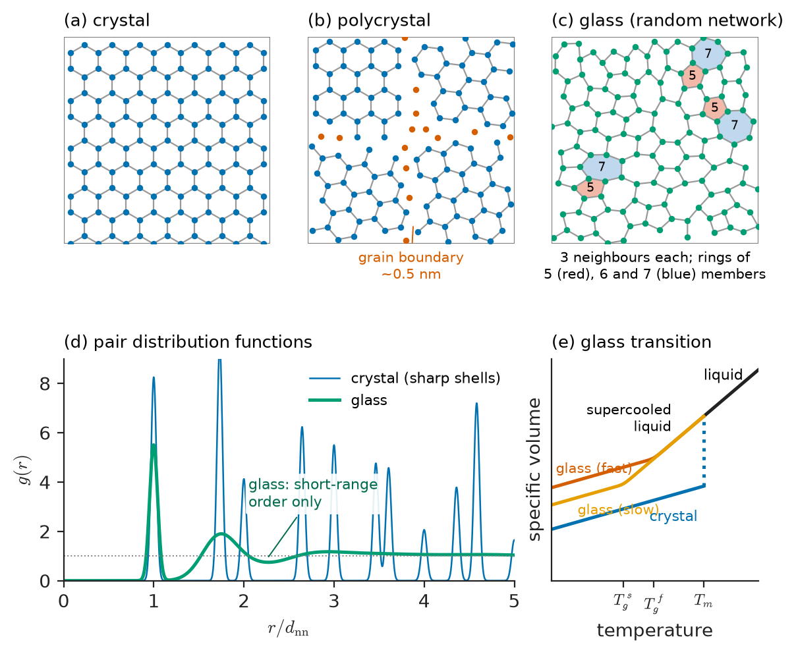
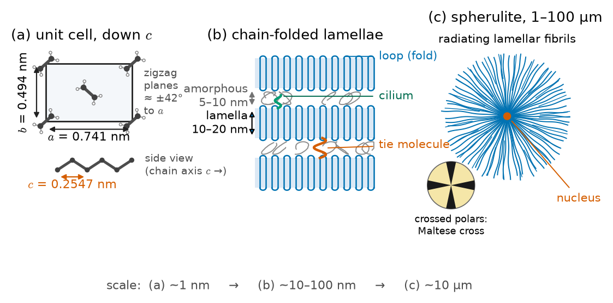

# Chapter 2 — Crystal Structures and Non-Crystalline Solids

*Part I · Structure of Materials*

Zirconia (ZrO$_2$) looks like an ideal engineering ceramic: it melts at about 2700 °C, resists chemical attack and is tougher than almost any other oxide. Yet a pure zirconia component sintered at 1500 °C cracks to pieces as it cools. The cause is a change of crystal structure. Near 950 °C on cooling (1170 °C on heating, with hysteresis), the tetragonal form of zirconia transforms to a monoclinic form whose volume is about 4–5 % larger, and the strain shatters the part. Engineers solved the problem in two quite different ways, both by controlling crystal structure. Adding about 8 mol % yttria stabilizes the cubic fluorite structure at all temperatures; this "fully stabilized" zirconia conducts oxygen ions and is the electrolyte of the oxygen sensor in every car exhaust and of solid-oxide fuel cells. Adding only about 3 mol % yttria keeps fine tetragonal grains *metastable* at room temperature; when a crack approaches, the stress triggers the transformation locally, the expansion squeezes the crack shut, and the toughness rises several-fold. That material makes dental crowns, hip-joint heads and cutting blades. One chemical compound, three crystal structures, three industries.

Every property traced in this book starts from the arrangement of atoms. This chapter builds the vocabulary for describing it: lattices and unit cells, the structures of metals, ceramics and silicates, the notation for directions and planes, the aggregates of crystals that make up real parts, and the solids, from window glass to polyethylene to liquid crystals, that are not perfectly periodic at all.

> **How are atoms arranged in metals, ionic and covalent compounds and silicates, and what decides which structure a compound adopts?**
> **How do we name directions and planes in a crystal, and how do real materials depart from the single perfect crystal: as polycrystals, glasses, semicrystalline polymers, liquid crystals and quasicrystals?**

| Concept | Engineering destination |
|---|---|
| Lattice, basis, unit cell; coordination and packing | Density, porosity checks, interstitial solubility (Chapters 5, 8) |
| FCC, BCC, HCP and stacking | Ductility of metals, slip systems (Chapters 12–13), steel heat treatment (Chapter 15) |
| Ionic and covalent structures; Pauling's rules | Ceramics, refractories, oxide fuels, battery cathodes, semiconductors, piezoelectrics |
| Silicates and polymorphism | Glass, cement, clays, quartz inversion in refractories, zirconia toughening |
| Directions and planes; Miller and Miller–Bravais indices | Slip planes, cleavage, X-ray diffraction (Chapter 4), wafer and blade orientation |
| Polycrystals, texture, grain size | Strength, formability, creep, magnetic and corrosion behaviour |
| Glasses and radial distribution functions | Window and fibre glass, metallic glasses, amorphous coatings |
| Polymer crystallinity; liquid crystals; quasicrystals | Polymer stiffness and barrier properties, aramid fibres, displays, coatings |

**Roadmap.** Lattice, basis and cell (2.1) → metallic structures (2.2) → ionic and covalent structures and Pauling's rules (2.3) → silicates and polymorphism (2.4) → naming directions and planes (2.5) → polycrystals, texture and grain size (2.6) → glasses (2.7) → polymer crystallinity (2.8) → liquid crystals and quasicrystals (2.9).

---

## 2.1 Lattices, bases and unit cells

### Crystal = lattice + basis

A **crystal** is a solid in which atoms are arranged in a pattern that repeats periodically in three dimensions. Its description separates two ideas.

- The **lattice** is an infinite array of mathematical points, each with identical surroundings, generated by three non-coplanar **lattice vectors** $\mathbf a$, $\mathbf b$, $\mathbf c$:

$$
\mathbf R=n_1\mathbf a+n_2\mathbf b+n_3\mathbf c,\qquad n_1,n_2,n_3\ \text{integers}
$$

- The **basis** (or motif) is the group of atoms attached to each lattice point. In copper it is one Cu atom; in silicon two Si atoms; in rock salt one Na and one Cl; in polyethylene, two chain segments containing four CH$_2$ groups.

Crystal structure is lattice plus basis. Different materials can share a lattice while having very different bases (copper, silicon and NaCl all have face-centred cubic lattices), and properties such as piezoelectricity depend on the symmetry of the whole structure, not of the lattice alone. Why atoms form periodic arrays at all is a matter of thermodynamics: at low temperature the periodic arrangement lets every atom adopt the same, optimal set of neighbours. Chapter 3 classifies the possible lattices (seven crystal systems, fourteen Bravais lattices) by symmetry; here we need only their geometry.

### Unit cells and lattice parameters

The **unit cell** is a parallelepiped built on the lattice vectors that fills space when repeated by translation. It is specified by six **lattice parameters**: edge lengths $a$, $b$, $c$ and interaxial angles $\alpha$ (between $\mathbf b$ and $\mathbf c$), $\beta$ and $\gamma$. A *primitive* cell contains one lattice point; a *conventional* cell is often larger so that it shows the full symmetry. Atoms on corners, edges and faces are shared with neighbouring cells and count as $1/8$, $1/4$ and $1/2$ respectively; this bookkeeping gives the number $n$ of atoms (or formula units) per cell.

### Coordination and packing

Two numbers summarize how tightly a structure is built. The **coordination number** (CN) is the number of nearest neighbours of an atom. The **atomic packing factor** (APF) is the fraction of the cell volume occupied by atoms modelled as hard spheres of radius $R$:

$$
\mathrm{APF}=\frac{n\cdot\tfrac43\pi R^3}{V_c}
$$

And because the cell repeats, its mass divided by its volume is the density of a perfect crystal:

$$
\rho=\frac{n\,A}{V_c\,N_A}
$$

where $A$ is the atomic (or formula) mass and $N_A=6.022\times10^{23}\ \mathrm{mol^{-1}}$. Comparing this theoretical density with a measured one is the standard way to find the porosity of a sintered ceramic or a powder-metallurgy part.

> **Status of the principle: hard-sphere model of crystal structures**
> *Approximate.* Atoms are treated as rigid touching spheres; it predicts lattice parameters and densities to within a few per cent for close-packed metals and many ionic solids, but fails for covalent crystals, where bond directions rather than packing set the structure.

---

## 2.2 Metallic structures: FCC, BCC, HCP and stacking sequences

Metallic bonds are non-directional, so most metals adopt one of three simple, dense structures (Figure 2.1).

<!-- FIGURE 2.1 | figures/ch02/fig-2-1-metallic-structures.png | crystal | The metallic structures: body-centred cubic, face-centred cubic and hexagonal close-packed, with the stacking of close-packed layers and the interstitial sites. | Content: top row, three cells in hard-sphere and reduced-sphere views: (a) BCC with body diagonal of touching spheres, label a = 4R/√3, CN 8, APF 0.68; (b) FCC with face diagonal of touching spheres, label a = 2√2R, CN 12, APF 0.74, one (111) plane shaded; (c) HCP prism with a and c labelled, ideal c/a = 1.633, CN 12, APF 0.74. Bottom row: (d) close-packed layer viewed from above with sites A (spheres), B and C (hollows) marked; side views of stacking ABCABC (FCC) and ABAB (HCP); (e) FCC cell with octahedral site at body centre (r/R = 0.414) and one tetrahedral site at (¼,¼,¼) (r/R = 0.225); BCC cell with octahedral site at a face centre (r/R = 0.155) and tetrahedral site at (½,¼,0) (r/R = 0.291). -->

*Figure 2.1 — The metallic structures: body-centred cubic, face-centred cubic and hexagonal close-packed, with the stacking of close-packed layers and the interstitial sites.*

### Body-centred cubic (BCC)

Atoms at the cube corners and one at the centre: $n=8\times\tfrac18+1=2$. Atoms touch along the body diagonal, so $\sqrt3\,a=4R$ and

$$
a=\frac{4R}{\sqrt3},\qquad \mathrm{CN}=8,\qquad \mathrm{APF}=\frac{\sqrt3\,\pi}{8}=0.680
$$

Iron at room temperature (α-Fe, ferrite), chromium, molybdenum, tungsten, vanadium, niobium and β-titanium are BCC. BCC metals are strong and often become brittle at low temperature (Chapter 12), the root of the Liberty-ship fractures in Chapter 1.

### Face-centred cubic (FCC)

Atoms at the corners and the centre of each face: $n=8\times\tfrac18+6\times\tfrac12=4$. Atoms touch along the face diagonal, $\sqrt2\,a=4R$:

$$
a=2\sqrt2\,R,\qquad \mathrm{CN}=12,\qquad \mathrm{APF}=\frac{\pi}{3\sqrt2}=0.740
$$

Aluminium, copper, nickel, silver, gold, platinum, lead and austenitic stainless steel are FCC, as is iron between 912 °C and 1394 °C (γ-Fe, austenite). FCC metals stay ductile down to cryogenic temperatures, which is why austenitic stainless steels and aluminium alloys make tanks for liquefied natural gas and liquid hydrogen.

### Hexagonal close-packed (HCP) and stacking sequences

Equal spheres in a plane pack most densely in a triangular array. Stacking such layers, each new layer sits in hollows of the one below, and there are two sets of hollows, so layer positions can be labelled A, B and C. The sequence $\ldots ABABAB\ldots$ gives **hexagonal close-packed**; $\ldots ABCABC\ldots$ gives FCC, whose close-packed layers are the $\{111\}$ planes (Section 2.5). Both have CN 12 and APF 0.740, the densest possible packing of equal spheres.

The HCP conventional cell is a hexagonal prism containing $n=12\times\tfrac16+2\times\tfrac12+3=6$ atoms, with an ideal axial ratio

$$
\frac ca=\sqrt{\frac83}=1.633
$$

Real HCP metals deviate: magnesium (1.624) is nearly ideal, titanium (1.587) compressed and zinc (1.856) elongated. HCP metals have fewer easy slip systems than FCC metals and are less formable at room temperature, which is why magnesium sheet is usually formed warm (Chapter 13).

Stacking matters beyond metals. A single error in the FCC sequence, $\ldots ABCAB\,|\,ABC\ldots$, is a **stacking fault**, a planar defect whose energy controls how copper and stainless steel work-harden (Chapters 5 and 12); a mirror reversal, $\ldots ABCACBA\ldots$, is a **twin boundary**. The polytypes of silicon carbide (3C, 4H, 6H) differ only in the stacking of their Si–C layers.

### Interstitial sites

Between the spheres of a close-packed structure lie holes. In FCC each atom has one **octahedral** site (surrounded by six atoms, at the cell centre and edge midpoints) and two **tetrahedral** sites (surrounded by four). The largest sphere that fits without strain has radius $r=0.414R$ in an octahedral site and $r=0.225R$ in a tetrahedral site. BCC, though less densely packed, has smaller holes: its octahedral sites are distorted and admit only $r=0.155R$, its tetrahedral sites $r=0.291R$. These numbers matter for steel. In austenite at 912 °C ($R=0.129$ nm) the octahedral hole has radius 0.053 nm; in ferrite ($R=0.126$ nm) the largest hole is 0.037 nm. A carbon atom (radius about 0.077 nm) is a tight fit in either, but far tighter in ferrite, which is why austenite dissolves up to 2.1 wt % carbon and ferrite at most 0.022 wt %, the fact on which all steel heat treatment rests (Chapters 7 and 15).

**Worked example — Density of iron and the volume change at 912 °C.** α-Fe is BCC with $n=2$, $A=55.85\ \mathrm{g\,mol^{-1}}$, $a=0.2866$ nm at room temperature:

$$
\rho=\frac{2\times55.85}{(2.866\times10^{-8}\ \mathrm{cm})^3\times6.022\times10^{23}}=\frac{111.7}{2.354\times10^{-23}\times6.022\times10^{23}}=7.88\ \mathrm{g\,cm^{-3}}
$$

against a measured 7.87 g cm$^{-3}$. At 912 °C the BCC and FCC forms coexist, with lattice parameters of about 0.2904 nm and 0.3647 nm. The volume per atom is

$$
\frac{a_\alpha^3}{2}=\frac{0.2904^3}{2}=0.012245\ \mathrm{nm^3},\qquad \frac{a_\gamma^3}{4}=\frac{0.3647^3}{4}=0.012127\ \mathrm{nm^3}
$$

so iron *contracts* by $(0.012127-0.012245)/0.012245=-0.97\,\%$ in volume on transforming from BCC to FCC on heating, and expands by the same amount on cooling. The hard-sphere radii, $R_\alpha=\sqrt3a_\alpha/4=0.1257$ nm and $R_\gamma=a_\gamma/(2\sqrt2)=0.1289$ nm, show that the atoms themselves are effectively about 2.5 % larger in the 12-coordinated structure; the denser packing (0.74 against 0.68) wins. This dilatation is measured in a dilatometer to find transformation temperatures, and its larger cousin, the expansion when austenite becomes martensite, causes quench distortion and cracking in heat-treated parts (Chapter 15).

| Metal | Structure | Lattice parameters at 20 °C (nm) | Atoms per cell | Density (g cm$^{-3}$) |
|---|---|---|---|---|
| Aluminium | FCC | $a=0.4050$ | 4 | 2.70 |
| Copper | FCC | $a=0.3615$ | 4 | 8.96 |
| Nickel | FCC | $a=0.3524$ | 4 | 8.91 |
| α-Iron | BCC | $a=0.2866$ | 2 | 7.87 |
| Tungsten | BCC | $a=0.3165$ | 2 | 19.3 |
| Magnesium | HCP | $a=0.3209$, $c=0.5211$ | 6 | 1.74 |
| α-Titanium | HCP | $a=0.2951$, $c=0.4683$ | 6 | 4.51 |
| Zinc | HCP | $a=0.2665$, $c=0.4947$ | 6 | 7.14 |

---

## 2.3 Ionic and covalent structures

### Building ionic structures: radius ratio

In an ionic compound the larger ions, usually the anions, form a close-packed or nearly close-packed array and the smaller cations sit in its holes. Each cation wants as many anion neighbours as possible, but only as long as it still touches them; if the hole is larger than the cation, the cation "rattles" and the structure is unstable. Geometry then fixes the minimum cation-to-anion radius ratio $r_c/r_a$ for each coordination:

| Coordination number | Polyhedron | Range of $r_c/r_a$ | Examples |
|---|---|---|---|
| 3 | Triangle | 0.155–0.225 | B in B$_2$O$_3$ glass |
| 4 | Tetrahedron | 0.225–0.414 | Si in SiO$_2$, Zn in ZnO |
| 6 | Octahedron | 0.414–0.732 | Mg in MgO, Al in Al$_2$O$_3$ |
| 8 | Cube | 0.732–1.0 | Cs in CsCl, Ca in CaF$_2$ |
| 12 | Cuboctahedron | ≥ 1.0 | Ba in BaTiO$_3$ |

The boundaries are pure geometry: $2/\sqrt3-1=0.155$, $\sqrt{3/2}-1=0.225$, $\sqrt2-1=0.414$ and $\sqrt3-1=0.732$.

> **Status of the principle: radius-ratio rules**
> *Approximate.* They follow from treating ions as hard spheres of fixed radius; they predict the coordination of strongly ionic compounds about two times in three, and fail where covalency (ZnO, tetrahedral despite a ratio of about 0.53 with the sixfold Zn radius) or ion polarizability matters.

### The common structure types

Figure 2.2 shows the important types.

- **Rock salt** (NaCl type): FCC anions with cations in every octahedral hole; CN 6:6. NaCl, MgO, CaO, NiO, FeO, and the hard interstitial compounds TiC, TiN and ZrC used in cutting-tool coatings.
- **Caesium chloride** (CsCl type): anions at the cube corners and a cation at the centre; CN 8:8. Although it looks like BCC, the two sites hold different atoms, so the lattice is *simple cubic* with a two-atom basis. Ordered intermetallics adopt it: NiAl (a bond coat for turbine blades), β-brass CuZn and FeAl (Chapter 3).
- **Fluorite** (CaF$_2$ type): FCC cations with anions in all tetrahedral holes; CN 8:4. CaF$_2$, UO$_2$ (the nuclear fuel in most power reactors), ThO$_2$, CeO$_2$ (a catalyst support), and cubic yttria-stabilized ZrO$_2$. The empty octahedral holes make the structure open enough to accommodate fission products and oxygen vacancies.
- **Zincblende** (sphalerite, ZnS type): FCC anions with cations in half the tetrahedral holes; CN 4:4. ZnS, GaAs, InP, cubic SiC and cubic boron nitride. If both sites hold the same atom, the result is the **diamond cubic** structure of diamond, Si and Ge.
- **Wurtzite**: the hexagonal (AB-stacked) analogue of zincblende; ZnO, GaN, AlN, BeO. Its unique $c$ axis is polar, making these materials piezoelectric.
- **Perovskite** (ABO$_3$): a large A cation at the cube corners, a small B cation at the centre inside an octahedron of six oxygens at the face centres. BaTiO$_3$ and PZT (capacitors, sensors, ultrasound transducers), SrTiO$_3$, the high-pressure mineral bridgmanite MgSiO$_3$ (the most abundant mineral in the Earth's mantle) and the halide perovskites of emerging solar cells.
- **Spinel** (AB$_2$O$_4$): an FCC array of oxygen with A cations in one-eighth of the tetrahedral holes and B cations in half the octahedral holes, eight formula units in a cubic cell of edge about 0.81–0.84 nm. MgAl$_2$O$_4$ (transparent armour, refractories), magnetite Fe$_3$O$_4$, ferrites, and LiMn$_2$O$_4$ battery cathodes, whose lithium moves through the empty sites.
- **Corundum** (α-Al$_2$O$_3$): a nearly HCP array of oxygen with Al in two-thirds of the octahedral holes; trigonal. Alumina substrates and wear parts, sapphire windows, ruby (with Cr$^{3+}$), and the protective Cr$_2$O$_3$ and Al$_2$O$_3$ scales on stainless steels and superalloys (Chapter 42).

<!-- FIGURE 2.2 | figures/ch02/fig-2-2-ionic-covalent-structures.png | crystal | Common ionic and covalent structure types: rock salt, CsCl, fluorite, zincblende/diamond, wurtzite and perovskite, with spinel and corundum shown as polyhedral sketches. | Content: eight small panels, ball-and-stick with coordination polyhedra shaded. (a) Rock salt MgO, a = 0.421 nm, MgO6 octahedron. (b) CsCl, a = 0.412 nm, cation at body centre, label "simple cubic lattice + 2-atom basis". (c) Fluorite UO2/CaF2, a = 0.547 nm, cation cube of 8 anions, empty octahedral hole at body centre highlighted. (d) Zincblende GaAs, a = 0.565 nm, tetrahedron, inset "same atom on both sites = diamond cubic (Si, a = 0.543 nm)". (e) Wurtzite GaN, a = 0.319, c = 0.519 nm, polar c-axis arrow. (f) Perovskite BaTiO3, a ≈ 0.40 nm, TiO6 octahedron, Ba in 12-fold site. (g) Spinel MgAl2O4 as corner-sharing AlO6 octahedra and MgO4 tetrahedra, a = 0.808 nm. (h) Corundum as layers of edge-sharing AlO6 octahedra with one-third of the octahedral sites empty in a honeycomb pattern. -->

*Figure 2.2 — Common ionic and covalent structure types: rock salt, CsCl, fluorite, zincblende/diamond, wurtzite and perovskite, with spinel and corundum shown as polyhedral sketches.*

| Compound | Structure type | Lattice parameters (nm) | Formula units per cell | Density (g cm$^{-3}$) |
|---|---|---|---|---|
| NaCl | Rock salt | $a=0.5640$ | 4 | 2.16 |
| MgO | Rock salt | $a=0.4212$ | 4 | 3.58 |
| CsCl | CsCl | $a=0.4123$ | 1 | 3.99 |
| UO$_2$ | Fluorite | $a=0.5470$ | 4 | 10.96 |
| ZrO$_2$ (cubic, Y-stabilized) | Fluorite | $a\approx0.514$ | 4 | about 6.0 |
| Si | Diamond cubic | $a=0.5431$ | 8 atoms | 2.33 |
| GaAs | Zincblende | $a=0.5653$ | 4 | 5.32 |
| ZnO | Wurtzite | $a=0.3250$, $c=0.5207$ | 2 | 5.68 |
| BaTiO$_3$ (tetragonal) | Perovskite | $a=0.3994$, $c=0.4038$ | 1 | 6.01 |
| MgAl$_2$O$_4$ | Spinel | $a=0.8083$ | 8 | 3.58 |
| α-Al$_2$O$_3$ | Corundum | $a=0.4759$, $c=1.2991$ (hexagonal setting) | 6 | 3.99 |

### Pauling's rules

Linus Pauling summarized the principles of ionic structures in five rules (1929), still the best qualitative guide to oxide and silicate structures.

1. **Coordination polyhedra.** A polyhedron of anions forms around each cation; the cation–anion distance is the sum of the radii and the coordination number is set by the radius ratio.
2. **Electrostatic valence.** The strength of each bond from a cation of charge $z$ and coordination CN is $s=z/\mathrm{CN}$; in a stable structure the bond strengths reaching each anion sum to the magnitude of its charge.
3. **Sharing of polyhedron elements.** Sharing edges, and especially faces, between polyhedra lowers stability, because it brings the cations closer together.
4. **Highly charged cations avoid one another.** In crystals with different cations, those with high charge and low coordination tend not to share polyhedron elements.
5. **Parsimony.** The number of essentially different kinds of site tends to be small.

Rule 2 is quantitative and easy to check. In perovskite BaTiO$_3$, each oxygen is bonded to 2 Ti (each bond $s=4/6=2/3$) and 4 Ba ($s=2/12=1/6$): $2\times\tfrac23+4\times\tfrac16=2$, exactly the oxygen charge. In spinel MgAl$_2$O$_4$ each oxygen bonds to one tetrahedral Mg ($2/4=\tfrac12$) and three octahedral Al ($3/6=\tfrac12$ each): total 2. In fluorite each F$^-$ bonds to four Ca ($2/8=\tfrac14$): total 1. And in silicates, each Si–O bond has $s=4/4=1$, so an oxygen can bond to at most *two* silicon atoms: the SiO$_4$ tetrahedra can share corners but never edges or faces (rule 3), which is the founding principle of silicate structures (Section 2.4).

> **Status of the principle: Pauling's rules**
> *Empirical.* They were distilled from known structures and rationalized by electrostatics; they hold well for predominantly ionic oxides, silicates and halides and become unreliable for covalent, metallic or highly polarizable compounds.

### Perovskite stability: the tolerance factor

For the perovskite structure, the ideal cubic geometry requires the A–O distance to equal $\sqrt2$ times the B–O distance. Goldschmidt's **tolerance factor**

$$
t=\frac{r_A+r_O}{\sqrt2\,(r_B+r_O)}
$$

measures how well the ions fit. Cubic perovskites form for $t$ close to 1; for $t>1$ the B cation is too small for its octahedron and tends to displace off-centre, giving ferroelectricity; for $t<1$ the octahedra tilt and the symmetry drops to orthorhombic or rhombohedral; below about 0.8, other structures form.

> **Status of the principle: Goldschmidt tolerance factor**
> *Empirical.* A hard-sphere geometric criterion fitted to known perovskites; it is a useful screen (perovskites form for roughly $0.8<t<1.05$) but cannot predict the detailed distortions, which need the full energetics (Chapter 55).

**Worked example — From ionic radii to structure and density.** *MgO.* With Shannon radii $r_{\mathrm{Mg^{2+}}}=0.072$ nm (sixfold) and $r_{\mathrm{O^{2-}}}=0.140$ nm, $r_c/r_a=0.072/0.140=0.514$, inside the octahedral range 0.414–0.732, so rock salt is predicted, as observed. Cations and anions touch along the cube edge, so $a=2(r_c+r_a)=2(0.212)=0.424$ nm, within 0.7 % of the measured 0.4212 nm. With four MgO units (40.30 g mol$^{-1}$) per cell,

$$
\rho=\frac{4\times40.30}{(4.212\times10^{-8})^3\times6.022\times10^{23}}=3.58\ \mathrm{g\,cm^{-3}}
$$

in agreement with dense magnesia refractories; a fired MgO brick of bulk density 3.0 g cm$^{-3}$ therefore contains $1-3.0/3.58=16\,\%$ porosity.

*Titanates.* With $r_{\mathrm{Ti^{4+}}}=0.0605$ nm (sixfold) and twelvefold A-site radii of 0.161 nm (Ba), 0.144 nm (Sr) and 0.134 nm (Ca):

$$
t_{\mathrm{BaTiO_3}}=\frac{0.161+0.140}{\sqrt2\times(0.0605+0.140)}=\frac{0.301}{0.2836}=1.062
$$

and similarly $t=1.002$ for SrTiO$_3$ and $0.966$ for CaTiO$_3$. The ranking matches the behaviour: SrTiO$_3$ is cubic at room temperature; BaTiO$_3$, with its too-small Ti, is ferroelectric with Ti displaced along $c$ (tetragonal, $c/a=1.011$); CaTiO$_3$, with its too-small Ca, has tilted octahedra and orthorhombic symmetry. Three numbers from a table of radii sort a capacitor dielectric, a substrate crystal and a mineral.

---

## 2.4 Silicate structures and polymorphism

### The SiO$_4$ tetrahedron and its connectivity

Silicon and oxygen are the two most abundant elements in the Earth's crust, and silicates make up glass, cement, clay, brick, porcelain, refractories, rocks and sand. All are built from the same unit, the SiO$_4$ tetrahedron (Si–O 0.162 nm), with a radius ratio (about 0.19 for Si$^{4+}$, borderline between threefold and fourfold) and partly covalent bonding that both favour fourfold coordination. Following Pauling's second and third rules, tetrahedra link only through shared corners, and each shared ("bridging") oxygen joins exactly two tetrahedra. Silicates are classified by how many corners of each tetrahedron are shared, written $Q^n$ with $n=0$–4 bridging oxygens (Figure 2.3).

| Class | Shared corners ($Q^n$) | Silicate unit | Example materials |
|---|---|---|---|
| Orthosilicates (nesosilicates) | 0 | Isolated SiO$_4^{4-}$ | Forsterite Mg$_2$SiO$_4$ (refractories), zircon ZrSiO$_4$, Ca$_2$SiO$_4$ and Ca$_3$SiO$_5$ in cement clinker |
| Pyrosilicates (sorosilicates) | 1 | Si$_2$O$_7^{6-}$ | Melilite in slags |
| Rings and single chains | 2 | (SiO$_3$)$_n^{2n-}$ | Beryl (rings); pyroxenes such as enstatite MgSiO$_3$ in steatite ceramics (chains) |
| Double chains | 2 and 3 | Si$_4$O$_{11}^{6-}$ | Amphiboles, including the asbestos minerals |
| Sheets (phyllosilicates) | 3 | Si$_2$O$_5^{2-}$ | Kaolinite Al$_2$Si$_2$O$_5$(OH)$_4$ (clay, porcelain), talc, mica |
| Frameworks (tektosilicates) | 4 | SiO$_2$ | Quartz, cristobalite, feldspars (with Al substituting for Si), zeolites |

The connectivity explains engineering behaviour. Sheet silicates cleave into flakes and, as clays, slide past each other when wet, which makes clay mouldable before firing. Chain silicates such as asbestos form fibres. Frameworks are hard and refractory. Cement clinker phases are orthosilicates whose isolated tetrahedra react readily with water to form the calcium silicate hydrate that binds concrete (Chapter 18). In glass, adding Na$_2$O breaks bridging oxygens into non-bridging ones, lowering connectivity, viscosity and melting temperature (Section 2.7 and Chapter 17).

<!-- FIGURE 2.3 | figures/ch02/fig-2-3-silicate-units.png | schematic | Silicate structures built from corner-sharing SiO4 tetrahedra, from isolated tetrahedra to sheets and frameworks, and the polymorphs of silica. | Content: left two-thirds: tetrahedra drawn as blue triangles (top view) with bridging O as shared corners and non-bridging O as red dots: (a) isolated SiO4 (Q0), (b) Si2O7 pair (Q1), (c) six-membered ring (Q2), (d) single chain (Q2), (e) double chain (Q2/Q3), (f) sheet of six-membered rings (Q3), (g) 3D framework (Q4). Labels with Si:O ratios 1:4, 2:7, 1:3, 1:3, 4:11, 2:5, 1:2. Right third: (h) temperature axis 0–1800 °C at 1 atm with stability ranges of SiO2 polymorphs: α-quartz up to 573 °C, β-quartz 573–867 °C, tridymite 867–1470 °C, cristobalite 1470–1713 °C, liquid above 1713 °C; displacive α↔β transitions marked with short arrows, reconstructive transitions with long arrows; inset of densities: quartz 2.65, cristobalite 2.33, fused silica 2.20, coesite 2.93, stishovite 4.29 g/cm³. -->

*Figure 2.3 — Silicate structures built from corner-sharing SiO4 tetrahedra, from isolated tetrahedra to sheets and frameworks, and the polymorphs of silica.*

### Polymorphism

Many materials change crystal structure with temperature or pressure; this is **polymorphism** (called *allotropy* for elements). Two kinds of transformation differ in speed. **Displacive** transformations need only small atomic shifts and bond-angle changes; they happen almost instantly and cannot be suppressed. **Reconstructive** transformations require bonds to break and re-form; they are sluggish and the high-temperature form can often be retained metastably.

| Material | Polymorphs (at 1 atm unless stated) | Engineering consequence |
|---|---|---|
| Iron | α (BCC) → γ (FCC) at 912 °C → δ (BCC) at 1394 °C → liquid at 1538 °C | Heat treatment of steels (Chapters 7, 10, 15) |
| Titanium | α (HCP) → β (BCC) at 882 °C | α, α+β and β alloys (Chapter 16) |
| Silica | α-quartz → β-quartz at 573 °C (displacive) → tridymite 867 °C → cristobalite 1470 °C (reconstructive) → liquid 1713 °C; coesite and stishovite at high pressure | Silica refractories and porcelain must be heated slowly through 573 °C, where quartz changes volume by roughly 1–2 % |
| Zirconia | Monoclinic → tetragonal at about 1170 °C → cubic at about 2370 °C | 4–5 % volume change; stabilization and transformation toughening (opening of this chapter, Chapter 14) |
| Carbon | Graphite (stable) and diamond (metastable at ambient conditions) | Synthetic diamond at high pressure and temperature; graphite as lubricant and electrode |
| Tin | β (body-centred tetragonal, 7.29 g cm$^{-3}$) → α (diamond cubic, 5.77 g cm$^{-3}$) below 13.2 °C | "Tin pest" disintegration of lead-free solders and tin objects in the cold |
| TiO$_2$ | Anatase, brookite (metastable) → rutile on heating | Photocatalytic coatings (anatase) versus white pigment (rutile) |

Polymorphism is one of the most powerful tools of processing. A structure stable at high temperature can be retained, transformed partly, or transformed into a fine mixture by controlling cooling; Chapters 7, 9 and 10 develop the thermodynamics and kinetics, and Chapter 3 shows how the symmetry relationship between two polymorphs determines how many orientation variants form.

---

## 2.5 Directions, planes, Miller and Miller–Bravais indices

### Directions

A crystallographic **direction** is written $[uvw]$: the components of a vector parallel to it, expressed in multiples of $a$, $b$, $c$ and reduced to the smallest integers, with bars for negative values ($[1\bar10]$ means $u=1$, $v=-1$, $w=0$). Directions related by symmetry form a **family** in angle brackets: in a cubic crystal $\langle100\rangle$ stands for the six cube-edge directions and $\langle111\rangle$ for the eight body diagonals. Points inside the cell are given as fractional coordinates, such as $\tfrac12\tfrac12\tfrac12$ for the body centre.

In cubic crystals only, directions behave as Cartesian vectors, and the angle between two directions is

$$
\cos\theta=\frac{u_1u_2+v_1v_2+w_1w_2}{\sqrt{u_1^2+v_1^2+w_1^2}\,\sqrt{u_2^2+v_2^2+w_2^2}}
$$

For $[100]$ and $[111]$, $\cos\theta=1/\sqrt3$ and $\theta=54.74^\circ$; for $[110]$ and $[111]$, $35.26^\circ$; between two body diagonals, $70.53^\circ$.

### Planes and Miller indices

A crystallographic **plane** always means a whole family of parallel, equally spaced planes passing through lattice points. Its **Miller indices** $(hkl)$ (Figure 2.4) are found by taking the intercepts of one plane on the three axes in units of $a$, $b$, $c$ (shifting the origin if the plane passes through it), taking reciprocals (a plane parallel to an axis has intercept $\infty$ and index 0), and clearing fractions to the smallest integers. A plane with intercepts $1, 2, \infty$ has reciprocals $1, \tfrac12, 0$ and indices $(210)$. Families of symmetry-equivalent planes are written in braces: $\{100\}$ for the six cube faces, $\{111\}$ for the eight octahedral planes. Reciprocals are used because $(hkl)$ are the components of the plane normal in the *reciprocal lattice*, the natural language of diffraction (Chapter 4).

<!-- FIGURE 2.4 | figures/ch02/fig-2-4-miller-indices.png | crystal | Miller indices of planes and directions in a cubic cell, the close-packed directions and planes of FCC and BCC, and the four-index system for hexagonal crystals. | Content: top row: three cubes, origin at back-lower-left, axes x, y, z: (100) shaded with [100] normal; (110) shaded with [110]; (111) shaded with [111]; a fourth cube shows a plane with intercepts 1, 2, ∞ labelled (210). Middle row: FCC (111) plane with the three close-packed <110> directions drawn in it; BCC (110) plane with the two close-packed <111> directions; the 54.74° angle between [100] and [111] marked. Bottom row: hexagonal prism with axes a1, a2, a3 at 120° and c; basal plane (0001) blue, prism plane (1-100) green, prism plane (11-20) orange, pyramidal plane (10-11) grey; directions [2-1-10] and [0001] drawn; caption note i = −(h + k). -->

*Figure 2.4 — Miller indices of planes and directions in a cubic cell, the close-packed directions and planes of FCC and BCC, and the four-index system for hexagonal crystals.*

### Three results for cubic crystals

**The direction $[hkl]$ is perpendicular to the plane $(hkl)$**, so the normal to a $(111)$ plane is the body diagonal.

**The interplanar spacing** is

$$
d_{hkl}=\frac{a}{\sqrt{h^2+k^2+l^2}}
$$

For copper, $d_{111}=0.3615/\sqrt3=0.2087$ nm, $d_{200}=0.1808$ nm and $d_{220}=0.1278$ nm. Diffraction measures exactly these spacings (Chapter 4).

**The zone rule.** A direction $[uvw]$ lies in a plane $(hkl)$ when

$$
hu+kv+lw=0
$$

So $[1\bar10]$ lies in $(111)$; this is how one finds the slip directions lying in a slip plane or the line along which a plane meets a surface.

> **Status of the principle: interplanar spacing and zone rule**
> *Derived.* Both are pure lattice geometry: the spacing formula holds for cubic lattices only (Chapter 4 gives the general form), and the zone rule holds in every crystal system when $(hkl)$ and $[uvw]$ refer to the same axes.

### Linear and planar densities

The **linear density** of a direction is the number of atoms centred on it per unit length; the **planar density** of a plane is the number of atoms centred on it per unit area. They identify the most densely packed directions and planes, which are the slip directions and slip planes of metals (Chapter 13), the planes along which crystals cleave and the surfaces that are slowest to etch or oxidize.

For FCC, the $(100)$ face contains a face-centre atom and four quarter-corner atoms in area $a^2$, so $\mathrm{PD}_{100}=2/a^2$; the $(110)$ rectangle $a\times\sqrt2a$ contains 2 atoms, $\mathrm{PD}_{110}=\sqrt2/a^2$; the $(111)$ triangle of side $\sqrt2a$ and area $(\sqrt3/2)a^2$ contains $3\times\tfrac16+3\times\tfrac12=2$ atoms, $\mathrm{PD}_{111}=4/(\sqrt3a^2)$. Atoms touch along $\langle110\rangle$.

**Worked example — Close-packed planes and directions in copper and iron.** For copper ($a=0.3615$ nm, $a^2=0.1307\ \mathrm{nm^2}$):

$$
\mathrm{PD}_{100}=\frac{2}{0.1307}=15.3,\qquad \mathrm{PD}_{110}=\frac{1.414}{0.1307}=10.8,\qquad \mathrm{PD}_{111}=\frac{4}{1.732\times0.1307}=17.7\ \ \mathrm{atoms\,nm^{-2}}
$$

The $\{111\}$ planes are both the densest and the most widely spaced ($d_{111}=0.209$ nm against $d_{200}=0.181$ nm), and the linear density along $\langle110\rangle$ is $2/(\sqrt2a)=3.91\ \mathrm{nm^{-1}}$, just $1/2R$. Copper therefore slips on $\{111\}\langle110\rangle$: 4 planes × 3 directions = 12 slip systems.

For BCC iron ($a=0.2866$ nm), atoms touch along the body diagonal: $\mathrm{LD}_{111}=2/(\sqrt3a)=4.03\ \mathrm{nm^{-1}}$. The densest plane is $\{110\}$, a rectangle $a\times\sqrt2a$ containing 2 atoms:

$$
\mathrm{PD}_{110}=\frac{\sqrt2}{a^2}=\frac{1.414}{0.08214}=17.2,\qquad \mathrm{PD}_{100}=\frac{1}{a^2}=12.2,\qquad \mathrm{PD}_{111}=\frac{1}{\sqrt3a^2}=7.0\ \ \mathrm{atoms\,nm^{-2}}
$$

Iron slips along $\langle111\rangle$, mainly on $\{110\}$. But no BCC plane is truly close-packed (17.2 atoms nm$^{-2}$ against 18.7 for an ideal close-packed layer of iron-sized atoms), so dislocations in BCC metals face a strong lattice resistance that rises steeply as temperature falls; that is one root of the ductile–brittle transition of ferritic steels (Chapters 12 and 14).

### Miller–Bravais indices for hexagonal crystals

In hexagonal crystals three indices hide the sixfold symmetry: equivalent planes get indices that look unrelated. The **Miller–Bravais** system uses three basal axes $\mathbf a_1$, $\mathbf a_2$, $\mathbf a_3$ at $120^\circ$ and $\mathbf c$ perpendicular to them. A plane is written $(hkil)$ with

$$
i=-(h+k)
$$

so that the six prism faces become the family $\{1\bar100\}$. The important planes for HCP metals (Mg, Ti, Zn, Zr) and wurtzite crystals are the **basal** plane $(0001)$, the **prism** planes $\{1\bar100\}$ and $\{11\bar20\}$, and the **pyramidal** planes such as $\{10\bar11\}$. Directions are written $[uvtw]$ and converted from the three-index form $[UVW]$ by

$$
u=\tfrac13(2U-V),\qquad v=\tfrac13(2V-U),\qquad t=-(u+v),\qquad w=W
$$

The $a_1$ axis, $[100]$ in three indices, becomes $\tfrac13[2\bar1\bar10]$, i.e. the $\langle11\bar20\rangle$ family, the close-packed slip directions of HCP metals. Titanium alloys deform mainly by prism slip, magnesium by basal slip; their scarcity of slip systems, and the textures that rolling gives them, are why both are anisotropic and harder to form than aluminium (Chapters 13 and 16).

---

## 2.6 Polycrystals, texture and grain size

### Single crystals and polycrystals

In a **single crystal** the periodic arrangement extends uninterrupted through the whole piece. Large single crystals must be grown deliberately from a seed: silicon wafers, sapphire windows, quartz resonators, laser crystals and the single-crystal turbine blades of Chapter 1. Most crystalline materials are instead **polycrystalline**: aggregates of many small crystals (**grains**) with different orientations, joined at **grain boundaries** about 0.5–1 nm thick in which the atomic arrangement is disturbed. Polycrystals form whenever crystals nucleate at many places at once: in a casting, in a sintered powder, in a recrystallizing rolled sheet, in a weld or in an additively manufactured track. Grain boundaries are described in Chapter 5; here we need their number and the orientations of the grains they separate.

### Texture

If grain orientations are random, a polycrystal is isotropic on scales much larger than the grain size, even when each grain is anisotropic. If the orientations are not random, the polycrystal has a **texture**. Textures are written as $\{hkl\}\langle uvw\rangle$, meaning that the $\{hkl\}$ planes of most grains lie parallel to the sheet surface and their $\langle uvw\rangle$ directions point along the rolling direction; a **fibre texture** has one crystal direction aligned with an axis and random rotation about it. Representative cases from across engineering:

- **Steel for deep drawing** is processed to have $\{111\}$ planes parallel to the sheet (the γ-fibre). This resists thinning, so car-body panels and food cans can be drawn deep without splitting.
- **Aluminium can stock** combines rolling and recrystallization textures in balance; if one dominates, the drawn cup forms four or six "ears" that must be trimmed off.
- **Grain-oriented electrical steel** has the Goss texture $\{110\}\langle001\rangle$, putting the easy magnetization direction along the strip (Chapter 29).
- **Zirconium-alloy fuel cladding** is rolled so that basal-plane normals point radially, which makes hydrides precipitate circumferentially, where they do little harm.
- **Drawn wire and electroplated or sputtered films** have fibre textures; in bone, the $c$ axes of hydroxyapatite crystals align with the collagen fibres.
- **Additively manufactured metals** grow columnar grains with $\langle100\rangle$ along the build direction, making their properties anisotropic (Chapter 48).

Chapter 3 introduces the pole figure, the standard way to display and measure texture.

### Measuring grain size

Grain size is measured on a polished and etched section. The **mean linear intercept** $\bar\ell$ is found by laying test lines of total length $L_T$ on a micrograph and counting the $P$ grain-boundary intersections: $\bar\ell=L_T/P$. A result of stereology links it exactly to the boundary area per unit volume:

$$
S_V=2P_L=\frac{2}{\bar\ell}
$$

where $P_L=P/L_T$; the factor 2 comes from averaging over the angles at which random lines cross a surface.

> **Status of the principle: $S_V=2P_L$**
> *Derived.* A theorem of geometric probability, exact for isotropic random test lines whatever the grain shape; for elongated or textured grains the test lines must be oriented in several directions and the results averaged.

The **ASTM grain-size number** $G$ (standard E112) is defined so that at a magnification of 100× there are

$$
N=2^{G-1}
$$

grains per square inch of image. Larger $G$ means finer grains, and each step of 1 halves the grain area.

**Worked example — From ASTM number to boundary area.** A structural steel plate is rated $G=8$. At 100×, $N=2^7=128$ grains per square inch of image. One square inch at 100× corresponds to $(25.4/100)^2=0.0645\ \mathrm{mm^2}$ of specimen, so there are $128/0.0645=1984$ grains per mm$^2$, an average grain section area of $504\ \mathrm{\mu m^2}$ and an equivalent square side of $\sqrt{504}=22.5$ µm. The E112 relation between $G$ and mean intercept gives $\bar\ell\approx20$ µm. The boundary area per unit volume is then

$$
S_V=\frac{2}{20\times10^{-6}\ \mathrm{m}}=1.0\times10^5\ \mathrm{m^{-1}}
$$

so every cubic centimetre of this steel contains about 0.1 m$^2$ of grain boundary. Refining to $G=12$ (about 5 µm) multiplies the boundary area by about four. Because boundaries obstruct dislocations, such refinement is the main strengthening mechanism of controlled-rolled high-strength low-alloy steels, with yield strength rising roughly as $d^{-1/2}$ (the Hall–Petch relation, Chapter 13); it also lowers the ductile–brittle transition temperature, the change that cured the Liberty ships. For creep at high temperature the opposite holds: boundaries slide and carry fast diffusion, so turbine blades remove them altogether.

---

## 2.7 Amorphous solids and glasses

### Order without periodicity

An **amorphous** solid has no long-range periodic order, but it is not random. Each atom keeps nearly the same number of neighbours at nearly the same distance as in the crystal, because these are fixed by bonding; what is lost is the regular repetition of that environment over large distances. In silica glass, every Si is surrounded by four O and every O bridges two Si, exactly as in quartz, but the Si–O–Si angle between tetrahedra varies from about 120° to 180° (mean about 144°), so the network never repeats. This is Zachariasen's **continuous random network** (1932), which also gave rules for which oxides form glasses: the cation should have low coordination (3 or 4), oxygen should bridge no more than two cations, polyhedra should share corners rather than edges or faces, and at least three corners of each should be shared. SiO$_2$, B$_2$O$_3$, GeO$_2$ and P$_2$O$_5$ satisfy them and are **network formers**; Na$_2$O and CaO break the network and are **modifiers** (Chapter 17).

> **Status of the principle: Zachariasen's rules for glass formation**
> *Empirical.* They are structural criteria inferred from oxide glasses; they explain why SiO$_2$ and B$_2$O$_3$ form glasses readily, but they say nothing about kinetics and do not apply to metallic or polymer glasses.

### The radial distribution function

The structure of a non-crystalline solid is described statistically by the **pair distribution function** $g(r)$: the average density of atoms at distance $r$ from any atom, divided by the mean density $\rho_0$. The number of atoms in a spherical shell between $r$ and $r+dr$ is $4\pi r^2\rho_0 g(r)\,dr$, a quantity called the **radial distribution function**, and the area under its first peak is the mean coordination number:

$$
N_1=\int_{\text{first peak}}4\pi r^2\rho_0\,g(r)\,dr
$$

In a crystal $g(r)$ is a series of sharp peaks continuing to arbitrary distance. In a glass the first peak is almost as sharp as in the crystal, the second is broader and beyond three or four neighbour distances $g(r)$ approaches 1: short-range order without long-range order (Figure 2.5). For silica glass the peaks lie at 0.162 nm (Si–O), 0.265 nm (O–O, the tetrahedron edge) and about 0.31 nm (Si–Si, consistent with $2\times0.162\times\sin72^\circ=0.308$ nm for a 144° bridge), and the first-peak area gives four O around each Si. Diffraction from a glass shows broad humps instead of sharp Bragg peaks; Fourier transforming them yields $g(r)$, the basis of the pair-distribution-function analysis of Chapter 53.

<!-- FIGURE 2.5 | figures/ch02/fig-2-5-crystal-glass-rdf.png | schematic | Crystal, polycrystal and glass in two dimensions, with their pair distribution functions and the volume–temperature behaviour that defines the glass transition. | Content: top row: three 2D networks of threefold-coordinated atoms at the same density: (a) perfect hexagonal network; (b) four grains of the same network at different orientations with disordered boundaries (one labelled "grain boundary ~0.5 nm"); (c) continuous random network with same coordination, rings of 5, 6 and 7 members. Bottom left: g(r) versus r/d_nn from 0 to 5: crystal as sharp spikes at fixed shells; glass with sharp first peak at 1.0, broader peaks at about 1.7 and 2.6, decaying oscillation to g = 1 beyond about 4; annotation "short-range order only". Bottom right: specific volume versus temperature: liquid line, abrupt drop at T_m to crystal line; supercooled liquid continuing below T_m and bending into glass lines at T_g(fast cooling) above T_g(slow cooling); labels "liquid", "supercooled liquid", "glass (fast)", "glass (slow)", "crystal". -->

*Figure 2.5 — Crystal, polycrystal and glass in two dimensions, with their pair distribution functions and the volume–temperature behaviour that defines the glass transition.*

### How glasses form and the glass transition

A liquid cooled below its melting point $T_m$ must rearrange its atoms to crystallize, which takes time. If it is cooled faster than it can rearrange, or its viscosity rises so steeply that rearrangement stalls, the disordered structure is frozen in. The specific volume then shows no jump at $T_m$; it follows the supercooled-liquid line until, over a narrow range, its slope falls to that of a solid. The intersection defines the **glass transition temperature** $T_g$ (Figure 2.5), which shifts slightly with cooling rate, so the glass transition is kinetic, not a true phase transition. Typical values: fused silica about 1200 °C, soda-lime glass about 550 °C, polystyrene about 100 °C, PMMA about 105 °C, epoxy 120–180 °C, polyethylene about −120 °C.

Glass-forming ability varies enormously:

- **Silicate glasses** form at ordinary cooling rates because their networks of strong directional bonds make the liquid extremely viscous.
- **Polymers** with irregular chains (atactic polystyrene, PMMA, polycarbonate, epoxies) cannot crystallize at all and are always glassy or rubbery.
- **Metals** crystallize so readily that metallic glasses needed cooling rates of about $10^5$–$10^6$ K s$^{-1}$, achieved by melt spinning ribbon 20–30 µm thick; multicomponent alloys such as Zr–Ti–Cu–Ni–Be now form "bulk" glasses centimetres thick at about 1 K s$^{-1}$. Their atoms are arranged in a dense random packing (packing fraction about 0.64, compared with 0.74 for FCC); with no dislocations, they combine high strength with large elastic strain, used in golf-club faces, precision springs and transformer cores.
- **Thin films** deposited from vapour at low temperature are often amorphous, because arriving atoms are buried before they find crystal sites: sputtered oxide coatings, diamond-like carbon, and amorphous silicon.

Amorphous materials are isotropic, have no grain boundaries to act as leakage or diffusion paths, and can be formed as viscous liquids. Their disadvantage is that they are not in equilibrium: given time at a high enough temperature, they crystallize ("devitrify").

---

## 2.8 Polymer chain packing and crystallinity (preview)

A polymer chain is a long, flexible covalent backbone, and whether it can crystallize depends on its regularity. Linear polyethylene, polytetrafluoroethylene, nylons and isotactic polypropylene have regular chains that can pack side by side in a lattice; atactic polystyrene and PMMA, with randomly placed side groups, cannot. Even regular polymers never crystallize completely, because their chains are entangled in the melt. The result is a **semicrystalline** solid: thin crystalline **lamellae**, typically 10–20 nm thick, in which chains fold back and forth, separated by amorphous layers and linked by **tie molecules** that pass from one lamella to the next. On cooling from the melt, lamellae grow radially from nuclei into **spherulites** 1–100 µm across (Figure 2.6). The amorphous regions give toughness and, above $T_g$, flexibility; the crystals give stiffness, solvent resistance and a barrier to gas permeation.

Polymer crystals are ordinary crystals with an unusual basis. Polyethylene is orthorhombic with $a=0.741$ nm, $b=0.494$ nm and $c=0.2547$ nm along the chain, two chains passing through each cell and four CH$_2$ groups per cell. The chain axis is a screw axis (Chapter 3): in the planar zigzag of polyethylene, each CH$_2$ unit is rotated 180° about the axis and advanced $c/2$; isotactic polypropylene forms a helix with three repeat units per turn.

<!-- FIGURE 2.6 | figures/ch02/fig-2-6-polymer-crystallinity.png | schematic | Chain packing in crystalline polyethylene, chain-folded lamellae and the spherulite, from the unit cell to the micrometre scale. | Content: three panels at increasing scale. (a) Orthorhombic polyethylene cell viewed down the chain axis c: two zigzag chains (corner and centre), a = 0.741 nm, b = 0.494 nm, with setting angle of the zigzag planes about 45° to a; side view of one chain showing C–C zigzag with c = 0.2547 nm. (b) Stack of chain-folded lamellae, thickness 10–20 nm, separated by amorphous layers 5–10 nm with loops, cilia and tie molecules labelled. (c) Spherulite, 1–100 µm, radiating lamellar fibrils from a central nucleus, Maltese-cross pattern indicated as seen between crossed polarizers. Side scale bar comparing 1 nm, 10 nm, 10 µm. -->

*Figure 2.6 — Chain packing in crystalline polyethylene, chain-folded lamellae and the spherulite, from the unit cell to the micrometre scale.*

### Degree of crystallinity

Because crystals pack chains more densely than the amorphous phase, density measures crystallinity. If $\rho_c$ and $\rho_a$ are the densities of fully crystalline and fully amorphous polymer, a two-phase model gives the mass fraction crystallinity of a sample of density $\rho$:

$$
x_c=\frac{\rho_c\,(\rho-\rho_a)}{\rho\,(\rho_c-\rho_a)}
$$

> **Status of the principle: two-phase crystallinity from density**
> *Approximate.* It treats the polymer as a mixture of perfect crystal and bulk amorphous phase; it ignores the interphase between them and voids or fillers, so it agrees with calorimetric and X-ray measurements to within a few per cent for unfilled polymers.

**Worked example — Crystallinity of polyethylenes.** The crystal density follows from the unit cell: four CH$_2$ units of 14.03 g mol$^{-1}$ in a volume $abc$,

$$
\rho_c=\frac{4\times14.03}{(0.741\times0.494\times0.2547)\times10^{-21}\ \mathrm{cm^3}\times6.022\times10^{23}}=\frac{56.11}{0.09323\times602.2}=1.00\ \mathrm{g\,cm^{-3}}
$$

With $\rho_a=0.855\ \mathrm{g\,cm^{-3}}$, a high-density polyethylene of density 0.960 g cm$^{-3}$ has

$$
x_c=\frac{1.00\times(0.960-0.855)}{0.960\times(1.00-0.855)}=\frac{0.105}{0.1392}=0.754
$$

about 75 % crystalline by mass, while a low-density polyethylene of 0.920 g cm$^{-3}$, whose short-chain branches disrupt packing, is only 49 % crystalline. The difference of 4 % in density marks a factor of three to four in stiffness, much better barrier properties in the HDPE milk bottle and gas pipe, and much better flexibility and clarity in the LDPE film. Processing changes crystallinity too: a PET bottle preform quenched from the melt is clear and amorphous, and stretching it during blow moulding induces crystallinity that stiffens the bottle and slows carbon-dioxide loss. Chapters 19–21 develop polymer structure in full.

---

## 2.9 Liquid crystals and quasicrystals (preview)

### Liquid crystals

Between the perfect order of a crystal and the disorder of a liquid lie **liquid crystals**: fluids whose rod-like or disc-like molecules keep some orientational, and sometimes positional, order. In the **nematic** phase the molecules point on average along a common direction, the *director* $\mathbf n$, but their centres are random. The degree of alignment is measured by the **order parameter**

$$
S=\left\langle\frac{3\cos^2\theta-1}{2}\right\rangle
$$

where $\theta$ is the angle between a molecule and the director and the brackets denote an average; $S=1$ for perfect alignment and $S=0$ for an isotropic liquid, with typical nematics between about 0.3 and 0.8. **Smectic** phases add layering, and **cholesteric** phases twist the director into a helix whose pitch can match the wavelength of light. *Thermotropic* liquid crystals form within a temperature window: the display compound 5CB is nematic between about 24 °C and 35 °C. *Lyotropic* ones form in solution above a critical concentration.

The engineering uses are significant. Liquid-crystal displays exploit the optical anisotropy of nematics and the ease of turning the director with a few volts (Chapter 37). Aramid fibres (Kevlar) are spun from a lyotropic liquid-crystalline solution in sulphuric acid; the chains are already aligned in the fluid, and the fibre reaches a modulus above 100 GPa. Liquid-crystalline polymers mould into thin-walled connectors with very low shrinkage (Chapter 20). Cell membranes and many biological tissues are liquid-crystalline too.

### Quasicrystals

In 1982 Dan Shechtman, examining rapidly solidified Al–Mn alloys in an electron microscope, saw diffraction patterns with sharp spots, proof of long-range order, arranged with tenfold symmetry. Such symmetry is forbidden to any periodic crystal (Chapter 3 proves that only two-, three-, four- and sixfold rotations are compatible with a lattice). The material was a **quasicrystal**: ordered but not periodic. Its atomic arrangement is the three-dimensional analogue of a Penrose tiling, in which two kinds of tile cover the plane with fivefold local symmetry but never repeat, and in which the ratio of the numbers of the two tiles tends to the golden ratio $\tau=(1+\sqrt5)/2=1.618$. Quasicrystals can be described as slices through periodic structures in higher-dimensional space. Their discovery forced the International Union of Crystallography to redefine a crystal in 1992 as any solid with an essentially discrete diffraction pattern, and earned Shechtman the 2011 Nobel Prize in Chemistry.

Quasicrystals are hard, have low surface energy and friction, and conduct heat and electricity poorly for metallic alloys. They have been used as non-stick and wear-resistant coatings and as fine strengthening particles in some precipitation-hardened maraging steels and magnesium alloys. Chapter 3 returns to them, together with incommensurately modulated structures, the other important family of ordered but non-periodic solids.

---

## What remains open

| Open question | Where it is answered |
|---|---|
| What symmetry operations relate the atoms of a crystal, and why are only fourteen lattices and 230 space groups possible? | Chapter 3 |
| How is texture measured and displayed with stereographic projections and pole figures? | Chapter 3 |
| How do diffraction patterns reveal lattice spacings, structures and grain size? | Chapter 4 |
| What do grain boundaries, stacking faults, vacancies and dislocations look like, and how do they control properties? | Chapter 5 |
| Why does a given structure, polymorph or glass form under given conditions? | Chapters 6, 7 and 9 |
| How does carbon dissolve and diffuse in the interstitial sites of iron? | Chapters 8 and 15 |
| How do slip systems and grain size set the strength of metals? | Chapters 12–13 |
| How does transformation toughening make zirconia tough? | Chapters 14 and 17 |
| How do cement silicates hydrate to bind concrete? | Chapter 18 |
| How do polymer chains crystallize, and how do lamellae and $T_g$ set polymer properties? | Chapters 19–20 |
| How do liquid crystals work in displays and actuators? | Chapter 37 |
| How are glasses and amorphous structures measured by pair-distribution-function analysis? | Chapter 53 |

**Next:** Chapter 3 makes the idea of a periodic crystal precise through symmetry: the operations that leave a crystal unchanged, the point groups, Bravais lattices and space groups they generate, the stereographic projection, and the ordered superlattices, quasicrystals and modulated structures that extend the classical picture.
