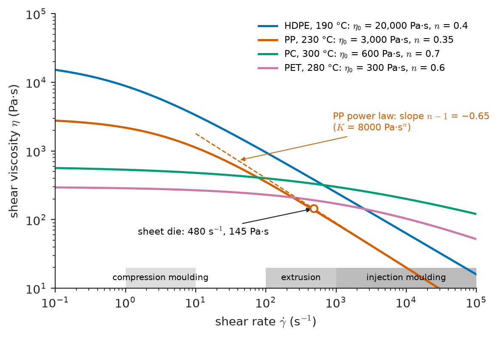
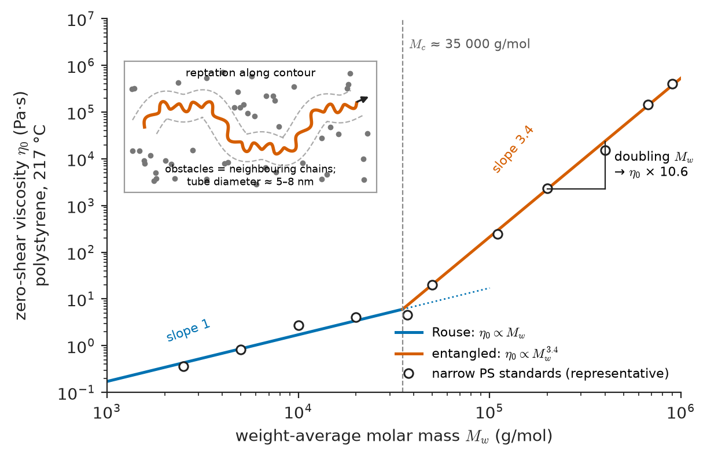
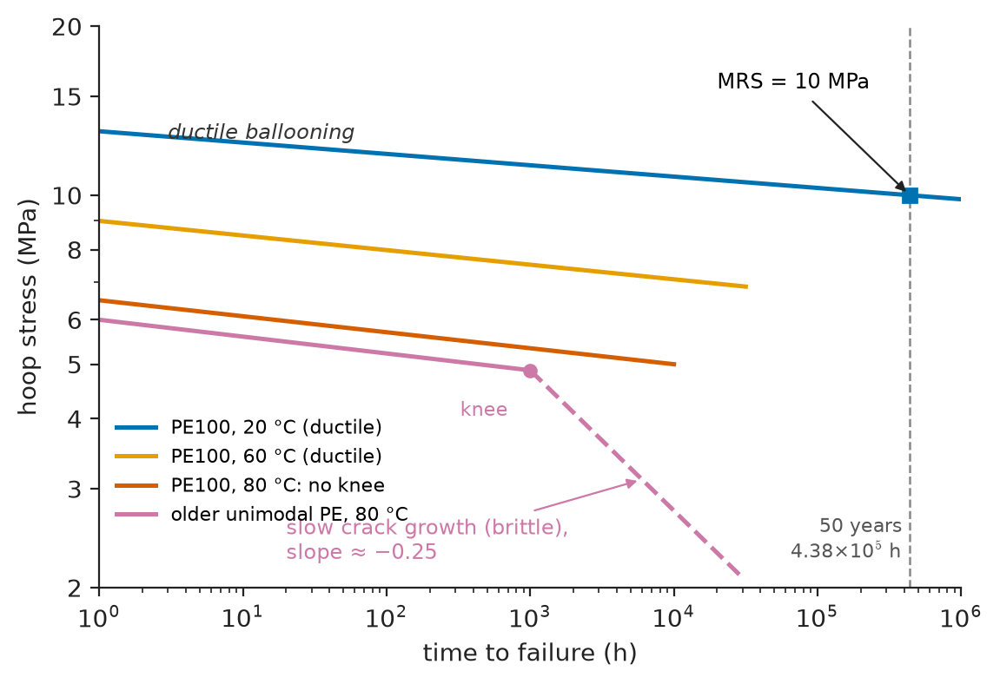
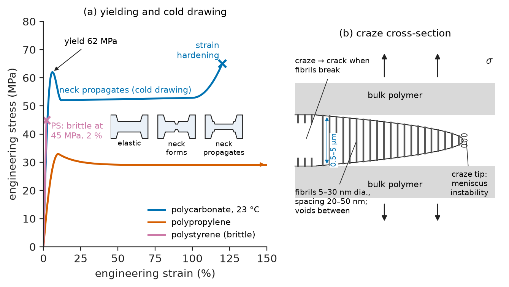
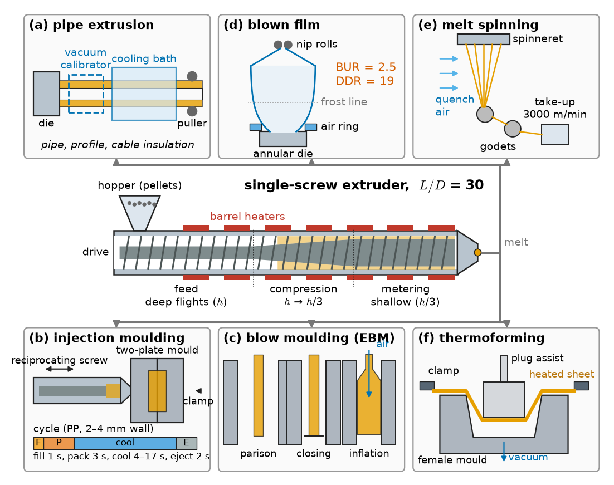
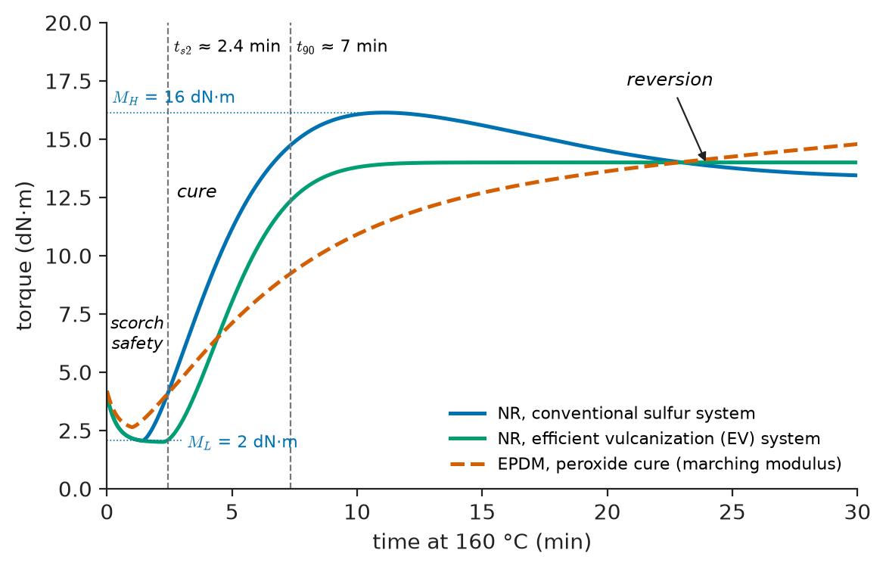

# Chapter 21 — Polymer Rheology, Mechanics and Processing

*Part V · Polymers and Composites*

A hospital reports that the polycarbonate housings of its infusion pumps are cracking. The cracks start at the screw bosses, run a few millimetres into the wall and have smooth, mirror-like faces. The housings had passed every drop and impact test at launch. Three things turned out to have combined. The bosses were moulded with high residual tensile stress because the mould was run cold to shorten the cycle; self-tapping screws added a hoop stress of 20–30 MPa, well below the 60 MPa yield strength of polycarbonate; and the cleaning staff had switched to a new disinfectant wipe containing alcohols and quaternary ammonium compounds. Polycarbonate under modest tensile stress, wetted by a liquid that plasticizes its surface, crazes and cracks in days — environmental stress cracking. The same polymer, the same design, the same screws had worked for years with the old wipe.

The case links the whole chapter: melt flow and cooling set the residual stress, viscoelastic relaxation set how much screw stress remained, the yield-or-craze competition set the failure mode, and the environment set the time to failure. This chapter puts the chains of Chapters 19 and 20 in motion — in the melt, the deforming solid and the processing machine — and follows them through formulation, aging, vulcanization and the end of life.

> **Why do polymer melts flow as they do, and how do processing flows set the structure and residual stress of a part?**
> **How do polymer parts deform, yield, craze and degrade in service, and what can additives, crosslinking and recycling do about it?**

| Concept | Engineering destination |
|---|---|
| Shear thinning, entanglement, reptation, $M^{3.4}$ | Grade selection by melt flow index; extruder and die design; mould filling |
| Creep modulus, isochronous curves | Snap fits, bolted plastic flanges, pressure pipes, storage tanks |
| Yielding, crazing, environmental stress cracking | Impact-modified housings, medical devices, chemical-resistant parts |
| Extrusion, moulding, blow moulding, thermoforming, spinning, film blowing | Choice of process and of grade for pipes, bottles, packaging, fibres, car parts |
| Plasticizers, fillers, stabilizers, flame retardants | Flexible PVC cables, glass-filled nylon brackets, UV-stable outdoor parts, aircraft interiors |
| UV, thermo-oxidative and hydrolytic degradation | Service-life estimates, accelerated aging, outdoor and under-bonnet applications |
| Vulcanization | Tyres, seals, hoses, engine mounts |
| Recycling and biodegradable polymers | Packaging design, end-of-life regulation, compostable and resorbable products |

**Roadmap.** How melts flow and why molecular weight dominates (21.1) → viscoelastic design of solid parts (21.2) → yielding, crazing and stress cracking (21.3) → processing routes (21.4) → additives (21.5) → degradation in service (21.6) → elastomers and vulcanization (21.7) → recycling and biodegradable polymers (21.8).

---

## 21.1 Melt rheology

### Viscosity of polymer melts

A polymer melt is a peculiar viscous liquid. Its viscosity at low shear rates, the **zero-shear viscosity** $\eta_0$, ranges from about 10 Pa·s for a low-molar-mass polyester to $10^4$–$10^6$ Pa·s for commercial thermoplastics, against 0.001 Pa·s for water and about 1 Pa·s for honey. Its viscosity falls as the shear rate rises, it stores elastic energy, it swells when it leaves a die, and it can fracture like a solid if pulled too fast. All of this follows from the long, entangled chains.

Processing spans wall shear rates $\dot\gamma$ from 1–10 s⁻¹ in compression moulding through 100–1,000 s⁻¹ in extrusion to $10^3$–$10^5$ s⁻¹ in injection moulding.

### Shear thinning

Above a characteristic shear rate, roughly the reciprocal of the longest relaxation time of the chains, the melt viscosity falls with increasing shear rate (Figure 21.1). Chains are oriented and partly disentangled by the flow faster than Brownian motion can restore their random coils, and the oriented, less entangled melt resists flow less. Over the processing range the viscosity is described adequately by a **power law**,

$$
\eta=K\,\dot\gamma^{\,n-1}
$$

with a **flow index** $n$ of 0.2–0.5 for most thermoplastic melts ($n=1$ is Newtonian). The Cross and Carreau–Yasuda models join the Newtonian plateau at low rates to the power law at high rates and are what mould-filling software uses.

> **Status of the principle: Power-law (Ostwald–de Waele) viscosity**
> *Empirical.* A two-parameter fit valid over one to three decades of shear rate in the shear-thinning region; it fails at low rates, where the viscosity tends to the finite plateau $\eta_0$, and predicts unphysical infinite viscosity as $\dot\gamma\to0$.

Shear thinning lets thin-walled parts be filled at $10^4$ s⁻¹ with acceptable pressures. Viscosity also falls with temperature: by an Arrhenius law (activation energies of 25–35 kJ/mol for HDPE, 40–50 kJ/mol for PP) for polyolefins, and by the much steeper WLF law (Chapter 20) for amorphous polymers processed within 100 K of $T_g$, such as PC and PMMA, which therefore need closer temperature control.

<!-- FIGURE 21.1 | figures/ch21/fig-21-1-flow-curves.png | plot | Shear viscosity versus shear rate for typical thermoplastic melts, with the processing windows of different operations. | Content: log–log axes, x shear rate 10^-1 to 10^5 s^-1, y viscosity 10 to 10^5 Pa·s. Cross-model curves: HDPE at 190 °C (η0 ≈ 2×10^4 Pa·s, n ≈ 0.4), PP at 230 °C (η0 ≈ 3×10^3 Pa·s, power-law part matching K = 8000 Pa·s^n, n = 0.35, i.e. η ≈ 145 Pa·s at 480 s^-1), PC at 300 °C (η0 ≈ 600 Pa·s, Newtonian to ~10^3 s^-1, n ≈ 0.7 above), PET at 280 °C (η0 ≈ 300 Pa·s). Shaded horizontal bands along x for compression moulding, extrusion, injection moulding. Dashed line showing slope n − 1. -->

*Figure 21.1 — Shear viscosity versus shear rate for typical thermoplastic melts, with the processing windows of different operations.*

### Entanglement

In a melt, coils of different chains interpenetrate (Chapter 20). Above a critical length the chains cannot slide past one another freely: each is hemmed in by **entanglements**, topological constraints that act on short time scales like temporary crosslinks. Over times shorter than the disentanglement time, an entangled melt behaves like a rubber, with a **plateau modulus** given by the rubber-elasticity result of Chapter 20 with the entanglement molecular weight $M_e$ in place of $M_c$:

$$
G_N^0\approx\frac{\rho RT}{M_e}
$$

| Polymer | $M_e$ (g/mol, typical) | $G_N^0$ (MPa, approx.) | Critical $M_c$ for $M^{3.4}$ (g/mol, typical) |
|---|---|---|---|
| Polyethylene | 1,000–1,300 | 2 (at 140 °C) | 3,500 |
| Polycarbonate | 1,300–1,700 | 2.5 (at 200 °C) | 4,000–5,000 |
| Polypropylene | 5,000–7,000 | 0.4 | 10,000–15,000 |
| PMMA | 10,000 | 0.3–0.4 | 25,000–30,000 |
| PDMS | 12,000 | 0.2 | 25,000–30,000 |
| Polystyrene | 13,000–17,000 | 0.2 (at 180 °C) | 31,000–36,000 |

Entanglement is also what makes a glassy or semicrystalline polymer tough. A chain shorter than about $2M_e$ is anchored at no more than one entanglement and can be pulled out of a craze or crack without breaking; longer chains must break bonds. This is why the cable ties of Chapter 19 became brittle when $M_n$ fell toward a few times $M_e$, and why polycarbonate, with its small $M_e$, is tough while polystyrene, with a large one, is brittle.

### Reptation and the 3.4-power law

How does an entangled chain move? De Gennes (1971) and Doi and Edwards (1978) pictured each chain confined in a **tube** formed by its neighbours. The chain cannot move sideways through the tube walls, but it can slide, snake-like, along its own contour: **reptation**. The time to diffuse out of the original tube, the **disentanglement time** $\tau_d$, scales as the tube length squared divided by the chain's curvilinear diffusion coefficient. The tube length is proportional to $N$ and the friction to $N$, so $\tau_d\propto N^3$. The viscosity is of order $G_N^0\tau_d$, and since $G_N^0$ does not depend on chain length,

$$
\eta_0\propto M^3\quad\text{(pure reptation)},\qquad \eta_0\propto M^{3.4}\quad\text{(measured, }M>M_c\text{)}
$$

Below the critical molecular weight $M_c\approx2$–$3M_e$, chains are unentangled and the Rouse model gives $\eta_0\propto M$ (Figure 21.2).

> **Status of the principle: Reptation and the 3.4-power law**
> *Approximate* (reptation, $M^3$) and *Empirical* (the exponent 3.4). The tube model is derived for a chain in a fixed network of obstacles; contour-length fluctuations and constraint release (the tube itself moving as neighbours reptate) account for most of the difference between 3 and the measured 3.4 ± 0.2, which holds for linear chains over a wide range above $M_c$. Long-chain branches suppress reptation and make viscosity rise exponentially with branch length.

<!-- FIGURE 21.2 | figures/ch21/fig-21-2-viscosity-vs-m.png | plot | Zero-shear viscosity versus weight-average molar mass: Rouse regime below Mc and the 3.4-power law above it. | Content: log–log axes, x Mw from 10^3 to 10^6 g/mol, y η0 (relative, or Pa·s for polystyrene at 217 °C) from 10^-1 to 10^7. Slope-1 line below Mc ≈ 35,000 g/mol, slope-3.4 line above; data points for several narrow polystyrene standards scattered about the lines. Inset schematic: a chain (bold) confined in a tube formed by surrounding chains (dots in cross-section), with arrow "reptation along contour", labelled tube diameter ≈ 5–8 nm. Annotation: "doubling Mw → η0 × 10.6". -->

*Figure 21.2 — Zero-shear viscosity versus weight-average molar mass: Rouse regime below Mc and the 3.4-power law above it.*

**Worked example — molecular weight, grade and die pressure.** Because $\eta_0\propto M_w^{3.4}$, a 20 % increase in $M_w$ raises the zero-shear viscosity by $1.2^{3.4}=1.86$, and doubling $M_w$ raises it by $2^{3.4}=10.6$. This is why the **melt flow index** (MFI or MFR, grams extruded in 10 min through a standard die under a standard load, ISO 1133) is the everyday measure of grade: a PP of MFR 2 g/10 min is for pipes and sheet, one of 12 for general injection moulding, one of 50–100 for thin-wall packaging, and between them $M_w$ differs by roughly a factor of three. Now take a sheet die for PP at 230 °C, with a 1.0 m wide slit, 1.5 mm gap and 100 mm land length, running at 300 kg/h. With melt density 750 kg/m³ the flow rate is $Q=1.11\times10^{-4}$ m³/s. The apparent (Newtonian) wall shear rate in a slit is $6Q/(WH^2)=6\times1.11\times10^{-4}/(1.0\times(1.5\times10^{-3})^2)=296$ s⁻¹; the Rabinowitsch correction for a power-law fluid with $n=0.35$ multiplies this by $(2n+1)/(3n)=1.62$, giving $\dot\gamma_w=480$ s⁻¹. With $K=8{,}000$ Pa·sⁿ, the wall shear stress is $\tau_w=8000\times480^{0.35}=6.9\times10^4$ Pa, the viscosity is $145$ Pa·s, and the pressure drop over the land is $\Delta P=2L\tau_w/H=2\times0.10\times6.9\times10^4/1.5\times10^{-3}=9.3$ MPa (93 bar). Doubling the throughput would raise the pressure by only $2^{0.35}=1.27$, thanks to shear thinning; a Newtonian liquid would need twice the pressure.

### Melt elasticity: die swell, melt fracture and extensional flow

Chains oriented in the die recoil when the melt leaves it, so the extrudate swells to 1.2–3 times the die gap (**die swell**). Above a wall shear stress of roughly 0.1–0.3 MPa the extrudate surface roughens ("sharkskin") and then distorts grossly (**melt fracture**), capping the extrusion rate. In **extensional flows** — fibre spinning, film blowing, blow moulding, thermoforming — the relevant property is the extensional viscosity. Linear polymers such as LLDPE thin uniformly under extension; long-chain-branched LDPE **strain-hardens**, its extensional viscosity rising steeply with strain, which stabilizes a bubble or parison against local thinning. That is why LDPE is blended into LLDPE film recipes (Chapter 19).

---

## 21.2 Viscoelastic mechanical behaviour in practice

### Why polymers must be designed with time in mind

Chapter 14 introduced the viscoelastic models and time–temperature superposition. Their practical consequence is that a polymer part has no single modulus: a polypropylene bracket may have an apparent modulus of 1.4 GPa after a minute, 0.9 GPa after a day and about 0.45 GPa after a year at room temperature, and a part designed with the handbook modulus sags, loses clamping force or leaks.

### Creep modulus and isochronous curves

Plastics datasheets therefore give **creep data**: strain versus time at several stresses and temperatures, measured over $10^3$–$10^4$ h (ISO 899). Designers use them in two forms.

- The **creep modulus** $E_c(t)=\sigma/\varepsilon(t)$, the apparent modulus at a chosen time, is substituted for $E$ in the ordinary elastic formulas (the pseudo-elastic design method). A beam deflection or a plate buckling calculation becomes a calculation for the end of the design life.
- **Isochronous stress–strain curves** are cross-plots of the creep curves at constant time (1 h, 1,000 h, 10 years). They show that polymers are non-linear even at small strain: above about 0.5–1 % strain the creep modulus falls with stress.

| Polymer (unfilled unless stated) | Short-term $E$ at 23 °C (GPa) | Creep modulus at 23 °C, 1,000 h, low stress (GPa, typical) | Typical design strain limit |
|---|---|---|---|
| HDPE | 1.0–1.2 | 0.3–0.4 | 1–2 % |
| Polypropylene (homopolymer) | 1.5 | 0.5–0.6 | 1–2 % |
| ABS | 2.3 | 1.4–1.6 | 0.5–1 % |
| Polycarbonate | 2.3 | 1.7–1.9 | 0.5–1 % |
| POM (acetal) | 2.9 | 1.2–1.5 | 1 % |
| PA66 (conditioned, 50 % RH) | 1.6–2.0 | 0.6–0.9 | 1 % |
| PA66 + 30 % glass fibre (conditioned) | 6–8 | 4–5 | 0.5 % |
| PEEK | 3.8 | 3.0–3.3 | 0.5–1 % |

Semicrystalline polymers above their $T_g$ (PE, PP, POM, wet PA66) creep most; glassy amorphous polymers well below $T_g$ (PC, ABS) and high-$T_g$ semicrystalline polymers (PEEK) creep least, and short glass fibres reduce creep by carrying load across the matrix (Chapter 22).

### Stress relaxation in assemblies

Snap fits, press fits, screw bosses, bolted flanges and seals depend on a stress that must persist. In each case the strain is fixed and the stress relaxes. For a polycarbonate boss in the opening case, an initial hoop stress of 25 MPa might relax to 15 MPa within a month — still enough to drive stress cracking in an aggressive environment. Threaded metal inserts are often moulded in to carry clamp loads.

### Long-term design: pressure pipes

The most thoroughly codified viscoelastic design is that of plastic pressure pipes. Pipes are pressure-tested at several temperatures until they fail, and the hoop stress at failure is plotted against time to failure on log–log axes (ISO 9080). The regression line is extrapolated to 50 years at 20 °C to give the **minimum required strength** (MRS): 8 MPa for PE80, 10 MPa for PE100. At high stress the pipes fail by ductile ballooning; at lower stress and longer times the curve shows a "knee" to a steeper brittle branch, where slow crack growth through the wall controls life (Figure 21.3). Bimodal PE100 shows no knee at 80 °C within 5,000 h, evidence that its tie-molecule-rich morphology (Chapters 19 and 20) resists slow crack growth.

> **Status of the principle: Stress-regression extrapolation of pipe life**
> *Empirical.* A statistical fit (ISO 9080) to failure data extrapolated by up to a factor of about 50 in time with the help of elevated-temperature tests; it assumes the failure mechanism does not change beyond the test window, which is why the knee must be located.

**Worked example — pressure rating of a PE100 water main.** A PE100 pipe has MRS = 10 MPa. Water-supply codes apply an overall service coefficient $C=1.25$, giving a design stress $\sigma_s=10/1.25=8.0$ MPa. The hoop stress in a thin-walled pipe of mean diameter $D-e$ and wall $e$ under internal pressure $p$ is $\sigma=p(D-e)/(2e)$; written with the standard dimension ratio $\mathrm{SDR}=D/e$, $p=2\sigma_s/(\mathrm{SDR}-1)$. For SDR 11 (a 110 mm pipe with 10 mm wall), $p=2\times8.0/10=1.6$ MPa = 16 bar: the pipe is rated PN16. The same pipe in PE80 (MRS 8 MPa, $\sigma_s=6.4$ MPa) is rated PN12.5. For gas distribution, the coefficient is at least 2.0, so PE100 SDR 11 is limited to $2\times5.0/10=1.0$ MPa, or 10 bar.
<!-- FIGURE 21.3 | figures/ch21/fig-21-3-pipe-regression.png | plot | Stress-regression curves for polyethylene pressure pipe: hoop stress versus time to failure at 20, 60 and 80 °C. | Content: log–log axes, x time to failure from 1 h to 10^6 h (with vertical line at 50 years = 4.38×10^5 h), y hoop stress from 2 to 20 MPa. PE100 at 20 °C: shallow ductile line from 13 MPa at 1 h to 10 MPa at 50 years (MRS marked). PE100 at 80 °C: ductile line from 6.5 MPa at 1 h falling to about 5 MPa at 10^4 h without a knee. Older unimodal PE at 80 °C: ductile line with a knee at about 1,000 h turning into a steeper brittle line (slope about −0.25). Annotation "ductile ballooning" and "slow crack growth (brittle)". -->

*Figure 21.3 — Stress-regression curves for polyethylene pressure pipe: hoop stress versus time to failure at 20, 60 and 80 °C.*

---

## 21.3 Yielding, crazing and environmental stress cracking

### Yielding and cold drawing

Pull a strip of polycarbonate or polypropylene in tension at room temperature and its stress–strain curve rises to a **yield point**, falls a little, and a **neck** forms. Unlike a metal neck, which thins until fracture, the polymer neck stabilizes and propagates along the specimen at almost constant load, converting unoriented material into a highly oriented one with a draw ratio of 2–5 (Figure 21.4). This is **cold drawing**. It works because the aligned chains in the neck strain-harden strongly, so further deformation is easier in the undrawn shoulders; fibre drawing, strapping tape and PET stretch-blow moulding exploit it.

Polymer yielding differs from metal yielding in three ways that designers must account for.

1. **Rate and temperature dependence.** Yield in glassy polymers is thermally activated segmental motion, and the **Eyring** model, $\dot\varepsilon=\dot\varepsilon_0\exp[-(\Delta H-\sigma V)/kT]$, predicts that yield stress rises linearly with the logarithm of strain rate and falls linearly with temperature. For polycarbonate, the yield stress rises by a few MPa per decade of strain rate and falls from about 60 MPa at 23 °C to near zero at $T_g$.
2. **Pressure dependence.** Because yield needs free volume, hydrostatic pressure raises the yield stress, and polymers yield at lower stress in tension than in compression (typically 10–30 % lower). The pressure-modified von Mises or Drucker–Prager criteria describe this.
3. **Strain softening.** After yield, glassy polymers soften by 10–20 % before strain hardening sets in, which localizes the deformation into shear bands; aged glasses soften more, which is one reason why physical aging (Chapter 20) embrittles them.

> **Status of the principle: Eyring model of polymer yield**
> *Approximate.* Treats yield as a stress-biased activated process with a single activation volume (typically several nm³); it fits rate and temperature dependence over a few decades, but secondary relaxations add additional processes at low temperature or high rate.

### Crazing

In tension, glassy polymers such as polystyrene, PMMA, SAN and (in aggressive conditions) polycarbonate can fail by **crazing** before they yield. A craze looks like a crack — a thin, planar, light-reflecting feature perpendicular to the maximum principal stress — but it is bridged by fibrils of highly drawn polymer 5–30 nm in diameter, separated by voids, with a void fraction of 50–70 %. Crazes nucleate at stress concentrations where a dilatational (negative pressure) stress state exists, grow by drawing new polymer into the fibrils at the craze tip, and turn into true cracks when the fibrils break. The craze stress is typically 20–40 MPa for polystyrene, below its yield stress of about 50 MPa, so PS crazes and fractures in a brittle way at a few percent strain.

Whether a glassy polymer crazes or shear-yields depends on its entanglement density. Polymers with low $M_e$ (polycarbonate, $M_e\approx1{,}500$) have short, well-anchored strands that resist fibril formation and yield in shear bands instead; those with high $M_e$ (polystyrene, $M_e\approx15{,}000$) craze. This is the molecular reason why polycarbonate is used for safety glasses and riot shields while polystyrene is used for disposable cutlery.

### Rubber toughening

A craze absorbs energy as it forms. The trick in HIPS and ABS is to make many small crazes rather than one large one: rubber particles 0.5–5 µm across, grafted to the matrix (Chapter 19), concentrate stress at their equators and nucleate crazes, and also stop crazes from turning into cracks. In tougher matrices (PC/ABS, toughened nylon, toughened epoxy), rubber particles cavitate and relieve hydrostatic stress, which lets the matrix shear-yield. Impact strength increases five- to tenfold at the cost of some stiffness and transparency. The same principle, sometimes with core–shell particles or thermoplastic inclusions, toughens the epoxy matrices of aerospace composites (Chapter 23).

<!-- FIGURE 21.4 | figures/ch21/fig-21-4-yield-craze.png | schematic | Polymer yielding and crazing: engineering stress–strain curves with necking and cold drawing, and the internal structure of a craze. | Content: left panel: engineering stress (0–80 MPa) vs strain (0–150 %) for polycarbonate at 23 °C (yield peak 62 MPa at 6 %, drop to 52 MPa, plateau during neck propagation to 100 %, hardening to fracture at 120 % and 65 MPa), polypropylene (yield 33 MPa at 10 %, long plateau), polystyrene (linear to 45 MPa, brittle at 2 %). Small specimen sketches showing neck formation and propagation. Right panel: craze cross-section: bulk polymer above and below, fibrils (diameter 5–30 nm, spacing 20–50 nm) bridging a gap 0.5–5 µm thick, voids between; craze tip with "meniscus instability" and labelled "craze → crack when fibrils break". -->

*Figure 21.4 — Polymer yielding and crazing: engineering stress–strain curves with necking and cold drawing, and the internal structure of a craze.*

### Environmental stress cracking

**Environmental stress cracking** (ESC) is the failure of a polymer under a tensile stress well below its short-term strength, accelerated by contact with a liquid or vapour that does not attack it chemically. It is the single largest cause of plastic part failures in service, with commonly cited estimates from failure-analysis laboratories putting it at about a quarter of all plastic part failures. The mechanism is physical: the agent absorbs preferentially into the highly strained material at a craze tip or into the amorphous regions between crystals, plasticizes it locally, lowers the craze stress or the disentanglement resistance of tie molecules, and accelerates crack growth.

- **Glassy amorphous polymers** (PC, PMMA, PS, ABS, PSU) are attacked by organic liquids with solubility parameters near their own (Chapter 20): alcohols and esters on PC, alcohols on PMMA, oils and fats on PS and ABS. Medical devices are especially exposed because of aggressive disinfectants, which is the opening case.
- **Semicrystalline polyolefins** are cracked by surfactants and detergents (the standard Bell test for PE uses a nonylphenol ethoxylate solution) and by oils. Here the agent accelerates slow crack growth by easing tie-molecule disentanglement, so resistance improves with higher molecular weight, more short-chain branches and bimodal distributions.

Design rules are simple and often ignored: keep sustained tensile strain below the agent-specific critical strain (often 0.3–1 % for amorphous polymers in aggressive media), avoid moulded-in stress (higher mould temperature, annealing), and avoid sharp corners at bosses and snap fits. The polycarbonate housings in the opening case were redesigned with thicker bosses, a hotter mould and a disinfectant restriction; a PC/polyester blend, whose crystalline polyester phase resists the agents, was used for the next generation.

---

## 21.4 Processing

Thermoplastic processes melt the polymer, shape it and cool it while holding the shape; orientation, crystallinity, residual stress and weld lines are set during shaping and cooling, so process conditions are material properties in disguise.

### Extrusion

The **single-screw extruder** is the universal melting and pumping machine of the industry. Pellets fed through a hopper are conveyed along the barrel by a rotating screw with three zones: a **feed zone** (deep flights, solid conveying by friction against the barrel), a **compression (transition) zone** (decreasing flight depth, melting mainly by viscous dissipation, which supplies 70–90 % of the energy) and a **metering zone** (shallow flights, pumping melt at constant rate against the die pressure). Screws are 25–250 mm in diameter with length-to-diameter ratios of 24–36. Downstream, a die shapes the melt into pipe, window profile, sheet, cable insulation or the parisons and films of the processes below, and must be designed for uniform exit velocity, allowing for die swell and shear thinning (Section 21.1). Co-rotating twin-screw extruders mix better and are used for compounding (Section 21.5).

### Injection moulding

**Injection moulding** produces most discrete plastic parts, from car bumpers and dashboards to syringes, LEGO bricks and connector housings, at cycle times of a few seconds to a minute. A reciprocating screw plasticizes a shot of melt, then moves forward as a ram to inject it at 50–200 MPa into a closed, temperature-controlled steel mould. The cycle has four stages: **filling** (1 s or less for thin walls), **packing and holding** (pressure maintained to add melt as the part shrinks), **cooling** (the longest stage) and **ejection**. Each stage leaves a signature in the part.

- **Orientation.** Fountain flow at the melt front deposits stretched material on the cold mould wall, where it freezes before it can relax (the WLF calculation of Chapter 20). The part has an oriented **skin** and a less oriented **core**; in fibre-filled grades, fibres align along the flow in the skin and across it in the core, making the part anisotropic (Chapter 22).
- **Shrinkage and warpage.** Semicrystalline polymers shrink 1.5–3 % (PP, POM, PA) on cooling and crystallizing, amorphous ones 0.4–0.8 % (PC, ABS, PS). Differential shrinkage between thick and thin sections, or between flow and cross-flow directions in glass-filled parts, causes **warpage**; uneven cooling causes residual stress and sink marks.
- **Weld lines.** Where two flow fronts meet, the chains have little time to interdiffuse across the interface before freezing. Weld lines can have half the strength of the bulk, much less in glass-filled or liquid-crystalline polymers (Chapter 20).

**Worked example — cooling time of an injection-moulded part.** The cooling time is controlled by conduction through the wall. Treating the part as a slab of thickness $h$ cooled from both faces, with the first term of the series solution for its centre-line temperature, the time to reach ejection temperature $T_e$ is

$$
t_c=\frac{h^2}{\pi^2\alpha}\ln\!\left(\frac{8}{\pi^2}\,\frac{T_m-T_w}{T_e-T_w}\right)
$$

where $\alpha$ is the thermal diffusivity, $T_m$ the melt temperature and $T_w$ the mould temperature. For polypropylene, $\alpha\approx1.1\times10^{-7}$ m²/s, $T_m=230$ °C, $T_w=40$ °C and $T_e=90$ °C. For a 2 mm wall, $h^2/(\pi^2\alpha)=(2\times10^{-3})^2/(9.87\times1.1\times10^{-7})=3.68$ s and the logarithm is $\ln(0.811\times190/50)=\ln3.08=1.13$, so $t_c=4.1$ s. A 3 mm wall needs 9.3 s and a 4 mm wall 16.6 s: cooling time grows with the square of thickness. This is why plastic parts have uniform walls of 1–3 mm with ribs instead of thick sections, and why the low thermal diffusivity of polymers (Chapter 24) dominates moulding economics.

> **Status of the principle: One-term slab cooling-time estimate**
> *Approximate.* Derived from one-dimensional transient conduction with constant properties and perfect contact with the mould; it ignores latent heat of crystallization, temperature-dependent diffusivity and the gap that opens as the part shrinks, and is accurate to roughly 20–30 % for thin walls.

Variants include gas-assisted, co-injection, overmoulding, insert and reaction injection moulding (RIM, in which polyurethane monomers react in the mould).

### Blow moulding

Hollow articles are made by inflating a tube or preform inside a mould. **Extrusion blow moulding** extrudes a tubular **parison** of HDPE, PP or PVC downward between open mould halves, closes the mould, pinches off the bottom and blows air inside. It makes milk bottles, drums and multilayer fuel tanks, and needs high melt strength so the parison does not sag, favouring high-$M_w$, broad-distribution HDPE. **Injection stretch blow moulding** reheats an injection-moulded PET **preform** just above $T_g$ (95–110 °C) and stretches it about threefold axially and radially. Biaxial orientation and small strain-induced crystals keep the bottle clear while raising strength and CO₂ barrier enough for carbonated drinks at 4–5 bar.

### Thermoforming

**Thermoforming** heats an extruded sheet until it is soft but not liquid — above $T_g$ for amorphous PS, ABS, PET and PMMA, just below $T_m$ for PP — and draws it over or into a mould by vacuum, pressure or a mechanical plug. Food trays, blister packs, refrigerator liners and aircraft interior panels are made this way. Wall thickness falls roughly in proportion to the local areal draw ratio, so corners are thinnest. The material needs a wide rubbery temperature window, easy for amorphous polymers and hard for low-melt-strength semicrystalline ones.

### Fibre spinning

Fibres are made by extruding polymer through a **spinneret** with many fine holes and drawing the filaments.

- **Melt spinning** (PET, nylon, PP): the melt is drawn down while cooling in air; at take-up speeds of 3,000–6,000 m/min PET filaments acquire substantial orientation, and further drawing below $T_m$ completes it.
- **Wet and dry spinning** from solution (acrylic, viscose, spandex). Wet-spun polyacrylonitrile is the precursor of most carbon fibre (Chapter 22).
- **Dry-jet wet spinning** of lyotropic liquid-crystalline solutions (Kevlar, Chapter 20) and **gel spinning** of UHMWPE, drawn to ratios above 30 (Dyneema, modulus 100–150 GPa).
- **Electrospinning** in a strong electric field gives nanofibres 50–500 nm across for filters, battery separators and tissue scaffolds (Chapter 39).

Orientation sets fibre properties: drawn PET fibre has a modulus of 10–20 GPa against 2–3 GPa for moulded PET.

### Film blowing

**Blown film** is the dominant process for polyethylene packaging film, agricultural film and bags. Melt is extruded through an annular die with a gap of 0.8–2.5 mm, inflated with internal air into a bubble, cooled by an air ring and pulled upward by nip rolls at a speed higher than the die exit speed. The **blow-up ratio** (BUR, bubble diameter over die diameter, typically 2–4) stretches the film in the transverse direction; the **draw-down ratio** stretches it in the machine direction. For a 1.2 mm die gap, a BUR of 2.5 and a final film thickness of 25 µm, the draw-down ratio is $1.2/(0.025\times2.5)=19$, so the film is stretched much more in the machine direction, and its tear strength is anisotropic unless the BUR is increased. The bubble is stabilized by the extensional strain hardening of LDPE (Section 21.1). Co-extrusion produces multilayer films combining PE for sealing, PA for toughness and EVOH for oxygen barrier; flat-die **biaxially oriented** films (BOPP, BOPET) serve where optical quality and dimensional stability matter, as in capacitor dielectrics and solar back sheets.

<!-- FIGURE 21.5 | figures/ch21/fig-21-5-processing-routes.png | schematic | The main thermoplastic processing routes built around the single-screw extruder. | Content: centre: cross-section of a single-screw extruder (hopper, barrel heaters, screw with feed, compression and metering zones labelled with relative flight depths; L/D = 30), arrows from its outlet to five small sketches: (a) pipe die with vacuum calibrator and cooling bath; (b) injection unit with reciprocating screw and two-plate mould, with cycle bar "fill 1 s, pack 3 s, cool 4–17 s, eject 2 s"; (c) extrusion blow moulding: parison, mould closing, inflation; (d) blown film: annular die, bubble, air ring, nip rolls, labels BUR = 2.5, DDR = 19; (e) melt spinning: spinneret, quench air, godets, take-up at 3000 m/min. Side sketch (f) thermoforming of a sheet over a female mould with plug assist. -->

*Figure 21.5 — The main thermoplastic processing routes built around the single-screw extruder.*

---

## 21.5 Additives

A commercial plastic is rarely a pure polymer. **Compounding** in twin-screw extruders blends the base resin with additives that adjust processing, properties and durability. Additive loadings range from parts per million (catalyst deactivators) to more than half the mass (flame-retardant fillers, plasticizers).

### Plasticizers

**Plasticizers** are low-volatility liquids, miscible with the polymer, that lower its $T_g$ by adding free volume and separating chains (Chapter 20). Over 80 % of plasticizer production goes into PVC, which can be turned from a rigid pipe material ($T_g$ 82 °C) into flexible cable insulation, flooring, medical tubing and blood bags. The traditional plasticizer, di(2-ethylhexyl) phthalate (DEHP), has been restricted in toys and medical devices because of reproductive toxicity and replaced by DINCH, DOTP and citrates. Plasticizers migrate, evaporate and are extracted by oils, so flexible PVC stiffens with age, and plasticizer migrating into adjacent PS or PC parts can stress-crack them.

**Worked example — plasticizing PVC for a cable jacket.** Taking $T_g=82$ °C (355.2 K) for PVC and about −85 °C (188.2 K) for DEHP, the Fox equation of Chapter 20 gives, for 30 wt % plasticizer, $1/T_g=0.70/355.2+0.30/188.2=3.565\times10^{-3}$ K⁻¹, so $T_g=280.5$ K $\approx7$ °C. At 40 wt % (about 67 phr, parts per hundred of resin), $T_g\approx-11$ °C. A cable jacket that must remain flexible at −15 °C therefore needs 40–45 wt % plasticizer, or a low-temperature plasticizer such as an adipate with a lower $T_g$. The measured transition of plasticized PVC is 30–50 K wide, so the Fox estimate only locates its middle; cable standards therefore specify cold-bend and cold-impact tests.

### Fillers and reinforcements

Inert fillers (calcium carbonate, talc, wood flour) lower cost, raise stiffness and reduce shrinkage; talc-filled PP is the standard car-interior material. Short glass fibres (10–50 %) raise stiffness and strength several-fold and reduce creep, at the cost of anisotropy and weld-line weakness (Chapter 22); glass-filled PA66 engine covers and connectors are the archetype. Carbon black and carbon nanotubes make antistatic and EMI-shielding grades, and exfoliated clays and graphene improve barrier at low loading if well dispersed (Chapter 38).

### Stabilizers

Every polymer begins to degrade during processing (Section 21.6). **Primary antioxidants** (hindered phenols) trap the peroxy radicals that propagate oxidation; **secondary antioxidants** (phosphites, thioesters) decompose hydroperoxides before they split into new radicals. **UV absorbers** (benzotriazoles, benzophenones) convert UV to heat but do little in thin films; **hindered-amine light stabilizers** (HALS) trap radicals in a regenerative cycle and are the most effective light stabilizers for polyolefins; and 2–2.5 % **carbon black** is the cheapest UV protection of all, which is why outdoor PE pipes and cables are black. PVC needs **heat stabilizers** (calcium–zinc soaps, organotins; formerly lead) to neutralize the HCl released by dehydrochlorination, and cable insulation needs **metal deactivators** against copper-catalysed oxidation.

### Flame retardants

Polymers are hydrocarbons and burn. Flammability is described by the **limiting oxygen index** (LOI, the minimum oxygen concentration that sustains burning, ISO 4589) and by standard tests such as UL 94 (V-0, V-1, V-2, HB rankings) and cone calorimetry (peak heat-release rate).

| Polymer | LOI (%, typical) |
|---|---|
| Polyethylene, polypropylene | 17–18 |
| Polystyrene, PMMA | 17–18 |
| PA66 | 23–24 |
| Polycarbonate | 25–27 |
| PEEK | 35 |
| Rigid PVC | 45–49 |
| PEI (Ultem) | 47 |
| PTFE | 95 |

Air contains 21 % oxygen, so polymers with LOI below 21 burn readily once ignited. Flame retardants act in the gas phase (halogenated compounds, often with antimony trioxide, which release halogen radicals that quench the combustion chain), in the condensed phase (phosphorus compounds and intumescent systems that promote a protective char), or by cooling and dilution (aluminium trihydroxide, ATH, which decomposes endothermically at about 200 °C releasing water, and magnesium hydroxide at about 330 °C). Mineral retardants need 50–65 wt % loading, which costs mechanical properties, but they are halogen-free and low in smoke, and dominate cables for tunnels and ships. Restrictions on persistent brominated retardants are pushing phosphorus systems and inherently flame-resistant polymers (PEI, PPS, PEEK).

Nucleating agents, impact modifiers, lubricants, blowing agents, antistatics and pigments complete a typical formulation, and each must be compatible with the others: acidic flame retardants deactivate HALS, and uncoated titanium dioxide catalyses photo-oxidation.

---

## 21.6 Degradation

Polymers degrade by **chain scission** (which lowers $M_n$, embrittles and can increase melt flow), by **crosslinking** (which raises stiffness and lowers elongation) and by changes in side groups (yellowing, loss of transparency, release of small molecules). The three most common agents are ultraviolet light, heat with oxygen, and water.

### Thermo-oxidative degradation

Most polymers oxidize by a radical chain mechanism, **auto-oxidation**:

1. **Initiation**: a polymer radical $\mathrm{P^\bullet}$ forms from heat, shear, light or catalyst residues.
2. **Propagation**: $\mathrm{P^\bullet+O_2\to POO^\bullet}$; $\mathrm{POO^\bullet+PH\to POOH+P^\bullet}$.
3. **Chain branching**: hydroperoxides decompose, $\mathrm{POOH\to PO^\bullet+{}^\bullet OH}$, each creating two new radicals.
4. **Termination**: radicals combine.

Because each hydroperoxide decomposition creates two new radicals, oxidation is autocatalytic: an induction period during which antioxidants are consumed is followed by rapid property loss. The **oxidation induction time** (OIT) measured by DSC in oxygen is the standard quality test for stabilized PE pipe and cable. Polypropylene, with a tertiary hydrogen on every second carbon, is much more susceptible than polyethylene: unstabilized PP embrittles within days at 150 °C. Chain scission predominates in PP; crosslinking competes in PE.

Service life at elevated temperature is estimated by accelerated aging, assuming Arrhenius kinetics. A property (tensile strength, elongation at break) is monitored at several temperatures until it falls to a failure criterion, often 50 % of its initial value, and the times are extrapolated to service temperature. The **relative thermal index** (UL 746B) of a plastic is the temperature at which it retains half its properties after about 100,000 h; it is the number cited on electrical-insulation and connector datasheets.

> **Status of the principle: Arrhenius extrapolation of polymer aging**
> *Empirical.* Assumes a single rate-controlling mechanism with constant activation energy across test and service temperatures; it fails when the mechanism changes (antioxidant loss by evaporation at high temperature, diffusion-limited oxidation in thick sections, crossing $T_g$ or a melting range), and errors in $E_a$ translate exponentially into errors in predicted life.

**Worked example — extrapolating a heat-aging test.** An under-bonnet PA66 connector housing retains 50 % of its elongation after 1,000 h at 120 °C. If the degradation has activation energy 100 kJ/mol, the acceleration factor relative to 70 °C is $\exp[(E_a/R)(1/343.15-1/393.15)]=\exp[12{,}028\times3.71\times10^{-4}]=\exp(4.46)=86$, so the predicted life at 70 °C is about 86,000 h, or 9.9 years. If the true activation energy is 80 kJ/mol, the factor is 35 and the life only about 4 years. This sensitivity is why standards require at least three test temperatures, a straight Arrhenius line through them, and test temperatures below transitions such as the melting range.

### Photo-oxidation by ultraviolet light

Sunlight reaching the ground contains UV down to about 295 nm, energetic enough to break C–C and C–H bonds when absorbed. Pure polyolefins absorb little, but carbonyl groups formed during processing, catalyst residues and hydroperoxides do, initiating auto-oxidation at the surface. Aromatic polymers (PC, PET, PS, aramids) absorb directly and yellow. The damage is concentrated in a surface layer tens to hundreds of micrometres thick, which embrittles and microcracks; the cracks then run into the interior under load. Chalking PVC window frames, yellowed polycarbonate headlamp lenses and crumbling polypropylene garden furniture are the familiar results. Accelerated xenon-arc tests (ISO 4892) correlate only roughly with outdoor exposure (Chapter 44).

### Hydrolytic degradation

Condensation polymers — polyesters, polyamides, polycarbonates and polyurethanes — can be cut by water, the reverse of the step-growth reaction of Chapter 19. At room temperature hydrolysis is slow for most engineering grades, but it accelerates strongly with temperature and with acid or base catalysis. PET must be dried to below about 0.005–0.02 % moisture before melt processing; polyester-urethane seals and shoe soles crumble after years in humid climates; polycarbonate loses toughness in repeated steam sterilization. Hydrolysis is the designed degradation route of resorbable PLA, PGA and PLGA implants (Chapter 39): water penetrates the amorphous regions, ester bonds are cut, $M_n$ falls roughly exponentially with time and mass is lost only once fragments become small enough to dissolve, so strength disappears long before the device disappears.

### Other environmental attacks

Ozone attacks the double bonds of diene rubbers (natural rubber, SBR, NBR), producing surface cracks perpendicular to the strain in stretched parts; antiozonants (para-phenylenediamines such as 6PPD) bloom to the surface and react with ozone first. Its transformation product 6PPD-quinone, washed from tyre wear particles into urban streams, was identified in 2020 as the cause of coho salmon die-offs. Ionizing radiation (gamma sterilization, nuclear environments, space) causes scission and crosslinking (Chapter 41); PTFE and PP are particularly sensitive, PEEK and polyimides resistant.

---

## 21.7 Elastomers and their vulcanization

### From sticky gum to rubber

Raw natural rubber, cis-1,4-polyisoprene from the latex of *Hevea brasiliensis*, is a viscous, sticky material that flows under its own weight, softens in summer and stiffens in winter. In 1839 Charles Goodyear found that heating it with sulfur converts it into a resilient elastic solid, insensitive to temperature over a wide range. **Vulcanization** creates a network: sulfur bridges join the chains at the allylic carbons next to their double bonds, every 50–100 repeat units or so, giving $M_c$ of a few thousand g/mol. The network turns flow into recoverable elasticity (Chapter 20) and stops chains slipping past each other.

### Cure systems

- **Accelerated sulfur vulcanization** is used for diene rubbers (NR, SBR, BR, NBR, EPDM through its diene termonomer). A typical tyre recipe contains, per 100 parts of rubber (phr): 1–3 phr sulfur, 0.5–2 phr accelerator (sulfenamides such as CBS, thiazoles, thiurams), 3–5 phr zinc oxide and 1–2 phr stearic acid as activators, and 30–80 phr carbon black or silica. Cure takes minutes at 140–180 °C. The ratio of accelerator to sulfur controls crosslink structure: **conventional** systems (high sulfur, low accelerator) give long **polysulfidic** crosslinks with good fatigue life and tear strength but poor heat resistance; **efficient vulcanization** (EV) systems (low sulfur, high accelerator) give mono- and disulfidic crosslinks that resist heat aging and compression set.
- **Peroxide curing** creates thermally stable C–C crosslinks in saturated rubbers (EPM, silicone) and in polyethylene cable insulation (XLPE), at some cost in tear strength.
- **Other systems**: metal oxides for polychloroprene, bisphenols for fluoroelastomers, platinum-catalysed addition curing for medical silicones, and electron-beam crosslinking for heat-shrink tubing and UHMWPE bearings.

### The cure curve

Vulcanization is monitored with a moving-die rheometer (ISO 6502), which oscillates a die in a sample held at cure temperature and records the torque (Figure 21.6). The torque first falls to a minimum $M_L$ as the compound softens, stays low during the **scorch time** $t_{s2}$ (the processing safety window during which the compound can still be shaped), rises as crosslinks form and levels off at $M_H$. The optimum cure time $t_{90}$ is the time to reach 90 % of the torque rise. Some NR compounds show **reversion**, a fall in torque after the maximum, as polysulfidic crosslinks break and rearrange at high temperature; truck tyres cured too hot or too long revert in their thick sections. The difference $M_H-M_L$ is proportional to crosslink density.

<!-- FIGURE 21.6 | figures/ch21/fig-21-6-cure-curve.png | plot | Moving-die rheometer cure curves for a sulfur-cured natural-rubber compound at 160 °C. | Content: x-axis time 0–30 min; y-axis torque 0–20 dN·m. Curve 1 (conventional sulfur system): minimum ML = 2 dN·m at 1 min, scorch time ts2 ≈ 2.5 min, steep rise, maximum MH = 16 dN·m at 12 min, then reversion decreasing to 13.5 dN·m at 30 min. Curve 2 (EV system): ts2 ≈ 3.5 min, plateau at MH = 14 dN·m with no reversion. Curve 3 (peroxide-cured EPDM, same axes): slower rise, marching to 15 dN·m at 30 min. Vertical dashed lines marking ts2 and t90 (≈ 7 min for curve 1). Labels "scorch safety", "cure", "reversion". -->

*Figure 21.6 — Moving-die rheometer cure curves for a sulfur-cured natural-rubber compound at 160 °C.*

### Measuring crosslink density by swelling

A vulcanizate placed in a good solvent swells until the osmotic drive of mixing (Chapter 20) is balanced by the retractive force of the network. The **Flory–Rehner** equation expresses the balance:

$$
\nu=-\frac{\ln(1-\phi_r)+\phi_r+\chi\phi_r^2}{V_1\left(\phi_r^{1/3}-\phi_r/2\right)}
$$

where $\phi_r$ is the volume fraction of rubber in the swollen gel, $V_1$ the molar volume of the solvent, $\chi$ the polymer–solvent interaction parameter and $\nu$ the crosslink density (mol of network chains per unit volume of dry rubber).

> **Status of the principle: Flory–Rehner swelling equation**
> *Approximate.* Combines the Flory–Huggins mixing free energy with affine Gaussian network elasticity; it is the standard practical method for crosslink density but inherits the uncertainty in $\chi$ (which is concentration-dependent) and ignores filler–rubber interactions, so it is used comparatively for filled compounds.

**Worked example — crosslink density of a natural-rubber seal.** A specimen of unfilled NR vulcanizate swells in toluene at 25 °C until the rubber occupies 25 % of the swollen volume ($\phi_r=0.25$). With $\chi=0.39$ and $V_1=106.3$ cm³/mol $=1.063\times10^{-4}$ m³/mol, the numerator is $-[\ln0.75+0.25+0.39\times0.0625]=-[-0.2877+0.25+0.0244]=0.0133$, and the denominator is $1.063\times10^{-4}\times(0.630-0.125)=5.37\times10^{-5}$ m³/mol. Thus $\nu=248$ mol/m³ and $M_c=\rho/\nu=920/248=3.7$ kg/mol $=3{,}700$ g/mol. The rubber elasticity theory of Chapter 20 then predicts $G=\nu RT=248\times8.314\times298=0.61$ MPa — the right magnitude for a soft seal compound. Swelling in the service fluid itself gives the volume change that seal specifications limit (Chapter 20).

### Reinforcement and the behaviour of filled rubbers

Unfilled vulcanizates of non-crystallizing rubbers such as SBR have tensile strengths of only 2–3 MPa; 30–60 phr of fine carbon black (particles 20–50 nm) raises this tenfold, with tear and abrasion resistance — which is why tyres are black. Silane-coupled silica in "green" tyre treads lowers hysteresis at the 10–100 Hz of rolling while keeping it high at the kHz frequencies of road texture that govern wet grip, a direct use of the time–temperature behaviour of Chapter 20. Filled rubbers show the **Mullins effect** (stress softening on the first stretch, as filler–rubber bonds and chains between particles break and rearrange) and the **Payne effect** (fall of dynamic modulus with oscillation amplitude, as the filler network breaks up).

| Elastomer | $T_g$ (°C, typical) | Service range (°C, typical) | Key strengths | Typical uses |
|---|---|---|---|---|
| Natural rubber (NR) | −70 | −50 to 80 | Strength, fatigue, strain crystallization | Truck and aircraft tyres, bridge bearings, engine mounts |
| SBR | −50 to −60 | −40 to 100 | Cost, abrasion | Car tyre treads, conveyor belts |
| Butyl (IIR) | −70 | −40 to 120 | Gas impermeability, damping | Tyre inner liners, vial stoppers |
| EPDM | −55 | −40 to 150 | Ozone and weather resistance | Door seals, roofing, radiator hoses |
| Nitrile (NBR) | −40 to −10 (with ACN content) | −30 to 120 | Oil and fuel resistance | O-rings, fuel hoses, gloves |
| Chloroprene (CR) | −45 | −40 to 110 | Moderate oil and weather, flame | Wetsuits, cable jackets, bellows |
| Silicone (VMQ) | −125 | −60 to 230 | Temperature range, biocompatibility | Medical tubing, oven seals, implants |
| Fluoroelastomer (FKM) | −20 to −15 | −20 to 230 | Fuels, chemicals, heat | Aerospace and automotive fuel seals |

**Thermoplastic elastomers** (SBS, TPU, and TPV, made by dynamically vulcanizing EPDM within PP) use physical crosslinks (Chapter 20), can be injection-moulded and recycled, and have replaced vulcanized rubber in many grips and automotive boots, though they creep more when hot.

---

## 21.8 Recycling and biodegradable polymers

### The scale of the problem

World plastics production exceeds 400 million tonnes per year; about 40 % is packaging with a service life of months. Historically under 10 % of plastic waste has been recycled. Materials science decides which end-of-life routes are technically possible; Chapter 59 weighs them.

### Mechanical recycling

**Mechanical recycling** collects, sorts, washes, grinds and re-melts thermoplastics into new products. Its success depends on three materials issues already met in this part.

1. **Sorting.** Polymers are identified by resin codes (1 PET, 2 HDPE, 3 PVC, 4 LDPE, 5 PP, 6 PS, 7 other) and sorted by near-infrared spectroscopy, which cannot see carbon-black-pigmented plastics. Because most polymer pairs are immiscible (Chapter 20), mixed streams give weak, brittle blends, and a few percent of PVC in PET releases HCl that degrades the whole batch.
2. **Molecular-weight loss.** Each melt cycle causes chain scission by shear, oxidation and hydrolysis (Chapter 19). Recycled PET is dried and solid-state polymerized back to bottle grade; polyolefins are restabilized with antioxidants.
3. **Contamination.** Labels, adhesives, multilayer barrier films and absorbed chemicals limit the use of recyclate, which is why single-polymer packaging is now a design requirement (Chapter 59).

### Chemical and feedstock recycling

**Chemical recycling** breaks polymers back into monomers or feedstock. Step-growth polymers are well suited: PET can be depolymerized by glycolysis, methanolysis or enzymes and repolymerized to virgin quality, nylon-6 returns to caprolactam, and PMMA unzips to its monomer on heating. Polyolefins do not unzip; **pyrolysis** converts them to a hydrocarbon mixture for cracker feedstock, with debated energy costs and yields. **Energy recovery** by incineration recovers the high calorific value of polyolefins (about 43 MJ/kg, similar to fuel oil) but releases fossil CO₂.

Thermosets and elastomers cannot be remelted. Ground tyre rubber is used in asphalt, playground surfaces and as filler; devulcanization selectively breaks sulfur crosslinks; epoxy composites are recycled by pyrolysis or solvolysis to recover fibres (Chapter 23). Vitrimers and other covalent adaptable networks (Chapter 19) are being developed so that thermosets can be reprocessed like thermoplastics.

### Biodegradable and bio-based polymers

Two different properties are often confused. **Bio-based** means made from renewable biological feedstock; **biodegradable** means broken down by microorganisms to CO₂, water and biomass under specified conditions. Bio-based polyethylene from sugar-cane ethanol is chemically identical to fossil PE and not biodegradable; PBAT and PCL are fossil-based and biodegradable; PLA and PHA are both bio-based and biodegradable.

| Polymer | Source | $T_g$ / $T_m$ (°C, typical) | Biodegradation conditions | Uses |
|---|---|---|---|---|
| PLA | Fermentation of sugars to lactic acid | 55–60 / 150–175 | Industrial composting (about 58 °C, above $T_g$); very slow in soil or sea | Packaging, cups, 3D-printing filament, resorbable implants |
| PHA (PHB, PHBV) | Bacterial fermentation | 0–5 / 160–175 (PHB) | Composting, soil, seawater | Packaging, agricultural films, medical |
| PBAT | Fossil | −30 / 110–120 | Industrial and home composting | Compostable bags, mulch film |
| PCL | Fossil | −60 / 60 | Composting, slow in body | Long-term implants, scaffolds |
| PGA, PLGA | Synthetic | 35–45 (PLGA) / 225 (PGA) | Hydrolysis in the body (weeks to months) | Sutures, drug-delivery microspheres |

Biodegradation usually starts with abiotic hydrolysis that cuts chains to oligomers small enough for microbes to assimilate, so it depends on the factors of Section 21.6: temperature relative to $T_g$, crystallinity and thickness. PLA hydrolyses quickly only above its $T_g$ of about 55–60 °C, which is why it certifies as compostable under industrial composting standards (EN 13432, ASTM D6400: at least 90 % conversion to CO₂ within 6 months and disintegration within 12 weeks at about 58 °C) but persists for years in a garden compost heap or the sea. Compostability is no solution to litter.

> **Boundary.** The full life-cycle comparison of recycling routes, biodegradable alternatives and energy recovery, including embodied carbon, belongs to Chapter 59; implant applications of resorbable polymers to Chapter 39.

---

## What remains open

| Open question | Where it is answered |
|---|---|
| What are the viscoelastic constitutive models and time–temperature superposition used here? | Chapter 14 |
| How do fracture mechanics and fatigue apply to the crack growth that follows crazing? | Chapter 14 |
| How do short and continuous fibres stiffen a polymer, and why are moulded fibre-filled parts anisotropic? | Chapter 22 |
| How are thermoset matrices cured and composite parts manufactured? | Chapter 23 |
| Why is the thermal conductivity of polymers low, and how do they expand? | Chapter 24 |
| How do polymer insulation and dielectrics fail electrically? | Chapter 26 |
| How do polymer nanocomposites and conductive fillers work? | Chapter 38 |
| Which polymers are used in implants, and how are resorbable devices designed? | Chapter 39 |
| How does radiation damage polymers in nuclear and space environments? | Chapter 41 |
| How are weathering, aging and polymer failures investigated in practice? | Chapter 44 |
| How are adhesives designed and bonded joints made? | Chapter 47 |
| How are polymers processed by additive manufacturing? | Chapter 48 |
| How are DSC, TGA, DMA, FTIR and SEC used in polymer analysis? | Chapter 52 |
| How do recycling routes compare in life-cycle and circular-economy terms? | Chapter 59 |

**Next:** Chapter 22 adds a second phase to the polymer — stiff, strong fibres of glass, carbon or aramid — and asks how fibre and matrix share load in a composite lamina.
