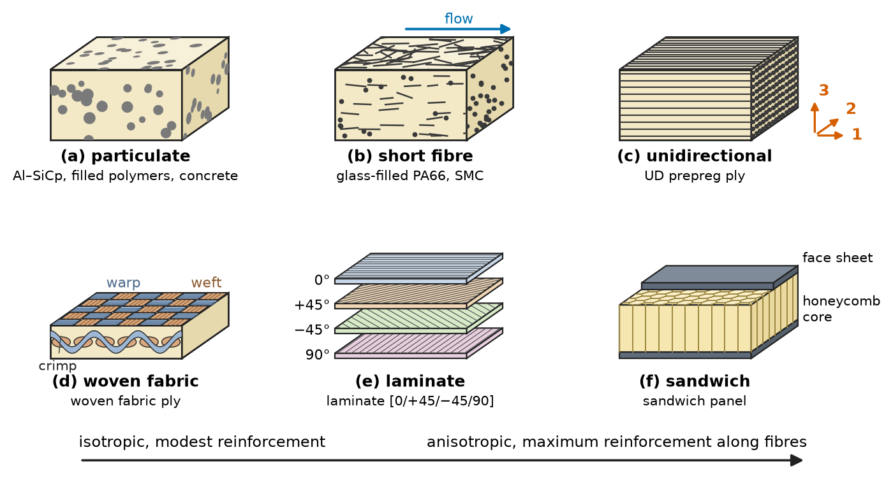
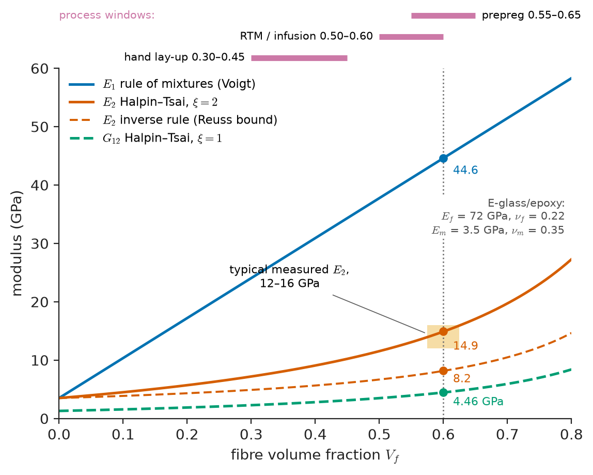
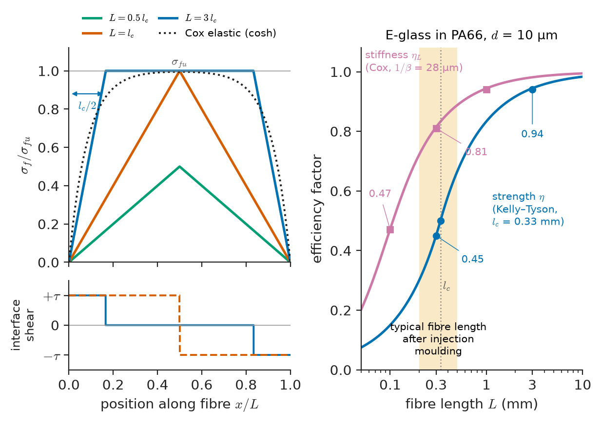
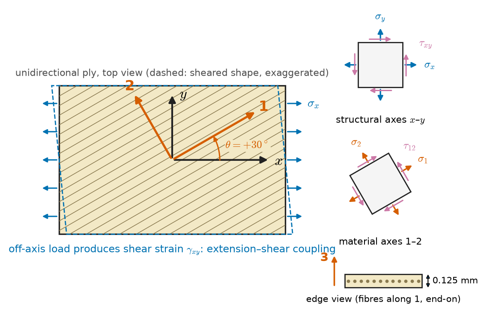
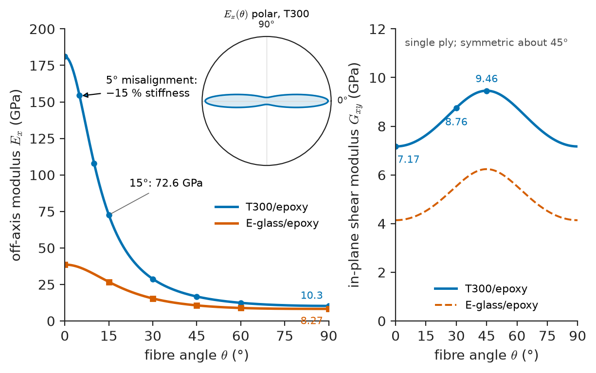
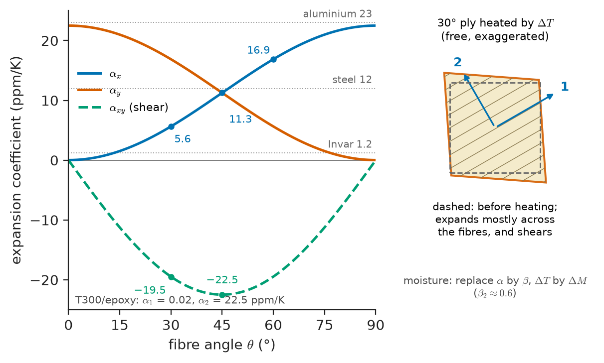

# Chapter 22 — Composite Micromechanics and Lamina Behaviour

*Part V · Polymers and Composites*

A wind-turbine blade 80 m long has to bend tens of millions of times in twenty years without cracking, and it has to be stiff enough that its tip never strikes the tower in a gust. A designer who reached for aluminium would find the blade too heavy to lift; a designer who reached for steel would find it too heavy to turn. The blade is instead built from glass and carbon fibres, each thinner than a hair, laid in an epoxy resin in carefully chosen directions: most of them along the span in the spar caps, some at ±45° in the skins to carry torsion, a few across. The same blade, tested in the laboratory, turns out to be several times stiffer along its length than across it, and its strength in one direction has almost nothing to do with its strength in another. Nothing in the metals chapters prepares an engineer for a material whose properties depend so strongly on the direction of load — or for one whose properties are designed fibre by fibre rather than chosen from a handbook.

This chapter builds the first half of the tools needed to design with such materials: how the properties of fibres and matrix combine into the properties of a single layer (micromechanics), and how a single layer responds when loaded along or across its fibres or at any angle in between (lamina mechanics). Chapter 23 stacks these layers into laminates, predicts how they fail and explains how they are made.

> **How do the stiffness and strength of a fibre and a matrix combine into the properties of a composite, and when do simple averages fail?**
> **How does a single fibre-reinforced layer respond to load in any direction, and to changes in temperature and moisture?**

| Concept | Engineering destination |
|---|---|
| Composite classes and architectures | Choosing between particulate, short-fibre, continuous-fibre and laminated designs |
| Fibres and matrices | Glass for boat hulls and blades, carbon for aircraft and bicycles, aramid for armour, natural fibres for car interiors |
| Rule of mixtures, Halpin–Tsai | First estimates of ply stiffness from fibre content |
| Particulate composites, Eshelby | Filled polymers, Al–SiC brake discs, cemented carbides, concrete |
| Shear lag, critical length | Injection-moulded glass-filled nylon, fibre sizing and interface design |
| Orthotropic lamina, reduced stiffness $Q$ | Input to laminate analysis in every composite design code |
| Off-axis lamina, $\bar Q$ | Angle plies in torsion tubes, blade skins, pressure vessels |
| Thermal and hygral expansion | Cure residual stress, dimensional stability of satellite structures, swelling in humid service |

**Roadmap.** Why composites and how they are arranged (22.1) → the constituents: fibres and matrices (22.2) → continuous aligned fibres: rule of mixtures and Halpin–Tsai (22.3) → particles and the Eshelby inclusion picture (22.4) → short fibres: shear lag and the critical length (22.5) → the orthotropic lamina in its own axes (22.6) → the lamina loaded off-axis (22.7) → thermal and moisture expansion of a lamina (22.8).

---

## 22.1 Why composites: classes and architectures

### The case for combining materials

Chapter 1 showed that property space is not filled evenly. Ceramics and fibres are stiff and strong but brittle; polymers are tough and easy to shape but compliant; metals are tough and stiff but dense. A **composite** combines two or more chemically distinct phases, separated by an interface, so that the combination occupies a region of property space that none of the constituents reaches alone. The phase that is continuous is the **matrix**; the dispersed phase is the **reinforcement**.

The idea is ancient (straw in mud brick, laminated bows of horn and sinew) and it is everywhere in nature: wood is a composite of cellulose fibrils in a lignin–hemicellulose matrix (Chapter 18), bone is a composite of hydroxyapatite platelets in collagen (Chapter 39), and nacre is 95 % aragonite tiles bonded by a few percent of protein. Modern engineering composites run from glass-fibre polyester boats in the 1940s to carbon-fibre-reinforced polymer (CFRP) making up about half the structural weight of the Boeing 787 and Airbus A350.

The decisive advantage of a fibre composite is **specific stiffness and strength** — properties per unit density. A unidirectional carbon/epoxy ply has a modulus along the fibres of about 140–180 GPa at a density of about 1.6 g/cm³, giving $E/\rho\approx100$ GPa per g/cm³, against about 26 for steel, aluminium and titanium alike. The second advantage, less obvious but equally important, is **tailorability**: the designer chooses how much fibre goes in which direction, so stiffness and strength can be placed where the loads are.

### Classes by matrix and reinforcement

Composites are classified first by matrix:

- **Polymer-matrix composites (PMCs)** — by far the largest class by volume and value. Glass-fibre-reinforced polymers (GFRP) dominate tonnage: boats, pipes, tanks, wind-turbine blades, car body panels, printed-circuit boards. CFRP dominates where weight matters most: aircraft, racing cars, bicycles, sporting goods, pressure vessels for hydrogen.
- **Metal-matrix composites (MMCs)** — aluminium, magnesium or titanium reinforced with SiC or Al₂O₃ particles, whiskers or fibres: brake rotors, pistons, electronic baseplates, bicycle frames, fan blades.
- **Ceramic-matrix composites (CMCs)** — SiC fibres in SiC, carbon fibres in carbon or SiC, oxide fibres in oxide matrices: hot-section aero-engine parts, brake discs for aircraft and sports cars, re-entry thermal protection. Here the aim is not stiffness but toughness: the fibres make a brittle ceramic fail gracefully (Section 23.7).

and then by the geometry of the reinforcement.

### Architectures

Figure 22.1 shows the main architectures. **Particulate** composites contain roughly equiaxed particles; their properties are nearly isotropic and the reinforcement is modest. **Short-fibre** (discontinuous) composites contain fibres with length-to-diameter ratios of 20–1000, usually partially aligned by flow during moulding. **Continuous-fibre** composites contain fibres that run the full length of the part, either all in one direction (**unidirectional**, UD) or woven, braided or knitted into **fabrics**. Continuous plies are stacked into **laminates**, and laminates can be separated by a light core to form **sandwich** structures (Section 23.5). Three-dimensional woven and stitched preforms add fibres through the thickness to resist delamination.

<!-- FIGURE 22.1 | figures/ch22/fig-22-1-composite-architectures.png | schematic | The main composite architectures, from isotropic particulate to strongly anisotropic unidirectional plies, laminates and sandwich panels. | Content: six panels in a 3 × 2 grid, each a small 3D block with cut faces. (a) Particulate: equiaxed particles (~10–30 % volume) in a matrix, label "Al–SiCp, filled polymers, concrete". (b) Short fibre: fibres with aspect ratio ~30, partly aligned along a flow arrow, label "glass-filled PA66, SMC". (c) Unidirectional continuous fibres along axis 1, axes 1–2–3 drawn, label "UD prepreg ply". (d) Woven fabric (plain weave) showing warp and weft tows with crimp, label "woven fabric ply". (e) Laminate of four plies with fibre directions 0°, +45°, −45°, 90° shown on each exposed edge, label "laminate". (f) Sandwich: two thin face sheets on a honeycomb core, label "sandwich panel". Under the row, an arrow from "isotropic, modest reinforcement" (left) to "anisotropic, maximum reinforcement along fibres" (right). -->

*Figure 22.1 — The main composite architectures, from isotropic particulate to strongly anisotropic unidirectional plies, laminates and sandwich panels.*

The geometry of the reinforcement determines both the efficiency of reinforcement and the degree of anisotropy. A useful rule of thumb for stiffness in the loading direction: a unidirectional composite loaded along its fibres uses about 100 % of the fibres' stiffness contribution; a cross-ply [0/90] about 50 %; a quasi-isotropic laminate about 37 %; and a random three-dimensional short-fibre composite only about 20 %. These **orientation efficiency factors** (Krenchel factors) reappear in Section 22.5.

---

## 22.2 Fibres and matrices

### Why fibres are strong

Bulk glass breaks at 50–100 MPa; a freshly drawn glass fibre 10 μm across breaks at 3,000–4,500 MPa. The difference is flaws. Chapter 14 showed that brittle strength is set by the largest crack in the stressed volume and that, by Weibull statistics, a smaller volume is likely to contain a smaller worst flaw. A thin fibre has a tiny volume per unit length and a pristine, fire-polished surface. In carbon and polymer fibres a second effect is added: the strong covalent bonds of graphene sheets or polymer backbones are aligned along the fibre axis by drawing or by heat treatment under tension, so the fibre exploits the stiffest direction of a highly anisotropic structure. Carbon fibre is stiff along its axis (230–900 GPa) but compliant across it (about 10–20 GPa), and aramid and polyethylene fibres are even more anisotropic.

### The fibre families

**Glass fibres** are drawn from melts of calcium aluminoborosilicate (E-glass, the general-purpose grade) or higher-alumina, magnesia-rich compositions (S- and R-glass, about 25 % stiffer and 30 % stronger). They are isotropic, cheap (about 1–3 USD/kg for E-glass roving), electrically insulating and moderately stiff. Their weaknesses are a modest modulus, a relatively high density and sensitivity to stress corrosion by water (static fatigue, Chapter 43).

**Carbon fibres** are made by stabilizing and carbonizing polyacrylonitrile (PAN) precursor fibres at 1,000–1,500 °C, optionally graphitizing them at up to 3,000 °C, or by spinning and carbonizing mesophase pitch. Low graphitization temperatures give high-strength, standard-modulus fibres (T300, T700: about 230 GPa); higher temperatures give more perfect graphitic order and higher modulus (M55J: 540 GPa; pitch fibres up to about 900 GPa), at the cost of strain to failure. Carbon fibres have a slightly negative axial thermal expansion, are electrically conductive and galvanically noble (they corrode aluminium in contact), and cost about 15–40 USD/kg for standard grades.

**Aramid fibres** (Kevlar, Twaron) are liquid-crystalline polymer fibres (Chapter 20) of poly(p-phenylene terephthalamide). They are light, tough and excellent in tension and impact, but poor in compression — the chains kink at about 0.3–0.5 % compressive strain — and they absorb moisture and degrade in UV. **Ultra-high-molecular-weight polyethylene** (UHMWPE: Dyneema, Spectra) fibres are lighter still (density below water) with very high specific strength, used in ballistic protection and ropes, but they creep and melt at about 145 °C.

**Natural fibres** — flax, hemp, jute, sisal, kenaf — have specific stiffnesses close to E-glass at a fraction of its embodied energy and are used in automotive interior panels and increasingly in sporting goods and boat building. Their properties vary with growing season, they absorb water, and they degrade above about 200 °C, which limits the matrices they can be processed with. **Basalt fibres**, melt-spun from volcanic rock, sit between E- and S-glass.

**Ceramic fibres** — SiC (Nicalon, Tyranno, Hi-Nicalon Type S), alumina and aluminosilicate (Nextel) — retain strength above 1,000 °C and are the reinforcement of CMCs and some MMCs. **Boron fibres**, made by chemical vapour deposition onto a tungsten wire, were the first high-modulus fibre and survive in niche aerospace repair patches.

**Table 22.1 — Representative reinforcing fibres (typical values, axial properties).**

| Fibre | Density (g/cm³) | Modulus $E$ (GPa) | Tensile strength (GPa) | Failure strain (%) | Diameter (μm) | Axial CTE (ppm/K) |
|---|---|---|---|---|---|---|
| E-glass | 2.54–2.60 | 72–74 | 3.4 (pristine); 2.0–2.5 (strand) | 4.5 | 10–17 | 5.0 |
| S-/R-glass | 2.46–2.55 | 86–89 | 4.4–4.6 | 5.3 | 9–10 | 2.9 |
| Basalt | 2.65–2.80 | 85–90 | 2.8–4.0 | 3.1 | 9–13 | 6 |
| Carbon, standard modulus (T300) | 1.76 | 230 | 3.5 | 1.5 | 7 | −0.4 to −0.6 |
| Carbon, high strength (T700, T800) | 1.80–1.81 | 230–294 | 4.9–5.9 | 2.0–2.1 | 5–7 | −0.4 to −0.6 |
| Carbon, intermediate modulus (IM7) | 1.78 | 276 | 5.6 | 1.9 | 5 | −0.6 |
| Carbon, high modulus (M55J) | 1.91 | 540 | 4.0 | 0.8 | 5 | −1.1 |
| Carbon, pitch ultra-high modulus | 2.15–2.20 | 640–900 | 2.6–3.8 | 0.3–0.5 | 10–11 | −1.4 to −1.5 |
| Aramid (Kevlar 49) | 1.44 | 112–125 | 3.0–3.6 | 2.4–2.8 | 12 | −2 |
| UHMWPE (Dyneema SK75) | 0.97 | 110–120 | 3.4–3.6 | 3.5 | 15–20 | −12 |
| Flax | 1.40–1.50 | 45–70 | 0.5–1.5 | 1.5–3 | 10–25 (elementary) | — |
| SiC (Hi-Nicalon Type S) | 3.05 | 400–420 | 2.6 | 0.6 | 12 | 5.1 |
| Alumina (Nextel 610) | 3.9 | 370–380 | 3.1 | 0.8 | 10–12 | 8 |
| Boron (on W core) | 2.57 | 400 | 3.6 | 0.9 | 100–140 | 4.5 |

Fibre strengths are wide distributions, not single values. The strength of a bundle or a strand impregnated in resin is usually 60–80 % of the mean single-filament strength measured at a 25 mm gauge length, because the bundle fails progressively once the weakest filaments break (Chapter 14).

### The matrix and the interface

The matrix does four jobs: it holds the fibres in position, transfers load into and between fibres by shear, protects fibre surfaces from abrasion and environment, and carries the loads the fibres cannot — transverse tension, in-plane shear and compression, where it stabilizes the fibres against buckling. In nearly every composite the matrix, not the fibre, sets the service-temperature limit, the environmental resistance, the transverse and shear strengths and the resistance to delamination.

**Thermoset matrices** (Chapter 19) dominate: unsaturated polyester and vinyl ester for marine, chemical and construction uses; epoxies for aerospace, wind energy and sporting goods; bismaleimides and polyimides for service above 200 °C; phenolics where fire, smoke and toxicity rules apply (aircraft interiors, rail). Thermosets impregnate fibres easily because they are processed as low-viscosity liquids before cure. **Thermoplastic matrices** — polypropylene and nylon for automotive parts, PEEK, PEKK and PPS for aerospace — are tougher, can be welded and reshaped, and recycled more easily, but their melt viscosities are 100–1,000 times higher, which makes impregnation harder (Chapter 21).

**Table 22.2 — Representative matrices (typical values).**

| Matrix | Density (g/cm³) | $E$ (GPa) | Tensile strength (MPa) | Failure strain (%) | $T_g$ or max. service (°C) | Mode I toughness $G_{Ic}$ (kJ/m²) |
|---|---|---|---|---|---|---|
| Unsaturated polyester | 1.1–1.4 | 2.0–4.5 | 40–90 | 1–3 | $T_g$ 70–120 | 0.05–0.1 |
| Vinyl ester | 1.1–1.2 | 3.0–3.5 | 70–85 | 4–7 | $T_g$ 100–150 | 0.1–0.3 |
| Epoxy (aerospace, 180 °C cure) | 1.2–1.3 | 3.0–4.5 | 60–100 | 2–6 | $T_g$ 180–220 | 0.1–0.3 (toughened 0.5–1) |
| Bismaleimide | 1.2–1.3 | 3.5–4.5 | 50–90 | 1.5–3 | $T_g$ 230–300 | 0.1–0.4 |
| Polypropylene | 0.90 | 1.3–1.8 | 30–40 | >100 | service ~100 | >5 |
| Nylon 66 (dry) | 1.14 | 2.8–3.3 | 80 | 30–60 | service ~120–150 | 2–5 |
| PEEK | 1.30 | 3.6 | 100 | 30–50 | $T_g$ 143, $T_m$ 343 | 1–2 |
| Aluminium 6061-T6 | 2.70 | 69 | 310 | 12 | ~150–200 | ductile |
| Ti-6Al-4V | 4.43 | 114 | 950 | 14 | ~400 | ductile |
| SiC (CVI matrix) | 2.5–3.0 (porous) | 300–400 | brittle | <0.1 | >1,200 | brittle |

Between fibre and matrix lies the **interface** (or interphase), engineered deliberately. Glass fibres are coated during drawing with a **size** containing silane coupling agents that bond chemically to the glass surface and co-react with the resin; carbon fibres are surface-oxidized and sized with epoxy. A strong interface transfers load efficiently and gives high transverse and shear strength; a weak one lets cracks deflect along fibres and fibres pull out, which absorbs energy. PMCs are designed for strong interfaces; CMCs are deliberately designed with weak ones (Section 23.7). The interface quality is measured as an interfacial shear strength $\tau$ by single-fibre fragmentation, pull-out or microbond tests, typically 20–80 MPa for well-sized fibres in epoxy.

---

## 22.3 Continuous aligned fibres: rule of mixtures and Halpin–Tsai

### Volume fraction and density

Micromechanics works with **volume fractions**: $V_f$ for fibre, $V_m=1-V_f$ for matrix (neglecting voids). Manufacturers often specify weight fractions $w_f$, which convert as

$$
V_f=\frac{w_f/\rho_f}{w_f/\rho_f+(1-w_f)/\rho_m}
$$

Densities mix exactly by volume: $\rho_c=V_f\rho_f+V_m\rho_m$. Achievable fibre volume fractions depend on the process: 0.15–0.30 for spray-up and short-fibre mouldings, 0.30–0.45 for hand lay-up, 0.50–0.60 for infusion and RTM, 0.55–0.65 for autoclaved prepreg and filament winding, up to 0.70 for pultrusion. The geometric maximum for parallel circular fibres is $\pi/(2\sqrt3)=0.907$ for hexagonal packing; in practice, above about 0.70 the fibres touch and the composite is starved of resin.

### Longitudinal stiffness: the iso-strain rule

Load a unidirectional composite along the fibres (direction 1). If fibres and matrix are perfectly bonded and the fibres continuous, they must stretch together: $\varepsilon_f=\varepsilon_m=\varepsilon_1$. Force balance across a cross-section gives $\sigma_1=V_f\sigma_f+V_m\sigma_m$, and dividing by the common strain,

$$
E_1=V_fE_f+V_mE_m
$$

This is the **rule of mixtures** (the **Voigt** or iso-strain estimate). The same argument with Poisson contraction gives the major Poisson's ratio

$$
\nu_{12}=V_f\nu_f+V_m\nu_m
$$

> **Status of the principle: Longitudinal rule of mixtures**
> *Derived.* Follows exactly from equal axial strain and force balance for continuous, aligned, perfectly bonded fibres; in practice it agrees with measured $E_1$ within a few percent, the small deficit coming from fibre misalignment (waviness) and voids. For $\nu_{12}$ it is an approximation that is accurate to about 5 %.

Since $E_f\gg E_m$, the fibres carry almost all the load: the fraction carried by the fibres is $V_fE_f/E_1$. For glass/epoxy at $V_f=0.6$ that is $0.6\times72/44.6=97$ %.

### Transverse and shear stiffness: iso-stress and why it underestimates

Load the same composite across the fibres (direction 2). The simplest picture places fibre and matrix in series, like slabs stacked across the load, so they carry the same stress and their strains add:

$$
\frac1{E_2}=\frac{V_f}{E_f}+\frac{V_m}{E_m},\qquad \frac1{G_{12}}=\frac{V_f}{G_f}+\frac{V_m}{G_m}
$$

This is the **inverse rule of mixtures** (**Reuss** or iso-stress estimate). The Voigt and Reuss expressions are rigorous upper and lower bounds on the modulus of any two-phase mixture, but the transverse Reuss value is a poor estimate: real round fibres are not slabs, the stress in the matrix is not uniform, and the matrix between neighbouring fibres is constrained. Measured transverse moduli lie well above the Reuss bound.

The **Halpin–Tsai equations** interpolate between the bounds with one geometric parameter $\xi$:

$$
\frac{P}{P_m}=\frac{1+\xi\eta V_f}{1-\eta V_f},\qquad \eta=\frac{P_f/P_m-1}{P_f/P_m+\xi}
$$

where $P$ is the property sought ($E_2$, $G_{12}$) and $P_f$, $P_m$ the fibre and matrix values. Setting $\xi=0$ recovers Reuss and $\xi\to\infty$ recovers Voigt. For circular fibres in a square or hexagonal array, $\xi\approx2$ for $E_2$ and $\xi\approx1$ for $G_{12}$; for rectangular cross-sections and for short fibres other values are used (Section 22.5).

> **Status of the principle: Halpin–Tsai equations**
> *Approximate.* An interpolation fitted to exact elasticity solutions for regular fibre arrays; for $E_2$ and $G_{12}$ it agrees with experiment within about 10–15 % up to $V_f\approx0.6$, and it underestimates properties near maximum packing, where a modified $\xi$ (for example $\xi=2+40V_f^{10}$) is used.

**Worked example — Ply stiffness of glass/epoxy at 60 % fibre.** Take E-glass ($E_f=72$ GPa, $\nu_f=0.22$) in epoxy ($E_m=3.5$ GPa, $\nu_m=0.35$), $V_f=0.60$. The constituents are isotropic, so $G=E/[2(1+\nu)]$: $G_f=72/2.44=29.5$ GPa and $G_m=3.5/2.70=1.30$ GPa.

Longitudinal: $E_1=0.6\times72+0.4\times3.5=43.2+1.4=44.6$ GPa, and $\nu_{12}=0.6\times0.22+0.4\times0.35=0.272$.

Transverse, Reuss: $1/E_2=0.6/72+0.4/3.5=0.00833+0.1143=0.1226$ GPa⁻¹, so $E_2=8.2$ GPa.

Transverse, Halpin–Tsai with $\xi=2$: $E_f/E_m=20.57$, so $\eta=(20.57-1)/(20.57+2)=0.867$ and

$$
E_2=3.5\times\frac{1+2\times0.867\times0.6}{1-0.867\times0.6}=3.5\times\frac{2.040}{0.4797}=14.9\ \mathrm{GPa}
$$

Shear, Halpin–Tsai with $\xi=1$: $G_f/G_m=22.76$, so $\eta=21.76/23.76=0.916$ and $G_{12}=1.30\times(1+0.550)/(1-0.550)=4.46$ GPa, against a Reuss value of 3.04 GPa.

Density: $\rho=0.6\times2.54+0.4\times1.20=2.00$ g/cm³. Measured values for such a ply are typically $E_1\approx43$–45, $E_2\approx12$–16, $G_{12}\approx4$–5 GPa and $\nu_{12}\approx0.27$–0.28: the rule of mixtures and Halpin–Tsai are right; Reuss is far too low. The ply is $44.6/14.9=3.0$ times stiffer along than across the fibres. With standard-modulus carbon ($E_{f1}=230$ GPa) at the same $V_f$, $E_1=0.6\times230+0.4\times3.5=139$ GPa, but $E_2$ hardly changes (about 9–10 GPa), because carbon's own transverse modulus is only about 15 GPa: a carbon ply is about 15 times stiffer along than across.

Figure 22.2 plots the three estimates against fibre content. Two features stand out. First, $E_1$ rises linearly and is fibre-dominated; $E_2$ and $G_{12}$ stay close to the matrix value until $V_f$ exceeds about 0.4 and are **matrix-dominated**. Second, the matrix-dominated properties are where Halpin–Tsai and Reuss differ most, which is why they need the more careful model.

<!-- FIGURE 22.2 | figures/ch22/fig-22-2-micromechanics-moduli.png | plot | Longitudinal and transverse moduli of E-glass/epoxy versus fibre volume fraction: the rule of mixtures, the Reuss lower bound and the Halpin–Tsai estimate. | Content: x-axis fibre volume fraction V_f 0 to 0.8; y-axis modulus 0–60 GPa. Curves for E_f = 72 GPa, ν_f = 0.22, E_m = 3.5 GPa, ν_m = 0.35: E_1 rule of mixtures (straight line from 3.5 to 58.3 at V_f = 0.8); E_2 Reuss (convex, 8.2 at V_f = 0.6); E_2 Halpin–Tsai ξ = 2 (14.9 at V_f = 0.6); G_12 Halpin–Tsai ξ = 1 (dashed, 4.46 at V_f = 0.6). Vertical dotted line at V_f = 0.6 with markers and values 44.6, 14.9, 8.2, 4.46 GPa. Shaded band labelled "typical measured E_2, 12–16 GPa" at V_f = 0.6. Second x-axis tick labels marking process windows: "hand lay-up 0.30–0.45", "RTM / infusion 0.50–0.60", "prepreg 0.55–0.65". -->

*Figure 22.2 — Longitudinal and transverse moduli of E-glass/epoxy versus fibre volume fraction: the rule of mixtures, the Reuss lower bound and the Halpin–Tsai estimate.*

### Longitudinal strength

Strength follows the same iso-strain logic but with a twist: the constituents have different failure strains. In a polymer-matrix composite the fibre usually fails first (glass at 2.5–4.5 %, carbon at 1.5–2 %), while toughened epoxies tolerate 3–6 %. At the fibre failure strain $\varepsilon_{fu}$ the matrix carries only $\sigma_m'=E_m\varepsilon_{fu}$, so

$$
\sigma_{1u}=V_f\sigma_{fu}+V_m\sigma_m'
$$

For glass/epoxy with an in-situ fibre strength of 1,800 MPa, $\varepsilon_{fu}=1800/72{,}000=2.5\,\%$ and $\sigma_m'=3500\times0.025=87.5$ MPa, so $\sigma_{1u}=0.6\times1800+0.4\times87.5=1080+35=1115$ MPa, close to measured values of 1,000–1,100 MPa.

For a ductile metal matrix the story has a third act. Once the fibres break, the matrix alone can carry $V_m\sigma_{mu}$. At small $V_f$ that may exceed the composite strength, so adding a little fibre can weaken the material. The composite is stronger than the matrix only above the **critical volume fraction**

$$
V_{\mathrm{crit}}=\frac{\sigma_{mu}-\sigma_m'}{\sigma_{fu}-\sigma_m'}
$$

For tungsten wires ($\sigma_{fu}=2000$ MPa) in copper ($\sigma_{mu}=210$ MPa, with a flow stress $\sigma_m'\approx100$ MPa at the fibre failure strain), $V_{\mathrm{crit}}=110/1900=0.058$: about 6 % fibre must be added just to break even.

> **Status of the principle: Strength rule of mixtures**
> *Approximate.* Assumes all fibres fail at one strain; real fibres have a Weibull strength distribution, so the composite fails by progressive fibre breakage and clustering of breaks, and measured strengths are typically 70–90 % of the simple prediction.

### Transverse strength and compression

Transverse tensile strength is the Achilles' heel of a unidirectional ply. The fibres cannot help in this direction; they hurt, because they concentrate strain in the thin matrix ligaments between them and because any weak interface is an internal crack. Typical values are only 30–60 MPa — below the strength of the neat resin. In-plane shear strength is similar, 60–100 MPa.

Compressive strength along the fibres is governed not by crushing but by **fibre microbuckling** and **kink-band formation**: the fibres are slender columns supported only by the shear stiffness of the matrix. The Argon–Budiansky analysis gives $\sigma_{1c}\approx G_{12}/(1+\phi/\gamma_y)$, where $\phi$ is the initial fibre misalignment (typically 1–3°) and $\gamma_y$ the matrix shear yield strain. Fibre waviness, a shear-weak matrix and hot-wet conditions (which lower $G_{12}$) all reduce compressive strength, which for carbon/epoxy is typically 50–80 % of the tensile strength and for aramid composites only about 20 %. Table 22.3 collects representative unidirectional ply properties; these are the inputs to everything that follows here and in Chapter 23.

**Table 22.3 — Unidirectional ply properties (typical values, room temperature, dry).**

| Property | E-glass/epoxy ($V_f\approx0.55$) | T300/epoxy ($V_f\approx0.70$) | IM7/epoxy ($V_f\approx0.60$) | Kevlar 49/epoxy ($V_f\approx0.60$) |
|---|---|---|---|---|
| $\rho$ (g/cm³) | 1.97 | 1.60 | 1.58 | 1.38 |
| $E_1$ (GPa) | 38.6 | 181 | 165 | 76 |
| $E_2$ (GPa) | 8.27 | 10.3 | 9.0 | 5.5 |
| $G_{12}$ (GPa) | 4.14 | 7.17 | 5.6 | 2.3 |
| $\nu_{12}$ | 0.26 | 0.28 | 0.34 | 0.34 |
| $X_t$ (MPa) | 1062 | 1500 | 2560 | 1400 |
| $X_c$ (MPa) | 610 | 1500 | 1590 | 235 |
| $Y_t$ (MPa) | 31 | 40 | 73 | 12 |
| $Y_c$ (MPa) | 118 | 246 | 185 | 53 |
| $S$ (MPa) | 72 | 68 | 90 | 34 |
| $\alpha_1$ (ppm/K) | 8.6 | 0.02 | −0.4 | −4.0 |
| $\alpha_2$ (ppm/K) | 22.1 | 22.5 | 30 | 79 |

Here $X$, $Y$ and $S$ are the longitudinal, transverse and in-plane shear strengths, with subscripts $t$ and $c$ for tension and compression. The T300/epoxy and glass/epoxy columns are the classic Tsai data sets (T300/5208 and Scotchply 1002) used throughout composites teaching; modern toughened systems are stronger in $Y_t$ and $S$.

---

## 22.4 Particulate composites and the Eshelby inclusion picture

### Where particles are used

Particle reinforcement trades efficiency for simplicity and isotropy. Examples span every field: **concrete**, an aggregate-filled cement paste (Chapter 18); **cemented carbides**, 70–94 % WC particles in a cobalt binder, for cutting tools and mining bits; **Al–SiC** with 10–30 vol% SiC particles for brake rotors on rail vehicles, pistons, bicycle frames and electronics baseplates; **dental composites**, 60–80 vol% silica or glass fillers in a dimethacrylate resin; **filled polymers** — talc in polypropylene bumpers, carbon black in tyres, silica in underfill encapsulants; and **particle-toughened** systems, in which rubber or thermoplastic particles raise the toughness of epoxy (Chapter 21).

### Bounds for an isotropic mixture

For a statistically isotropic particulate composite the Voigt and Reuss bounds are still valid but far apart. **Hashin and Shtrikman** found the tightest possible bounds that use only the volume fractions and the phase moduli: for bulk modulus,

$$
K_{\mathrm{HS}}^{\mathrm{lower}}=K_m+\frac{V_p}{\dfrac{1}{K_p-K_m}+\dfrac{3V_m}{3K_m+4G_m}}
$$

with an analogous expression for shear modulus; the upper bound is obtained by exchanging the roles of the phases. When the stiffer phase is the particle, the lower bound corresponds physically to stiff spheres coated by compliant matrix — exactly the geometry of most particulate composites — and it is usually the better estimate.

**Worked example — How stiff is aluminium with 20 % SiC particles?** For Al 6061 ($E=69$ GPa, $\nu=0.33$) and SiC ($E=410$ GPa, $\nu=0.19$), $K=E/[3(1-2\nu)]$ and $G=E/[2(1+\nu)]$ give $K_m=67.6$, $G_m=25.9$, $K_p=220$ and $G_p=172$ GPa. At $V_p=0.20$:

- Voigt: $0.2\times410+0.8\times69=137$ GPa.
- Reuss: $1/(0.2/410+0.8/69)=82.8$ GPa.
- Hashin–Shtrikman lower: $K=92.6$ GPa, $G=36.1$ GPa, hence $E=9KG/(3K+G)=92.7$ GPa.
- Hashin–Shtrikman upper: 114 GPa.

Measured moduli for 6061/SiC/20p are about 100–105 GPa, inside the Hashin–Shtrikman window and about 50 % stiffer than the unreinforced alloy at almost the same density (2.80 against 2.70 g/cm³). The Voigt value, appropriate to continuous fibres, would overestimate the gain by a factor of two.

### The Eshelby inclusion (qualitative)

Why do particles of the same volume fraction stiffen differently depending on their shape? The key insight is due to **Eshelby** (1957). Imagine cutting an ellipsoidal region out of an infinite elastic body, letting it undergo some stress-free strain (a thermal expansion, a phase transformation, a misfit), and welding it back. Eshelby proved a remarkable result: the strain inside an ellipsoidal inclusion is **uniform**, and it is related to the stress-free strain by a fourth-rank **Eshelby tensor** $S$ that depends only on the inclusion's shape (its aspect ratios) and the matrix Poisson's ratio. The result extends, through the "equivalent inclusion" idea, to an inhomogeneity of different stiffness sitting in a loaded matrix.

Three qualitative consequences matter to the materials engineer:

- **Shape controls load transfer.** A sphere is loaded mainly through hydrostatic constraint; a prolate ellipsoid (a needle or fibre) aligned with the load picks up a larger share of the stress; a flat disc (a platelet) aligned with the load stiffens both in-plane directions. This is why platelets (talc, mica, clay, graphene) are more efficient than spheres in plastics, and why fibres are best of all along their axis.
- **Interactions can be included at modest cost.** The **Mori–Tanaka** method places each inclusion in the average matrix stress caused by all the others and gives reliable estimates up to $V_p\approx0.3$–0.4. For spheres it coincides with the Hashin–Shtrikman lower bound; for aligned fibres it reproduces the rule of mixtures along them. It underlies most commercial software for injection-moulded short-fibre parts.
- **Misfit produces internal stress.** The same tensor gives the stress inside and around a precipitate with a transformation misfit (Chapter 10) or a particle with a different thermal expansion. On cooling Al–SiC from processing temperature, the mismatch in CTE (23 against 4 ppm/K) generates residual stresses that exceed the matrix yield strength and punch dislocations into it, contributing to the strength of MMCs (Chapter 13).

> **Status of the principle: Eshelby's inclusion result**
> *Derived.* An exact consequence of linear elasticity for a single ellipsoidal inclusion in an infinite isotropic matrix; mean-field schemes built on it (Mori–Tanaka, self-consistent) are approximations that degrade at high volume fraction, for clustered particles and when particles touch and form a connected skeleton.

---

## 22.5 Short-fibre composites: shear lag and the critical length

### Where short fibres are used

About half of all fibre-reinforced polymer by mass is discontinuous: glass-filled nylon, polypropylene and PBT injection-moulded into engine covers, air-intake manifolds, power-tool housings, connector bodies and pump impellers; **sheet moulding compound** (SMC), 25 mm chopped glass in polyester, compression-moulded into truck cabs and car body panels; **bulk moulding compound** (BMC) for electrical enclosures; chopped carbon in thermoplastics for drones and brackets. Short fibres flow with the melt, so complex shapes can be moulded at high rates, but each fibre is too short to carry its full potential load.

### How load gets into a fibre: shear lag

A fibre embedded in a matrix that is stretched along the fibre axis carries no load at its ends. Load is transferred into it by shear stress $\tau$ at the fibre–matrix interface, and the fibre's tensile stress builds up from zero at each end. For a fibre of diameter $d$, a force balance on a slice of length $dx$ gives

$$
\frac{d\sigma_f}{dx}=\frac{4\tau}{d}
$$

The **shear-lag** model of **Cox** (1952) assumes elastic matrix and interface. The fibre stress then varies as

$$
\sigma_f(x)=E_f\varepsilon_1\left[1-\frac{\cosh\beta(L/2-x)}{\cosh(\beta L/2)}\right],\qquad \beta=\sqrt{\frac{2G_m}{E_fr^2\ln(R/r)}}
$$

for a fibre of length $L$ and radius $r$, with $x$ measured from one end and $2R$ the spacing between neighbouring fibres. The stress rises over a distance of a few $1/\beta$ from each end and plateaus at the long-fibre value $E_f\varepsilon_1$. Averaging this profile along the fibre gives the **length efficiency factor** for stiffness,

$$
\eta_L=1-\frac{\tanh(\beta L/2)}{\beta L/2}
$$

which enters a modified rule of mixtures, $E_c=\eta_o\eta_LV_fE_f+V_mE_m$, where $\eta_o$ is the **orientation factor**: 1 for perfectly aligned fibres, 3/8 for fibres randomly oriented in a plane and 1/5 for random three-dimensional orientation (Krenchel).

> **Status of the principle: Cox shear-lag model**
> *Approximate.* Assumes elastic fibre and matrix, perfect bonding, no load transfer across fibre ends and an idealized cylindrical neighbourhood; it captures the length dependence correctly but its $\beta$ depends on the assumed fibre spacing, and it ignores interfacial slip and matrix yielding.

### The critical length

If the interface yields or slips at a constant shear stress $\tau$ (a rigid-plastic interface, the **Kelly–Tyson** model), the fibre stress rises linearly from each end. The fibre can reach its own fracture stress $\sigma_{fu}$ only if it is longer than the **critical length**

$$
l_c=\frac{\sigma_{fu}\,d}{2\tau}
$$

Fibres shorter than $l_c$ never break; they pull out of the matrix. Fibres much longer than $l_c$ are nearly as effective as continuous ones. The average stress in a fibre of length $L$ gives the strength efficiency: $\eta=L/(2l_c)$ for $L<l_c$ and $\eta=1-l_c/(2L)$ for $L\ge l_c$, in

$$
\sigma_{cu}\approx\eta_o\,\eta\,V_f\sigma_{fu}+V_m\sigma_m'
$$

> **Status of the principle: Kelly–Tyson critical length**
> *Approximate.* Assumes a constant interfacial shear stress along the debonded or yielded length and a single fibre strength; it is the basis of the single-fibre fragmentation test, where the measured fragment-length distribution is used in reverse to obtain $\tau$.

Figure 22.3 shows the stress profiles for fibres shorter than, equal to and longer than $l_c$.

<!-- FIGURE 22.3 | figures/ch22/fig-22-3-shear-lag-critical-length.png | plot | Stress transfer into a short fibre: tensile stress along the fibre and interfacial shear stress, for fibres shorter than, equal to and longer than the critical length. | Content: left panel: normalized position x/L from 0 to 1 on x-axis; fibre tensile stress σ_f / σ_fu on y-axis 0–1.1. Three Kelly–Tyson profiles: L = 0.5 l_c (triangle peaking at 0.5), L = l_c (triangle peaking at 1.0 at mid-length), L = 3 l_c (trapezoid rising over l_c/2 at each end to 1.0 plateau). Dotted curve: Cox elastic profile (cosh shape) for comparison. Small panel underneath: interfacial shear stress τ, constant at ±τ over the ramp regions, zero on the plateau. Right panel: efficiency factors versus fibre length L (mm, log axis 0.05–10): Kelly–Tyson strength efficiency for l_c = 0.33 mm (0.45 at 0.3 mm, 0.5 at 0.33 mm, 0.94 at 3 mm), and Cox stiffness efficiency η_L for glass in PA66 with 1/β = 0.028 mm (0.47 at 0.1 mm, 0.81 at 0.3 mm, 0.94 at 1 mm). Shaded band 0.2–0.5 mm labelled "typical fibre length after injection moulding". -->

*Figure 22.3 — Stress transfer into a short fibre: tensile stress along the fibre and interfacial shear stress, for fibres shorter than, equal to and longer than the critical length.*

**Worked example — Glass-filled nylon 66.** A housing is injection-moulded in PA66 with 30 wt% E-glass ($\rho_f=2.54$, $\rho_m=1.14$ g/cm³, $d=10$ μm). Convert to volume: $V_f=(0.30/2.54)/(0.30/2.54+0.70/1.14)=0.1181/0.7321=0.161$.

Critical length, with an in-situ fibre strength of 2,000 MPa and $\tau=30$ MPa: $l_c=2000\times10/(2\times30)=333$ μm, or $l_c/d=33$. The pellets contain fibres about 3–4 mm long, but screw shearing and gate passage break them to a typical mean of 0.2–0.5 mm. At $L=0.3$ mm, below $l_c$, the strength efficiency is $0.3/(2\times0.333)=0.45$: more than half of the fibres' strength potential is lost. Had the fibres survived at 3 mm, $\eta=1-0.333/6=0.94$. This is the reason for long-fibre thermoplastic granules (10–25 mm), which keep fibres 2–5 mm long in the part.

Stiffness. With $E_m=2.8$ GPa and $\nu_m=0.4$, $G_m=1.0$ GPa. For hexagonal packing $R/r=\sqrt{\pi/(2\sqrt3V_f)}=2.37$, so $\beta=\sqrt{2\times1.0/(72\times(5\times10^{-6})^2\ln2.37)}=3.59\times10^4$ m⁻¹, a transfer length $1/\beta=28$ μm. For $L=0.3$ mm, $\beta L/2=5.38$ and $\eta_L=1-\tanh(5.38)/5.38=0.81$. Stiffness transfer is much more forgiving than strength transfer, because elastic load transfer needs only a few fibre diameters. With a skin–core orientation distribution averaging $\eta_o\approx0.7$ in the flow direction,

$$
E_c=0.7\times0.81\times0.161\times72+0.839\times2.8=6.6+2.3=9.0\ \mathrm{GPa}
$$

against datasheet values of 9–10 GPa (dry, flow direction) and about half that transverse to flow. The orientation pattern — fibres aligned with flow near the mould walls, across flow in the core — makes injection-moulded parts anisotropic and prone to warpage, so mould-filling simulation is now coupled to Mori–Tanaka micromechanics. And nylon absorbs 2–3 % water in humid air, which plasticizes the matrix and can lower $E_c$ by a third, a reminder that matrix-dominated properties are environment-dependent (Section 22.8).

---

## 22.6 The orthotropic lamina: stiffness, compliance and reduced stiffness

### From micromechanics to a homogeneous ply

Laminates are built from thin layers — **laminae** or **plies**, typically 0.125–0.25 mm thick for prepreg — each of which contains thousands of fibres through its width. For structural analysis each ply is treated as a **homogeneous, anisotropic** continuum with effective properties ($E_1$, $E_2$, $G_{12}$, $\nu_{12}$, strengths and expansion coefficients) obtained from micromechanics or, preferably, from tests on unidirectional coupons. From here on the fibres disappear from the analysis and reappear only through these properties. This is **macromechanics**.

### Orthotropy

A unidirectional ply has three mutually perpendicular planes of symmetry: the material axes are 1 (along the fibres), 2 (in-plane, across the fibres) and 3 (through the thickness). Chapter 4 showed that Neumann's principle reduces the number of independent elastic constants as symmetry increases. A general anisotropic solid has 21; a material with three orthogonal symmetry planes — an **orthotropic** material — has 9:

$$
\begin{pmatrix}\varepsilon_1\\ \varepsilon_2\\ \varepsilon_3\\ \gamma_{23}\\ \gamma_{13}\\ \gamma_{12}\end{pmatrix}=
\begin{pmatrix}
1/E_1 & -\nu_{21}/E_2 & -\nu_{31}/E_3 & 0 & 0 & 0\\
-\nu_{12}/E_1 & 1/E_2 & -\nu_{32}/E_3 & 0 & 0 & 0\\
-\nu_{13}/E_1 & -\nu_{23}/E_2 & 1/E_3 & 0 & 0 & 0\\
0 & 0 & 0 & 1/G_{23} & 0 & 0\\
0 & 0 & 0 & 0 & 1/G_{13} & 0\\
0 & 0 & 0 & 0 & 0 & 1/G_{12}
\end{pmatrix}
\begin{pmatrix}\sigma_1\\ \sigma_2\\ \sigma_3\\ \tau_{23}\\ \tau_{13}\\ \tau_{12}\end{pmatrix}
$$

The matrix is the **compliance** $[S]$; its inverse is the **stiffness** $[C]$. Here $\nu_{ij}$ is the contraction in direction $j$ per unit extension in direction $i$ under uniaxial stress in $i$, and $\gamma$ are engineering shear strains (twice the tensor shear strains). The compliance must be symmetric because the strain energy must be a unique function of strain (Chapter 11), which gives the **reciprocal relations**

$$
\frac{\nu_{12}}{E_1}=\frac{\nu_{21}}{E_2}
$$

and its two companions. A unidirectional ply with randomly placed fibres is in fact **transversely isotropic** — properties are the same in every direction in the 2–3 plane — so $E_3=E_2$, $G_{13}=G_{12}$, $\nu_{13}=\nu_{12}$ and $G_{23}=E_2/[2(1+\nu_{23})]$, leaving 5 independent constants.

> **Status of the principle: Orthotropic Hooke's law**
> *Fundamental.* Linear elasticity with the symmetries required by strain energy and by the three mirror planes of the ply; its validity is limited only by linearity, which for polymer-matrix plies fails in in-plane shear above about 0.5–1 % shear strain and in transverse compression, where the matrix behaves non-linearly.

Note an important consequence of the reciprocal relation. For T300/epoxy, $\nu_{12}=0.28$ but $\nu_{21}=0.28\times10.3/181=0.016$: pulling along the fibres causes noticeable contraction across them, but pulling across the fibres causes almost none along them, because the fibres resist it.

### Plane stress and the reduced stiffness

A ply in a thin laminate carries stress essentially in its own plane: $\sigma_3=\tau_{13}=\tau_{23}=0$. Deleting those rows and columns and inverting gives the **plane-stress** relation

$$
\begin{pmatrix}\sigma_1\\ \sigma_2\\ \tau_{12}\end{pmatrix}=
\begin{pmatrix}Q_{11} & Q_{12} & 0\\ Q_{12} & Q_{22} & 0\\ 0 & 0 & Q_{66}\end{pmatrix}
\begin{pmatrix}\varepsilon_1\\ \varepsilon_2\\ \gamma_{12}\end{pmatrix}
$$

with the **reduced stiffnesses**

$$
Q_{11}=\frac{E_1}{1-\nu_{12}\nu_{21}},\quad Q_{22}=\frac{E_2}{1-\nu_{12}\nu_{21}},\quad Q_{12}=\frac{\nu_{12}E_2}{1-\nu_{12}\nu_{21}},\quad Q_{66}=G_{12}
$$

"Reduced" because they are not the full three-dimensional stiffnesses $C_{ij}$ (which would assume $\varepsilon_3=0$) but the stiffnesses appropriate when the ply is free to contract through its thickness. Note that there is **no coupling** between normal stress and shear strain: in its own axes, an orthotropic ply behaves like a slightly more complex isotropic sheet, with different moduli along and across.

Figure 22.4 defines the material axes 1–2 and the structural axes $x$–$y$ that are used when the ply is rotated.

<!-- FIGURE 22.4 | figures/ch22/fig-22-4-lamina-axes.png | schematic | A unidirectional lamina with material axes 1–2 rotated by angle θ from the structural axes x–y, and the stress components in each frame. | Content: top view of a rectangular ply with fibres drawn as fine parallel lines at θ = +30° to the horizontal x-axis. Material axis 1 along fibres, axis 2 perpendicular in plane; structural axes x (horizontal) and y (vertical); positive θ measured anticlockwise from x to 1. Two small stress elements: one aligned with x–y showing σ_x, σ_y, τ_xy; one aligned with 1–2 showing σ_1, σ_2, τ_12. Side inset: ply thickness 0.125 mm with axis 3 through-thickness. Annotation near a uniaxial load σ_x arrow: "off-axis load produces shear strain γ_xy: extension–shear coupling". -->

*Figure 22.4 — A unidirectional lamina with material axes 1–2 rotated by angle θ from the structural axes x–y, and the stress components in each frame.*

**Worked example — Reduced stiffness of a carbon/epoxy ply.** For T300/epoxy ($E_1=181$ GPa, $E_2=10.3$ GPa, $G_{12}=7.17$ GPa, $\nu_{12}=0.28$): $\nu_{21}=0.28\times10.3/181=0.01593$ and $1-\nu_{12}\nu_{21}=0.99554$. Then

$$
Q_{11}=181.8,\quad Q_{22}=10.35,\quad Q_{12}=2.90,\quad Q_{66}=7.17\ \mathrm{GPa}
$$

The Poisson correction raises $Q_{11}$ and $Q_{22}$ above $E_1$ and $E_2$ by only 0.45 %, because $\nu_{21}$ is so small; for a quasi-isotropic material with $\nu=0.3$ it would be 10 %. The ply is about 18 times stiffer in direction 1 than in direction 2 and 25 times stiffer than in shear — the anisotropy that makes the next section necessary.

---

## 22.7 The off-axis lamina: transformation and $\bar Q$

### Why rotate

Few plies in a real structure are loaded only along or across their fibres. A drive shaft in torsion is wound with fibres at ±45° to its axis, a pressure vessel at about ±55°, a wind-turbine blade skin at ±45° over 0° spar caps, a golf-club shaft with a mixture of 0° and ±45°. To analyse these, ply stresses and strains must be expressed in the **structural axes** $x$–$y$, rotated from the material axes by the ply angle $\theta$ (Figure 22.4).

### The transformation

Stresses transform as a second-rank tensor (Chapter 4). With $c=\cos\theta$ and $s=\sin\theta$,

$$
\begin{pmatrix}\sigma_1\\ \sigma_2\\ \tau_{12}\end{pmatrix}=[T]\begin{pmatrix}\sigma_x\\ \sigma_y\\ \tau_{xy}\end{pmatrix},\qquad
[T]=\begin{pmatrix}c^2 & s^2 & 2sc\\ s^2 & c^2 & -2sc\\ -sc & sc & c^2-s^2\end{pmatrix}
$$

and tensor strains transform the same way; with engineering shear strain the factor of two is handled by the Reuter matrix $[R]=\mathrm{diag}(1,1,2)$. Combining $\boldsymbol\sigma_{12}=[Q]\boldsymbol\varepsilon_{12}$ with the transformations gives the stress–strain law in structural axes,

$$
\begin{pmatrix}\sigma_x\\ \sigma_y\\ \tau_{xy}\end{pmatrix}=
\begin{pmatrix}\bar Q_{11} & \bar Q_{12} & \bar Q_{16}\\ \bar Q_{12} & \bar Q_{22} & \bar Q_{26}\\ \bar Q_{16} & \bar Q_{26} & \bar Q_{66}\end{pmatrix}
\begin{pmatrix}\varepsilon_x\\ \varepsilon_y\\ \gamma_{xy}\end{pmatrix},\qquad [\bar Q]=[T]^{-1}[Q][R][T][R]^{-1}
$$

Written out,

$$
\bar Q_{11}=Q_{11}c^4+2(Q_{12}+2Q_{66})s^2c^2+Q_{22}s^4
$$

$$
\bar Q_{22}=Q_{11}s^4+2(Q_{12}+2Q_{66})s^2c^2+Q_{22}c^4
$$

$$
\bar Q_{12}=(Q_{11}+Q_{22}-4Q_{66})s^2c^2+Q_{12}(s^4+c^4)
$$

$$
\bar Q_{66}=(Q_{11}+Q_{22}-2Q_{12}-2Q_{66})s^2c^2+Q_{66}(s^4+c^4)
$$

$$
\bar Q_{16}=(Q_{11}-Q_{12}-2Q_{66})sc^3+(Q_{12}-Q_{22}+2Q_{66})s^3c
$$

$$
\bar Q_{26}=(Q_{11}-Q_{12}-2Q_{66})s^3c+(Q_{12}-Q_{22}+2Q_{66})sc^3
$$

> **Status of the principle: Lamina stiffness transformation**
> *Derived.* An exact consequence of tensor transformation applied to the plane-stress orthotropic law; it introduces no new approximation beyond those of Section 22.6.

### Extension–shear coupling

The new terms $\bar Q_{16}$ and $\bar Q_{26}$ are zero at 0° and 90° but not in between. They couple normal stress to shear strain: pull an off-axis ply along $x$ and it shears as well as stretches, because the material would rather deform along its compliant transverse and shear directions than along its stiff fibres. This **extension–shear coupling** is harmless when a $+\theta$ ply is paired with a $-\theta$ ply (their $\bar Q_{16}$ terms cancel, Chapter 23), but in a single ply or an unbalanced laminate it distorts parts and complicates testing: an off-axis tensile coupon gripped rigidly develops an S-shaped deformation and spurious stresses near the grips.

The coupling can also be exploited. **Aeroelastic tailoring** uses deliberately unbalanced laminates so that a forward-swept wing twists nose-down as it bends up, preventing divergence (the X-29 demonstrator); in wind turbines, bend–twist coupled blades shed load in gusts.

**Worked example — How fast does stiffness fall off-axis?** The modulus of a single ply loaded in uniaxial stress along $x$ follows from the compliance transformation:

$$
\frac{1}{E_x(\theta)}=\frac{c^4}{E_1}+\left(\frac{1}{G_{12}}-\frac{2\nu_{12}}{E_1}\right)s^2c^2+\frac{s^4}{E_2}
$$

For T300/epoxy:

| $\theta$ | 0° | 5° | 10° | 15° | 30° | 45° | 60° | 90° |
|---|---|---|---|---|---|---|---|---|
| $E_x$ (GPa), T300/epoxy | 181 | 154 | 108 | 72.6 | 28.8 | 16.7 | 12.4 | 10.3 |
| $E_x$ (GPa), E-glass/epoxy | 38.6 | — | — | 26.8 | 15.4 | 10.7 | 8.9 | 8.3 |

A misalignment of only 5° costs 15 % of the stiffness of the carbon ply, and at 15° 60 % has gone. The glass ply, being less anisotropic, is more forgiving: at 15° it retains 69 %. The fall is controlled at small angles by the shear compliance term $1/G_{12}$, which is large: the off-axis ply deforms mainly by shearing the matrix. At 45° for T300/epoxy the transformed stiffness matrix is

$$
[\bar Q]_{45^\circ}=\begin{pmatrix}56.7 & 42.3 & 42.9\\ 42.3 & 56.7 & 42.9\\ 42.9 & 42.9 & 46.6\end{pmatrix}\ \mathrm{GPa}
$$

The large $\bar Q_{66}$ (46.6 GPa against $Q_{66}=7.17$) is why ±45° plies are used to carry shear and torsion: at 45° the shear load becomes tension and compression along the fibres. The off-axis in-plane shear modulus $G_{xy}$ rises correspondingly, from 7.2 GPa at 0° to 9.5 GPa for a single ply at 45° and to much higher values in a ±45° laminate, where the coupling terms of the two plies cancel and constrain each other (Chapter 23). Figure 22.5 shows these angular dependences.

<!-- FIGURE 22.5 | figures/ch22/fig-22-5-off-axis-moduli.png | plot | Off-axis Young's modulus and shear modulus of single unidirectional plies of carbon/epoxy and glass/epoxy versus fibre angle. | Content: x-axis fibre angle θ 0–90°; left y-axis E_x 0–200 GPa. Curves: T300/epoxy E_x (181 at 0°, 154 at 5°, 108 at 10°, 72.6 at 15°, 28.8 at 30°, 16.7 at 45°, 12.4 at 60°, 10.3 at 90°); E-glass/epoxy E_x (38.6, 26.8 at 15°, 15.4 at 30°, 10.7 at 45°, 8.9 at 60°, 8.27 at 90°). Second panel or right axis 0–12 GPa: G_xy for T300/epoxy (7.17 at 0°, 8.76 at 30°, 9.46 at 45°, symmetric about 45°). Inset polar plot of E_x(θ) for T300/epoxy showing the narrow "peanut" lobe along the fibres. Annotate "5° misalignment: −15 % stiffness" on the carbon curve. -->

*Figure 22.5 — Off-axis Young's modulus and shear modulus of single unidirectional plies of carbon/epoxy and glass/epoxy versus fibre angle.*

### Off-axis strength in brief

Strength transforms less simply than stiffness, because the ply fails by different mechanisms in different directions. An off-axis tensile load produces $\sigma_1=\sigma_xc^2$, $\sigma_2=\sigma_xs^2$ and $\tau_{12}=-\sigma_xsc$, and the ply fails by whichever mode is reached first: fibre fracture at very small angles, in-plane shear at intermediate angles (roughly 3–30° for carbon/epoxy) and transverse tension at large angles. Because $Y_t$ and $S$ are 20–40 times smaller than $X_t$, the off-axis strength drops even faster than the stiffness: a T300/epoxy ply loaded at 15° has a strength of only about 250 MPa. Interactive criteria that combine these modes — Tsai–Hill, Tsai–Wu and Puck — are developed in Chapter 23.

---

## 22.8 Thermal and hygral expansion of laminae

### Why expansion matters

Every polymer-matrix composite is cured or consolidated hot (120–180 °C for epoxies, 380–400 °C for PEEK) and used cold. Every one absorbs some moisture. Both effects produce strains that the fibres resist along the ply and do not resist across it, so a single ply wants to change shape anisotropically. In a laminate the plies constrain each other, and the result is **residual stress**, which can be large enough to crack the matrix of a cross-ply laminate before any load is applied, to warp an unsymmetric panel, or to distort a precision structure.

### Expansion coefficients of a ply from micromechanics

Along the fibres, fibre and matrix share a strain. The stiff fibres dominate, and force equilibrium (with no external load) gives the **Schapery** (or Turner) expression

$$
\alpha_1=\frac{\alpha_fE_fV_f+\alpha_mE_mV_m}{E_fV_f+E_mV_m}
$$

Across the fibres, the matrix expands more freely, and its expansion is amplified by the Poisson effect of being restrained along the fibres. Schapery's approximation is

$$
\alpha_2\approx(1+\nu_m)\alpha_mV_m+(1+\nu_f)\alpha_fV_f-\alpha_1\nu_{12}
$$

> **Status of the principle: Schapery expansion coefficients**
> *Approximate.* $\alpha_1$ follows from energy bounds and is accurate for isotropic constituents; $\alpha_2$ is an approximation that works well for $V_f>0.25$. Both must be modified for anisotropic fibres such as carbon and aramid, whose transverse CTEs differ from their axial ones.

For E-glass/epoxy at $V_f=0.6$ (with $\alpha_f=5$, $\alpha_m=60$ ppm/K): $\alpha_1=(5\times72\times0.6+60\times3.5\times0.4)/(43.2+1.4)=(216+84)/44.6=6.7$ ppm/K, and $\alpha_2\approx1.35\times60\times0.4+1.22\times5\times0.6-6.7\times0.272=32.4+3.7-1.8=34$ ppm/K — five times $\alpha_1$. With T300 carbon ($\alpha_{f1}=-0.5$ ppm/K, $E_{f1}=230$ GPa) at the same $V_f$, $\alpha_1=(-0.5\times138+84)/139.4=0.11$ ppm/K, essentially zero, while $\alpha_2$ is 25–35 ppm/K. Measured T300/epoxy plies give $\alpha_1=0.02$ and $\alpha_2=22.5$ ppm/K (Table 22.3).

### Hygral swelling

Epoxies absorb 1–6 % water by weight at saturation depending on chemistry and humidity; polyesters and vinyl esters less, thermoplastics such as PEEK and PPS only 0.1–0.5 %. The absorbed water swells the matrix. Swelling is described exactly like thermal expansion, with moisture content $\Delta M$ (weight fraction) taking the place of $\Delta T$ and **coefficients of hygral (moisture) expansion** $\beta_1$, $\beta_2$ taking the place of $\alpha_1$, $\alpha_2$:

$$
\varepsilon_1^H=\beta_1\Delta M,\qquad \varepsilon_2^H=\beta_2\Delta M
$$

Glass and carbon fibres absorb no water, so $\beta_1\approx0$ while $\beta_2\approx0.4$–0.6 for typical carbon/epoxy. Aramid and natural fibres absorb water themselves, which makes their composites swell in both directions. Moisture enters by Fickian diffusion through the thickness (Chapter 8); a 2 mm carbon/epoxy laminate at 70 °C takes several months to saturate, which is why aircraft structures are qualified on "hot–wet" conditioned coupons.

The two effects are additive and of similar size. For T300/epoxy with $\beta_2=0.6$, absorbing 1 % moisture gives $\varepsilon_2^H=0.006$, the same transverse strain as heating by $0.006/22.5\times10^{-6}=270$ K. In a laminate cured at 177 °C and used at room temperature, the cool-down strains of about $-150\times22.5\times10^{-6}=-0.0034$ are partly offset over time by moisture swelling — residual stresses are relieved in wet service and maximal when dry and cold.

### Off-axis expansion

Expansion coefficients are components of a second-rank strain tensor and transform like strains. For a ply at angle $\theta$,

$$
\alpha_x=\alpha_1c^2+\alpha_2s^2,\qquad \alpha_y=\alpha_1s^2+\alpha_2c^2,\qquad \alpha_{xy}=2(\alpha_1-\alpha_2)sc
$$

where $\alpha_{xy}$ is an engineering shear-strain coefficient: an off-axis ply heated freely distorts in shear. For T300/epoxy at 30° to $x$, $\alpha_x=0.02\times0.75+22.5\times0.25=5.6$ ppm/K, $\alpha_y=16.9$ ppm/K and $\alpha_{xy}=-19.5$ ppm/K. At 45°, $\alpha_x=\alpha_y=11.3$ ppm/K and $\alpha_{xy}=-22.5$ ppm/K. The same transformation, with $\beta$ in place of $\alpha$, applies to swelling. Figure 22.6 plots these, and Chapter 23 shows how a laminate's plies, each wanting to deform this way, settle on a common strain and lock residual stresses into every ply.

<!-- FIGURE 22.6 | figures/ch22/fig-22-6-ply-thermal-expansion.png | plot | Thermal expansion coefficients of a unidirectional carbon/epoxy ply versus fibre angle, and the free thermal distortion of an off-axis ply. | Content: x-axis fibre angle θ 0–90°; y-axis expansion coefficient −25 to +25 ppm/K. Curves for T300/epoxy (α_1 = 0.02, α_2 = 22.5 ppm/K): α_x rising from 0.02 at 0° to 5.6 at 30°, 11.3 at 45°, 16.9 at 60°, 22.5 at 90°; α_y the mirror image; α_xy (dashed) from 0 at 0° to −22.5 at 45° back to 0 at 90°. Reference lines: aluminium 23, steel 12, Invar 1.2 ppm/K. Right inset: square ply element with fibres at 30°, heated by ΔT: exaggerated deformed shape (rhombus) showing extension mostly across fibres and shear distortion. Small note: "replace α by β and ΔT by ΔM for moisture swelling (β_2 ≈ 0.6)". -->

*Figure 22.6 — Thermal expansion coefficients of a unidirectional carbon/epoxy ply versus fibre angle, and the free thermal distortion of an off-axis ply.*

Carbon's slightly negative axial CTE also makes **near-zero-expansion laminates** possible: a layup dominated by 0° plies of high-modulus pitch fibre (ply $\alpha_1\approx-1.1$ ppm/K) with a few angle plies can be tuned through zero, which is how satellite optical benches and antenna reflectors hold their shape between sunlight and shadow; among metals only Invar (about 1.2 ppm/K) comes close, at five times the density.

---

## What remains open

| Open question | Where it is answered |
|---|---|
| How do plies of different angles combine into a laminate, and what are its stiffness and coupling terms? | Chapter 23 (classical laminate theory, ABD matrix) |
| How do plies and laminates fail under combined stress, and what happens after the first ply cracks? | Chapter 23 (failure criteria, progressive failure) |
| Why do laminates delaminate at free edges and after impact? | Chapter 23 (interlaminar stresses, compression after impact) |
| How are fibres and matrix actually combined at scale, and how does the process set $V_f$, voids and waviness? | Chapter 23 (manufacturing); Chapter 21 (polymer processing) |
| What sets the strength distribution of fibres and why does strength depend on size? | Chapter 14 (Weibull statistics), Chapter 17 (ceramic fibres and glass) |
| How do matrix creep and viscoelasticity affect long-term composite behaviour? | Chapter 14 (viscoelasticity), Chapter 21 (polymer mechanics) |
| How do MMCs and CMCs behave at high temperature, and how are CMCs toughened? | Chapter 23 (MMCs, CMCs), Chapter 41 (extreme environments) |
| How do composites age, absorb moisture and degrade in service? | Chapter 44 (degradation across classes) |
| How do the elastic-tensor ideas used here generalize to arbitrary anisotropy? | Chapter 4 (tensor properties), Chapter 11 (anisotropic elasticity) |
| How are composites chosen against metals using performance indices? | Chapter 58 (materials selection) |
| How are nanocomposites (clay, graphene, nanotube) different? | Chapter 38 (nanocomposites) |

**Next:** Chapter 23 stacks oriented plies into laminates, derives the ABD matrix, predicts how laminates fail, and follows composites through their manufacture and into metal and ceramic matrices.
