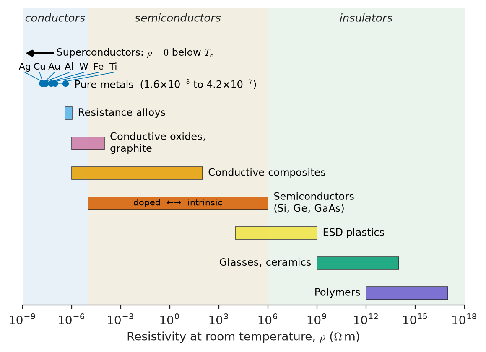
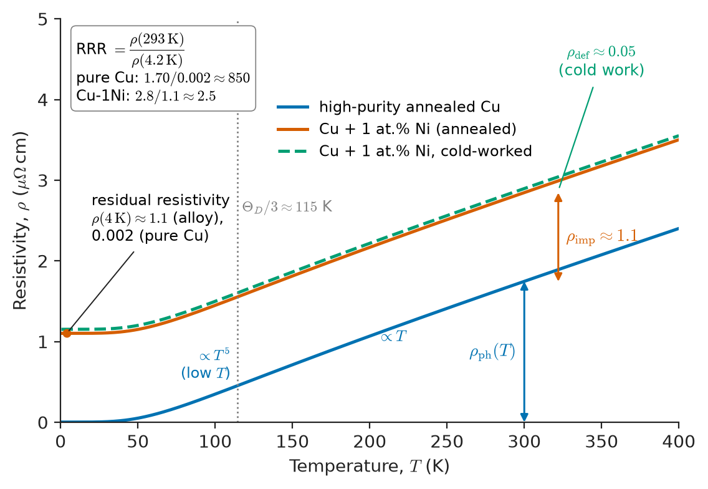
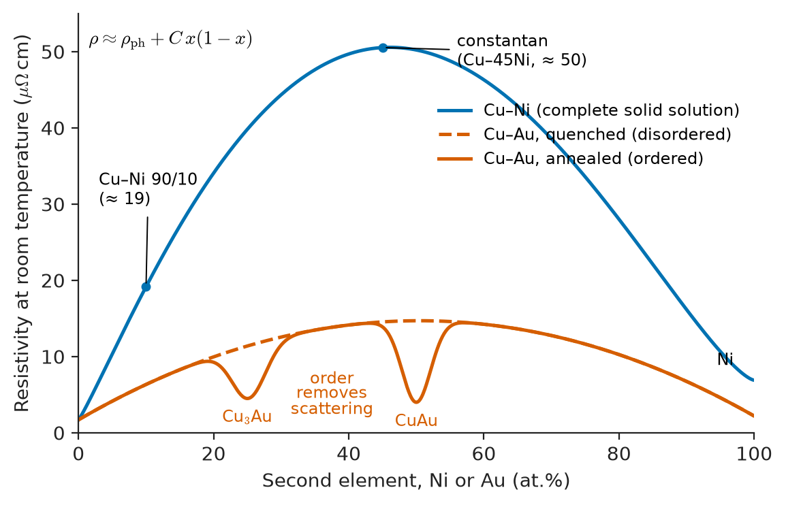
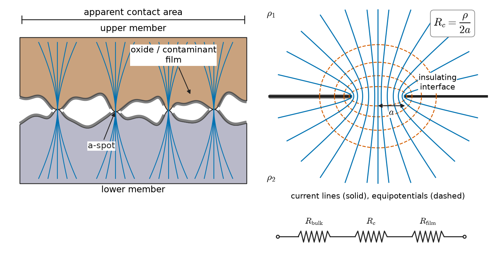
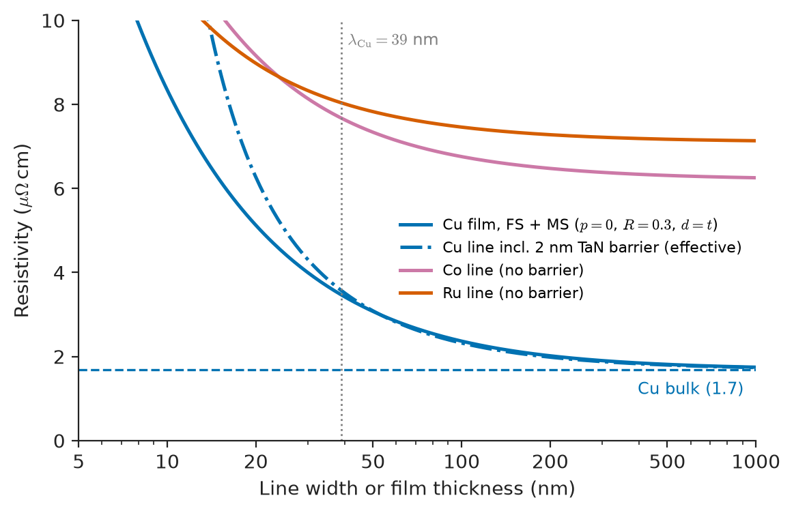
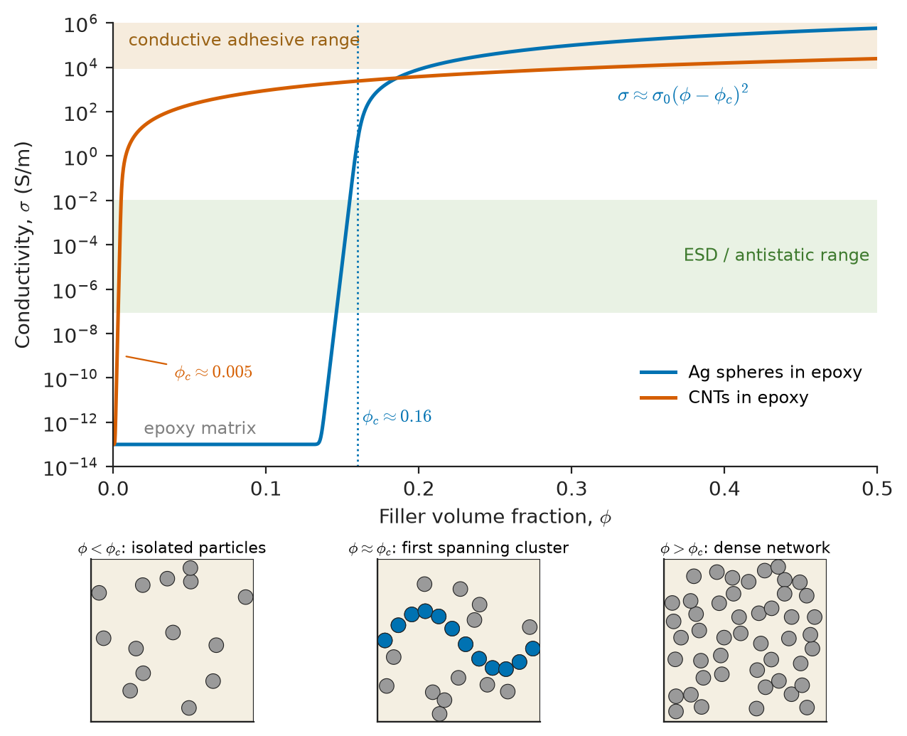
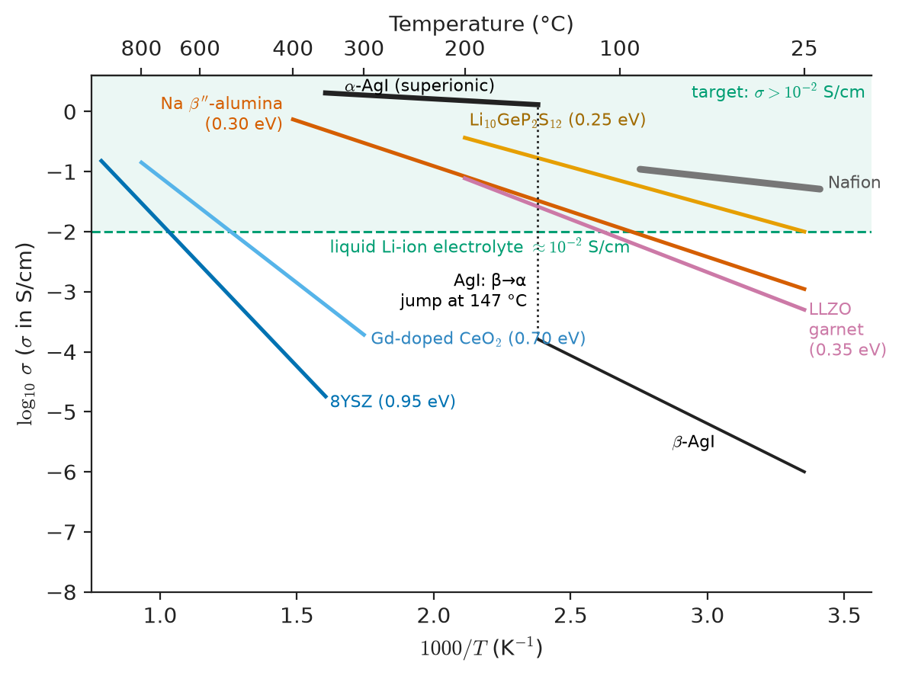

# Chapter 25 — Electrical Conduction in Materials

*Part VI · Thermal, Electrical, Dielectric and Magnetic Materials*

A battery-pack designer switches the main busbars of an electric scooter from copper to aluminium to save weight. The new pack passes its bench tests, but after a few hundred charge cycles the bolted joints at the cell terminals run hot. The thermal camera shows a cluster of hot spots of 40 K and more, all at the joints, none along the bars. The bars themselves were sized correctly: aluminium has 1.6 times the resistivity of copper, and the designer made the cross-section 1.6 times larger. What the calculation left out was that the current does not flow through the whole face of a bolted joint. It flows through a few microscopic contact spots, and aluminium covers itself within seconds with a hard insulating oxide. The resistance that mattered was a property of a surface and a few micrometre-sized spots, not of the bulk.

This chapter is about what sets the resistance of real conductors: bulk metals, alloys, thin films, contacts and filled polymers. The central idea is simple. Every conductor has carriers, and those carriers are scattered. The density of carriers is fixed by the electronic structure of the material. Scattering is what the engineer controls through composition, temperature, defects, grain size and geometry.

> **Why is copper a better conductor than brass, even though both are mostly copper?**
> **Why does a 20 nm copper line have twice the resistivity of a copper wire?**
> **Why do the joints, rather than the conductors, so often limit a high-current design?**

| Concept | Engineering destination |
|---|---|
| Resistivity, conductivity, sheet resistance | Conductor sizing, PCB trace width, film resistors |
| Mobility and scattering time | Why alloys and films conduct worse; link to semiconductors (Chapter 32) |
| Temperature coefficient of resistance | Winding temperature measurement, RTDs, precision shunts |
| Matthiessen and Nordheim rules | Alloy choice for connectors, springs, heating elements |
| Holm constriction resistance | Connector, relay, busbar-joint and battery-terminal design |
| Thin-film size effects | On-chip interconnects, thin-film resistors, transparent electrodes |
| Percolation in composites | Conductive adhesives, ESD plastics, PTC fuses, thick-film resistors |
| Wiedemann–Franz law | Estimating thermal conductivity of alloys and solders; contact heating |
| Selection indices | Wires, contacts, interconnects, electrodes |

**Roadmap.** Conductivity and resistivity as material properties (25.1) → carriers, mobility and scattering (25.2) → temperature dependence and TCR (25.3) → metals and alloys, Matthiessen and Nordheim (25.4) → contacts (25.5) → thin films (25.6) → conductive composites (25.7) → electrical versus thermal conductivity (25.8) → material selection (25.9) → ionic conduction and solid electrolytes (25.10).

---

## 25.1 Conductivity and resistivity

### From resistance to a material property

The resistance of a uniform bar of length $L$ and cross-section $A$ is

$$
R=\rho\,\frac{L}{A}
$$

where the **resistivity** $\rho$ (unit $\Omega\,\mathrm{m}$) depends only on the material and its state (temperature, composition, microstructure). Its reciprocal is the **conductivity** $\sigma=1/\rho$ (unit $\mathrm{S/m}$). The geometry has been separated from the material.

The local form of Ohm's law says the same thing without any bar:

$$
\mathbf J=\sigma\,\mathbf E
$$

The current density at a point is proportional to the electric field at that point. This is the form used in field solvers and in every derivation below. For an anisotropic crystal (graphite, many oxides, some intermetallics) $\sigma$ is a tensor and $\mathbf J$ need not be parallel to $\mathbf E$ (Chapter 4). Cubic metals are isotropic, and we will treat $\sigma$ as a scalar unless stated.

> **Status of the principle: Ohm's law $\mathbf J=\sigma\mathbf E$**
> *Approximate.* It is the linear term of the current response to a field. It holds very well in metals up to current densities far beyond any practical use, because the drift velocity stays tiny compared with the electron speed (Section 25.2). It fails at high fields in semiconductors (velocity saturation, Chapter 32), in insulators near breakdown (Chapter 26) and in very short channels where carriers do not scatter at all.

### Units engineers actually use

Several practical units are in daily use and are easy to confuse:

- $\mu\Omega\,\mathrm{cm}$: $1\ \mu\Omega\,\mathrm{cm}=10^{-8}\ \Omega\,\mathrm{m}$. Copper is about $1.7\ \mu\Omega\,\mathrm{cm}$.
- $\Omega\,\mathrm{mm^2/m}$: the wire-table unit. $1\ \Omega\,\mathrm{mm^2/m}=10^{-6}\ \Omega\,\mathrm{m}$. Copper is $0.0172\ \Omega\,\mathrm{mm^2/m}$.
- **% IACS** (International Annealed Copper Standard): conductivity as a percentage of that of standard annealed copper, defined as $\rho=1.7241\times10^{-8}\ \Omega\,\mathrm{m}$ at 20 °C (that is, $58.0\ \mathrm{MS/m}$). Modern high-purity copper exceeds 100 % IACS (about 101–102 %).
- **Sheet resistance** $R_s=\rho/t$ for a film of thickness $t$, in ohms per square ($\Omega/\square$). A line of length $L$ and width $W$ has $R=R_s\,L/W$, i.e. $R_s$ times the number of squares. It is the natural unit for PCB copper, thin films and printed conductors (Section 25.6).

### The widest range of any physical property

Resistivity spans more than 25 orders of magnitude at room temperature, from silver ($1.6\times10^{-8}\ \Omega\,\mathrm{m}$) to PTFE (above $10^{16}\ \Omega\,\mathrm{m}$), and superconductors drop to zero (Chapter 30). Few other material properties vary over such a range. It is why the same field equation can describe a busbar and a cable insulation, and why measurement methods differ so much between conductors (four-point probe, Chapter 52) and insulators (guarded electrodes, Chapter 26).

| Material class | Example | Typical $\rho$ at 20 °C ($\Omega\,\mathrm{m}$) |
|---|---|---|
| Pure metals | Ag, Cu, Al | $1.6$–$2.7\times10^{-8}$ |
| Resistance alloys | Constantan, Nichrome | $0.5$–$1.1\times10^{-6}$ |
| Conductive oxides | ITO film, RuO$_2$ | $10^{-6}$–$10^{-5}$ |
| Graphite (polycrystalline) | Electrode graphite | $\approx 10^{-5}$ |
| Conductive composites | Ag-filled epoxy; carbon-filled polymer | $10^{-6}$–$10^{-3}$; $10^{-2}$–$10^{2}$ |
| Semiconductors | Si (doped to intrinsic) | $10^{-5}$–$2\times10^{3}$ |
| Static-dissipative plastics | ESD trays | $10^{4}$–$10^{9}$ |
| Glasses and ceramics | Soda-lime glass, alumina | $10^{9}$–$>10^{12}$ |
| Polymers | Epoxy, PE, PTFE | $10^{12}$–$>10^{16}$ |

<!-- FIGURE 25.1 | figures/ch25/fig-25-1-resistivity-spectrum.png | map | The resistivity of engineering materials at room temperature spans more than 25 orders of magnitude. | Content: horizontal log axis of resistivity from 1e-9 to 1e18 ohm m. Horizontal bars (ranges) stacked by class: superconductors (arrow at zero, left edge), pure metals (Ag, Cu, Au, Al, W, Fe, Ti labelled as points 1.6e-8 to 4.2e-7), resistance alloys (manganin, constantan, nichrome 4e-7 to 1.1e-6), conductive oxides and graphite (1e-6 to 1e-4), conductive composites (1e-6 to 1e2), semiconductors Si/Ge/GaAs (1e-5 to 1e6, note doping range), ESD plastics (1e4 to 1e9), glasses and ceramics (1e9 to 1e14), polymers (1e12 to 1e17). Vertical shaded bands labelled conductors, semiconductors, insulators. -->

*Figure 25.1 — The resistivity of engineering materials at room temperature spans more than 25 orders of magnitude.*

Figure 25.1 shows this range by material class. The split into "conductors", "semiconductors" and "insulators" is not a matter of degree only. A metal's carrier density is fixed by its electronic structure and barely changes with temperature. A semiconductor's carrier density can be changed by many orders of magnitude by doping and temperature. An insulator has almost no free carriers at all. Explaining that split needs energy bands, which is the job of Chapter 31. This chapter takes the carrier density of a metal as given and asks what limits the current.

---

## 25.2 Mobility and scattering as material properties

### The Drude picture

Treat the conduction electrons of a metal as a gas of $n$ free carriers per unit volume, each with charge $-e$ and mass $m$. A field $\mathbf E$ accelerates each electron. Collisions with imperfections of the lattice randomize its momentum, on average once every **mean free time** (scattering time) $\tau$. Between collisions the field adds momentum $-e\mathbf E$ per unit time; collisions remove it at the rate $\langle\mathbf p\rangle/\tau$. In steady state the two balance:

$$
\frac{d\langle\mathbf p\rangle}{dt}=-e\mathbf E-\frac{\langle\mathbf p\rangle}{\tau}=0
\quad\Longrightarrow\quad
\mathbf v_d=\frac{\langle\mathbf p\rangle}{m}=-\frac{e\tau}{m}\,\mathbf E
$$

The **drift velocity** $\mathbf v_d$ is proportional to the field. The constant of proportionality is the **mobility**

$$
\mu=\frac{e\tau}{m}\qquad(\mathrm{m^2\,V^{-1}\,s^{-1}})
$$

The current density is the charge per volume times the drift velocity, $\mathbf J=-ne\mathbf v_d=ne\mu\mathbf E$, so

$$
\sigma=ne\mu=\frac{ne^2\tau}{m}
$$

This one equation organizes the whole chapter. Conductivity is a product of **how many carriers** ($n$) and **how freely they move** ($\mu$, or equivalently $\tau$). In semiconductors both factors vary and both are engineered (Chapter 32). In metals $n$ is essentially fixed at roughly one to three electrons per atom, about $10^{28}$–$10^{29}\ \mathrm{m^{-3}}$. All the differences between pure copper, brass, a thin copper film and hot copper come from $\tau$.

> **Status of the principle: Drude conductivity $\sigma=ne^2\tau/m$**
> *Approximate.* It assumes free carriers with a single relaxation time. The form survives in the band theory of Chapter 31 with $m$ replaced by an effective mass and $\tau$ evaluated for electrons at the Fermi energy. The classical Drude model gets the electron speed wrong, and with it the heat capacity and the mean free path (see below), but its conductivity formula is right.

### What the numbers say about copper

**Worked example — scattering time, mobility and mean free path of copper.** Copper has one conduction electron per atom. With density $8.96\ \mathrm{g/cm^3}$ and molar mass $63.55\ \mathrm{g/mol}$, $n=8.47\times10^{28}\ \mathrm{m^{-3}}$. At room temperature $\rho=1.68\times10^{-8}\ \Omega\,\mathrm{m}$.

The scattering time:

$$
\tau=\frac{m}{ne^2\rho}=\frac{9.109\times10^{-31}}{(8.47\times10^{28})(1.602\times10^{-19})^2(1.68\times10^{-8})}=2.49\times10^{-14}\ \mathrm{s}
$$

The mobility:

$$
\mu=\frac{e\tau}{m}=\frac{1}{ne\rho}=\frac{1}{(8.47\times10^{28})(1.602\times10^{-19})(1.68\times10^{-8})}=4.39\times10^{-3}\ \mathrm{m^2/(V\,s)}=43.9\ \mathrm{cm^2/(V\,s)}
$$

This is low. Electrons in lightly doped silicon have a mobility of about $1400\ \mathrm{cm^2/(V\,s)}$. Copper conducts well because it has $10^{6}$–$10^{9}$ times more carriers, not because its carriers move easily.

The drift velocity at a heavy current density $J=10\ \mathrm{A/mm^2}=10^{7}\ \mathrm{A/m^2}$:

$$
v_d=\frac{J}{ne}=\frac{10^{7}}{(8.47\times10^{28})(1.602\times10^{-19})}=7.4\times10^{-4}\ \mathrm{m/s}
$$

Less than a millimetre per second. The signal travels at a large fraction of the speed of light because the field propagates, not the electrons.

The mean free path. The conduction electrons do not move at thermal speeds. They move at the **Fermi velocity**, $v_F=1.57\times10^{6}\ \mathrm{m/s}$ for copper, a quantum result explained in Chapter 31. The distance between scattering events is

$$
\lambda=v_F\tau=(1.57\times10^{6})(2.49\times10^{-14})=3.9\times10^{-8}\ \mathrm{m}=39\ \mathrm{nm}
$$

about 150 atomic spacings. Electrons pass straight through a perfect lattice. They are scattered only by departures from perfect periodicity. And 39 nm is close to the dimensions of modern on-chip wires, which is why Section 25.6 will find that thin copper does not behave like bulk copper.

### What scatters electrons

A perfectly periodic lattice does not scatter electrons at all. That result (Bloch's theorem, Chapter 31) is why a classical picture of electrons bouncing off every ion fails by two orders of magnitude in $\lambda$. Scattering comes only from **deviations from periodicity**, which are exactly the structural features of Chapters 2 and 5:

| Scatterer | Origin | Temperature dependence | Controlled by |
|---|---|---|---|
| Phonons (lattice vibrations) | Thermal motion of atoms | Strong; $\propto T$ above about $\Theta_D/3$ | Temperature only |
| Impurity atoms in solution | Composition | Nearly independent of $T$ | Purity, alloying |
| Vacancies, interstitials | Quenching, irradiation | Independent of $T$ (if frozen in) | Annealing |
| Dislocations | Cold work | Independent of $T$ | Annealing |
| Grain boundaries | Polycrystalline structure | Independent of $T$ | Grain size (Section 25.6) |
| External surfaces | Finite size | Independent of $T$ | Film thickness, wire width |
| Precipitates | Second phase | Independent of $T$ | Heat treatment |

Each scattering process has its own rate $1/\tau_i$. Because the processes are independent, the rates add:

$$
\frac{1}{\tau}=\frac{1}{\tau_{\rm ph}}+\frac{1}{\tau_{\rm imp}}+\frac{1}{\tau_{\rm def}}+\cdots
$$

and since $\rho=m/(ne^2\tau)$ is proportional to $1/\tau$, the resistivities add. This is Matthiessen's rule, taken up in Section 25.4. The mobility and scattering time are therefore material properties in the same sense as yield strength: they depend on composition, temperature and microstructure, and processing sets them.

> **Boundary.** The quantum-mechanical reason a periodic lattice does not scatter, and the meaning of $v_F$ and the effective mass, belong to Chapter 31 (and in full to Engineering Physics). Here we use them as material parameters.

---

## 25.3 Temperature coefficients of resistance

### Definition

The **temperature coefficient of resistance** (TCR) at a reference temperature $T_0$ is

$$
\alpha_0=\frac{1}{\rho(T_0)}\left.\frac{d\rho}{dT}\right\rvert_{T_0}
$$

Over a limited range the resistivity is close to linear,

$$
\rho(T)\approx\rho(T_0)\left[1+\alpha_0\,(T-T_0)\right]
$$

so that $\alpha_0$ is the fractional change per kelvin. The value depends on the reference temperature, because $\rho(T_0)$ appears in the denominator. Datasheets usually quote $\alpha_{20}$ (or $\alpha_{25}$). TCR is often given in $\mathrm{ppm/K}$; $1\ \mathrm{ppm/K}=10^{-6}\ \mathrm{K^{-1}}$.

### Why pure metals have a TCR near 0.4 % per kelvin

Above roughly a third of the Debye temperature $\Theta_D$, the number of thermally excited phonons is proportional to $T$, and so is the phonon scattering rate. The phonon resistivity is then linear in absolute temperature, $\rho_{\rm ph}\approx bT$. If phonons dominate, extrapolating $\rho$ linearly downward reaches zero near $T=0\ \mathrm K$, and the TCR at temperature $T$ is close to $1/T$. At 293 K that gives about $0.0034\ \mathrm{K^{-1}}$. Real pure metals have $\alpha_{20}=0.0039$–$0.0045\ \mathrm{K^{-1}}$. They are slightly higher because the phonon resistivity is not exactly linear and because the extrapolated zero lies a little above 0 K (for copper the linear extrapolation hits zero at $-234.5$ °C, i.e. 38.7 K).

At low temperature the phonon contribution collapses (as $T^5$ in the Bloch–Grüneisen model for $T\ll\Theta_D$) and only the temperature-independent residual part remains. The ratio $\rho(300\ \mathrm K)/\rho(4.2\ \mathrm K)$, the **residual resistivity ratio** (RRR), is a sensitive measure of purity and perfection: about 50–100 for commercial copper and several thousand for annealed 6N copper. RRR matters in cryogenic electronics and in stabilizers for superconducting wires (Chapter 30).

> **Status of the principle: $\rho_{\rm ph}\propto T$ above about $\Theta_D/3$**
> *Approximate.* It follows from the classical (high-temperature) population of phonons. It fails at low temperature, where phonons freeze out, and is modified near the melting point and in metals with complex band structure (transition metals such as Ni and Pt show curvature).

### Engineering values

| Material | $\rho_{20}$ ($10^{-8}\ \Omega\,\mathrm{m}$) | $\alpha_{20}$ ($10^{-3}\ \mathrm{K^{-1}}$) | Use |
|---|---|---|---|
| Copper (annealed, IACS) | 1.724 | 3.93 | Windings, wiring |
| Aluminium (EC grade 1350) | 2.82 | 4.03 | Overhead lines, busbars |
| Silver | 1.59 | 3.8 | Contacts, plating |
| Gold | 2.2 | 3.4 | Contacts, bond wires |
| Platinum | 10.6 | 3.85 (IEC 60751, 0–100 °C) | RTDs (Pt100) |
| Nickel | 6.9 | 6.0 | Thermistors, sensors |
| Tungsten | 5.3 | 4.5 | Lamp filaments, contacts |
| Nichrome (80Ni–20Cr) | 108 | about 0.1 | Heating elements, film resistors |
| Constantan (55Cu–45Ni) | 49 | about $\pm0.02$ | Thermocouples, strain gauges |
| Manganin (86Cu–12Mn–2Ni) | 43 | about $\pm0.01$ | Precision shunts, standards |
| Carbon (graphite) | about 1000 | about $-0.5$ | Carbon resistors, brushes |

The table splits into two groups that serve opposite purposes. Pure metals have a large, reproducible TCR, which is exactly what a **temperature sensor** needs. The platinum resistance thermometer (Pt100: $100\ \Omega$ at 0 °C) is the industrial standard because platinum is chemically stable and its $\rho(T)$ is reproducible to millikelvins; its curve is described by the Callendar–Van Dusen equation, an empirical quadratic (cubic below 0 °C). Concentrated alloys have a tiny TCR, which is what a **precision resistor or shunt** needs. Section 25.4 explains why alloying flattens $\rho(T)$.

### Measuring a winding temperature by its resistance

Since copper's TCR is reproducible, the resistance of a winding is a thermometer averaged over the whole winding. Standards for motors and transformers (IEC 60034, IEEE C57) use this "resistance method". Writing $\rho\propto(T+234.5)$ for copper with $T$ in °C:

$$
\frac{R_2}{R_1}=\frac{234.5+T_2}{234.5+T_1}
$$

(for aluminium the constant is 225 or 228, depending on the standard and grade).

**Worked example — winding temperature rise.** A transformer winding measures $R_1=2.000\ \Omega$ at the ambient temperature of 20 °C. Immediately after a heat run it measures $R_2=2.480\ \Omega$. The hot temperature is

$$
T_2=\frac{R_2}{R_1}(234.5+T_1)-234.5=\frac{2.480}{2.000}(254.5)-234.5=315.6-234.5=81.1\ ^\circ\mathrm C
$$

The average winding rise is 61 K. Two lessons follow. First, a 24 % increase in resistance is a 24 % increase in $I^2R$ loss at the same current, so hot copper is less efficient copper, and loss estimates must be made at the operating temperature (75 °C or 115 °C reference temperatures are used in standards for this reason). Second, the method gives an average. The hottest spot may be 10–20 K hotter, which is what insulation life depends on (Chapter 26).

---

## 25.4 Conductivity in metals and alloys

### Why pure metals differ

Within the pure metals, resistivity varies by a factor of about 30 at room temperature (silver $1.6$, titanium $42\times10^{-8}\ \Omega\,\mathrm{m}$). The variation tracks the electronic structure. The noble metals Cu, Ag, Au have a single s-electron outside a filled d-shell; their conduction electrons have a small effective mass and few states to scatter into, and they are the best conductors. Aluminium has three free electrons per atom but scatters them more strongly. Transition metals (Fe, Ni, Pt, Ti) have partially filled d bands that offer many empty states into which an s-electron can be scattered. Their scattering rates are higher and their resistivities are 4–25 times that of copper. These trends come from band structure (Chapter 31). The engineer's working rule is simpler: **for low resistivity, use Ag, Cu, Au or Al, and keep them pure.**

| Metal | $\rho_{20}$ ($10^{-8}\ \Omega\,\mathrm{m}$) | % IACS | Density ($\mathrm{g/cm^3}$) | Melting point (°C) |
|---|---|---|---|---|
| Silver | 1.59 | 108 | 10.5 | 962 |
| Copper (OFE, annealed) | 1.69 | 102 | 8.96 | 1085 |
| Gold | 2.2 | 78 | 19.3 | 1064 |
| Aluminium (99.99 %) | 2.65 | 65 | 2.70 | 660 |
| Magnesium | 4.4 | 39 | 1.74 | 650 |
| Tungsten | 5.3 | 33 | 19.3 | 3422 |
| Zinc | 5.9 | 29 | 7.14 | 420 |
| Nickel | 6.9 | 25 | 8.90 | 1455 |
| Iron | 9.7 | 18 | 7.87 | 1538 |
| Platinum | 10.6 | 16 | 21.5 | 1768 |
| Tin | 11.5 | 15 | 7.29 | 232 |
| Lead | 21 | 8 | 11.3 | 327 |
| Titanium | 42 | 4 | 4.51 | 1668 |

### Matthiessen's rule

Section 25.2 showed that independent scattering rates add. Translating to resistivity:

$$
\rho(T,c,\text{defects})=\rho_{\rm ph}(T)+\rho_{\rm imp}(c)+\rho_{\rm def}
$$

The thermal part depends only on temperature and is the same for pure copper and dilute copper alloys. The residual parts depend on composition and defects and not on temperature. Plotting $\rho(T)$ for a pure metal and a dilute alloy gives two curves of the same shape, displaced vertically by a constant (Figure 25.2).

<!-- FIGURE 25.2 | figures/ch25/fig-25-2-matthiessen-rho-vs-t.png | plot | Matthiessen's rule: impurities and defects shift the resistivity curve upward without changing its temperature-dependent part. | Content: x-axis temperature 0 to 400 K; y-axis resistivity 0 to 5 micro-ohm cm. Curves: high-purity annealed Cu (residual about 0.002, reaching 1.7 at 293 K, T^5 knee below about 50 K, linear above about 100 K); Cu + 1 at.% Ni (same shape, shifted up by about 1.1); cold-worked Cu + 1 at.% Ni (shifted up a further 0.05). Annotate rho_ph(T), rho_imp, rho_def as vertical arrows at 300 K; mark Theta_D/3 for Cu (about 115 K) and the residual resistivity at 4 K. Inset: RRR definition. -->

*Figure 25.2 — Matthiessen's rule: impurities and defects shift the resistivity curve upward without changing its temperature-dependent part.*

Figure 25.2 shows the consequence for the TCR. The slope $d\rho/dT$ is the same for the pure metal and the alloy, but $\rho$ is larger for the alloy, so the TCR $\alpha=(1/\rho)\,d\rho/dT$ is smaller. Adding a residual resistivity lowers the TCR. A concentrated alloy with a large residual term and an almost flat curve, such as manganin or constantan, is the extreme case.

> **Status of the principle: Matthiessen's rule**
> *Empirical.* It follows from adding independent scattering rates, but scattering processes are not strictly independent (impurities change the phonon spectrum and the electron distribution). Deviations of a few per cent of the residual resistivity are common, and the rule fails badly in concentrated alloys and at low temperature in some systems. It remains the standard first estimate.

### Impurities: a little goes a long way

Each dissolved impurity atom adds its own resistivity, roughly in proportion to its concentration while dilute. The increment per atomic per cent varies enormously with the solute:

| Solute in copper | Approximate $\Delta\rho$ ($\mu\Omega\,\mathrm{cm}$ per at.%) |
|---|---|
| Ag | 0.14 |
| Zn | 0.3 |
| Au | 0.55 |
| Ni | 1.1 |
| Sn | 2.9 |
| P | 6.7 |
| Fe | 9 |

The pattern is that solutes chemically similar to the host (Ag, Au, Zn) scatter weakly; solutes with a different valence or an open d-shell (P, Fe, Co) scatter strongly. Two industrial consequences follow:

- **Phosphorus-deoxidized copper** (Cu-DHP, about 0.02 wt% P) is easy to braze and weld, but its conductivity is about 85 % IACS. Electrical conductors use electrolytic tough pitch (Cu-ETP) or oxygen-free (Cu-OF) copper at 100–101 % IACS. A tiny residue of the wrong element costs 15 % of the conductivity.
- **Silver-bearing copper** (about 0.03–0.1 % Ag) keeps nearly full conductivity while raising the softening temperature, which is why it is used for commutators and windings that are hot during manufacturing.

### Concentrated alloys: Nordheim's rule

When a second element is added beyond the dilute limit, the residual resistivity of a disordered solid solution $A_{1-x}B_x$ follows approximately

$$
\rho_{\rm alloy}\approx\rho_{\rm ph}(T)+C\,x(1-x)
$$

where $C$ is a constant for the pair of elements. The resistivity is largest near $x=0.5$, where the lattice is most disordered, and returns to the pure-metal value at both ends. Copper–nickel (complete solid solubility) is the classic case; its resistivity rises from 1.7 to about $50\ \mu\Omega\,\mathrm{cm}$ near 45 % Ni, which is constantan.

<!-- FIGURE 25.3 | figures/ch25/fig-25-3-nordheim-cu-ni-cu-au.png | plot | Resistivity across two complete solid-solution systems: the Nordheim parabola in Cu–Ni and the effect of atomic ordering in Cu–Au. | Content: x-axis composition 0 to 100 at.% of second element; y-axis residual plus room-temperature resistivity in micro-ohm cm (0 to 55). Curve 1: Cu-Ni, near-parabolic peak about 50 near 45 at.% Ni, annotate constantan and Cu-Ni 90/10 (about 19). Curve 2: Cu-Au quenched (disordered), smooth parabola with peak about 15 at 50 at.%. Curve 3: Cu-Au annealed (ordered), sharp minima at Cu3Au (25 at.%) and CuAu (50 at.%) dropping to about 4-5. Annotate "order removes scattering". -->

*Figure 25.3 — Resistivity across two complete solid-solution systems: the Nordheim parabola in Cu–Ni and the effect of atomic ordering in Cu–Au.*

Figure 25.3 also shows the second half of the story. If the alloy **orders**, so that A and B atoms occupy regular sublattices (Cu$_3$Au, CuAu), the lattice becomes periodic again and the resistivity drops sharply. Disorder, not composition as such, is what scatters. The same principle explains why intermetallic compounds such as Cu$_6$Sn$_5$ in solder joints (Chapter 51) have moderate resistivity, not a disordered-alloy value.

> **Status of the principle: Nordheim's rule**
> *Empirical.* It describes disordered binary solid solutions of elements with similar electronic structure. It fails for ordered alloys, for transition-metal solutes with magnetic effects, and when phases separate.

### Strength versus conductivity

Pure annealed copper is soft (yield strength about 70 MPa). A connector spring, a trolley wire or a lead frame needs much more strength. Every strengthening mechanism of Chapter 13 works by introducing obstacles to dislocations, and every obstacle also scatters electrons. The question is how much conductivity each mechanism costs:

| Strengthening mechanism | Effect on strength | Effect on conductivity | Example |
|---|---|---|---|
| Cold work (dislocations) | Large (yield up to about 350 MPa) | Small (2–3 % IACS lost) | Hard-drawn Cu wire |
| Solid solution | Moderate | Large (solute in the lattice scatters strongly) | Brass, phosphor bronze, Cu–Ni |
| Precipitation hardening | Large | Small to moderate (solute removed from lattice into particles) | CuCrZr, CuBe, CuNiSi |
| Grain refinement | Moderate | Small in bulk | Fine-grained Cu |
| Dispersion strengthening | Moderate, stable when hot | Small | Al$_2$O$_3$-dispersed Cu (Glidcop) |

The key is where the alloying atoms sit. A solute dissolved in the lattice scatters on every atomic scale; the same atoms gathered into precipitates scatter only at the particle surfaces, a far smaller area. Precipitation-hardened alloys therefore give the best compromise:

| Alloy | Typical conductivity (% IACS) | Typical yield strength (MPa) | Use |
|---|---|---|---|
| Cu-ETP, annealed | 101 | 70 | Wire, busbar |
| Cu-ETP, hard drawn | 97 | 300–350 | Overhead contact wire |
| CuCrZr (aged) | 75–85 | 300–450 | Welding electrodes, lead frames |
| CuNiSi (C70250, aged) | 35–45 | 550–700 | Connector springs |
| CuBe (C17200, aged) | 20–25 | 1000–1200 | High-reliability springs |
| Brass C26000 (70Cu–30Zn) | 28 | 100–450 | Terminals, housings |
| Phosphor bronze C51000 | 15 | 300–700 | Spring contacts |
| Al 1350 (EC) | 61–62 | 30–165 | Conductors |
| Al 6101/6201 (Al–Mg–Si, aged) | 52–57 | 170–300 | Busbars, overhead conductors |

The answer to the first opening question is now clear. Brass has 28 % IACS, not 100 %, because 30 % zinc in solid solution makes the copper lattice disordered on every atomic scale. Brass is chosen for terminals because it is cheap, machinable and strong enough, not because it conducts well.

**Worked example — aluminium for copper.** Replace a copper busbar ($\rho_{\rm Cu}=1.72\times10^{-8}\ \Omega\,\mathrm{m}$) with EC aluminium ($\rho_{\rm Al}=2.82\times10^{-8}\ \Omega\,\mathrm{m}$) of the same length and the same resistance. Equal resistance needs

$$
\frac{A_{\rm Al}}{A_{\rm Cu}}=\frac{\rho_{\rm Al}}{\rho_{\rm Cu}}=\frac{2.82}{1.72}=1.64
$$

For a round conductor the diameter grows by $\sqrt{1.64}=1.28$. The mass ratio is

$$
\frac{m_{\rm Al}}{m_{\rm Cu}}=\frac{A_{\rm Al}\,d_{\rm Al}}{A_{\rm Cu}\,d_{\rm Cu}}=1.64\times\frac{2.70}{8.96}=0.49
$$

where $d$ is the density. The aluminium conductor has the same resistance at half the mass, which is why overhead transmission lines, large building busbars and many automotive cables use aluminium. The price is the larger cross-section, a lower strength (often fixed with a steel core or Al–Mg–Si alloy), a higher thermal expansion, creep under bolt load, and the joint problem of the opening paragraph, analysed in the next section.

---

## 25.5 Contact resistance

### Why two flat conductors touch only at spots

No real surface is flat at the micrometre scale. When two surfaces are pressed together, they touch only at the tips of the highest asperities. The asperities deform plastically until the total load is supported, so the true contact area is

$$
A_r\approx\frac{F}{H}
$$

where $F$ is the contact force and $H$ the indentation hardness of the softer member. With a hardness of about 1 GPa, a force of 1 N gives a real contact area of $10^{-9}\ \mathrm{m^2}$, i.e. $1000\ \mu\mathrm m^2$. That is a millionth of a square centimetre, regardless of how large the apparent contact face is. The current must squeeze through these small conducting spots ("a-spots").

### Constriction resistance (Holm)

Consider a single circular spot of radius $a$ joining two semi-infinite bodies of resistivity $\rho$. The current lines converge into the spot and spread out again on the other side (Figure 25.4). Solving Laplace's equation for this geometry (Holm, 1958) gives the **constriction resistance**

$$
R_c=\frac{\rho}{2a}
$$

for the two halves together ($\rho/4a$ each). If the two members have different resistivities, $R_c=(\rho_1+\rho_2)/4a$. The resistance scales with $1/a$, not $1/a^2$, because the constriction is a three-dimensional spreading effect, concentrated within a distance of a few $a$ from the spot.

<!-- FIGURE 25.4 | figures/ch25/fig-25-4-holm-constriction.png | schematic | Electrical contact at the microscale: current lines converge through a-spots, and surface films add resistance in series. | Content: left panel: cross-section of two rough metal surfaces pressed together, apparent contact area bracketed, three or four a-spots where asperities touch, oxide/contaminant film (shaded) covering non-contacting regions, current lines bunching into the spots. Right panel: single circular a-spot of radius a between two half-spaces, equipotential surfaces as oblate ellipsoids and current lines as hyperbolae; label R_c = rho/(2a). Small inset: equivalent circuit R_bulk + R_c + R_film in series. -->

*Figure 25.4 — Electrical contact at the microscale: current lines converge through a-spots, and surface films add resistance in series.*

**Worked example — a copper contact at 1 N.** Two copper surfaces ($\rho=1.72\times10^{-8}\ \Omega\,\mathrm{m}$, $H\approx1\ \mathrm{GPa}$) are pressed together with $F=1\ \mathrm N$.

The real contact area is $A_r=F/H=10^{-9}\ \mathrm{m^2}$. If it formed a single circular spot, its radius would be

$$
a=\sqrt{\frac{A_r}{\pi}}=\sqrt{\frac{10^{-9}}{\pi}}=1.78\times10^{-5}\ \mathrm m=17.8\ \mu\mathrm m
$$

and the constriction resistance

$$
R_c=\frac{\rho}{2a}=\frac{1.72\times10^{-8}}{2\times1.78\times10^{-5}}=4.8\times10^{-4}\ \Omega=0.48\ \mathrm{m\Omega}
$$

In practice the area is divided among many spots. If it were split into ten spots of equal area spread far apart, each would have $a=5.64\ \mu\mathrm m$; the ten resistances in parallel give $\rho/(2\times10\times a)=0.15\ \mathrm{m\Omega}$. Spots close together interact, and Greenwood's result for a cluster of $n$ spots of radius $a$ within a region of radius $\alpha$ is

$$
R_c\approx\frac{\rho}{2na}+\frac{\rho}{2\alpha}
$$

The first term is the parallel spot resistance; the second is the constriction of the whole cluster. For a cluster radius of 0.5 mm the second term adds only $0.017\ \mathrm{m\Omega}$. A clean metallic contact at 1 N is therefore a fraction of a milliohm, which is acceptable for a signal connector but not for a 200 A busbar joint, which needs hundreds to thousands of newtons. Because $a\propto\sqrt{F/H}$, the single-spot estimate gives $R_c\propto F^{-1/2}$: quadrupling the force only halves the resistance. Measured connector curves show $R_c\propto F^{-m}$ with $m$ between 0.5 and 1, depending on how the number of spots grows with force.

> **Status of the principle: Holm constriction resistance $R_c=\rho/2a$**
> *Derived.* It is an exact solution of Laplace's equation for a circular spot between half-spaces. Its use for real contacts is approximate: spot sizes and numbers are estimated from $F/H$, and when $a$ approaches the electron mean free path (39 nm in copper) the spot conducts ballistically (Sharvin resistance), which adds a term $\propto\lambda/a^2$.

### Film resistance

The second, and usually larger, contribution comes from films on the surfaces: oxides, sulphides, adsorbed water, organic residues. A film of resistivity $\rho_f$ and thickness $t_f$ over a spot of area $\pi a^2$ adds

$$
R_f=\frac{\rho_f\,t_f}{\pi a^2}=\frac{\sigma_f}{\pi a^2}
$$

where $\sigma_f$ (in $\Omega\,\mathrm{m^2}$) is the film resistance per unit area. For films thinner than about 2 nm, electrons tunnel through and $\sigma_f$ is roughly $10^{-12}$–$10^{-8}\ \Omega\,\mathrm{m^2}$. Thicker films insulate, and contact is made only where the film is broken mechanically (by wiping or by high contact pressure) or electrically ("fritting", breakdown of the film at a few volts).

This is why contact materials are chosen for the films they do or do not form:

- **Gold** forms no oxide. A thin gold plate (0.1–1.3 $\mu$m over a nickel barrier) keeps low-force signal contacts (0.3–1 N) below a few milliohms for decades. Hard gold (Au–Co, Au–Ni) resists wear.
- **Silver** forms no oxide but tarnishes to Ag$_2$S in sulphur-bearing air. The sulphide is soft and broken easily at moderate force, so silver works well in power contacts.
- **Tin** oxidizes in seconds, but the oxide is thin and brittle and tin is soft, so a force of 1–3 N cracks it. Tin contacts must not move after mating: micromotion of a few micrometres (from vibration or thermal cycling) repeatedly exposes fresh tin, which oxidizes and accumulates as an insulating debris layer. This **fretting corrosion** is a leading cause of automotive connector failure.
- **Aluminium** forms an oxide that is hard, adherent, and an excellent insulator (it is the dielectric of electrolytic capacitors). Joints need abrasion plus a sealing grease, bimetallic Cu–Al transition pieces, or plating. Aluminium also creeps under bolt load, so the force decays and the joint relaxes; spring washers and specified torques compensate. This is the busbar failure of the opening paragraph.

### Contact heating and the voltage–temperature relation

All the power dissipated in a constriction is generated within a few spot radii of the spot, so the spot itself is the hottest point. Because heat and current spread through the same geometry, a remarkable result follows (Kohlrausch): if the metal obeys the Wiedemann–Franz law (Section 25.8), the maximum temperature $T_m$ in the spot depends only on the voltage $U$ across the contact, not on its size or the metal:

$$
T_m^2-T_0^2=\frac{U^2}{4L}
$$

where $L=2.44\times10^{-8}\ \mathrm{W\,\Omega\,K^{-2}}$ is the Lorenz number and $T_0$ the bulk temperature. Setting $T_m$ to characteristic temperatures of copper ($T_0=293\ \mathrm K$):

- **Softening** of copper (about 190 °C, 463 K): $U=\sqrt{4L(T_m^2-T_0^2)}=0.11\ \mathrm V$.
- **Melting** (1358 K): $U=0.41\ \mathrm V$.

Measured softening and melting voltages for copper are about 0.12 V and 0.43 V. A contact drop of a tenth of a volt is therefore a warning: the spots soften, flatten and grow (which lowers the resistance, a self-healing effect), but at a few tenths of a volt they weld. Contact-resistance degradation over time (fretting, oxidation, intermetallic growth, stress relaxation) is treated as a failure mechanism in Chapter 44.

### Contact materials for switching

Contacts that make and break current (relays, contactors, circuit breakers) also face arcing, which erodes and welds. Their materials are composites designed against these failures:

| Contact material | Typical use | Reason |
|---|---|---|
| Fine silver, AgNi | Low-current relays | Low resistance, soft, resists welding at low current |
| Ag–SnO$_2$ (replaced Ag–CdO) | Contactors, motor starters | Oxide particles raise arc viscosity and resist welding |
| W–Cu, W–Ag (sintered, infiltrated) | Circuit breakers, arcing tips | Tungsten resists arc erosion; Cu/Ag carries current |
| Au, Au alloys, Pd | Signal relays, reed switches | No films at low force and low voltage ("dry circuit") |
| Graphite, Cu–graphite | Brushes | Self-lubricating sliding contact |

---

## 25.6 Thin-film conductors

### Sheet resistance

On-chip interconnects, thin-film resistors, transparent electrodes and PCB copper are all thin layers, specified by sheet resistance $R_s=\rho/t$. PCB copper is specified by mass per area in ounces per square foot: 1 oz copper is 35 $\mu$m thick, giving $R_s=1.72\times10^{-8}/35\times10^{-6}=0.49\ \mathrm{m\Omega/\square}$. A 0.25 mm wide, 50 mm long trace is 200 squares, or $98\ \mathrm{m\Omega}$ at 20 °C.

### Why thin films have higher resistivity

When a film thickness $t$ or a grain size $d$ becomes comparable with the electron mean free path $\lambda$, the boundaries add scattering that bulk metal does not have. Two models describe the two contributions.

**Surface scattering (Fuchs–Sondheimer).** An electron hitting a surface may reflect specularly (keeping its momentum along the film, no added resistance) or diffusely (randomized, like a collision). With a fraction $p$ of specular reflections, the thick-film limit of the Fuchs–Sondheimer solution is

$$
\frac{\rho_{\rm film}}{\rho_0}\approx1+\frac{3}{8}\,\frac{\lambda}{t}\,(1-p),\qquad t\gtrsim\lambda
$$

For $p=1$ there is no penalty. Real deposited films are rough on the atomic scale, and $p$ is usually close to zero.

**Grain-boundary scattering (Mayadas–Shatzkes).** Electrons crossing a grain boundary are reflected with probability $R$ (typically 0.2–0.5 for copper). With average grain size $d$, define

$$
\alpha=\frac{\lambda}{d}\,\frac{R}{1-R}
$$

The Mayadas–Shatzkes result is

$$
\frac{\rho_0}{\rho_{\rm gb}}=3\left[\frac13-\frac{\alpha}{2}+\alpha^2-\alpha^3\ln\left(1+\frac1\alpha\right)\right]
\quad\approx\quad\frac{\rho_{\rm gb}}{\rho_0}\approx1+\frac32\alpha\ \ (\alpha\ll1)
$$

Grain size in a deposited film is usually comparable with the film thickness, so the two effects grow together as the film thins.

> **Status of the principle: Fuchs–Sondheimer and Mayadas–Shatzkes models**
> *Approximate.* Both are Boltzmann-transport solutions with a single isotropic mean free path, and the parameters $p$ and $R$ are fitted to data. They describe trends well above about 10 nm; below that, the band structure of the thin layer, surface roughness on the scale of the electron wavelength and liner materials dominate, and first-principles calculations are needed.

**Worked example — a 100 nm copper film.** Take $\lambda=39\ \mathrm{nm}$, $t=100\ \mathrm{nm}$, fully diffuse surfaces ($p=0$), grain size $d=100\ \mathrm{nm}$ and grain-boundary reflection $R=0.3$.

Surface scattering:

$$
\frac{\rho_{\rm FS}}{\rho_0}=1+\frac38\times\frac{39}{100}=1+0.146=1.146
$$

Grain boundaries: $\alpha=(39/100)\times(0.3/0.7)=0.167$. The approximate form gives $1+1.5\times0.167=1.25$; the full expression gives

$$
3\left[0.3333-0.0836+0.0279-0.0091\right]=0.806\quad\Rightarrow\quad\frac{\rho_{\rm gb}}{\rho_0}=1.24
$$

Adding the two excess contributions (Matthiessen's rule again): $\rho/\rho_0\approx1+0.146+0.24=1.39$, so

$$
\rho\approx1.39\times1.68=2.3\ \mu\Omega\,\mathrm{cm},\qquad R_s=\frac{2.3\times10^{-8}}{1.0\times10^{-7}}=0.23\ \Omega/\square
$$

Grain boundaries cost more than surfaces in this film. That is why interconnect copper is annealed after plating to grow grains (Chapter 50), and why making the film thinner without growing the grains hurts twice.

### On-chip interconnects: the end of copper's advantage

For a modern on-chip wire, the cross-section is only tens of nanometres on a side, the grains are bounded by the line width, and a diffusion barrier (TaN/Ta, a few nanometres, resistivity 10–100 times that of copper) takes up part of the cross-section. The effective resistivity of a 20 nm copper line is roughly two to three times the bulk value (Figure 25.5). That is the answer to the second opening question.

<!-- FIGURE 25.5 | figures/ch25/fig-25-5-thin-film-size-effect.png | plot | Effective resistivity of narrow interconnect lines rises steeply once the dimensions approach the electron mean free path. | Content: x-axis line width or film thickness 5 to 1000 nm (log scale); y-axis resistivity 0 to 10 micro-ohm cm. Curves: Cu bulk (flat 1.7 dashed); Cu film with surface + grain-boundary scattering (FS+MS, p=0, R=0.3, d=t), rising to about 2.3 at 100 nm and above 4 at 20 nm; Cu line including 2 nm TaN barrier (effective, rising faster below 30 nm); Ru and Co lines (higher at 1000 nm, about 7 and 6, but crossing Cu below about 10-15 nm). Mark the Cu mean free path 39 nm with a vertical dotted line. -->

*Figure 25.5 — Effective resistivity of narrow interconnect lines rises steeply once the dimensions approach the electron mean free path.*

Whether a metal suffers from the size effect depends on the product $\rho_0\lambda$. For a free-electron metal $\rho_0\lambda=mv_F/(ne^2)$, a constant independent of how many scatterers the metal contains. A metal with a higher bulk resistivity but a much shorter mean free path loses less as dimensions shrink. This is why ruthenium, cobalt and molybdenum, poor conductors in bulk, are being introduced for the narrowest lines and vias:

| Metal | Bulk $\rho$ ($\mu\Omega\,\mathrm{cm}$) | Approximate $\lambda$ at 300 K (nm) | Barrier needed? |
|---|---|---|---|
| Cu | 1.7 | 39 | Yes (diffuses into Si and SiO$_2$) |
| Al | 2.7 | about 19 | No (but electromigration-prone) |
| W | 5.3 | about 15–19 | Adhesion liner |
| Mo | 5.3 | about 14 | Thin or none |
| Co | 6.2 | about 12 | Thin |
| Ru | 7.1 | about 7 | None or thin |

Narrow lines also carry very high current densities ($10^{9}$–$10^{10}\ \mathrm{A/m^2}$), at which momentum transfer from electrons to atoms moves the metal itself. This **electromigration** is treated in Chapter 44; its material dependence (grain structure, interfaces, Cu versus Al) is one more reason the choice of interconnect metal is not just a question of resistivity.

### Thin-film resistors and transparent conductors

Some films are designed for high and stable resistance rather than low resistance:

| Film | Typical sheet resistance | Typical TCR | Use |
|---|---|---|---|
| NiCr (sputtered, 10–50 nm) | 25–300 $\Omega/\square$ | $\pm25$ ppm/K or better | Precision thin-film resistors |
| TaN | 10–100 $\Omega/\square$ | about $-100$ ppm/K | Integrated resistors, stable in humidity |
| SiCr (cermet) | 0.5–2 k$\Omega/\square$ | $\pm50$ ppm/K | High-value integrated resistors |
| RuO$_2$–glass thick film | 10 $\Omega/\square$–1 M$\Omega/\square$ | $\pm100$ ppm/K | Chip resistors, hybrid circuits (Section 25.7) |
| ITO (In$_2$O$_3$:Sn, 100–200 nm) | 5–100 $\Omega/\square$ | Small | Transparent electrodes (displays, touch, solar cells) |

Thin metal films typically have lower TCR than bulk because of their large residual resistivity (Matthiessen again), and the TCR of NiCr and TaN can be tuned to near zero by composition, oxygen or nitrogen content and annealing. Transparent conducting oxides are degenerate semiconductors: high carrier density ($10^{20}$–$10^{21}\ \mathrm{cm^{-3}}$) for conduction, wide band gap (above 3.5 eV) for transparency. They involve the band ideas of Chapters 31 and 35. Their engineering trade-off is direct: a thicker film lowers $R_s$ but absorbs more light.

---

## 25.7 Conductive composites

### When conductors are dispersed in an insulator

Many conducting materials in electronics are not metals but polymers filled with conducting particles: conductive adhesives, electrostatic dissipative (ESD) plastics, EMI shielding gaskets, printed silver inks, carbon-composite resistors, resettable polymer fuses, and the thick-film resistor pastes of the table above. Their behaviour is not described by any average of the two resistivities. It is controlled by connectivity.

### Percolation

Imagine adding conducting spheres at random to an insulating matrix. At low volume fraction $\phi$ the spheres are isolated and the composite insulates. As $\phi$ increases, clusters form and grow, and at a critical fraction $\phi_c$, the **percolation threshold**, the first cluster spans the sample. Above it the conductivity rises steeply:

$$
\sigma\approx\sigma_0\,(\phi-\phi_c)^{t},\qquad \phi>\phi_c
$$

with a universal exponent $t\approx2$ in three dimensions. The threshold depends on particle shape and arrangement. For randomly placed spheres $\phi_c\approx0.16$ (by volume). For elongated or flaky particles it is much lower, because a few long particles span large distances: carbon nanotubes with aspect ratios of 100–1000 percolate at a fraction of a per cent, and silver flakes in adhesives at well below the sphere value.

<!-- FIGURE 25.6 | figures/ch25/fig-25-6-percolation.png | plot | Conductivity of a conductor-filled polymer: an abrupt percolation transition separates insulating and conducting composites. | Content: x-axis filler volume fraction 0 to 0.5; y-axis log conductivity 1e-14 to 1e6 S/m. Curve for spherical Ag particles in epoxy: flat at matrix level (about 1e-13) up to phi_c about 0.16, then rising about 15 orders over a few per cent, then following sigma_0 (phi - phi_c)^2 toward about 1e5-1e6 S/m. Second curve for CNT filler: threshold near 0.005. Shaded windows labelled: ESD/antistatic range (1e-7 to 1e-2 S/m), conductive adhesive range (1e4 to 1e6 S/m). Insets: schematic microstructures below, at and above threshold showing isolated particles, a first spanning cluster, a dense network. -->

*Figure 25.6 — Conductivity of a conductor-filled polymer: an abrupt percolation transition separates insulating and conducting composites.*

> **Status of the principle: percolation scaling $\sigma\propto(\phi-\phi_c)^t$**
> *Approximate.* It is a result of statistical physics for random networks, exact only asymptotically near $\phi_c$. The prefactor $\sigma_0$ and the effective threshold depend on particle contact resistance, dispersion and processing, so both are fitted for each material system.

Figure 25.6 shows the practical consequence: near the threshold, conductivity is extremely sensitive to filler content. For spheres with $\phi_c=0.16$ and $t=2$, raising the volume fraction from 0.20 to 0.25 multiplies the conductivity by $(0.09/0.04)^2=5.1$. A product formulated near the threshold will vary from batch to batch with small variations in dispersion. Products that need a defined resistivity are formulated well above the threshold or controlled through the contact resistance between particles.

### What limits conductivity above threshold

Even well above threshold a silver-filled epoxy is 10–100 times more resistive than bulk silver. Current passes from particle to particle through small contacts, so each junction is a Holm constriction (Section 25.5) with an organic or polymer film in series, often thin enough to tunnel through. Curing shrinks the matrix and presses particles together, which lowers the resistivity; silver is used because its oxide is conductive and its sulphide thin. Typical values:

| Composite | Typical volume resistivity ($\Omega\,\mathrm{m}$) | Use |
|---|---|---|
| Isotropic conductive adhesive (Ag flake–epoxy) | $10^{-6}$–$10^{-5}$ | Die attach, SMD assembly on heat-sensitive substrates (Chapter 51) |
| Sintered or printed Ag nanoparticle ink | $3\times10^{-8}$–$10^{-7}$ | Printed electronics, die attach |
| Anisotropic conductive film (ACF) | Conducts only through the thickness | Display driver and flex connections |
| Carbon-black–polymer | $10^{-2}$–$10^{2}$ | Resistors, heating films, PTC fuses |
| ESD dissipative plastic | $10^{4}$–$10^{9}$ (surface $10^{5}$–$10^{11}\ \Omega/\square$) | Trays, housings, flooring |
| RuO$_2$–glass thick film | $10^{-5}$–$10^{-1}$ (set by RuO$_2$ fraction) | Chip and hybrid resistors |

Sintered silver differs from conductive adhesives because the particles fuse into a continuous, porous metal network with a resistivity only about 2–5 times that of bulk silver.

### Engineering with the threshold: PTC polymer fuses

A carbon-black-filled polyethylene formulated just above its percolation threshold conducts at room temperature. If the current heats it toward the melting point of the polyethylene crystallites (about 120–130 °C), the polymer expands by several per cent, pulls the particle network apart, and the volume fraction effectively drops below $\phi_c$. The resistance rises by three to six orders of magnitude within a few kelvin, limiting the current. On cooling the network reforms. This is the **resettable polymeric PTC fuse**: a circuit-protection device built entirely on the steepness of the percolation curve and the thermal expansion of a polymer (Chapter 24).

### Anisotropic conductive films

Anisotropic conductive films use a filler fraction well **below** the threshold, about 5–10 %, of 3–5 $\mu$m metal-coated polymer spheres. In the plane of the film the particles never connect, so adjacent pads stay isolated. When a bump is pressed onto a pad, the particles trapped between them are squeezed into contact through the film thickness. The same composite is an insulator laterally and a conductor vertically, purely through geometry.

---

## 25.8 Electrical conductivity versus thermal conductivity

### Same carriers, same scattering

In a metal the conduction electrons carry heat as well as charge, and they carry most of it. A material's thermal conductivity is the sum of an electronic part and a lattice (phonon) part, $\kappa=\kappa_e+\kappa_{\rm ph}$ (Chapter 24). In pure metals $\kappa_e$ dominates; $\kappa_{\rm ph}$ is a few W/(m K).

Kinetic theory gives the thermal conductivity of a gas of carriers as

$$
\kappa_e=\tfrac13\,C_e\,v\,\lambda=\tfrac13\,C_e\,v^2\,\tau
$$

where $C_e$ is the heat capacity of the carriers per unit volume. If the same scattering time $\tau$ limits both currents, the ratio of thermal to electrical conductivity is

$$
\frac{\kappa_e}{\sigma}=\frac{\tfrac13C_ev^2\tau}{ne^2\tau/m}=\frac{C_e\,mv^2}{3ne^2}
$$

The scattering time cancels. All the disorder in the material, every impurity and grain boundary, drops out. What remains depends on how much heat the carriers absorb and how fast they move. Classical theory, with $C_e=\tfrac32nk_B$ and $\tfrac12mv^2=\tfrac32k_BT$, gives $\kappa/\sigma T=\tfrac32(k_B/e)^2$, which has the right form but the wrong constant. The correct values come from the quantum (Fermi–Dirac) statistics of Chapter 31: only electrons within about $k_BT$ of the Fermi energy can absorb heat, so $C_e=\tfrac{\pi^2}{2}nk_B\,(k_BT/E_F)$; but those electrons move at the Fermi velocity, $\tfrac12mv_F^2=E_F$. The Fermi energy cancels, and

$$
\frac{\kappa_e}{\sigma T}=\frac{\pi^2}{3}\left(\frac{k_B}{e}\right)^2=L_0=2.44\times10^{-8}\ \mathrm{W\,\Omega\,K^{-2}}
$$

This is the **Wiedemann–Franz law**, and $L_0$ is the Sommerfeld value of the **Lorenz number**.

> **Status of the principle: Wiedemann–Franz law**
> *Approximate.* It is derived for elastic scattering with the same relaxation time for charge and heat. It holds well for metals at room temperature and above, and at very low temperature where impurity scattering dominates. It fails at intermediate temperatures (roughly 10–100 K for Cu), where small-angle inelastic phonon scattering degrades the heat current more than the charge current, and wherever phonons carry a significant share of the heat (alloys, semiconductors, insulators).

### The data

| Metal (about 293 K) | $\sigma$ ($\mathrm{MS/m}$) | $\kappa$ (W/(m K)) | $L=\kappa/\sigma T$ ($10^{-8}\ \mathrm{W\,\Omega\,K^{-2}}$) |
|---|---|---|---|
| Silver | 63 | 429 | 2.32 |
| Copper | 59.6 | 401 | 2.30 |
| Gold | 45 | 318 | 2.41 |
| Aluminium | 37.7 | 237 | 2.15 |
| Tungsten | 18.9 | 173 | 3.12 |
| Iron | 10.3 | 80 | 2.65 |
| Platinum | 9.4 | 72 | 2.61 |
| Stainless steel 304 | 1.4 | 16 | 3.9 |

The noble metals and aluminium lie within about 12 % of $L_0$. Tungsten, iron and stainless steel have larger values because phonons and, in transition metals, electronic structure effects contribute more. In stainless steel the electrons are so strongly scattered by the disordered alloy that the lattice carries a significant share of the heat.

### Using the law

The law has three practical uses.

**Estimating thermal conductivity from an electrical measurement.** Resistivity is easy to measure (four-point probe, Chapter 52); thermal conductivity is not. For metals and alloys, $\kappa\approx L_0T/\rho$ gives the electronic part.

**Worked example — thermal conductivity of a lead-free solder.** SAC305 solder (Sn–3.0Ag–0.5Cu) has a resistivity of about $13.2\ \mu\Omega\,\mathrm{cm}$ at room temperature. The electronic thermal conductivity at 293 K is

$$
\kappa_e\approx\frac{L_0T}{\rho}=\frac{(2.443\times10^{-8})(293)}{1.32\times10^{-7}}=54\ \mathrm{W/(m\,K)}
$$

Published values for SAC305 are about $55$–$60\ \mathrm{W/(m\,K)}$, the remainder being the phonon contribution and the deviation of $L$ from $L_0$. A single resistance measurement gives the thermal conductivity of a new solder or bond-wire alloy to within about 10 %, which is good enough for a first thermal model of a joint (Chapter 51).

**Explaining contact heating.** The voltage–temperature relation of Section 25.5 follows from the same identity of heat and charge paths.

**Showing what cannot be had.** For a metal you cannot raise the thermal conductivity without raising the electrical conductivity, nor lower one without the other. Each design goal has its own way out:

- **Electrically insulating heat spreaders** (AlN, BeO, diamond, cubic and hexagonal BN, alumina) conduct heat by phonons, not electrons, and so escape the law entirely. AlN reaches 170–230 W/(m K) and diamond above 1500 W/(m K) while remaining excellent insulators. That is the basis of power-module substrates and thermal interface fillers (Chapters 24 and 51).
- **Thermoelectric materials** need the opposite: high $\sigma$ but low $\kappa$. They achieve it by suppressing phonons (heavy atoms, nanostructuring) in heavily doped semiconductors, where $\kappa_{\rm ph}$ is a large part of $\kappa$ (Chapter 40).
- **Thermal isolation of a heated sensor element** (thermistors, bolometers, MEMS heaters) uses thin, high-resistivity metal or semiconductor legs, accepting the electrical resistance that comes with low thermal conductance.

> **Boundary.** The thermal conductivity of insulators by phonons, its temperature dependence and its role in heat spreading are treated in Chapter 24. This section covers only the electronic part and its link to $\sigma$.

---

## 25.9 Material selection for wires, contacts, interconnects, and electrodes

### What is being optimized

Each conductor application weighs resistivity against other requirements. A useful way to compare candidates is a **performance index**, a combination of properties that measures merit for a given objective (developed in Chapter 58).

- Minimum **mass** for a given resistance per length: maximize $1/(\rho d)$, i.e. conductivity divided by density.
- Minimum **cost** for a given resistance per length: maximize $1/(\rho d c_m)$, with $c_m$ the cost per kg.
- Minimum **volume** (most compact winding): maximize $1/\rho$.

| Conductor | $1/\rho$ relative to Cu | $1/(\rho d)$ relative to Cu | Notes |
|---|---|---|---|
| Copper | 1.00 | 1.00 | Reference: compact, solderable, strong enough |
| Aluminium (EC) | 0.61 | 2.0 | Lightest per resistance; joints are the weak point |
| Silver | 1.08 | 0.92 | Too expensive for bulk; plating and contacts |
| Gold | 0.78 | 0.36 | Contacts and bond wires only |
| Sodium | 0.36 | 3.3 | Historically trialled for cables; reactive |
| Copper-clad aluminium (10 % Cu by volume) | about 0.65 | about 1.8 | Light, solderable surface; RF and automotive cable |

### Wires and cables

Copper is the default because it combines high conductivity with solderability, ductility, adequate strength, moderate cost and easy joining. Aluminium wins where weight or cost per ampere dominates: overhead lines (as ACSR, aluminium conductor steel-reinforced, or all-aluminium-alloy conductors), large building feeders, and increasingly automotive battery cables. Fine wires for windings use oxygen-free copper with polymer enamel insulation (Chapter 26). High-temperature conductors use nickel-plated copper or copper with dispersed oxide.

At high frequency, current crowds into a surface layer of thickness equal to the **skin depth**

$$
\delta=\sqrt{\frac{\rho}{\pi f\mu}}
$$

For copper ($\mu=\mu_0$) this is 9.3 mm at 50 Hz, 66 $\mu$m at 1 MHz and 2.1 $\mu$m at 1 GHz. Above a few megahertz only the outer few micrometres carry current, so the core can be made of something cheaper or stronger: copper-clad steel (antenna and CATV centre conductors), silver-plated copper (RF cables), and Litz wire (many insulated strands, each thinner than $\delta$) in high-frequency transformers. The derivation of $\delta$ belongs to electromagnetism; the materials point is that at RF the resistivity that matters is that of the surface finish, including its roughness. Rough PCB copper foil (needed for adhesion to the laminate) raises high-frequency loss once the roughness is comparable with $\delta$, which is why low-profile foils are specified for multi-gigahertz boards.

### Contacts

Contacts combine the criteria of Section 25.5: low film formation, adequate hardness, wear resistance, and for switching, arc resistance. The usual stack is a strong copper-alloy spring (CuNiSi, phosphor bronze, CuBe) for force, a nickel underplate as a diffusion barrier and hard base, and a thin noble or tin finish for the surface. Gold over nickel for low-force, low-voltage, high-reliability contacts; tin for high-force, low-cost, non-moving contacts; silver for power contacts; and the composite arc-resistant materials for switching.

### Interconnects on chips and boards

| Level | Typical conductor | Selection drivers |
|---|---|---|
| Lowest on-chip lines and vias (below about 20 nm) | Cu with thin liners; Ru, Co, Mo emerging | Size effect ($\rho_0\lambda$), barrier thickness, electromigration |
| Upper on-chip levels | Cu (dual damascene), barrier TaN/Ta | Bulk-like resistivity, electromigration |
| Contacts to transistors | W plugs, Co, silicides (NiSi, TiSi$_2$) | Fills high-aspect holes, stable on Si (Chapter 34) |
| Bond wires | Au, Cu, Pd-coated Cu, Al (power modules) | Bondability, corrosion, cost (Chapter 51) |
| PCB | Electrodeposited or rolled Cu, plated finishes | Adhesion, roughness, solderability |
| Die attach | Solder, sintered Ag, conductive adhesive | Thermal and electrical conduction, stress |

### Electrodes

An electrode is a conductor in contact with a functional material: a dielectric, a semiconductor, an electrolyte or a sensor element. Its requirements come from that interface, not from bulk resistivity alone:

- **Capacitor electrodes.** MLCC internal electrodes are Ni (base-metal electrode) or Ag–Pd, co-fired with the BaTiO$_3$ dielectric (Chapter 27). Nickel needs a reducing firing atmosphere; Ag–Pd tolerates air but costs more. Film capacitors use vapour-deposited Al or Zn layers 20–50 nm thick that burn away around a breakdown spot ("self-healing", Chapter 26).
- **Semiconductor electrodes.** The work function and reactivity matter: Al, Ti, Ni, Pt, silicides and TiN are chosen for ohmic or Schottky behaviour and stability (Chapter 34).
- **Sensor and heater electrodes.** Pt for high-temperature and chemically demanding sensors (oxygen sensors, RTDs, MEMS heaters); NiCr and FeCrAl alloys for heating elements, chosen for high resistivity, low TCR and a protective Cr$_2$O$_3$ or Al$_2$O$_3$ scale. MoSi$_2$ and SiC heating elements reach 1600–1800 °C in air.
- **Transparent electrodes.** ITO, fluorine-doped tin oxide, silver nanowire networks (a percolating composite, Section 25.7) and graphene (Chapter 38) for displays, touch panels and solar cells.
- **Electrochemical electrodes** (batteries, fuel cells, supercapacitors) are a separate topic that combines conduction with electrochemistry; their materials are covered in Chapter 40, and the electrochemistry belongs to the Advanced Chemistry core.

The busbar of the opening paragraph can now be redesigned. The aluminium conductor itself was correct. The joint needed a larger, flatter contact area at a sustained high force (spring washers or Belleville stacks against creep), oxide removal and sealing grease at assembly, or a tin- or nickel-plated contact face, and a bimetallic transition where aluminium meets copper. Each of these follows from the Holm picture of Section 25.5.

---

## 25.10 Ionic conduction and solid electrolytes

### Ions as carriers

In ionic solids, glasses and some polymers, the carriers are ions moving by thermally activated jumps between lattice sites, through the vacancy and interstitial mechanisms of Chapter 8. The conductivity has the same form as for electrons, $\sigma=nq\mu$, but now the mobility is tied to diffusion through the **Nernst–Einstein relation**:

$$
\sigma=\frac{nq^2D}{k_BT}
$$

where $n$ is the concentration of mobile ions of charge $q$ and $D$ their diffusion coefficient. Because $D=D_0\exp(-E_m/k_BT)$ and the number of mobile defects may itself be activated, the conductivity is Arrhenius:

$$
\sigma T=A\exp\!\left(-\frac{E_a}{k_BT}\right)
$$

with activation energies typically 0.2–1.2 eV. A useful solid electrolyte must therefore satisfy three structural conditions: a high concentration of mobile defects (vacancies or interstitials), a connected network of energetically similar sites to jump between, and a low barrier between them. Equally important, its electronic conductivity must be negligible, so that the material passes ions but blocks electrons — otherwise a fuel cell or battery would short-circuit internally.

> **Status of the principle: Nernst–Einstein relation**
> *Derived.* It follows from the fluctuation–dissipation link between random-walk diffusion and drift in a field. It holds exactly for independent, non-interacting carriers; in concentrated or correlated conductors the measured conductivity differs from the tracer-diffusion value by the Haven ratio, typically 0.3–1.

### Defect engineering: doped zirconia and ceria

Pure ZrO$_2$ is a poor conductor. Substituting Y$^{3+}$ for Zr$^{4+}$ does two things. It stabilizes the cubic fluorite structure (Chapter 7, ZrO$_2$–Y$_2$O$_3$), and, by the Kröger–Vink charge balance of Chapter 5, every two Y$^{3+}$ ions create one oxygen vacancy:

$$
\mathrm{Y_2O_3}\xrightarrow{\mathrm{ZrO_2}}2\mathrm{Y'_{Zr}}+3\mathrm{O_O^{\times}}+\mathrm{V_O^{\bullet\bullet}}
$$

At 8 mol% Y$_2$O$_3$ (8YSZ) about 4 % of the oxygen sites are vacant, and oxide ions hop through them. Conductivity rises with dopant level up to about 8–10 mol%, then falls, because vacancies bind to dopant cations and to each other — a clean example of defect chemistry setting a property maximum. Gadolinium-doped ceria (GDC) and strontium- and magnesium-doped lanthanum gallate (LSGM) conduct better at lower temperature, but ceria is partly reduced in hydrogen and becomes a mixed conductor.

These materials are the core of **solid-oxide fuel cells and electrolysers** (Chapter 40), of the zirconia **lambda sensor** that controls the air–fuel ratio of every petrol engine (an oxygen concentration cell whose voltage follows the Nernst equation), and of oxygen pumps for industrial gas analysis.

### The family of fast-ion conductors

| Electrolyte | Mobile ion | Conductivity (S/cm) at temperature | Application |
|---|---|---|---|
| 8YSZ (cubic ZrO$_2$–Y$_2$O$_3$) | O$^{2-}$ | 0.03 at 800 °C | SOFC, lambda sensor |
| Gd-doped CeO$_2$ | O$^{2-}$ | 0.02–0.03 at 600 °C | Intermediate-temperature SOFC |
| Na $\beta''$-alumina | Na$^+$ | 0.2–0.4 at 300 °C | Sodium–sulfur and ZEBRA batteries |
| $\alpha$-AgI (above 147 °C) | Ag$^+$ | 1–2 at 150 °C | Model superionic conductor |
| Li$_7$La$_3$Zr$_2$O$_{12}$ garnet (LLZO, doped) | Li$^+$ | $10^{-4}$–$10^{-3}$ at 25 °C | Solid-state lithium batteries |
| Li$_{10}$GeP$_2$S$_{12}$ (sulfide) | Li$^+$ | $\approx10^{-2}$ at 25 °C | Solid-state lithium batteries |
| LiPF$_6$ in carbonate (liquid, reference) | Li$^+$ | $\approx10^{-2}$ at 25 °C | Commercial Li-ion cells |
| Nafion (hydrated) | H$^+$ | $\approx0.1$ at 80 °C | PEM fuel cells and electrolysers |
| Soda-lime glass | Na$^+$ | $\approx10^{-13}$ at 25 °C | (an insulator, but ions drift under DC) |

*Chapter 25 — Representative ionic conductivities (typical; values depend on dopant, density and microstructure).*

<!-- FIGURE 25.7 | figures/ch25/fig-25-7-ionic-conductivity-arrhenius.png | plot | Arrhenius plot of ionic conductivity: fast-ion conductors reach liquid-electrolyte values, but most oxide conductors need high temperature. | Content: x-axis 1000/T from 0.8 to 3.6 K^-1 with a secondary top axis in degrees C (1000, 800, 600, 400, 200, 25); y-axis log10 sigma from -8 to 0 (S/cm). Straight lines: 8YSZ (0.03 S/cm at 800 C, Ea 0.95 eV, about 2.9e-3 at 600 C); Gd-doped CeO2 (about 0.025 at 600 C, Ea 0.7 eV); Na beta''-alumina (0.3 at 300 C, Ea 0.3 eV); LLZO garnet (5e-4 at 25 C, Ea 0.35 eV); Li10GeP2S12 (1e-2 at 25 C, Ea 0.25 eV); alpha-AgI segment above 147 C at about 1 to 2 S/cm with a vertical jump at the transition; Nafion (0.1 at 80 C, short segment). Horizontal dashed band at 1e-2 labelled liquid Li-ion electrolyte. Shaded target region sigma > 1e-2 S/cm. -->

*Figure 25.7 — Arrhenius plot of ionic conductivity: fast-ion conductors reach liquid-electrolyte values, but most oxide conductors need high temperature.*

Chapter 25 compares them on an Arrhenius plot. Several structural motifs recur. In $\beta$-alumina the Na$^+$ ions move in loosely packed planes between spinel blocks, so conduction is two-dimensional. In $\alpha$-AgI the iodide sublattice offers many more interstitial sites than there are silver ions, so the cation sublattice is effectively molten. In sulfide lithium conductors the large, polarizable S$^{2-}$ anions lower the hopping barrier. In Nafion, protons move through hydrated nanochannels formed by phase separation of the sulfonated side chains — a polymer conductor whose performance depends on keeping its water content. Even soda-lime glass conducts by sodium drift, which is why it is avoided in high-voltage DC insulators.

Microstructure enters through **grain boundaries**. In polycrystalline YSZ and LLZO the boundaries carry a space-charge layer depleted of mobile defects, and at low temperature the grain-boundary resistance can exceed the bulk value by an order of magnitude. Impedance spectroscopy (Chapter 52) separates the two. Densification is equally critical: porosity both lowers conductivity and, in lithium garnets, lets lithium dendrites grow along voids and boundaries to short the cell.

**Worked example — how thin must a fuel-cell electrolyte be?** An SOFC loses voltage across its electrolyte in proportion to the area-specific resistance $\mathrm{ASR}=t/\sigma$. Take 8YSZ with $\sigma=0.030$ S/cm at 800 °C and $E_a=0.95$ eV. A 150 µm self-supporting electrolyte has $\mathrm{ASR}=0.015\ \mathrm{cm}/0.030\ \mathrm{S\,cm^{-1}}=0.50\ \Omega\,\mathrm{cm^2}$, which at a typical 0.5 A/cm² wastes 0.25 V of a cell voltage of about 0.8 V. A 10 µm film on a porous anode support gives $0.033\ \Omega\,\mathrm{cm^2}$, a loss of only 17 mV. Lowering the operating temperature to 600 °C (cheaper steel interconnects, slower degradation) reduces the conductivity by the Arrhenius factor:

$$
\sigma_{600}=0.030\exp\!\left[-\frac{0.95\ \mathrm{eV}}{k_B}\left(\frac{1}{873\ \mathrm K}-\frac{1}{1073\ \mathrm K}\right)\right]=2.9\times10^{-3}\ \mathrm{S/cm}
$$

a factor of 10.5 lower. The same 10 µm film now has ASR 0.35 $\Omega\,\mathrm{cm^2}$; to keep it below a target of 0.15 $\Omega\,\mathrm{cm^2}$ the film would have to be about 4 µm thick and pinhole-free over the whole cell, which is why intermediate-temperature cells switch to GDC or LSGM instead. The design problem is solved by defect chemistry (a better conductor) and thin-film processing (Chapter 49), not by geometry alone.

---

## What remains open

| Open question | Where it is answered |
|---|---|
| Why do metals have a fixed, high carrier density while semiconductors and insulators do not? What sets $v_F$ and the effective mass? | Chapter 31 |
| How do mobility and scattering work in semiconductors, where both carrier density and mobility depend on doping and temperature? | Chapter 32 |
| How do metal–semiconductor contacts differ from metal–metal contacts (Schottky barriers, ohmic contacts)? | Chapter 34 |
| How do superconductors carry current with zero resistance, and why do practical wires still need a copper stabilizer? | Chapter 30 |
| How do conduction and size effects change in nanowires, nanotubes and graphene? | Chapter 38 |
| How are interconnect films deposited and their grain structure controlled? | Chapters 49 and 50 |
| Which solders, bonding wires and conductive adhesives are used, and how do they fail in packages? | Chapter 51 |
| How are resistivity and sheet resistance measured accurately (four-point probe, van der Pauw)? | Chapter 52 |
| How do electromigration, fretting and contact degradation limit conductor life? | Chapter 44 |
| How are conductor choices made systematically with performance indices and cost? | Chapter 58 |

**Next:** Chapter 26 turns from materials that must carry current to materials that must stop it, and asks what makes an insulator store field energy, lose some of it as heat, and eventually break down.
