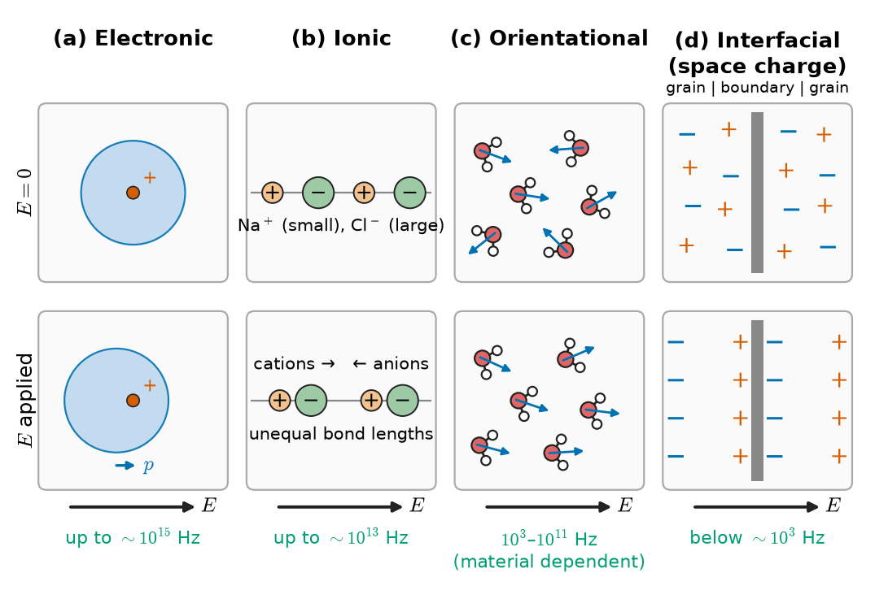
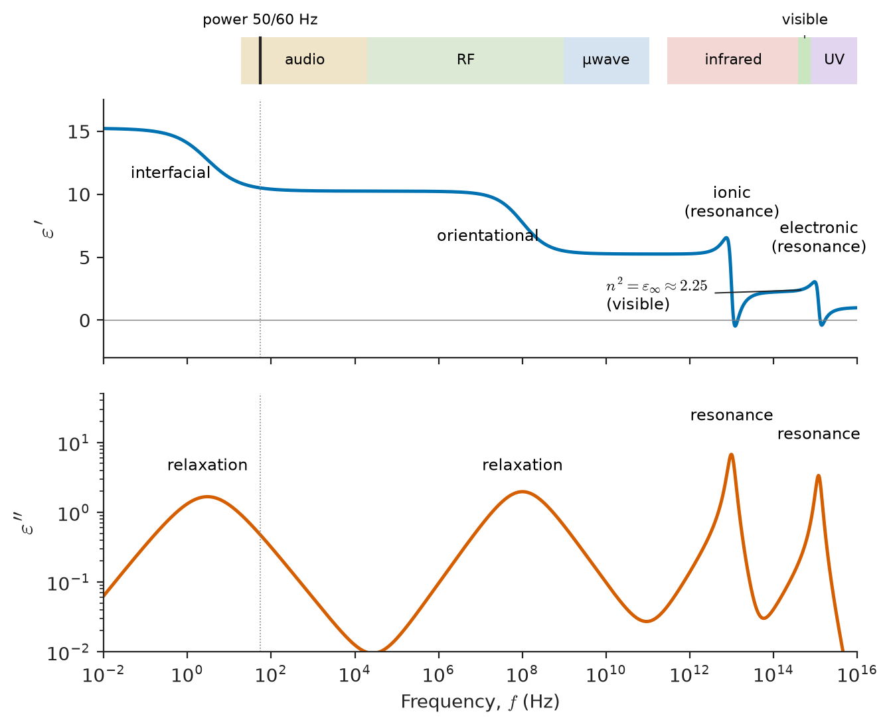
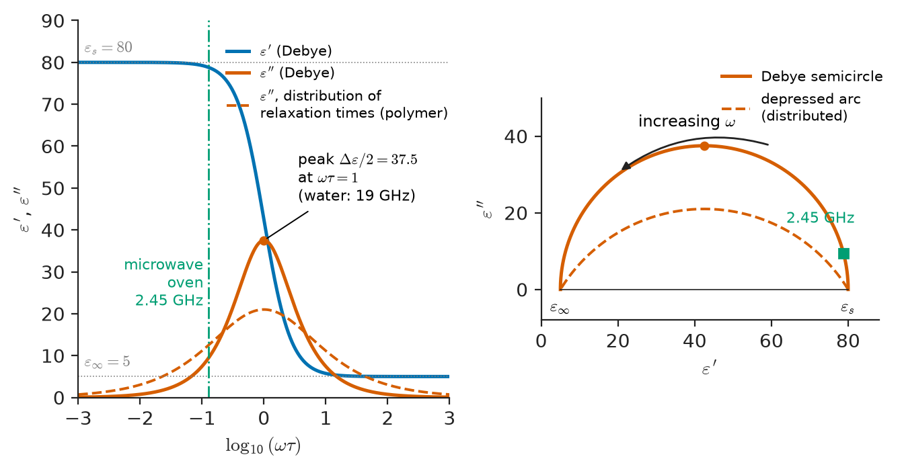
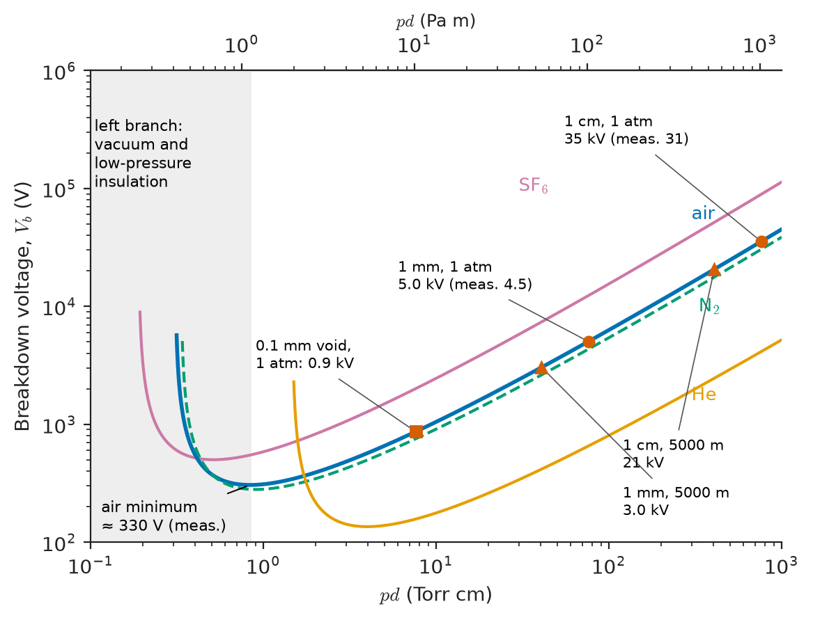
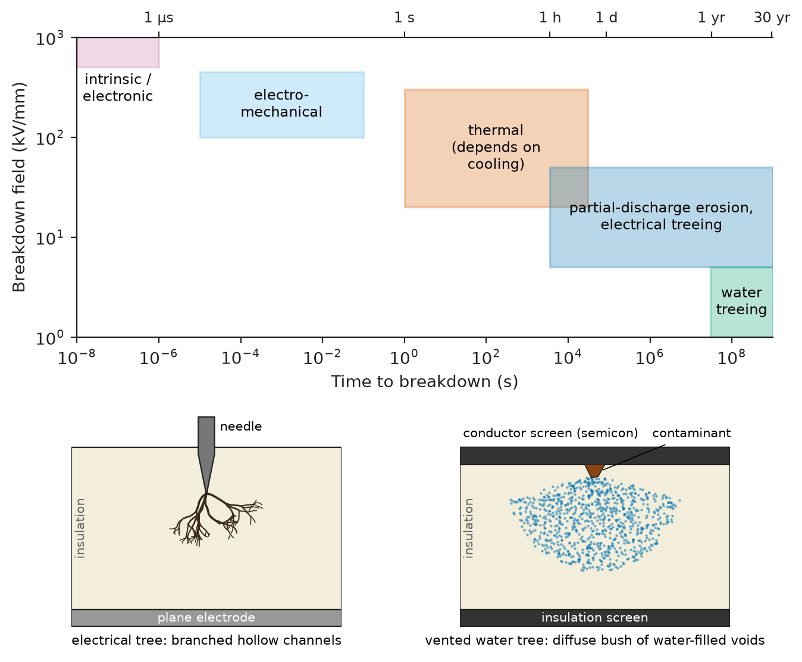
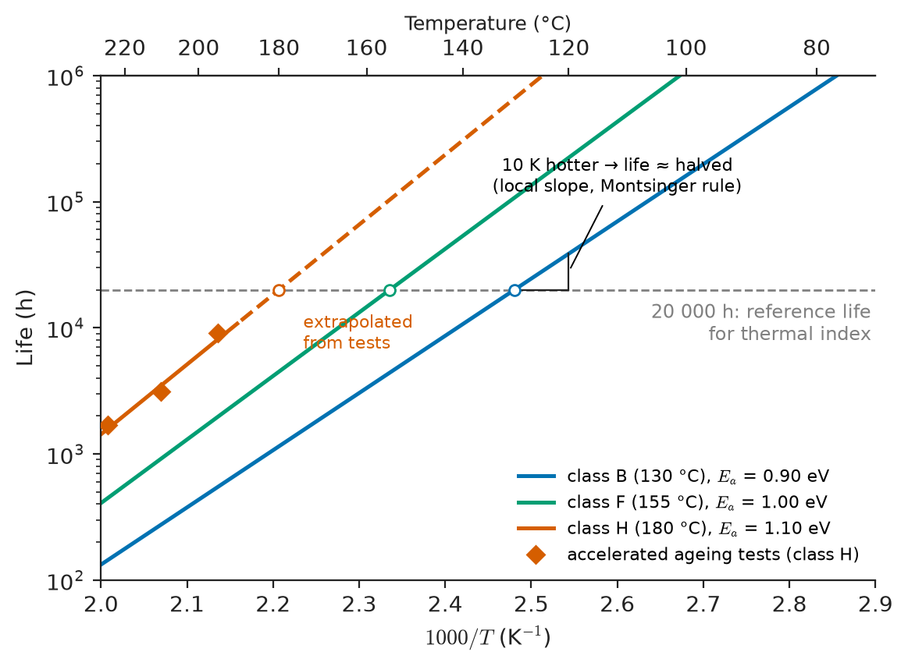

# Chapter 26 — Dielectric and Insulating Materials

*Part VI · Thermal, Electrical, Dielectric and Magnetic Materials*

A utility installs a medium-voltage underground cable with cross-linked polyethylene (XLPE) insulation. It passes its factory tests at more than twice its operating voltage. Eleven years later it fails, in wet ground, at its ordinary operating voltage. The failure analysis finds a pinhole through the insulation, and around it a dense bush of microscopic water-filled channels, "water trees", that grew from a small contaminant particle at the conductor screen. Nothing about the material's datasheet strength of tens of kilovolts per millimetre predicted this. The insulation did not fail because the field was too high for polyethylene. It failed because water, a defect and an alternating field acted together for a decade, changing the material until the local field was too high for what it had become.

This chapter is about insulators: what makes them store field energy, why they waste some of it as heat, what determines the voltage they can hold, and how they age. An EEE engineer meets these questions in every capacitor, cable, PCB, transformer, motor winding, connector housing and chip.

> **Why does a capacitor's dielectric heat up, and why does the heating depend on frequency?**
> **Why does a thin film of an insulator hold a much higher field than a thick slab of the same material?**
> **What turns a sound insulation into a failed one after years in service?**

| Concept | Engineering destination |
|---|---|
| Permittivity, polarization mechanisms | Capacitance, cable and PCB-line impedance, signal speed |
| Loss tangent, complex permittivity | Capacitor heating, RF and high-speed PCB loss, cable loss |
| Frequency and temperature dependence | Laminate choice for GHz boards, capacitor stability |
| Dielectric strength, Weibull statistics | Insulation thickness, voltage ratings, test margins |
| Breakdown mechanisms (gas, liquid, solid, thermal) | Clearances, oil and gas insulation, altitude derating |
| Volume and surface resistivity | Leakage, insulation-resistance testing, high-impedance circuits |
| Tracking, partial discharge | Creepage distances, CTI, PD testing of cables and machines |
| Moisture and contamination | PCB cleanliness, conformal coating, transformer drying |
| Insulation classes and aging | Thermal class of motors and transformers, design life |

**Roadmap.** Polarization and permittivity (26.1) → loss (26.2) → frequency and temperature dependence (26.3) → dielectric strength (26.4) → breakdown mechanisms (26.5) → resistivity of insulators (26.6) → surface and void discharges: tracking and partial discharge (26.7) → moisture and contamination (26.8) → polymer, ceramic and composite insulators (26.9) → aging (26.10).

---

## 26.1 Permittivity and dielectric polarization

### What a dielectric does to a capacitor

Put a slab of insulator between the plates of a capacitor held at fixed voltage, and the charge on the plates rises by a factor $\varepsilon_r$, the **relative permittivity** (dielectric constant). The capacitance of a parallel-plate capacitor of area $A$ and gap $d$ becomes

$$
C=\frac{\varepsilon_0\varepsilon_rA}{d},\qquad \varepsilon_0=8.854\times10^{-12}\ \mathrm{F/m}
$$

The extra charge is held by the material. The field displaces the bound charges in every atom or molecule slightly, creating dipoles, and the dipole moment per unit volume is the **polarization** $\mathbf P$ (unit $\mathrm{C/m^2}$). At the surfaces of the slab the ends of these dipoles leave a bound surface charge that partly cancels the field of the plate charges, so more free charge is needed to reach the same voltage. In terms of fields,

$$
\mathbf D=\varepsilon_0\mathbf E+\mathbf P=\varepsilon_0\varepsilon_r\mathbf E,\qquad \mathbf P=\varepsilon_0(\varepsilon_r-1)\mathbf E=\varepsilon_0\chi_e\mathbf E
$$

where $\chi_e$ is the electric susceptibility. The relative permittivity measures how easily the material's charges are displaced. In an anisotropic crystal it is a tensor; in amorphous polymers, glasses and fine-grained ceramics it is a scalar.

> **Status of the principle: linear dielectric response $\mathbf P=\varepsilon_0\chi_e\mathbf E$**
> *Approximate.* It is the first term of the response for fields small compared with internal atomic fields (about $10^{11}\ \mathrm{V/m}$). It holds for ordinary insulators up to breakdown. It fails for ferroelectrics, whose polarization depends on field history (Chapter 27).

### The four polarization mechanisms

The bound charge can be displaced in four ways, at four very different length and time scales (Figure 26.1).

<!-- FIGURE 26.1 | figures/ch26/fig-26-1-polarization-mechanisms.png | schematic | The four polarization mechanisms, each shown without field and with field applied. | Content: four panels in a row, each with "E = 0" (top) and "E applied" (bottom, field arrow to the right). (a) Electronic: atom with nucleus and spherical electron cloud; cloud shifted left of nucleus under field. (b) Ionic: row of alternating Na+ and Cl- ions; cations shifted right, anions left, bond lengths unequal. (c) Orientational: randomly oriented polar molecules (e.g. H2O drawn as bent with dipole arrows); partial alignment with field. (d) Interfacial (space charge): two-phase material or grain/grain-boundary structure with mobile charges accumulating at interfaces, + on one side, - on the other. Label each with typical upper frequency: electronic about 1e15 Hz, ionic about 1e13 Hz, orientational 1e3-1e11 Hz (material dependent), interfacial below about 1e3 Hz. -->

*Figure 26.1 — The four polarization mechanisms, each shown without field and with field applied.*

**Electronic polarization.** The electron cloud of every atom shifts relative to its nucleus. A crude model, a uniformly charged sphere of radius $R$ around a point nucleus, gives an induced dipole $p=\alpha_eE$ with polarizability $\alpha_e=4\pi\varepsilon_0R^3$. It is present in all materials, responds up to optical frequencies (about $10^{15}\ \mathrm{Hz}$), and is the whole story for non-polar materials such as polyethylene, PTFE and diamond.

**Ionic (atomic) polarization.** In an ionic or partly ionic solid, the field pushes cations and anions in opposite directions, stretching the bonds. Ions are heavy, so this mechanism responds only up to infrared frequencies ($10^{12}$–$10^{13}\ \mathrm{Hz}$). It dominates the permittivity of oxide ceramics (alumina, $\varepsilon_r\approx9.8$) and becomes enormous in some perovskites (Chapter 27).

**Orientational (dipolar) polarization.** Molecules or groups with a permanent dipole moment $p_0$ (water, C–Cl in PVC, C=O in polyesters) rotate partly into line with the field against thermal agitation. For weak fields the average aligned moment is $p_0^2E/(3k_BT)$, so the orientational polarizability is

$$
\alpha_{\rm or}=\frac{p_0^2}{3k_BT}
$$

It falls with temperature, and since rotating a molecule in a liquid or solid is slow and frictional, it responds at frequencies from millihertz to about $10^{11}\ \mathrm{Hz}$, depending on how free the dipoles are.

**Interfacial (space-charge, Maxwell–Wagner) polarization.** In a heterogeneous material, such as a composite, a polycrystal with conducting grains and insulating boundaries, or a material with mobile ions, charges drift until they pile up at internal interfaces. The resulting dipoles are as large as the grains or layers, so the apparent permittivity can be huge, but the mechanism is slow (typically below a kilohertz) and always lossy.

### From atoms to permittivity: the local field

Each dipole feels not the average field $E$ but a **local field** that includes the field of all the other dipoles. For a site of cubic symmetry, Lorentz showed that

$$
E_{\rm loc}=E+\frac{P}{3\varepsilon_0}
$$

With $N$ polarizable units per volume, $P=N\alpha E_{\rm loc}=N\alpha\left(E+P/3\varepsilon_0\right)$. Solving for $P$ and using $P=\varepsilon_0(\varepsilon_r-1)E$:

$$
\frac{\varepsilon_r-1}{\varepsilon_r+2}=\frac{N\alpha}{3\varepsilon_0}
$$

This is the **Clausius–Mossotti relation**. It connects a macroscopic property ($\varepsilon_r$) to an atomic one ($\alpha$) and a structural one ($N$, the density of polarizable units). It also predicts that as $N\alpha/3\varepsilon_0$ approaches 1, $\varepsilon_r$ diverges. The local field feeds back on itself. That "polarization catastrophe" is the seed of ferroelectricity (Chapter 27).

> **Status of the principle: Clausius–Mossotti relation**
> *Approximate.* It assumes the Lorentz local field, exact only for sites of cubic symmetry with point dipoles. It works well for gases, non-polar liquids and cubic ionic crystals. It fails for polar liquids such as water, where neighbouring dipoles are strongly correlated (Onsager and Kirkwood corrections are needed).

The relation explains why density changes permittivity. Polyethylene's $\varepsilon_r$ rises from 2.28 to 2.36 between low-density and high-density grades because $N$ rises. It also explains a small negative temperature coefficient of $\varepsilon_r$ in non-polar materials, which expand on heating.

### Reading the mechanisms from optical data

At optical frequencies only electronic polarization can follow the field, and Maxwell's equations give $\varepsilon_r=n^2$, where $n$ is the refractive index. Comparing $n^2$ with the low-frequency permittivity therefore shows how much of a material's polarization is electronic.

**Worked example — which mechanism dominates?**

| Material | $n$ (visible) | $n^2$ | $\varepsilon_r$ (1 kHz–1 MHz) | Interpretation |
|---|---|---|---|---|
| Polyethylene | 1.51 | 2.28 | 2.3 | Entirely electronic: non-polar |
| PTFE | 1.35 | 1.82 | 2.1 | Mainly electronic; small atomic contribution from C–F bonds |
| PVC | 1.54 | 2.37 | 3–4 | Extra comes from rotating C–Cl dipoles |
| Alumina | 1.76 | 3.10 | 9.8 | Two thirds of the permittivity is ionic |
| Water | 1.333 | 1.78 | 80 | Almost all orientational |

Polyethylene and PTFE are the two lowest-permittivity solid insulators because they have only electronic polarization, and they keep that permittivity unchanged up to tens of gigahertz. That is why they are used in coaxial cables and microwave substrates. Water's $\varepsilon_r$ of 80, by contrast, is a property of its rotating dipoles. That is why a trace of water changes an insulator's behaviour so much (Section 26.8).

### Representative permittivities

| Material | $\varepsilon_r$ (typical, 1 kHz–1 MHz, 20 °C) | Dominant mechanism |
|---|---|---|
| Vacuum; air (1 atm) | 1; 1.0006 | — |
| SF$_6$ gas (1 atm) | 1.002 | Electronic |
| PTFE | 2.1 | Electronic |
| Polypropylene; polyethylene, XLPE | 2.2; 2.3 | Electronic |
| Mineral transformer oil | 2.2 | Electronic |
| Polystyrene | 2.55 | Electronic |
| Silicone rubber (filled) | 3–4 | Electronic + some dipolar |
| Polyimide (Kapton) | 3.4 | Electronic + dipolar |
| Epoxy (unfilled) | 3.5–4.5 | Electronic + dipolar |
| Thermal SiO$_2$; fused silica | 3.9; 3.8 | Electronic + ionic |
| FR-4 laminate | 4.3–4.8 (lower at GHz) | Composite: glass + epoxy |
| Mica (muscovite) | 6–7 | Ionic |
| Electrical porcelain | 5–7 | Ionic + interfacial |
| Silicon nitride (film) | 7–7.5 | Ionic |
| Aluminium nitride | 8.6–8.9 | Ionic |
| Alumina (96–99.5 %) | 9.4–9.9 | Ionic |
| HfO$_2$ (film) | 20–25 | Ionic (soft modes) |
| Water (25 °C) | 78.4 | Orientational |
| TiO$_2$ (rutile) | 86 (perp. to c), 170 (along c) | Ionic (soft modes) |
| BaTiO$_3$ ceramics | 1000–10,000 | Ferroelectric (Chapter 27) |

---

## 26.2 Dielectric loss and loss tangent

### Why a capacitor heats

An ideal capacitor driven by a sinusoidal voltage draws a current leading the voltage by exactly 90°, and dissipates no power. A real dielectric draws a current that leads by slightly less than 90°. The missing angle $\delta$ is the **loss angle**. Two separate processes cause it:

- **Polarization lag.** The dipoles of Section 26.1 cannot follow the field instantaneously. Their response lags, and part of the work done on them is dissipated by friction with their surroundings.
- **Conduction.** A small real current flows through the insulator's finite resistivity (Section 26.6).

Both are described by a **complex relative permittivity**

$$
\varepsilon_r^*=\varepsilon'-j\varepsilon''
$$

The real part $\varepsilon'$ governs storage; the imaginary part $\varepsilon''$ (the **loss factor** or loss index) governs dissipation. The ratio is the **loss tangent** (dissipation factor):

$$
\tan\delta=\frac{\varepsilon''}{\varepsilon'}
$$

A d.c. conductivity $\sigma$ adds $\sigma/(\omega\varepsilon_0)$ to $\varepsilon''$, which dominates at low frequency. The quality factor of a capacitor dielectric is $Q=1/\tan\delta$.

### The power dissipated

For a sinusoidal field of r.m.s. amplitude $E$ and angular frequency $\omega$, the power dissipated per unit volume is

$$
p=\omega\varepsilon_0\varepsilon''E^2=\omega\varepsilon_0\varepsilon'\tan\delta\,E^2
$$

For a capacitor at r.m.s. voltage $V$:

$$
P=\omega CV^2\tan\delta
$$

The equivalent circuit is an ideal capacitor $C$ in parallel with a resistance $R_p=1/(\omega C\tan\delta)$. This resistance is not a fixed resistor: it changes with frequency because $\tan\delta$ does.

Three engineering consequences come straight from the formula:

1. Loss grows linearly with frequency for fixed $\tan\delta$. A dielectric that is negligible at 50 Hz can dominate at 1 GHz.
2. Loss grows with the square of the field. Insulation designed for higher stress needs a lower $\tan\delta$.
3. The product $\varepsilon'\tan\delta=\varepsilon''$ is what heats the material. In microwave heating that is the goal (water's $\varepsilon''$ at 2.45 GHz is about 10–12); in an insulator it is the enemy.

### Representative values

| Material | $\varepsilon'$ | $\tan\delta$ (typical) | Frequency |
|---|---|---|---|
| PTFE | 2.1 | $1$–$2\times10^{-4}$ | 1 MHz–10 GHz |
| Polyethylene, XLPE | 2.3 | $2$–$5\times10^{-4}$ | 50 Hz–1 GHz |
| Polypropylene (capacitor film) | 2.2 | $2\times10^{-4}$ | 1 kHz–1 MHz |
| Polystyrene | 2.55 | $1\times10^{-4}$ | 1 MHz |
| Polyimide | 3.4 | $2$–$8\times10^{-3}$ | 1 kHz–1 GHz |
| FR-4 | 4.2–4.5 | 0.015–0.02 | 1 GHz |
| Low-loss hydrocarbon or PTFE–ceramic laminates | 3.0–3.5 | 0.001–0.004 | 10 GHz |
| Fused silica | 3.8 | $1\times10^{-4}$ or lower | 1 MHz–10 GHz |
| Alumina 99.5 % | 9.8 | $1\times10^{-4}$ | 1 MHz–10 GHz |
| Mineral oil (new, 90 °C) | 2.2 | below $5\times10^{-3}$ | 50 Hz |
| Oil-impregnated paper | 3.5 | $2$–$3\times10^{-3}$ | 50 Hz |
| PVC (plasticized) | 4–6 | 0.05–0.1 | 50 Hz |
| Water (25 °C) | 77 | about 0.16 | 2.45 GHz |

**Worked example — loss and charging current in a medium-voltage cable.** An 11 kV three-phase cable has a phase-to-earth voltage $U_0=6.35\ \mathrm{kV}$. Each core has a conductor (with its semiconducting screen) of radius $r=6.0\ \mathrm{mm}$ and XLPE insulation out to $R=9.4\ \mathrm{mm}$, with $\varepsilon_r=2.3$ and $\tan\delta=5\times10^{-4}$ at 50 Hz.

The capacitance of a coaxial insulation per unit length is

$$
C'=\frac{2\pi\varepsilon_0\varepsilon_r}{\ln(R/r)}=\frac{2\pi(8.854\times10^{-12})(2.3)}{\ln(9.4/6.0)}=\frac{1.280\times10^{-10}}{0.449}=2.85\times10^{-10}\ \mathrm{F/m}
$$

or $0.285\ \mu\mathrm F/\mathrm{km}$. The charging current per kilometre per phase is

$$
I=\omega C'U_0=(314.2)(2.85\times10^{-7})(6350)=0.57\ \mathrm{A/km}
$$

and the dielectric loss per kilometre per phase

$$
P=\omega C'U_0^2\tan\delta=(314.2)(2.85\times10^{-7})(6350)^2(5\times10^{-4})=1.8\ \mathrm{W/km}
$$

The dielectric loss is tiny compared with the conductor's $I^2R$ loss (several kilowatts per kilometre at rated current). That is why XLPE, with its low loss tangent, displaced the oil-paper cables of the past ($\tan\delta$ about 10 times higher). At transmission voltages, where $U_0^2$ is 100 times larger, the dielectric loss becomes significant and the loss tangent becomes a design parameter. The charging current, not the loss, limits the length of long a.c. cables, which is one reason long submarine links use HVDC.

### Loss at high frequency: why board material matters

On a printed circuit board carrying a signal of frequency $f$, the dielectric attenuation of a transmission line is approximately

$$
\alpha_d\approx\frac{\pi\sqrt{\varepsilon_{\rm eff}}\tan\delta}{\lambda_0}\ \ \mathrm{Np/m}=27.3\,\frac{\sqrt{\varepsilon_{\rm eff}}\tan\delta}{\lambda_0}\ \ \mathrm{dB/m}
$$

where $\lambda_0$ is the free-space wavelength. At 10 GHz ($\lambda_0=30\ \mathrm{mm}$), a stripline in FR-4 ($\varepsilon_r=4.3$, $\tan\delta=0.02$) loses $27.3\times2.07\times0.02/0.03=37.7\ \mathrm{dB/m}$, or about 0.38 dB/cm. A PTFE–ceramic laminate ($\varepsilon_r=3.0$, $\tan\delta=0.0013$) loses about 2.0 dB/m, nearly twenty times less. Over a 30 cm backplane trace the difference is 11 dB against 0.6 dB, which decides whether a multi-gigabit link works. This is the materials reason for the large family of low-loss laminates in Chapter 51: the epoxy and glass of FR-4 contain polar groups and ions whose losses rise in the gigahertz range, and low-loss laminates replace them with non-polar resins (PTFE, hydrocarbons, polyphenylene ether) and low-loss fillers.

---

## 26.3 Frequency and temperature dependence

### The dielectric spectrum

Because each mechanism has its own response time, a plot of $\varepsilon'$ and $\varepsilon''$ against frequency shows a staircase of steps (Figure 26.2). At the lowest frequencies all mechanisms contribute. As frequency rises, first interfacial, then orientational, then ionic, then electronic polarization drops out, each producing a step down in $\varepsilon'$ and a peak in $\varepsilon''$. Every peak in loss accompanies a step in permittivity. The two are linked: the Kramers–Kronig relations, which follow from causality, require any frequency-dependent $\varepsilon'$ to come with loss somewhere in the spectrum.

<!-- FIGURE 26.2 | figures/ch26/fig-26-2-dielectric-spectrum.png | plot | Dielectric spectrum: real and imaginary permittivity of a polar, heterogeneous solid from millihertz to ultraviolet frequencies. | Content: x-axis log frequency 1e-2 to 1e16 Hz; upper panel epsilon' (0 to about 15, arbitrary but schematic) with four descending steps labelled interfacial (below 1e3 Hz), orientational (relaxation step centred about 1e6-1e9 Hz), ionic (resonance near 1e13 Hz with characteristic overshoot), electronic (resonance near 1e15 Hz, settling to 1 above). Lower panel epsilon'' with broad relaxation peaks at the first two steps and sharp resonance peaks at the last two. Mark the bands: power (50/60 Hz), audio, RF, microwave (1-100 GHz), infrared, visible, UV. Note n^2 = epsilon_infinity in the visible region. -->

*Figure 26.2 — Dielectric spectrum: real and imaginary permittivity of a polar, heterogeneous solid from millihertz to ultraviolet frequencies.*

The two kinds of feature have different shapes. Ionic and electronic polarization are **resonances**: bound charges on springs with natural frequencies in the infrared and ultraviolet, giving sharp peaks and an overshoot in $\varepsilon'$ just below the resonance. Orientational and interfacial polarization are **relaxations**: there is no restoring spring, only friction, and the response decays smoothly.

### The Debye relaxation

Suppose the orientational polarization relaxes toward its equilibrium value exponentially with a single time constant $\tau$. Solving for a sinusoidal field gives

$$
\varepsilon^*(\omega)=\varepsilon_\infty+\frac{\varepsilon_s-\varepsilon_\infty}{1+j\omega\tau}
$$

where $\varepsilon_s$ is the static (low-frequency) and $\varepsilon_\infty$ the high-frequency permittivity. Separating real and imaginary parts:

$$
\varepsilon'=\varepsilon_\infty+\frac{\Delta\varepsilon}{1+\omega^2\tau^2},\qquad
\varepsilon''=\frac{\Delta\varepsilon\,\omega\tau}{1+\omega^2\tau^2},\qquad \Delta\varepsilon=\varepsilon_s-\varepsilon_\infty
$$

The loss peaks at $\omega\tau=1$ with height $\Delta\varepsilon/2$, and the step in $\varepsilon'$ is centred at the same frequency. Plotting $\varepsilon''$ against $\varepsilon'$ (a **Cole–Cole plot**) gives a semicircle of radius $\Delta\varepsilon/2$ centred on the real axis (Figure 26.3).

<!-- FIGURE 26.3 | figures/ch26/fig-26-3-debye-cole-cole.png | plot | Debye relaxation: frequency response and the Cole–Cole representation. | Content: left panel: x-axis log(omega tau) from -3 to 3; epsilon' falling from epsilon_s to epsilon_infinity (use epsilon_s = 80, epsilon_infinity = 5, like water), epsilon'' peak 37.5 at omega tau = 1; second, broader dashed epsilon'' curve labelled "distribution of relaxation times (polymer)". Right panel: Cole–Cole plot epsilon'' vs epsilon', ideal Debye semicircle from 5 to 80, depressed arc for a distributed relaxation; arrow showing increasing frequency from right to left. Annotate water at 25 C: f_peak about 19 GHz, microwave oven at 2.45 GHz. -->

*Figure 26.3 — Debye relaxation: frequency response and the Cole–Cole representation.*

Water is close to a Debye relaxer, with $\tau\approx8.3\ \mathrm{ps}$ at 25 °C. Its loss peak is at $f=1/(2\pi\tau)\approx19\ \mathrm{GHz}$. A microwave oven at 2.45 GHz works on the low-frequency side of that peak, where $\varepsilon''$ is still large but the wave penetrates several centimetres. Polymers have broad distributions of relaxation times, and their arcs are flatter than a semicircle (the empirical Cole–Cole and Havriliak–Negami forms fit them).

> **Status of the principle: Debye relaxation**
> *Approximate.* It assumes non-interacting dipoles with a single relaxation time. It describes dilute polar liquids and some defect dipoles in crystals. Solids and polymers show broader, asymmetric loss peaks, fitted by empirical generalizations.

### Interfacial polarization in a layered insulator

Interfacial polarization can be derived from the same picture. Take two layers in series, thicknesses $d_1,d_2$, permittivities $\varepsilon_1,\varepsilon_2$ and conductivities $\sigma_1,\sigma_2$. At high frequency the field divides according to the permittivities (capacitive division). At low frequency, after charge has accumulated at the interface, it divides according to the conductivities (resistive division). The transition is a Debye relaxation with time constant

$$
\tau_{\rm MW}=\varepsilon_0\,\frac{\varepsilon_1d_2+\varepsilon_2d_1}{\sigma_1d_2+\sigma_2d_1}
$$

For good insulators $\tau_{\rm MW}$ can be seconds to hours. This is the origin of **dielectric absorption** in capacitors: a capacitor discharged briefly and then left open-circuit recovers part of its voltage as the interfacial charge redistributes. It matters in sample-and-hold circuits and integrators, and is why polypropylene and polystyrene (homogeneous, non-polar) are chosen there.

### Temperature dependence

Temperature enters in three ways.

**Relaxation times are thermally activated.** For dipoles that must hop over an energy barrier $E_a$,

$$
\tau=\tau_0\exp\left(\frac{E_a}{k_BT}\right)
$$

so heating shortens $\tau$ and shifts the loss peak to higher frequency. A loss peak sitting at 1 kHz at room temperature may sit at 50 Hz at a lower temperature, or at 1 MHz at a higher one. For polymers the strongest relaxation is tied to the glass transition (Chapter 20). Below $T_g$ the main-chain dipoles are frozen and only local side-group motions contribute. Near $T_g$ the main chain unfreezes, and both $\varepsilon'$ and $\tan\delta$ rise sharply. This is why a polar insulator's loss rises steeply as it approaches its softening temperature, and why thermal runaway (Section 26.5) is a real risk.

**Orientational polarizability falls as $1/T$** (Section 26.1), once the dipoles are free to rotate.

**Conduction rises exponentially** with temperature (Section 26.6), adding $\sigma/\omega\varepsilon_0$ to $\varepsilon''$. At power frequencies and high temperature, conduction often dominates the loss.

The net result is that non-polar insulators (PE, PP, PTFE, fused silica) have nearly flat $\varepsilon'(T)$ and very low loss over wide ranges, while polar ones (PVC, epoxy, polyamide, cellulose) change substantially. For capacitors, the temperature coefficient of capacitance, written $\mathrm{TCC}=(1/C)\,dC/dT$, is specified by class; Chapter 27 treats the ceramic capacitor classes, whose permittivity is engineered rather than incidental.

---

## 26.4 Dielectric strength

### Definition and what it hides

The **dielectric strength** is the field at which an insulator fails, usually stated as breakdown voltage divided by thickness:

$$
E_b=\frac{V_b}{d}\qquad(\mathrm{kV/mm}\ \text{or}\ \mathrm{MV/m};\ 1\ \mathrm{kV/mm}=1\ \mathrm{MV/m})
$$

Unlike permittivity, $E_b$ is not a single material property. The measured value depends on:

- **Thickness.** Thinner specimens test stronger. An empirical fit is $E_b\propto d^{-n}$ with $n$ typically 0.3–0.5 for solids.
- **Area or volume tested.** Larger specimens contain more weak spots and fail at lower fields (the weakest-link statistics below).
- **Time and waveform.** Short impulses (lightning, 1.2/50 $\mu$s) give higher values than 1 min a.c. tests, which give higher values than long-term service. Breakdown is a process with a duration, not an instantaneous event.
- **Electrode geometry and medium.** Edges and points enhance the field; a test in oil prevents flashover around the specimen, while in air the surrounding gas may break down first.
- **Temperature, humidity and frequency.**

Datasheet values are therefore test-method values (IEC 60243, ASTM D149) and are useful only for comparing materials under the same conditions. Design stresses in long-life equipment are a small fraction of them.

| Material | Typical short-term $E_b$ (kV/mm) | Conditions |
|---|---|---|
| Air, 1 atm | about 3 | Uniform field, gaps of about 1 cm |
| SF$_6$, 1 atm | about 8.9 | Uniform field |
| Mineral transformer oil | 10–25 | IEC 60156, 2.5 mm gap; strongly reduced by water and particles |
| Polyethylene, XLPE | 20–50 | 1–2 mm sheet, a.c. |
| PTFE | 20–60 | 1–2 mm sheet; higher in thin film |
| Biaxially oriented PP film | 400–700 | 5–15 $\mu$m film, d.c. (capacitor film) |
| Polyimide film | about 300 | 25 $\mu$m film, a.c. |
| Epoxy (cast) | 20–30 | 1–3 mm |
| FR-4 | 20–40 | Through thickness, in oil |
| Electrical porcelain | 15–25 | Several mm |
| Alumina 96–99.5 % | 10–35 | Thickness dependent; lower at high temperature |
| Mica (muscovite) | 50–200 | Thin sheet |
| Thermal SiO$_2$ | about 1000 | 5–100 nm gate oxides |

The thermal oxide value deserves a note. A 10 nm gate oxide holding 10 V experiences $10^{9}\ \mathrm{V/m}$, about 300 times the field that breaks down air. Thin, nearly defect-free amorphous films approach the intrinsic limit of the material (Section 26.5), while thick, practical insulation fails at defects long before.

### Weakest-link statistics

Breakdown starts at the worst flaw in the stressed volume: a void, a particle, a protrusion on an electrode. Repeated tests on nominally identical specimens give a spread of breakdown fields, usually well described by a two-parameter **Weibull distribution**:

$$
P_F(E)=1-\exp\left[-\left(\frac{E}{E_0}\right)^{\beta}\right]
$$

$E_0$ is the scale parameter (the field at which 63.2 % of specimens have failed), and $\beta$ the shape parameter: a large $\beta$ (20 or more) means a tight distribution of strengths; small $\beta$ (5–10) means scattered weak spots. If the failure probability per unit area is independent of position, a specimen $k$ times larger has the same probability of survival as $k$ independent small specimens all surviving, and its scale parameter falls as

$$
E_0(kA)=E_0(A)\,k^{-1/\beta}
$$

> **Status of the principle: Weibull statistics of breakdown**
> *Empirical.* The Weibull form follows from weakest-link reasoning if flaw strengths have a suitable extreme-value distribution; in practice it is fitted to test data (IEC 62539). The area-scaling law assumes flaws are randomly and independently distributed.

**Worked example — why a large capacitor is weaker than a test coupon.** A polymer film tested on 1 cm$^2$ electrodes shows $E_0=500\ \mathrm{kV/mm}$ with $\beta=10$. A wound capacitor of the same film has 100 cm$^2$ of active area. Its characteristic strength is

$$
E_0=500\times100^{-1/10}=500\times0.631=316\ \mathrm{kV/mm}
$$

37 % lower, purely from having more chances to contain a weak spot. A lower $\beta$ would make the reduction worse. This is why capacitor designers derate film strength heavily and why the self-healing metallized electrodes of Section 26.9 are so valuable: they turn a fatal weak spot into a small, isolated loss of area.

### Field enhancement and geometry

The field in real insulation is not uniform. In a coaxial cable it is highest at the conductor:

$$
E(r)=\frac{U_0}{r\ln(R/r_c)}
$$

where $r_c$ is the conductor radius and $R$ the outer radius of the insulation. For the cable of the worked example in Section 26.2, the field at the conductor screen is $6350/(0.006\times0.449)=2.36\ \mathrm{kV/mm}$ and at the outer screen $1.50\ \mathrm{kV/mm}$. That is a design stress of about 5 % of the short-term strength of XLPE, the margin needed for 40 years of service with defects, water and temperature cycling. Semiconducting screens are extruded onto both sides of the insulation to make the electrode surfaces smooth, because a protrusion of radius a few micrometres on a rough conductor could raise the local field by an order of magnitude. Such a protrusion was the origin of the water tree in the opening example.

---

## 26.5 Electrical breakdown mechanisms

Breakdown is the change from insulating to conducting, with a sudden collapse of voltage and a destructive current. The mechanisms differ in gases, liquids and solids, but they share one feature: a positive feedback that multiplies carriers or heat faster than they are removed.

### Gases: avalanche and Paschen's law

A free electron in a gas is accelerated by the field. If it gains enough energy between collisions, it ionizes a molecule, freeing a second electron. Both are accelerated and repeat the process. The number of ionizing collisions per unit length is the **first Townsend coefficient** $\alpha$, so an avalanche starting at the cathode grows as $e^{\alpha d}$ over a gap $d$. The positive ions produced drift back and release further electrons from the cathode, with yield $\gamma$ per ion (the **second Townsend coefficient**). The discharge becomes self-sustaining, i.e. breakdown occurs, when each initial electron leads on average to one replacement:

$$
\gamma\left(e^{\alpha d}-1\right)=1\quad\Longrightarrow\quad\alpha d=\ln\left(1+\frac1\gamma\right)
$$

The ionization coefficient depends on the energy gained per mean free path. The mean free path is inversely proportional to pressure $p$, so $\alpha/p$ depends only on $E/p$. A standard empirical form is

$$
\frac{\alpha}{p}=A\exp\left(-\frac{Bp}{E}\right)
$$

Substituting $E=V/d$ into the breakdown condition and solving for $V$:

$$
V_b=\frac{B\,pd}{\ln(A\,pd)-\ln\left[\ln\left(1+1/\gamma\right)\right]}
$$

This is **Paschen's law**: the breakdown voltage of a uniform gap depends on pressure and gap only through their product $pd$. For air, $A\approx15\ \mathrm{cm^{-1}\,Torr^{-1}}$ and $B\approx365\ \mathrm{V\,cm^{-1}\,Torr^{-1}}$ (1 Torr = 133.3 Pa), with $\gamma\approx0.01$, so $\ln[\ln(101)]=1.53$.

> **Status of the principle: Paschen's law**
> *Empirical.* The scaling with $pd$ follows from the Townsend mechanism, but the constants $A$, $B$, $\gamma$ are fitted, and the formula fails at very small gaps (below about 5 $\mu$m in air, where field emission from the electrodes takes over), at large $pd$ (above roughly 1000 Torr cm, where streamer breakdown governs), and in non-uniform fields.

**Worked example — the Paschen curve for air.** For a 1 mm gap at 1 atm, $pd=760\times0.1=76\ \mathrm{Torr\,cm}$:

$$
V_b=\frac{365\times76}{\ln(15\times76)-1.53}=\frac{27{,}740}{7.04-1.53}=5.0\ \mathrm{kV}
$$

For a 1 cm gap, $pd=760$: $V_b=277{,}400/(9.34-1.53)=35.5\ \mathrm{kV}$. Measured values are about 4.5 kV and 31 kV; the fitted constants are good to 10–15 %. The curve has a minimum: setting $dV_b/d(pd)=0$ gives

$$
(pd)_{\min}=\frac{e\,\ln(1+1/\gamma)}{A}=\frac{2.718\times4.62}{15}=0.84\ \mathrm{Torr\,cm},\qquad
V_{\min}=\frac{e\,B\,\ln(1+1/\gamma)}{A}=305\ \mathrm V
$$

(the measured minimum for air is about 330 V near 0.6–0.8 Torr cm). **No gap in air at any pressure breaks down below about 330 V**: on the left of the minimum there are too few molecules to ionize, on the right too many collisions to gain energy. Figure 26.4 shows the curve.

<!-- FIGURE 26.4 | figures/ch26/fig-26-4-paschen-curve.png | plot | Paschen curves: breakdown voltage of a uniform gap depends on the product of pressure and gap. | Content: log-log axes, x: pd from 0.1 to 1000 Torr cm (secondary axis in Pa m: 0.13 to 1300); y: breakdown voltage 100 V to 1 MV. Curves for air (minimum about 330 V at about 0.7 Torr cm), SF6 (higher, minimum about 500 V), N2, and He (lower). Mark points: 1 mm and 1 cm gaps at 1 atm (about 4.5 kV, 31 kV); same gaps at 5000 m altitude (shifted left, lower V); a 0.1 mm void in epoxy at 1 atm (about 0.9 kV). Shade the "left branch" region used in vacuum insulation. -->

*Figure 26.4 — Paschen curves: breakdown voltage of a uniform gap depends on the product of pressure and gap.*

Two engineering consequences follow:

- **Altitude.** At 5000 m the pressure is about 54 kPa (0.535 atm). For a 1 cm gap $pd=407\ \mathrm{Torr\,cm}$ and the calculated $V_b$ falls from 35.5 to 20.7 kV, a 42 % reduction. Insulation-coordination standards (IEC 60664-1) multiply clearances by altitude correction factors above 2000 m, and aircraft and space electronics need their own rules. In a partial vacuum a power supply may arc at a few hundred volts at the Paschen minimum.
- **Vacuum and high-pressure insulation.** Both sides of the minimum are used. Vacuum interrupters and X-ray tubes work far to the left; SF$_6$ switchgear works to the right at several bar, exploiting the electronegative gas's ability to capture electrons and its higher $B$. Because SF$_6$ is a very potent greenhouse gas, replacements (dry air, fluoronitrile mixtures) are now being introduced.

In non-uniform fields (points, edges, thin wires) the gas breaks down locally first, producing **corona**: a glow discharge near the sharp electrode that does not bridge the gap. Corona wastes power on transmission lines, generates ozone and radio noise, and erodes nearby polymer surfaces.

### Liquids

Very pure liquids can hold fields close to those of solids, but practical insulating liquids (mineral oil, synthetic and natural esters, silicone fluids) break down at much lower fields through their impurities:

- **Particles and fibres** (cellulose fibres in a transformer) polarize, align along the field, and form bridges between electrodes.
- **Water** dissolved in the oil is harmless up to its solubility limit, but free or emulsified water, especially on fibres, drastically lowers strength (Section 26.8).
- **Bubbles** of gas, formed by heating or by local discharges, have lower permittivity than the oil, so the field inside them is higher, and they then break down as gases.

Liquid insulation is therefore maintained, not just specified: transformer oil is filtered, dried and degassed, and tested periodically for breakdown voltage, water content and dissolved gases.

### Solids

Solids show several distinct mechanisms. In practice, which one governs depends on time scale, temperature and the quality of the material (Figure 26.5 summarizes them on a time axis).

**Intrinsic (electronic) breakdown.** In a perfect solid at low temperature, conduction electrons gain energy from the field and lose it to phonons. Above a critical field the gain exceeds the loss, and impact ionization multiplies the electrons as in a gas. This sets the ultimate strength, about 0.5–1 GV/m ($500$–$1000\ \mathrm{kV/mm}$) for polymers and oxides. It is approached only in thin, clean films over nanoseconds to seconds.

**Thermal breakdown.** Dielectric and conduction losses heat the insulation. Both $\tan\delta$ and conductivity increase with temperature (Sections 26.3 and 26.6), so heating raises the loss, which raises the temperature further. If heat cannot be removed fast enough, the temperature runs away.

A simple model shows when. Let a slab of thickness $d$, with a voltage $V$ across it, lose heat from its surface with a heat-transfer coefficient $h$ (W/(m$^2$ K)), and let its loss tangent increase as $\tan\delta=\tan\delta_0\exp(\beta\Delta T)$, where $\Delta T$ is the temperature rise. Per unit area, heat generated equals heat removed in steady state:

$$
\omega\varepsilon_0\varepsilon_r\tan\delta_0\,e^{\beta\Delta T}\,\frac{V^2}{d}=h\,\Delta T
$$

The left side grows exponentially with $\Delta T$, the right side linearly. A stable solution exists only if the two curves cross. They just touch, the critical condition, when both their values and their slopes are equal, which happens at $\beta\Delta T=1$. At that point $e\cdot\omega\varepsilon_0\varepsilon_r\tan\delta_0V^2/d=h/\beta$, giving the critical voltage

$$
V_c=\sqrt{\frac{h\,d}{e\,\beta\,\omega\varepsilon_0\varepsilon_r\tan\delta_0}}
$$

> **Status of the principle: thermal breakdown criterion**
> *Derived* from the heat balance, within an *approximate* model: uniform temperature through the slab, exponential temperature dependence of loss, and surface cooling with constant $h$. Thick insulation with internal temperature gradients needs a numerical solution, but the scaling with frequency, cooling and loss holds.

**Worked example — thermal breakdown at power and radio frequency.** A 1 mm polar insulator has $\varepsilon_r=4$, $\tan\delta_0=0.01$, $\beta=0.05\ \mathrm{K^{-1}}$ (loss doubles every 14 K), and $h=20\ \mathrm{W/(m^2\,K)}$ (still air). At 50 Hz:

$$
V_c=\sqrt{\frac{20\times10^{-3}}{2.718\times0.05\times314.2\times8.854\times10^{-12}\times4\times0.01}}=\sqrt{\frac{0.020}{1.512\times10^{-11}}}=3.6\times10^{4}\ \mathrm V
$$

about 36 kV, comparable with the short-term electrical strength, so thermal breakdown competes with other mechanisms at power frequency. At 1 MHz (with the same loss tangent, for comparison) $V_c$ falls by $\sqrt{20{,}000}=141$, to about 260 V. The runaway point is reached when the insulation is only $1/\beta=20\ \mathrm K$ above ambient. The model explains three engineering rules: polar, lossy insulators are unsuitable at radio frequency; thermal breakdown voltage grows only as $\sqrt d$ (thicker insulation gains little); and cooling matters as much as material strength. Thermal runaway is a real failure mode in high-voltage bushings, in capacitors in hot enclosures, and in polar insulation near its glass transition.

**Electromechanical breakdown.** The electrostatic pressure between electrodes, $\tfrac12\varepsilon_0\varepsilon_rE^2$, compresses a soft insulator. If the material's modulus is low (a polymer near its softening temperature), the thickness decreases, the field rises, and compression accelerates. Stark and Garton showed that instability occurs when the field reaches about $0.6\sqrt{Y/(\varepsilon_0\varepsilon_r)}$, where $Y$ is Young's modulus. It is significant for thermoplastics at elevated temperature and is exploited deliberately in dielectric elastomer actuators (Chapter 27).

**Discharge-induced and treeing breakdown.** In practice, most long-term failures of polymer insulation follow a slow route:

1. A local field enhancement (void, protrusion, contaminant) causes **partial discharges** (Section 26.7) or charge injection.
2. These erode the polymer and leave a hollow channel. Further discharges in the channel extend it, and it branches. The resulting structure, visible in transparent samples, is an **electrical tree**.
3. When a tree channel bridges most of the insulation, the remaining material breaks down.

In the presence of water and a.c. fields, a different, slower structure grows at lower fields: the **water tree**, a region of microscopic water-filled voids and channels formed by electro-oxidation and mechanical stress in the polymer. A water tree does not itself conduct, but it raises the local field and lowers the strength, and an electrical tree eventually starts from its tip. This is the opening failure. Modern "tree-retardant" XLPE uses additives and very clean compounds to suppress it.

<!-- FIGURE 26.5 | figures/ch26/fig-26-5-solid-breakdown-mechanisms.png | schematic | Breakdown mechanisms in solid insulation arranged by the time to failure, with sketches of electrical and water trees. | Content: upper panel: horizontal log time axis from 1e-8 s to 1e9 s (about 30 years); vertical axis breakdown field (log, 1 to 1000 kV/mm). Bands: intrinsic/electronic (about 500-1000 kV/mm, < 1e-6 s), electromechanical, thermal (seconds to hours, depends on cooling), partial discharge erosion and electrical treeing (hours to years, 5-50 kV/mm), water treeing (years, few kV/mm). Lower panel: two sketches in a slab between needle electrode and plane: an electrical tree (branched hollow channels, dark) and a vented water tree (diffuse bush of tiny voids, shaded) growing from a contaminant at the conductor screen. -->

*Figure 26.5 — Breakdown mechanisms in solid insulation arranged by the time to failure, with sketches of electrical and water trees.*

---

## 26.6 Volume and surface resistivity

### Two paths for leakage

An insulator leaks current by two paths: through its bulk and along its surface. Each has its own resistivity.

- **Volume resistivity** $\rho_v$ ($\Omega\,\mathrm m$; often quoted in $\Omega\,\mathrm{cm}$, 100 times larger numerically) is defined as for conductors: $\rho_v=R_vA/t$.
- **Surface resistivity** $\rho_s$ is the resistance of a square of surface between two parallel edge electrodes. A path of length $g$ and width $W$ has $R_s=\rho_s\,g/W$, so $\rho_s$ has units of ohms (written $\Omega/\square$, as for sheet resistance).

The two are measured together with a three-electrode arrangement (IEC 62631-3, ASTM D257): a guard ring diverts the surface current away from the measuring electrode when volume resistivity is measured, and the roles are swapped for surface resistivity. Volume resistivity is a material property; surface resistivity is mostly a property of the surface's condition: its moisture, contamination and history.

### How current flows in an insulator

An insulator has very few free carriers, and the ones it has move with difficulty. Several conduction mechanisms operate, with different signatures:

| Mechanism | Carriers | Characteristic dependence |
|---|---|---|
| Ionic conduction | Mobile ions (Na$^+$ in glass, impurity ions in polymers) | Arrhenius in $T$; ohmic; electrode polarization at low frequency |
| Hopping | Electrons between localized states | Arrhenius or $\exp[-(T_0/T)^{1/4}]$ |
| Schottky emission | Electrons over an electrode barrier | $\ln J\propto\sqrt E$; strongly $T$-dependent |
| Poole–Frenkel emission | Electrons released from traps in the bulk | $\ln(J/E)\propto\sqrt E$ |
| Space-charge-limited current | Injected carriers | $J\propto V^2/d^3$ at high field |
| Tunnelling (Fowler–Nordheim) | Electrons through a thin barrier | $J\propto E^2\exp(-b/E)$; nearly $T$-independent (thin gate oxides) |

At low field the bulk conduction of most insulators is ionic or hopping, and the resistivity follows an Arrhenius law:

$$
\rho_v(T)=\rho_\infty\exp\left(\frac{E_a}{k_BT}\right)
$$

with activation energies typically 0.5–1.5 eV. At high field the electrode-limited and trap-limited mechanisms take over, and the current rises faster than linearly. These mechanisms matter most for thin films and gate dielectrics (Chapter 34).

> **Status of the principle: Arrhenius dependence of insulator resistivity**
> *Empirical.* It reflects thermally activated ion hopping or carrier release from traps (the kinetics is treated in the Advanced Chemistry core). Over wide temperature ranges several mechanisms with different $E_a$ contribute and the plot of $\ln\rho$ against $1/T$ curves.

### Representative values

| Material | Volume resistivity at 20–25 °C ($\Omega\,\mathrm m$) |
|---|---|
| PTFE | $>10^{16}$ |
| Polyethylene, XLPE, PP | $10^{14}$–$10^{16}$ |
| Fused silica | $>10^{16}$ |
| Polyimide | about $10^{15}$ |
| Epoxy (cast) | $10^{12}$–$10^{15}$ |
| FR-4 (through thickness) | $10^{12}$–$10^{14}$ |
| Alumina (99 %) | $>10^{12}$ (falls to about $10^{8}$ at 500 °C) |
| Mica | $10^{11}$–$10^{15}$ |
| PVC (plasticized) | $10^{9}$–$10^{13}$ |
| Electrical porcelain | $10^{10}$–$10^{12}$ |
| Soda-lime glass | $10^{9}$–$10^{11}$ (mobile Na$^+$) |
| Mineral oil | $10^{10}$–$10^{13}$ |
| Ultrapure water | $1.8\times10^{5}$ |

**Worked example — leakage and its temperature dependence in the cable.** For the XLPE cable of Section 26.2, take $\rho_v=10^{14}\ \Omega\,\mathrm m$ at 20 °C. The insulation resistance of a length $\ell$ of coaxial insulation is

$$
R_{\rm ins}=\frac{\rho_v\ln(R/r)}{2\pi\ell}=\frac{10^{14}\times0.449}{2\pi\times1000}=7.1\times10^{9}\ \Omega
$$

for 1 km, i.e. 7.1 G$\Omega$ km. The leakage current at 6.35 kV is $6350/7.1\times10^{9}=0.9\ \mu\mathrm A$, six orders of magnitude below the capacitive charging current of 0.57 A. At a.c. the resistivity of XLPE hardly matters. Now heat the insulation to its rated 90 °C. With $E_a=1.0\ \mathrm{eV}$, the resistivity falls by

$$
\exp\left[\frac{E_a}{k_B}\left(\frac{1}{293.15}-\frac{1}{363.15}\right)\right]=\exp\left[11{,}605\times6.58\times10^{-4}\right]=\exp(7.63)\approx2.1\times10^{3}
$$

a factor of about 2000. Under d.c. this matters a great deal. In an HVDC cable the steady-state field divides according to resistivity, not permittivity (Section 26.9), so the temperature gradient across a loaded cable shifts the stress toward the cooler outer insulation.

### Absorption currents and the polarization index

When a d.c. voltage is applied to insulation, the current does not settle at once. A large capacitive charging spike is followed by an **absorption current** that decays over minutes to hours (slow orientational and interfacial polarization, Section 26.3), and only then by the steady leakage current. Insulation-resistance testers exploit this. The **polarization index** of a motor or generator winding, the ratio of the insulation resistance after 10 min to that after 1 min (IEEE 43), is about 2 or more for clean, dry insulation. Moisture and surface contamination add a large, steady conduction current that swamps the absorption, and the ratio falls toward 1. A measured ratio of insulation resistances is thus a quick indicator of the material's condition.

---

## 26.7 Tracking and partial discharge

Two processes degrade insulation without ever bridging it as a whole: tracking along surfaces and partial discharges inside voids and at edges. Both are slow, both are driven by local discharges, and both are the subject of their own tests and standards.

### Tracking: how a surface becomes a conductor

On a contaminated, damp surface (dust plus condensation on a PCB, salt fog on an outdoor insulator), a thin conducting electrolyte film forms. Leakage current flows through it and heats it. Where the current density is highest the film dries out, forming a **dry band** that interrupts the current. Almost the full voltage now appears across the narrow dry band, which breaks down in small arcs (scintillations). The arcs' heat decomposes the polymer surface underneath. If the polymer leaves carbon behind, the carbonized path conducts, and the process advances step by step until a conducting **track** bridges the electrodes.

Whether a material tracks depends on its chemistry. Polymers with aromatic rings or high char yield (phenolics, standard epoxies, polycarbonate) form carbon and track readily. Aliphatic polymers that decompose to volatile products (polyethylene, polyamide, melamine, PTFE, silicones) and filled compounds with alumina trihydrate (ATH), which releases water when heated and so cools the arc, resist tracking. Ceramics and glasses do not track at all, although they can suffer surface flashover.

The resistance to tracking is measured by the **comparative tracking index** (CTI, IEC 60112): the highest voltage at which a specimen withstands 50 drops of an ammonium-chloride solution falling between two electrodes 4 mm apart without tracking. The insulation coordination standard groups materials by CTI:

| Material group (IEC 60664-1) | CTI range (V) | Typical materials |
|---|---|---|
| I | 600 and above | PTFE, silicone rubber, melamine, PA66, high-CTI FR-4, ceramics |
| II | 400 to below 600 | Some PBT and PA grades |
| IIIa | 175 to below 400 | Standard FR-4, polycarbonate, many epoxies |
| IIIb | 100 to below 175 | Phenolic paper laminates |

The **creepage distance**, the shortest path along a surface between conductors, required by IEC 60664-1 and product standards (IEC 62368-1 and others) depends on the working voltage, the pollution degree of the environment, and the material group. For the same voltage and pollution degree, a group IIIb material may need roughly twice the creepage of group I. That is a direct materials-to-layout link: choosing a high-CTI laminate or housing material shrinks a power supply's layout. Slots milled in a PCB between high-voltage nodes, conformal coatings and potting all work by lengthening or protecting the surface path.

### Partial discharge: breakdown inside the insulation

A **partial discharge** (PD) is a breakdown that bridges only part of the insulation: a gas-filled void inside a cast resin or a cable, a delamination in a winding, the gap at a sharp electrode edge, the wedge of air between a wire and a board. Two effects make voids dangerous.

**The field in a void is higher than in the solid.** In a flat, disc-shaped void with its faces perpendicular to the field, the normal component of $\mathbf D$ is continuous across the faces, so

$$
E_{\rm void}=\varepsilon_r\,E_{\rm solid}
$$

For a spherical void the enhancement is smaller, $E_{\rm void}=3\varepsilon_r E/(2\varepsilon_r+1)$, which is $1.33E$ for $\varepsilon_r=4$.

**The gas in the void is weaker than the solid.** It breaks down according to Paschen's law at a voltage set by the void depth and gas pressure.

**Worked example — PD inception in a void.** An epoxy insulation ($\varepsilon_r=4$) contains a flat air-filled void 0.1 mm deep at atmospheric pressure, normal to the field. From Paschen's law with $pd=760\times0.01=7.6\ \mathrm{Torr\,cm}$:

$$
V_b=\frac{365\times7.6}{\ln(15\times7.6)-1.53}=\frac{2774}{4.74-1.53}=0.865\ \mathrm{kV}
$$

The void breaks down when the field inside it reaches $0.865\ \mathrm{kV}/0.1\ \mathrm{mm}=8.65\ \mathrm{kV/mm}$, i.e. when the field in the epoxy reaches $8.65/4=2.2\ \mathrm{kV/mm}$. The epoxy itself has a short-term strength of 20–30 kV/mm. A design stress of 3 kV/mm, comfortable for the solid, would make this void discharge every half-cycle.

Each discharge collapses the void voltage, then the applied a.c. voltage builds it back up, and the void discharges again: several times per cycle, $10^{8}$–$10^{9}$ times per year. Each discharge transfers a small charge (detectable at the terminals as an **apparent charge** of picocoulombs to nanocoulombs, measured to IEC 60270), and bombards the void walls with electrons, ions, UV and ozone. The walls erode, an electrical tree starts, and the insulation fails long before the bulk field alone would have caused trouble. Figure 26.5 places this mechanism on the time axis.

That is why insulation systems are specified to be "PD-free" at a voltage above the operating voltage, why cable and resin casting processes are designed to exclude voids (vacuum casting, degassing, pressure impregnation), and why PD measurement is a standard acceptance and condition-monitoring test for cables, transformers, machines and power modules. The rise of fast-switching SiC and GaN inverters has made PD in motor windings a new problem: fast voltage edges with overshoots of up to twice the d.c. link voltage stress turn-to-turn enamel insulation above its PD inception voltage. Corona-resistant enamels, filled with nano-silica or alumina that resists erosion, are the materials response.

---

## 26.8 Moisture and contamination effects

### Why water is the insulator's main enemy

Water combines three properties that are all damaging to insulation:

- **High permittivity.** Its $\varepsilon_r$ of 80 raises the permittivity of any material that absorbs it, and its orientational relaxation adds loss.
- **Ionic conduction.** Water dissolves ionic impurities and makes them mobile, raising conductivity by orders of magnitude, especially on surfaces.
- **Chemical attack.** It hydrolyzes polyesters, polyamides, cellulose and some epoxies, and drives electrochemical migration of metals (the electrochemistry belongs to the Advanced Chemistry core).

The bulk permittivity rises only modestly. For an epoxy ($\varepsilon_r=4$) absorbing 1 % water by volume, the logarithmic mixing rule (Section 26.9) gives

$$
\ln\varepsilon=0.99\ln4+0.01\ln80=1.416\quad\Rightarrow\quad\varepsilon=4.12
$$

a 3 % rise. But the loss tangent can double, the volume resistivity can fall by one or two orders of magnitude, and the surface resistivity by many more. A humid film only a few molecular layers thick on a surface with ionic residues is enough to drop surface resistivity from above $10^{14}\ \Omega$ to below $10^{9}\ \Omega$.

### Water uptake by insulating materials

| Material | Typical water absorption | Consequence |
|---|---|---|
| PTFE, PE, PP | Below 0.01 % | Electrical properties nearly insensitive to humidity |
| Polystyrene | 0.05 % | Stable, used in precision capacitors |
| FR-4 | 0.1–0.2 % (24 h immersion) | Small shift in $\varepsilon_r$ and $\tan\delta$; CAF risk |
| Epoxy (cast) | 0.1–0.5 % (24 h) | Higher at elevated temperature |
| Polyimide | 1–3 % (at equilibrium, humid) | Measurable $\varepsilon_r$ and $\tan\delta$ change; bake before high-temperature soldering |
| PA66 (nylon) | 2.5 % at 50 % RH; up to about 8 % saturated | Large shifts; dimensional change |
| Cellulose (paper, pressboard) | Several per cent | Dried below 0.5 % in transformers |
| Alumina, glass | Negligible in bulk; surface films only | Surface leakage in humidity |

### Moisture in liquid–solid insulation systems

In a power transformer, almost all the water is in the cellulose paper and pressboard, not in the oil. Water partitions between them according to temperature: as the transformer heats, water moves from paper into oil; as it cools, back again. The oil's breakdown voltage depends on its water content relative to saturation, not on the absolute amount, and drops steeply once relative saturation exceeds roughly 20–30 %. A sudden cooling of a wet, hot transformer can push the oil past saturation and form free water droplets. Water also accelerates the chemical aging of cellulose (Section 26.10). New transformers are therefore dried to below about 0.5 % water in the cellulose, and online moisture monitoring is common.

### Contamination on printed circuit assemblies

On a PCB, the combination of humidity, ionic residues (flux activators, handling salts, plating chemicals) and a bias voltage leads to two failure processes:

- **Electrochemical migration.** Metal ions dissolve at the anode, migrate through a surface water film, and plate out at the cathode as dendrites that grow back across the gap until they short it. Silver, copper and tin all migrate; silver is the worst.
- **Conductive anodic filament (CAF).** Copper migrates along the interface between glass fibres and resin inside the laminate, especially where drilling has damaged it, eventually shorting adjacent vias.

The materials responses are cleaner processes ("no-clean" fluxes whose residues are non-ionic, or washing), CAF-resistant laminates with better glass–resin coupling, surface insulation resistance (SIR) qualification testing at elevated temperature and humidity under bias, and conformal coatings (acrylic, silicone, polyurethane, parylene) that keep water films from forming continuous paths. A coating slows water absorption but does not stop it, since all polymers are permeable to water vapour to some degree. The long-term processes of moisture ingress and corrosion in packages are treated in Chapter 44.

---

## 26.9 Polymer, ceramic, and composite insulators

### Polymers

Polymers are the dominant insulating materials by volume: cable insulation, wire enamel, film capacitors, PCB resins, encapsulants, connector housings. They are cheap, easily formed, and many have very low loss. Their weaknesses are a limited temperature range (Chapter 20), creep, flammability, water absorption for polar types, and susceptibility to discharge erosion and tracking.

| Polymer | $\varepsilon_r$ | $\tan\delta$ | Max. continuous temperature (°C, typical) | Characteristic uses |
|---|---|---|---|---|
| PE (LDPE, HDPE) | 2.3 | $2\times10^{-4}$ | 70–80 | Coax dielectric, telecom cable |
| XLPE | 2.3 | $2$–$5\times10^{-4}$ | 90 (250 short-circuit) | MV/HV power cable |
| PP (biaxially oriented) | 2.2 | $2\times10^{-4}$ | 85–105 | Film capacitors (power electronics) |
| PTFE | 2.1 | $1$–$2\times10^{-4}$ | 260 | RF cables, microwave laminates, high-temperature wire |
| PET (polyester film) | 3.2 | $5\times10^{-3}$ | 105–125 | General-purpose film capacitors, motor slot liners |
| Polyimide | 3.4 | $2$–$8\times10^{-3}$ | 200–240 | Flex circuits, wire wrap, high-temperature insulation |
| Epoxy (filled, cast) | 3.5–5 | $5\times10^{-3}$–$0.02$ | 130–180 (depends on $T_g$) | Cast transformers, encapsulation, PCB resin |
| Silicone rubber | 3–4 | $10^{-3}$–$5\times10^{-3}$ | 180–200 | Outdoor insulator housings, cable accessories, potting |
| PVC | 3–6 | 0.01–0.1 | 70–90 | Low-voltage building wire |
| PEEK, PPS | 3.0–3.3 | $3\times10^{-3}$ | 200–240 | High-temperature connectors, coil formers |

The non-polar polymers (PE, PP, PTFE) are the high-performance dielectrics: lowest loss, highest intrinsic strength, lowest water uptake. Polarity buys adhesion, temperature resistance and flame retardancy at the price of loss.

### Ceramics and glasses

Ceramics offer what polymers cannot: high temperature capability, no creep, resistance to discharges and tracking, high thermal conductivity in some cases, and dimensional stability. Their weaknesses are brittleness, thermal-shock sensitivity (Chapter 24), and processing cost.

| Ceramic | $\varepsilon_r$ | $\tan\delta$ (1 MHz) | Thermal conductivity (W/(m K)) | Characteristic uses |
|---|---|---|---|---|
| Electrical porcelain (quartz/alumina–feldspar–clay) | 5–7 | 0.01–0.02 | 1.5–4 | Line and station insulators, bushings |
| Steatite (MgO–SiO$_2$) | 6 | $10^{-3}$ | 2–3 | Low-loss insulating parts, RF stand-offs |
| Alumina 96 % | 9.4 | $3\times10^{-4}$ | 20–25 | Substrates, spark-plug insulators, vacuum feedthroughs |
| Alumina 99.5 % | 9.8 | $1\times10^{-4}$ | 30–35 | Microwave substrates, high-voltage parts |
| Aluminium nitride | 8.6–8.9 | $3\times10^{-4}$–$10^{-3}$ | 170–230 | Power-module substrates |
| Beryllium oxide | 6.7 | $4\times10^{-4}$ | about 250 | RF power packages (toxic dust; declining use) |
| Fused silica | 3.8 | $1\times10^{-4}$ | 1.4 | Low-loss RF windows, optical fibre |
| Glass (borosilicate) | 4.6 | $4\times10^{-3}$ | 1.1 | Hermetic seals, bushings |
| Mica (muscovite, phlogopite) | 6–7 | $2\times10^{-4}$ | 0.5 (across sheets) | Machine insulation (as mica paper), heaters, capacitors |

### Composites: getting both

Most practical insulation is a composite, designed to combine a polymer's processability with a ceramic or fibre's strength, discharge resistance or thermal conductivity.

- **Oil–paper** (transformers, older cables, bushings): cellulose paper gives mechanical structure; oil fills the pores, excludes air (and therefore PD), and carries heat away.
- **Epoxy–mica** (rotating-machine groundwall insulation): mica flakes, which do not erode under discharges, bound in epoxy and vacuum–pressure impregnated. Mica is the only practical material for machine windings at 6–25 kV because PD in such windings cannot be fully avoided.
- **Glass-fibre–epoxy** (FR-4 laminates, rods of composite outdoor insulators, slot wedges): fibres give stiffness and strength; the resin bonds and insulates.
- **Silicone housings over glass-fibre rods** (composite or "polymeric" line insulators): light, unbreakable, and with a water-repellent silicone surface that resists pollution flashover. Low-molecular-weight silicone migrates to the surface and keeps it hydrophobic even when polluted.
- **Filled polymers**: silica or alumina in epoxy for lower expansion and higher thermal conductivity (Chapter 51); ATH in silicone for tracking resistance; nano-fillers for PD and treeing resistance (nanodielectrics, Chapter 38).

### Mixing rules for composite permittivity

The effective permittivity of a two-phase composite depends on how the phases are arranged:

- **Layers parallel to the field** (capacitors side by side): $\varepsilon_{\rm eff}=\phi_1\varepsilon_1+\phi_2\varepsilon_2$, the upper bound.
- **Layers in series with the field**: $1/\varepsilon_{\rm eff}=\phi_1/\varepsilon_1+\phi_2/\varepsilon_2$, the lower bound.
- **Dilute spheres of $\varepsilon_i$ in a matrix $\varepsilon_m$** (Maxwell Garnett):

$$
\frac{\varepsilon_{\rm eff}-\varepsilon_m}{\varepsilon_{\rm eff}+2\varepsilon_m}=\phi\,\frac{\varepsilon_i-\varepsilon_m}{\varepsilon_i+2\varepsilon_m}
$$

- **Random mixtures**, often fitted by the logarithmic (Lichtenecker) rule: $\ln\varepsilon_{\rm eff}=\phi_1\ln\varepsilon_1+\phi_2\ln\varepsilon_2$.

> **Status of the principle: dielectric mixing rules**
> *Approximate.* The parallel and series forms are exact bounds for any arrangement. Maxwell Garnett is derived for dilute, non-interacting spheres. The Lichtenecker rule is empirical. None captures interfacial polarization, which can dominate at low frequency when one phase conducts.

The bounds explain why a high-permittivity filler raises a polymer's permittivity so little at moderate loadings. Isolated particles in a low-permittivity matrix are effectively in series with matrix layers, and the field concentrates in the low-permittivity phase.

### Field division in layered insulation

The same series reasoning governs every insulation made of layers: oil and paper, a cable's insulation with a void, an encapsulant over a substrate. For two layers in series, continuity of $D$ under a.c. gives

$$
\varepsilon_1E_1=\varepsilon_2E_2\quad\Rightarrow\quad\frac{E_1}{E_2}=\frac{\varepsilon_2}{\varepsilon_1}\qquad(\text{a.c.})
$$

The **lower-permittivity layer carries the higher field**. In oil–paper insulation the oil ($\varepsilon_r=2.2$) is stressed $3.5/2.2=1.6$ times more than the paper ($\varepsilon_r=3.5$), and the oil is the weaker material. That is why transformer design uses thin oil ducts, divided by pressboard barriers, rather than wide open oil gaps: a thin oil gap has a higher breakdown strength.

Under d.c., after the interfacial charging of Section 26.3, continuity of current gives

$$
\sigma_1E_1=\sigma_2E_2\quad\Rightarrow\quad\frac{E_1}{E_2}=\frac{\sigma_2}{\sigma_1}\qquad(\text{d.c., steady state})
$$

and the **lower-conductivity layer carries the higher field**. Because conductivities vary by orders of magnitude with temperature, moisture and field (Section 26.6), d.c. stress distributions are much harder to control than a.c. ones, and they change when the voltage polarity reverses. HVDC cable insulation is therefore a specially formulated material, with additives that make its conductivity less sensitive to temperature and that suppress space-charge accumulation.

### Self-healing capacitor films

A film capacitor with metallized electrodes (aluminium or zinc only 20–50 nm thick on polypropylene) survives the breakdown of a weak spot. The arc at the fault vaporizes the thin electrode around it within microseconds, isolating the spot, and the capacitor loses a tiny area of capacitance instead of failing. This is a materials solution to the Weibull problem of Section 26.4. It works only because the electrode is thin enough to evaporate and the polymer decomposes to gaseous, not carbonaceous, products.

---

## 26.10 Insulation aging and degradation

Insulation rarely fails because its short-term strength is exceeded. It fails because the material changes over years until its strength falls to the service stress. The engineer's tools for designing against aging are life laws, fitted to accelerated tests, and thermal classes.

### Thermal aging

At service temperature, polymers slowly oxidize, lose plasticizer and low-molecular-weight fractions, cross-link further and embrittle, or depolymerize (cellulose). The insulation is usually declared at its end of life when a property such as tensile elongation at break or electrical strength has fallen to a fixed fraction (often 50 %) of its initial value, at which point mechanical stress (vibration, thermal cycling, short-circuit forces) can crack it.

The rate of most of these processes is thermally activated, so life follows an Arrhenius law (the kinetics belongs to the Advanced Chemistry core):

$$
t_{\rm life}=A\exp\left(\frac{E_a}{k_BT}\right)\quad\Longrightarrow\quad\ln t_{\rm life}=\ln A+\frac{E_a}{k_B}\cdot\frac1T
$$

A plot of $\ln t_{\rm life}$ against $1/T$ is a straight line (Figure 26.6), which allows life at service temperature to be extrapolated from accelerated tests at higher temperatures (IEC 60216).

The traditional rule of thumb is the **Montsinger rule**: life halves for every 10 K rise (some materials, 6–8 K). It is a local approximation to the Arrhenius law. Halving per 10 K near 100 °C corresponds to

$$
E_a=\frac{k_B\ln2}{\dfrac{1}{373.15}-\dfrac{1}{383.15}}=\frac{(8.617\times10^{-5})(0.693)}{7.0\times10^{-5}}=0.85\ \mathrm{eV}
$$

At higher temperatures the same activation energy gives a longer halving interval, because $1/T$ changes more slowly.

> **Status of the principle: Arrhenius thermal-aging law**
> *Empirical.* It assumes a single dominant, thermally activated degradation reaction whose mechanism does not change with temperature. Extrapolation fails if the accelerated test triggers a different mechanism (melting, a glass transition, loss of an additive), so test temperatures are kept close to service temperature and well below transitions.

<!-- FIGURE 26.6 | figures/ch26/fig-26-6-arrhenius-aging.png | plot | Thermal endurance of insulation: Arrhenius life lines and the thermal classes they define. | Content: x-axis reciprocal temperature 1000/T from 2.0 to 2.9 per kK, with secondary top axis in degrees C (approx. 70 to 230). y-axis life in hours, log scale 100 to 1e6. Straight lines for three illustrative insulation systems with Ea about 0.85-1.2 eV crossing 20,000 h at 130 C, 155 C and 180 C (classes B, F, H). Horizontal dashed line at 20,000 h labelled "reference life for thermal index". Mark accelerated-test points (e.g. 200, 220, 240 C at 1000-5000 h) on the class H line, with extrapolation dashed. Annotate the 10 K halving rule as a local slope. -->

*Figure 26.6 — Thermal endurance of insulation: Arrhenius life lines and the thermal classes they define.*

### Thermal classes

Insulation systems for machines, transformers and wiring are assigned a **thermal class** (IEC 60085), the maximum continuous temperature at which they meet their design life (typically defined from a thermal index at 20,000 h):

| Thermal class (°C) | Former letter | Typical materials |
|---|---|---|
| 90 | Y | Cotton, paper, unimpregnated |
| 105 | A | Impregnated cellulose, oil-paper |
| 120 | E | Polyester and polyurethane enamels, PET film |
| 130 | B | Glass, mica with organic binders; polyester-imide enamels |
| 155 | F | Mica, glass with epoxy or polyester-imide resins |
| 180 | H | Silicone-bonded mica and glass; polyimide, aramid paper |
| 200, 220, 250 | N, R, — | Polyimide film and enamel, ceramic-filled and inorganic systems |

**Worked example — the value of running cooler.** A motor's class F insulation (155 °C) has a design life of 20,000 h at its hottest-spot temperature of 155 °C. In service it runs with a hot spot at 135 °C. By the 10 K rule, life increases by $2^{20/10}=4$, to 80,000 h. With the Arrhenius law and $E_a=0.85\ \mathrm{eV}$:

$$
\frac{t_{135}}{t_{155}}=\exp\left[\frac{0.85}{8.617\times10^{-5}}\left(\frac{1}{408.15}-\frac{1}{428.15}\right)\right]=\exp(1.13)=3.1
$$

giving about 62,000 h. The two estimates differ by 30 % because the 10 K rule was calibrated near 100 °C; at 150 °C the halving interval for 0.85 eV is about 13 K. Either way, the point is the same: 20 K of temperature margin multiplies insulation life by three to four. This is why motor designs are often "class F insulation, class B temperature rise", and why the hot-spot temperature, not the average winding temperature of Chapter 25, governs life.

### Electrical aging

At high field, the electrical processes of Sections 26.5 and 26.7 (charge injection, partial discharge, treeing) degrade the material even without high temperature. Life under constant field is usually fitted by an **inverse power law**:

$$
t_{\rm life}=t_0\left(\frac{E}{E_0}\right)^{-n}
$$

with a voltage endurance coefficient $n$ of about 9–15 for XLPE cable insulation and 9–12 for epoxy–mica machine insulation. The steepness is striking: with $n=9$, a 20 % higher field shortens life to $1.2^{-9}=0.19$ of its value, a factor of five. That is why voltage stress, not just temperature, must be held below the design value, and why overvoltages from switching surges and fast inverter edges matter for life.

> **Status of the principle: inverse power law of electrical aging**
> *Empirical.* It is fitted to accelerated voltage-endurance tests over a limited field range. It cannot be extrapolated below the threshold field for partial discharges or space-charge accumulation, below which electrical aging may practically stop.

### Multi-stress aging

Real insulation is aged by several stresses at once, often summarized as **TEAM**: thermal, electrical, ambient (moisture, chemicals, UV, radiation, pollution) and mechanical (vibration, thermal cycling, short-circuit forces). The stresses interact: heat accelerates electrical treeing, moisture accelerates thermal aging of cellulose, and mechanical cracks create voids for partial discharge. Life models that combine an Arrhenius term with an inverse power law are used for cables and machines, but their parameters are always empirical and specific to a material system. The opening water-tree failure is a textbook case of combined electrical and ambient aging. How aging appears as a failure mechanism in electronic systems, and how it is investigated, is the subject of Chapter 44, which also treats how accelerated tests are designed and interpreted.

---

## What remains open

| Open question | Where it is answered |
|---|---|
| What happens when polarization becomes spontaneous and switchable, and how are ferroelectric, piezoelectric and high-permittivity dielectrics engineered? | Chapter 27 |
| Why is the band gap of an insulator large, and how does it relate to breakdown strength and to tunnelling leakage? | Chapter 31 |
| How do gate dielectrics, interface traps and thin-film insulators behave in devices? | Chapter 34 |
| What dielectric properties matter for high-frequency electronic and optical materials? | Chapter 35 |
| How do nanofillers change the breakdown and discharge resistance of polymers? | Chapter 38 |
| How are dielectric films deposited and their defects controlled? | Chapter 50 |
| Which laminates, encapsulants and substrates are used in packages, and how is CTE mismatch managed? | Chapter 51 |
| How are dielectric properties and breakdown measured, and how is measurement uncertainty interpreted? | Chapter 52 |
| How do dielectric breakdown, moisture ingress and thermal aging appear as failure mechanisms, and how are failures analysed? | Chapter 44 |
| How are accelerated aging tests designed and insulation chosen for a required service life? | Chapter 58 |

**Next:** Chapter 27 follows the polarization catastrophe of Section 26.1 to its conclusion: materials whose polarization is spontaneous, switchable, or coupled to strain, heat and light, and the capacitors, actuators, sensors and RF components built from them.
