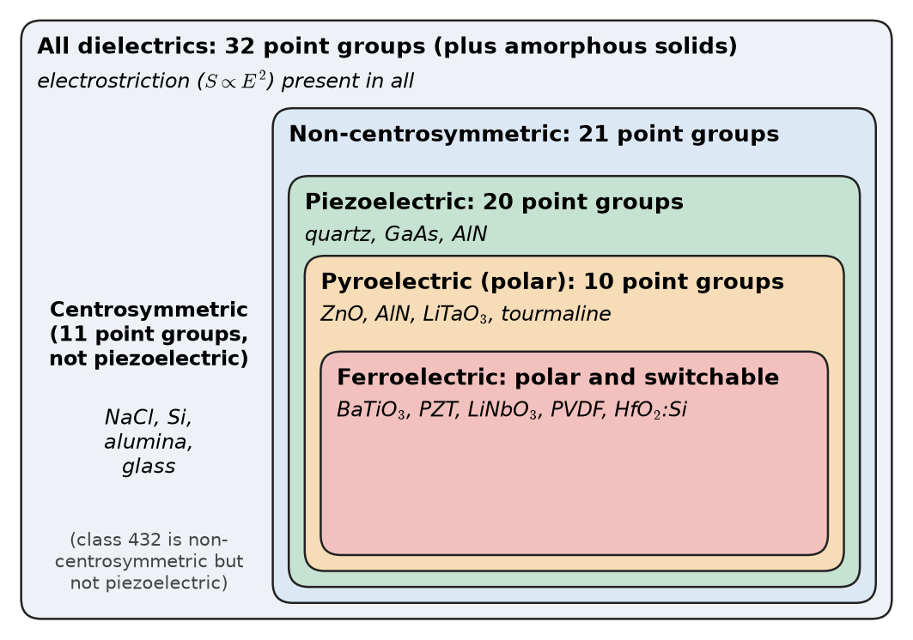
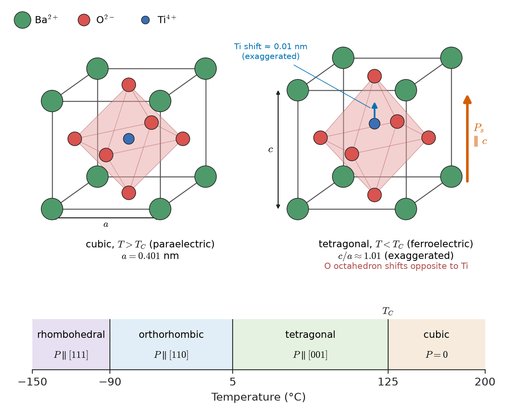
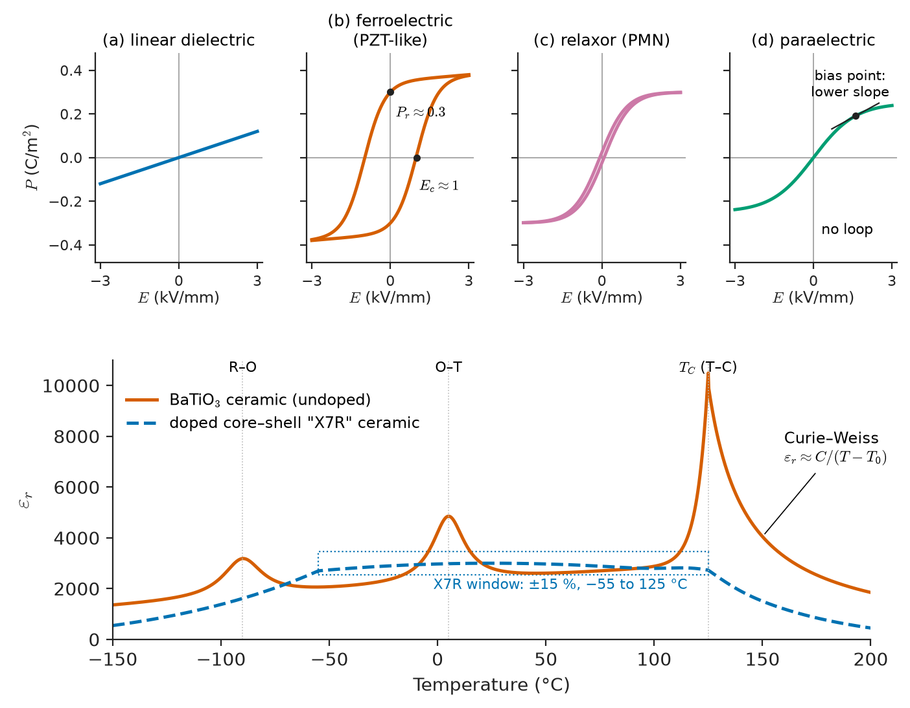
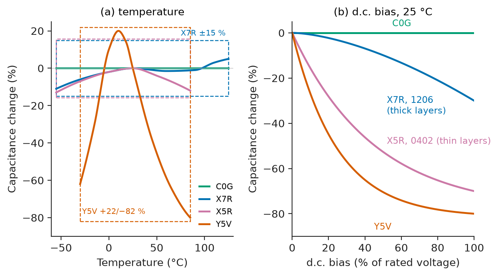
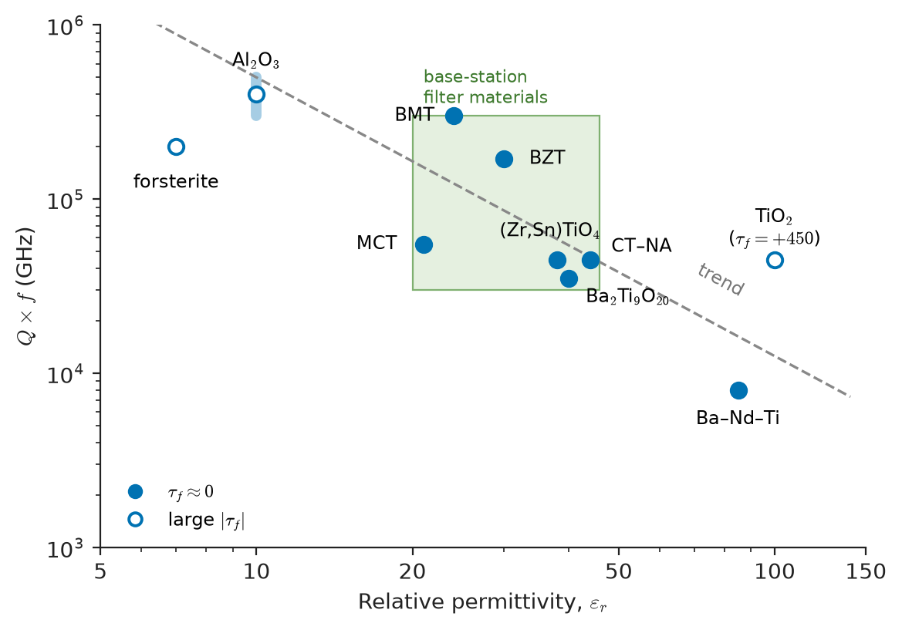
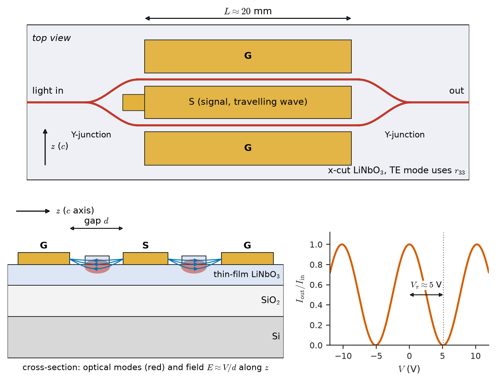

# Chapter 27 — Functional Dielectric Materials

*Part VI · Thermal, Electrical, Dielectric and Magnetic Materials*

A power-supply designer replaces an electrolytic capacitor with a small 10 $\mu$F, 16 V multilayer ceramic capacitor (MLCC). On the bench, at 12 V d.c., the output ripple is three times what the simulation predicted. An impedance analyser shows why: at 12 V bias the "10 $\mu$F" part has only about 3 $\mu$F. Worse, it audibly whines at the converter's burst-mode frequency, and its capacitance drifts down a few per cent over the first weeks of storage. None of this is a defect. The MLCC's dielectric is barium titanate, a ferroelectric. Its huge permittivity, its loss of capacitance under bias, its acoustic noise and its slow aging all come from the same physics: a polarization that is not just induced by the field, but exists spontaneously, sits in domains, and is coupled to the shape of the crystal.

Chapter 26 treated dielectrics as passive: they polarize in proportion to the field and give the polarization back. This chapter is about dielectrics in which polarization is coupled to something else, such as mechanical strain, temperature or light, or in which it becomes spontaneous and switchable. These **functional dielectrics** are the active materials in ultrasound probes, inkjet heads, quartz oscillators, RF filters in every phone, infrared motion detectors, non-volatile memories, high-capacitance capacitors and optical modulators.

> **Why do only some crystals generate a voltage when squeezed?**
> **What makes barium titanate's permittivity a thousand times that of polyethylene, and why does it collapse under d.c. bias?**
> **How does one choose a material for an actuator, a sensor, a microwave resonator or an optical modulator?**

| Concept | Engineering destination |
|---|---|
| Crystal symmetry, polar axes | Which materials can be piezo-, pyro- or ferroelectric |
| Ferroelectric domains, hysteresis, Curie–Weiss law | MLCC behaviour, FeRAM and FeFET memories, poling |
| Piezoelectric coefficients $d$, $g$, $k$ | Actuators, ultrasound, quartz crystals, SAW/BAW filters |
| Pyroelectric coefficient, figures of merit | PIR motion sensors, uncooled thermal imaging |
| Electrostriction, relaxors | Precision positioning, MLCC "singing", dielectric elastomers |
| High-permittivity dielectrics, EOT | MLCCs, DRAM and gate dielectrics |
| Dielectric resonators, $Q\times f$, $\tau_f$ | Microwave filters, oscillators, base-station hardware |
| Pockels and Kerr effects, $V_\pi$ | Optical modulators, Q-switches, photonic integrated circuits |

**Roadmap.** Symmetry as the gatekeeper (27.1) → ferroelectrics (27.2) → piezoelectrics (27.3) → pyroelectrics (27.4) → electrostriction (27.5) → high-permittivity dielectrics (27.6) → dielectric resonators (27.7) → electro-optic materials (27.8) → applications and selection (27.9).

---

## 27.1 Symmetry decides which effects are possible

### Why squeezing glass gives no voltage

Press on a block of glass and nothing electrical happens. Press on a quartz crystal along certain directions and charge appears on its faces. The difference is symmetry. A uniform stress has a centre of symmetry: inverting all coordinates through a point ($\mathbf r\to-\mathbf r$) leaves it unchanged. Polarization is a vector and changes sign under inversion. If the material also has a centre of symmetry, a stress can only produce something that is itself unchanged by inversion, and $\mathbf P\to-\mathbf P$ is not, so the induced polarization must be zero. **A material with a centre of symmetry cannot be piezoelectric.** Glass, being isotropic on average, behaves as if it had full symmetry; a cubic NaCl crystal has a centre of symmetry. Neither can show the effect.

This argument is an example of **Neumann's principle**: the symmetry of any physical property of a crystal must include the symmetry of the crystal's point group. It filters the 32 crystallographic point groups (Chapter 3) into nested families:

| Set | Number of point groups | Condition | Examples |
|---|---|---|---|
| All crystals | 32 | — | All |
| Non-centrosymmetric | 21 | No inversion centre | Quartz, GaAs, ZnO, BaTiO$_3$ (tetragonal) |
| Piezoelectric | 20 | Non-centrosymmetric, excluding class 432 | Quartz, AlN, GaN, ZnO, LiNbO$_3$, PZT |
| Pyroelectric (polar) | 10 | Has a unique polar axis | ZnO, AlN, LiTaO$_3$, BaTiO$_3$, PVDF |
| Ferroelectric | Subset of the 10 polar classes | Spontaneous polarization that an applied field can reverse | BaTiO$_3$, PZT, LiNbO$_3$, PVDF, doped HfO$_2$ |

<!-- FIGURE 27.1 | figures/ch27/fig-27-1-symmetry-classes.png | schematic | Nested symmetry classes of dielectric materials: every ferroelectric is pyroelectric, every pyroelectric is piezoelectric, and every dielectric is electrostrictive. | Content: nested rounded rectangles or Euler diagram. Outer: all dielectrics (32 point groups; electrostriction present in all). Next: 21 non-centrosymmetric. Next: 20 piezoelectric (examples: quartz, GaAs, AlN). Next: 10 polar = pyroelectric (ZnO, AlN, LiTaO3, tourmaline). Innermost: ferroelectric (BaTiO3, PZT, LiNbO3, PVDF, HfO2:Si). Small side note: centrosymmetric examples (NaCl, Si, glass, alumina) placed outside the non-centrosymmetric box. Use one colour per level. -->

*Figure 27.1 — Nested symmetry classes of dielectric materials: every ferroelectric is pyroelectric, every pyroelectric is piezoelectric, and every dielectric is electrostrictive.*

Figure 27.1 shows the nesting. Each inner set is a subset of the one outside it, so every ferroelectric is also pyroelectric and piezoelectric, and every pyroelectric is piezoelectric. The reverse is not true. Quartz is piezoelectric but not pyroelectric (it has polar directions but no unique polar axis). AlN and ZnO are pyroelectric but not ferroelectric (their polarization cannot be reversed by any practical field before breakdown). **Electrostriction**, a strain proportional to the square of the field, is allowed in every material, including glass and centrosymmetric crystals (Section 27.5).

> **Status of the principle: Neumann's principle**
> *Fundamental.* It follows from the requirement that physical laws do not depend on how the crystal is oriented. It tells us which effects are forbidden; it does not tell us how large an allowed effect will be.

### Polycrystals and poling

A ceramic made of randomly oriented piezoelectric grains has, on average, the full rotational symmetry of an isotropic solid, and the contributions of the grains cancel. A non-ferroelectric piezoelectric (quartz, AlN) must therefore be used as a single crystal or as a textured film whose grains share an orientation (the c-axis-oriented AlN films of Section 27.3). A ferroelectric ceramic offers a way out. A strong field applied at elevated temperature reorients the switchable polarization of each grain as nearly as its crystallography allows toward the field. This process, **poling**, gives the ceramic a net polar axis, and with it piezoelectricity and pyroelectricity. Almost all piezoelectric ceramics are poled ferroelectrics, which is why the ferroelectrics come first.

---

## 27.2 Ferroelectric materials

### Spontaneous polarization in the perovskite structure

Barium titanate, BaTiO$_3$, has the **perovskite** structure $ABO_3$ (Figure 27.2): large Ba$^{2+}$ ions at the cube corners, O$^{2-}$ at the face centres forming an octahedron, and a small Ti$^{4+}$ ion at the body centre. Above about 120–130 °C the structure is cubic and centrosymmetric. The Ti ion is a small ion in a slightly too large octahedral cage. Below the transition it shifts off centre by about 0.01 nm toward one of the six oxygen ions, along with smaller shifts of the oxygen ions. The positive and negative charge centres no longer coincide, the unit cell becomes a permanent dipole, and the crystal becomes tetragonal with $c/a\approx1.01$. Every cell shifts the same way, so the crystal acquires a **spontaneous polarization** $P_s$ of about $0.26\ \mathrm{C/m^2}$ at room temperature.

<!-- FIGURE 27.2 | figures/ch27/fig-27-2-batio3-perovskite.png | crystal | Perovskite BaTiO3: cubic paraelectric cell above the Curie temperature and tetragonal ferroelectric cell below it, with the off-centre Ti displacement. | Content: left: cubic ABO3 cell, Ba at corners (large spheres), O at face centres (medium, forming octahedron, shaded), Ti at centre; label a = 0.401 nm, T > Tc. Right: tetragonal cell, c/a about 1.01 (exaggerated), Ti displaced upward along c by about 0.01 nm (exaggerated arrow), O octahedron shifted opposite; dipole arrow P_s along c. Below: sequence of phases on a temperature axis: rhombohedral (< -90 C), orthorhombic (-90 to 5 C), tetragonal (5 to 125 C), cubic (> 125 C), with polarization directions [111], [110], [001] indicated. -->

*Figure 27.2 — Perovskite BaTiO3: cubic paraelectric cell above the Curie temperature and tetragonal ferroelectric cell below it, with the off-centre Ti displacement.*

The transition happens because two contributions compete. The short-range repulsion between ions favours the centred position. The long-range dipole–dipole interaction, the local field feedback of Section 26.1, favours a displaced one. At high temperature thermal motion keeps the average position centred. As the temperature falls, the restoring force for this particular displacement pattern weakens (the lattice vibration involved is called a **soft mode**), and at the **Curie temperature** $T_C$ it vanishes and the displaced structure becomes stable. This is the Clausius–Mossotti polarization catastrophe made real. BaTiO$_3$ passes through three transitions on cooling, cubic → tetragonal (about 125 °C) → orthorhombic (about 5 °C) → rhombohedral (about $-90$ °C), each with the polarization along a different crystal direction. Each transition produces a peak in the permittivity, which matters for capacitors (Section 27.6).

### Landau theory and the Curie–Weiss law

The thermodynamics of the transition can be described without knowing the microscopic details. Expand the free energy density of the crystal in powers of the polarization, keeping only even powers since $+P$ and $-P$ are equivalent by symmetry:

$$
G(P,T)=G_0+\tfrac12a\,(T-T_0)\,P^2+\tfrac14b\,P^4+\tfrac16c\,P^6-EP
$$

with $a,c>0$. Take first the case $b>0$ (a continuous, second-order transition). With no field, setting $\partial G/\partial P=0$:

$$
a(T-T_0)P+bP^3=0\quad\Longrightarrow\quad P_s=0\ \ (T>T_0),\qquad P_s^2=\frac{a(T_0-T)}{b}\ \ (T<T_0)
$$

The polarization grows continuously from zero below $T_0$. Above $T_0$, a small field gives $E=a(T-T_0)P$, so the susceptibility is

$$
\chi=\frac{P}{\varepsilon_0E}=\frac{1}{\varepsilon_0a\,(T-T_0)}\quad\Longrightarrow\quad\varepsilon_r\approx\frac{C}{T-T_0},\qquad C=\frac{1}{\varepsilon_0a}
$$

This is the **Curie–Weiss law**: the permittivity diverges as the transition is approached from above. For BaTiO$_3$ the Curie constant is $C\approx1.7\times10^{5}\ \mathrm K$. Its transition is in fact first order ($b<0$, stabilized by the $P^6$ term), so $P_s$ jumps at $T_C$, and the Curie–Weiss temperature $T_0$ lies about 10 K below $T_C$, but the Curie–Weiss behaviour above the transition remains.

> **Status of the principle: Landau theory and the Curie–Weiss law**
> *Approximate.* Landau theory is a symmetry-based expansion valid near the transition, where $P$ is small. Its coefficients are fitted. The Curie–Weiss law describes the permittivity above $T_C$ well for displacive ferroelectrics such as BaTiO$_3$ and PbTiO$_3$; it fails very close to $T_C$, far below it, and in relaxors (Section 27.5).

**Worked example — permittivity above the Curie point.** For a BaTiO$_3$ crystal with $C=1.7\times10^{5}\ \mathrm K$ and $T_0=110$ °C, at 150 °C the permittivity is

$$
\varepsilon_r\approx\frac{1.7\times10^{5}}{150-110}=4250
$$

At 300 °C it has fallen to $1.7\times10^{5}/190\approx900$. A paraelectric perovskite operated just above its transition is therefore a high-permittivity, field-tunable dielectric. (Ba,Sr)TiO$_3$, whose Curie temperature is lowered below room temperature by strontium, is used this way in tunable RF capacitors (Section 27.9).

### Domains and the hysteresis loop

A crystal that polarizes uniformly would have bound charge on its surfaces and a large depolarizing field. It lowers its energy by splitting into **domains**, regions of uniform polarization separated by **domain walls** a few lattice spacings thick. In tetragonal BaTiO$_3$ there are 180° walls (between antiparallel domains) and 90° walls (between domains polarized along different cube edges). The 90° walls also relieve the elastic strain from the tetragonal distortion.

When a field is applied, domains aligned with it grow at the expense of others by wall motion and nucleation of new domains. Plotting $P$ against $E$ through a full cycle gives a **hysteresis loop** (Figure 27.3), with:

- **saturation polarization** $P_{\rm sat}$, approached at high field;
- **remanent polarization** $P_r$, remaining at zero field;
- **coercive field** $E_c$, the field needed to reduce $P$ to zero.

The loop is the signature of ferroelectricity. Its area is the energy dissipated per cycle per unit volume. The parallel with ferromagnetic hysteresis (Chapter 28) is close and deliberate: the magnetization and its domains replace the polarization and its domains.

<!-- FIGURE 27.3 | figures/ch27/fig-27-3-pe-loops-and-epsilon-t.png | plot | Polarization–field loops of four dielectric types, and the permittivity of BaTiO3 against temperature. | Content: top row, four small P-E panels (x: E from -Emax to +Emax; y: P): (a) linear dielectric, straight line through origin; (b) ferroelectric (PZT-like), square-ish loop with Pr about 0.3 C/m2 and Ec about 1 kV/mm marked; (c) relaxor/electrostrictor (PMN), slim nonlinear S-curve with little hysteresis; (d) paraelectric under bias, curved but no loop. Bottom panel: epsilon_r of BaTiO3 ceramic vs temperature from -150 to 200 C (y up to about 10,000): peaks at about -90, 5 and 125 C (largest at Tc), Curie-Weiss 1/(T - T0) decay above Tc; dashed second curve for a doped "X7R" core-shell ceramic flattened to about 3000 +/- 15 % from -55 to 125 C. -->

*Figure 27.3 — Polarization–field loops of four dielectric types, and the permittivity of BaTiO3 against temperature.*

| Ferroelectric | $T_C$ (°C) | $P_r$ (typical, $\mathrm{C/m^2}$) | $E_c$ (typical) | Use |
|---|---|---|---|---|
| BaTiO$_3$ (ceramic) | 120–130 | 0.05–0.1 | 0.1–0.5 kV/mm | MLCC dielectric, PTC thermistors |
| PbTiO$_3$ | 490 | 0.5–0.8 (crystal) | High | Component of PZT |
| PZT (Pb(Zr,Ti)O$_3$, near MPB) | 230–390 (by composition, doping) | 0.3–0.4 | 1–2 kV/mm | Piezoelectric ceramics, FeRAM |
| LiNbO$_3$ | 1140–1210 | 0.71 | About 21 kV/mm (congruent) | Electro-optics, SAW, periodically poled crystals |
| PVDF, P(VDF–TrFE) | About 100–130 for copolymer | 0.05–0.1 | 50–100 kV/mm | Flexible sensors, polymer memory |
| HfO$_2$:Si, Hf$_{0.5}$Zr$_{0.5}$O$_2$ (thin film) | Several hundred (phase is metastable) | 0.1–0.25 | 100–200 kV/mm (1–2 MV/cm) | FeFET, FeRAM integrated in CMOS |

### Lead zirconate titanate and the morphotropic phase boundary

PZT, the solid solution PbZrO$_3$–PbTiO$_3$, is the workhorse of piezoelectric ceramics. On the Ti-rich side it is tetragonal; on the Zr-rich side, rhombohedral. Near Zr/Ti ≈ 52/48 the two phases have almost equal energy. This boundary is called the **morphotropic phase boundary** (MPB) because it is nearly vertical in temperature. At the MPB the polarization can rotate easily between the 6 tetragonal and 8 rhombohedral directions (and intermediate monoclinic ones). Poling aligns grains well, domain walls move easily, and the permittivity and piezoelectric coefficients peak. Small dopant additions then tune the material:

- **Donor doping** (La$^{3+}$ on Pb sites, Nb$^{5+}$ on Ti sites) creates lead vacancies that make domain walls mobile. The result is a **"soft" PZT** (e.g. PZT-5A, 5H): high $d$, high permittivity, high loss, low coercive field, suited to sensors and low-power actuators.
- **Acceptor doping** (Fe$^{3+}$, Mn on Ti sites) creates oxygen vacancies that form defect dipoles and pin domain walls. The result is a **"hard" PZT** (e.g. PZT-4, PZT-8): lower $d$, low loss, high mechanical quality factor, stable under high drive, suited to ultrasonic power transducers and sonar.

This is the microstructure–property link of Chapter 5 applied to domain walls: point defects decide how easily walls move, and wall motion supplies a large part of the dielectric and piezoelectric response of a ceramic.

### Ferroelectric memory

The two remanent states $\pm P_r$ store a bit without power. In a **ferroelectric RAM** (FeRAM) cell, a capacitor is switched by a read pulse. If it switches, the extra charge $2P_rA$ flows; if not, only the small linear charge does.

**Worked example — FeRAM switching charge.** A PZT capacitor of area $A=1\ \mu\mathrm m^2$ with $P_r=0.3\ \mathrm{C/m^2}$ releases on switching

$$
Q=2P_rA=2\times0.3\times10^{-12}=6\times10^{-13}\ \mathrm C=600\ \mathrm{fC}
$$

A DRAM cell stores about 10–25 fC. A ferroelectric therefore delivers a large signal from a small area. The drawbacks are that reading is destructive (the bit must be rewritten), that repeated switching causes **fatigue** (loss of switchable polarization as charged defects pin domain walls at electrodes) and **imprint** (one state becoming preferred), and that lead-based perovskites are difficult to integrate with CMOS. The discovery in 2011 that thin films of HfO$_2$, already the standard high-permittivity gate dielectric (Section 27.6), become ferroelectric when doped with Si or Zr and crystallized in a non-centrosymmetric orthorhombic phase has revived ferroelectric memory. **Ferroelectric field-effect transistors** (FeFETs) use a ferroelectric gate layer whose polarization shifts the transistor's threshold voltage. The device side belongs to Electronics & Computing; the interface and reliability issues are taken up in Chapter 34.

### Aging, temperature limits and grain size

Three practical properties of ferroelectric ceramics follow from domain physics.

- **Aging.** After cooling through $T_C$ or after poling, domain configurations slowly relax into lower-energy states, stabilized by migrating point defects. The permittivity and piezoelectric coefficients decrease roughly linearly with the logarithm of time. Heating above $T_C$ ("de-aging") resets the clock.
- **Depoling temperature.** A poled ceramic loses its polarization as it approaches $T_C$, and thermally activated wall motion degrades it well below. A common rule is to keep operating temperatures below about half of $T_C$ in °C. That is why high-$T_C$ PZT is preferred to BaTiO$_3$ for piezoelectric use.
- **Size effects.** Below grain sizes of about 1 $\mu$m in BaTiO$_3$, the permittivity peak is suppressed and broadened, and in films of a few nanometres, depolarizing fields from incomplete electrode screening suppress ferroelectricity. MLCC dielectric layers below 1 $\mu$m are designed around this.

---

## 27.3 Piezoelectric materials

### The effect and its converse

In a piezoelectric material, stress produces polarization (the **direct effect**) and an electric field produces strain (the **converse effect**). Both are described by the same coefficient, which is guaranteed by thermodynamics: both effects come from a cross term in the same free energy. In the strain–charge form, for one-dimensional loading along the poling axis "3":

$$
D_3=d_{33}\,T_3+\varepsilon_{33}^T\,E_3\qquad\text{(direct)}
$$

$$
S_3=s_{33}^E\,T_3+d_{33}\,E_3\qquad\text{(converse)}
$$

$T$ is stress, $S$ strain, $s^E$ the compliance at constant field, and $\varepsilon^T$ the permittivity at constant stress. The **piezoelectric charge coefficient** $d$ has units of $\mathrm{C/N}$ (charge per force) or, equivalently, $\mathrm{m/V}$ (strain per field). In general $d_{ij}$ is a third-rank tensor written in matrix form with two indices: the first index gives the electrical direction (1, 2, 3, with 3 the poling axis), the second the mechanical one (1–3 normal, 4–6 shear). For a poled ceramic the important ones are:

- $d_{33}$: field and strain both along the poling axis (thickness-mode actuators, stacks);
- $d_{31}$: field along 3, strain perpendicular (bending actuators, length-mode resonators); negative, since the material thins as it lengthens along 3;
- $d_{15}$: shear (shear-mode sensors, some accelerometers).

Other useful coefficients are derived from these. The **voltage coefficient** $g=d/\varepsilon^T$ (units $\mathrm{V\,m/N}$) gives the open-circuit field per stress and is the figure of merit for sensors. The **electromechanical coupling factor**

$$
k^2=\frac{d^2}{s^E\varepsilon^T}
$$

is the fraction of input energy, electrical or mechanical, converted to the other form in a quasi-static cycle. It governs the bandwidth of transducers and filters.

> **Status of the principle: linear piezoelectric constitutive equations**
> *Approximate.* They are the small-signal linear terms of a thermodynamic expansion (IEEE Std 176). They hold well for quartz, AlN and LiNbO$_3$ over their working ranges. For ferroelectric ceramics at high drive, domain-wall motion makes $d$ field-dependent and hysteretic, and the coefficients drift with aging, temperature and stress history.

### The material families

| Material | $d_{33}$ (pC/N) | $\varepsilon_{33}^T/\varepsilon_0$ | $k_{33}$ or $k_t$ | $T_C$ (°C) | Character |
|---|---|---|---|---|---|
| Quartz (single crystal) | $d_{11}=2.3$ | 4.5 | about 0.1 | 573 (α–β transition) | Very stable, very low loss; oscillators, force sensors |
| AlN (c-axis film) | 5–6 | 9–10 | $k_t^2\approx6$–7 % | No ferroelectric transition | CMOS-compatible; BAW filters, MEMS |
| Al$_{1-x}$Sc$_x$N ($x\approx0.3$, film) | 15–30 | 12–20 | $k_t^2\approx10$–15 % | — | Wider-bandwidth BAW filters |
| ZnO (film) | 10–12 | 8–11 | $k_t\approx0.28$ | — | Older thin-film transducers |
| LiNbO$_3$ (single crystal) | 6 ($d_{15}=69$) | 28 | Up to 0.5 (depends on cut) | 1140–1210 | SAW filters, high-temperature sensors |
| BaTiO$_3$ (ceramic) | 190 | 1700 | 0.5 | 120–130 | Historical; limited by low $T_C$ |
| PZT-4 (hard) | 289 | 1300 | 0.70 | 328 | Power ultrasound, sonar |
| PZT-5A (soft) | 374 | 1700 | 0.71 | 365 | Sensors, actuators |
| PZT-5H (soft) | 593 | 3400 | 0.75 | 193 | High-displacement actuators, medical imaging |
| PMN–PT (single crystal) | 1500–2500 | 4000–7000 | above 0.9 | 130–170 | High-end ultrasound probes |
| KNN-based (lead-free) | 100–400 | 500–2000 | 0.4–0.6 | 200–400 | RoHS-driven replacements |
| PVDF (stretched, poled) | about $-25$ to $-33$ ($d_{31}=18$–23) | 10–13 | 0.1–0.2 | — | Flexible sensors, hydrophones |

The table shows the central trade-off. Ferroelectric ceramics give coefficients 100–1000 times larger than quartz or AlN, but they have high permittivity, high loss, aging, temperature drift and hysteresis. Non-ferroelectric crystals give small coefficients but extraordinary stability and very low loss. **Large signals from ceramics; precise frequencies from crystals.**

### Actuators: the converse effect

**Worked example — a multilayer piezo stack.** A PZT-5H stack contains 100 active layers, each 0.1 mm thick, electrically in parallel. At 150 V each layer sees

$$
E_3=\frac{150}{1.0\times10^{-4}}=1.5\times10^{6}\ \mathrm{V/m}=1.5\ \mathrm{kV/mm}
$$

and strains by

$$
S_3=d_{33}E_3=(593\times10^{-12})(1.5\times10^{6})=8.9\times10^{-4}
$$

Each layer extends by $8.9\times10^{-4}\times0.1\ \mathrm{mm}=89\ \mathrm{nm}$, and the stack of 100 layers by $8.9\ \mu\mathrm m$. The total stack length is 10 mm, so the displacement is about 0.09 % of the length. Multilayer construction is the key to useful actuators: it gives a high field (1.5 kV/mm) at a low drive voltage (150 V) by making the layers thin, just as an MLCC achieves high capacitance. The displacement is small, but it is fast (microseconds), very stiff (blocking forces of kilonewtons), and resolvable to sub-nanometre steps. That is why piezo stacks drive fuel injectors, scanning-probe microscopes, optical alignment stages and active vibration control. Larger strokes need mechanical amplification (bending bimorphs using $d_{31}$, flextensional levers).

### Sensors: the direct effect

**Worked example — charge and voltage from a force.** A quartz force sensor with $d_{11}=2.3\ \mathrm{pC/N}$ loaded with 100 N generates $Q=d\,F=230\ \mathrm{pC}$, independent of the crystal's dimensions. Into a 100 pF capacitance (crystal plus cable) this is 2.3 V. Because the charge leaks away through finite insulation resistance, piezoelectric sensors measure changing forces only, and are read with charge amplifiers. The extremely high resistivity and low loss of quartz (Chapter 26) make its quasi-static response unusually good.

For voltage output, use the $g$ coefficient. A PZT-5A disc ($g_{33}=d_{33}/\varepsilon_{33}^T=374\times10^{-12}/(1700\times8.854\times10^{-12})=24.8\times10^{-3}\ \mathrm{V\,m/N}$) of area 1 cm$^2$ and thickness 1 mm under a 10 N force (stress $T=10^{5}\ \mathrm{Pa}$) develops an open-circuit voltage

$$
V=g_{33}\,T\,t=(24.8\times10^{-3})(10^{5})(10^{-3})=2.5\ \mathrm V
$$

PVDF film has a $d$ coefficient more than ten times smaller than PZT, but its permittivity is about 150 times smaller, so its $g_{31}$ ($\approx0.22\ \mathrm{V\,m/N}$) is about ten times larger than that of PZT. It is also flexible, tough and acoustically matched to water and tissue. That makes PVDF the material for hydrophones, contact microphones and wearable pressure sensors, despite its weak coupling.

### Resonators and filters

A piezoelectric plate driven at its mechanical resonance shows a sharp electrical resonance, with a quality factor set by the material's mechanical loss. This turns a piece of crystal into a frequency standard or a filter.

- **Quartz crystal oscillators** use thickness-shear vibration of thin plates. The resonance frequency is $f=N/t$, with frequency constant $N=1.661\ \mathrm{MHz\,mm}$ for the AT cut, so a 10 MHz crystal is 0.166 mm thick. The AT cut is chosen because, at that orientation, the temperature coefficients of the elastic constants and the thermal expansion cancel to first order; the frequency stays within a few parts per million over the commercial temperature range. Quartz has a mechanical $Q$ of $10^{5}$–$10^{6}$. No other material combines that with such low drift.
- **Surface acoustic wave (SAW) filters** use interdigitated electrodes on LiNbO$_3$ or LiTaO$_3$ to launch and detect surface waves at velocities of about 3500–4000 m/s. Electrode pitch sets the frequency; SAW dominates below about 2 GHz.
- **Bulk acoustic wave (BAW, FBAR) filters** use a thin AlN or ScAlN film, about 0.5–2 $\mu$m thick, between electrodes, suspended or acoustically isolated, resonating in thickness mode at 1.5–10 GHz. A smartphone contains dozens. The bandwidth achievable is proportional to $k_t^2$, which is why scandium is alloyed into AlN for the wider 5G bands: Sc softens the lattice and raises the piezoelectric response.

---

## 27.4 Pyroelectric materials

### The effect

In a polar material the spontaneous polarization depends on temperature. A temperature change $\Delta T$ changes $P_s$ and therefore the bound surface charge. If electrodes are connected through an external circuit, a current flows:

$$
\Delta P_s=p\,\Delta T,\qquad i=p\,A\,\frac{dT}{dt}
$$

where $p=dP_s/dT$ is the **pyroelectric coefficient** (units $\mathrm{C\,m^{-2}\,K^{-1}}$) and $A$ the electrode area. Like piezoelectric sensors, pyroelectric detectors respond to change only: a constant temperature gives no signal, because the bound charge is eventually neutralized by leakage. That is not a limitation for their main applications, which detect moving or modulated infrared sources.

Part of the measured coefficient is "secondary": thermal expansion strains the crystal, which then polarizes piezoelectrically. Since every pyroelectric is piezoelectric, vibration and acoustic noise also produce signals, and detector designs must reject them (usually with a pair of opposite-polarity elements).

> **Status of the principle: pyroelectric response $i=pA\,dT/dt$**
> *Derived* from the temperature dependence of $P_s$ for a uniformly heated element. The value of $p$ is a measured material property. Non-uniform heating, secondary piezoelectric contributions and leakage modify the response.

### Figures of merit

For a thin detector element absorbing radiation, the temperature change per unit absorbed power is set by its volumetric heat capacity $c'$ (J m$^{-3}$ K$^{-1}$). The current responsivity is then proportional to $p/c'$; the voltage responsivity across the element's own capacitance to

$$
F_V=\frac{p}{c'\,\varepsilon_0\varepsilon_r}
$$

A good voltage-mode pyroelectric has a large $p$, a small heat capacity and a **small** permittivity. This is the opposite of what a capacitor or an actuator needs, and it reorders the materials:

| Material | $p$ ($10^{-4}\ \mathrm{C\,m^{-2}\,K^{-1}}$) | $\varepsilon_r$ | $c'$ ($\mathrm{MJ\,m^{-3}\,K^{-1}}$) | $F_V$ ($\mathrm{m^2/C}$) | Comments |
|---|---|---|---|---|---|
| TGS (triglycine sulphate) | 3.5 | 40 | 2.5 | 0.40 | Best $F_V$, but $T_C=49$ °C and water-soluble |
| LiTaO$_3$ | 2.3 | 47 | 3.2 | 0.17 | Stable to 600 °C; standard in PIR and power meters |
| PVDF | 0.27 | 12 | 2.4 | 0.11 | Cheap, large-area, flexible |
| Modified PZT ceramic | 3.8 | 290 | 2.5 | 0.06 | Robust, cheap; high permittivity limits $F_V$ |
| BaTiO$_3$ ceramic | 2.0 | about 1200 | 2.5 | about 0.008 | Large $p$, but permittivity much too high |

**Worked example — the signal from a motion detector.** A LiTaO$_3$ element of area 1 mm$^2$ warms at 0.1 K/s as a person crosses its field of view (focused by a Fresnel lens). The current is

$$
i=pA\frac{dT}{dt}=(2.3\times10^{-4})(1.0\times10^{-6})(0.1)=2.3\times10^{-11}\ \mathrm A=23\ \mathrm{pA}
$$

A current this small is converted to a voltage by a JFET source follower with a gate resistor of tens of gigohms, integrated in the detector can. The element must therefore be an excellent insulator ($\rho_v>10^{12}\ \Omega\,\mathrm m$, Chapter 26), and thin, typically 20–50 $\mu$m, to minimize heat capacity.

Uncooled thermal imaging arrays use either pyroelectric materials (BST operated near its transition, where $p$ is largest) or, more commonly today, resistive bolometers (vanadium oxide, amorphous silicon) whose resistance changes with temperature (Chapter 25's TCR, used deliberately: VO$_x$ films have TCRs of about $-2$ % per kelvin). Infrared detector materials in general are taken up in Chapter 35.

---

## 27.5 Electrostrictive materials

### A strain proportional to the square of the field

Every dielectric deforms in a field, because polarization changes the forces between ions. The lowest-order effect allowed in all materials, with or without a centre of symmetry, is quadratic:

$$
S=Q\,P^2\approx M\,E^2
$$

$Q$ (units $\mathrm{m^4/C^2}$) is the **electrostrictive coefficient**. Since the strain depends on $P^2$, reversing the field gives the same strain: an electrostrictor always expands (or always contracts) along the field, whatever its sign. In ordinary dielectrics the effect is tiny, because $P$ is small. It becomes useful only in materials with very large polarization.

> **Status of the principle: quadratic electrostriction $S=QP^2$**
> *Approximate.* It is the leading term allowed by symmetry in all materials. $Q$ is nearly independent of temperature and composition in a given structure family, so writing the strain in terms of $P$ rather than $E$ is more accurate. Higher-order terms and saturation of $P$ appear at high field.

### Piezoelectricity of a ferroelectric is biased electrostriction

Write the polarization as a large static part plus a small signal, $P=P_0+\delta P$. Then

$$
S=Q(P_0+\delta P)^2\approx QP_0^2+2QP_0\,\delta P
$$

The small-signal strain is linear in $\delta P=\varepsilon_0\varepsilon_r\,\delta E$, with an effective piezoelectric coefficient

$$
d_{\rm eff}=2\,Q\,\varepsilon_0\varepsilon_r\,P_0
$$

A material with a built-in polarization behaves as a piezoelectric. In a poled ferroelectric, $P_0$ is the remanent polarization. In a paraelectric or relaxor, $P_0$ is induced by a d.c. bias, and the piezoelectric response can be switched on and off with the bias.

**Worked example — where barium titanate's piezoelectricity comes from.** For single-crystal BaTiO$_3$ at room temperature, $Q_{11}\approx0.11\ \mathrm{m^4/C^2}$, $P_s=0.26\ \mathrm{C/m^2}$ and $\varepsilon_{33}/\varepsilon_0\approx168$ along the polar axis. Then

$$
d_{33}\approx2\times0.11\times(8.854\times10^{-12})\times168\times0.26=8.5\times10^{-11}\ \mathrm{C/N}=85\ \mathrm{pC/N}
$$

The measured single-crystal value is about 86–90 pC/N. The piezoelectric coefficient of a ferroelectric is not a separate property: it is electrostriction about the spontaneous polarization, amplified by the permittivity.

The same physics produces the "singing" MLCC of the opening paragraph. A BaTiO$_3$ capacitor under d.c. bias has an induced polarization, so an a.c. ripple produces a strain at the ripple frequency. When the ripple falls in the audio range (light-load burst modes of converters), the capacitor shakes the circuit board at frequencies people can hear. The fixes are mechanical (small cases, soldering arrangements, interposers) or materials-based (C0G or polymer-film capacitors, which have no ferroelectric response).

### Relaxor ferroelectrics

Lead magnesium niobate, Pb(Mg$_{1/3}$Nb$_{2/3}$)O$_3$ (PMN), is the classic **relaxor**. Mg$^{2+}$ and Nb$^{5+}$ share the B site in a nanoscale, partly disordered arrangement. Instead of a single sharp transition, PMN contains **polar nanoregions** that grow and slow down on cooling. The permittivity shows a broad maximum near $-10$ °C, very large ($\varepsilon_r$ up to about 20,000) and frequency-dependent: the peak shifts to higher temperature at higher measurement frequency, following a Vogel–Fulcher law rather than the Curie–Weiss law.

Just above its permittivity peak, PMN has an enormous induced polarization but almost no remanence. Its strain is large ($S\approx0.1$ % at about 1–2 kV/mm), quadratic and nearly hysteresis-free, and it does not need poling or show aging of a poled state. With $Q\approx0.025\ \mathrm{m^4/C^2}$ and an induced $P=0.2\ \mathrm{C/m^2}$, $S=QP^2=0.025\times0.04=1.0\times10^{-3}$. That makes PMN-based ceramics the material for precision positioning where hysteresis is unacceptable, such as deformable mirrors for adaptive optics. Its disadvantages are strong temperature dependence (the effect is tied to the region near the permittivity peak) and high capacitance, hence high drive current. Solid solutions of relaxors with PbTiO$_3$ (PMN–PT, PZN–PT) grown as single crystals near their MPB give the record piezoelectric coefficients of Section 27.3.

### Dielectric elastomers: electrostriction by Maxwell stress

Soft polymers offer a different route to large field-induced strain. In a **dielectric elastomer actuator**, a soft film (silicone, acrylic) with compliant electrodes is squeezed by the electrostatic attraction of its electrodes. The effective pressure is

$$
p=\varepsilon_0\varepsilon_rE^2
$$

which is again quadratic in field. For silicone with $\varepsilon_r=3$ at 50 kV/mm, $p=8.854\times10^{-12}\times3\times(5\times10^{7})^2=6.6\times10^{4}\ \mathrm{Pa}$. With a modulus of about 1 MPa, that is a thickness strain of several per cent, and area strains of tens of per cent are achieved in pre-stretched films. The penalty is kilovolt drive and the electromechanical instability of Section 26.5, which these devices operate close to. They are used in soft robotics, haptics and tunable optics.

---

## 27.6 High-permittivity dielectrics

### Why permittivity matters, and why it is not enough

The capacitance of a parallel-plate capacitor, $C=\varepsilon_0\varepsilon_rA/d$, can be raised by increasing area, reducing thickness, or increasing permittivity. Area costs volume and chip space; thickness is limited by breakdown and, for nanometre films, by tunnelling. Permittivity is the material lever, and the ferroelectric perovskites offer values 1000 times those of polymers. But capacitance is not the only figure of merit. The energy a dielectric can store per unit volume is

$$
w=\tfrac12\varepsilon_0\varepsilon_rE_b^2
$$

and is limited by the breakdown field $E_b$ as much as by $\varepsilon_r$. For biaxially oriented polypropylene ($\varepsilon_r=2.2$, usable field about 600 kV/mm) the formula gives $w=\tfrac12(8.854\times10^{-12})(2.2)(6\times10^{8})^2=3.5\ \mathrm{MJ/m^3}=3.5\ \mathrm{J/cm^3}$. For a BaTiO$_3$ ceramic at $\varepsilon_r=2000$ but a usable field of about 5 kV/mm, $w=\tfrac12(8.854\times10^{-12})(2000)(5\times10^{6})^2=0.22\ \mathrm{J/cm^3}$, and less in practice, because its permittivity falls with field. **High permittivity gives high capacitance per volume at low voltage; high breakdown strength gives high energy per volume at high voltage.** That is why MLCCs dominate decoupling at a few volts, and polypropylene film capacitors dominate d.c. links and pulse power at hundreds of volts and above.

### MLCC dielectrics

An MLCC is a stack of hundreds of ceramic layers, each 0.5–10 $\mu$m thick, interleaved with Ni (or Ag–Pd) electrodes, co-fired into a monolithic block (Chapter 25, Section 25.9). With $N$ active layers of thickness $d$ and overlap area $A$,

$$
C=N\,\frac{\varepsilon_0\varepsilon_rA}{d}
$$

**Worked example — an MLCC and its bias derating.** A 1206-size capacitor has $N=100$ active layers of BaTiO$_3$-based X7R dielectric with $\varepsilon_r=3000$, thickness $d=5\ \mu\mathrm m$, and an electrode overlap of $2.0\times1.0\ \mathrm{mm}=2.0\times10^{-6}\ \mathrm{m^2}$:

$$
C=100\times\frac{(8.854\times10^{-12})(3000)(2.0\times10^{-6})}{5\times10^{-6}}=1.06\times10^{-6}\ \mathrm F
$$

about 1 $\mu$F. At its 16 V rating each layer sees $16\ \mathrm V/5\ \mu\mathrm m=3.2\ \mathrm{kV/mm}$, several times the coercive field of BaTiO$_3$. At that field the domains are clamped in the field direction and can no longer contribute to the small-signal response, and the polarization approaches saturation on a flattening $P$–$E$ curve. The small-signal permittivity, $\partial D/\partial E$, falls, typically by 30–60 % for X7R at rated voltage, and more for thinner layers and higher-permittivity grades. That is the opening problem. A smaller case with thinner layers, at the same voltage, has a higher field per layer and loses more.

The temperature behaviour of BaTiO$_3$ is tamed by microstructure. Additions of rare-earth oxides, MgO and others diffuse only partway into each grain during sintering, forming a **core–shell** grain: a ferroelectric core with a peak near 125 °C and a shell of graded composition with peaks spread over lower temperatures. The sum is a flattened $\varepsilon_r(T)$ (Figure 27.3, dashed curve). EIA codes specify the outcome:

| Class and code | Temperature range (°C) | Capacitance change | Typical $\varepsilon_r$ | Material basis |
|---|---|---|---|---|
| Class I, C0G (NP0) | $-55$ to $+125$ | $0\pm30$ ppm/K | 20–100 | CaZrO$_3$, (Ca,Sr)(Zr,Ti)O$_3$, TiO$_2$-based; paraelectric |
| Class II, X7R | $-55$ to $+125$ | $\pm15$ % | 2000–4000 | Core–shell BaTiO$_3$ |
| Class II, X5R | $-55$ to $+85$ | $\pm15$ % | 3000–5000 | BaTiO$_3$, thin layers |
| Class II, Y5V | $-30$ to $+85$ | $+22$ % / $-82$ % | 10,000–18,000 | BaTiO$_3$ with shifted Curie peak (e.g. Zr, Sn additions) |

Class I dielectrics are linear, stable, low-loss and free of aging, bias effects and acoustic noise, which suits them to filters, oscillators and timing. Class II dielectrics trade all of those for 30–500 times more capacitance per volume, which suits them to decoupling and bulk filtering. Class II parts also **age**, losing about 1–3 % of capacitance per decade of time for X7R (more for Y5V), measured from their last heating above $T_C$ (for example, during soldering). Datasheet values are referred to a stated age, usually 1000 h.

<!-- FIGURE 27.4 | figures/ch27/fig-27-4-mlcc-dc-bias-temperature.png | plot | MLCC dielectric classes: capacitance change with temperature and with d.c. bias. | Content: left panel: x-axis temperature -55 to 125 C, y-axis capacitance change -90 % to +25 %. Curves: C0G (flat line at 0), X7R (within +/-15 % box, gently curved, small peak near 125 C), X5R (within +/-15 % to 85 C), Y5V (peak +20 % near 10-20 C, falling to -80 % at 85 C). Draw the EIA tolerance boxes as dashed rectangles. Right panel: x-axis d.c. bias as % of rated voltage 0 to 100 %; y-axis capacitance change 0 to -90 %. Curves: C0G flat at 0; X7R 1206 thick layers (-30 % at rated); X5R 0402 thin layers (-70 % at rated); Y5V (-80 %). -->

*Figure 27.4 — MLCC dielectric classes: capacitance change with temperature and with d.c. bias.*

Figure 27.4 compares the classes against temperature and bias. Choosing an MLCC is therefore a materials decision: the capacitance on the label is the zero-bias, room-temperature, fresh value of a ferroelectric.

### High-k gate and memory dielectrics

In a MOS transistor the gate dielectric must provide high capacitance per area, $\varepsilon_0\varepsilon_r/t$, to control the channel. With SiO$_2$ ($\varepsilon_r=3.9$), the thickness needed by the 2000s fell below 1.5 nm, where direct tunnelling currents became intolerable. The solution was a thicker film of higher permittivity. Its performance is quoted as an **equivalent oxide thickness**

$$
\mathrm{EOT}=t_{\rm high\text{-}k}\,\frac{3.9}{\varepsilon_{r,\rm high\text{-}k}}
$$

the SiO$_2$ thickness that would give the same capacitance.

**Worked example — EOT of a hafnia gate stack.** A 3.0 nm HfO$_2$ film with $\varepsilon_r=20$ has

$$
\mathrm{EOT}=3.0\times\frac{3.9}{20}=0.59\ \mathrm{nm}
$$

The physical film is five times thicker than an SiO$_2$ film of equal capacitance, and the tunnelling current through it is lower by many orders of magnitude, because tunnelling decreases exponentially with thickness. In practice an unavoidable interfacial SiO$_2$ layer of about 0.5 nm adds to the EOT, so the full stack is closer to 1 nm EOT.

Permittivity cannot simply be pushed up. High permittivity in oxides comes from soft, highly polarizable ionic bonds, and those materials tend to have smaller band gaps. A smaller band gap means lower barriers to electron injection and higher leakage (band ideas, Chapter 31).

| Dielectric | $\varepsilon_r$ | Band gap (eV) | Comment |
|---|---|---|---|
| SiO$_2$ | 3.9 | 9 | Reference; excellent interface with Si |
| Si$_3$N$_4$ | 7 | 5.3 | Diffusion barrier; charge-trap memory |
| Al$_2$O$_3$ | 9 | 8.8 | Good barrier, ALD-friendly; moderate $\varepsilon_r$ |
| HfO$_2$ | 20–25 | 5.7–6 | Standard high-k gate dielectric since 2007 |
| ZrO$_2$ | 25 | 5.8 | DRAM capacitors (ZrO$_2$/Al$_2$O$_3$ stacks) |
| La$_2$O$_3$ | about 30 | 6 | Threshold-voltage tuning additive |
| Ta$_2$O$_5$ | 22 | 4.4 | Too small a conduction-band offset for gates |
| TiO$_2$ (rutile) | 80–170 | 3.0–3.5 | Leaky on Si; DRAM capacitor research |
| SrTiO$_3$ | 300 (film lower) | 3.2 | Very high $\varepsilon_r$, small gap |

HfO$_2$ won because it combines a permittivity of about 20 with a band gap near 6 eV, thermodynamic stability in contact with silicon, and deposition by atomic layer deposition. Its interface with silicon, its traps, and its reliability are material problems treated in Chapter 34.

---

## 27.7 Dielectric resonators

### A microwave cavity made of ceramic

A block of high-permittivity, low-loss ceramic acts as a resonator at microwave frequencies, because electromagnetic waves inside it are trapped by reflection at its surfaces, just as in a metal cavity. The wavelength inside is shorter by $\sqrt{\varepsilon_r}$, so a resonator of permittivity $\varepsilon_r$ is about $\sqrt{\varepsilon_r}$ times smaller than an air-filled cavity. **Dielectric resonators** (DRs) are used in the filters and oscillators of cellular base stations, satellite transponders, radar and microwave links, where low loss, small size and temperature stability are all needed.

For the commonly used TE$_{01\delta}$ mode of a cylindrical puck of radius $a$ and height $L$, an empirical formula (Kajfez and Guillon) gives

$$
f_{\rm GHz}\approx\frac{34}{a_{\rm mm}\sqrt{\varepsilon_r}}\left(\frac{a}{L}+3.45\right)
$$

valid to about 2 % for $0.5<a/L<2$ and $30<\varepsilon_r<50$.

> **Status of the principle: resonant-frequency formula for the TE$_{01\delta}$ puck**
> *Empirical.* It is a fit to numerical solutions of Maxwell's equations for an isolated puck. Shields, supports and tuning screws shift the frequency by several per cent, so final designs use electromagnetic simulation.

**Worked example — sizing a resonator at 2 GHz.** With $a/L=1$ and $\varepsilon_r=37$ (a zirconium tin titanate):

$$
a=\frac{34\times(1+3.45)}{2\times\sqrt{37}}=\frac{151.3}{12.17}=12.4\ \mathrm{mm}
$$

so the puck is about 25 mm in diameter and 12 mm high, against a free-space wavelength of 150 mm. With $\varepsilon_r=90$, the same formula (now outside its fitted range, so only indicative) gives $a\approx8\ \mathrm{mm}$; with alumina ($\varepsilon_r=10$), about 24 mm. The size scales as $1/\sqrt{\varepsilon_r}$.

### The three material requirements

A DR material must satisfy three requirements simultaneously:

1. **High permittivity**, for small size: $\varepsilon_r$ 20–100.
2. **Low loss**, for a sharp resonance. Because the loss of the best ceramics comes mainly from anharmonic interactions of the microwave field with lattice vibrations, $\tan\delta$ grows roughly in proportion to frequency, and the product $Q\times f$ (with $Q=1/\tan\delta$) is roughly constant for a given material. It is quoted in GHz. A material with $Q\times f=40{,}000\ \mathrm{GHz}$ has $Q=20{,}000$ ($\tan\delta=5\times10^{-5}$) at 2 GHz. Impurities, porosity, secondary phases and grain boundaries add extrinsic loss, so dense, pure, well-ordered ceramics are essential.
3. **Near-zero temperature coefficient of resonant frequency** $\tau_f$. Since $f\propto1/(L\sqrt{\varepsilon_r})$, differentiating with respect to temperature gives

$$
\tau_f=\frac1f\frac{df}{dT}=-\alpha_L-\tfrac12\tau_\varepsilon
$$

where $\alpha_L$ is the linear thermal expansion coefficient and $\tau_\varepsilon=(1/\varepsilon_r)\,d\varepsilon_r/dT$. A filter channel only a few megahertz wide at 2 GHz cannot drift by more than a few ppm/K. Most high-permittivity materials have a strongly negative $\tau_\varepsilon$ (their soft modes stiffen on heating), giving large positive $\tau_f$. TiO$_2$, for example, has $\tau_f\approx+450\ \mathrm{ppm/K}$. Practical materials are solid solutions or composites that mix phases of opposite $\tau_f$ to bring it to zero.

> **Status of the principle: constant $Q\times f$**
> *Empirical.* It reflects intrinsic phonon-limited loss, for which $\tan\delta\propto f$ in the microwave range. It fails where extrinsic losses (defects, impurities, grain boundaries) dominate, and near any relaxation or resonance.

### Materials

There is a clear trade-off between permittivity and $Q\times f$ (Figure 27.5). Higher permittivity comes from softer lattice modes, which are also more anharmonic, so loss rises.

| Material | $\varepsilon_r$ | $Q\times f$ (GHz) | $\tau_f$ (ppm/K) | Typical use |
|---|---|---|---|---|
| Al$_2$O$_3$ (high purity) | 10 | 300,000–500,000 | about $-60$ | Low-loss substrates, high-frequency resonators |
| Ba(Mg$_{1/3}$Ta$_{2/3}$)O$_3$ (BMT) | 24–25 | 250,000–400,000 | 0 to +5 | Satellite and high-frequency filters |
| Ba(Zn$_{1/3}$Ta$_{2/3}$)O$_3$ (BZT) | 29–30 | 150,000–200,000 | 0 to +2 | Base-station filters |
| (Mg,Ca)TiO$_3$ | 20–21 | about 55,000 | about 0 | Low-cost resonators, GPS antennas |
| (Zr,Sn)TiO$_4$ | 37–38 | 40,000–50,000 | about 0 | Base-station filters, oscillators |
| Ba$_2$Ti$_9$O$_{20}$ | 39–40 | 32,000–40,000 | +2 | Classic filter material |
| CaTiO$_3$–NdAlO$_3$ | 43–45 | about 45,000 | about 0 | Base-station filters |
| Ba–Nd–Ti–O (tungsten-bronze-type) | 80–90 | 5,000–10,000 | tunable to 0 | Compact low-frequency filters |
| TiO$_2$ (rutile) | 100 | 40,000–50,000 | +450 | End member for $\tau_f$ compensation |

The complex perovskites BZT and BMT achieve their very high $Q\times f$ through **B-site ordering**: long annealing arranges the Zn (or Mg) and Ta ions on alternating (111) planes, a periodicity that reduces anharmonic scattering. This is Section 25.4's lesson about disorder in yet another form: ordering removes a source of loss, here for phonons rather than electrons.

<!-- FIGURE 27.5 | figures/ch27/fig-27-5-microwave-dielectrics-qf-map.png | map | Microwave dielectric ceramics: the trade-off between permittivity and the quality factor product Q x f. | Content: log-log axes, x: relative permittivity 5 to 150; y: Q x f in GHz from 1,000 to 1,000,000. Points/ellipses labelled: Al2O3 (10, 300k-500k), forsterite (7, 200k), BMT (24, 300k), BZT (30, 170k), MCT (21, 55k), (Zr,Sn)TiO4 (38, 45k), Ba2Ti9O20 (40, 35k), CT-NA (44, 45k), Ba-Nd-Ti (85, 8k), TiO2 (100, 45k, flagged tau_f +450). Dashed trend line showing falling Q x f with increasing epsilon_r. Colour or marker indicates tau_f: near zero (filled), large (open). Shade the region "base-station filter materials". -->

*Figure 27.5 — Microwave dielectric ceramics: the trade-off between permittivity and the quality factor product Q x f.*

---

## 27.8 Electro-optic materials

### Field-controlled refractive index

In a non-centrosymmetric crystal, an applied field changes the refractive index linearly: the **Pockels effect**. In any material, including liquids and glasses, there is also a quadratic change: the **Kerr effect**. The Pockels effect is written in terms of the optical impermeability $1/n^2$:

$$
\Delta\left(\frac{1}{n^2}\right)=r\,E\quad\Longrightarrow\quad\Delta n\approx-\tfrac12n^3\,r\,E
$$

and the Kerr effect as $\Delta n=\lambda KE^2$, with $K$ the Kerr constant. The Pockels coefficient $r$ (units $\mathrm{m/V}$, usually quoted in pm/V) is a third-rank tensor with the same symmetry restrictions as the piezoelectric $d$: only non-centrosymmetric materials have it. The physical origin is related too. The field displaces ions and distorts electron clouds, which changes the electronic polarizability at optical frequencies.

> **Status of the principle: Pockels and Kerr effects**
> *Approximate.* They are the first two terms of an expansion of the optical impermeability in the applied field, valid for fields small compared with internal atomic fields. The Pockels coefficient includes electronic, ionic and (at low frequency) acoustic contributions, so its value depends on whether the crystal is mechanically clamped (above its acoustic resonances) or free.

### Modulators

A refractive-index change becomes an optical phase change over a length $L$:

$$
\Delta\phi=\frac{2\pi}{\lambda}\,\Delta n\,L
$$

In a waveguide modulator with electrode gap $d$ (so $E\approx V/d$) and an overlap factor $\Gamma$ between optical mode and electric field, the voltage that produces a phase change of $\pi$ is

$$
V_\pi=\frac{\lambda\,d}{n^3\,r\,\Gamma\,L}
$$

Placing the phase modulator in one or both arms of a Mach–Zehnder interferometer converts phase to intensity. $V_\pi$, or the product $V_\pi L$, is the figure of merit that the material sets through $n^3r$.

<!-- FIGURE 27.6 | figures/ch27/fig-27-6-linbo3-mach-zehnder.png | schematic | Electro-optic Mach–Zehnder modulator in lithium niobate: top view and cross-section. | Content: top view: input waveguide splitting at a Y-junction into two arms of length L (about 20 mm, labelled), coplanar travelling-wave electrodes (signal between two grounds) alongside the arms, recombining Y-junction and output; label "x-cut LiNbO3, TE mode uses r33". Cross-section: LiNbO3 substrate (or thin-film LiNbO3 on SiO2 on Si), optical mode spots under/between electrodes with gap d, field lines from signal to ground electrodes crossing the waveguides horizontally along the crystal z (c) axis. Inset plot: output intensity vs voltage, raised cosine, V_pi marked. -->

*Figure 27.6 — Electro-optic Mach–Zehnder modulator in lithium niobate: top view and cross-section.*

**Worked example — half-wave voltage of a lithium niobate modulator.** Lithium niobate has $n_e=2.138$ and $r_{33}=30.8\ \mathrm{pm/V}$ at $\lambda=1.55\ \mu\mathrm m$. For an electrode gap $d=10\ \mu\mathrm m$, length $L=20\ \mathrm{mm}$ and overlap factor $\Gamma=0.5$:

$$
n_e^3r_{33}=(2.138)^3\times30.8\times10^{-12}=9.77\times30.8\times10^{-12}=3.01\times10^{-10}\ \mathrm{m/V}
$$

$$
V_\pi=\frac{(1.55\times10^{-6})(10\times10^{-6})}{(3.01\times10^{-10})(0.5)(0.020)}=\frac{1.55\times10^{-11}}{3.01\times10^{-12}}=5.1\ \mathrm V
$$

so $V_\pi L\approx10\ \mathrm{V\,cm}$, typical of conventional titanium-diffused LiNbO$_3$ modulators. Driving both arms in push–pull halves the voltage to about 2.6 V. Modern **thin-film lithium niobate** (a sub-micrometre LiNbO$_3$ layer bonded on SiO$_2$/Si) confines the light more tightly, so the gap can shrink to a few micrometres with a better overlap. $V_\pi L$ drops to about 2 V cm, and bandwidths exceed 100 GHz. The material is unchanged; the geometry lets it be used more effectively.

### Materials

| Material | Effect | Key coefficient | $n$ | Use |
|---|---|---|---|---|
| LiNbO$_3$ | Pockels | $r_{33}=30.8$ pm/V | 2.14–2.21 | Telecom modulators; thin-film photonics |
| LiTaO$_3$ | Pockels | $r_{33}\approx30$ pm/V | 2.14–2.18 | Modulators with higher optical damage threshold |
| KH$_2$PO$_4$ (KDP), KD*P | Pockels (longitudinal) | $r_{63}\approx10$–25 pm/V | 1.5 | Pockels cells, laser Q-switches (kV drive) |
| β-BaB$_2$O$_4$ (BBO) | Pockels | $r_{22}\approx2.7$ pm/V | 1.65 | High-power, high-repetition Q-switches |
| GaAs, InP | Pockels | $r_{41}\approx1.4$–1.5 pm/V | 3.2–3.4 | Integrated with III–V lasers (large $n^3$ compensates) |
| BaTiO$_3$ (thin film on Si) | Pockels | Hundreds of pm/V | 2.3 | Emerging silicon-photonics modulators |
| Electro-optic polymers (poled chromophores) | Pockels | $r_{33}=100$–300 pm/V | 1.6–1.8 | Very low $V_\pi$; thermal stability limits |
| PLZT (9/65/35) ceramic | Kerr (quadratic) | Large quadratic coefficient | 2.5 | Shutters, light valves |

The usable figure of merit is $n^3r$, not $r$ alone. GaAs has a small $r$ but a large $n$ and can be integrated with lasers on the same chip. Material choice also depends on optical transparency at the working wavelength, on resistance to **photorefractive damage** (light-induced index changes from photoexcited carriers trapped at defects; reduced in LiNbO$_3$ by MgO doping), on d.c. drift (slow ionic redistribution under bias, a dielectric-relaxation problem from Chapter 26), and on compatibility with silicon processing. Silicon itself is centrosymmetric and has no Pockels effect; silicon modulators instead use the change in refractive index caused by changing the free-carrier density (plasma dispersion), a semiconductor effect treated in Chapter 35.

---

## 27.9 Applications in capacitors, actuators, sensors, and RF systems

The same handful of structural ideas, polar symmetry, domains, soft modes, ordering and defect chemistry, run through all the applications. The table maps each application to the material property that governs it and the materials that are chosen.

| Application | Governing property | Preferred materials | Main material limitation |
|---|---|---|---|
| Decoupling and bulk MLCCs | High $\varepsilon_r$ in thin layers | BaTiO$_3$ (X5R, X7R) with Ni electrodes | Bias derating, aging, acoustic noise |
| Precision, filter and timing capacitors | Stable, linear $\varepsilon_r$; low loss | C0G ceramics; PP, PPS films | Low capacitance per volume |
| High-voltage, pulse and d.c.-link capacitors | High $E_b$, self-healing | BOPP film; high-voltage ceramics | Temperature limit of PP (about 105 °C) |
| DRAM storage capacitors | High $\varepsilon_r$, low leakage at nm thickness | ZrO$_2$/Al$_2$O$_3$/ZrO$_2$ stacks | Band gap vs permittivity trade-off |
| Transistor gate dielectric | High $\varepsilon_r$, wide gap, stable on Si | HfO$_2$-based | Interface traps, threshold stability (Chapter 34) |
| Non-volatile ferroelectric memory | Switchable $P_r$, CMOS compatibility | PZT, SBT; doped HfO$_2$ | Fatigue, imprint, wake-up |
| Positioning and injector actuators | Large $d_{33}$, multilayer form | Soft PZT stacks; PMN for hysteresis-free | Hysteresis, creep, depoling, Pb content |
| Ultrasound (medical, NDT, sonar) | High $k$, suitable acoustic impedance | PZT-5H, PMN–PT crystals; PZT–polymer 1–3 composites; PVDF | Acoustic mismatch to tissue and water |
| Force, pressure and vibration sensors | High $g$ (voltage) or stable $d$ (charge) | Quartz; PZT; PVDF; AlN MEMS | Static measurement impossible; temperature drift |
| Infrared motion sensors | High $p/(c'\varepsilon_r)$ | LiTaO$_3$; PZT; PVDF | Microphonic noise; low signal currents |
| Frequency references | Very high $Q$, near-zero temperature coefficient | AT-cut quartz; MEMS with AlN | Aging, size |
| RF filters in handsets | $k_t^2$ (bandwidth), acoustic $Q$, CMOS-compatible | LiTaO$_3$/LiNbO$_3$ SAW; AlN, ScAlN BAW | Bandwidth vs Q; power handling |
| Base-station filters and oscillators | High $Q\times f$, $\tau_f\approx0$, moderate $\varepsilon_r$ | BZT, BMT, (Zr,Sn)TiO$_4$, CT–NA | Size at low frequencies; cost of Ta |
| Tunable RF capacitors, phase shifters | Field-dependent $\varepsilon_r$ with low loss | Paraelectric (Ba,Sr)TiO$_3$ thin films | Loss rises with tunability |
| Optical modulators | Large $n^3r$, high bandwidth | LiNbO$_3$ (bulk and thin film), InP, EO polymers | Drift, photorefractive damage, integration |
| Energy harvesting | $d\cdot g$ product, fatigue resistance | PZT, PVDF, AlN (Chapter 40) | Low power density, fatigue |

Three broad selection rules come out of this chapter:

1. **Large response versus stability.** Ferroelectric materials give responses hundreds of times larger than non-ferroelectric crystals, at the cost of hysteresis, aging, temperature drift, bias dependence and loss. Where precision matters (frequency control, metrology, filtering), non-ferroelectric materials or linear paraelectrics win. Where magnitude matters (capacitance per volume, actuator stroke, ultrasound sensitivity), ferroelectrics win.
2. **Figures of merit differ by application.** A capacitor wants high $\varepsilon_r$; a pyroelectric or voltage-mode sensor wants **low** $\varepsilon_r$; an energy-storage capacitor wants high $\varepsilon_rE_b^2$; a resonator wants high $Q\times f$ and $\tau_f=0$. The "best" material differs in each case.
3. **Integration and regulation shape the choice.** Lead-based PZT and PMN dominate performance tables but face RoHS exemptions that may end; KNN, BNT and other lead-free ceramics are improving. AlN, ScAlN and ferroelectric HfO$_2$ have risen not because their coefficients are best but because they can be deposited in CMOS fabs. Material availability and processing (Chapters 17 and 50) matter as much as intrinsic properties.

The MLCC of the opening paragraph is now fully explained. Its BaTiO$_3$ dielectric gives hundreds of times more capacitance per volume than a polymer film because it is ferroelectric. The same ferroelectricity makes its domains clamp under 12 V bias (capacitance loss), turns ripple into strain (audible noise), and lets its domain structure relax after soldering (aging). The designer's remedies are all materials remedies: a larger case or higher voltage rating (thicker layers, lower field per layer), a C0G or film capacitor where stability matters, or a polymer or tantalum capacitor where bulk capacitance under bias matters.

---

## What remains open

| Open question | Where it is answered |
|---|---|
| How do band gaps arise, and why do high-permittivity oxides have smaller gaps? | Chapter 31 |
| What limits high-k gate dielectrics and ferroelectric HfO$_2$ at their interface with silicon (traps, threshold drift)? | Chapter 34 |
| How do electro-optic, photonic and infrared detector materials fit into optoelectronics? | Chapter 35 |
| How do magnetic domains, hysteresis and Curie temperatures compare with their ferroelectric counterparts? | Chapter 28 |
| How do ferroelectric and piezoelectric properties change in nanostructures and ultrathin films? | Chapter 38 |
| How are piezoelectric materials used to harvest energy, and what limits their power density? | Chapter 40 |
| How are ceramic powders, MLCCs and piezoelectric films processed, sintered and deposited? | Chapters 17 and 50 |
| How are ferroelectric, piezoelectric and dielectric properties measured? | Chapter 52 |
| How do capacitors and functional dielectrics degrade and fail in service (cracking, fatigue, breakdown)? | Chapter 44 |
| How are functional dielectrics selected against cost, regulation (lead content) and reliability? | Chapter 58 |

**Next:** Chapter 28 (Magnetic Material Behaviour) turns from electric to magnetic order, asking how electron spins in a solid line up into domains, and how domain walls, hysteresis and temperature decide the behaviour of every inductor, transformer and magnetic sensor.
