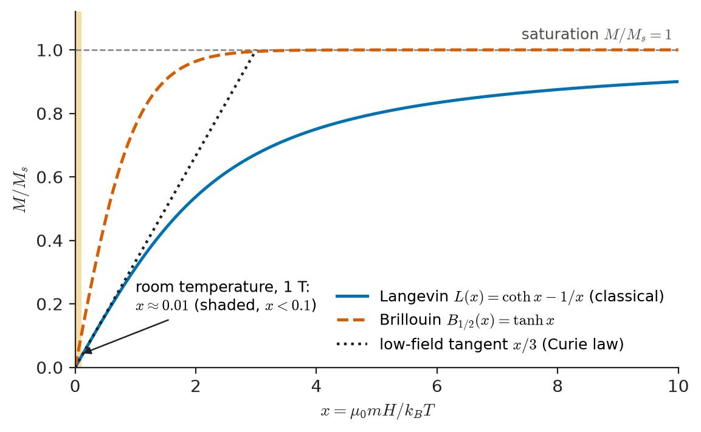
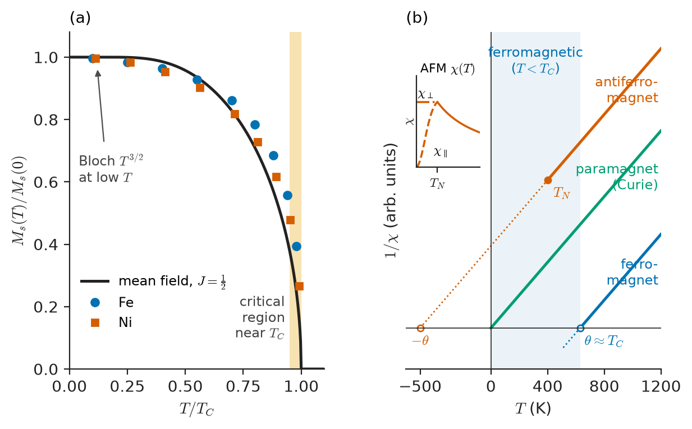
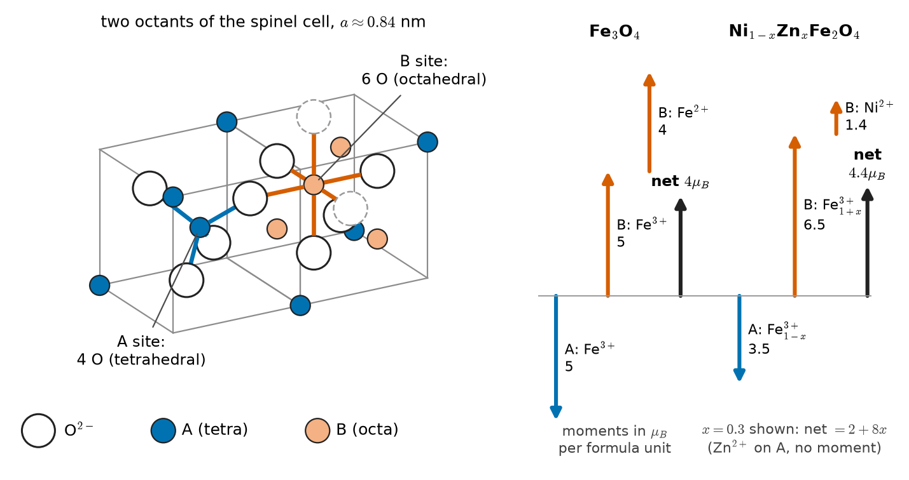
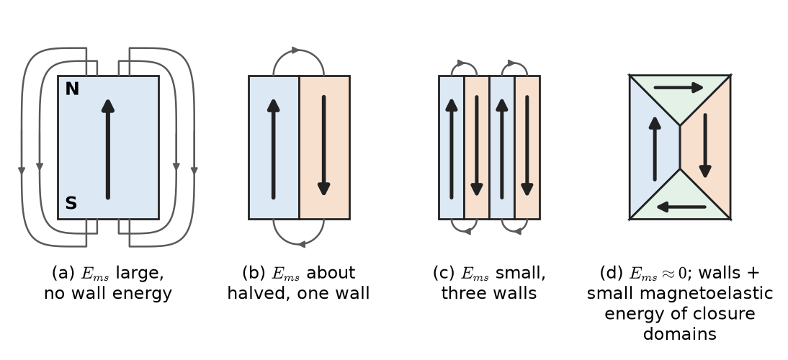
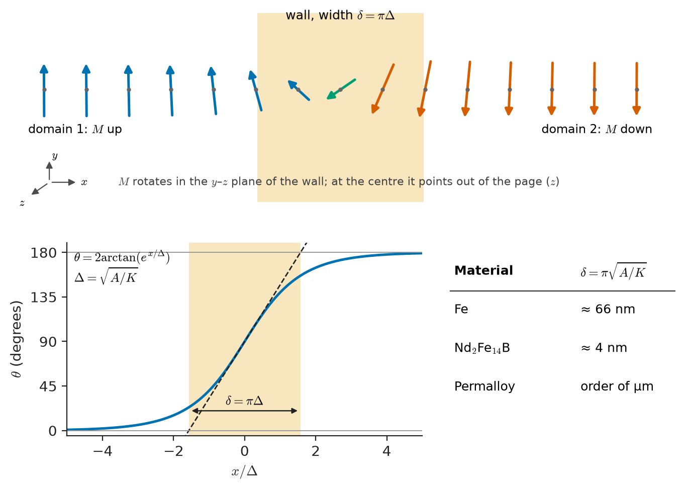
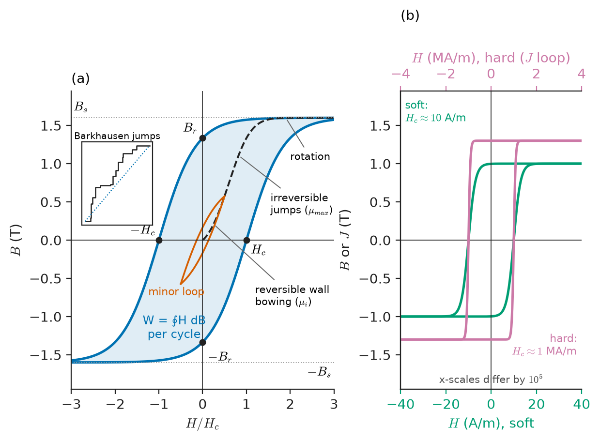

# Chapter 28 — Magnetic Material Behavior

*Part VI · Thermal, Electrical, Dielectric and Magnetic Materials*

A buck converter passes its room-temperature qualification without trouble. In the field, inside a sealed enclosure on a summer afternoon, it starts to fail: the inductor current, which should be a gentle triangle, develops sharp spikes at the top of every cycle, the MOSFETs run hot, and eventually one of them dies. Nothing in the circuit changed. The ferrite core of the inductor did. At 25 °C its saturation flux density was about 0.49 T; at 110 °C it is under 0.39 T. The peak flux that used to sit comfortably below the knee of the magnetization curve now reaches saturation, the permeability collapses towards that of air, and the inductance with it. The designer had used a magnetic material as if it were a fixed number — an inductance factor on a datasheet — when it is a population of atomic moments whose alignment fights thermal agitation and weakens long before a definite temperature, the Curie point, at which it vanishes altogether.

This chapter builds the materials picture an engineer needs to read a magnetic datasheet with understanding. Chemistry and physics explain where the atomic moments come from; this chapter takes them as given and asks what a solid does with them.

> **Why do some materials respond to a magnetic field a hundred thousand times more strongly than others, and why does that response disappear at a definite temperature?**
> **Why does a ferromagnet split into domains, and why does the way its domain walls move decide whether it becomes a transformer core or a permanent magnet?**

| Concept | Engineering destination |
|---|---|
| $B$, $H$, $M$, $\chi$, $\mu_r$; demagnetizing field | Reading datasheets; gapped cores; effective permeability of real parts |
| Diamagnetism and paramagnetism, Curie law | Non-magnetic structural metals, stainless steels near sensors, MRI-compatible parts, cryogenic sensing |
| Ferromagnetism, exchange, Curie–Weiss law | Why only Fe, Co, Ni, some rare earths and some oxides make useful cores and magnets |
| Antiferromagnetism, Néel temperature | Pinning layers in GMR/TMR sensors and read heads |
| Ferrimagnetism in spinel ferrites | High-frequency cores, EMI suppressors, the whole ferrite industry (Chapter 29) |
| Saturation magnetization $M_s$ | Maximum flux density of a core, hence core size and weight |
| Domains, anisotropy, magnetostriction | Permeability, transformer hum, stress sensitivity of cores |
| Domain-wall width and pinning | Soft versus hard behaviour; why grain size and purity matter |
| Hysteresis loop, $B_r$, $H_c$ | Core loss per cycle; permanent-magnet strength |
| $M_s(T)$, $T_C$, superparamagnetism | Thermal derating of inductors and magnets; Curie-point thermostats; data-retention limits |

**Roadmap.** Field quantities (28.1) → where moments come from (28.2) → weak magnetism: diamagnetism and paramagnetism (28.3–28.4) → cooperative magnetism: ferro-, antiferro- and ferrimagnetism (28.5–28.7) → saturation magnetization (28.8) → domains and walls (28.9–28.10) → wall motion and pinning (28.11) → hysteresis, remanence and coercivity (28.12–28.13) → temperature (28.14).

---

## 28.1 Magnetization, field and induction

### Three vector fields

An engineer meets three magnetic vector fields, and most datasheet confusion comes from mixing them.

- The **magnetic field strength** $\mathbf H$ (unit A/m) is set by free currents. In a toroid of $N$ turns carrying current $I$ around a mean path length $l$, Ampère's law gives $H=NI/l$. It is what the circuit controls.
- The **magnetization** $\mathbf M$ (A/m) is the magnetic dipole moment per unit volume of the material: $\mathbf M=n\langle\mathbf m\rangle$ for $n$ moments per cubic metre with average moment $\langle\mathbf m\rangle$ (each in A m²). It is what the material contributes.
- The **magnetic flux density** or induction $\mathbf B$ (tesla, T = Wb/m²) is what Faraday's law sees. It determines the voltage induced in a winding, $v=-N\,d\Phi/dt$ with $\Phi=\int\mathbf B\cdot d\mathbf A$, and the force on a conductor.

They are related by

$$
\mathbf B=\mu_0\left(\mathbf H+\mathbf M\right)=\mu_0\mathbf H+\mathbf J,\qquad \mu_0=4\pi\times10^{-7}\ \mathrm{H/m}
$$

where $\mathbf J=\mu_0\mathbf M$ is the **magnetic polarization**, measured in tesla. Magnet and steel datasheets quote $J$ (or "intrinsic induction" $B_i$) because it isolates the material's contribution; when a datasheet quotes "saturation polarization $J_s=2.03$ T" for a silicon steel it means $\mu_0M_s$.

> **Status of the principle: $\mathbf B=\mu_0(\mathbf H+\mathbf M)$**
> *Fundamental.* It is the definition of $\mathbf H$ that makes Maxwell's equations in matter close: $\nabla\cdot\mathbf B=0$ always, and $\nabla\times\mathbf H=\mathbf J_{\rm free}+\partial\mathbf D/\partial t$, with all bound (atomic) currents absorbed into $\mathbf M$.

### Susceptibility and permeability

For many materials, and for any material at small enough fields, $\mathbf M$ is proportional to $\mathbf H$:

$$
\mathbf M=\chi\mathbf H,\qquad \mathbf B=\mu_0(1+\chi)\mathbf H=\mu_0\mu_r\mathbf H,\qquad \mu_r=1+\chi
$$

The dimensionless **volume susceptibility** $\chi$ is the material's response per unit applied field; the **relative permeability** $\mu_r$ is what goes into inductance formulas. Their ranges are enormous: $\chi\approx-10^{-5}$ for copper, $+2\times10^{-5}$ for aluminium, and $\mu_r$ up to $10^5$ for annealed nickel–iron or nanocrystalline alloys. Three classes follow (Sections 28.3–28.7):

| Class | Sign and size of $\chi$ | Temperature dependence | Examples |
|---|---|---|---|
| Diamagnetic | $-10^{-6}$ to $-10^{-4}$ (superconductor: $-1$) | Essentially none | Cu, Ag, Au, Bi, water, most polymers, Si |
| Paramagnetic | $+10^{-6}$ to $+10^{-2}$ | Curie law $\chi\propto1/T$ for local moments; nearly constant for metals | Al, Pt, O₂, rare-earth salts, austenitic stainless steel |
| Ferro- and ferrimagnetic | $10$ to $10^6$, field-dependent, hysteretic | Vanishes at the Curie temperature $T_C$ | Fe, Ni, Co, electrical steels, ferrites, NdFeB |
| Antiferromagnetic | $+10^{-5}$ to $10^{-3}$ | Maximum at the Néel temperature $T_N$ | MnO, NiO, Cr, IrMn |

For ferromagnets "the" permeability is not one number, because $M$ is a nonlinear, history-dependent function of $H$. Datasheets distinguish:

- **initial permeability** $\mu_i=\lim_{H\to0}B/(\mu_0H)$ on the virgin curve — relevant to small-signal transformers and EMI chokes;
- **maximum (amplitude) permeability** $\mu_{\max}$, the largest $B/\mu_0H$ on the initial curve;
- **differential permeability** $\mu_{\rm diff}=(1/\mu_0)\,dB/dH$ — the slope at the operating point;
- **incremental (reversible) permeability** $\mu_\Delta$, for a small AC ripple superposed on a DC bias — the quantity that sets the inductance of a converter choke carrying DC;
- **complex permeability** $\mu=\mu'-j\mu''$ under sinusoidal excitation, where $\mu''$ measures loss (Chapter 29).

Older literature uses Gaussian (cgs) units, and magnet datasheets still do. The conversions in the next table appear on every magnet catalogue page.

| Quantity | SI unit | cgs unit | Conversion |
|---|---|---|---|
| $H$ | A/m | oersted (Oe) | 1 Oe = $10^3/4\pi$ A/m = 79.58 A/m |
| $B$, $J$ | T | gauss (G) | 1 G = $10^{-4}$ T |
| $M$ | A/m | emu/cm³ | 1 emu/cm³ = $10^3$ A/m |
| $\chi$ (volume) | dimensionless | dimensionless | $\chi_{\rm SI}=4\pi\chi_{\rm cgs}$ |
| $(BH)_{\max}$ | kJ/m³ | MGOe | 1 MGOe = 7.958 kJ/m³ |

### The demagnetizing field

A magnetized body of finite size carries effective magnetic "poles" on its end faces, and these produce a field inside the body opposite to $\mathbf M$, the **demagnetizing field**

$$
\mathbf H_d=-N\mathbf M
$$

where the **demagnetizing factor** $N$ (between 0 and 1, exactly computable for ellipsoids) depends only on shape: $N=1/3$ for a sphere, $N\to0$ for a long needle along its axis, $N=1$ for a thin plate magnetized perpendicular to its plane, and $N\approx0$ for a closed toroid. The field the material actually experiences is $H_{\rm int}=H_{\rm app}-NM$. For a high-permeability body this dominates: solving $M=\chi(H_{\rm app}-NM)$ gives an apparent susceptibility $\chi/(1+N\chi)$, which tends to $1/N$ as $\chi\to\infty$. A sphere of $\mu_r=10\,000$ behaves as if $\mu_r\approx4$. Shape, not material, then decides the response.

This is why magnetic cores are closed loops, and why an air gap — a deliberate, small demagnetizing feature — is such a powerful design knob. A core of path length $l_e$ and material permeability $\mu_r$ with a gap $l_g$ has an effective permeability

$$
\mu_e\approx\frac{\mu_r}{1+\mu_r l_g/l_e}
$$

For $\mu_r=2000$, $l_e=100$ mm and $l_g=1$ mm, $\mu_e=2000/21\approx95$. The gap makes the inductance almost independent of the scatter and temperature drift of $\mu_r$, and it stores most of the energy; Chapter 29 uses this when selecting inductor materials. The same shape effect makes a permanent magnet's operating point depend on its geometry (Section 28.13 and Chapter 29).

> **Status of the principle: demagnetizing factor $\mathbf H_d=-N\mathbf M$**
> *Derived* for uniformly magnetized ellipsoids, where it follows exactly from magnetostatics; *approximate* for other shapes, where $N$ varies over the body and only an average value can be quoted.

---

## 28.2 Where atomic moments come from

> **Boundary.** The quantum origin of electron spin, orbital angular momentum, Hund's rules and the filling of d and f shells belongs to the Advanced Chemistry core (atomic structure) and to Engineering Physics. This section only collects the results the materials engineer uses.

An electron carries a spin magnetic moment of almost exactly one **Bohr magneton**,

$$
\mu_B=\frac{e\hbar}{2m_e}=9.274\times10^{-24}\ \mathrm{A\,m^2}
$$

and its orbital motion contributes a further moment proportional to its orbital angular momentum. In a filled shell all spins and orbits pair off and the net moment is zero. A net atomic moment therefore requires a partly filled shell: the 3d shell of the transition metals Cr–Cu and the 4f shell of the rare earths. Hund's first rule (maximize total spin) gives, for example, five unpaired d electrons and $5\mu_B$ for Fe³⁺ and Mn²⁺ (d⁵), $4\mu_B$ for Fe²⁺ (d⁶), $3\mu_B$ for Co²⁺, $2\mu_B$ for Ni²⁺ and zero for Zn²⁺ (d¹⁰).

Two features of the solid change these free-ion values.

1. **Orbital quenching.** In a crystal, the electrostatic field of the neighbouring ions (the crystal field) locks the 3d orbitals to the lattice, and their orbital moment largely disappears. 3d-ion moments are therefore close to spin-only values. The small residual orbital moment couples the spin direction to the crystal axes through spin–orbit coupling; this is the origin of **magnetocrystalline anisotropy** (Section 28.9). The 4f shell lies deep inside the atom, is shielded from the crystal field, and keeps its large orbital moment — which is why rare-earth compounds have anisotropies a hundred times larger than iron.
2. **Band formation.** In metals the 3d electrons are not localized but form bands (Chapter 31). Moments are then non-integer: $2.22\mu_B$ per Fe atom, $1.72\mu_B$ per Co, $0.61\mu_B$ per Ni. They measure the imbalance between spin-up and spin-down d-band populations.

Moments alone do not make a magnet. A gas of independent $2\mu_B$ moments at room temperature is only weakly paramagnetic (Section 28.4). Strong magnetism requires an interaction that aligns neighbouring moments against thermal agitation — the exchange interaction of Section 28.5.

---

## 28.3 Diamagnetic materials

Every material is diamagnetic. When a field is switched on, Lenz's law acting on the electron orbits induces a small change in orbital current that opposes the field. A classical calculation (Larmor precession of the orbits) gives

$$
\chi_{\rm dia}=-\frac{\mu_0 n e^2}{6m_e}\sum_i\langle r_i^2\rangle
$$

summed over the electrons of each atom, with $n$ atoms per unit volume and $\langle r_i^2\rangle$ the mean-square orbit radius perpendicular to the field. For $n=8.5\times10^{28}$ m⁻³ (copper) and $\langle r^2\rangle=(0.1\ \mathrm{nm})^2$, each electron contributes about $-5\times10^{-6}$; summed over the few outer electrons with significant radius, $\chi\sim-10^{-5}$. The result is negative, small, and independent of temperature, because nothing thermal enters the derivation.

> **Status of the principle: Larmor diamagnetism**
> *Approximate.* The classical derivation gives the right sign and order of magnitude for closed-shell atoms and ions; it is masked whenever a material has any permanent moments, whose paramagnetism is usually larger.

Diamagnetism is the whole story only when there are no permanent moments: closed-shell ions (Na⁺, Cl⁻), covalent solids such as Si and diamond, noble metals in which the d shell is full (Cu, Ag, Au), most polymers, water and biological tissue. Bismuth and graphite are unusually strongly diamagnetic because their conduction electrons have very small effective masses and large orbits (Landau diamagnetism, Chapter 31's band picture). A superconductor expels flux almost completely: $\chi=-1$, perfect diamagnetism, a cooperative effect of an entirely different origin taken up in Chapter 30.

For an EEE engineer diamagnetism matters in three places: it makes copper and aluminium "non-magnetic" to the level that a current sensor near a busbar sees only the field of the current; it allows diamagnetic levitation demonstrations and pyrolytic-graphite position sensors; and it sets the background against which weak paramagnetic contamination is detected in precision instruments.

---

## 28.4 Paramagnetic materials

### Independent moments in a field: the Langevin model

Suppose each atom carries a permanent moment $m$ that does not interact with its neighbours. In a field $\mu_0H$ (strictly the local field; the difference is negligible for weak magnetization), a moment at angle $\theta$ to the field has energy $U=-\mu_0mH\cos\theta$. Thermal agitation randomizes orientations; Boltzmann statistics weights each by $e^{-U/k_BT}$. Averaging $\cos\theta$ over all directions of solid angle,

$$
\langle\cos\theta\rangle=\frac{\int_0^\pi\cos\theta\,e^{x\cos\theta}\sin\theta\,d\theta}{\int_0^\pi e^{x\cos\theta}\sin\theta\,d\theta}=\coth x-\frac1x\equiv L(x),\qquad x=\frac{\mu_0mH}{k_BT}
$$

$L(x)$ is the **Langevin function** (Figure 28.1). The magnetization is $M=nmL(x)$. Two limits matter:

- **Strong field or low temperature** ($x\gg1$): $L\to1$ and $M\to M_s=nm$, all moments aligned.
- **Weak field or high temperature** ($x\ll1$): expanding, $L(x)\approx x/3$.

The ratio $x$ is small in practice. For $m=5.92\mu_B$ (an Mn²⁺ ion) in a field of 1 T at 300 K, $x=mB/k_BT=0.013$. Laboratory fields can saturate a paramagnet only at liquid-helium temperatures. In the linear regime,

$$
M=\frac{n\mu_0m^2}{3k_BT}H\quad\Longrightarrow\quad \chi=\frac{C}{T},\qquad C=\frac{\mu_0nm^2}{3k_B}
$$

This is the **Curie law**, with **Curie constant** $C$ (in kelvin, for the dimensionless SI susceptibility). Measuring $\chi(T)$ and plotting $1/\chi$ against $T$ gives a straight line through the origin whose slope yields $m$: this is how effective moments of ions in solids are determined.

<!-- FIGURE 28.1 | figures/ch28/fig-28-1-langevin-function.png | plot | The Langevin function L(x) (classical moments) and the Brillouin function for J = 1/2, with the low-field tangent x/3 that gives the Curie law. | Content: x-axis x = mu0 m H / kB T from 0 to 10; y-axis M/Ms from 0 to 1. Solid curve L(x) = coth x − 1/x; dashed curve Brillouin B_1/2 (tanh x) for comparison; dotted straight line x/3 from origin to about x = 3. Shade the region x < 0.1 and annotate "room temperature, 1 T: x ≈ 0.01". Annotate saturation asymptote M/Ms = 1. -->

*Figure 28.1 — The Langevin function L(x) (classical moments) and the Brillouin function for J = 1/2, with the low-field tangent x/3 that gives the Curie law.*

> **Status of the principle: Curie law $\chi=C/T$**
> *Derived* from Boltzmann statistics for non-interacting permanent moments in the weak-field limit $\mu_0mH\ll k_BT$. It fails at low temperature or high field (saturation), and whenever moments interact (Sections 28.5–28.7).

**Quantum correction.** Moments are quantized: a moment of total angular momentum quantum number $J$ can take only $2J+1$ orientations. Repeating the average over those orientations replaces $L(x)$ by the **Brillouin function** $B_J(x)$, which approaches the Langevin function as $J\to\infty$ and equals $\tanh x$ for $J=1/2$. The Curie law survives, with $m^2$ replaced by $m_{\rm eff}^2=g^2J(J+1)\mu_B^2$, where $g$ is the Landé factor ($g=2$ for pure spin). For Mn²⁺ ($J=S=5/2$, $g=2$), $m_{\rm eff}=2\sqrt{35/4}\,\mu_B=5.92\mu_B$, which is the value measured in manganese salts.

**Worked example — Curie-law susceptibility of a dilute paramagnet.** A ceramic contains $n=1.0\times10^{28}$ Mn²⁺ ions per cubic metre, each with $m_{\rm eff}=5.92\mu_B=5.49\times10^{-23}$ A m², and the ions are far enough apart that they do not interact. The Curie constant is

$$
C=\frac{\mu_0nm^2}{3k_B}=\frac{(1.257\times10^{-6})(1.0\times10^{28})(5.49\times10^{-23})^2}{3(1.381\times10^{-23})}=0.914\ \mathrm{K}
$$

At 300 K, $\chi=0.914/300=3.0\times10^{-3}$; at 77 K (liquid nitrogen), $\chi=1.19\times10^{-2}$. In a field $\mu_0H=1$ T at room temperature the magnetization is $M=\chi H=3.0\times10^{-3}\times7.96\times10^5=2.4\times10^3$ A/m, about 0.4 % of the $M_s=nm=5.5\times10^5$ A/m that full alignment would give. A paramagnet is a material with moments but without order.

### Pauli paramagnetism of metals

Conduction electrons also carry spin moments, but they cannot all reorient freely: the Pauli principle allows only electrons within about $\mu_BB$ of the Fermi level to flip. The resulting **Pauli paramagnetism** is $\chi_P\approx\mu_0\mu_B^2g(E_F)$, where $g(E_F)$ is the density of states at the Fermi level (Chapter 31). It is small (about $10^{-5}$) and almost independent of temperature, because the fraction of electrons able to respond is set by the Fermi distribution, not by $k_BT$ alone. Aluminium, sodium and magnesium are Pauli paramagnets. Transition metals such as Pt, Pd, Ti and W have high $g(E_F)$ from their d bands and are noticeably more paramagnetic. Palladium is close to the threshold for ferromagnetism (Section 28.5).

### Representative values

| Material | Volume susceptibility $\chi$ (SI, room temperature, typical) | Type |
|---|---|---|
| Bismuth | $-1.7\times10^{-4}$ | Diamagnetic |
| Pyrolytic graphite (field ⊥ planes) | about $-4\times10^{-4}$ | Diamagnetic, strongly anisotropic |
| Copper | $-9.6\times10^{-6}$ | Diamagnetic |
| Silver | $-2.4\times10^{-5}$ | Diamagnetic |
| Gold | $-3.4\times10^{-5}$ | Diamagnetic |
| Water | $-9.0\times10^{-6}$ | Diamagnetic |
| Superconductor (Meissner state) | $-1$ | Perfect diamagnet (Chapter 30) |
| Oxygen gas, 1 atm | $+1.9\times10^{-6}$ | Paramagnetic (Curie) |
| Aluminium | $+2.2\times10^{-5}$ | Pauli paramagnetic |
| Tungsten | $+7\times10^{-5}$ | Paramagnetic |
| Titanium | $+1.8\times10^{-4}$ | Paramagnetic |
| Platinum | $+2.7\times10^{-4}$ | Paramagnetic |
| Austenitic stainless steel (304, annealed) | about $+3\times10^{-3}$ to $10^{-2}$ | Paramagnetic (can become partly ferromagnetic after cold work) |
| Manganese salt, ~10²⁸ ions/m³ | about $+3\times10^{-3}$ | Curie paramagnet |

The stainless-steel row is a common engineering trap. Austenitic (fcc) 304 is paramagnetic, but cold working transforms part of it to bcc martensite, which is ferromagnetic. Screws or sensor housings specified as "non-magnetic stainless" can disturb a nearby Hall sensor or compass after forming. Grade 316 is more stable against this transformation.

---

## 28.5 Ferromagnetism

### Spontaneous magnetization and the molecular field

Iron at room temperature holds a magnetization of $1.7\times10^6$ A/m with no applied field at all, inside each domain. The Curie law offers no route to this: with $x\approx0.01$ at 1 T, independent moments stay almost random. Pierre Weiss proposed in 1907 that each moment feels, besides the applied field, an internal **molecular field** proportional to the magnetization of its surroundings:

$$
H_{\rm eff}=H+\lambda M
$$

with $\lambda$ a dimensionless molecular-field constant. Substituting into the Curie law, $M=(C/T)(H+\lambda M)$, and solving for $M$:

$$
\chi=\frac MH=\frac{C}{T-\lambda C}=\frac{C}{T-\theta},\qquad \theta=\lambda C
$$

This is the **Curie–Weiss law**. As $T$ falls towards $\theta$ the susceptibility diverges: a vanishing field produces a finite magnetization. Below this temperature the material magnetizes spontaneously. In mean-field theory the ordering temperature, the **Curie temperature** $T_C$, equals $\theta$. Above $T_C$ the material is paramagnetic with an enhanced, Curie–Weiss susceptibility; below it, it is ferromagnetic (Figure 28.2b).

Below $T_C$ the spontaneous magnetization follows from self-consistency: the moments are aligned by the field their own alignment creates. Setting $H=0$,

$$
\frac{M_s(T)}{M_s(0)}=L\!\left(\frac{\mu_0m\lambda M_s(T)}{k_BT}\right)\quad\text{(or }B_J\text{ for quantized moments)}
$$

which has a non-zero solution only for $T<T_C$. The solution, plotted in Figure 28.2a, is flat at low temperature and falls steeply to zero at $T_C$. When $M_s/M_s(0)$ is plotted against $T/T_C$, very different ferromagnets fall close to one universal curve. Section 28.14 returns to this curve and to where the mean-field theory fails.

<!-- FIGURE 28.2 | figures/ch28/fig-28-2-ms-and-inverse-chi.png | plot | (a) Reduced spontaneous magnetization versus reduced temperature for Fe and Ni with the mean-field curve; (b) inverse susceptibility versus temperature for a paramagnet, a ferromagnet and an antiferromagnet. | Content: Panel (a): x-axis T/T_C from 0 to 1.1, y-axis Ms(T)/Ms(0) from 0 to 1; mean-field Brillouin J=1/2 curve as solid line; data points for Ni and Fe close to it; inset annotation "Bloch T^(3/2) at low T" and "critical region near T_C". Panel (b): x-axis T in K from 0 to 1200; y-axis 1/chi (arbitrary units). Paramagnet: straight line through origin (Curie). Ferromagnet: straight line intercepting T axis at theta ≈ T_C (positive), below T_C the line stops (ferromagnetic region shaded). Antiferromagnet: straight line above T_N extrapolating to a negative intercept −theta; mark T_N where the line ends. Small inset: chi (not 1/chi) versus T for the antiferromagnet, showing the cusp at T_N with chi_parallel falling to 0 and chi_perpendicular flat below T_N. -->

*Figure 28.2 — (a) Reduced spontaneous magnetization versus reduced temperature for Fe and Ni with the mean-field curve; (b) inverse susceptibility versus temperature for a paramagnet, a ferromagnet and an antiferromagnet.*

> **Status of the principle: Curie–Weiss law $\chi=C/(T-\theta)$**
> *Approximate.* It follows from the mean-field (molecular-field) model and describes the paramagnetic region well above $T_C$; close to $T_C$ correlated fluctuations make the measured paramagnetic $\theta$ slightly larger than $T_C$ (iron: $\theta\approx1100$ K against $T_C=1043$ K), and the critical behaviour deviates from mean-field predictions.

**Worked example — how strong is the molecular field in iron?** Iron has $T_C=1043$ K and $m=2.22\mu_B=2.06\times10^{-23}$ A m² per atom. In the classical mean-field model, $T_C=\lambda C=\lambda\mu_0nm^2/3k_B$, so the molecular field at full magnetization $M_s=nm$ is

$$
B_W=\mu_0\lambda M_s=\frac{3k_BT_C}{m}=\frac{3(1.381\times10^{-23})(1043)}{2.06\times10^{-23}}\approx2.1\times10^3\ \mathrm{T}
$$

(For spin-½ moments the factor 3 is absent and $B_W\approx700$ T.) Compare this with the actual magnetic dipole field produced at an atom by a neighbour at the nearest-neighbour distance $r=0.248$ nm:

$$
B_{\rm dip}\approx\frac{\mu_0}{4\pi}\frac{m}{r^3}=10^{-7}\times\frac{2.06\times10^{-23}}{(0.248\times10^{-9})^3}=0.13\ \mathrm{T}
$$

and the corresponding energy $mB_{\rm dip}/k_B\approx0.2$ K. Magnetic dipole–dipole forces could order iron only below about a kelvin. The "molecular field" of several hundred to a few thousand tesla is not a magnetic field at all. It is the energetic preference for parallel spins created by electrostatics and the Pauli principle — the exchange interaction.

### Exchange: the origin of the molecular field

> **Boundary.** The quantum-mechanical origin of exchange — the antisymmetry of the many-electron wavefunction, which makes the Coulomb energy depend on relative spin orientation — belongs to Engineering Physics and to the Advanced Chemistry core (the same physics as Hund's first rule and the triplet–singlet splitting of two-electron systems). Here it is used as a material parameter.

Two electrons with parallel spins must have an antisymmetric spatial wavefunction, which keeps them apart and lowers their Coulomb repulsion; with antiparallel spins they may overlap more. Depending on the orbitals involved and on the bonding, either alignment can win. The result is summarized by the Heisenberg form of the energy of two neighbouring spins,

$$
U_{ij}=-2\mathcal J\,\mathbf S_i\cdot\mathbf S_j
$$

with **exchange integral** $\mathcal J$ (an energy). $\mathcal J>0$ favours parallel alignment (ferromagnetism); $\mathcal J<0$ favours antiparallel (antiferromagnetism, ferrimagnetism). The mean-field constant $\lambda$ is a lumped measure of $z\mathcal J$ over $z$ neighbours, and in the mean-field approximation $k_BT_C$ is of order $z\mathcal J S(S+1)$, which is why $T_C$ is a direct read-out of exchange strength.

Three materials-level rules of thumb follow:

1. **Direct exchange depends on spacing.** In the 3d metals the sign of $\mathcal J$ depends on the ratio of interatomic spacing to the radius of the 3d shell. The empirical **Bethe–Slater curve** places Fe, Co and Ni on the positive (ferromagnetic) side and Mn and Cr on the negative side. Lattice spacing and structure therefore matter: fcc iron (austenite, stable above 912 °C) is not ferromagnetic, and adding elements that expand the Mn lattice (as in Heusler alloys such as Cu₂MnAl) can make manganese ferromagnetic.
2. **Band ferromagnetism needs a high density of states at $E_F$.** In metals the itinerant **Stoner criterion** $I\,g(E_F)>1$ (with $I$ an exchange energy) says a spin-split band lowers the energy if the d-band density of states at the Fermi level is large enough. Fe, Co and Ni meet it; Pd and Pt nearly do. The fractional moments of Section 28.2 follow naturally from the split bands.
3. **In oxides, exchange runs through oxygen.** Metal ions in ferrites and other oxides are too far apart for direct overlap; they couple through the intervening O²⁻ ion (**superexchange**). For a metal–oxygen–metal angle near 180° and half-filled d shells it is strongly antiparallel. This is why most magnetic oxides are antiferromagnetic or ferrimagnetic, not ferromagnetic (Sections 28.6–28.7).

> **Status of the principle: Heisenberg exchange $-2\mathcal J\,\mathbf S_i\cdot\mathbf S_j$**
> *Approximate.* It is an effective spin Hamiltonian derived from electrostatics plus the Pauli principle for localized electrons; it describes insulators (ferrites, garnets) well and metals only qualitatively, where a band description is needed.

### The ferromagnetic elements and compounds

| Material | Moment per atom or formula unit | $J_s$ at 20 °C (T) | $T_C$ (K) | $T_C$ (°C) |
|---|---|---|---|---|
| Fe (bcc) | $2.22\mu_B$ | 2.15 | 1043 | 770 |
| Co (hcp) | $1.72\mu_B$ | 1.79 | about 1390 | about 1115 |
| Ni (fcc) | $0.61\mu_B$ | 0.61 | 627 | 354 |
| Gd | $7.6\mu_B$ (at 0 K) | small (near $T_C$) | 293 | 20 |
| Fe–35Co | about $2.45\mu_B$ average | 2.45 | about 1210 | about 940 |
| Nd₂Fe₁₄B | — | 1.61 | 585 | 312 |
| SmCo₅ | — | 1.07 | about 1000 | about 720 |

Gadolinium's Curie point is at room temperature, so a gadolinium sample is ferromagnetic on a cold day and paramagnetic on a warm one — the basis of magnetocaloric refrigeration research.

---

## 28.6 Antiferromagnetism

When the exchange integral is negative, neighbouring moments align antiparallel. The simplest picture divides the lattice into two interpenetrating **sublattices**, A and B, each internally parallel and each antiparallel to the other, with equal and opposite sublattice magnetizations. The net magnetization is zero. The material is **antiferromagnetic** (Louis Néel, 1936).

Ordering again disappears at a critical temperature, the **Néel temperature** $T_N$. Above $T_N$ the material is paramagnetic, and the same molecular-field argument, now with a negative coupling between sublattices, gives

$$
\chi=\frac{C}{T+\theta},\qquad\theta>0
$$

so that $1/\chi$ extrapolates to a negative temperature intercept (Figure 28.2b). Below $T_N$ the susceptibility depends on direction. A field parallel to the sublattice axis finds the moments locked; as $T\to0$, $\chi_\parallel\to0$. A field perpendicular to the axis cants both sublattices slightly towards it, and $\chi_\perp$ stays roughly constant at its value at $T_N$. In a powder or polycrystal the measured susceptibility shows a cusp at $T_N$ — the experimental fingerprint of antiferromagnetic order. Neutron diffraction, which sees magnetic moments directly, confirmed the two-sublattice structure of MnO in 1949.

| Material | $T_N$ (K) | Paramagnetic $\theta$ (K) | Notes |
|---|---|---|---|
| MnF₂ | 67 | 82 | Classic two-sublattice antiferromagnet |
| MnO | 116 | 610 | Superexchange through O²⁻; $\theta/T_N\approx5$ from next-nearest-neighbour coupling |
| FeO | 198 | 570 | |
| CoO | 291 | 330 | Orders just below room temperature |
| NiO | 525 | about 2000 | Used in early spin-valve pinning layers |
| Cr (metal) | 311 | — | Spin-density-wave antiferromagnet |
| α-Fe₂O₃ (hematite) | about 950 | — | Weakly ferromagnetic through slight canting |
| IrMn (thin film) | about 700 | — | Pinning layer in GMR/TMR sensors and read heads |
| PtMn (thin film) | about 970 | — | High-temperature pinning layer |

An antiferromagnet has no useful net moment, so why does an electrical engineer care? Because when a ferromagnetic film is grown on an antiferromagnetic one and cooled through $T_N$ in a field, interfacial exchange "pins" the ferromagnet's magnetization in one direction. This **exchange bias** shifts the ferromagnet's hysteresis loop along the field axis by tens of kA/m. It provides the fixed reference layer in giant- and tunnel-magnetoresistance sensors, hard-disk read heads and MRAM cells (Chapter 29, Section 29.9). The relevant engineering limit is the *blocking temperature* of the pinning, usually well below the bulk $T_N$, which sets the maximum operating and processing temperature of the sensor stack.

> **Status of the principle: two-sublattice Néel model**
> *Approximate.* It explains the sign of $\theta$, the cusp at $T_N$ and the anisotropy of $\chi$ below $T_N$; the ratio $\theta/T_N$ differs from the mean-field value of 1 whenever more than one exchange path (nearest and next-nearest neighbours) contributes.

---

## 28.7 Ferrimagnetism in spinel ferrites

### Unequal sublattices

If the two antiparallel sublattices carry *unequal* moments, the cancellation is incomplete and a net spontaneous magnetization remains. Néel named this **ferrimagnetism** (1948). Macroscopically a ferrimagnet behaves like a ferromagnet — domains, hysteresis, a Curie temperature — but with a smaller saturation magnetization and with an insulating or semiconducting oxide lattice. That combination is decisive for electrical engineering: an oxide has electrical resistivity $10^6$ to $10^{14}$ times that of iron, so eddy currents (Chapter 29) are suppressed at their origin. Ferrites made high-frequency magnetics possible.

### The spinel structure

The **spinel ferrites** have formula MFe₂O₄ (M = Mn, Fe, Co, Ni, Cu, Zn, Mg, or mixtures). Their structure (Figure 28.3) is a face-centred cubic array of 32 O²⁻ ions in a cubic unit cell of edge about 0.84 nm, containing 8 formula units. The metal cations sit in interstices of two kinds:

- **A sites**, tetrahedrally coordinated by four oxygens: 64 per cell, of which 8 are occupied;
- **B sites**, octahedrally coordinated by six oxygens: 32 per cell, of which 16 are occupied.

The A–O–B bond angle is about 125°, and the A–B superexchange is strong and antiparallel. The A–A and B–B interactions are weaker. So the A sublattice and the B sublattice are aligned antiparallel, and the net moment per formula unit is

$$
m_{\rm f.u.}=m_B-m_A
$$

Which cations go where depends on crystal-field site preferences (Advanced Chemistry core; it is a bonding question). In a **normal spinel** the divalent M²⁺ occupies A and both Fe³⁺ occupy B; in an **inverse spinel** M²⁺ moves to B and one Fe³⁺ moves to A. Using the spin-only moments of Section 28.2:

| Ferrite | Cation distribution (A)[B] | Predicted $m_B-m_A$ | Measured (per f.u., 0 K) |
|---|---|---|---|
| Fe₃O₄ (magnetite) | (Fe³⁺)[Fe²⁺Fe³⁺] inverse | $(4+5)-5=4\mu_B$ | $4.1\mu_B$ |
| NiFe₂O₄ | (Fe³⁺)[Ni²⁺Fe³⁺] inverse | $(2+5)-5=2\mu_B$ | $2.3\mu_B$ |
| CoFe₂O₄ | (Fe³⁺)[Co²⁺Fe³⁺] inverse | $(3+5)-5=3\mu_B$ | $3.7\mu_B$ (orbital contribution) |
| MnFe₂O₄ | mostly (Mn²⁺)[Fe³⁺Fe³⁺], about 80 % normal | $10-5=5\mu_B$ | $4.6\mu_B$ |
| ZnFe₂O₄ | (Zn²⁺)[Fe³⁺Fe³⁺] normal | A empty of moments: no A–B coupling | Paramagnetic at room temperature ($T_N\approx10$ K) |

The agreement — within the uncertainty of cation distribution and residual orbital moments — is one of the clean successes of materials physics: the saturation magnetization of an oxide can be predicted by counting ions on sites.

<!-- FIGURE 28.3 | figures/ch28/fig-28-3-spinel-sublattices.png | crystal | One octant pair of the spinel unit cell showing tetrahedral A sites and octahedral B sites around the fcc oxygen array, with the antiparallel spin arrangement that gives magnetite its net 4 μB per formula unit. | Content: Left: two adjacent octants of the cubic spinel cell (a ≈ 0.84 nm): large open circles O2−, small dark circle at a tetrahedral A site with four O bonds drawn, small light circles at octahedral B sites with six O bonds drawn. Right: bar diagram of moments per formula unit for Fe3O4: A site Fe3+ arrow down (5 μB), B sites Fe3+ arrow up (5 μB) and Fe2+ arrow up (4 μB), net arrow up 4 μB. Second bar diagram for Ni(1−x)Zn(x)Fe2O4 showing net 2 + 8x as Zn enters A site. -->

*Figure 28.3 — One octant pair of the spinel unit cell showing tetrahedral A sites and octahedral B sites around the fcc oxygen array, with the antiparallel spin arrangement that gives magnetite its net 4 μB per formula unit.*

**Worked example — saturation magnetization of magnetite.** Magnetite has lattice parameter $a=0.8396$ nm and 8 formula units per cell, each carrying $4\mu_B$ net. The number of formula units per cubic metre is

$$
n_{\rm f.u.}=\frac{8}{(0.8396\times10^{-9}\ \mathrm{m})^3}=\frac{8}{5.918\times10^{-28}\ \mathrm{m^3}}=1.352\times10^{28}\ \mathrm{m^{-3}}
$$

so

$$
M_s(0)=n_{\rm f.u.}\times4\mu_B=1.352\times10^{28}\times4\times9.274\times10^{-24}=5.01\times10^5\ \mathrm{A/m},\qquad J_s=\mu_0M_s=0.63\ \mathrm{T}
$$

The measured room-temperature value is about $4.8\times10^5$ A/m ($J_s\approx0.60$ T); the difference is mostly thermal reduction at 300 K. A ferrite saturates at well under a third of iron's 2.15 T. That is the price paid for its resistivity, and it is why ferrite cores for the same power are physically larger than steel cores at low frequency — but much smaller at 100 kHz, where steel cannot be used at all.

Magnetite itself is not a useful power ferrite: electrons hop between Fe²⁺ and Fe³⁺ on equivalent B sites, giving a resistivity of only about $10^{-4}$ Ω m. Commercial ferrites keep the Fe²⁺ content low, which raises resistivity by many orders of magnitude (Chapter 29).

### Why zinc raises the moment

Zinc ferrite is non-magnetic at room temperature, yet adding zinc to nickel or manganese ferrite *increases* the saturation magnetization. Count again. In Ni$_{1-x}$Zn$_x$Fe₂O₄, Zn²⁺ strongly prefers A sites and pushes an equal amount of Fe³⁺ onto B:

$$
\text{A: }\mathrm{Zn}_x^{2+}\mathrm{Fe}_{1-x}^{3+},\qquad \text{B: }\mathrm{Ni}_{1-x}^{2+}\mathrm{Fe}_{1+x}^{3+}
$$

$$
m=\left[2(1-x)+5(1+x)\right]-5(1-x)=2+8x\quad(\mu_B\ \text{per f.u.})
$$

The moment rises from $2\mu_B$ at $x=0$ toward $6\mu_B$ at $x=0.5$. Experimentally the rise continues only up to about $x\approx0.4$–0.5. Beyond that the weakened A sublattice can no longer hold the B moments rigidly antiparallel, the B moments cant, and the moment falls again. At the same time $T_C$ falls steadily because there are fewer A–B exchange bonds. Zn content is therefore the main composition knob trading saturation and permeability against Curie temperature, in both MnZn and NiZn ferrites (Chapter 29).

> **Status of the principle: Néel sublattice counting $m=m_B-m_A$**
> *Approximate.* It assumes collinear, antiparallel sublattices and spin-only ionic moments; it fails when one sublattice is so diluted that canting sets in (high Zn content) and underestimates ions with unquenched orbital moment (Co²⁺).

### Other ferrimagnetic families

- **Hexagonal ferrites** (hexaferrites) such as BaFe₁₂O₁₉ and SrFe₁₂O₁₉ have 12 Fe³⁺ per formula unit on five sublattice types, a net $20\mu_B$, $J_s\approx0.47$ T, $T_C\approx720$–$740$ K, and a strong uniaxial anisotropy along the c axis. They are the hard ferrite permanent magnets of Chapter 29 and are also used in millimetre-wave devices.
- **Garnets** such as yttrium iron garnet Y₃Fe₅O₁₂ (YIG; $J_s\approx0.18$ T, $T_C\approx560$ K) have three sublattice types and extremely narrow ferromagnetic-resonance linewidths. They are the materials of microwave circulators, isolators and YIG-tuned filters (Chapter 35 covers high-frequency materials).

---

## 28.8 Saturation magnetization

The **saturation magnetization** $M_s$ is the magnetization reached when every moment in a single domain points the same way. It is an *intrinsic* property: it depends on composition and temperature, but not on grain size, defects or processing. That separates it sharply from permeability and coercivity, which are *extrinsic* and depend on microstructure (Sections 28.9–28.13).

$M_s$ matters because it sets the maximum flux density a core can carry. A transformer of given voltage and frequency needs a core cross-section $A$ with $V_{\rm rms}=4.44fNA\hat B$, and $\hat B$ must stay safely below $\mu_0M_s$. A higher saturation therefore means a smaller, lighter, cheaper core and less copper wound around it. For a permanent magnet, the remanence — and so the field it can produce — is bounded by $J_s$.

**Worked example — saturation polarization of iron from its moment per atom.** Body-centred cubic iron has a lattice parameter $a=0.2866$ nm and 2 atoms per cell. The atom density is

$$
n=\frac{2}{(0.2866\times10^{-9})^3}=\frac{2}{2.354\times10^{-29}}=8.50\times10^{28}\ \mathrm{m^{-3}}
$$

With $2.22\mu_B$ per atom at 0 K,

$$
M_s(0)=8.50\times10^{28}\times2.22\times9.274\times10^{-24}=1.75\times10^6\ \mathrm{A/m},\qquad J_s(0)=\mu_0M_s=2.20\ \mathrm{T}
$$

The measured value at 0 K is $J_s=2.22$ T, falling to 2.15 T at room temperature. Two lessons follow. First, $J_s$ is fixed by atomic moment and atom density, so no amount of processing can push a pure-iron core above about 2.2 T. Second, any non-magnetic addition dilutes it. Adding 3 wt% silicon to iron for resistivity (Chapter 29) lowers $J_s$ to about 2.03 T, and 6.5 wt% to about 1.80 T. Every soft-magnetic alloy design trades saturation against something else.

**Can one beat iron?** In Fe–Co alloys the average moment per atom *rises* above iron's, to a maximum of about $2.45\mu_B$ near 30–35 % Co. This is the top of the empirical **Slater–Pauling curve**, which plots average moment against electrons per atom for 3d alloys: adding electrons beyond iron's first fills the minority-spin band, increasing the spin imbalance, before the majority band saturates and the moment falls (Co, Ni). Fe–Co alloys (Permendur, Hiperco; $J_s=2.35$–2.45 T) are the highest-saturation practical soft magnets and are used where weight matters most: aircraft generators, actuators and high-specific-power motors. Cobalt's cost and the alloy's brittleness keep them out of mass applications.

| Material | $J_s$ at 20 °C (T) | $M_s$ (MA/m) | $T_C$ (°C) | Remark |
|---|---|---|---|---|
| Fe–(30–50)Co | 2.35–2.45 | 1.87–1.95 | about 940 | Highest practical saturation |
| Fe | 2.15 | 1.71 | 770 | Reference |
| Fe–3 % Si electrical steel | 2.0–2.03 | 1.60 | about 745 | Transformer, motor cores |
| Fe–6.5 % Si | 1.80 | 1.43 | about 700 | Near-zero magnetostriction |
| Co | 1.79 | 1.42 | about 1115 | |
| Fe-based amorphous (Fe–Si–B) | 1.56 | 1.24 | about 400 | Low-loss distribution transformers |
| Nd₂Fe₁₄B | 1.61 | 1.28 | 312 | Hard magnet phase |
| Nanocrystalline Fe–Si–B–Nb–Cu | 1.23–1.25 | 0.98 | about 570 | |
| Fe–50Ni | 1.5–1.6 | 1.2–1.3 | about 500 | |
| Fe–80Ni–Mo (Permalloy, mu-metal) | 0.7–0.8 | 0.56–0.64 | about 400–460 | Highest permeability |
| Ni | 0.61 | 0.485 | 354 | |
| Fe₃O₄ | 0.60 | 0.48 | 585 | |
| MnZn ferrite | 0.45–0.53 | 0.36–0.42 | 150–300 | Grade-dependent |
| BaFe₁₂O₁₉ / SrFe₁₂O₁₉ | 0.47 | 0.37 | about 450–460 | Hard ferrite |
| NiZn ferrite | 0.25–0.40 | 0.20–0.32 | 100–500 | Grade-dependent |
| Co-based amorphous | 0.5–0.8 | 0.4–0.64 | 200–400 | Zero magnetostriction |
| Y₃Fe₅O₁₂ (YIG) | 0.18 | 0.14 | about 285 | Microwave |

---

## 28.9 Magnetic domains and why they form

### The puzzle

Below its Curie temperature every small region of iron is magnetized to $M_s$. Yet an ordinary nail is not a magnet: its net magnetization is near zero until a field is applied, and then a field of only tens to hundreds of A/m — minute compared with the molecular field of Section 28.5 — magnetizes a soft iron part almost to saturation. Weiss's second hypothesis resolved both facts: the material is divided into **domains**, each spontaneously magnetized to $M_s$ but in different directions, so that the moments average to zero. Magnetizing a piece of iron does not create magnetization; it rearranges the domains.

Domains are not a defect. They are the equilibrium state that minimizes the total free energy, which contains five terms.

### The energy terms

**1. Exchange energy.** Exchange (Section 28.5) favours parallel neighbouring spins. In a continuum description, a spatial variation of the magnetization direction costs an energy density

$$
e_{\rm ex}=A\left[(\nabla\alpha_1)^2+(\nabla\alpha_2)^2+(\nabla\alpha_3)^2\right]
$$

where $\alpha_i$ are the direction cosines of $\mathbf M$ and $A$ is the **exchange stiffness** (J/m), of order $k_BT_C/a$ for lattice spacing $a$: about $2\times10^{-11}$ J/m for iron. Exchange alone would make the whole sample one domain.

**2. Magnetocrystalline anisotropy energy.** Because of spin–orbit coupling (Section 28.2), magnetization prefers certain crystal directions, the **easy axes**. For a cubic crystal,

$$
e_K=K_1\left(\alpha_1^2\alpha_2^2+\alpha_2^2\alpha_3^2+\alpha_3^2\alpha_1^2\right)+K_2\,\alpha_1^2\alpha_2^2\alpha_3^2
$$

For iron $K_1>0$ and the easy axes are the cube edges $\langle100\rangle$; for nickel $K_1<0$ and they are the body diagonals $\langle111\rangle$. For a uniaxial (hexagonal or tetragonal) crystal, $e_K=K_u\sin^2\theta$ with $\theta$ the angle from the c axis. Anisotropy energy is what a domain must pay to point anywhere other than an easy direction. It is small in cubic 3d metals and huge in rare-earth compounds, which is the single most important distinction between soft and hard materials.

**3. Magnetostatic (demagnetizing) energy.** A magnetized body with poles on its surfaces generates a stray field, and the stray field stores energy $\tfrac12\mu_0\int H^2\,dV$ over all space. For a uniformly magnetized body this equals $\tfrac12\mu_0NM_s^2$ per unit volume. Its natural scale is the **magnetostatic energy density**

$$
K_d=\tfrac12\mu_0M_s^2=\frac{J_s^2}{2\mu_0}
$$

which for iron is $(2.15)^2/(2\times1.257\times10^{-6})=1.84\times10^6$ J/m³ — the energy that a thin iron plate would store if magnetized perpendicular to its surface. Splitting into domains of alternating direction lets flux close locally and removes most of this energy. It is the driving force for domain formation.

**4. Magnetoelastic energy and magnetostriction.** A ferromagnet changes shape when magnetized: the lattice strains along the magnetization by the **saturation magnetostriction** $\lambda_s$ (about $-7\times10^{-6}$ for polycrystalline iron, $-33\times10^{-6}$ for nickel). Conversely, a mechanical stress $\sigma$ creates an anisotropy energy density

$$
e_\sigma=\tfrac32\lambda_s\sigma\sin^2\theta
$$

where $\theta$ is the angle between $\mathbf M$ and the stress axis. For a material with $\lambda_s>0$, tension along an axis makes it an easy axis. The effect is not small: $\lambda_s=30\times10^{-6}$ under $\sigma=100$ MPa gives $\tfrac32\lambda_s\sigma=4.5$ kJ/m³, comparable to or larger than the crystal anisotropy of most soft materials. Three engineering consequences follow. Soft magnetic properties degrade under clamping, punching and winding stress, which is why cores are stress-relief annealed and potted with care. Transformers **hum** at twice the line frequency (100 or 120 Hz and harmonics), because each half-cycle stretches and relaxes the core through magnetostriction. And materials with $\lambda_s\approx0$ — 80 % Ni permalloy, 6.5 % Si steel, Co-based amorphous and nanocrystalline alloys — are the softest and quietest of all. The opposite extreme, Terfenol-D with $\lambda_s\approx1.5$–$2\times10^{-3}$, is used deliberately in actuators and sonar.

**5. Zeeman energy.** In an applied field the magnetization has energy $e_Z=-\mu_0\mathbf M\cdot\mathbf H$, favouring domains aligned with $\mathbf H$. This is the term that moves walls in Section 28.11.

| Material | $K_1$ (J/m³) | Easy axis | $\lambda_s$ ($\times10^{-6}$) | $A$ (J/m) | $K_d=J_s^2/2\mu_0$ (J/m³) |
|---|---|---|---|---|---|
| Fe | $+4.8\times10^4$ | $\langle100\rangle$ | $-7$ ($\lambda_{100}=+21$, $\lambda_{111}=-21$) | $2.1\times10^{-11}$ | $1.84\times10^6$ |
| Fe–3 % Si | about $+3.5\times10^4$ | $\langle100\rangle$ | $\lambda_{100}\approx+23$ | about $2\times10^{-11}$ | $1.6\times10^6$ |
| Ni | about $-5\times10^3$ | $\langle111\rangle$ | $-33$ | about $1\times10^{-11}$ | $1.5\times10^5$ |
| Co (hcp) | $+4.1\times10^5$ (uniaxial) | c axis | about $-60$ | about $3\times10^{-11}$ | $1.27\times10^6$ |
| Fe–80Ni (Permalloy) | about 0 | — | about 0 | $1.3\times10^{-11}$ | about $2\times10^5$ |
| Fe₃O₄ | $-1.1\times10^4$ | $\langle111\rangle$ | about $+40$ | about $1\times10^{-11}$ | $1.4\times10^5$ |
| MnZn ferrite (power grade) | about $-10^2$ to $-10^3$, temperature-tuned | — | about $-1$ | — | about $9\times10^4$ |
| Nd₂Fe₁₄B | $+4.9\times10^6$ (uniaxial) | c axis | small | $7.7\times10^{-12}$ | $1.03\times10^6$ |
| SmCo₅ | $+1.7\times10^7$ (uniaxial) | c axis | small | about $1.2\times10^{-11}$ | $4.6\times10^5$ |
| BaFe₁₂O₁₉ | $+3.3\times10^5$ (uniaxial) | c axis | small | about $6\times10^{-12}$ | $8.8\times10^4$ |
| Terfenol-D (Tb–Dy–Fe₂) | small (compensated) | — | 1500–2000 | — | — |

### Domain subdivision

Figure 28.4 follows a single crystal as it lowers its energy. As one domain (a) it has a large stray field and pays the full magnetostatic energy. Splitting into two antiparallel domains (b) roughly halves the stray field energy at the cost of one **domain wall**, the transition layer between domains, which carries an energy per unit area $\gamma$ (Section 28.10). Further splitting into $n$ domains reduces the magnetostatic energy roughly in proportion to $1/n$ while adding wall area in proportion to $n$, so an optimum domain width exists. For stripe domains of width $D$ in a plate of thickness $L$, minimizing (wall energy per unit plate area $\gamma L/D$) plus (magnetostatic energy per unit area, about $0.136\,\mu_0M_s^2D$) gives

$$
D=\sqrt{\frac{\gamma L}{0.136\,\mu_0M_s^2}}\propto\sqrt L
$$

Thicker samples have wider domains. In a low-anisotropy cubic material such as iron, the crystal can do better still: triangular **closure domains** at the surfaces (Figure 28.4d) carry the flux around the ends inside the material, so almost no stray field leaves the body. The closure domains are magnetized along another easy axis, so they cost only a little magnetoelastic energy. Grain-oriented transformer steel, viewed under a Kerr microscope, shows exactly such slab domains running along the rolling direction with small closure domains at grain edges (Chapter 29).

The ratio $Q=K/K_d$ classifies behaviour. For iron $Q=4.8\times10^4/1.84\times10^6\approx0.03$: anisotropy is weak compared with magnetostatics, flux-closure patterns form readily, and the material is easily magnetized in any direction — the signature of a soft material. For Nd₂Fe₁₄B, $Q=4.9\times10^6/1.03\times10^6\approx4.8$: anisotropy wins, the magnetization stays along the c axis even against its own demagnetizing field, and the material can be a permanent magnet. A magnet material must have $Q>1$, and in practice $Q$ well above 1.

<!-- FIGURE 28.4 | figures/ch28/fig-28-4-domain-subdivision.png | schematic | Domain formation lowers magnetostatic energy: (a) single domain with large stray field, (b) two antiparallel domains, (c) four domains, (d) slab domains with triangular closure domains and no external stray field. | Content: Four square cross-sections of a crystal side by side. (a) single arrow up, field lines looping outside from top to bottom face, N/S labels. (b) two halves, arrows up and down, shorter outer loops. (c) four stripes alternating, very short outer loops. (d) two vertical slab domains plus triangular closure domains top and bottom with arrows forming a closed circulation, no outer field lines. Under each: label of the energy trade-off, from "(a) E_ms large, no wall energy" through "(b) E_ms about halved, one wall" and "(c) E_ms small, three walls" to "(d) E_ms ≈ 0, walls plus small magnetoelastic energy of closure domains". -->

*Figure 28.4 — Domain formation lowers magnetostatic energy: (a) single domain with large stray field, (b) two antiparallel domains, (c) four domains, (d) slab domains with triangular closure domains and no external stray field.*

### Single-domain particles

Shrink the sample and the balance changes: magnetostatic energy scales with volume ($r^3$), wall energy with area ($r^2$). Below a critical size a wall no longer pays for itself and the particle stays a single domain. For a sphere, equating the magnetostatic energy of the single-domain state, $\tfrac16\mu_0M_s^2\cdot\tfrac43\pi r^3$, with roughly half that plus a wall of area $\pi r^2$ gives a critical radius $r_c\approx9\gamma/(\mu_0M_s^2)$, or with $\gamma=4\sqrt{AK}$ from Section 28.10,

$$
d_c\approx\frac{72\sqrt{AK}}{\mu_0M_s^2}
$$

For Nd₂Fe₁₄B this gives $d_c\approx0.2$ μm; for iron, about 20 nm (where the crude model is least reliable, since soft particles can also curl their magnetization). Single-domain particles cannot be magnetized or demagnetized by wall motion — only by rotating the whole moment against the anisotropy — which makes them potentially very hard. This is the design principle of fine-particle and nanostructured magnets (Section 28.13) and of recording media. Below an even smaller size, thermal energy can flip the whole particle: superparamagnetism (Section 28.14).

> **Status of the principle: domain formation by energy minimization**
> *Derived* from minimizing the sum of exchange, anisotropy, magnetostatic, magnetoelastic and Zeeman energies (micromagnetics); the closed-form domain widths and critical sizes quoted here are *approximate* scaling estimates that capture trends and orders of magnitude, not precise values.

---

## 28.10 Domain walls

### Why the wall has a width

Between two domains magnetized in opposite directions, the magnetization must turn through 180°. Exchange wants this rotation to be as gradual as possible, because the energy cost of a small angle $\phi$ between neighbouring spins is proportional to $\phi^2$: spreading a 180° turn over $N$ atomic planes costs exchange energy proportional to $N(\pi/N)^2=\pi^2/N$, which falls as the wall widens. Anisotropy wants the rotation to be abrupt, because every spin inside the wall points away from the easy axis and pays anisotropy energy proportional to the wall's width. The wall width is the compromise. In a **Bloch wall** the magnetization rotates in the plane of the wall, so that no magnetic poles appear on its faces (Figure 28.5).

**Estimate.** Model a 180° wall of width $\delta$ as a uniform rotation $d\theta/dx=\pi/\delta$. The exchange energy per unit wall area is $A(\pi/\delta)^2\delta=A\pi^2/\delta$. The anisotropy energy per unit area is $\int K\sin^2\theta\,dx\approx K\delta/2$, since the average of $\sin^2\theta$ across the wall is ½. Minimizing the sum

$$
\gamma(\delta)=\frac{A\pi^2}{\delta}+\frac{K\delta}{2},\qquad \frac{d\gamma}{d\delta}=0\ \Rightarrow\ \delta=\pi\sqrt{\frac{2A}{K}},\qquad \gamma=\pi\sqrt{2AK}
$$

**Exact result.** Minimizing the energy functional $\int[A(d\theta/dx)^2+K\sin^2\theta]\,dx$ properly gives the profile $\theta(x)=2\arctan[\exp(x/\Delta)]$ with $\Delta=\sqrt{A/K}$, and

$$
\delta=\pi\sqrt{\frac AK},\qquad \gamma=4\sqrt{AK}
$$

where $\delta$ is the width obtained by extending the slope at the wall centre. The estimate and the exact result agree to within a factor $\sqrt2$ in width and 11 % in energy. What matters is the scaling: width grows with $\sqrt{A/K}$, energy with $\sqrt{AK}$.

> **Status of the principle: Bloch-wall width $\delta=\pi\sqrt{A/K}$ and energy $\gamma=4\sqrt{AK}$**
> *Derived* from continuum micromagnetics for a 180° wall in an infinite uniaxial crystal; *approximate* for cubic crystals (90° walls, $K_1$ replaces $K$ with modified numerical factors), for thin films and for walls narrower than a few lattice spacings, where the continuum description fails.

<!-- FIGURE 28.5 | figures/ch28/fig-28-5-bloch-wall.png | schematic | Rotation of the magnetization through a 180° Bloch wall, with the angle profile θ(x) = 2 arctan(exp(x/Δ)) and the wall width δ = π√(A/K). | Content: Top: a row of about 15 arrows across the wall, left domain arrows pointing up, rotating out of the page plane (drawn in perspective, rotation in the wall plane) to pointing down on the right; wall region shaded. Bottom: plot of θ (0 to 180°) versus x/Δ (−5 to +5), sigmoid curve, tangent line at centre intersecting 0 and 180° marking δ. Side table: Fe δ ≈ 66 nm, Nd2Fe14B δ ≈ 4 nm, Permalloy δ of order μm. -->

*Figure 28.5 — Rotation of the magnetization through a 180° Bloch wall, with the angle profile θ(x) = 2 arctan(exp(x/Δ)) and the wall width δ = π√(A/K).*

**Worked example — walls in iron and in a rare-earth magnet.** For iron, $A=2.1\times10^{-11}$ J/m and $K_1=4.8\times10^4$ J/m³ (treating the cubic anisotropy as a uniaxial $K$ for an order-of-magnitude result):

$$
\delta=\pi\sqrt{\frac{2.1\times10^{-11}}{4.8\times10^4}}=\pi\times2.09\times10^{-8}=66\ \mathrm{nm},\qquad \gamma=4\sqrt{(2.1\times10^{-11})(4.8\times10^4)}=4.0\times10^{-3}\ \mathrm{J/m^2}
$$

The wall spans about $66/0.287\approx230$ lattice spacings. For Nd₂Fe₁₄B, $A=7.7\times10^{-12}$ J/m and $K_1=4.9\times10^6$ J/m³:

$$
\delta=\pi\sqrt{\frac{7.7\times10^{-12}}{4.9\times10^6}}=\pi\times1.25\times10^{-9}=3.9\ \mathrm{nm},\qquad \gamma=4\sqrt{(7.7\times10^{-12})(4.9\times10^6)}=2.5\times10^{-2}\ \mathrm{J/m^2}
$$

The rare-earth wall is seventeen times thinner and six times more energetic. These two numbers explain much of Chapter 29. A wide, low-energy wall in iron glides past features much smaller than 66 nm hardly noticing them; a 4 nm wall in NdFeB is caught by atomic-scale disorder at grain boundaries. And in near-zero-anisotropy permalloy and nanocrystalline alloys, walls are micrometres wide and are barely pinned by anything — the root of their extreme softness.

### Néel walls in thin films

In a film thinner than the Bloch-wall width, a Bloch wall would put poles on the film surfaces where its central spins point out of plane. It becomes cheaper for the magnetization to rotate *within the film plane*, creating poles on the wall faces instead. Such **Néel walls** dominate in permalloy films below a few tens of nanometres thick — the layers in magnetoresistive sensors and read heads. Their stray fields make neighbouring walls interact, which is why thin-film sensor elements are shaped and biased to stay single-domain (Chapter 29).

---

## 28.11 Domain-wall motion and pinning

### How a material magnetizes

Apply a slowly increasing field to a demagnetized polycrystal. The **initial magnetization curve** (Figure 28.6) has three regions, each tied to a domain process:

1. **Reversible wall displacement** (low fields). Domains favourably oriented to $\mathbf H$ grow at the expense of others by small displacements of their walls, which bow out between pinning points like elastic membranes. Removing the field lets them spring back. The slope here is the initial permeability $\mu_i$.
2. **Irreversible wall displacement** (intermediate fields, the steep part). A wall pressed hard enough breaks free from a pinning site and jumps to the next one, sweeping a volume in microseconds. These jumps are **Barkhausen jumps**; picked up by a search coil they sound like crackling and form the basis of Barkhausen-noise inspection of residual stress and heat treatment in steel parts. Most of the magnetization change, and most of the hysteresis loss, occurs here; the maximum permeability $\mu_{\max}$ lies in this region.
3. **Rotation** (high fields). Once walls have swept out, each grain is a single domain magnetized along the easy axis nearest to $\mathbf H$. Further increase turns $\mathbf M$ away from the easy axis toward $\mathbf H$ against the anisotropy. This **approach to saturation** is slow and needs fields of order $K/\mu_0M_s$.

The wall process works only because a wall moves under a small force. The applied field exerts a pressure on a 180° wall equal to the difference in Zeeman energy density between the two sides, $p=2\mu_0M_sH$. For iron at $H=10$ A/m, $p=2\times1.257\times10^{-6}\times1.71\times10^6\times10\approx43$ Pa. That is a minute pressure, but it acts on a wall that can move without changing $M$ anywhere except within itself.

### Pinning: why walls stick

If the material were perfectly uniform, the wall energy $\gamma$ would be the same everywhere and a wall would move under an arbitrarily small field. Real materials contain inclusions, precipitates, voids, dislocations, grain boundaries, local stresses and composition fluctuations (Chapter 5). Each changes the local $A$, $K$, $M_s$ or $\lambda_s\sigma$ and so makes the wall energy depend on position, $\gamma(x)$. A wall then needs a field to climb out of every energy minimum; the largest restoring force $\max(d\gamma/dx)$ across the sample sets the field required, giving approximately

$$
H_c\approx\frac{1}{2\mu_0M_s}\left(\frac{d\gamma}{dx}\right)_{\max}
$$

Two features of pinning are central to materials design.

- **Pinning is strongest when the obstacle is about as large as the wall is wide.** A defect much smaller than $\delta$ changes the energy of only a tiny fraction of the wall; a defect much larger than $\delta$ presents a gentle, almost flat energy landscape. In iron, with $\delta\approx66$ nm, carbide and nitride precipitates and non-metallic inclusions of 0.05–1 μm are the most damaging. This is why electrical steels are decarburized to below about 30 ppm C: otherwise slow carbide precipitation during service raises coercivity and loss (**magnetic ageing**; Chapter 44).
- **Inclusions also create closure domains.** A non-magnetic inclusion intersected by a wall reduces the wall area (lowering the energy) and, when isolated inside a domain, carries poles and spike-like closure domains that attach to passing walls. Kersten's and Néel's inclusion theories give $H_c$ increasing with inclusion volume fraction, roughly as $v^{2/3}$, and with $K$ or $\lambda_s\sigma$.

Grain boundaries pin too, partly because the easy axis changes direction across them. In conventional soft materials coercivity falls with increasing grain size $D$ roughly as $H_c\propto1/D$; this is why non-oriented motor steels are annealed to grain sizes of 100–150 μm, and why grain-oriented steels have grains of millimetres to centimetres (Chapter 29). The trend reverses dramatically below the exchange length in nanocrystalline alloys, where $H_c\propto D^6$ — the random-anisotropy effect developed in Chapter 29.

### Two ways to make a material soft, two ways to make it hard

For **soft** materials the recipe is to make walls move easily: low anisotropy $K$ (wide walls, weak pinning), near-zero magnetostriction (no stress pinning), high purity, few inclusions, large grains (or, alternatively, grains far below the exchange length), and annealing to remove dislocations and residual stress.

For **hard** materials there are two strategies:

- **Pinning-type** magnets deliberately fill the material with obstacles comparable in size to the narrow wall, so that walls exist but cannot move. Sm₂Co₁₇-type magnets work this way: a cellular nanostructure of Sm₂Co₁₇ cells about 100 nm across, bounded by thin SmCo₅-type cell-boundary phase with different wall energy, pins walls at the cell boundaries.
- **Nucleation-type** magnets are made of grains so well isolated and perfect that, once saturated, a grain contains *no* walls; reversal requires nucleating a reversed domain, usually at a surface or grain-boundary defect where anisotropy is locally reduced. Sintered NdFeB and SmCo₅ work this way. In a nucleation magnet the critical engineering feature is the grain boundary: a thin non-magnetic Nd-rich layer that decouples the grains magnetically, and a grain surface with high local anisotropy (the reason for dysprosium diffusion into grain shells, Chapter 29).

> **Status of the principle: coercivity controlled by wall pinning or nucleation**
> *Approximate.* The pinning and nucleation models identify which microstructural features control $H_c$ and give correct trends with defect size, grain size and anisotropy; quantitative coercivity prediction from microstructure still requires micromagnetic simulation, and the absolute values are typically uncertain by a factor of two or more.

---

## 28.12 Hysteresis

### The loop

Take a ferromagnet to saturation in a large positive field, reduce the field to zero, reverse it, and return. $B$ (or $M$) does not retrace its path. The closed curve traced under a cyclic field is the **hysteresis loop** (Figure 28.6). Its key points are:

- the **saturation** induction $B_s$ (or polarization $J_s=\mu_0M_s$) at the tips;
- the **remanence** $B_r$, the induction left at $H=0$ after saturation;
- the **coercivity** $H_c$, the reverse field needed to bring $B$ (or $M$) back to zero;
- the **minor loops** traced when the field amplitude does not reach saturation, nested inside the major loop. A transformer at 1.5 T in a material that saturates at 2.0 T runs on a minor loop.

Hysteresis exists because the processes of Section 28.11 are irreversible. When a wall jumps from one pinning site to the next, the energy released is not stored. It is dissipated, as eddy currents around the moving wall and as spin waves that end as heat. The magnetization lags the field because it can only move in jumps, each of which needs the field to exceed a local pinning threshold.

<!-- FIGURE 28.6 | figures/ch28/fig-28-6-hysteresis-loop.png | plot | Hysteresis loop of a ferromagnet with initial magnetization curve, saturation, remanence and coercivity, a minor loop, and a comparison of soft and hard loops. | Content: Main panel: x-axis H in units of Hc, from −3 to +3; y-axis B (T), from −Bs to +Bs. Major loop with labels Bs at tips, Br at H = 0 intercepts, −Hc at B = 0 intercept. Dashed initial curve from origin with three regions marked: "reversible wall bowing (μi)", "irreversible jumps (μmax)", "rotation". Small nested minor loop around the origin. Inset staircase on steep section showing Barkhausen jumps. Second panel: on shared B axis, narrow tall loop labelled "soft: Hc ≈ 10 A/m" and wide square loop labelled "hard: Hc ≈ 1 MA/m" (log note: x-scales differ by 10^5). Shade the loop area labelled "W = ∮H dB per cycle". -->

*Figure 28.6 — Hysteresis loop of a ferromagnet with initial magnetization curve, saturation, remanence and coercivity, a minor loop, and a comparison of soft and hard loops.*

### Energy dissipated per cycle

Why does the loop area represent energy? Consider a toroidal core of cross-section $A$ and mean path $l$ wound with $N$ turns. The source drives current $i$ against the induced voltage $v=NA\,dB/dt$. In time $dt$ it delivers energy $vi\,dt=NA\,dB\cdot i$. Using $H=Ni/l$, this is $(Al)\,H\,dB$: per unit volume, the work done on the material is $H\,dB$. Around a closed cycle the stored energy returns to its starting value, so the net work per unit volume per cycle is

$$
W_h=\oint H\,dB\quad(\mathrm{J/m^3\ per\ cycle})
$$

the area of the $B$–$H$ loop. At frequency $f$ the hysteresis power per unit volume is $P_h=fW_h$.

> **Status of the principle: loop area equals energy dissipated per cycle**
> *Fundamental.* It follows from Faraday's and Ampère's laws and energy conservation, with no assumption about the material. At low frequency the loop is the static (hysteresis) loop; at higher frequency the same formula applied to the dynamic loop includes eddy-current loss as well (Chapter 29).

**Worked example — hysteresis loss of a motor steel, and why a magnet is never cycled.** A non-oriented electrical steel has coercivity $H_c=40$ A/m and is cycled to $\hat B=1.5$ T at 50 Hz. A loop cannot be wider than $2H_c$ or taller than $2\hat B$, and a rectangle with these sides gives an upper bound

$$
W_h\lesssim4H_c\hat B=4\times40\times1.5=240\ \mathrm{J/m^3}
$$

At 50 Hz this is $P_h\lesssim240\times50=1.2\times10^4$ W/m³. With density 7650 kg/m³, $P_h\lesssim1.6$ W/kg. Measured hysteresis losses of such steels at 1.5 T, 50 Hz are about 1.3–2 W/kg — the bound is close because steel loops are fairly square at high induction. For a 10 kg stator core, 15 W of heat comes from hysteresis alone; Chapter 29 adds the eddy-current terms.

Now a hard ferrite magnet with $H_{cJ}=300$ kA/m and $J_s=0.40$ T. Its intrinsic loop, if cycled fully, would enclose about $4H_{cJ}J_s=4\times3\times10^5\times0.40=4.8\times10^5$ J/m³ per cycle — two thousand times the steel's. At 50 Hz that is 24 MW/m³: the magnet would melt. Permanent magnets are designed so they *never* traverse their loop. They sit at an operating point in the second quadrant and move only along nearly reversible recoil lines (Chapter 29).

### The Rayleigh region

At low field amplitudes $\hat H$, well below the coercivity, the loop is a narrow lens and the permeability rises linearly with amplitude: $\mu=\mu_i+\nu\hat H$, with **Rayleigh constant** $\nu$. The loop branches are parabolas and the hysteresis energy per cycle is

$$
W_h=\tfrac43\mu_0\nu\hat H^3
$$

Since $\hat B\approx\mu_0\mu_i\hat H$ at low amplitude, the loss scales as $\hat B^3$ — a steeper dependence than at high inductions, where measured exponents are closer to 1.6–2. This is one reason the Steinmetz exponent of Chapter 29 is not a constant, and why low-level signal transformers and current sensors are designed around the Rayleigh behaviour.

> **Status of the principle: Rayleigh law**
> *Empirical.* It describes the low-amplitude, nearly reversible regime of wall motion in a random pinning landscape (Néel later gave it a statistical justification); it fails once $\hat H$ approaches $H_c$.

---

## 28.13 Remanence and coercivity

### Remanence

After saturation and removal of the field, each grain relaxes its magnetization to the easy axis closest to the previous field direction (assuming no walls re-enter). The remanence ratio $M_r/M_s$ therefore depends on how easy axes are distributed:

| Grain easy-axis distribution (non-interacting, no walls) | $M_r/M_s$ |
|---|---|
| All easy axes aligned with the field (perfect texture) | 1 |
| Random uniaxial grains | 0.5 |
| Random cubic grains, $K_1>0$ (six $\langle100\rangle$ directions) | 0.83 |
| Random cubic grains, $K_1<0$ (eight $\langle111\rangle$ directions) | 0.87 |
| Sintered NdFeB pressed and aligned in a field (real) | 0.95–0.97 |

Permanent magnets need high remanence, so their powders are aligned in a strong field during pressing to make the c axes parallel: an anisotropic sintered magnet has nearly twice the remanence of an isotropic one of the same composition. Exchange coupling between very fine grains can raise $M_r/M_s$ above 0.5 even for random orientation (remanence enhancement), at the expense of coercivity.

Soft materials want the opposite of high remanence in most applications — a core that stays magnetized after the current stops is a nuisance (inrush current in transformers). But a *square* loop with high $B_r/B_s$ is wanted in magnetic amplifiers and some pulse cores, and a deliberately *flat* (sheared) loop with low $B_r$ is wanted in current transformers and chokes carrying DC. These shapes are set by field annealing or by an air gap (Chapter 29).

### Coercivity: intrinsic and normal

Two coercivities appear on a magnet datasheet, and the distinction matters:

- the **intrinsic coercivity** $H_{cJ}$ (or $_iH_c$) is the reverse field at which $J=\mu_0M=0$. It measures the material's resistance to reversal.
- the **normal coercivity** $H_{cB}$ (or $_bH_c$) is the reverse field at which $B=\mu_0H+J=0$.

Since $B=\mu_0H+J$, a magnet whose $J$ stays at $B_r$ until large reverse fields has a straight $B$–$H$ demagnetization line of slope $\mu_0\mu_{\rm rec}$, where the **recoil permeability** $\mu_{\rm rec}$ is close to 1 (1.03–1.10 for NdFeB and ferrite). The $B=0$ point then lies at $H_{cB}=B_r/(\mu_0\mu_{\rm rec})$. For NdFeB with $B_r=1.30$ T and $\mu_{\rm rec}=1.05$, $H_{cB}=985$ kA/m, whatever the intrinsic coercivity, as long as $H_{cJ}$ exceeds it. $H_{cB}$ can never exceed $B_r/\mu_0$; $H_{cJ}$ can be far larger, and is what decides whether a magnet survives heat and opposing fields (Chapter 29).

### An upper bound: coherent rotation

What is the largest possible coercivity? Consider a single-domain particle (Section 28.9) with uniaxial anisotropy $K$, magnetized along its easy axis, and a reverse field along that axis. With no walls, the only way to reverse is for the whole moment to rotate. The energy per unit volume as a function of angle $\theta$ from the original direction is

$$
e(\theta)=K\sin^2\theta+\mu_0M_sH\cos\theta
$$

(with $H$ the magnitude of the reverse field). The original state $\theta=0$ is a minimum as long as $d^2e/d\theta^2=2K-\mu_0M_sH>0$. It becomes unstable, and the moment flips, at the **anisotropy field**

$$
H_K=\frac{2K}{\mu_0M_s}
$$

This is the **Stoner–Wohlfarth** result.

> **Status of the principle: Stoner–Wohlfarth switching field $H_K=2K/\mu_0M_s$**
> *Derived* for a single-domain particle reversing by uniform rotation at zero temperature, with the field along the easy axis; it is an upper bound on coercivity for real materials, which reverse by easier, non-uniform paths.

For Nd₂Fe₁₄B, $H_K=2\times4.9\times10^6/1.61=6.1\times10^6$ A/m, i.e. $\mu_0H_K\approx7.6$ T. Real sintered NdFeB magnets achieve $H_{cJ}\approx1$–$2.5$ MA/m, only 15–40 % of $H_K$. This shortfall, known as **Brown's paradox**, is not a mystery but a measurement of defects. Reversal nucleates at grain surfaces where anisotropy is locally degraded, and at sharp corners where demagnetizing fields concentrate. For iron, $H_K=2\times4.8\times10^4/2.15=4.5\times10^4$ A/m, while soft iron has $H_c\approx10$–$80$ A/m — a thousand times lower, because walls do the work and rotation is never needed. Coercivity is therefore the most structure-sensitive of all magnetic properties: the same composition can span several orders of magnitude depending on processing.

| Material class | Typical $H_c$ (A/m) | Controlling mechanism |
|---|---|---|
| Co-based amorphous, Finemet, Supermalloy | 0.2–2 | Near-zero $K$ and $\lambda_s$, wide walls |
| 80Ni Permalloy, Fe-based amorphous | 1–5 | Low $K$, low pinning |
| Grain-oriented Si steel | 5–10 | Large grains, low C, texture |
| Non-oriented Si steel, pure iron | 20–100 | Grain size, inclusions |
| MnZn / NiZn ferrite | 5–20 / 20–300 | Porosity, grain size, $K$ |
| AlNiCo | $4\times10^4$–$1.6\times10^5$ | Shape anisotropy of rod precipitates |
| Hard ferrite | $2\times10^5$–$4\times10^5$ ($H_{cJ}$) | Single-domain-size grains, $K$ |
| NdFeB, SmCo | $8\times10^5$–$3\times10^6$ ($H_{cJ}$) | Nucleation or pinning, very high $K$ |

The coercivity of commercial magnetic materials spans seven orders of magnitude. Chapter 29 places the boundary between soft and hard and selects within each class.

---

## 28.14 Temperature dependence of magnetic behaviour

### Saturation magnetization and the Curie temperature

The spontaneous magnetization falls with temperature as thermal agitation disorders the moments, and it vanishes at $T_C$ (Figure 28.2a). Three regimes deserve attention.

- **Low temperature.** The mean-field theory predicts an exponentially flat start, but measurements follow **Bloch's $T^{3/2}$ law**, $M_s(T)=M_s(0)\,(1-bT^{3/2})$, because the lowest excitations are long-wavelength spin waves (collective, gently varying precessions of the moments) whose number grows as $T^{3/2}$.
- **Intermediate temperatures.** The reduced curve $M_s/M_s(0)$ against $T/T_C$ is close to the mean-field Brillouin curve. A practical consequence follows: materials with a high $T_C$ are flat at room temperature, while those with $T_C$ only a few hundred kelvin above it are on the steep part. Iron ($T_C=1043$ K, $T/T_C=0.28$ at 20 °C) loses only about 1 % of its saturation between 20 °C and 100 °C. A MnZn power ferrite with $T_C\approx220$ °C loses about 20 %.
- **Near $T_C$.** $M_s\propto(T_C-T)^{\beta}$ with measured critical exponents $\beta\approx0.33$–0.37, not the mean-field $\tfrac12$: correlated fluctuations, which mean-field theory neglects, dominate near any continuous phase transition.

> **Status of the principle: mean-field $M_s(T)$ and Bloch $T^{3/2}$ law**
> *Approximate.* The mean-field curve reproduces the overall shape between about $0.3T_C$ and $0.9T_C$; Bloch's law is the low-temperature spin-wave limit, valid below about $0.3T_C$; neither describes the critical region close to $T_C$.

This is the physics behind the opening failure. The inductor's ferrite had $B_s\approx0.49$ T at 25 °C, falling to about 0.39 T at 100 °C and lower still at 110 °C. A design that allowed only 10–15 % margin at room temperature lost it in the enclosure. Power-ferrite datasheets quote $B_s$ at 25 °C and at 100 °C for exactly this reason, and the 100 °C value is the one to design with.

The Curie point itself is used in devices:

- **Curie-point thermostats.** A rice cooker's thermal switch holds a permanent magnet against a ferrite whose $T_C$ is set (by Zn content) just above 100 °C. When the water has boiled away and the pot exceeds $T_C$, the ferrite stops attracting the magnet and the switch drops out.
- **Self-regulating soldering tips and induction heaters.** A ferromagnetic tip alloy heated by RF induction absorbs strongly through hysteresis and skin-effect losses below $T_C$; at $T_C$ its permeability collapses, absorption falls, and the tip regulates at its Curie temperature without a sensor.
- **Thermomagnetic writing.** Heat-assisted magnetic recording heats a high-anisotropy medium near $T_C$ with a laser so a modest head field can write it.

### Anisotropy and coercivity fall faster than $M_s$

Magnetocrystalline anisotropy depends on the alignment of neighbouring moments even more strongly than $M_s$ does. A useful empirical relation (the Callen–Callen law) is $K(T)/K(0)\approx[M_s(T)/M_s(0)]^{l(l+1)/2}$, giving $K\propto M_s^3$ for uniaxial anisotropy ($l=2$) and $K\propto M_s^{10}$ for cubic ($l=4$). Coercivity follows anisotropy. Consequences:

- In NdFeB, $H_{cJ}$ falls by about 0.5–0.6 % per kelvin near room temperature, much faster than $B_r$ (about 0.12 % per kelvin). At 150 °C a magnet can lose half or more of its room-temperature coercivity. This is the root of the dysprosium problem in traction motors (Chapter 29).
- In hard ferrite the anisotropy falls more slowly than $M_s$, so $H_c$ actually *rises* with temperature over the normal range (a positive coefficient, about +0.2 to +0.4 % per kelvin). Ferrite magnets are therefore vulnerable to demagnetization in the *cold*, not the heat.
- In MnZn ferrite, $K_1$ is the sum of a negative host contribution and a positive contribution from Fe²⁺ (and Co²⁺) ions. Manufacturers tune composition so that $K_1$ crosses zero near the intended operating temperature (often 80–100 °C). There permeability peaks (the "secondary maximum") and losses reach a minimum. A power ferrite therefore *gets less lossy* as it warms up to its design temperature, which helps thermal stability, and more lossy beyond it, which can lead to thermal runaway.
- The **Hopkinson effect**: permeability of a soft material often rises sharply just below $T_C$, because $K$ vanishes faster than $M_s$, before collapsing to paramagnetic values at $T_C$.

### Superparamagnetism: when thermal energy flips the whole particle

A single-domain particle of volume $V$ and uniaxial anisotropy $K$ has two stable states separated by an energy barrier $KV$. Thermal activation flips it at the Néel–Arrhenius rate

$$
\tau=\tau_0\exp\!\left(\frac{KV}{k_BT}\right),\qquad \tau_0\approx10^{-9}\ \mathrm{s}
$$

If $\tau$ is shorter than the measurement time the particle shows no remanence or coercivity — it behaves like a paramagnet with a giant moment, hence **superparamagnetism**. Taking logarithms: stability over a 100 s measurement needs $KV/k_BT\gtrsim\ln(10^{11})\approx25$; ten-year data retention needs $KV/k_BT\gtrsim\ln(3\times10^{17})\approx40$, and recording engineers require 50–60 to allow for a distribution of particle sizes. For iron ($K=4.8\times10^4$ J/m³) at 300 K, $KV/k_BT=25$ requires $V=2.2\times10^{-24}$ m³, a sphere of diameter about 16 nm. Below this size iron nanoparticles are superparamagnetic at room temperature. This is the thermal stability limit of magnetic data storage and the reason recording media moved to high-anisotropy FePt and to heat-assisted writing. Superparamagnetic nanoparticles are also useful in their own right, for ferrofluids and biomedical contrast agents (Chapter 38).

> **Status of the principle: Néel–Arrhenius relaxation $\tau=\tau_0e^{KV/k_BT}$**
> *Approximate.* It is an activated-process rate for non-interacting single-domain particles with a single energy barrier; $\tau_0$ is known only to within an order of magnitude, and interparticle interactions and size distributions modify the effective barrier.

---

## What remains open

| Open question | Where it is answered |
|---|---|
| Where is the boundary between soft and hard, and which material is chosen for which device? | Chapter 29 |
| How are the hysteresis, eddy-current and excess losses of a real core separated and minimized? | Chapter 29 |
| How do texture, lamination, nanocrystallization and sintering produce the microstructures that set $\mu$ and $H_c$? | Chapter 29; processing in Chapters 10 and 46 |
| Why is a superconductor a perfect diamagnet, and how does flux pinning resemble domain-wall pinning? | Chapter 30 |
| How do size effects and superparamagnetism shape magnetic nanoparticles and thin films? | Chapter 38 |
| How are magnetic thin-film stacks deposited for sensors and memories? | Chapters 49 and 50 |
| How are $B$–$H$ loops, $M_s$, $T_C$, permeability and core loss measured (VSM, permeameter, Epstein frame)? | Chapter 52 |
| How do magnetic ageing, corrosion of rare-earth magnets and thermal demagnetization limit service life? | Chapter 44 |
| How do spin-dependent transport devices (spin valves, MRAM) operate as circuits? | Electronics & Computing core |

**Next:** Chapter 29 turns these principles into engineering materials — electrical steels, ferrites, amorphous and nanocrystalline alloys and permanent magnets — and shows how losses, eddy currents and temperature decide which one goes into a transformer, motor, inductor or sensor.
