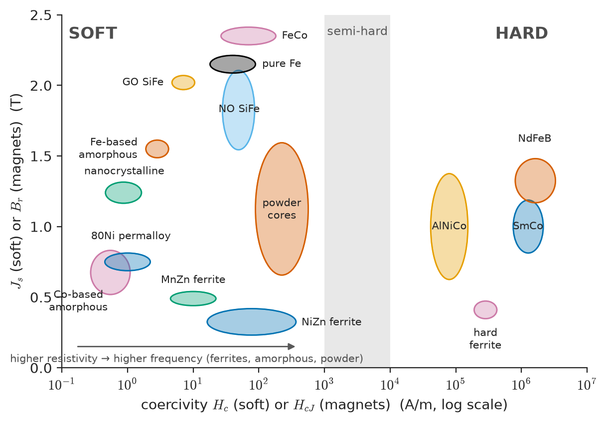
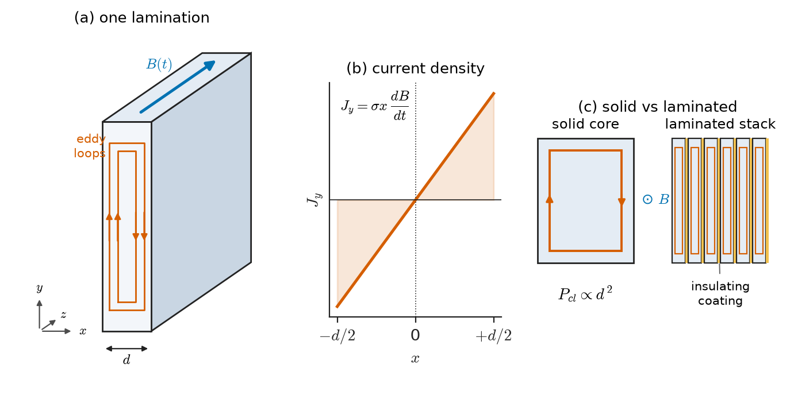
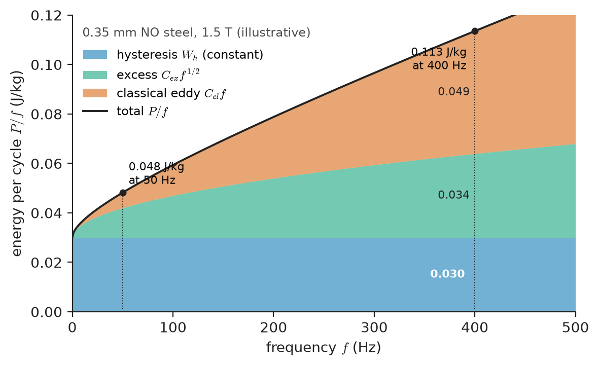
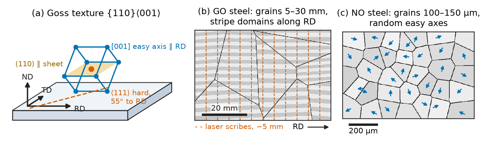
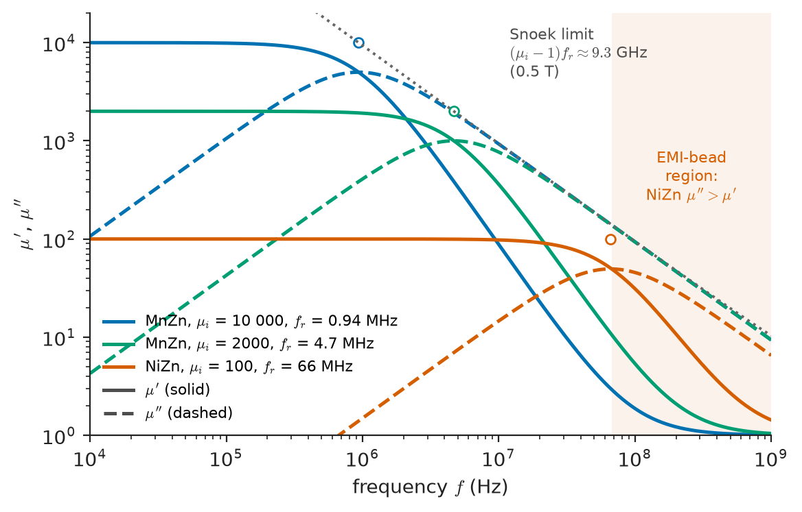
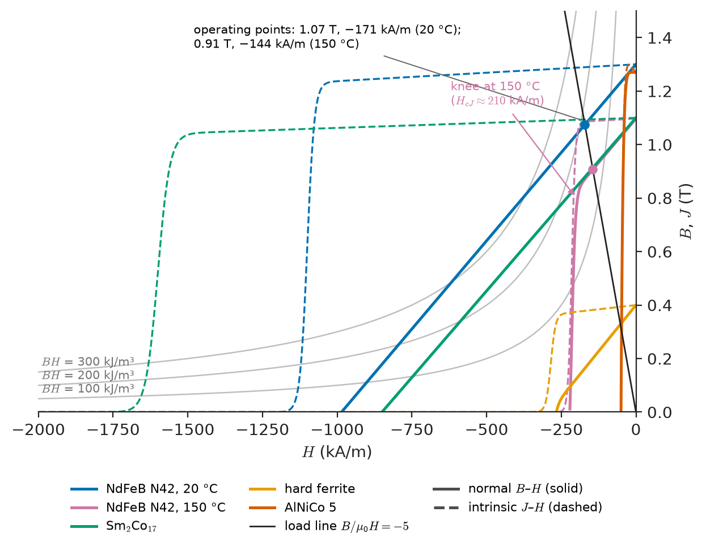

# Chapter 29 — Soft and Hard Magnetic Materials

*Part VI · Thermal, Electrical, Dielectric and Magnetic Materials*

A utility buys distribution transformers by the thousand. Each 100 kVA unit sits on a pole or a pad, energized 8760 hours a year whether its customers draw power or not, and for most of that time it is lightly loaded. Its copper loss rises and falls with load; its **core loss** — the no-load loss — does not. With a core of conventional grain-oriented silicon steel, a well-designed 100 kVA unit dissipates roughly 150–250 W at no load. Built on an amorphous-metal core, the same rating dissipates roughly 50–80 W. Take a difference of 130 W: that is $130\times8760\approx1.14\times10^3$ kWh per transformer per year, or about 34 MWh over a 30-year life, multiplied by every transformer on the network. The amorphous unit is larger, noisier, harder to manufacture and more expensive. Whether it pays depends on the price of energy, the cost of capital and the regulations in force. But the decision rests on a materials fact: an alloy with no crystal structure, cast as a ribbon 25 μm thick, wastes a quarter to a third as much energy per cycle as the best textured crystal of iron–silicon.

Chapter 28 explained why magnetic materials have hysteresis, domains and a Curie temperature. This chapter turns that into a toolkit: the families of engineering magnetic materials, where their losses come from, how the losses are suppressed, and how the right material is chosen for a transformer, a motor, an inductor, a shield or a sensor.

> **Why does a 50 Hz transformer use steel sheets a third of a millimetre thick, while a 200 kHz converter uses a ceramic, and an aircraft generator uses cobalt alloy?**
> **What limits a permanent magnet's strength and its operating temperature, and why does a motor designer care about the world's dysprosium supply?**

| Concept | Engineering destination |
|---|---|
| Soft versus hard figures of merit | Choosing a material class for a core or a magnet |
| Loss separation, Steinmetz equation | Core-loss budgets, thermal design of transformers and inductors |
| Classical eddy loss, skin depth, lamination | Lamination gauge, frequency limits of steels, ferrite dimensional limits |
| Electrical steels (GO, NO), Si content, Goss texture | Power and distribution transformers, motor and generator cores |
| MnZn and NiZn ferrites, Snoek limit | Switched-mode power transformers and inductors, EMI suppression |
| Amorphous and nanocrystalline alloys | Low-loss distribution transformers, common-mode chokes, current transformers |
| NdFeB, SmCo, ferrite, AlNiCo; $(BH)_{\max}$, temperature coefficients | Motors, generators, actuators, loudspeakers, sensors |
| Dysprosium and grain-boundary diffusion | Traction-motor magnet cost and supply risk |
| Shielding by flux shunting, absorption, reflection | Shielding of sensors, CRT-era and MRI-era enclosures, EMC |
| Hall and magnetoresistive materials | Current sensing, position sensing, read heads |

**Roadmap.** Soft and hard (29.1) → where losses come from (29.2) → how eddy currents are suppressed (29.3) → the soft families: electrical steels, ferrites, amorphous and nanocrystalline alloys (29.4–29.6) → permanent magnets (29.7) → shielding (29.8) → selection for transformers, motors, inductors and sensors (29.9).

> **Boundary.** This chapter treats materials and their properties. The design of transformers, rotating machines, inductors and magnetic circuits — winding design, equivalent circuits, machine topology, thermal rating — belongs to the Electrical Energy & Machines core, and sensor and memory circuits to Electronics & Computing. Here a device appears only to fix the material requirement.

---

## 29.1 Soft and hard magnetic materials

The coercivities in Chapter 28 span seven orders of magnitude, from below 1 A/m to above 2 MA/m. The engineering world divides them into two groups with opposite jobs, and a small middle group used for recording and latching devices (semi-hard materials, roughly 1–10 kA/m).

### Soft magnetic materials

A **soft** magnetic material must guide and concentrate flux produced by a winding and give it back each cycle with as little loss as possible. Its figures of merit are:

- **high saturation** $J_s$, so the core can be small for a given flux;
- **high permeability** $\mu_r$, so little magnetizing current (and little winding copper) is needed for a given flux;
- **low coercivity** $H_c$ — conventionally below about 1 kA/m, and below 100 A/m for good core materials — giving a narrow loop and low hysteresis loss;
- **high electrical resistivity** $\rho$ (or thin section), to suppress eddy currents;
- often **low magnetostriction**, for low noise and stress insensitivity;
- a Curie temperature comfortably above the operating temperature, and stable properties with time.

From Chapter 28, the microstructural recipe for softness is easy wall motion: low anisotropy, low magnetostriction, few inclusions and precipitates, low residual stress, and grains either large (conventional alloys) or far smaller than the exchange length (nanocrystalline alloys).

| Material (typical grade) | $J_s$ (T) | Relative permeability | $H_c$ (A/m) | Resistivity | Usual form, frequency range |
|---|---|---|---|---|---|
| Pure (low-carbon) iron | 2.15 | $\mu_{\max}$ 5000–20 000 | 20–80 | 0.10 μΩ m | Solid parts: relays, actuators, DC |
| Non-oriented Si steel | 2.0–2.1 ($J$ at 5000 A/m about 1.6–1.7) | $\mu_{\max}$ 3000–10 000 | 30–80 | 0.25–0.6 μΩ m | 0.20–0.65 mm laminations, 50 Hz–1 kHz |
| Grain-oriented Si steel | 2.03 | $\mu_{\max}$ 30 000–80 000 (rolling direction) | 5–10 | 0.48 μΩ m | 0.18–0.35 mm, 50/60 Hz transformers |
| Fe–6.5 % Si | 1.80 | $\mu_{\max}$ about 20 000 | about 20 | 0.82 μΩ m | 0.05–0.10 mm, up to tens of kHz |
| Fe–49Co–2V | 2.35 | $\mu_{\max}$ about 10 000 | 30–160 | 0.40 μΩ m | 0.10–0.35 mm, aerospace 400 Hz–2 kHz |
| Fe–50Ni | 1.5–1.6 | $\mu_i$ 5000–15 000 | 5–15 | 0.45 μΩ m | Tape and laminations |
| Fe–80Ni–Mo (Permalloy, mu-metal) | 0.7–0.8 | $\mu_i$ 50 000–150 000 | 0.5–2 | 0.55–0.60 μΩ m | Shields, signal transformers, CTs |
| Fe-based amorphous (Fe–Si–B) | 1.56 | $\mu_{\max}$ up to $\sim10^5$ (annealed) | 2–4 | 1.30 μΩ m | 25 μm ribbon, 50 Hz to ~10 kHz |
| Co-based amorphous | 0.55–0.8 | $\mu_i$ up to $10^5$ | 0.3–1 | 1.2–1.4 μΩ m | Ribbon: sensors, magnetic amplifiers |
| Nanocrystalline Fe–Si–B–Nb–Cu | 1.24 | $\mu_i$ 20 000–150 000 | 0.5–1.5 | 1.15–1.2 μΩ m | 14–20 μm ribbon, 50 Hz–200 kHz |
| MnZn ferrite | 0.45–0.53 (25 °C) | $\mu_i$ 2000–15 000 | 5–20 | 0.1–10 Ω m | Pressed cores, 10 kHz–3 MHz |
| NiZn ferrite | 0.25–0.40 | $\mu_i$ 15–1500 | 20–300 | $10^4$–$10^7$ Ω m | 1–500 MHz, EMI |
| Powder cores (Fe, MPP, Fe–Si–Al, Fe–Ni) | 0.75–1.5 | 14–550 (distributed gap) | 100s | Very high (insulated particles) | Chokes with DC bias, 10 kHz–1 MHz |

### Hard magnetic materials

A **hard** (permanent-magnet) material must *produce* flux in an external circuit, an air gap, without any current, and keep doing so against heat, opposing fields and time. Its figures of merit are:

- **high remanence** $B_r$, which sets the flux it can drive;
- **high intrinsic coercivity** $H_{cJ}$ — conventionally above about 10 kA/m, and above 200 kA/m for modern magnets — which sets its resistance to demagnetization;
- a high **maximum energy product** $(BH)_{\max}$, which measures how much air-gap field energy a unit volume of magnet can support (Section 29.7);
- small **temperature coefficients** of $B_r$ and $H_{cJ}$, and a high Curie temperature;
- corrosion resistance, mechanical robustness and acceptable cost and supply.

From Chapter 28, the recipe for hardness is to make magnetization reversal difficult: very high uniaxial anisotropy ($Q=K/K_d\gg1$), grains near or below single-domain size or a pinning nanostructure, magnetically isolated grain boundaries, and aligned easy axes for high remanence.

<!-- FIGURE 29.1 | figures/ch29/fig-29-1-hc-js-map.png | map | Property map of saturation polarization versus coercivity for soft and hard magnetic material families, spanning seven decades of coercivity. | Content: Ashby-style map. x-axis: coercivity H_c (or H_cJ for magnets), log scale from 0.1 A/m to 10^7 A/m. y-axis: J_s or B_r from 0 to 2.5 T, linear. Bubbles (ellipses) for: Co-based amorphous, nanocrystalline, 80Ni permalloy, Fe-based amorphous, GO SiFe, NO SiFe, pure Fe, FeCo, MnZn ferrite, NiZn ferrite, powder cores (soft cluster at left, 0.1–300 A/m); AlNiCo, hard ferrite, SmCo, NdFeB (hard cluster at right, 4×10^4–3×10^6 A/m). Vertical shaded band at 1–10 kA/m labelled "semi-hard". Labels "SOFT" left and "HARD" right; arrows annotate "higher resistivity → higher frequency" on soft side. -->

*Figure 29.1 — Property map of saturation polarization versus coercivity for soft and hard magnetic material families, spanning seven decades of coercivity.*

Figure 29.1 places both families on one map. The two clusters are separated by roughly four decades of coercivity: the same physical quantity, set by microstructure and anisotropy, decides whether a material will be wound into a transformer or glued into a rotor.

> **Status of the principle: soft/hard classification by coercivity**
> *Empirical.* The 1 kA/m and 10 kA/m boundaries are conventions, not physical thresholds; the classification works because real materials cluster far from them.

---

## 29.2 Magnetic losses

### Where the power goes

A core driven by an alternating field dissipates energy every cycle. Measured as watts per kilogram at a stated peak induction and frequency — for example $P_{1.5/50}$ = loss at 1.5 T, 50 Hz — core loss is the headline number on every electrical-steel and ferrite datasheet. It is customarily **separated** into three parts:

$$
P=P_h+P_{\rm cl}+P_{\rm ex}
$$

- **Hysteresis loss** $P_h$: the quasi-static loop area of Chapter 28 times frequency, $P_h=fW_h$. It comes from irreversible wall jumps, and its energy per cycle does not depend on frequency.
- **Classical eddy-current loss** $P_{\rm cl}$: the Joule heating of currents induced by $dB/dt$ in a conductor of given shape and resistivity, *calculated as if the material were magnetically uniform* (no domains).
- **Excess (anomalous) loss** $P_{\rm ex}$: the extra eddy-current loss due to the fact that magnetization actually changes only at moving domain walls, so that $dB/dt$ — and the induced current — is concentrated near walls rather than spread uniformly.

### Classical eddy loss in a lamination

Consider a sheet of thickness $d$ (along $x$), much wider and longer than it is thick, with resistivity $\rho=1/\sigma$, carrying a uniform induction $B(t)$ along $z$ in its plane (Figure 29.2). Assume the frequency is low enough that the field penetrates fully (Section 29.3 makes this precise). By symmetry the induced electric field runs along $y$, reverses sign at the mid-plane $x=0$, and from Faraday's law applied to a rectangular loop spanning $\pm x$:

$$
E_y(x)=x\,\frac{dB}{dt},\qquad J_y(x)=\sigma x\,\frac{dB}{dt}
$$

The eddy current grows linearly from zero at the mid-plane to a maximum at the surfaces and closes at the sheet edges. The power dissipated per unit volume, averaged across the thickness, is

$$
p(t)=\frac1d\int_{-d/2}^{d/2}\frac{J_y^2}{\sigma}\,dx=\frac{\sigma}{d}\left(\frac{dB}{dt}\right)^2\int_{-d/2}^{d/2}x^2\,dx=\frac{\sigma d^2}{12}\left(\frac{dB}{dt}\right)^2
$$

For sinusoidal induction $B=\hat B\sin\omega t$, the time average of $(dB/dt)^2$ is $\omega^2\hat B^2/2$, so

$$
P_{\rm cl}=\frac{\sigma\omega^2\hat B^2d^2}{24}=\frac{\pi^2d^2\hat B^2f^2}{6\rho}\qquad(\mathrm{W/m^3})
$$

Dividing by density $\rho_m$ gives W/kg. Three scaling laws follow immediately, and the whole engineering of soft magnetic materials is organized around them:

$$
P_{\rm cl}\propto d^2,\qquad P_{\rm cl}\propto\frac1\rho,\qquad P_{\rm cl}\propto f^2\hat B^2
$$

Halve the lamination thickness and the classical eddy loss falls by four. Quadruple the resistivity and it falls by four. Raise the frequency eightfold and it rises sixty-four-fold.

> **Status of the principle: classical eddy-current loss $P_{\rm cl}=\pi^2d^2\hat B^2f^2/6\rho$**
> *Derived* from Faraday's and Ohm's laws for a thin sheet with uniform, sinusoidal induction; *approximate* in practice, because it assumes full field penetration ($d$ well below the skin depth), uniform magnetization (no domains), sinusoidal flux and sheet width much greater than thickness.

<!-- FIGURE 29.2 | figures/ch29/fig-29-2-lamination-eddy-currents.png | schematic | Eddy currents in a single lamination of thickness d carrying in-plane flux, and the linear current-density profile across the thickness; a laminated stack compared with a solid core. | Content: Left: 3D sketch of a thin sheet (thickness d along x, flux B along z, sheet width along y), with elongated rectangular eddy-current loops in the y–x cross-section, arrows opposite on either side of the mid-plane, closing at sheet edges. Middle: plot of J_y versus x from −d/2 to +d/2, a straight line through zero, labelled J = σ x dB/dt. Right: comparison of a solid block with one large eddy loop versus a stack of insulated laminations each with small loops; label "P_cl ∝ d²". Insulating coating layers drawn between laminations. -->

*Figure 29.2 — Eddy currents in a single lamination of thickness d carrying in-plane flux, and the linear current-density profile across the thickness; a laminated stack compared with a solid core.*

**Worked example — classical eddy loss in a motor lamination.** A non-oriented steel with 3 % Si has $\rho=0.48$ μΩ m and density 7650 kg/m³. In 0.35 mm sheet at $\hat B=1.5$ T and 50 Hz:

$$
P_{\rm cl}=\frac{\pi^2(0.35\times10^{-3})^2(1.5)^2(50)^2}{6(0.48\times10^{-6})}=\frac{9.870\times1.225\times10^{-7}\times2.25\times2500}{2.88\times10^{-6}}=2.36\times10^3\ \mathrm{W/m^3}
$$

or $2.36\times10^3/7650=0.31$ W/kg. Variations:

- In 0.50 mm sheet: $\times(0.50/0.35)^2=2.04$, giving 0.63 W/kg.
- In 0.35 mm sheet of pure iron ($\rho=0.10$ μΩ m, density 7870 kg/m³): about 1.45 W/kg — nearly five times worse. This is why silicon is added (Section 29.4).
- In 25 μm Fe-based amorphous ribbon ($\rho=1.30$ μΩ m, density 7180 kg/m³) at 1.4 T and 60 Hz: $\pi^2(25\times10^{-6})^2(1.4)^2(60)^2/(6\times1.30\times10^{-6})=5.6$ W/m³, i.e. $7.8\times10^{-4}$ W/kg. The classical eddy loss of amorphous ribbon is negligible; its measured total of about 0.2 W/kg is almost all hysteresis and excess loss.

A typical datasheet total for a good 0.35 mm grade at 1.5 T, 50 Hz is about 2.3–2.7 W/kg, so the classical term is only one-eighth of it. The rest is hysteresis and excess loss.

### Excess loss and domain walls

Measured eddy losses in electrical steels are commonly 1.5 to 3 times the classical value. The reason is visible under a domain microscope. Magnetization changes only where walls pass, so $dB/dt$ is not uniform. It is large near each moving wall and zero in between. Because power goes as the *square* of the local $dB/dt$, concentrating the same average change into narrow regions raises the loss. A simple model of a sheet with equally spaced 180° walls (the Pry–Bean model) gives an eddy loss that exceeds the classical value by a factor that grows with the ratio of domain width $2L$ to sheet thickness $d$ — roughly $1.6\times(2L/d)$ when the domains are much wider than the sheet is thick. Wide domains mean high excess loss.

Bertotti's statistical theory treats the sheet as a population of "magnetic objects" (wall groups) that become active as the field rises, and gives, for sinusoidal flux,

$$
P_{\rm ex}=8\sqrt{\sigma GSV_0}\;\hat B^{3/2}f^{3/2}
$$

where $S$ is the sheet cross-section, $G\approx0.136$ a dimensionless constant, and $V_0$ a field (A/m) characterizing the statistical distribution of local pinning fields, fitted to measurement. The characteristic $f^{3/2}$ dependence distinguishes excess loss from the $f^1$ of hysteresis and the $f^2$ of classical eddy loss.

> **Status of the principle: excess loss $P_{\rm ex}\propto(\hat Bf)^{3/2}$**
> *Approximate.* It follows from a statistical model of domain-wall dynamics with one fitted parameter $V_0$; it describes laminated steels well at power frequencies and up to a few kHz, but is a phenomenological description, not a prediction from microstructure.

This explains a striking engineering fact: grain-oriented steel, with its very large grains and wide domains, has an especially large excess loss. Scratching the surface with a laser or etched grooves at intervals of a few millimetres (**domain refinement**) introduces stress patterns that subdivide the domains. Hysteresis loss rises slightly but excess loss falls more, cutting total loss by 5–15 % (Section 29.4).

### Separating the three

Divide the loss by frequency to get the energy per cycle:

$$
\frac{P}{f}=W_h+C_{\rm cl}\,f+C_{\rm ex}\,f^{1/2}
$$

Measured at constant $\hat B$ over a range of frequencies, $P/f$ plotted against $f$ (Figure 29.3) has an intercept at $f\to0$ equal to the hysteresis energy $W_h$, a calculable linear part $C_{\rm cl}f$, and a remainder that grows as $\sqrt f$, the excess loss. This is how loss separation is done in practice (measurement methods: Chapter 52).

<!-- FIGURE 29.3 | figures/ch29/fig-29-3-loss-separation.png | plot | Energy loss per cycle versus frequency at constant peak induction, separated into hysteresis, classical eddy and excess contributions. | Content: x-axis frequency f from 0 to 500 Hz; y-axis energy per cycle P/f in J/kg from 0 to 0.12. Stacked areas: bottom horizontal band W_h = 0.030 J/kg (hysteresis); middle band growing as √f (excess, 0.012 J/kg at 50 Hz, 0.034 J/kg at 400 Hz); top band growing linearly (classical, 0.0062 J/kg at 50 Hz, 0.049 J/kg at 400 Hz). Total curve reaches about 0.113 J/kg at 400 Hz. Markers at 50 Hz and 400 Hz. Label "0.35 mm NO steel, 1.5 T (illustrative)". -->

*Figure 29.3 — Energy loss per cycle versus frequency at constant peak induction, separated into hysteresis, classical eddy and excess contributions.*

**Worked example — what happens to a 50 Hz steel at 400 Hz.** The 0.35 mm, 3 % Si steel above is measured at 1.5 T, 50 Hz to have a total loss of 2.41 W/kg, which separates into hysteresis 1.50 W/kg, classical eddy 0.31 W/kg and excess 0.60 W/kg. Per cycle, these are $W_h=0.030$ J/kg, $W_{\rm cl}=0.0062$ J/kg and $W_{\rm ex}=0.012$ J/kg. Scale each to 400 Hz at the same 1.5 T:

- hysteresis: energy per cycle constant, so $P_h=0.030\times400=12.0$ W/kg;
- classical: $P\propto f^2$, so $0.31\times(400/50)^2=0.31\times64=19.8$ W/kg;
- excess: $P\propto f^{3/2}$, so $0.60\times8^{3/2}=0.60\times22.6=13.6$ W/kg.

The total is 45.3 W/kg, nineteen times the 50 Hz value for an eightfold frequency rise, and classical eddy loss has gone from the smallest term to the largest. Switching to 0.20 mm sheet reduces the classical term by $(0.20/0.35)^2=0.33$ to 6.5 W/kg. Taking the other two as unchanged (as a first approximation), the total becomes about 32 W/kg. This is the materials reason why the stators of high-speed traction motors and aerospace generators, with fundamental frequencies of several hundred hertz to over a kilohertz, use 0.20–0.27 mm laminations and higher-silicon grades.

### The Steinmetz equation

For ferrites and for design work in general, separating the loss is less useful than a compact fit. In 1892 Charles Steinmetz observed that hysteresis loss in iron scaled as $\hat B^{1.6}$. The generalized form now universal in power electronics is

$$
P_v=k\,f^{\alpha}\hat B^{\beta}
$$

with $P_v$ the loss per unit volume and $k$, $\alpha$, $\beta$ fitted to measured data over a limited range of frequency, induction and temperature. For power ferrites, typical fits are $\alpha\approx1.1$–1.8 and $\beta\approx2.3$–3. For laminated steels at power frequency, $\alpha\approx1.2$–1.6 and $\beta\approx1.6$–2.2. The exponent $\alpha$ is between 1 (pure hysteresis) and 2 (pure classical eddy loss); the exponent $\beta$ above 2 reflects the Rayleigh-like $\hat B^3$ behaviour at low induction (Chapter 28) and approach to saturation at high induction.

> **Status of the principle: Steinmetz equation $P_v=kf^\alpha\hat B^\beta$**
> *Empirical.* It is a power-law fit valid only within the range of frequency, flux density and temperature over which its coefficients were fitted, and only for sinusoidal flux; for non-sinusoidal (PWM) waveforms, modified forms such as the improved generalized Steinmetz equation (iGSE), which use $dB/dt$, are needed, and DC bias and relaxation effects need further corrections.

**Worked example — rescaling a ferrite datasheet.** A MnZn power ferrite has a datasheet loss of 375 kW/m³ at 100 kHz, 200 mT and 100 °C. Over the range 50–200 kHz and 100–250 mT the manufacturer's fit gives $\alpha=1.4$ and $\beta=2.6$. A transformer is to run at 150 kHz with $\hat B=150$ mT. The loss ratio is

$$
\frac{P_v}{375\ \mathrm{kW/m^3}}=\left(\frac{150}{100}\right)^{1.4}\left(\frac{150}{200}\right)^{2.6}=1.764\times0.473=0.835
$$

so $P_v=313$ kW/m³. For an ETD34 core of effective volume $V_e=7.64$ cm³ $=7.64\times10^{-6}$ m³, the core loss is $313\times10^3\times7.64\times10^{-6}=2.4$ W. Two cautions: the same calculation at 25 °C could give a loss 1.5–2 times higher, because the ferrite's loss minimum was placed near 100 °C (Section 29.5); and the PWM waveform of a real converter changes the result, which is why the coefficients are only an engineering starting point.

### Loss as complex permeability

At high frequency and low induction, where the loop is nearly elliptical, losses are expressed through the **complex permeability** $\mu=\mu'-j\mu''$. A winding on such a core behaves as an inductance $L\propto\mu'$ in series with a resistance $R\propto\omega\mu''$, and the **loss tangent** $\tan\delta_m=\mu''/\mu'$ plays the same role as the dielectric loss tangent of Chapter 26. Ferrite datasheets plot $\mu'$ and $\mu''$ against frequency (Figure 29.5). Filter-inductor designers use $\tan\delta_m/\mu_i$ (the relative loss factor) to compare materials at small signal; EMI designers deliberately exploit large $\mu''$.

---

## 29.3 Eddy-current suppression

### Skin depth: the frequency limit of a conducting core

The eddy-current derivation assumed the field penetrated the whole lamination. In a thick conductor the eddy currents themselves shield the interior. Combining Faraday's and Ampère's laws with Ohm's law in a linear conductor of permeability $\mu=\mu_0\mu_r$ and conductivity $\sigma$ (neglecting displacement current) gives a diffusion equation

$$
\nabla^2\mathbf H=\mu\sigma\frac{\partial\mathbf H}{\partial t}
$$

For a sinusoidal field applied at the surface of a half-space, the solution decays and lags with depth $x$ as $H=H_0e^{-x/\delta}e^{j(\omega t-x/\delta)}$, with **skin depth**

$$
\delta=\sqrt{\frac{2}{\omega\mu\sigma}}=\sqrt{\frac{\rho}{\pi f\mu_0\mu_r}}
$$

> **Status of the principle: skin depth $\delta=\sqrt{\rho/\pi f\mu_0\mu_r}$**
> *Derived* from Maxwell's equations for a linear, homogeneous conductor at frequencies where displacement current is negligible; *approximate* for ferromagnets, whose permeability is nonlinear and amplitude-dependent, so $\delta$ is an effective value.

A magnetic core works properly only if its smallest conducting dimension is less than about the skin depth. Otherwise flux crowds into a surface layer, the interior carries little flux, the effective permeability falls, and the loss is concentrated where the field is largest. The high permeability that makes a core useful makes its skin depth small.

**Worked example — skin depths of core materials.**

- 3 % Si steel, $\rho=0.48$ μΩ m, $\mu_r=5000$, at 50 Hz: $\delta=\sqrt{0.48\times10^{-6}/(\pi\times50\times4\pi\times10^{-7}\times5000)}=\sqrt{4.86\times10^{-7}}=0.70$ mm. A 0.35 mm lamination is half a skin depth thick: safely in the classical regime. With $\mu_r=1000$ (typical at high induction), $\delta=1.56$ mm.
- The same steel at 400 Hz, $\mu_r=5000$: $\delta=0.70/\sqrt8=0.25$ mm. A 0.35 mm lamination is now thicker than the skin depth, and thinner gauges are needed.
- Copper at 50 Hz ($\rho=1.72\times10^{-8}$ Ω m, $\mu_r=1$): $\delta=9.3$ mm. A copper conductor is far less affected than a steel core at the same frequency, because $\mu_r=1$.
- MnZn ferrite, $\rho=5$ Ω m, $\mu_r=2000$, at 1 MHz: $\delta=\sqrt{5/(\pi\times10^6\times4\pi\times10^{-7}\times2000)}=25$ mm. Even at a megahertz, a ferrite's resistivity gives skin depths larger than most cores.

The steel results show why laminated steels are confined to frequencies of up to a few kilohertz, and why their gauge falls as frequency rises.

### Strategies for suppressing eddy currents

Every strategy follows from $P_{\rm cl}\propto d^2/\rho$ and $\delta\propto\sqrt{\rho/\mu_rf}$: reduce the dimension through which eddy currents can circulate, or raise resistivity.

1. **Lamination.** Divide the core into sheets parallel to the flux, insulated from each other, so eddy currents circulate only within a thickness $d$. Gauges run from 0.65 mm (small 50 Hz motors) through 0.23–0.35 mm (transformers, efficient motors) to 0.10 mm and below (aerospace, kHz). Thinner gauges cost more to roll, punch and stack, and the **stacking factor** (fraction of core volume that is steel, about 0.95–0.98 for steels, 0.80–0.90 for amorphous ribbon) falls as coating thickness becomes comparable to sheet thickness.
2. **Interlaminar insulation.** An inorganic phosphate, oxide or organic-inorganic coating 0.5–5 μm thick insulates the sheets. It must survive punching and stress-relief annealing. Burrs from blunt punching dies, or welding and clamping across the stack, short adjacent laminations and create large eddy loops — a classic cause of a hot spot in a new machine.
3. **Raise resistivity by alloying.** Silicon and aluminium in iron, molybdenum in nickel–iron, and the metalloids (B, Si, P) in amorphous alloys increase electron scattering (Chapter 25) without destroying ferromagnetism. Iron goes from 0.10 μΩ m to about 0.48 μΩ m at 3 % Si and 1.3 μΩ m in Fe–Si–B glass.
4. **Use an insulator.** Ferrites have resistivities $10^6$ to $10^{14}$ times that of iron. Eddy loss is negligible up to the MHz range, at the cost of a saturation about one quarter of iron's.
5. **Subdivide in three dimensions.** Powder cores and **soft magnetic composites (SMC)** are made of iron or alloy particles (10–300 μm) individually coated with an insulating layer and pressed. Eddy currents are confined to single particles in every direction, so SMC supports three-dimensional flux paths (claw-pole and axial-flux machines) at the cost of lower permeability (a few hundred) and higher hysteresis loss from deformed particles.
6. **Segment permanent magnets.** Sintered NdFeB is a metal ($\rho\approx1.4$–1.6 μΩ m). Slot harmonics and PWM ripple induce eddy currents in rotor magnets, which heat them and lower their coercivity. Dividing each magnet into insulated segments along its length cuts the loss — the same $d^2$ law applied to a hard material.

---

## 29.4 Electrical steels

Electrical steels — iron with silicon, rolled to sheet — are by tonnage the dominant soft magnetic material: roughly 15 million tonnes are produced each year for transformers, motors and generators. Two families exist.

### Why silicon

Adding silicon to iron, typically 1–3.5 wt%, does four useful things and one harmful one:

1. **Raises resistivity**, roughly as $\rho\approx(0.10+0.12\,w_{\rm Si+Al})$ μΩ m for $w$ in wt% (a rough fit): 0.48 μΩ m at 3.2 %, cutting classical eddy loss by a factor of about five compared with pure iron.
2. **Lowers magnetocrystalline anisotropy** ($K_1$ falls from 48 to about 35 kJ/m³ at 3 %) and **magnetostriction**, which vanishes near 6.5 % Si. Both reduce hysteresis loss and noise.
3. **Closes the γ loop.** Silicon is a ferrite (bcc) stabilizer. Above about 2 % Si, iron stays bcc all the way to the melting point. The sheet can then be annealed at 1000–1200 °C to grow large grains and develop texture without passing through the α–γ transformation, which would destroy them (phase diagrams: Chapter 7).
4. **Suppresses magnetic ageing** by reducing carbon solubility, in combination with decarburization to below about 30 ppm C.
5. **Dilutes the magnetization** (harmful): $J_s$ falls from 2.15 T to about 2.03 T at 3 % and 1.80 T at 6.5 %. Above about 3.5 % the alloy also becomes brittle (ordering of Fe₃Si) and cannot be cold-rolled conventionally.

The practical ceiling is therefore about 3.2–3.5 % Si (sometimes with 0.5–1 % Al, which raises resistivity similarly). Fe–6.5 % Si, with near-zero magnetostriction and $\rho=0.82$ μΩ m, is made by depositing silicon on 3 % sheet by chemical vapour deposition and diffusing it in, and is used in thin gauges for high-frequency reactors and quiet transformers.

### Grain-oriented steel and the Goss texture

Iron's easy axes are the cube edges ⟨100⟩, and the permeability along an easy axis greatly exceeds that along ⟨111⟩. In a transformer core the flux runs along the limbs, in one direction. If every grain could have a ⟨100⟩ axis parallel to the rolling direction of the strip, the strip would be "a single crystal in the direction that matters".

N. P. Goss found the process in 1934. **Grain-oriented (GO)** steel is processed so that almost all grains have the **Goss texture** $\{110\}\langle001\rangle$: a {110} plane in the sheet surface and a ⟨001⟩ direction along the rolling direction (Figure 29.4). The route combines cold rolling, a decarburizing primary recrystallization anneal, and a high-temperature box anneal at about 1150–1200 °C. During the box anneal, fine **inhibitor** particles (MnS, AlN) pin ordinary grain boundaries, and only the rare Goss-oriented grains — whose boundaries move fastest — grow by **secondary recrystallization** (abnormal grain growth) to consume the whole strip. The final grains are millimetres to centimetres across. Processing–microstructure relationships of this kind are developed in Chapter 10.

- **Conventional GO (CGO)**: ⟨001⟩ axes within about 7° of the rolling direction; $J$ at 800 A/m ($J_{800}$) of about 1.80–1.85 T.
- **High-permeability GO (Hi-B)**: AlN inhibition and heavier final reduction give deviations of about 3°; $J_{800}\approx1.88$–1.94 T.
- **Domain-refined Hi-B**: laser-scribed or groove-etched to subdivide the wide domains (Section 29.2).

A glass-like forsterite (Mg₂SiO₄) layer formed during the box anneal, plus a phosphate coating on top, insulates the sheet and, being applied hot with a lower thermal expansion than the steel, puts the steel into **tension** of a few MPa along the rolling direction. Since $\lambda_{100}>0$, tension along ⟨001⟩ reinforces that easy axis, narrows the domains, and lowers loss and magnetostriction — a deliberate use of the magnetoelastic energy of Chapter 28.

GO steel's weakness is that its properties are excellent only along the rolling direction. At 55° (along ⟨111⟩) and 90° the permeability is far lower and the loss higher. Transformer cores are therefore built so the flux follows the rolling direction everywhere, with mitred (often step-lap) corner joints where the flux must turn. GO steel is not used in rotating machines, where flux direction rotates.

<!-- FIGURE 29.4 | figures/ch29/fig-29-4-goss-texture.png | crystal | The Goss texture {110}<001> in grain-oriented steel: orientation of the bcc cube relative to the rolled sheet, and the contrasting grain structures of grain-oriented and non-oriented steels. | Content: Left: rolled sheet drawn as a thin slab with axes RD (rolling direction), TD (transverse), ND (normal). A bcc unit cube drawn inside, rotated so that a cube edge [001] lies along RD and a face diagonal plane (110) lies parallel to the sheet surface; label easy axis <100> along RD, hard axis <111> at about 55° to RD in sheet plane. Middle: plan-view micrograph-style sketch of GO sheet with a few grains of 5–30 mm and long stripe domains along RD, with laser-scribe lines across RD every ~5 mm. Right: NO sheet micrograph-style sketch with equiaxed grains of 100–150 μm and random easy axes (arrows). Scale bars. -->

*Figure 29.4 — The Goss texture {110}<001> in grain-oriented steel: orientation of the bcc cube relative to the rolled sheet, and the contrasting grain structures of grain-oriented and non-oriented steels.*

### Non-oriented steel

Motors and generators need good properties in every direction within the sheet plane. **Non-oriented (NO)** steels have a weak or random texture, 0–3.5 % (Si + Al), and gauges of 0.20–0.65 mm. Two processing states exist:

- **fully processed** steel is annealed at the mill and sold with final properties; laminations are punched and used;
- **semi-processed** steel is given a final decarburizing anneal by the customer after punching, which also relieves punching stress.

The grain size of NO steel is optimized at roughly 100–150 μm. Larger grains reduce hysteresis loss (Chapter 28: $H_c\propto1/D$) but increase the domain width and with it the excess loss, so total loss passes through a minimum. Low-loss grades seek a favourable texture with more ⟨100⟩ directions in the sheet plane (cube or η-fibre components) — a modest version of the Goss idea.

Punching damages the material near the cut edge over a width of roughly one sheet thickness, raising local coercivity through plastic deformation and residual stress (Chapter 13). In the narrow teeth of small, high-speed motors this damaged fraction is significant, which is why stress-relief annealing at about 750–800 °C, laser cutting, or wire-EDM prototypes are compared carefully.

### Grades and representative properties

European grades encode the guaranteed maximum loss: in a name such as **M270-35A**, 270 means 2.70 W/kg at 1.5 T, 50 Hz; 35 means 0.35 mm; A means non-oriented, fully processed. For GO grades (suffix S for conventional, P for high-permeability) the number refers to 1.7 T, 50 Hz.

| Grade (EN style) | Type | Thickness (mm) | Si + Al (wt%, typical) | $\rho$ (μΩ m, typical) | Guaranteed max. loss (W/kg) | Typical polarization |
|---|---|---|---|---|---|---|
| M235-35A | NO, high grade | 0.35 | about 3.3 | 0.59 | 2.35 at 1.5 T, 50 Hz | $J_{5000}\approx1.60$ T |
| M270-35A | NO | 0.35 | about 3.0 | 0.52 | 2.70 at 1.5 T, 50 Hz | $J_{5000}\approx1.60$ T |
| M400-50A | NO | 0.50 | about 2.0 | 0.42 | 4.00 at 1.5 T, 50 Hz | $J_{5000}\approx1.63$ T |
| M800-65A | NO, low Si | 0.65 | about 1.0 | 0.25 | 8.00 at 1.5 T, 50 Hz | $J_{5000}\approx1.70$ T |
| NO thin gauge (e.g. 0.20 mm) | NO, high frequency | 0.20 | about 3.3 | 0.55–0.60 | about 15–20 at 1.0 T, 400 Hz | $J_{5000}\approx1.60$ T |
| M130-27S | GO, conventional | 0.27 | about 3.1 | 0.48 | 1.30 at 1.7 T, 50 Hz | $J_{800}\approx1.80$ T |
| M103-27P | GO, Hi-B | 0.27 | about 3.1 | 0.48 | 1.03 at 1.7 T, 50 Hz | $J_{800}\approx1.88$ T |
| Hi-B, domain-refined | GO | 0.23 | about 3.1 | 0.48 | about 0.70–0.85 at 1.7 T, 50 Hz | $J_{800}\approx1.90$ T |

Notice two lessons in the table. Higher silicon buys lower loss but lower polarization: M800-65A reaches 1.70 T at 5000 A/m but loses 8 W/kg; M235-35A loses 2.35 W/kg but reaches only 1.60 T. And GO steel at 1.7 T loses less than half as much as the best NO steel at 1.5 T — the value of texture when the flux direction is fixed.

---

## 29.5 Ferrites

### Why ferrites

Chapter 28 showed that the spinel ferrites are ferrimagnetic oxides, with saturation set by sublattice counting and resistivity far above any metal. Above roughly 20–50 kHz, no practical lamination is thin enough for steel, and ferrites take over. Two families dominate soft-ferrite production.

**MnZn ferrites**, Mn$_{1-x}$Zn$_x$Fe₂O₄ with a small excess of iron, have the higher permeability and saturation and the lower resistivity:

- $\mu_i$ about 2000–15 000, $B_s$ about 0.45–0.53 T at 25 °C and 0.35–0.43 T at 100 °C;
- $T_C$ about 150–300 °C, falling as Zn (and permeability) increase;
- resistivity about 0.1–10 Ω m — small for an oxide, because of Fe²⁺–Fe³⁺ electron hopping on B sites — with relative permittivity of order $10^4$–$10^5$ at low frequency from conducting grains separated by resistive grain boundaries;
- used from about 10 kHz to 1–3 MHz: switched-mode power transformers and inductors, signal and pulse transformers, common-mode chokes.

**NiZn ferrites**, Ni$_{1-x}$Zn$_x$Fe₂O₄, have much higher resistivity because the Fe²⁺ content is negligible:

- $\mu_i$ about 15–1500, $B_s$ about 0.25–0.40 T;
- resistivity $10^4$–$10^7$ Ω m, permittivity about 10–20;
- used from about 1 MHz to several hundred MHz: RF transformers and baluns, antenna rods, and EMI-suppression beads and cable cores.

### Microstructure and processing

Ferrites are ceramics: oxides are mixed, calcined, milled, pressed to shape, and sintered at about 1100–1400 °C (Chapter 17). In MnZn ferrite, the oxygen partial pressure during sintering and cooling must be controlled precisely to set the Fe²⁺ content, which sets $K_1$, resistivity and loss. Small additions of CaO and SiO₂ segregate to grain boundaries and form thin insulating layers that raise the bulk resistivity and cut eddy losses inside grains. Grain size is a frequency-dependent compromise. Large grains (10–20 μm) and low porosity give high permeability for low-frequency, high-$\mu$ grades. Small grains (a few μm) give lower eddy and residual losses for MHz power grades.

### Loss and temperature

Power ferrites are characterized by Steinmetz-type data at stated frequency, induction and temperature (Section 29.2). Typical values for current power grades:

| Ferrite type (typical) | $\mu_i$ | $B_s$ at 100 °C (T) | Core loss at 100 kHz, 200 mT, 100 °C (kW/m³) | Typical use |
|---|---|---|---|---|
| MnZn power, 25–200 kHz | 2000–3000 | 0.38–0.42 | 300–400 | Flyback, forward, LLC transformers |
| MnZn low-loss, wide temperature | 3000 | 0.40–0.43 | about 300, flatter versus T | Automotive, wide ambient |
| MnZn high-frequency, 0.3–1 MHz | 1400–2000 | 0.38–0.40 | Specified at 500 kHz, 50 mT: about 100–200 | Resonant, GaN converters |
| MnZn high-$\mu$ | 5000–15 000 | 0.20–0.38 | Not a power grade | Signal, CMC, pulse |
| NiZn | 15–1500 | 0.20–0.35 | Not a power grade at 100 kHz | RF, EMI beads |

The loss of a MnZn power grade has a **minimum** with temperature, usually designed to lie between 80 and 100 °C. The loss minimum follows the zero crossing of the anisotropy constant $K_1$, which is tuned by the Fe²⁺ (and sometimes Co²⁺) content (Chapter 28). The minimum provides thermal stability: a core that warms toward its minimum loses less. But a core pushed beyond it heats faster as it gets hotter and can run away thermally, especially since $B_s$ is also falling. Datasheet loss curves are specified at temperature for this reason.

### Frequency limits: Snoek's law and dimensional resonance

Why does a high-permeability ferrite fail at high frequency, and why can a low-permeability ferrite go higher? Above some frequency the magnetization can no longer follow the field: the precession of moments about their effective anisotropy field reaches resonance, $\mu'$ falls and $\mu''$ peaks (Figure 29.5). For a cubic ferrite in which magnetization proceeds by rotation, the resonance frequency $f_r$ and initial permeability are linked by **Snoek's law**:

$$
(\mu_i-1)f_r\approx\frac{\gamma}{3\pi}\mu_0M_s,\qquad \frac{\gamma}{3\pi}=1.87\times10^{10}\ \mathrm{Hz/T}
$$

where $\gamma=1.76\times10^{11}$ rad s⁻¹ T⁻¹ is the electron gyromagnetic ratio. The product of permeability and bandwidth is fixed by the saturation. For MnZn ferrite with $\mu_0M_s=0.5$ T, the right-hand side is $9.3$ GHz; with $\mu_i=2000$, $f_r\approx4.7$ MHz. For NiZn with $\mu_0M_s=0.35$ T and $\mu_i=100$, $f_r\approx66$ MHz. This is why EMI beads use low-$\mu$ NiZn: above $f_r$, $\mu''$ dominates and the bead behaves as a frequency-dependent resistor that absorbs interference in the 30–1000 MHz range.

> **Status of the principle: Snoek's law**
> *Approximate.* It follows from the gyromagnetic resonance of moments rotating against an isotropic distribution of anisotropy fields, ignoring domain-wall resonance and demagnetizing effects; hexagonal ferrites with planar anisotropy, and composites, can exceed it.

<!-- FIGURE 29.5 | figures/ch29/fig-29-5-ferrite-permeability-spectra.png | plot | Complex permeability spectra of MnZn and NiZn ferrites, showing the fall of μ′ and the peak of μ″ at frequencies limited by Snoek's law. | Content: log-log axes. x-axis frequency 10 kHz to 1 GHz. y-axis μ′ and μ″ from 1 to 20 000. Three materials: MnZn μi = 10 000 (μ′ flat then falling near 0.5–1 MHz, μ″ peak there), MnZn μi = 2000 (falling near 3–5 MHz), NiZn μi = 100 (falling near 50–100 MHz). Solid lines μ′, dashed lines μ″. Dotted diagonal line showing the Snoek limit (μi − 1) f_r ≈ 9 GHz for 0.5 T. Annotate the EMI-bead region where μ″ > μ′ for NiZn. -->

*Figure 29.5 — Complex permeability spectra of MnZn and NiZn ferrites, showing the fall of μ′ and the peak of μ″ at frequencies limited by Snoek's law.*

MnZn ferrites meet a second limit. Their high permittivity slows the electromagnetic wave inside the core. The wavelength in the material is $\lambda=c/(f\sqrt{\varepsilon_r\mu_r})$. With $\varepsilon_r\sim10^4$–$10^5$ and $\mu_r=2000$ at 1 MHz, $\lambda$ is only about 2–7 cm. A core whose cross-section approaches half a wavelength supports a standing wave — **dimensional resonance** — and its effective permeability and loss change abruptly. Large MnZn cores for MHz converters are therefore assembled from smaller pieces, or replaced by lower-permittivity grades.

---

## 29.6 Amorphous and nanocrystalline magnetic alloys

### Amorphous alloys

Chapter 2 introduced amorphous solids: atoms with short-range but no long-range order. Some iron- and cobalt-based alloys containing 15–25 at% metalloids (B, Si, P, C) can be frozen into a glass by **rapid solidification**: a molten jet is poured onto a copper wheel spinning at about 20–30 m/s, cooling at roughly $10^6$ K/s into a continuous ribbon 15–30 μm thick and up to about 200 mm wide (planar-flow casting).

With no crystal lattice there is no magnetocrystalline anisotropy on any scale that matters, and with no grain boundaries there are few pinning sites. Walls are wide, and coercivity is low — 2–4 A/m for Fe-based glasses and below 1 A/m for Co-based ones. Resistivity is high (1.2–1.4 μΩ m) because the disordered structure scatters electrons strongly. The ribbon is thin by nature. Classical eddy loss is negligible at power frequency (worked example, Section 29.2).

| Property | Fe-based amorphous (Fe–Si–B, e.g. Metglas 2605SA1) | Co-based amorphous (e.g. Metglas 2714A) | 3 % Si GO steel (Hi-B, for comparison) |
|---|---|---|---|
| $J_s$ (T) | 1.56 | 0.57 | 2.03 |
| $H_c$ (A/m) | 2–4 | about 0.3–1 | 5–10 |
| $\rho$ (μΩ m) | 1.30 | 1.4 | 0.48 |
| $\lambda_s$ | $+27\times10^{-6}$ | about 0 | $\lambda_{100}\approx+23\times10^{-6}$ |
| $T_C$ (°C) | about 395 | about 225 | about 745 |
| Crystallization temperature (°C) | about 500 | about 550 | — |
| Thickness | about 25 μm | about 15–25 μm | 0.23–0.30 mm |
| Density (g/cm³) | 7.18 | 7.6–7.9 | 7.65 |
| Core loss, 50–60 Hz, 1.3–1.4 T (W/kg) | about 0.1–0.2 | — | about 0.4–0.5 |

The Fe-based amorphous ribbon is the material of the opening example. Its loss at distribution-transformer inductions is roughly a quarter to a third of the best GO steel. But its drawbacks dictate how it is used:

- **lower saturation** (1.56 T, designed to operate at 1.3–1.4 T against 1.6–1.7 T for GO): the core must be larger and heavier for the same rating;
- **lower stacking factor** (about 0.80–0.88) because of ribbon surface roughness;
- **magnetostriction** of $27\times10^{-6}$: louder and stress-sensitive; cores must be supported, not clamped;
- **embrittlement**: the ribbon must be annealed (typically 350–400 °C in a longitudinal field) to relieve casting stresses and induce a favourable anisotropy, and after annealing it is brittle and hard to handle;
- **thermal limits**: it crystallizes, with catastrophic loss of softness, above about 500 °C, and its Curie temperature (about 395 °C) is low, so properties fall more quickly with temperature than those of steel;
- **form**: wound cores of thin ribbon suit distribution transformers, not punched motor laminations.

Co-based amorphous alloys trade saturation for **zero magnetostriction**, giving the highest permeabilities and lowest losses of any ribbon. They are used in magnetic amplifiers, fluxgate and magnetic-field sensors, high-accuracy current transformers and saturable reactors, and in anti-theft tags.

> **Status of the principle: low coercivity of amorphous alloys from absent crystal anisotropy**
> *Approximate.* It explains why amorphous metals are soft; residual coercivity is controlled by quenched-in stress coupled to magnetostriction, by surface roughness and by any incipient crystallization, which is why annealing matters as much as composition.

### Nanocrystalline alloys and random anisotropy

In 1988 Yoshizawa and co-workers at Hitachi Metals annealed an amorphous Fe₇₃.₅Si₁₃.₅B₉Nb₃Cu₁ ribbon at about 540 °C and found it became *softer* on crystallizing, contrary to all previous experience. Copper clusters nucleate a very high density of bcc Fe–Si crystallites, and niobium, which is rejected into the remaining amorphous matrix, stops them growing. The result — **Finemet**, also sold as Vitroperm and similar — is about 70–80 % by volume of Fe–Si grains 10–15 nm across, embedded in a ferromagnetic amorphous matrix.

Why should 10 nm crystals, each with an anisotropy constant $K_1\approx8$ kJ/m³ in random orientations, behave as if they had almost none? The answer is **Herzer's random-anisotropy model**. Exchange tries to keep the magnetization uniform over a length scale of order $L_0=\sqrt{A/K_1}$. With $A\approx10^{-11}$ J/m and $K_1=8\times10^3$ J/m³ for Fe–20 at% Si, $L_0\approx35$ nm. When the grain size $D$ is much smaller than this, the magnetization cannot follow the easy axis of each grain. It averages over the $N=(L_{\rm ex}/D)^3$ grains within one exchange volume of size $L_{\rm ex}$, whose random anisotropies largely cancel, leaving a residual of order $K_1/\sqrt N$. But a weaker average anisotropy lets exchange act over a longer distance, $L_{\rm ex}=\sqrt{A/\langle K\rangle}$, which averages over still more grains. Making $L_{\rm ex}$ and $\langle K\rangle$ self-consistent gives

$$
\langle K\rangle\approx\frac{K_1^4D^6}{A^3},\qquad H_c\propto\langle K\rangle\propto D^6
$$

For $D=10$ nm: $\langle K\rangle\approx(8\times10^3)^4(10^{-8})^6/(10^{-11})^3=4$ J/m³, about two thousand times smaller than $K_1$. This sixth-power law explains why the nanocrystalline alloy is soft only when the grains stay small: an anneal a few tens of degrees too hot coarsens them and coercivity rises steeply. Above about $L_0$ the conventional $H_c\propto1/D$ of Chapter 28 takes over. Together the two regimes make coercivity versus grain size an inverted V.

> **Status of the principle: random-anisotropy model, $H_c\propto D^6$**
> *Approximate.* It is a scaling argument valid for grain sizes well below the exchange length, with exchange-coupled grains of random orientation; it gives the trend and the order of magnitude, and residual magnetoelastic and induced anisotropies set the actual floor of $H_c$.

The magnetostriction also cancels. The Fe–Si grains have negative $\lambda_s$ and the amorphous matrix positive, and at the right silicon content the volume average is near zero (about $+2\times10^{-6}$). The result:

| Property | Nanocrystalline Fe–Si–B–Nb–Cu (Finemet type) |
|---|---|
| $J_s$ | 1.20–1.25 T |
| $\mu_i$ | 20 000–150 000 (adjustable by field annealing) |
| $H_c$ | 0.5–1.5 A/m |
| $\rho$ | 1.15–1.2 μΩ m |
| $\lambda_s$ | about $+2\times10^{-6}$ |
| $T_C$ | about 570 °C (crystalline phase); matrix lower |
| Thickness | 14–20 μm ribbon |

Nanocrystalline alloys combine a saturation two to three times that of ferrite with permeability and loss comparable to or better than the best ferrites up to about 100–200 kHz, and with far better temperature stability. They dominate **common-mode chokes** (high $\mu$ over a broad band), precision **current transformers** and residual-current devices, high-power medium-frequency transformers in solid-state transformers and fast chargers, and wireless-charging shields. Annealing under a transverse field induces an anisotropy that gives a flat, linear loop with low permeability for DC-tolerant applications; a longitudinal field gives a square loop for magnetic switches. Their limits are the same as for amorphous ribbon: wound cores, brittleness after annealing, and cost. Fe–Zr–B ("Nanoperm") and high-Fe variants reach $J_s\approx1.5$–1.6 T at somewhat higher loss.

---

## 29.7 Permanent-magnet materials

### The second quadrant and the energy product

A permanent magnet works in the **second quadrant** of its hysteresis loop, where $H$ is negative: inside a magnet that drives flux through an air gap, the field $H$ points against $M$ (Chapter 28's demagnetizing field). With no current in the circuit, Ampère's law around the loop gives $H_ml_m+H_gl_g=0$ for magnet length $l_m$ and gap $l_g$, if the iron has negligible reluctance. Flux continuity gives $B_mA_m=B_gA_g$, neglecting leakage. Multiplying,

$$
B_g^2\,\frac{V_g}{\mu_0}=-B_mH_m\,V_m,\qquad V_g=A_gl_g,\ V_m=A_ml_m
$$

The air-gap field energy (which is proportional to $B_g^2V_g/\mu_0$) that a magnet volume $V_m$ can support is proportional to the product $\lvert B_mH_m\rvert$ at its operating point. The magnet volume needed for a given gap is smallest when the magnet operates at the point where $\lvert BH\rvert$ is greatest: the **maximum energy product** $(BH)_{\max}$, quoted in kJ/m³ (or MGOe; 1 MGOe = 7.958 kJ/m³). The ratio $-B_m/\mu_0H_m$ is the **permeance coefficient**, set by geometry; it fixes the **load line** whose intersection with the demagnetization curve is the operating point.

> **Status of the principle: magnet volume minimized at $(BH)_{\max}$**
> *Approximate.* It follows from Ampère's law and flux continuity for an ideal magnetic circuit with no leakage and infinitely permeable iron; in real machines leakage, iron saturation and varying operating points (armature reaction, temperature) move the design optimum, and resistance to demagnetization often matters more than $(BH)_{\max}$.

**An upper bound.** For an ideal magnet with a perfectly square intrinsic loop, $J=J_s$ throughout the second quadrant, so $B=J_s+\mu_0H$. Writing $h=-H>0$, the energy product is $(J_s-\mu_0h)h$, which is greatest at $h=J_s/2\mu_0$:

$$
(BH)_{\max}\le\frac{J_s^2}{4\mu_0}
$$

This bound is reached only if the intrinsic coercivity exceeds $J_s/2\mu_0$. For Nd₂Fe₁₄B ($J_s=1.61$ T) the bound is 516 kJ/m³; the best commercial magnets reach about 440 kJ/m³ (N55), about 85 % of it. For SmCo₅ ($J_s=1.07$ T) it is 228 kJ/m³, for Sm₂Co₁₇ (1.25 T) 311 kJ/m³, and for hard ferrite (0.47 T) only 44 kJ/m³. AlNiCo has a high remanence (1.3 T, bound 336 kJ/m³) but reaches only about 40–80 kJ/m³, because its coercivity, about 50–150 kA/m, is far below the $J_s/2\mu_0\approx520$ kA/m needed. Saturation sets the ceiling; coercivity decides whether a material can approach it.

> **Status of the principle: $(BH)_{\max}\le J_s^2/4\mu_0$**
> *Derived* from $B=\mu_0H+J$ with a rectangular intrinsic loop and unit recoil permeability; it is a strict upper bound for a material of given saturation.

### The four magnet families

| Property (typical, 20 °C) | Sintered NdFeB (N42 / N52) | SmCo₅ | Sm₂Co₁₇ | Hard ferrite (Sr, Ba) | AlNiCo 5 (cast) |
|---|---|---|---|---|---|
| $B_r$ (T) | 1.30 / 1.45 | 0.85–1.0 | 1.0–1.15 | 0.38–0.45 | 1.25–1.30 |
| $H_{cJ}$ (kA/m) | ≥ 955 / ≥ 876 (grades to > 2500) | 1200–2000 | 800–2000 | 250–400 | about 50 |
| $H_{cB}$ (kA/m) | about 850–1000 (both) | 650–760 | 600–800 | 200–300 | about 50 |
| $(BH)_{\max}$ (kJ/m³) | 320–340 / 400–420 | 130–200 | 190–260 | 25–40 | 40–44 |
| Theoretical bound $J_s^2/4\mu_0$ (kJ/m³) | 516 | 228 | 311 | 44 | 336 |
| Recoil permeability | 1.05 | 1.02–1.05 | 1.03–1.05 | 1.05–1.1 | about 3–5 |
| $\alpha(B_r)$ (% per K) | −0.12 | −0.04 | −0.03 | −0.20 | −0.02 |
| $\beta(H_{cJ})$ (% per K) | −0.5 to −0.6 | −0.2 to −0.3 | −0.2 to −0.3 | +0.2 to +0.4 | about −0.02 |
| Curie temperature (°C) | 310–340 | about 720–750 | 800–850 | about 450 | 800–860 |
| Maximum working temperature (°C) | 80–230 (grade-dependent) | 250 | 300–350 | about 250 | 450–550 |
| Resistivity (μΩ m) | 1.4–1.6 | 0.5–0.6 | 0.8–0.9 | $>10^4$ (insulator) | 0.5 |
| Density (g/cm³) | 7.5 | 8.3 | 8.4 | 4.8–5.0 | 7.3 |
| Coercivity mechanism | Nucleation | Nucleation | Wall pinning | Single-domain-size grains | Shape anisotropy |
| Main weaknesses | Temperature, corrosion, Dy/Tb supply | Cost (Co, Sm), brittle | Cost, brittle | Low $B_r$, cold demagnetization | Low $H_c$, easily demagnetized |

Brief notes on each:

- **Sintered NdFeB** (Sagawa, Sumitomo, and Croat, General Motors, 1984) is a tetragonal Nd₂Fe₁₄B phase with a thin Nd-rich grain-boundary phase that decouples the grains. Powder of 3–5 μm single crystals is aligned in a field, pressed and sintered. It has the highest energy product of any material, and moderate cost, but the lowest Curie temperature of the rare-earth magnets. It corrodes readily, so magnets are coated with Ni–Cu–Ni, epoxy or aluminium (Chapter 44). **Bonded NdFeB** (melt-spun powder in a polymer) has $B_r\approx0.6$–0.7 T and $(BH)_{\max}$ of 60–100 kJ/m³, but can be moulded to complex shapes.
- **Samarium–cobalt** magnets were the first rare-earth magnets (1960s–70s). They are more expensive and brittle, but have far smaller temperature coefficients and a high Curie temperature. Sm₂Co₁₇ grades work at 300–350 °C, and special grades higher. They are used in aerospace, military, high-temperature sensors and high-speed machines.
- **Hard ferrites** (SrFe₁₂O₁₉, BaFe₁₂O₁₉; hexagonal ferrites, Chapter 28) have a low $(BH)_{\max}$ but are made from cheap, abundant oxides, are electrical insulators (no eddy currents) and resist corrosion. By mass they are still the most-produced magnets: appliance and automotive auxiliary motors, loudspeakers, and holding magnets. Their coercivity *rises* with temperature, so the dangerous condition is cold start.
- **AlNiCo** (Fe–Al–Ni–Co with Cu, Ti) owes its coercivity to elongated, aligned ferromagnetic Fe–Co precipitates in a weakly magnetic Ni–Al matrix (shape anisotropy, produced by spinodal decomposition in a field). It has a high remanence and the best temperature stability of all, but its low coercivity means that a long, thin shape is needed, and it is easily demagnetized. It survives in guitar pickups, sensors, and precision instruments.

<!-- FIGURE 29.6 | figures/ch29/fig-29-6-demagnetization-curves.png | plot | Second-quadrant demagnetization curves of the four permanent-magnet families, with constant-(BH) hyperbolae, a load line, and the effect of temperature on NdFeB. | Content: x-axis H from −2000 kA/m to 0; y-axis B from 0 to 1.5 T. Normal (B–H) curves as solid lines and intrinsic (J–H) curves as dashed lines for: NdFeB N42 at 20 °C (Br 1.30 T, straight B line to H_cB ≈ −985 kA/m, J knee near −1000 kA/m); same magnet at 150 °C (Br 1.10 T, J knee near −210 kA/m, B curve bending sharply at about −200 kA/m); Sm2Co17 (Br 1.1 T, H_cJ 1600 kA/m); hard ferrite (Br 0.40 T, H_cB 270 kA/m); AlNiCo 5 (Br 1.27 T, curved, H_c 50 kA/m). Grey hyperbolae BH = 100, 200, 300 kJ/m³. Straight load line from origin with permeance coefficient 5 (B/μ0H = −5). Mark operating points and "knee" for NdFeB at 150 °C. -->

*Figure 29.6 — Second-quadrant demagnetization curves of the four permanent-magnet families, with constant-(BH) hyperbolae, a load line, and the effect of temperature on NdFeB.*

### Temperature, the knee and irreversible demagnetization

Figure 29.6 shows the decisive feature of the demagnetization curves. At room temperature, NdFeB's $B$–$H$ line is straight all the way to $H_{cB}$: the intrinsic polarization stays at $B_r$ until $H$ approaches $-H_{cJ}$, which is larger than $H_{cB}$. As temperature rises, $B_r$ falls slowly (−0.12 % per K) and is recovered on cooling — a *reversible* loss. But $H_{cJ}$ falls fast (−0.5 to −0.6 % per K). Once $H_{cJ}$ drops below $H_{cB}$, the $B$–$H$ curve develops a **knee** in the second quadrant. If the operating point, pushed by heat and by any opposing field from the stator windings (armature reaction during overload or a short circuit), passes the knee, some grains reverse. On return to normal conditions the magnet recoils along a new, lower line: an *irreversible* loss that only remagnetization can repair.

> **Status of the principle: linear temperature coefficients $\alpha(B_r)$ and $\beta(H_{cJ})$**
> *Empirical.* They are linear fits to measured data over a stated range (usually 20–100 °C or 20–150 °C); extrapolating them far outside that range is only a rough estimate, and datasheet curves at temperature should be used for design.

**Worked example — will the magnet survive at 150 °C?** A rotor magnet of length $l_m=5$ mm drives flux across an effective air gap of $l_g=1$ mm of the same area. Iron reluctance and leakage are neglected. The magnet's demagnetization line is $B_m=B_r+\mu_0\mu_{\rm rec}H_m$, and the circuit requires $H_m=-B_ml_g/(\mu_0l_m)$. Eliminating $H_m$:

$$
B_m=\frac{B_r}{1+\mu_{\rm rec}l_g/l_m}
$$

*At 20 °C*, with an N42 magnet ($B_r=1.30$ T, $\mu_{\rm rec}=1.05$): $B_m=1.30/(1+1.05\times0.2)=1.30/1.21=1.074$ T, and

$$
H_m=-\frac{B_ml_g}{\mu_0l_m}=-\frac{1.074\times0.2}{4\pi\times10^{-7}}=-1.71\times10^5\ \mathrm{A/m}=-171\ \mathrm{kA/m}
$$

The operating point is far from the knee ($H_{cJ}\ge955$ kA/m).

*At 150 °C*: $B_r=1.30(1-0.0012\times130)=1.097$ T, $B_m=1.097/1.21=0.907$ T and $H_m=-144$ kA/m. During a motor overload the stator adds, say, a further $-300$ kA/m in part of the magnet, so the local field reaches about $-444$ kA/m. Now estimate $H_{cJ}$ at 150 °C from the temperature coefficients:

| Grade | $H_{cJ}$ at 20 °C (kA/m, minimum) | $\beta$ (% per K, typical) | Estimated $H_{cJ}$ at 150 °C (kA/m) | Margin against 444 kA/m |
|---|---|---|---|---|
| N42 | 955 | −0.60 | $955(1-0.0060\times130)=210$ | Fails: irreversible loss even before overload is complete |
| N42SH | 1592 | −0.55 | $1592(1-0.0055\times130)=454$ | Marginal (about 2 %) |
| N38UH | 1990 | −0.50 | $1990(1-0.0050\times130)=697$ | Adequate (about 57 %) |

The high-coercivity grades get their $H_{cJ}$ from heavy rare earths, and they pay with remanence: a UH grade has $B_r$ of about 1.20–1.25 T, so the magnet must be larger, or the motor accepts less flux. That trade is the dysprosium problem.

### The dysprosium issue

Nd₂Fe₁₄B has an anisotropy field $\mu_0H_K\approx7.6$ T at room temperature (Chapter 28). Substituting dysprosium (or terbium) for some of the neodymium raises it: Dy₂Fe₁₄B has $\mu_0H_K\approx15$ T and Tb₂Fe₁₄B over 20 T. But the heavy rare-earth moments couple *antiparallel* to the iron moments, while the light rare-earth Nd couples parallel. Dy₂Fe₁₄B has $J_s$ of only about 0.7 T. So every per cent of Dy raises coercivity and lowers remanence, very roughly by 0.1 MA/m and 0.02 T per weight per cent when substituted uniformly through the grains. A traction-motor magnet rated for 150–180 °C has traditionally contained 6–10 wt% Dy.

The difficulty is supply. Dysprosium and terbium are heavy rare earths found at useful concentration mainly in ion-adsorption clay deposits in southern China and neighbouring Myanmar; separation and metal production are overwhelmingly concentrated in China. The 2010–2011 price spike, when dysprosium oxide rose by about an order of magnitude within a year, made the risk clear. Since then the materials response has had several strands:

- **Grain-boundary diffusion (GBD).** Coercivity in a nucleation magnet is decided at grain surfaces (Chapter 28), so heavy rare earths are only needed there. Dy or Tb (as metal, fluoride or hydride) is coated on the finished magnet and diffused along the grain boundaries at about 800–900 °C, forming a Dy-rich shell a few nanometres thick on each grain. This raises $H_{cJ}$ by 0.3–0.8 MA/m with well under 1 wt% heavy rare earth, and with almost no loss of $B_r$, because the grain cores stay Nd₂Fe₁₄B. The method is limited to magnets a few millimetres thick, since diffusion depth is limited.
- **Grain refinement.** Smaller grains (below about 3 μm) raise coercivity without heavy rare earths, but require oxygen-free fine-powder processing.
- **Cerium and lanthanum substitution** of part of the Nd for lower-cost, lower-performance grades.
- **Design**: better cooling, magnet segmentation (Section 29.3), flux-weakening control and rotor geometries that shield the magnets from armature reaction. Machine topologies that avoid rare earths entirely — induction, wound-field synchronous and switched-reluctance machines, or ferrite-assisted reluctance machines — are decided in the Electrical Energy & Machines core.

Recycling of magnets from end-of-life drives and hard disks, and the lifecycle cost of rare-earth extraction, are taken up in Chapter 59.

---

## 29.8 Magnetic shielding materials

A magnetometer on a satellite boom, a photomultiplier, an electron-beam instrument, an MRI suite, a precision current sensor next to a busbar, and a sensitive audio transformer all need protection from unwanted magnetic fields. Two physically different mechanisms provide shielding, and which dominates depends on frequency.

### Low frequency: flux shunting

At DC and power frequencies, a conducting shield does almost nothing against magnetic fields, because there are no time-varying fields to induce eddy currents. The only remedy is a **high-permeability** enclosure that offers the field lines an easier path *around* the protected volume. For a long cylindrical shell of diameter $D$, wall thickness $t\ll D$ and relative permeability $\mu_r\gg1$, in a transverse field, the **shielding factor** (external field divided by interior field) is approximately

$$
S\approx1+\frac{\mu_rt}{D}
$$

> **Status of the principle: flux-shunting shielding factor $S\approx1+\mu_rt/D$**
> *Approximate.* It follows from magnetostatics for a thin, infinitely long, linear cylindrical shell in a uniform transverse field; end openings, seams, nonlinear permeability and saturation reduce the real shielding factor.

The materials requirement follows directly: high $\mu_r$ at the low field strengths being shielded. That points to **mu-metal** and related 77–80 % Ni–Fe alloys with Mo or Cu and Cr additions. After a final hydrogen anneal at about 1100–1150 °C, they reach $\mu_i$ of the order of $5\times10^4$ and $\mu_{\max}$ of several $10^5$. Their weaknesses follow from Chapter 28:

- **Low saturation** (0.75–0.8 T). The shield concentrates flux in its walls; for a cylinder the wall induction is roughly $B_0D/t$. In a 1 mT ambient field, a shield with $D/t=100$ carries about 0.1 T in its walls, safely below saturation; in 10 mT it would saturate and its permeability would collapse. Strong fields are handled by **nested shields**: an outer layer of high-saturation material (low-carbon steel or 50 % Ni–Fe) reduces the field enough for an inner mu-metal layer to work.
- **Stress sensitivity.** Permalloy's near-zero anisotropy and magnetostriction are what make it so permeable, and they are destroyed by plastic deformation. Bending, drilling, welding or dropping a finished shield can reduce its permeability by a large factor. Shields are formed first and hydrogen-annealed last, and handled with care afterwards.
- **Low-field permeability.** Shielding the earth's field (about 50 μT, $H\approx40$ A/m) or smaller fields uses the initial permeability, which is several times lower than $\mu_{\max}$.

**Worked example — a mu-metal cylinder.** A cylindrical shield of diameter $D=100$ mm and wall $t=1$ mm has $\mu_r=2\times10^4$ at the working field. The shielding factor is $S\approx1+2\times10^4\times10^{-3}/0.1=201$, or $20\log_{10}201=46$ dB. A second, concentric shell with a gap between them roughly multiplies the factors, giving of order $4\times10^4$ (about 90 dB) in the ideal case. An earth-field environment of 50 μT reduces to about 0.25 μT inside one layer. In an ambient of 1 mT the wall carries about $1\ \mathrm{mT}\times100=0.1$ T, well below saturation.

### High frequency: absorption and reflection

At higher frequencies a conducting enclosure attenuates fields through eddy currents. Schelkunoff's transmission-line description splits **shielding effectiveness** (in dB) into

$$
SE=A+R+B
$$

- **Absorption loss** $A$: attenuation of the wave as it diffuses through the wall, $A=8.686\,t/\delta$ dB — 8.7 dB per skin depth of thickness. It depends on the material through $\delta=\sqrt{\rho/\pi f\mu_0\mu_r}$: high conductivity *and* high permeability both help.
- **Reflection loss** $R$: reflection at the impedance mismatch between the incident wave and the metal surface. For a plane wave (far field), $R\approx168-10\log_{10}(\mu_rf/\sigma_r)$ dB with $f$ in Hz and $\sigma_r$ the conductivity relative to copper. Reflection is large for good conductors and *reduced* by high permeability, which raises the surface impedance.
- **Multiple-reflection correction** $B$: negative, and significant only when the wall is thinner than about one skin depth.

The source matters. A **far-field** (plane-wave) or **electric** near-field source has a high wave impedance, and a thin copper or aluminium layer reflects it very effectively: $R\approx108$ dB for copper at 1 MHz. A **magnetic near-field** source — a transformer, a coil, a current loop at a distance short compared with $\lambda/2\pi$ — has a *low* wave impedance, close to that of the metal, so reflection is weak. Low-frequency magnetic fields must therefore be dealt with by absorption (thick, permeable, conductive walls) or, at the lowest frequencies, by flux shunting.

**Worked example — copper versus steel against a 1 kHz magnetic field.** Compare 0.5 mm sheets. For copper ($\rho=1.72\times10^{-8}$ Ω m, $\mu_r=1$) at 1 kHz, $\delta=2.09$ mm and $A=8.686\times0.5/2.09=2.1$ dB — almost transparent. For low-carbon steel ($\rho\approx1.0\times10^{-7}$ Ω m, $\mu_r\approx1000$) at 1 kHz, $\delta=\sqrt{1.0\times10^{-7}/(\pi\times10^3\times4\pi\times10^{-7}\times1000)}=0.16$ mm, and $A=8.686\times0.5/0.16=27$ dB. Steel's permeability makes it the better low-frequency magnetic shield, even though its conductivity is six times lower. At 100 kHz, copper's skin depth is 0.21 mm and $A=21$ dB. Steel, with its permeability now reduced to perhaps 100, has $\delta=50$ μm and $A\approx86$ dB, though seams and apertures, not the material, then usually limit performance.

| Shielding material | $\mu_r$ (typical, working) | $\rho$ | $J_s$ (T) | Best for |
|---|---|---|---|---|
| Mu-metal (77–80 % Ni–Fe–Mo/Cu) | $2\times10^4$–$10^5$ | 0.55–0.60 μΩ m | 0.75–0.8 | DC–kHz, low-level fields, sensors, instruments |
| 50 % Ni–Fe | 5000–$2\times10^4$ | 0.45 μΩ m | 1.5 | Moderate fields, outer layers |
| Low-carbon steel | 500–2000 | 0.1–0.2 μΩ m | 2.0–2.1 | Strong low-frequency fields, outer layer, enclosures |
| Si steel (GO/NO) | 1000–$10^4$ | 0.25–0.5 μΩ m | 2.0 | Room shielding against power-frequency fields |
| Nanocrystalline or amorphous foil | $10^4$–$10^5$ | 1.2–1.3 μΩ m | 0.6–1.25 | Thin, flexible shields; wireless-charging flux guides |
| Copper, aluminium | 1 | 0.017, 0.027 μΩ m | — | Electric and far-field EMI; magnetic fields above about 100 kHz |
| Ferrite sheet (NiZn, MnZn) | 50–3000 | High | 0.3–0.5 | Flux guiding in NFC, RFID and wireless charging |

Electromagnetic compatibility design — enclosures, gaskets, apertures — belongs with circuit and system design; the material choice is what this section supplies.

---

## 29.9 Material selection for transformers, motors, inductors and sensors

The selection logic is the same everywhere: identify the frequency, the peak flux density and its direction, the DC bias, the temperature, and the dominant cost (losses, size, weight, raw material). Then pick the material whose loss mechanisms, saturation and stability suit those conditions. A full property-based selection methodology, with performance indices, is developed in Chapter 58.

### Transformers

| Application | Frequency | Key requirements | Usual material | Reason |
|---|---|---|---|---|
| Power and large distribution transformers | 50/60 Hz | Lowest loss at 1.6–1.8 T, fixed flux direction, noise | Hi-B GO steel, 0.23–0.30 mm, domain-refined | Goss texture, high $J_s$, tension coating |
| Distribution transformers, loss-driven | 50/60 Hz | Lowest no-load loss | Fe-based amorphous ribbon | Loss one-quarter to one-third of GO; larger core accepted |
| Small mains transformers | 50/60 Hz | Low cost | NO steel (E–I laminations) or CGO | Punchability, price |
| Medium-frequency (solid-state, traction, fast chargers) | 1–50 kHz | High $B$ at moderate loss | Nanocrystalline, Fe-based amorphous, 6.5 % Si steel, MnZn ferrite | Thin ribbon, high $\rho$ |
| SMPS transformers | 20 kHz–1 MHz | Low loss at 0.05–0.25 T, at 80–100 °C | MnZn power ferrite | Resistivity; loss minimum near operating temperature |
| Current transformers, residual-current devices | 50 Hz–100 kHz | High, linear $\mu$; low $H_c$ | Nanocrystalline, 80 % Ni–Fe, Co-based amorphous | Accuracy depends on magnetizing current |
| Signal, pulse, gate-drive transformers | kHz–MHz | High $\mu_i$, low loss at low $B$ | High-$\mu$ MnZn, nanocrystalline | Small magnetizing current |
| RF transformers, baluns | 1–1000 MHz | Low loss at high frequency | NiZn ferrite | Snoek limit |

### Motors and generators

- **Stator and rotor cores**: NO steel, with gauge and silicon chosen by frequency. Industrial 50 Hz motors use 0.50–0.65 mm M400–M800 grades. Efficient and high-speed motors, including electric-vehicle traction motors with fundamentals of several hundred hertz to over a kilohertz, use 0.20–0.30 mm, high-Si grades (the 400 Hz worked example of Section 29.2). Edge damage from punching matters more as teeth narrow.
- **High specific power** (aircraft generators, actuators, racing): Fe–Co–V laminations, accepting cobalt cost for 15–20 % higher flux density.
- **Three-dimensional flux paths** (axial-flux, claw-pole, transverse-flux machines): soft magnetic composites.
- **Permanent magnets**: sintered NdFeB for high torque density, with the grade (and Dy/Tb content or GBD) set by worst-case temperature and demagnetizing field (Section 29.7 worked example), and segmented against eddy loss. Ferrite for low-cost appliance and automotive auxiliary motors, checked for low-temperature demagnetization. SmCo for high-temperature or high-reliability machines.
- **Amorphous and nanocrystalline stators** are used in some high-speed, high-efficiency niche machines, where cutting and stacking ribbon is worth the low loss.

### Inductors and chokes

An inductor must store energy, $\tfrac12LI^2$, and almost all of it is stored where $\mu$ is low: in an air gap, or in the distributed gaps between powder particles. The materials question is therefore how to get a well-defined, stable, low effective permeability with acceptable loss and saturation.

- **Gapped ferrite**: low loss at high frequency, sharp saturation. Its $B_s$ must be checked at the maximum temperature, which was the failure in Chapter 28's opening.
- **Powder cores** (iron powder, MPP 80 % Ni–Fe–Mo, Fe–Si–Al "Sendust", 50 % Ni–Fe "High Flux", Fe–Si): distributed gap, permeability 14–550, **soft saturation** (inductance falls gradually with DC bias rather than collapsing) and $B_s$ of 0.75–1.5 T. They suit output and PFC chokes with large DC current; their loss is higher than ferrite's at high frequency.
- **Laminated steel or amorphous gapped cores**: line-frequency and low-frequency chokes, high current.
- **Common-mode chokes**: high $\mu$ over a wide frequency range, with no DC bias (the line currents cancel): high-$\mu$ MnZn or nanocrystalline.
- **EMI beads and cable cores**: NiZn (or MnZn for lower frequencies), working above $f_r$ where $\mu''$ dissipates interference as heat.

### Sensors (material level)

> **Boundary.** The materials mechanisms below belong here; sensor circuits, signal conditioning and device operation belong to the Electronics & Computing core. Hall-effect *characterization* of materials is treated in Chapter 52, and semiconductor sensor materials in Chapter 35.

**Hall-effect materials.** A current $I$ through a plate of thickness $t$ in a perpendicular field $B$ produces a transverse voltage

$$
V_H=\frac{R_HIB}{t},\qquad R_H=\frac{1}{ne}
$$

for a single carrier type of density $n$. Sensitivity therefore favours **low carrier density** and **thin layers**, while low noise and low drive power favour **high mobility** (for constant-voltage bias, the Hall voltage scales with mobility). The choice runs among narrow-gap and III–V semiconductors (Chapter 33):

| Hall material | Electron mobility (m²/V s, 300 K) | Band gap (eV) | Character |
|---|---|---|---|
| InSb | about 7.7 | 0.17 | Highest sensitivity; strong temperature dependence |
| InAs | about 3.3 | 0.35 | High sensitivity, better temperature behaviour |
| GaAs | about 0.85 | 1.42 | Stable over temperature, moderate sensitivity |
| Si | about 0.14 | 1.12 | Low sensitivity; integrates with CMOS, cheapest |

For example, a GaAs plate with $n=1\times10^{22}$ m⁻³ and $t=5$ μm has $R_H=1/(1\times10^{22}\times1.602\times10^{-19})=6.2\times10^{-4}$ m³/C. At $I=1$ mA and $B=0.1$ T, $V_H=6.2\times10^{-4}\times10^{-3}\times0.1/(5\times10^{-6})=12.5$ mV. Silicon Hall sensors, despite their low mobility, dominate the market because they integrate with amplification and offset cancellation on one chip. They are often combined with **soft-magnetic flux concentrators** (permalloy or ferrite) that gather flux into the sensor, or with a gapped soft core around a conductor in closed-loop current sensors. In each case the soft material's linearity, hysteresis and saturation limit accuracy.

**Magnetoresistive materials.** Resistance that depends on magnetization direction allows smaller, more sensitive sensors than Hall plates:

- **Anisotropic magnetoresistance (AMR)**: in permalloy (Ni₈₁Fe₁₉) films, resistance depends on the angle between current and magnetization, through spin–orbit scattering; $\Delta R/R\approx2$–4 %. Zero-magnetostriction permalloy keeps the film insensitive to stress. AMR is used in compasses and position and angle sensors.
- **Giant magnetoresistance (GMR)**: in multilayers of ferromagnetic films (Co, CoFe, NiFe) separated by nanometre-thin non-magnetic metal (Cu), resistance depends on whether adjacent layers are magnetized parallel or antiparallel, through spin-dependent scattering; $\Delta R/R\approx5$–20 % in practical **spin valves**. One layer is pinned by an antiferromagnet (IrMn, PtMn; exchange bias, Chapter 28), the other is free.
- **Tunnel magnetoresistance (TMR)**: when the spacer is an insulating tunnel barrier, crystalline MgO about 1–2 nm thick between CoFeB electrodes, tunnelling depends strongly on relative magnetization through spin-filtering by the MgO crystal symmetry; $\Delta R/R$ of 100–600 % at room temperature. TMR is used in hard-disk read heads, high-sensitivity current and angle sensors, and MRAM.

The materials challenges in all three are film quality at nanometre thickness, interface sharpness, thermal stability of the pinning (the blocking temperature of the antiferromagnet), and control of Néel walls and domains in small elements (Chapter 28). Thin-film deposition and annealing of such stacks are discussed in Chapters 49 and 50.

**Other magnetic sensing materials.** **Fluxgate** magnetometers use cores of Co-based amorphous ribbon or permalloy driven repeatedly into saturation; the material requirements are low coercivity, a square loop and low noise. **Magnetostrictive** sensors and actuators use Terfenol-D or Fe–Ga (Galfenol), and magnetoelastic torque sensors on steel shafts exploit the stress dependence of permeability (Chapter 28). Barkhausen noise in steel is used for non-destructive evaluation of stress and hardness.

---

## What remains open

| Open question | Where it is answered |
|---|---|
| How are transformers, motors and inductors sized and designed around these materials? | Electrical Energy & Machines core |
| How do rolling, recrystallization, sintering and rapid solidification create the textures and microstructures of steels, ferrites, ribbons and magnets? | Chapters 9, 10 and 46 |
| How are magnetic thin-film sensor stacks deposited and patterned? | Chapter 50 |
| Can superconducting coils replace iron and permanent magnets in high-field machines and MRI? | Chapter 30 |
| How do nanoparticles, nanocomposites and two-dimensional magnets extend these families? | Chapter 38 |
| How are core loss (Epstein frame, single-sheet tester), $B$–$H$ loops and magnet demagnetization curves measured, and with what uncertainty? | Chapter 52 |
| How do NdFeB corrosion, magnetic ageing of steels and thermal demagnetization limit service life? | Chapter 44 |
| How are cost, supply risk, recyclability and performance indices combined in materials selection? | Chapter 58 |
| How do Hall, magnetoresistive and spintronic devices operate in circuits? | Electronics & Computing core |

**Next:** Chapter 30 closes Part VI with superconducting materials, whose zero resistance, perfect diamagnetism and flux pinning extend the magnetic ideas of this part to a new state of matter.
