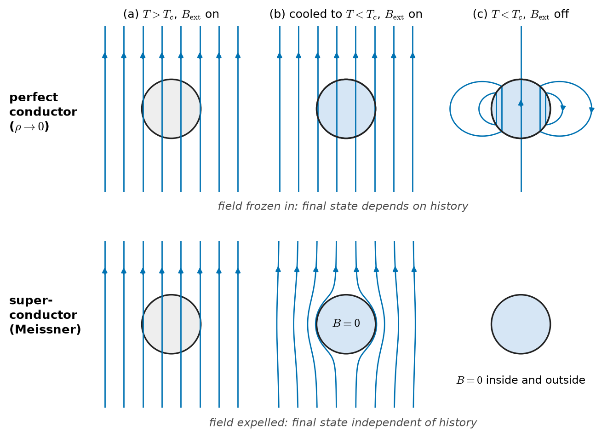
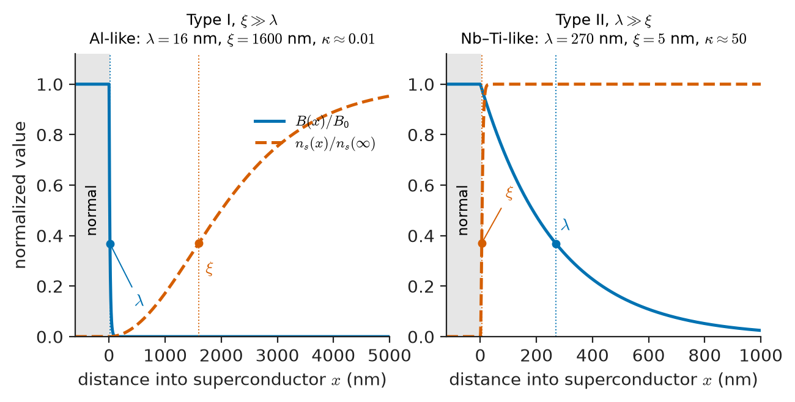
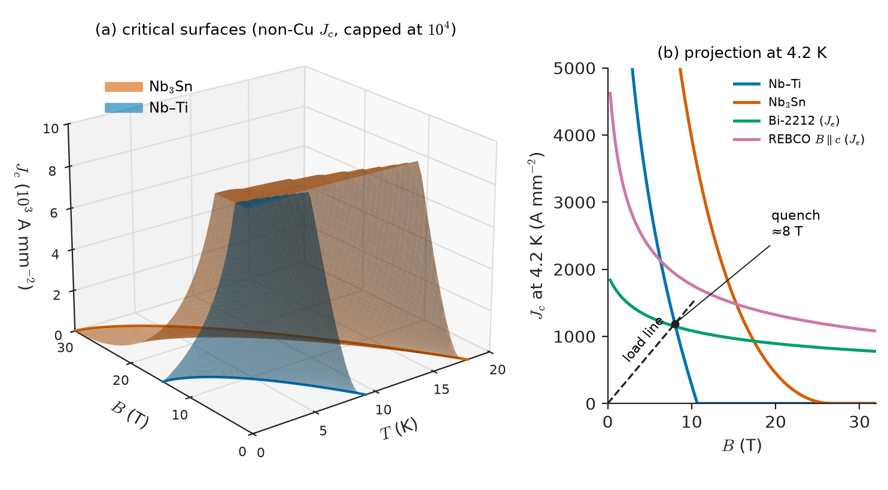
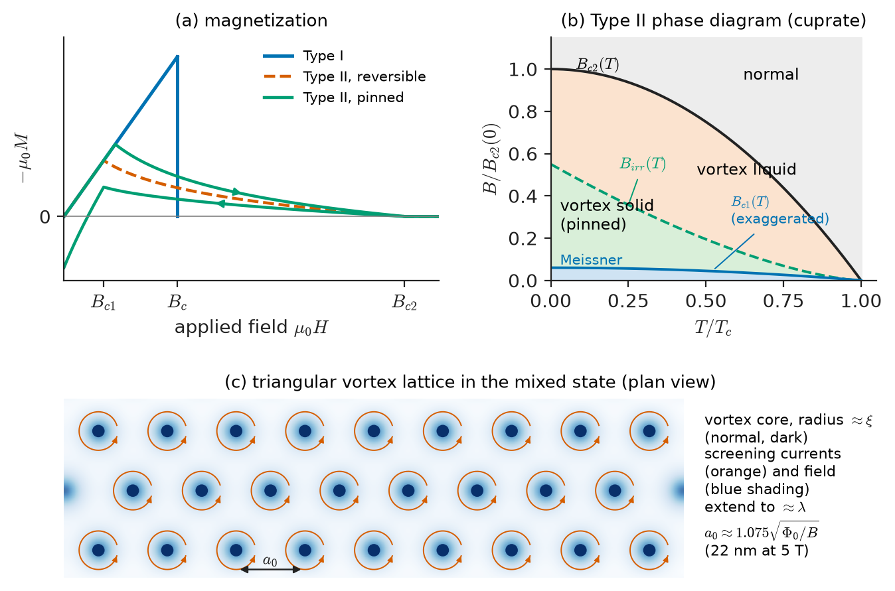
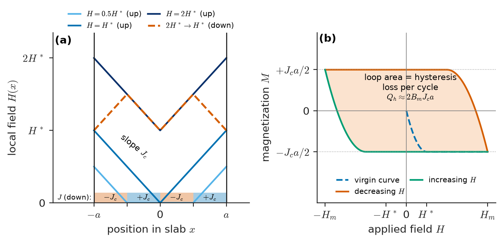
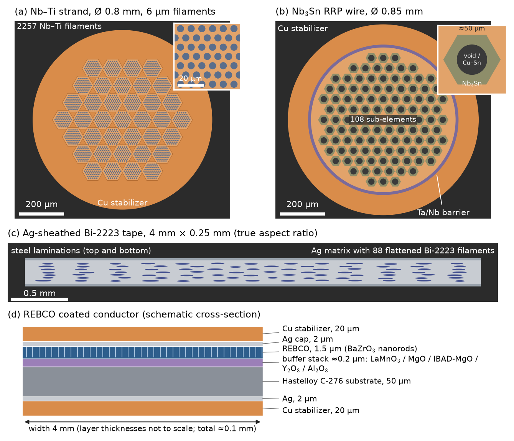

# Chapter 30 — Superconducting Materials

*Part VI · Thermal, Electrical, Dielectric and Magnetic Materials*

A 3 T MRI scanner carries a current of several hundred amperes around a coil of niobium–titanium wire several kilometres long, and it does so for years with the power supply disconnected. The current does not decay measurably. Yet the same wire, lifted a few kelvin above its operating temperature or pushed a few per cent beyond its rated current, turns resistive in milliseconds, dumps the stored magnetic energy (several megajoules) as heat, boils off hundreds of litres of liquid helium and can destroy itself. A copper engineer would call the first behaviour impossible and the second catastrophic. Both are properties of the material, and both are set by structure on the scale of nanometres: the spacing of titanium precipitates, the size of Nb$_3$Sn grains, the misorientation of grain boundaries in a ceramic tape. This chapter explains what a superconductor is, from the materials side, and why only a handful of the thousands of known superconductors are usable as engineering conductors.

> **Why does a superconductor carry current without loss, and what limits how much current, field and temperature it can tolerate?**
> **Why are the useful superconductors almost all Type II materials full of deliberately introduced defects, and why are the best of them so hard to make into wire?**

| Concept | Engineering destination |
|---|---|
| Zero resistance, persistent current | MRI and NMR magnets in persistent mode, lossless DC cables |
| Meissner effect, penetration depth $\lambda$ | Magnetic shielding, levitation, surface resistance of RF cavities |
| Coherence length $\xi$, Ginzburg–Landau parameter $\kappa$ | Type I versus Type II behaviour; upper critical field |
| Critical temperature, field and current; critical surface | Operating margin and load line of every superconducting magnet |
| Flux pinning, Bean critical-state model | Critical current density, magnetization, AC (hysteresis) loss |
| Multifilamentary wires, coated-conductor tapes | Conductor choice for magnets, cables, fault-current limiters |
| Strain sensitivity, brittleness, reaction heat treatment | Winding method, mechanical design, quench and stress limits |
| Flux quantum, Josephson effect | SQUID magnetometers, quantum-limited sensing |

**Roadmap.** What is special about the superconducting state (30.1) → the three limits $T_c$, $B_c$, $J_c$ and the critical surface (30.2) → why most practical superconductors are Type II (30.3) → the material families, including high-temperature superconductors (30.4) → how defects pin flux and set $J_c$ (30.5) → how the materials are turned into wires and tapes (30.6) → the processing constraints that follow (30.7) → magnets, power devices and sensors (30.8).

> **Boundary.** The microscopic (BCS) theory of superconductivity is quantum many-body physics and belongs to Engineering Physics; it is used here only qualitatively. Josephson-junction circuits and SQUID electronics belong to Electronics & Computing. The cryogenic and power-system design of magnets and cables belongs to Electrical Energy & Machines. This chapter treats the material: what its structure does to its critical parameters, and what its processing allows.

---

## 30.1 Superconducting properties

### 30.1.1 Zero resistance

In 1911 Kamerlingh Onnes measured the resistance of mercury as it was cooled in liquid helium. In an ordinary metal the resistivity falls with temperature as phonon scattering freezes out and then levels off at a residual value set by impurities and defects (Matthiessen's rule, Chapter 25). Mercury followed this curve down to 4.2 K and then, within a few hundredths of a kelvin, its resistance fell to below the resolution of his instrument. The temperature at which this happens is the **critical temperature** $T_c$.

"Below the resolution" needs a sharper statement. The most sensitive test is a persistent current: induce a current in a closed superconducting ring and watch its magnetic field. A ring of inductance $L$ and resistance $R$ loses current as $I(t)=I_0e^{-Rt/L}$. Experiments of this kind have found no decay over years, which puts upper limits on the resistivity of order $10^{-25}\ \Omega\,\mathrm{m}$ or below, at least seventeen orders of magnitude below room-temperature copper ($1.7\times10^{-8}\ \Omega\,\mathrm{m}$). For engineering purposes the DC resistivity is zero, and an MRI magnet can be "closed" with a superconducting switch and left to run for years with field drift below 0.1 ppm per hour.

Two qualifications matter immediately:

- **Zero resistance is a DC property.** At finite frequency the unpaired electrons respond to the field that accelerates the condensate, giving a small surface resistance that matters in RF cavities. In power applications the losses from flux motion (Section 30.5) matter more, even at 50 Hz.
- **Zero resistance holds only below three critical values together**: temperature, magnetic field and current density (Section 30.2).

### 30.1.2 The Meissner effect: more than a perfect conductor

Suppose a material merely had zero resistance. Faraday's law with $\mathbf E=\rho\mathbf J=0$ gives

$$
\nabla\times\mathbf E=-\frac{\partial\mathbf B}{\partial t}=0
$$

so the field inside a perfect conductor is frozen at whatever value it had when the resistance vanished. Cool such a material in zero field and apply a field: surface currents are induced that keep $\mathbf B=0$ inside. Cool it in a field and then remove the field: the interior field stays trapped. The final state depends on history.

In 1933 Meissner and Ochsenfeld found that a superconductor does something different. Cooled through $T_c$ *in* a field, it **expels** the field from its interior. The state $\mathbf B=0$ inside is reached regardless of history (Figure 30.1). The superconducting state is therefore a genuine thermodynamic phase, with a free energy that depends only on $T$ and $H$, not a kinetic consequence of vanishing resistance. Inside a bulk superconductor in the Meissner state

$$
\mathbf B=\mu_0(\mathbf H+\mathbf M)=0\quad\Rightarrow\quad \mathbf M=-\mathbf H,\qquad \chi=-1
$$

A superconductor is a perfect diamagnet, about $10^5$ times more strongly diamagnetic than copper ($\chi\approx-1\times10^{-5}$) and several thousand times more than bismuth, the most diamagnetic ordinary metal (Chapter 28). This is why a small magnet levitates stably above a cooled YBCO pellet.

<!-- FIGURE 30.1 | figures/ch30/fig-30-1-perfect-conductor-vs-meissner.png | schematic | A perfect conductor traps whatever field it had when its resistance vanished; a superconductor expels the field regardless of history. | Content: two rows of three panels. Top row "perfect conductor": (a) T>Tc with field lines passing through a sphere, (b) cooled below Tc in field: lines still pass through, (c) external field removed: lines remain trapped inside, closing around the sphere. Bottom row "superconductor": (a) same as top, (b) cooled in field: lines excluded and bunched around the sphere, (c) field removed: no field inside or outside. Label T>Tc, T<Tc, B_ext on/off. -->

*Figure 30.1 — A perfect conductor traps whatever field it had when its resistance vanished; a superconductor expels the field regardless of history.*

### 30.1.3 The London equations and the penetration depth

Expulsion cannot be perfect right up to the surface: the screening current that cancels the applied field must flow in a layer of finite thickness, otherwise the current density would be infinite. The brothers F. and H. London (1935) found the simplest description. Treat a density $n_s$ of superconducting carriers of charge $q$ and mass $m$ as frictionless. Newton's law gives $m\,d\mathbf v/dt=q\mathbf E$, and with $\mathbf J_s=n_sq\mathbf v$,

$$
\frac{\partial\mathbf J_s}{\partial t}=\frac{n_sq^2}{m}\mathbf E
$$

Taking the curl and using Faraday's law gives $\partial/\partial t\,[\nabla\times\mathbf J_s+(n_sq^2/m)\mathbf B]=0$. A perfect conductor would stop there: the bracket is constant. The London postulate, chosen to reproduce the Meissner effect, is that the bracket is not merely constant but zero:

$$
\nabla\times\mathbf J_s=-\frac{n_sq^2}{m}\,\mathbf B
$$

Combine with Ampère's law $\nabla\times\mathbf B=\mu_0\mathbf J_s$ and $\nabla\cdot\mathbf B=0$ (so $\nabla\times\nabla\times\mathbf B=-\nabla^2\mathbf B$):

$$
\nabla^2\mathbf B=\frac{1}{\lambda_L^2}\mathbf B,\qquad \lambda_L=\sqrt{\frac{m}{\mu_0n_sq^2}}
$$

For a field $B_0$ applied parallel to the flat surface of a superconductor filling $x>0$, the solution that does not blow up is

$$
B(x)=B_0\,e^{-x/\lambda_L}
$$

The field, and the screening current that produces it, decay over the **London penetration depth** $\lambda_L$ (Figure 30.2). Only a bulk sample much thicker than $\lambda_L$ shows full Meissner expulsion; a film thinner than $\lambda_L$ is penetrated almost uniformly.

**Worked example — the size of the penetration depth.** Take one carrier per atom with the free-electron charge and mass, $n_s=1\times10^{29}\ \mathrm{m^{-3}}$, $q=e$, $m=m_e$:

$$
\lambda_L=\sqrt{\frac{9.109\times10^{-31}}{(1.257\times10^{-6})(1\times10^{29})(1.602\times10^{-19})^2}}=\sqrt{\frac{9.109\times10^{-31}}{3.225\times10^{-15}}}=1.68\times10^{-8}\ \mathrm m
$$

about 17 nm. Measured values in clean elemental superconductors are 16–40 nm (Al about 16 nm, Nb about 40 nm), in good agreement given the crudeness of "one carrier per atom". In the cuprates the carrier density is roughly a hundred times smaller and the effective mass larger, and $\lambda$ rises to 150 nm or more, which is the first sign that these materials will behave differently in a field.

The penetration depth also depends on temperature, because $n_s$ falls to zero at $T_c$. A useful fit is the two-fluid form

$$
\lambda(T)\approx\frac{\lambda(0)}{\sqrt{1-(T/T_c)^4}}
$$

> **Status of the principle: London equations and penetration depth**
> *Approximate.* A phenomenological, local theory: it assumes the current at a point depends only on the field at that point. It fails when the coherence length exceeds $\lambda$ (clean, low-$\kappa$ metals such as Al), where Pippard's non-local theory is needed. The temperature dependence above is *Empirical*.

### 30.1.4 Cooper pairs, the energy gap and flux quantization (qualitative)

The London carriers turn out to be pairs. BCS theory (Bardeen, Cooper and Schrieffer, 1957) showed that a weak net attraction between electrons near the Fermi surface, mediated by lattice vibrations, binds them into **Cooper pairs** of opposite momentum and spin. Three consequences matter to a materials engineer, and each can be checked without the theory:

1. **An energy gap.** Breaking a pair costs energy $2\Delta$, with $2\Delta\approx3.5\,k_BT_c$ in the weak-coupling limit. This gap is seen in tunnelling and in far-infrared absorption. Photons or phonons with $h\nu<2\Delta$ cannot break pairs, which is why microwave losses are small and why superconducting detectors can count single photons.
2. **The isotope effect.** In conventional superconductors $T_c\propto M^{-1/2}$, where $M$ is the ionic mass, the fingerprint of phonon-mediated pairing. It is weak or absent in the cuprates, whose pairing mechanism is still debated.
3. **Charge $2e$.** The superconducting state is described by a single macroscopic wavefunction whose phase must be single-valued around any closed loop. The magnetic flux through a superconducting ring is therefore quantized in units of the **flux quantum**
$$
\Phi_0=\frac{h}{2e}=2.068\times10^{-15}\ \mathrm{Wb}
$$
The factor 2 in the denominator was the experimental proof of pairing. $\Phi_0$ sets the flux carried by each vortex in a Type II superconductor (Section 30.3) and the period of a SQUID (Section 30.8).

> **Status of the principle: BCS pairing**
> *Fundamental* in its domain: it is a quantum many-body theory that predicts the gap, the isotope effect and the $2e$ charge for conventional (phonon-mediated, weak-coupling) superconductors. It does not predict $T_c$ of a new material reliably, and it does not explain the cuprates.

### 30.1.5 Coherence length

The pair density cannot change abruptly. If a superconductor meets a normal region (a surface, a grain boundary, the core of a vortex), the density of pairs rises from zero to its bulk value over a characteristic distance, the **coherence length** $\xi$. Physically $\xi$ is the size of a Cooper pair, and BCS gives for a clean metal

$$
\xi_0\approx\frac{\hbar v_F}{\pi\Delta}
$$

A large Fermi velocity and a small gap (low $T_c$) give long coherence lengths: about 1.6 µm in aluminium, 83 nm in lead, 38 nm in niobium. In alloys and compounds two effects shorten $\xi$ dramatically. Electron scattering limits the pair size to roughly $\sqrt{\xi_0\ell}$, where $\ell$ is the electronic mean free path ("dirty limit"), so adding solute atoms or disorder shortens $\xi$. And materials with high $T_c$ have large gaps and, in the cuprates, low Fermi velocities: $\xi$ in YBCO is only about 1.5 nm in the CuO$_2$ planes and 0.2–0.3 nm perpendicular to them, comparable to a unit cell.

That last fact has an enormous engineering consequence. Any defect comparable to or larger than $\xi$, such as a grain boundary a few atoms wide, can locally suppress superconductivity. In niobium a grain boundary is invisible to the condensate; in YBCO it can be a barrier (Section 30.4.4).

<!-- FIGURE 30.2 | figures/ch30/fig-30-2-lambda-xi-interface.png | plot | Near a superconducting surface the field decays over the penetration depth lambda while the pair density rises over the coherence length xi; their ratio kappa decides Type I or Type II behaviour. | Content: two side-by-side panels sharing the horizontal axis x (distance into the superconductor, normal region x<0). Each shows B(x)/B0 decaying exponentially (solid line) and pair density n_s(x)/n_s(inf) rising as tanh-like (dashed). Left panel "Type I, xi >> lambda (kappa ~ 0.02, Al-like)": n_s rises slowly, B decays quickly. Right panel "Type II, lambda >> xi (kappa ~ 50, Nb-Ti-like)": n_s rises within a short distance, B penetrates far. Mark lambda and xi on each axis. -->

*Figure 30.2 — Near a superconducting surface the field decays over the penetration depth lambda while the pair density rises over the coherence length xi; their ratio kappa decides Type I or Type II behaviour.*

---

## 30.2 Critical temperature, field, and current

### 30.2.1 Critical temperature

$T_c$ is the temperature at which the superconducting free energy and the normal-state free energy become equal in zero field. Table 30.1 lists representative values. The history of $T_c$ is a materials story: from Hg (4.2 K, 1911) through Nb (9.3 K) and the A15 compounds such as Nb$_3$Sn (18 K) and Nb$_3$Ge (23 K, 1973), then the jump with the copper-oxide (cuprate) superconductors in 1986–1993 to 93 K in YBa$_2$Cu$_3$O$_7$ and 133–135 K in HgBa$_2$Ca$_2$Cu$_3$O$_{8+\delta}$ at ambient pressure. MgB$_2$ (39 K, 2001) and the iron-based superconductors (up to about 55 K, 2008) followed. Hydrogen-rich compounds such as H$_3$S and LaH$_{10}$ superconduct above 200 K, but only at pressures above 100 GPa, which makes them scientifically important and technologically irrelevant for now.

The engineering meaning of $T_c$ is the choice of coolant. Liquid helium boils at 4.2 K at atmospheric pressure, superfluid helium is used at 1.9 K, liquid hydrogen boils at 20 K, liquid neon at 27 K and liquid nitrogen at 77 K. Cryocoolers cover the range continuously. A material is practical at a temperature only if it still has a useful critical current at the field required there, which typically means operating at $T\lesssim T_c/2$ for magnets.

The cost of cooling grows quickly as temperature falls. An ideal (Carnot) refrigerator rejecting heat at 300 K needs $(300-T)/T$ watts of work per watt removed at $T$: 70 W/W at 4.2 K, 2.9 W/W at 77 K. Real cryoplants achieve 15–30 % of Carnot at large scale, so a watt deposited at 4.2 K costs several hundred watts at the wall. This is why AC losses (Section 30.5) and the choice between 4.2 K, 20 K and 77 K operation dominate system design.

### 30.2.2 Critical field and condensation energy

A magnetic field raises the free energy of the superconducting state, because expelling the field costs magnetic energy $B^2/2\mu_0$ per unit volume. When this equals the **condensation energy**, the free-energy advantage of pairing, superconductivity is destroyed. This defines the **thermodynamic critical field** $B_c$:

$$
g_n-g_s=\frac{B_c^2}{2\mu_0}
$$

For lead, $B_c(0)=0.080$ T, so the condensation energy is $(0.080)^2/(2\times1.257\times10^{-6})=2.5\times10^3\ \mathrm{J\,m^{-3}}$, a tiny energy: divided among the $3.3\times10^{28}$ atoms per cubic metre of lead it is about $5\times10^{-7}$ eV per atom. Superconductivity is a delicate low-energy order, which is why it is confined to low temperatures.

Experimentally $B_c$ falls with temperature in an approximately parabolic way:

$$
B_c(T)\approx B_c(0)\left[1-\left(\frac{T}{T_c}\right)^2\right]
$$

> **Status of the principle: parabolic critical-field law**
> *Empirical.* It fits most elemental superconductors to within a few per cent; BCS gives a slightly different curve. For the upper critical field of Type II materials (Section 30.3) the exponent is fitted per material, about 1.7 for Nb–Ti.

### 30.2.3 Critical current

A current produces a field. In a Type I wire of radius $a$ the field at the surface is $\mu_0I/2\pi a$, and superconductivity is lost when this reaches $B_c$ (Silsbee's rule). Because the current in a Type I superconductor flows only in the surface layer of thickness $\lambda$, the critical currents are small: a 1 mm lead wire at 4.2 K, with $B_c\approx0.055$ T, carries at most $I_c=2\pi aB_c/\mu_0=2\pi(5\times10^{-4})(0.055)/(1.257\times10^{-6})\approx140$ A, and in any appreciable external field much less. Type I superconductors are therefore useless as magnet conductors.

In Type II materials the critical current density $J_c$ is not set by an intrinsic field limit but by how strongly the material **pins** magnetic vortices against the Lorentz force of the current (Section 30.5). This makes $J_c$ a **microstructure-sensitive** property, like yield strength in metals (Chapter 13), whereas $T_c$ and $B_{c2}$ are largely **intrinsic** properties set by composition and crystal structure. The distinction organizes the whole of this chapter:

| Parameter | Controlled by | Analogue in Part III |
|---|---|---|
| $T_c$ | Composition, crystal structure, doping (oxygen content in cuprates) | Melting point |
| $B_{c2}$ | $T_c$ and electron scattering (alloying, disorder) | Elastic modulus |
| $J_c$ | Pinning defects: precipitates, grain boundaries, nanoparticles; grain alignment | Yield strength |

### 30.2.4 The critical surface

The three critical parameters are not independent. $J_c$ falls as field or temperature rises, and vanishes on the line $B_{c2}(T)$. The superconducting state is the region under a surface in $(T,B,J)$ space, the **critical surface** (Figure 30.3). A magnet operates at a point inside it. Its winding is energised along a **load line**: the peak field on the conductor rises in proportion to the current, and the magnet quenches where the load line pierces the critical surface. Designers keep a margin, typically operating at 70–85 % of the critical current along the load line, or a temperature margin of 1–2 K.

<!-- FIGURE 30.3 | figures/ch30/fig-30-3-critical-surface.png | plot | The critical surface bounds the superconducting state in temperature, field and current density; a magnet's load line must stay beneath it. | Content: 3D surface plot, axes T (0-20 K), B (0-30 T), J_c (0-10^4 A/mm^2, non-copper). Two surfaces: Nb-Ti (Tc 9.2 K, Bc2(0) 14.5 T) and Nb3Sn (Tc 18 K, Bc2(0) 30 T) in different shades. Inset 2D projection: J_c vs B at 4.2 K for Nb-Ti, Nb3Sn, Bi-2212, REBCO (B parallel to c), with a straight magnet load line from the origin crossing the Nb-Ti curve near 8 T. -->

*Figure 30.3 — The critical surface bounds the superconducting state in temperature, field and current density; a magnet's load line must stay beneath it.*

**Worked example — why the LHC runs at 1.9 K.** For Nb–Ti take $B_{c2}(0)=14.5$ T and $T_c=9.2$ K, with the empirical form $B_{c2}(T)=B_{c2}(0)[1-(T/T_c)^{1.7}]$.

At 4.2 K: $T/T_c=0.4565$, $(0.4565)^{1.7}=0.264$, so $B_{c2}=14.5\times0.736=10.7$ T.

At 1.9 K: $T/T_c=0.2065$, $(0.2065)^{1.7}=0.068$, so $B_{c2}=14.5\times0.932=13.5$ T.

Cooling from 4.2 K to 1.9 K raises the upper critical field by 2.8 T, about 26 %, and $J_c$ at a given field rises roughly in proportion to the distance from $B_{c2}$. The LHC dipoles, which must deliver 8.3 T in the bore (about 9 T peak on the conductor), are only possible in Nb–Ti at superfluid-helium temperature; superfluid helium is also an excellent heat conductor, which helps stability. A field much above 9 T requires a different material: Nb$_3$Sn or an HTS.

**Table 30.1 — Representative critical parameters of superconductors (typical values; $J_c$ depends strongly on processing).**

| Material | Structure | $T_c$ (K) | $B_c$ or $B_{c2}(0)$ (T) | Type | Usable form |
|---|---|---|---|---|---|
| Al | fcc metal | 1.18 | 0.0105 ($B_c$) | I | Thin films (qubits, junctions) |
| Pb | fcc metal | 7.2 | 0.080 ($B_c$) | I | Historical, solder for joints |
| Nb | bcc metal | 9.25 | 0.2 ($B_c$); 0.4 ($B_{c2}$) | II ($\kappa\approx1$) | RF cavities, Josephson junctions |
| Nb–Ti (Nb–47 wt% Ti) | bcc alloy | 9.2 | 14.5 | II | Ductile multifilament wire |
| Nb$_3$Sn | A15 intermetallic | 18.3 | 28–30 | II | Reacted multifilament wire |
| MgB$_2$ | hexagonal | 39 | 15–35 (anisotropic, dirty films higher) | II | PIT wire |
| YBa$_2$Cu$_3$O$_{7-\delta}$ (REBCO) | layered perovskite | 92 | >100 (in-plane, extrapolated) | II | Coated-conductor tape |
| Bi$_2$Sr$_2$CaCu$_2$O$_8$ (Bi-2212) | layered | 85–92 | >100 | II | Round wire |
| (Bi,Pb)$_2$Sr$_2$Ca$_2$Cu$_3$O$_{10}$ (Bi-2223) | layered | 110 | >100 | II | Ag-sheathed tape |
| Ba$_{1-x}$K$_x$Fe$_2$As$_2$ | layered pnictide | 38 | 60–90 | II | PIT tape (development) |
| HgBa$_2$Ca$_2$Cu$_3$O$_{8+\delta}$ | layered | 133–135 | >100 | II | None practical |

---

## 30.3 Type I and Type II superconductors

### 30.3.1 The Ginzburg–Landau parameter

Ginzburg and Landau (1950) described the superconductor by an order parameter $\psi(\mathbf r)$, with $\lvert\psi\rvert^2=n_s$, whose free energy depends on its magnitude, its spatial gradient and the magnetic field. Two lengths come out of the theory: the penetration depth $\lambda$, over which the field varies, and the coherence length $\xi$, over which $\psi$ varies. Their ratio

$$
\kappa=\frac{\lambda}{\xi}
$$

is the **Ginzburg–Landau parameter**, and it decides how a superconductor responds to a field.

The argument is about the energy of a boundary between normal and superconducting regions. Across such a wall the field penetrates the superconducting side over a depth $\lambda$, which *lowers* the cost of field expulsion, roughly by $(B_c^2/2\mu_0)\lambda$ per unit area. The pair density recovers over $\xi$, so a slab of thickness about $\xi$ loses its condensation energy, *raising* the energy by roughly $(B_c^2/2\mu_0)\xi$. The wall energy per unit area is therefore approximately

$$
\sigma_{ns}\approx\frac{B_c^2}{2\mu_0}\,(\xi-\lambda)
$$

- If $\xi>\lambda$ ($\kappa$ small), walls cost energy, the material avoids creating them, and the field is either fully expelled or, above $B_c$, fully admitted. This is a **Type I** superconductor.
- If $\lambda>\xi$ ($\kappa$ large), walls *lower* the energy, and above a certain field the material divides itself as finely as possible into normal and superconducting regions. This is a **Type II** superconductor.

The exact GL calculation places the boundary at $\kappa=1/\sqrt2\approx0.71$. Pure elemental metals other than Nb, V and Tc are Type I. Alloys, compounds and all high-$T_c$ materials are strongly Type II, because disorder shortens $\xi$ and low carrier density lengthens $\lambda$. Alloying is therefore the materials engineer's switch from Type I to Type II, much as it is the switch from soft to strong in structural metals.

> **Status of the principle: Ginzburg–Landau theory and the $\kappa=1/\sqrt2$ criterion**
> *Derived* from the GL free-energy expansion, which is itself *Approximate*: strictly valid near $T_c$, where $\psi$ is small. Gor'kov showed that GL follows from BCS in that limit. It remains qualitatively correct and widely used at all temperatures.

### 30.3.2 The mixed state and the two critical fields

A Type II superconductor in a rising field passes through three states (Figure 30.4):

1. **Meissner state** for $B<B_{c1}$: complete expulsion, $M=-H$.
2. **Mixed (Shubnikov) state** for $B_{c1}<B<B_{c2}$: field enters as **vortices** (fluxoids), each a normal core of radius about $\xi$ surrounded by circulating supercurrent extending out to about $\lambda$, and each carrying exactly one flux quantum $\Phi_0$. The vortices repel each other and in a clean material form a triangular lattice (the Abrikosov lattice). The average flux density is $B=n_v\Phi_0$, where $n_v$ is the number of vortices per unit area.
3. **Normal state** above $B_{c2}$, when the vortex cores overlap.

The GL theory gives the two critical fields in terms of $\lambda$ and $\xi$:

$$
B_{c1}\approx\frac{\Phi_0}{4\pi\lambda^2}\ln\kappa,\qquad B_{c2}=\frac{\Phi_0}{2\pi\xi^2}=\sqrt2\,\kappa\,B_c
$$

The upper critical field has a simple meaning: at $B_{c2}$ each vortex occupies an area of order $2\pi\xi^2$, so the cores fill space. Short coherence length means high $B_{c2}$, which is why disordered alloys and short-$\xi$ cuprates can survive tens of tesla while a clean metal cannot survive a tenth of a tesla.

The triangular vortex lattice has spacing

$$
a_0=\left(\frac{2}{\sqrt3}\frac{\Phi_0}{B}\right)^{1/2}\approx1.075\sqrt{\frac{\Phi_0}{B}}
$$

At 5 T, $a_0=1.075\sqrt{2.068\times10^{-15}/5}=1.075\times2.03\times10^{-8}=22$ nm. This number will reappear in Section 30.5: to pin vortices effectively, the defects in the material must be spaced on this scale.

> **Status of the principle: $B_{c2}=\Phi_0/2\pi\xi^2$**
> *Derived* from the linearized GL equations. With $\xi(T)$ measured or fitted it is quantitatively reliable for isotropic materials; for layered materials $B_{c2}$ depends on field direction, and in very high-$B_{c2}$ materials the Pauli (spin) limit can cap it below the GL value.

<!-- FIGURE 30.4 | figures/ch30/fig-30-4-type-i-type-ii.png | plot | Type I superconductors expel field completely up to Bc; Type II superconductors admit quantized vortices between Bc1 and Bc2, and pinning makes their magnetization irreversible. | Content: three panels. (a) -M vs applied mu0H: Type I triangle rising linearly to Bc then dropping to zero; Type II rising to Bc1 then decaying gradually to zero at Bc2 (reversible, dashed) and a hysteretic loop for a pinned material (solid). (b) B-T phase diagram for a Type II material: Meissner region below Bc1(T), mixed state between Bc1(T) and Bc2(T), irreversibility line B_irr(T) below Bc2 separating pinned vortex solid from vortex liquid (draw for a cuprate with B_irr well below Bc2), normal region above. (c) Plan-view sketch of a triangular vortex lattice with cores of radius xi shaded and circulating currents out to lambda; spacing a0 marked. -->

*Figure 30.4 — Type I superconductors expel field completely up to Bc; Type II superconductors admit quantized vortices between Bc1 and Bc2, and pinning makes their magnetization irreversible.*

### 30.3.3 Characteristic lengths in practice

**Worked example — coherence length and $\kappa$ from measured critical fields.** Nb$_3$Sn has $B_{c2}(0)\approx30$ T. Inverting $B_{c2}=\Phi_0/2\pi\xi^2$:

$$
\xi=\sqrt{\frac{\Phi_0}{2\pi B_{c2}}}=\sqrt{\frac{2.068\times10^{-15}}{2\pi\times30}}=\sqrt{1.097\times10^{-17}}=3.3\times10^{-9}\ \mathrm m
$$

For Nb–Ti, $B_{c2}(0)=14.5$ T gives $\xi=\sqrt{2.068\times10^{-15}/(2\pi\times14.5)}=4.8$ nm. With measured penetration depths of about 80–120 nm for Nb$_3$Sn and about 250–300 nm for Nb–Ti, $\kappa$ is roughly 25–35 and 50–60 respectively. Both are deep in the Type II regime. Compare niobium, $\xi\approx38$ nm and $\lambda\approx40$ nm, $\kappa\approx1$: alloying 47 wt% titanium into niobium shortens the coherence length eightfold by electron scattering, and that is what raises $B_{c2}$ from 0.4 T to 14.5 T while hardly changing $T_c$.

**Table 30.2 — Characteristic lengths (approximate low-temperature values; cuprate values for the CuO$_2$ planes).**

| Material | $\lambda$ (nm) | $\xi$ (nm) | $\kappa$ | Type |
|---|---|---|---|---|
| Al | 16 | 1600 | 0.01 | I |
| Pb | 37 | 83 | 0.45 | I |
| Nb | 40 | 38 | ≈1 | II (marginal) |
| Nb–Ti | 250–300 | 4–5 | 50–60 | II |
| Nb$_3$Sn | 80–120 | 3–4 | 25–35 | II |
| MgB$_2$ | 100–140 | 5–10 | 15–25 | II |
| YBCO (in-plane) | 150 | 1.5 | ≈100 | II |
| YBCO (out-of-plane $\xi_c$) | 800 ($\lambda_c$) | 0.2–0.3 | — | II |

The lower critical field of YBCO is small despite its high $T_c$: with $\lambda=150$ nm and $\kappa\approx100$, $B_{c1}\approx[2.068\times10^{-15}/(4\pi\times(1.5\times10^{-7})^2)]\ln100=7.3\times10^{-3}\times4.6\approx0.034$ T. In every practical magnet, power or cable application, Type II conductors operate in the mixed state, full of vortices. The Meissner state is relevant only to shielding, levitation and very-low-field sensing.

---

## 30.4 High-temperature superconductors and the practical family

Of thousands of known superconductors, about six are made into conductor in commercial quantities. They split into two groups: the **low-temperature superconductors** (LTS) Nb–Ti and Nb$_3$Sn, operated at 1.9–4.5 K, and the **high-temperature superconductors** (HTS), conventionally those with $T_c$ above 77 K (the cuprates REBCO and BSCCO) or, more loosely, anything usable above 20 K (adding MgB$_2$ and the iron-based materials). This section compares them by structure and by the property that decides their use. Table 30.3 at the end collects the engineering data.

### 30.4.1 Nb–Ti: the ductile workhorse

Nb–Ti alloys of about 47 wt% Ti are body-centred cubic solid solutions with $T_c\approx9.2$ K and $B_{c2}(4.2\ \mathrm K)\approx10.5$–11 T. What makes Nb–Ti dominant (most superconducting wire made, mainly for MRI) is not its modest superconducting parameters but its **mechanical** ones: it is a ductile metal that can be co-drawn with copper through area reductions of $10^4$ or more, is isotropic and strain-tolerant, and needs no heat treatment after winding. Its $J_c$ comes from pinning by nanometric α-Ti precipitates (Section 30.5.3).

### 30.4.2 Nb$_3$Sn: higher field, brittle compound

Nb$_3$Sn has the A15 crystal structure, in which Nb atoms form orthogonal chains along the cube faces. Its $T_c$ is 18.3 K and $B_{c2}(0)$ is about 30 T (raised to 27–28 T at 4.2 K by Ti or Ta doping, which adds scattering). It is the conductor for fields from about 10 T to 23 T at 4.2 K: high-field NMR, the high-luminosity upgrade of the LHC (HL-LHC) quadrupoles, and the ITER toroidal-field and central-solenoid coils. Its disadvantage is fundamental: like most intermetallic compounds it is brittle, with a fracture strain of a few tenths of a per cent. It cannot be drawn. Instead the precursors (Nb and Sn, or Nb and Cu–Sn bronze) are drawn as ductile composites, the wire is wound into its final coil shape, and the compound is formed by a solid-state diffusion reaction at 650–700 °C ("wind and react", Section 30.7). Its $J_c$ is also strongly **strain-dependent** (Section 30.7.1).

### 30.4.3 MgB$_2$: cheap and light, at 20 K

MgB$_2$ is a simple hexagonal compound of alternating Mg and graphite-like B layers. With $T_c=39$ K it is the highest-$T_c$ conventional (phonon-mediated) superconductor at ambient pressure. Its attractions are cost and availability: magnesium and boron are abundant and cheap, and the conductor is made by the powder-in-tube (PIT) method in Fe, Nb or Monel sheaths with a short reaction at 600–700 °C. Its coherence length (5–10 nm) is long enough that grain boundaries are not barriers to current, so untextured polycrystals carry useful current, unlike the cuprates. Its weakness is a low irreversibility field: in practical wires, useful $J_c$ at 20 K extends only to a few tesla. MgB$_2$ is therefore a conductor for low-field, cryogen-free applications at 10–25 K: open MRI magnets, power cables cooled by liquid hydrogen, and light electrical machines.

### 30.4.4 Cuprates: YBCO (REBCO) and BSCCO

The cuprate high-temperature superconductors share one structural motif: **CuO$_2$ planes**, square nets of copper and oxygen, separated by "charge reservoir" layers that set the number of holes in the planes. Superconductivity lives in the planes. Three consequences follow from this structure, and each becomes a processing problem.

**Doping by oxygen.** In YBa$_2$Cu$_3$O$_{7-\delta}$, $T_c$ depends on oxygen content. At $\delta\approx0$ the material is orthorhombic with $T_c=92$ K; at $\delta>0.6$ it is tetragonal and insulating. Oxygen is lost on heating, so every YBCO process must finish with an oxygenation anneal around 400–500 °C. The rare earth Y can be replaced by Gd, Eu, Sm and others with similar results, hence the general label **REBCO** (rare-earth barium copper oxide).

**Anisotropy.** Transport is easy in the planes and difficult across them. The ratio of in-plane to out-of-plane critical fields, the anisotropy $\gamma=\xi_{ab}/\xi_c=\lambda_c/\lambda_{ab}$, is about 5–7 for YBCO but 50–200 for the bismuth compounds, whose thick Bi–O reservoir layers weakly couple the planes. Large anisotropy makes the vortices behave like stacks of loosely coupled "pancakes" that pin poorly at high temperature, so the irreversibility field of BSCCO at 77 K is only a few tenths of a tesla. Above that field, vortices move freely and $J_c$ is zero even though $B_{c2}$ is enormous. BSCCO is therefore used either at 77 K in low field (cables, current leads) or at 4–30 K, where its irreversibility field becomes large.

**Weak links at grain boundaries.** Because $\xi$ is only 1–2 nm and the pair wavefunction has $d$-wave symmetry, a grain boundary in YBCO acts as a weak link. The critical current across a boundary falls roughly exponentially with misorientation angle $\theta$:

$$
J_c^{gb}(\theta)\approx J_c^{grain}\exp\left(-\frac{\theta}{\theta_0}\right),\qquad \theta_0\approx3\text{–}5^\circ
$$

so a 10° boundary passes perhaps a tenth of the intragrain current, and a random polycrystal of YBCO carries almost nothing. The material must be **biaxially textured**, every grain aligned in all three axes to within a few degrees, which is what forced the development of the coated-conductor architecture (Section 30.6.3). BSCCO is more forgiving because its micaceous grains align readily by mechanical deformation and the boundaries between plate-like grains have large contact areas, which is why the first HTS wires (1990s) were Bi-2223 tapes.

> **Status of the principle: exponential grain-boundary law**
> *Empirical.* Measured on bicrystal films of YBCO, it captures the trend over 0–40°. The decay constant depends on doping and on boundary type (tilt or twist), and calcium overdoping of the boundaries partly restores current.

### 30.4.5 Iron-based superconductors

Discovered in 2008 in LaFeAsO$_{1-x}$F$_x$ (26 K), the iron pnictides and chalcogenides contain FeAs or FeSe layers. The leading conductor candidate is Ba$_{1-x}$K$_x$Fe$_2$As$_2$ ($T_c\approx38$ K); "1111" compounds reach about 55 K. They combine $B_{c2}$ above 50 T with low anisotropy (1.5–2) and a grain-boundary critical angle about twice that of YBCO, so less perfect texture is tolerated, and PIT tapes have exceeded $10^5$ A/cm² at 4.2 K and 10 T. Arsenic toxicity and process immaturity keep them in development.

**Table 30.3 — Practical conductors compared (typical values; "non-Cu" means the superconductor plus matrix excluding copper stabilizer).**

| Conductor | $T_c$ (K) | Typical operating point | $J_c$ (A/mm²) at that point | Irreversible strain limit | Heat treatment after winding? | Main uses |
|---|---|---|---|---|---|---|
| Nb–Ti | 9.2 | 4.2 K, 5 T | ≈3000 (non-Cu) | >1 % (ductile) | No | MRI, accelerators, NMR outer coils |
| Nb$_3$Sn | 18.3 | 4.2 K, 12 T | 2500–3000 (non-Cu) | ≈0.2–0.4 % tensile | Yes, 650–700 °C, 50–200 h | NMR, HL-LHC, ITER, fusion |
| MgB$_2$ | 39 | 20 K, 1–2 T | 500–1000 (filament) | 0.3–0.5 % | Yes (in-situ route), ≈650 °C | Open MRI, cables, machines |
| Bi-2223 tape | 110 | 77 K, self-field | 150–200 ($J_e$) | 0.2–0.5 % (reinforced) | No (reacted before winding) | Cables, current leads |
| Bi-2212 round wire | 85–92 | 4.2 K, 20–30 T | 1000+ ($J_e$ at 20 T) | ≈0.3 % | Yes, partial melt ≈ 890 °C in O$_2$ | Very-high-field inserts |
| REBCO tape | 92 | 77 K self-field / 20 K, 20 T | 300–1000 ($J_e$) | 0.4–0.7 % tensile | No | Fusion, >20 T magnets, FCLs, cables |

---

## 30.5 Flux pinning

### 30.5.1 Why vortices must not move

A transport current density $\mathbf J$ flowing through a vortex lattice exerts on each vortex a force per unit length

$$
\mathbf f=\mathbf J\times\Phi_0\hat{\mathbf z}
$$

where $\hat{\mathbf z}$ is the direction of the vortex. Per unit volume, with $n_v=B/\Phi_0$ vortices per unit area, this becomes the familiar Lorentz force density $\mathbf F_L=\mathbf J\times\mathbf B$. If the vortices move with velocity $\mathbf v$, they induce an electric field

$$
\mathbf E=\mathbf B\times\mathbf v
$$

parallel to $\mathbf J$, and power $\mathbf E\cdot\mathbf J$ is dissipated. In a perfectly homogeneous superconductor the vortices are opposed only by viscous drag, and the resulting **flux-flow resistivity** is approximately

$$
\rho_{ff}\approx\rho_n\frac{B}{B_{c2}}
$$

(Bardeen–Stephen), a sizeable fraction of the normal-state resistivity. A perfect, defect-free Type II superconductor in the mixed state is therefore **not** a zero-resistance conductor at all. Zero resistance in a field depends entirely on *defects*.

> **Status of the principle: Bardeen–Stephen flux-flow resistivity**
> *Approximate.* It treats each vortex core as a normal cylinder of radius $\xi$ and is good to a factor of order one for $B\ll B_{c2}$ in conventional superconductors.

### 30.5.2 Pinning and the critical current density

A vortex core is a normal region of radius $\xi$; creating it costs condensation energy of roughly $(B_c^2/2\mu_0)\pi\xi^2$ per unit length. If the vortex passes through a region where superconductivity is already weakened (a non-superconducting precipitate, a grain boundary, a void, a dislocation, an oxygen vacancy cluster), that energy is saved. The vortex sits in a potential well and resists being moved. The maximum restoring force per unit volume that the defect population can supply is the **pinning force density** $F_p$, and the critical current is reached when the Lorentz force equals it:

$$
J_cB=F_p
$$

A useful pinning centre has two properties: its size is comparable to $\xi$ (a few nanometres), because a smaller defect barely perturbs the core and a larger one is wasteful; and the defects are numerous, with spacing comparable to the vortex spacing $a_0$ (about 20 nm at 5 T), so that every vortex has a pin nearby.

> **Status of the principle: critical-state condition $J_cB=F_p$**
> *Derived* as a force balance; $F_p$ itself is a microstructure-dependent quantity that is measured, not predicted. Its field dependence is usually fitted by the *Empirical* scaling law $F_p\propto b^p(1-b)^q$ with $b=B/B_{c2}$ (Kramer, Dew-Hughes), where $p$ and $q$ identify the dominant pinning mechanism.

### 30.5.3 Pinning microstructures by material

| Material | Dominant pinning centres | Size and spacing | How introduced |
|---|---|---|---|
| Nb–Ti | α-Ti precipitates (hcp), 20–25 vol% | Ribbons 1–4 nm thick, spacing ≈ 5–20 nm | Repeated 375–420 °C precipitation anneals, then heavy cold drawing that thins the precipitates to ribbons |
| Nb$_3$Sn | Grain boundaries | Grains 50–150 nm; $F_p\propto1/d$ | Low reaction temperature (finer grains); Hf, Zr additions; internal oxidation |
| MgB$_2$ | Grain boundaries; C substitution raises $B_{c2}$ | Grains 50–200 nm | Nanoscale B powder, C-doping, low-T reaction |
| REBCO | Correlated defects: BaZrO$_3$ or BaHfO$_3$ nanorods along $c$; stacking faults; Y$_2$O$_3$ particles | Nanorods 5–6 nm diameter, spacing 10–20 nm | Added to deposition target; self-assemble during growth |
| Bi-2212/2223 | Intrinsic (layered structure), defects | — | Limited control; high anisotropy limits pinning at 77 K |

Nb–Ti is the textbook example of microstructural engineering. Solution-annealed, it has $J_c$ of only a few hundred A/mm² at 5 T. Three or four precipitation anneals near 400 °C, each followed by cold drawing, produce α-Ti precipitates that the final drawing strain flattens into ribbons a few nanometres thick, spaced comparably to the vortex lattice at 5 T, raising $J_c$ almost tenfold to about 3000 A/mm². The pinning force density is then $F_p=J_cB=3\times10^9\times5=1.5\times10^{10}\ \mathrm{N\,m^{-3}}$, a body force comparable to that from a pressure gradient of 15 GPa per metre.

In REBCO, BaZrO$_3$ added to the deposition target self-assembles into columns about 5 nm across, parallel to the $c$ axis, during film growth. Each column matches a vortex along the same axis, so these **correlated** pins work best for fields along $c$, where REBCO otherwise pins worst; doubling $J_c$ at 20–30 K this way has been central to compact fusion magnets.

### 30.5.4 The Bean critical-state model

In 1962 C. P. Bean proposed a model that turns pinning into engineering numbers. Assume that wherever the field has changed, the local current density is exactly $\pm J_c$, and wherever it has not, $J=0$; take $J_c$ independent of field. Consider an infinite slab of half-thickness $a$ ($-a<x<a$) in a field $H$ applied parallel to its faces, starting from the virgin state. Ampère's law in one dimension is

$$
\frac{dH}{dx}=\pm J_c
$$

so the field inside falls *linearly* from its surface value, with slope $J_c$, and the flux front advances to a depth $H/J_c$ (Figure 30.5). The field reaches the centre at the **full-penetration field**

$$
H^*=J_ca,\qquad B^*=\mu_0J_ca
$$

Above $H^*$, the profile is a "roof" of fixed shape riding on the applied field, and the mean field inside is $H-J_ca/2$, so the magnetization saturates at

$$
M=-\frac{J_ca}{2}
$$

On reversing the field sweep, the sign of the current reverses from the surface inward, and $M$ swings to $+J_ca/2$. The magnetization loop is a parallelogram of width $J_ca$ in $M$, and $J_c$ can be measured from it with a magnetometer ($J_c=\Delta M/a$ for a slab, where $\Delta M=J_ca$ is the full loop width), which is the standard contactless characterization of superconductors (Chapter 52).

The area of the loop is energy dissipated as heat per cycle. For a field cycled between $\pm B_m$ with $B_m\gg B^*$, the loss per unit volume per cycle is the loop width times the field swing:

$$
Q_h\approx\mu_0\,(J_ca)\,(2H_m)=2B_mJ_ca
$$

The hysteresis loss is proportional to the filament size $a$. This single result explains why superconducting wire is made of thousands of fine filaments.

> **Status of the principle: Bean critical-state model**
> *Approximate.* It assumes $J_c$ independent of field, sharp current fronts and no flux creep. It is quantitatively good for $B_m\gg B^*$ and for the shape of magnetization loops; the Kim model ($J_c\propto1/(B+B_0)$) adds field dependence. Geometry changes numerical factors: for a cylindrical filament in a transverse field the coefficient differs from the slab value by order one.

<!-- FIGURE 30.5 | figures/ch30/fig-30-5-bean-model.png | plot | The Bean critical-state model: field profiles in a slab advance with constant slope Jc, and the resulting magnetization loop has width proportional to Jc times filament size. | Content: (a) slab -a<x<a, field profiles H(x) for increasing applied field H = 0.5H*, H*, 2H* (straight lines of slope Jc from the surfaces), and for the reverse sweep from 2H* down to H* (V-shaped return profile with reversed slope near the surfaces). Shade current regions +Jc and -Jc. (b) M vs H loop: virgin curve, saturated parallelogram with M = -Jc a/2 on increasing and +Jc a/2 on decreasing field; annotate loop area = hysteresis loss per cycle. -->

*Figure 30.5 — The Bean critical-state model: field profiles in a slab advance with constant slope Jc, and the resulting magnetization loop has width proportional to Jc times filament size.*

**Worked example — hysteresis loss and filament size.** Take a Nb–Ti conductor with $J_c=3\times10^9\ \mathrm{A\,m^{-2}}$ (3000 A/mm²), treat each filament as a slab of half-thickness $a$, and cycle the field to $B_m=1$ T.

For filaments 6 µm in diameter ($a=3\ \mu$m, as in the LHC strands):

$$
B^*=\mu_0J_ca=(1.257\times10^{-6})(3\times10^9)(3\times10^{-6})=0.011\ \mathrm T
$$

so $B_m\gg B^*$ and

$$
Q_h=2B_mJ_ca=2\times1\times(3\times10^9)\times(3\times10^{-6})=1.8\times10^4\ \mathrm{J\,m^{-3}}
$$

For filaments 100 µm in diameter ($a=50\ \mu$m), $Q_h=2\times1\times3\times10^9\times5\times10^{-5}=3.0\times10^5\ \mathrm{J\,m^{-3}}$, almost seventeen times more.

For one cubic centimetre of superconductor the energy per cycle is 0.018 J against 0.30 J. In a magnet ramped once per minute, the coarse conductor deposits $0.30/60=5$ mW per cm³ at 4.2 K, which at several hundred watts of wall power per watt at 4.2 K costs over a watt of refrigerator input per cubic centimetre. At 50 Hz the same coarse conductor would deposit 15 W per cm³, impossible to remove. AC applications need filaments of a few micrometres or less, and even then losses limit LTS to DC or slowly ramped magnets.

### 30.5.5 Flux creep and the irreversibility field

Pinning wells have finite depth $U_0$, and vortices can hop thermally out of them at a rate proportional to $\exp(-U_0/k_BT)$. The trapped current in a persistent magnet therefore decays logarithmically in time, and the voltage across a conductor does not jump abruptly at $J_c$ but rises steeply:

$$
E=E_c\left(\frac{J}{J_c}\right)^n
$$

where $J_c$ is defined by a voltage criterion, conventionally $E_c=1\ \mu\mathrm V\,\mathrm{cm^{-1}}$ (or $0.1\ \mu$V/cm). The **n-value** is a figure of merit for conductor quality and for persistent-mode operation: 30–60 for good Nb–Ti, 20–40 for REBCO at low temperature, lower when the conductor is damaged or non-uniform.

> **Status of the principle: power-law E–J characteristic**
> *Empirical.* It fits measured transitions over several decades of electric field and is the standard model for conductor specification and quench simulation; the logarithmic creep it represents has a *Derived* basis in thermally activated hopping.

In LTS, $U_0\gg k_BT$ at 4.2 K and creep is small. In the cuprates, where $\xi$ is short (shallow wells), $T$ is high and anisotropy weakens the vortices, creep is strong. Above the **irreversibility field** $B_{irr}(T)$ the vortex lattice melts into a "vortex liquid" and $J_c$ falls to zero. At 77 K, $B_{irr}$ is about 7 T for REBCO with $B\parallel c$ but only about 0.2 T for Bi-2223, and this, more than $T_c$ or $B_{c2}$, determines which HTS can be used where.

---

## 30.6 Superconducting wires and tapes

A superconductor filament alone is not a conductor. If any small region turns normal (a crack, a burst of flux motion, a mechanical slip of the winding releasing frictional heat) its resistivity jumps to the normal-state value, about $6\times10^{-7}\ \Omega\,\mathrm m$ for Nb–Ti, and the full current flowing through it would heat it explosively. A practical wire is therefore a **composite**: fine superconducting filaments embedded in a matrix of high-purity copper (or silver, or aluminium) that carries the current briefly if the superconductor fails, conducts heat away, and gives mechanical support.

### 30.6.1 Stabilization: the role of the copper

At 4.2 K, high-purity copper has a residual resistivity set by impurities and defects (Chapter 25). Its quality is expressed by the residual resistance ratio, RRR = $\rho(273\ \mathrm K)/\rho(4.2\ \mathrm K)$: RRR = 100 gives about $1.6\times10^{-10}\ \Omega\,\mathrm m$, roughly four thousand times less than normal Nb–Ti. Placing the filaments in this matrix allows the current to bypass a normal zone, limiting the local heating so that the zone can recover (cryogenic stability) or, in large magnets, propagate slowly enough to be detected and the magnet discharged safely (quench protection). The Cu:SC volume ratio is a design choice: about 1–2 for accelerator and fusion conductors, up to 4–7 for MRI conductors and much higher for cryostable conductors in large detector magnets.

Heat treatments for pinning (Nb–Ti) or reaction (Nb$_3$Sn) can contaminate the copper and lower its RRR, so diffusion barriers (Nb or Ta) are placed between filaments and stabilizer in Nb$_3$Sn wires.

### 30.6.2 Multifilamentary LTS wires

Three reasons drive superconducting filaments to be fine:

1. **Hysteresis loss** is proportional to filament size (Section 30.5.4).
2. **Flux jumping.** When the field changes, the critical state shifts and flux moves, dissipating heat. Heat lowers $J_c$, which lets more flux move: positive feedback. An adiabatic stability estimate for a slab of half-thickness $a$ is
$$
a<\sqrt{\frac{3\,\gamma C\,(T_c-T_0)}{\mu_0J_c^2}}
$$
where $\gamma C$ is the volumetric heat capacity and $T_c$ is the field-dependent critical temperature. For Nb–Ti at 4.2 K in 5 T, with $\gamma C\approx6\times10^3\ \mathrm{J\,m^{-3}\,K^{-1}}$, $T_c(5\ \mathrm T)-T_0\approx2.8$ K and $J_c=3\times10^9\ \mathrm{A\,m^{-2}}$, this gives $a<\sqrt{3(6\times10^3)(2.8)/[(1.257\times10^{-6})(9\times10^{18})]}=67\ \mu$m, a filament diameter of order 100 µm. With safety margins, filaments well below 50 µm are standard. (*Approximate*: adiabatic, field-independent $J_c$, no cooling.)
3. **Field quality** in accelerator magnets: magnetization currents in filaments distort the field at injection, scaling with $J_ca$.

Fine filaments alone are not enough: in a changing field they couple through the conducting matrix and act as one large filament. **Twisting** the wire (pitch 10–25 mm) reverses the coupling currents every half pitch; the coupling time constant scales as $L_p^2/\rho_t$, with $L_p$ the pitch and $\rho_t$ the matrix transverse resistivity, which resistive Cu–Mn or Cu–Ni barriers raise.

**Nb–Ti wire** is made by stacking Nb–Ti rods in copper cans into a billet, extruding, and drawing through many dies with intermediate precipitation heat treatments. An MRI wire may contain 30–60 filaments of 50–100 µm; an LHC strand (0.825–1.065 mm diameter) contains 6000–9000 filaments of 6–7 µm (Figure 30.6).

**Nb$_3$Sn wire** is drawn as precursors and reacted after winding. Three routes dominate:

- **Bronze route**: Nb filaments in a Cu–Sn bronze matrix (up to about 15 wt% Sn, the solubility limit for a workable bronze). Easy to draw and good for low-loss conductors, but the limited tin gives lower $J_c$; used for ITER and NMR.
- **Internal tin**, including restacked-rod process (RRP): tin cores surrounded by Nb filaments and Cu within a diffusion barrier. More tin gives more Nb$_3$Sn and $J_c$ of 2500–3000 A/mm² at 12 T, 4.2 K; used for HL-LHC.
- **Powder-in-tube (PIT)**: NbSn$_2$ powder inside Nb tubes, reacting outward.

Reacted Nb$_3$Sn filaments merge into larger effective filaments (sub-elements 40–60 µm across), so flux-jump stability and magnetization at low field remain design issues.

### 30.6.3 HTS conductors

**Bi-2223 tape (first generation).** Oxide powder in silver tubes (silver is permeable to oxygen and inert to the oxide) is drawn, stacked, rolled flat and heat-treated near 830 °C with intermediate rolling, which aligns the plate-like grains. A 4 mm × 0.2–0.3 mm tape carries 150–200 A at 77 K in self-field; the silver, 60–70 % of the cross-section, sets a cost floor.

**Bi-2212 round wire.** The only isotropic round HTS wire, so it can be cabled conventionally. It is heat-treated after winding by **partial melting** at about 880–890 °C in oxygen, under about 50 bar overpressure to remove porosity, and then carries over 1000 A/mm² ($J_e$) at 4.2 K and 20 T.

**REBCO coated conductor (second generation).** Because YBCO needs biaxial texture, it is grown as an epitaxial film on a textured template rather than as a drawn composite. A typical architecture, bottom to top (Figure 30.6):

| Layer | Material | Thickness | Function |
|---|---|---|---|
| Substrate | Hastelloy C-276 (Ni–Mo–Cr), or textured Ni–W | 30–100 µm | Strength (>600 MPa); non-magnetic (Hastelloy) |
| Buffer stack | Al$_2$O$_3$ diffusion barrier, Y$_2$O$_3$ seed, IBAD-MgO template, homoepitaxial MgO, LaMnO$_3$ or CeO$_2$ cap | ≈0.1–0.3 µm total | Biaxial texture (IBAD: ion-beam-assisted deposition, aligning MgO to within a few degrees), chemical barrier |
| Superconductor | (RE)BCO, often with BaZrO$_3$ or BaHfO$_3$ nanorods | 1–3 µm | Current-carrying layer |
| Cap | Ag | 1–3 µm | Oxygen-permeable protection; electrical contact |
| Stabilizer | Electroplated Cu (both sides) | 10–40 µm per side | Quench protection, current sharing |

The superconductor is deposited by pulsed-laser deposition, metal–organic chemical vapour deposition (MOCVD), reactive co-evaporation or metal–organic deposition at 700–850 °C, and oxygenated at about 500 °C. The tape is produced in lengths of hundreds of metres to a kilometre, in widths of 2–12 mm. The superconductor itself is only 1–2 % of the cross-section, so the **engineering current density** $J_e$, defined over the whole tape, is the number a magnet designer uses.

**Worked example — REBCO tape current and engineering current density.** A 4 mm wide tape carries a 1.5 µm REBCO layer with $J_c=3\ \mathrm{MA/cm^2}=3\times10^{10}\ \mathrm{A\,m^{-2}}$ at 77 K, self-field. The critical current is

$$
I_c=J_c\,w\,t=(3\times10^{10})(4\times10^{-3})(1.5\times10^{-6})=180\ \mathrm A
$$

With a total tape thickness of 0.1 mm (substrate, buffers, silver and copper), the engineering current density is

$$
J_e=\frac{I_c}{w\,t_{tape}}=\frac{180}{(4\times10^{-3})(1\times10^{-4})}=4.5\times10^8\ \mathrm{A\,m^{-2}}=450\ \mathrm{A/mm^2}
$$

A conventional copper power cable is designed for 1–5 A/mm² for thermal reasons. Even at 77 K, where it is far from its best, the HTS tape carries roughly a hundred times more current per unit cross-section. At 20 K and 20 T the same tape typically still carries a few hundred A/mm² in $J_e$, which is the basis of compact high-field fusion magnets. Note also that a 25 % thinner substrate raises $J_e$ by almost 25 % without touching the superconductor: much of conductor development is about the parts that do not superconduct.

<!-- FIGURE 30.6 | figures/ch30/fig-30-6-conductor-cross-sections.png | micrograph-style | Four conductor architectures: multifilamentary Nb-Ti in copper, reacted Nb3Sn RRP sub-elements, Ag-sheathed Bi-2223 multifilament tape, and the layered REBCO coated conductor. | Content: four panels drawn as stylized micrographs with scale bars. (a) Nb-Ti strand, 0.8 mm diameter, thousands of 6 um filaments arranged in hexagonal bundles in Cu (scale bar 200 um, zoom inset 20 um). (b) Nb3Sn RRP wire, 0.85 mm, ~100 hexagonal sub-elements each ~50 um with Nb3Sn annulus around a void/Cu-Sn core, Ta/Nb barrier, Cu outer stabilizer. (c) Bi-2223 tape, 4 mm x 0.25 mm, ~55-121 flattened filaments in Ag matrix, steel lamination. (d) REBCO coated conductor cross-section, not to scale: Hastelloy 50 um, buffer stack 0.2 um (labelled layers), REBCO 1.5 um with nanorods indicated, Ag 2 um, Cu 20 um each side; widths 4 mm. -->

*Figure 30.6 — Four conductor architectures: multifilamentary Nb-Ti in copper, reacted Nb3Sn RRP sub-elements, Ag-sheathed Bi-2223 multifilament tape, and the layered REBCO coated conductor.*

### 30.6.4 Cables

Single strands carry tens to hundreds of amperes; magnets for accelerators and fusion need 10–70 kA to keep the inductance and stored-energy-to-voltage ratio manageable during a quench. Strands are therefore cabled:

- **Rutherford cable**: 20–40 round strands twisted and flattened into a two-layer keystoned tape, used in all accelerator dipoles (Nb–Ti, Nb$_3$Sn, Bi-2212).
- **Cable-in-conduit conductor (CICC)**: hundreds to about a thousand strands in a steel jacket with forced-flow supercritical helium; used in fusion (ITER: Nb$_3$Sn and Nb–Ti).
- **HTS tape cables**: Roebel (punched, transposed tapes), CORC (tapes wound helically on a round core) and twisted stacked tapes.

Transposition makes each strand see the same average field, so current divides equally; cabling also deforms the strands, which brings in the strain limits of the next section.

---

## 30.7 Material processing constraints

### 30.7.1 Strain sensitivity

The critical current of most practical superconductors depends on mechanical strain, and magnets are large stress environments: the Lorentz force $\mathbf J\times\mathbf B$ in a 10 T magnet carrying 500 A/mm² is $5\times10^{9}\ \mathrm{N\,m^{-3}}$, and conductor hoop stresses of 100–400 MPa are normal.

- **Nb–Ti** is relatively insensitive: $I_c$ falls by only a few per cent at 0.5 % strain, and the alloy is ductile.
- **Nb$_3$Sn** is strongly sensitive. The A15 lattice is distorted by strain, which lowers $T_c$ and $B_{c2}$. After reaction, differential thermal contraction between Nb$_3$Sn and the Cu or bronze matrix on cooling to 4 K leaves the filaments under an axial compressive precompression of about 0.2–0.3 %. Applied tension first relieves this (raising $I_c$ to a maximum) and then reduces it. At 12 T the reversible $I_c$ variation over a strain range of ±0.5 % can be 30–50 %. Beyond an intrinsic tensile strain of about 0.2–0.4 % filaments crack and the damage is **irreversible**. Transverse compressive stress in Rutherford cables is limited to roughly 150–200 MPa for the same reason.
- **REBCO** tolerates axial tensile strain up to about 0.4–0.7 % reversibly, set mainly by the strong Hastelloy substrate, but it is very weak in **transverse tension**: the layered structure can delaminate at stresses of 10–50 MPa, which is why epoxy-impregnated REBCO coils must be designed to avoid thermal-contraction peeling stresses.
- **BSCCO** and **MgB$_2$** have irreversible strain limits of roughly 0.2–0.5 %, raised by external reinforcement.

The empirical strain function $I_c(\varepsilon)$ is measured on each conductor type with bending-beam or tensile rigs and enters magnet design as an essential input, as fatigue curves do for structural design (Chapter 14).

> **Status of the principle: strain dependence of $J_c$**
> *Empirical* in its engineering form (fitted strain-scaling functions for $T_c(\varepsilon)$ and $B_{c2}(\varepsilon)$); the underlying lattice-distortion effect on $T_c$ is physical but not predicted quantitatively.

### 30.7.2 Brittleness and the order of operations

Nb$_3$Sn, MgB$_2$ and the cuprates are ceramics or intermetallics. Their bending strain limit means a conductor of thickness $t$ wound on a radius $R$ experiences a surface bending strain of about $t/2R$. For a 0.8 mm Nb$_3$Sn strand with an allowable 0.2 % strain the minimum bending radius would be $0.0004/0.002=0.2$ m, too large for magnet ends if bent after reaction. Hence two processing strategies:

- **Wind and react**: wind the unreacted, ductile precursor, then heat-treat the whole coil. Used for Nb$_3$Sn, Bi-2212 and in-situ MgB$_2$.
- **React and wind**: react first and wind with large bend radii or with the brittle layer at the neutral axis. Used for Bi-2223, ex-situ MgB$_2$ and REBCO tape (in which the 1–2 µm superconductor sits on a thick metal substrate, so bend strain is controlled by placing it near the neutral axis of the laminate).

### 30.7.3 Reaction heat treatment

A Nb$_3$Sn coil is heated in vacuum or argon through stages, typically about 210 °C and 400 °C to form Cu–Sn phases and distribute tin, then 650–700 °C for 50–200 hours to form Nb$_3$Sn by diffusion. The reaction is a compromise between kinetics and microstructure: higher temperature reacts faster and more completely, but coarsens the grains, reducing pinning ($F_p\propto1/d$) and $J_c$ at intermediate fields. The heat treatment imposes constraints across the whole magnet:

- The insulation must survive 650 °C: glass or ceramic-fibre braid, with the coil vacuum-impregnated with epoxy only afterwards.
- Coil tooling must hold dimensions to tens of micrometres during the reaction, despite the volume change of about 3–5 % that accompanies Nb$_3$Sn formation.
- The copper stabilizer's RRR must be protected by diffusion barriers.
- Once reacted, the coil cannot be repaired by unwinding.

Bi-2212 is harder still: the whole coil must be held uniform to about ±1 K at 880–890 °C in oxygen, with insulation and reinforcement compatible with hot oxygen. REBCO avoids post-winding treatment, but once made it loses oxygen if heated much above about 200–250 °C, which limits soldering temperatures for joints.

### 30.7.4 Anisotropy, texture and joints

Anisotropic conductors carry different currents in different field orientations. For REBCO the critical current at 20 K and 20 T may differ several-fold between field parallel and perpendicular to the tape, so magnet designers must track the field angle at every turn. Texture must be maintained over kilometre lengths: a single defect region over a few centimetres limits a whole length, so tapes are inspected continuously by Hall-probe scanning of trapped field.

Joints are a materials problem too. LTS filaments can be joined superconductingly by cold pressing, which allows persistent operation; HTS joints are usually soldered and resistive ($10^{-9}$–$10^{-8}\ \Omega$), which makes persistent HTS magnets difficult.

### 30.7.5 Cryogenics and critical resources

Every superconductor carries the constraint of its coolant. Helium is a non-renewable by-product of natural gas with recurrent shortages, which is why modern MRI magnets use sealed, low-inventory cryocooler systems. Niobium comes mostly from one country (Brazil), and silver (BSCCO) and Hastelloy (REBCO) set cost floors. These issues return in Chapter 59.

---

## 30.8 Applications in magnets, power systems, and sensing

### 30.8.1 MRI, NMR and research magnets

Clinical MRI at 1.5 T and 3 T is the largest market for superconductors, using Nb–Ti with a high copper fraction in persistent mode at 4.2 K; research scanners reach 7 T and above (11.7 T in Nb–Ti at 1.8 K). Higher fields need other materials: NMR magnets nest Nb–Ti (outer, low field) around Nb$_3$Sn, and commercial 1.2 GHz (28.2 T) spectrometers add REBCO inserts. All-superconducting research magnets have reached 32 T with REBCO inserts. MgB$_2$ serves low-field, cryogen-free MRI. Grading a coil, cheap Nb–Ti where the field is low and high-field conductor only where needed, is a materials-selection exercise on the critical surfaces of Section 30.2.

### 30.8.2 Accelerator and fusion magnets

The LHC at CERN uses 1232 Nb–Ti dipoles at 8.3 T and 1.9 K. The HL-LHC upgrade introduces Nb$_3$Sn quadrupoles with peak conductor fields near 11–12 T. Research towards 14–16 T dipoles for future colliders uses Nb$_3$Sn, with HTS inserts for 20 T.

Fusion magnets are the most demanding. ITER's toroidal-field coils use Nb$_3$Sn CICC (peak field about 11.8 T) and its poloidal-field coils Nb–Ti. Compact tokamak designs use REBCO at about 20 K to reach 20 T on the coil (demonstrated in a large model coil in 2021), because fusion power density rises steeply with field. The materials questions are those of this chapter: $J_e$ at 20 T and 20 K, strain and delamination under huge Lorentz forces, plus neutron irradiation damage.

### 30.8.3 Power cables

An HTS cable has tapes wound helically on a former, cooled by flowing liquid nitrogen at 65–77 K inside a vacuum-insulated cryostat. An engineering current density a hundred times copper's allows high power at low voltage, so a 10 kV HTS cable can replace a 110 kV line in a city (a 1 km, 10 kV, 40 MVA BSCCO cable has run in Essen since 2014), and a coaxial HTS shield confines the magnetic field.

At 50 Hz the cable is not lossless: hysteresis loss in the tapes (Section 30.5.4) and dielectric losses must be removed at 77 K, which at a cryogenic penalty of 10–20 W per watt sets the economic break-even against copper.

### 30.8.4 Superconducting fault-current limiters

A **resistive superconducting fault-current limiter** (SFCL) exploits what is a failure mode in a magnet. In normal operation the current is below $I_c$ and the HTS element has negligible resistance. When a fault drives the current above $I_c$, the material moves up its steep $E$–$J$ curve, heats, and transitions to the normal state within about a millisecond, inserting a resistance that limits the fault current, often to a few times the rated current, before the first current peak. The device resets itself when the fault is cleared and the element recools.

The material requirements are specific: a high normal-state resistance per unit length (thin or resistive stabilizer, unlike magnet conductors), a uniform $I_c$ along kilometres of tape so that the whole length switches together rather than a weak spot burning out, and the ability to absorb the fault energy without exceeding a safe temperature (typically 300–400 K). REBCO tapes with thin silver and stainless-steel or Hastelloy shunts are the usual choice. Inductive and saturated-core variants use superconductors differently. SFCLs are in service in distribution networks in several countries.

Superconducting machines, magnetic energy storage and maglev face the same trade-off between current density, AC loss and cryogenic cost.

### 30.8.5 SQUIDs and superconducting sensors

The most sensitive magnetometer known is built from the flux quantum. A **SQUID** (superconducting quantum interference device) is a superconducting loop interrupted by one or two **Josephson junctions**, thin barriers (about 1–2 nm of AlO$_x$ in a Nb/AlO$_x$/Nb trilayer) through which Cooper pairs tunnel. The maximum supercurrent through a two-junction (DC) SQUID oscillates with the flux through the loop with period $\Phi_0$, and with feedback electronics the flux can be resolved to about $10^{-6}\Phi_0$ per $\sqrt{\mathrm{Hz}}$.

**Worked example — field resolution of a SQUID magnetometer.** A low-$T_c$ SQUID with a flux noise of $1\ \mu\Phi_0/\sqrt{\mathrm{Hz}}$ is coupled to a pickup coil with an effective area of 1 mm² ($1\times10^{-6}\ \mathrm{m^2}$). One flux quantum through that area corresponds to a field

$$
B=\frac{\Phi_0}{A}=\frac{2.068\times10^{-15}}{1\times10^{-6}}=2.07\times10^{-9}\ \mathrm T
$$

so the field noise is $2.07\times10^{-9}\times10^{-6}=2\times10^{-15}\ \mathrm T/\sqrt{\mathrm{Hz}}$, about 2 fT/√Hz. The Earth's field is about 50 µT, ten orders of magnitude larger; the magnetic field of the human brain at the scalp is 10–1000 fT. This is why magnetoencephalography (MEG), using hundreds of Nb SQUIDs at 4.2 K in a magnetically shielded room (Chapter 29), is possible.

The materials of SQUIDs are chosen differently from conductor materials. LTS SQUIDs use Nb thin films (Nb is Type II with $\kappa\approx1$, stable, and makes reproducible AlO$_x$ tunnel barriers). HTS SQUIDs use YBCO films with Josephson junctions formed **deliberately** at grain boundaries, by growing the film on a bicrystal substrate with a 24–37° misorientation: the weak-link behaviour that ruins YBCO wires is exactly what a junction needs. HTS SQUIDs operate at 77 K with noise of tens of fT/√Hz, and are used in non-destructive testing and geophysics.

Transition-edge sensors, nanowire single-photon detectors (NbN or WSi films a few nanometres thick) and Al or Nb quantum circuits rely on the same thin-film parameters: $T_c$, $\lambda$, the gap and interface defect density (Chapter 34).

> **Boundary.** Josephson-junction physics and SQUID readout circuits are treated in Engineering Physics and Electronics & Computing; this section explains only why the materials are chosen.

---

## What remains open

| Open question | Where it is answered |
|---|---|
| How do thin superconducting films (NbN, YBCO) grow epitaxially, and how are buffer stacks deposited? | Chapter 49 (thin-film deposition principles), Chapter 50 (thin-film deposition) |
| How is the copper stabilizer's residual resistivity set by purity and annealing? | Chapter 25 (Matthiessen's rule), Chapter 10 (annealing) |
| How are Nb–Ti precipitation anneals and Nb$_3$Sn diffusion reactions controlled as phase transformations? | Chapter 10 |
| How are joints, solders and laminations for conductors and leads chosen? | Chapter 51 |
| How are $J_c$, $T_c$ and magnetization measured, and with what uncertainty? | Chapter 52 (four-point probe, magnetic characterization, uncertainty) |
| How do delamination, fatigue and thermal cycling degrade conductors over a magnet's life? | Chapter 44 |
| When is a superconducting solution cheaper or more sustainable than copper, given cryogenic cost and helium supply? | Chapter 58 |
| How are magnets, cables and fault-current limiters designed as systems? | Electrical Energy & Machines core |

**Next:** Chapter 31 (Solid-State Foundations for Materials Engineering) opens Part VII by asking why some solids conduct, others insulate, and semiconductors lie in between, replacing the free-carrier picture of Chapter 25 with energy bands, band gaps and the Fermi level.
