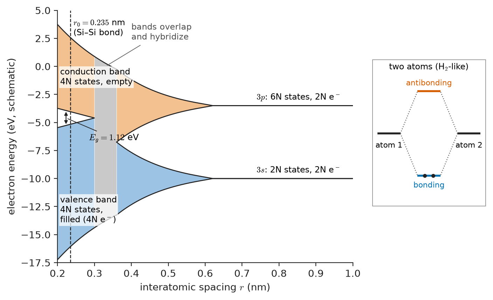
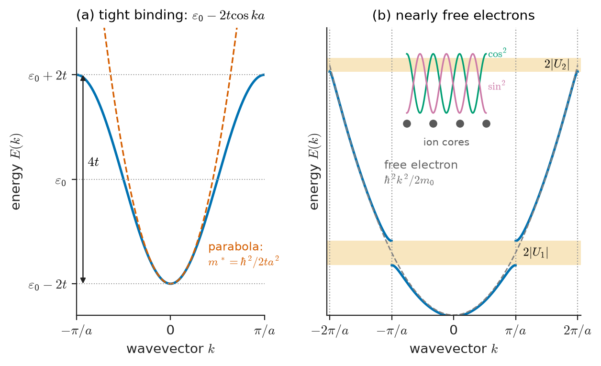
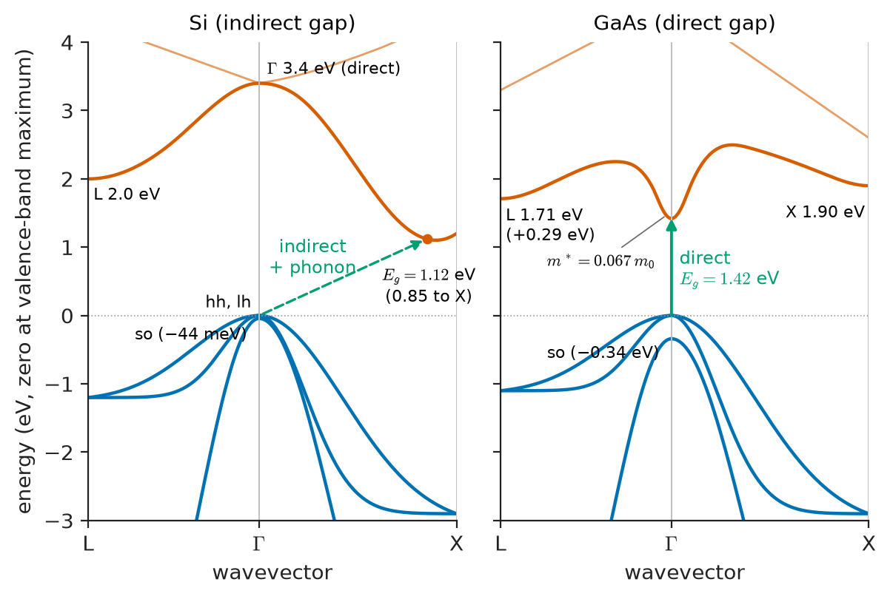
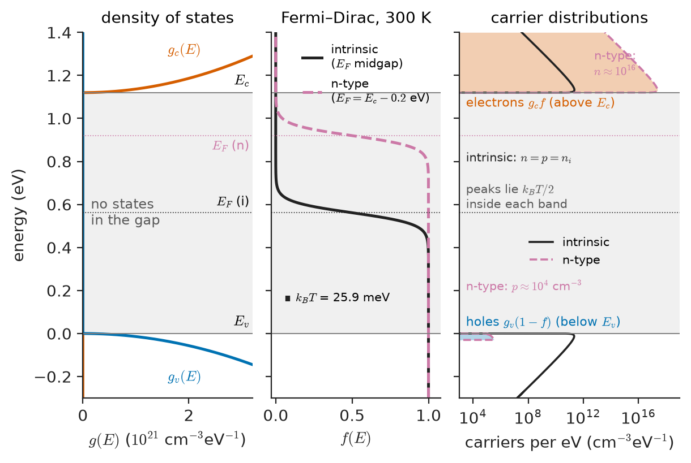
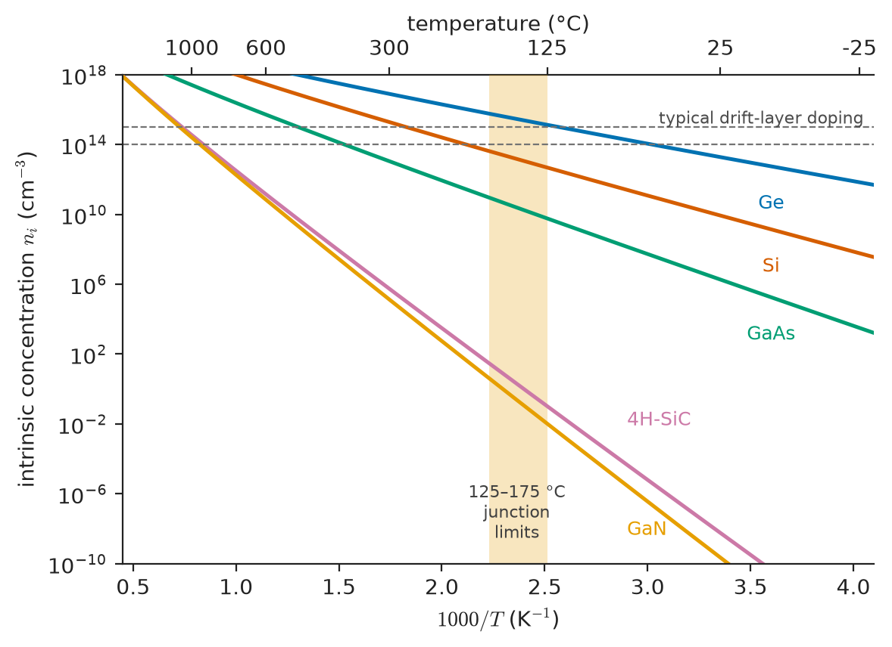
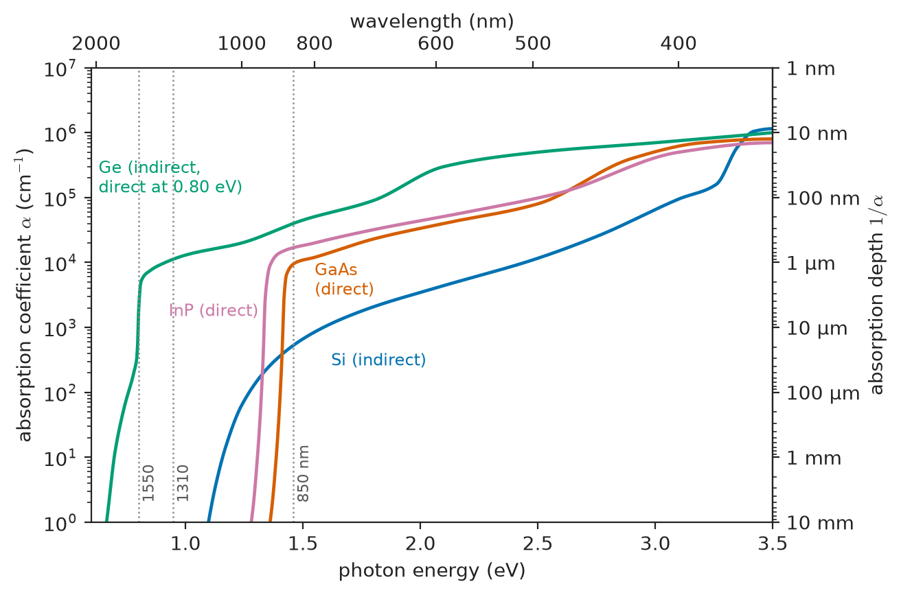

# Chapter 31 — Solid-State Foundations for Materials Engineering

*Part VII · Semiconductor and Photonic Materials*

An automotive supplier qualifies a silicon pressure-sensor interface chip for an engine-bay module. At 25 °C the chip's input leakage current is a few picoamperes and invisible. At 125 °C the same leakage is several hundred times larger, the sensor offset drifts out of specification, and the module fails its qualification test. Nothing in the chip was damaged. No bond broke, no metal melted, no dielectric failed. The silicon simply did what silicon does: the number of electrons that heat lifts across its band gap increased by a factor of about 500 over those 100 kelvin. A colleague proposes moving the sensor interface to silicon carbide, in which the same effect at 125 °C is smaller by about thirteen orders of magnitude. A second colleague asks why, if silicon carbide is so much better, the indicator LED on the same board is made of neither silicon nor silicon carbide but of a III–V compound. Both answers come from the electronic structure of the crystal, which is the subject of this chapter.

> **Why do electrons in a crystal occupy bands of allowed energy separated by forbidden gaps, and what sets the size of the gap?**
> **How many electrons and holes are available to carry current at a given temperature, and why does that number change so steeply with temperature and band gap?**
> **Why does silicon absorb light well but hardly emit it, while gallium arsenide does both?**

| Concept | Engineering destination |
|---|---|
| Bloch states, wavevector $k$ | The language of every band diagram, datasheet and simulator |
| Band formation (tight binding, nearly free electron) | Why gaps exist; why narrow bands mean heavy carriers |
| Valence and conduction bands, holes | Two-carrier conduction; p-type and n-type material (Chapter 32) |
| Band gap $E_g$ and its trends | Operating temperature, breakdown field, emission wavelength, leakage |
| Density of states $g(E)$, $N_c$, $N_v$ | Carrier counting; quantum wells and 2D materials (Chapters 34, 38) |
| Fermi level and Fermi–Dirac statistics | Contacts, junctions, work functions; equilibrium band diagrams |
| Effective mass | Mobility, saturation velocity, donor binding energy, tunnelling |
| $n_i(T)$ and the law of mass action | Leakage, maximum junction temperature, intrinsic limits |
| Direct and indirect gaps | LEDs and lasers versus photodetectors and solar cells (Chapter 35) |

**Roadmap.** Electronic states in a periodic crystal (31.1) → how bands form, from two pictures (31.2) → which bands are full and which are empty (31.3) → the band gap and its trends (31.4) → how many states there are (31.5) → how they are filled (31.6) → how carriers respond to forces (31.7) → how carrier populations change with temperature (31.8) → how the shape of the bands controls light absorption and emission (31.9).

> **Boundary.** This chapter gives the material-level picture of electronic structure: enough quantum mechanics to see why bands and gaps exist and to calculate with them. The Schrödinger equation, its solution for model potentials and the formal theory of crystal momentum belong in the Engineering Physics core. Atomic orbitals and chemical bonding are covered in the Advanced Chemistry core and are only referenced here. Diodes, transistors and their operation belong in the Electronics & Computing core.

---

## 31.1 Electronic states in solids

### From the free atom to the crystal

An isolated silicon atom has fourteen electrons in sharp, discrete energy levels: the familiar $1s^2\,2s^2\,2p^6\,3s^2\,3p^2$ configuration from the Advanced Chemistry core. The ten core electrons are bound by tens to thousands of electron-volts and play no part in conduction. The four outer electrons, in the $3s$ and $3p$ levels, are bound by only a few electron-volts, and they decide everything electrical.

Bring $N$ silicon atoms together into a crystal. The outer orbitals of neighbouring atoms overlap, and the electrons can no longer be assigned to a single atom. Two consequences follow at once.

1. **The Pauli principle still applies to the whole crystal.** No two electrons can occupy the same quantum state. Each atomic level, which could hold two electrons in one atom, must become $N$ distinct levels holding $2N$ electrons in the crystal. With $N\approx5\times10^{22}$ atoms per cubic centimetre, those levels lie so close together that they form an effectively continuous **band**.
2. **The width of each band is set by the overlap.** Strongly overlapping outer orbitals spread into bands several electron-volts wide. Core orbitals, which barely overlap, remain essentially sharp atomic levels.

The energy ranges between bands, which no extended state occupies, are the **band gaps**. Figure 31.1 shows this evolution as the interatomic spacing is reduced from infinity to the equilibrium value.

<!-- FIGURE 31.1 | figures/ch31/fig-31-1-level-splitting-to-bands.png | schematic | Atomic 3s and 3p levels of silicon broaden into bands as the atoms are brought together; at the equilibrium spacing the sp3 levels split into a filled bonding (valence) band and an empty antibonding (conduction) band separated by the gap. | Content: x axis interatomic spacing from about 0.2 nm to 1.0 nm (decreasing to the left), y axis electron energy in eV (schematic, about -15 to +5 eV). At large spacing two sharp levels, 3s (2N states, 2N electrons) and 3p (6N states, 2N electrons). As spacing falls the levels broaden into shaded bands, merge, and then split again into a lower band of 4N states (labelled valence band, filled, 4N electrons) and an upper band of 4N states (labelled conduction band, empty). Vertical dashed line at the equilibrium spacing 0.235 nm (Si–Si bond length) labelled; the vertical gap at that line labelled Eg = 1.12 eV. Inset at right: H2-like bonding and antibonding pair for two atoms. -->

*Figure 31.1 — Atomic 3s and 3p levels of silicon broaden into bands as the atoms are brought together; at the equilibrium spacing the sp3 levels split into a filled bonding (valence) band and an empty antibonding (conduction) band separated by the gap.*

### The periodic crystal and Bloch's theorem

In a crystal the potential energy $U(\mathbf r)$ that an electron feels repeats with the lattice (Chapter 2): $U(\mathbf r+\mathbf R)=U(\mathbf r)$ for every lattice vector $\mathbf R$. This one symmetry fixes the form of every electron state. Translating the crystal by $\mathbf R$ cannot change any measurable property, so the electron probability density $\lvert\psi\rvert^2$ must also repeat, and the wavefunction itself can change only by a phase factor. The result is **Bloch's theorem**:

$$
\psi_{n\mathbf k}(\mathbf r)=e^{i\mathbf k\cdot\mathbf r}\,u_{n\mathbf k}(\mathbf r),\qquad u_{n\mathbf k}(\mathbf r+\mathbf R)=u_{n\mathbf k}(\mathbf r)
$$

Every electron state in a perfect crystal is a plane wave $e^{i\mathbf k\cdot\mathbf r}$ modulated by a function $u$ that has the periodicity of the lattice. Two labels identify each state: the **wavevector** $\mathbf k$, and a **band index** $n$ that counts the solutions with the same $\mathbf k$. The allowed energies $E_n(\mathbf k)$, plotted against $\mathbf k$, form the **band structure** of the material.

> **Status of the principle: Bloch's theorem**
> *Fundamental.* It follows from the translational symmetry of a perfect, infinite crystal. Real crystals have surfaces, defects and thermal vibrations, and these act as perturbations that scatter electrons between Bloch states (Chapter 32).

Three consequences matter for engineering.

**A Bloch electron is not scattered by the perfect lattice.** A plane wave in a periodic potential propagates forever. The ions do not "get in the way" of the electron, as the classical Drude picture of Chapter 25 assumed. Resistance comes only from departures from perfect periodicity: lattice vibrations (phonons), impurities, defects, alloy disorder and surfaces. This is why the mobility of a semiconductor depends so strongly on temperature and on impurity concentration, and why it is a material property that processing can change.

**$\mathbf k$ is defined only within the Brillouin zone.** Adding a reciprocal-lattice vector $\mathbf G$ to $\mathbf k$ gives the same set of states, so all distinct states lie in one primitive cell of reciprocal space, the **first Brillouin zone**. For a one-dimensional lattice of period $a$ this is $-\pi/a<k\le\pi/a$. For the face-centred cubic lattice of Si, Ge and GaAs it is a truncated octahedron, and its high-symmetry points carry standard labels: $\Gamma$ at the centre, X at the centre of the square faces (along $\langle100\rangle$), L at the centre of the hexagonal faces (along $\langle111\rangle$). Band diagrams in datasheets and papers plot $E(\mathbf k)$ along lines joining these points.

**$\hbar\mathbf k$ behaves like momentum.** Under an external force $\mathbf F$, such as an electric field, the wavevector of an electron changes as

$$
\hbar\frac{d\mathbf k}{dt}=\mathbf F
$$

The quantity $\hbar\mathbf k$ is called the **crystal momentum**. It is not the mechanical momentum of the electron, because the lattice also exchanges momentum with it, but it is conserved in collisions and optical transitions (up to a reciprocal-lattice vector). Section 31.9 shows that this conservation law decides whether a material can emit light efficiently.

### Counting states

Apply periodic boundary conditions to a crystal of $N$ primitive cells. The allowed $\mathbf k$ values form a fine grid with exactly $N$ points in the Brillouin zone. Each band therefore holds $N$ orbital states, or $2N$ electrons including spin.

> **Status of the principle: 2N states per band**
> *Derived.* It follows from Bloch's theorem with periodic boundary conditions and the two spin states. It is the counting rule that decides, in Section 31.3, whether a crystal is a metal or an insulator.

---

## 31.2 Energy-band formation

Two complementary models explain why bands form and gaps open. The first starts from atoms and lets them interact. The second starts from free electrons and switches on the lattice. Each is approximate. Together they explain every qualitative feature of real band structures.

### The tight-binding picture: from bonds to bands

Start with two atoms, each with one orbital of energy $\varepsilon_0$. When they approach, the orbitals combine into a bonding state at $\varepsilon_0-t$ and an antibonding state at $\varepsilon_0+t$, where $t$ is the **hopping** or transfer energy, which measures how strongly an electron on one atom couples to the orbital on its neighbour (the molecular-orbital result of the Advanced Chemistry core).

Now take a long chain of $N$ atoms with spacing $a$, each coupled to its two neighbours. By Bloch's theorem each state is a combination of atomic orbitals with phase $e^{ikna}$ on atom $n$, and its energy is

$$
E(k)=\varepsilon_0-2t\cos(ka),\qquad -\frac{\pi}{a}<k\le\frac{\pi}{a}
$$

The two-atom bonding–antibonding pair has become a band of $N$ states running from $\varepsilon_0-2t$ at $k=0$ to $\varepsilon_0+2t$ at the zone boundary. Figure 31.2(a) shows this cosine band. Three features generalise to real crystals.

- **Bandwidth is proportional to overlap.** The width $4t$ (in general $2zt$ for $z$ nearest neighbours) grows as the atoms come closer. Strongly bonded, short-bond crystals have wide bands.
- **Each atomic orbital gives one band.** With several orbitals per atom ($s$, $p_x$, $p_y$, $p_z$) one obtains several bands. Where those bands do not overlap in energy, gaps remain between them.
- **Narrow bands mean heavy electrons.** Near the band bottom, $\cos(ka)\approx1-(ka)^2/2$, so $E\approx\varepsilon_0-2t+ta^2k^2$. This has the free-electron form $\hbar^2k^2/2m^*$ with an **effective mass**

$$
m^*=\frac{\hbar^2}{2ta^2}
$$

A small hopping energy, a narrow band and a heavy carrier go together. This anticipates Section 31.7.

**Worked example — effective mass from a tight-binding band.** Take $t=1.0$ eV and $a=0.25$ nm, typical of a covalent solid. Then $\hbar^2=(1.0546\times10^{-34})^2=1.112\times10^{-68}\ \mathrm{J^2\,s^2}$ and $2ta^2=2\times1.602\times10^{-19}\times(2.5\times10^{-10})^2=2.003\times10^{-38}\ \mathrm{J\,m^2}$, so $m^*=5.55\times10^{-31}$ kg $=0.61\,m_0$. The bandwidth is $4t=4$ eV. Halving the hopping energy to 0.5 eV, as in a weakly coupled organic crystal or a transition-metal oxide $d$ band, doubles the mass to $1.2\,m_0$ and halves the bandwidth. In organic semiconductors (Chapter 33) the intermolecular $t$ is only 0.05–0.1 eV, the bands are a few tenths of an electron-volt wide, and band transport gives way to hopping between molecules.

**Silicon in the tight-binding picture.** Each Si atom forms four $sp^3$ hybrid bonds to its tetrahedral neighbours in the diamond structure (Chapter 2). Each bond splits into a bonding and an antibonding combination. The $4N$ bonding states broaden into the **valence band**, the $4N$ antibonding states into the **conduction band**, and the gap between them is, roughly, the bonding–antibonding splitting minus the broadening of the two bands. Silicon has $4N$ valence electrons, exactly enough to fill the bonding band. This "chemist's band structure" is the origin of Figure 31.1. It explains at once why stronger, shorter bonds give wider gaps (C > Si > Ge), and why a gap exists even in an amorphous solid (Chapter 33), which has bonds but no long-range order.

### The nearly-free-electron picture: gaps from Bragg reflection

Now start from the opposite limit. An electron in an empty box has $E=\hbar^2k^2/2m_0$, a single parabola. Switch on a weak periodic potential $U(x)=\sum_G U_G e^{iGx}$, with reciprocal-lattice vectors $G=2\pi m/a$.

Away from the zone boundaries the parabola is barely changed. At $k=\pm\pi/a$, however, the electron wavelength is $\lambda=2a$, which satisfies the **Bragg condition** for reflection from the lattice planes, the same condition that governs X-ray diffraction (Chapter 52). The forward wave $e^{i\pi x/a}$ and the reflected wave $e^{-i\pi x/a}$ have equal energies and mix into two standing waves:

- $\psi_-\propto\cos(\pi x/a)$ piles charge on the ion cores, where the potential energy is low, and its energy is lowered.
- $\psi_+\propto\sin(\pi x/a)$ piles charge between the ions, and its energy is raised.

The two standing waves differ in energy by

$$
E_g=2\lvert U_G\rvert
$$

where $U_G$ is the Fourier component of the crystal potential at the reciprocal-lattice vector that connects $k=-\pi/a$ to $+\pi/a$. A gap opens at every zone boundary, and the parabola breaks into bands, as Figure 31.2(b) shows. The scale is right: for $a=0.543$ nm the free-electron energy at $k=\pi/a$ is $\hbar^2(\pi/a)^2/2m_0=1.27$ eV, and Fourier components of a few electron-volts are typical of real crystal potentials.

> **Status of the principle: band gaps from Bragg reflection**
> *Approximate.* The result $E_g=2\lvert U_G\rvert$ is first-order perturbation theory in a weak periodic potential. It is close to quantitative for simple metals such as Al and Na, whose potentials are weak. For covalent semiconductors the potential is strong and the tight-binding picture is more natural, but the conclusion that gaps open where electron waves Bragg-reflect holds in general.

<!-- FIGURE 31.2 | figures/ch31/fig-31-2-tight-binding-and-nfe-bands.png | band-diagram | Two routes to a band gap: (a) a tight-binding cosine band of width 4t formed from one atomic level; (b) the free-electron parabola split by Bragg reflection into bands with gaps 2 abs(U_G) at the zone boundaries. | Content: two side-by-side panels sharing the horizontal axis k from -pi/a to +pi/a (extended to -2pi/a..2pi/a in panel b). Panel (a): E(k) = eps0 - 2t cos(ka), with eps0 and the band edges eps0 - 2t and eps0 + 2t marked; a dashed parabola fitted at k = 0 labelled m* = hbar^2/(2ta^2). Panel (b): dashed free-electron parabola hbar^2 k^2/2m0; solid bands flattening near k = +/- pi/a with a gap 2 abs(U_1) and at +/- 2pi/a a smaller gap 2 abs(U_2); vertical dotted lines at the zone boundaries; inset sketch of the cos and sin standing waves against a row of ion cores. -->

*Figure 31.2 — Two routes to a band gap: (a) a tight-binding cosine band of width 4t formed from one atomic level; (b) the free-electron parabola split by Bragg reflection into bands with gaps 2 abs(U_G) at the zone boundaries.*

### What real band structures look like

Real band structures, computed numerically and confirmed by photoemission and optical spectroscopy, combine both pictures. Figure 31.3 sketches those of silicon and gallium arsenide along the L–Γ–X directions. Three features dominate the engineering behaviour.

- The **valence-band maximum** of all the common cubic semiconductors lies at $\Gamma$ ($k=0$), where three $p$-like bands meet: the heavy-hole, light-hole and (slightly lower) split-off bands.
- The **conduction-band minimum** lies wherever the lowest antibonding band dips lowest. In GaAs it is at $\Gamma$. In Si it lies along the six equivalent $\langle100\rangle$ directions, about 85 % of the way to X, giving six equivalent **valleys**. In Ge it lies at the eight L points, giving four full valleys (each L point is shared between neighbouring zones).
- **Secondary valleys** lie a few tenths of an electron-volt higher. In GaAs the L valleys lie about 0.29 eV above the $\Gamma$ minimum. Electrons heated by strong fields transfer into them, which produces the negative differential mobility of Chapter 32.

<!-- FIGURE 31.3 | figures/ch31/fig-31-3-si-gaas-band-structures.png | band-diagram | Simplified band structures of silicon (indirect gap) and gallium arsenide (direct gap) along L–Γ–X, with the band extrema that matter for transport and optics. | Content: two panels, energy axis -3 eV to +4 eV with zero at the valence-band maximum, wavevector axis from L through Γ to X. Silicon: valence bands (heavy hole, light hole, split-off 44 meV below) peaking at Γ; conduction-band minimum near 0.85 of the way Γ to X at 1.12 eV (marked Eg indirect); local minimum at L about 2.0 eV; direct gap at Γ about 3.4 eV; dashed arrow for the indirect transition with a phonon. Gallium arsenide: valence bands at Γ (split-off 0.34 eV down); conduction minimum at Γ at 1.42 eV with strong curvature (m* = 0.067 m0); L valley at 1.71 eV (0.29 eV above Γ) and X valley at about 1.90 eV; vertical arrow for the direct transition. -->

*Figure 31.3 — Simplified band structures of silicon (indirect gap) and gallium arsenide (direct gap) along L–Γ–X, with the band extrema that matter for transport and optics.*

---

## 31.3 Valence and conduction bands

### Filled bands, empty bands and conduction

Whether a crystal conducts depends on how its electrons fill the available bands. Two facts settle the question.

**A completely filled band carries no current.** For every state $\mathbf k$ in a band there is a state $-\mathbf k$ with opposite velocity. When the band is full, the velocities cancel exactly. An electric field shifts every electron's $\mathbf k$ at the same rate, but a full band remains full and the sum is still zero. An empty band trivially carries no current. **Only partly filled bands conduct.**

> **Status of the principle: full bands are inert**
> *Derived.* It follows from the symmetry $E(\mathbf k)=E(-\mathbf k)$ and the Pauli principle. It is why insulators insulate even though they contain about $10^{23}$ electrons per cubic centimetre.

**Electron counting decides the filling.** With $2N$ electrons per band (Section 31.1), a crystal with an even number of valence electrons per primitive cell can fill an integer number of bands exactly.

| Case | Valence electrons per primitive cell | Highest occupied band | Result | Examples |
|---|---|---|---|---|
| Odd count | 1, 3, ... | Half-filled | Metal | Na, Cu, Al |
| Even count, bands overlap in energy | 2, ... | Two partly filled bands | Metal or semimetal | Mg, Ca, Zn; Bi, graphite |
| Even count, gap between bands | 8 (two atoms × 4) | Full valence band, empty conduction band | Semiconductor or insulator | Si, Ge, GaAs, diamond, Al$_2$O$_3$ |

Silicon has two atoms per primitive cell and eight valence electrons, exactly enough to fill four bands. These are the valence bands. The next band up, empty at absolute zero, is the conduction band. At $T=0$ pure silicon is a perfect insulator.

The distinction between a **semiconductor** and an **insulator** is not one of kind but of degree, set by the gap and the temperature. At 300 K a material with $E_g\lesssim3$ eV contains enough thermally excited or dopant-supplied carriers to be called a semiconductor. Diamond (5.5 eV) and alumina (about 8.8 eV) are insulators in their pure form, but diamond can be doped and is treated as an ultra-wide-gap semiconductor in Chapter 33. Silicon carbide and gallium nitride, at 3.2–3.4 eV, are semiconductors that behave as near-insulators unless they are doped.

### Holes

When an electron is excited from the valence band to the conduction band, it leaves a single empty state in an otherwise full band. The response of the remaining $2N-1$ electrons to a field is awkward to describe directly. It is exactly equivalent, however, to the motion of a single fictitious particle, the **hole**, with these properties:

- charge $+q$,
- wavevector $\mathbf k_h=-\mathbf k_e$ of the missing electron,
- energy measured *downward* on the electron energy axis (a hole deeper in the valence band has more energy),
- a positive effective mass at the top of the valence band, where the electron effective mass is negative (Section 31.7).

The hole is not a book-keeping trick. Its positive charge is measured directly by the Hall effect (Chapter 52), which in p-type material gives a Hall voltage of the opposite sign to that in n-type material, something the free-electron model of metals cannot explain.

A semiconductor therefore has **two** kinds of carrier: electrons in the conduction band (concentration $n$) and holes in the valence band (concentration $p$). Its conductivity is

$$
\sigma=q\left(n\mu_n+p\mu_p\right)
$$

where $\mu_n$ and $\mu_p$ are the mobilities defined in Chapter 25. The rest of this chapter finds $n$ and $p$. Chapter 32 finds $\mu_n$ and $\mu_p$.

---

## 31.4 Band gaps

### What the gap measures

The band gap $E_g=E_c-E_v$ is the energy difference between the conduction-band minimum $E_c$ and the valence-band maximum $E_v$. Physically it is the minimum energy needed to break one bond and free its electron to move through the crystal while leaving a mobile hole behind. Almost every important semiconductor property depends on it:

- the intrinsic carrier concentration, through $e^{-E_g/2k_BT}$ (Section 31.8), and with it leakage currents and the maximum operating temperature;
- the critical field for avalanche breakdown, which grows roughly as $E_g^2$ to $E_g^{2.5}$ (Chapter 32), and with it the voltage rating per unit thickness of a power device;
- the absorption edge and emission wavelength, $\lambda\,(\mathrm{\mu m})\approx1.24/E_g\,(\mathrm{eV})$ (Section 31.9 and Chapter 35);
- the ionization energies of dopants and the depth of defect levels, measured from the band edges (Chapter 32).

### Representative values

| Material | Structure | $E_g$ at 300 K (eV) | Type | Cut-off wavelength $1.24/E_g$ (µm) |
|---|---|---|---|---|
| InSb | zincblende | 0.17 | direct | 7.3 |
| InAs | zincblende | 0.35 | direct | 3.5 |
| Ge | diamond | 0.66 | indirect | 1.88 |
| In$_{0.53}$Ga$_{0.47}$As | zincblende | 0.75 | direct | 1.65 |
| Si | diamond | 1.12 | indirect | 1.11 |
| InP | zincblende | 1.34 | direct | 0.93 |
| GaAs | zincblende | 1.42 | direct | 0.87 |
| GaP | zincblende | 2.26 | indirect | 0.55 |
| 4H-SiC | hexagonal | 3.26 | indirect | 0.38 |
| GaN | wurtzite | 3.39 | direct | 0.37 |
| ZnO | wurtzite | 3.37 | direct | 0.37 |
| β-Ga$_2$O$_3$ | monoclinic | 4.8–4.9 | (nearly) indirect | 0.26 |
| Diamond (C) | diamond | 5.47 | indirect | 0.23 |
| AlN | wurtzite | 6.0–6.2 | direct | 0.20 |
| SiO$_2$ (amorphous) | amorphous | about 9 | — | — |

### Trends: what sets the gap

The table shows two clear trends, both explained by the tight-binding picture of Section 31.2.

**Shorter, stronger bonds give wider gaps.** Down group IV, the bond length grows and the bonding–antibonding splitting falls: C (0.154 nm, 5.47 eV) → Si (0.235 nm, 1.12 eV) → Ge (0.245 nm, 0.66 eV) → α-Sn (0.281 nm, 0, a semimetal). The same pattern runs through the III–V compounds: AlN > GaN > InN (about 0.7 eV), and GaP > GaAs > GaSb (0.73 eV).

**Ionicity widens the gap.** Moving from a group-IV element to an isoelectronic III–V and then II–VI compound in the same row keeps the bond length nearly constant but makes the bond more polar, which adds an ionic contribution to the splitting: Ge (0.66 eV) → GaAs (1.42 eV) → ZnSe (2.7 eV). The polar bond character is a chemistry result (Advanced Chemistry core). Its materials consequence is that compound semiconductors offer a wide, nearly continuous menu of gaps.

**Alloys interpolate.** In a solid solution such as Al$_x$Ga$_{1-x}$As or In$_x$Ga$_{1-x}$N the gap varies smoothly with composition, usually as a quadratic with a small **bowing parameter** $b$:

$$
E_g(x)=xE_g^{A}+(1-x)E_g^{B}-b\,x(1-x)
$$

> **Status of the principle: gap interpolation with bowing**
> *Empirical.* The quadratic form fits measured gaps of most III–V and II–VI alloys with one fitted parameter. It fails where the alloy changes from direct to indirect (Al$_x$Ga$_{1-x}$As near $x\approx0.45$), where the different valleys must each be interpolated separately, and for highly mismatched alloys such as GaN$_x$As$_{1-x}$, where a few per cent of nitrogen lowers the gap by hundreds of meV.

This is how optoelectronic materials are tuned to a wavelength (Chapters 33 and 35).

### Temperature and pressure dependence

The gap shrinks as temperature rises, because thermal expansion lengthens the bonds and lattice vibrations smear the band edges. The **Varshni relation** fits the data:

$$
E_g(T)=E_g(0)-\frac{\alpha T^2}{T+\beta}
$$

| Material | $E_g(0)$ (eV) | $\alpha$ (eV/K) | $\beta$ (K) | $E_g(300\ \mathrm K)$ (eV) | $dE_g/dT$ at 300 K (meV/K) |
|---|---|---|---|---|---|
| Si | 1.170 | $4.73\times10^{-4}$ | 636 | 1.125 | −0.25 |
| Ge | 0.744 | $4.77\times10^{-4}$ | 235 | 0.663 | −0.39 |
| GaAs | 1.519 | $5.41\times10^{-4}$ | 204 | 1.422 | −0.45 |

> **Status of the principle: Varshni relation**
> *Empirical.* A two-parameter fit that reproduces $E_g(T)$ to a few meV from cryogenic temperatures to several hundred kelvin. Its form is motivated by the electron–phonon interaction but its parameters are fitted, not derived.

The shift matters in practice. An LED's emission wavelength red-shifts by about 0.3 nm/K, and a silicon bandgap-voltage reference relies on extrapolating the junction voltage to $E_g(0)/q\approx1.2$ V, which is the temperature-independent quantity in the circuit.

### The gap is not always the same number

Three different "gaps" appear in the literature, and confusing them causes errors.

- The **electronic (transport) gap** is the energy to create a free electron and a free hole.
- The **optical gap** is the photon energy at which absorption begins. It is smaller than the transport gap by the exciton binding energy, a few meV in Si and GaAs, 60 meV in ZnO, and 0.3–1 eV in organic semiconductors and monolayer transition-metal dichalcogenides (Chapter 33).
- **Computed gaps** from standard density-functional theory underestimate the true gap, often by 30–50 %. Values from simulation must be checked against measurement before being used in design.

---

## 31.5 Density of states

### Why we need it

To find how many electrons occupy a band we need two things: how many states exist at each energy, and the probability that each state is occupied. The first is the **density of states** $g(E)$, defined so that $g(E)\,dE$ is the number of states per unit volume with energies between $E$ and $E+dE$. The second is the Fermi–Dirac function of Section 31.6. Their product gives the carrier distribution.

### Derivation for a parabolic band in three dimensions

Near the bottom of the conduction band, any smooth $E(\mathbf k)$ can be expanded about its minimum. For an isotropic minimum this gives

$$
E=E_c+\frac{\hbar^2k^2}{2m_n^*}
$$

with an effective mass $m_n^*$ (Section 31.7). With periodic boundary conditions on a crystal of volume $V$, the allowed wavevectors form a grid with one point per $(2\pi)^3/V$ of $k$-space. The number of states, including two spins, inside a sphere of radius $k$ is

$$
N(k)=2\times\frac{\tfrac43\pi k^3}{(2\pi)^3/V}=\frac{Vk^3}{3\pi^2}
$$

Substituting $k=\sqrt{2m_n^*(E-E_c)}/\hbar$ and differentiating with respect to $E$, then dividing by $V$:

$$
g_c(E)=\frac{1}{2\pi^2}\left(\frac{2m_n^*}{\hbar^2}\right)^{3/2}\sqrt{E-E_c},\qquad E\ge E_c
$$

Similarly for holes near the valence-band maximum, $g_v(E)=\frac{1}{2\pi^2}(2m_p^*/\hbar^2)^{3/2}\sqrt{E_v-E}$ for $E\le E_v$. Inside the gap, $g=0$ in a perfect crystal.

> **Status of the principle: parabolic density of states**
> *Approximate.* It follows from the parabolic (effective-mass) expansion of $E(\mathbf k)$ and is accurate within roughly 0.1–0.2 eV of a band edge, which is where nearly all carriers sit in a non-degenerate semiconductor. It fails for hot carriers far into the band, for non-parabolic narrow-gap materials (InSb, InAs), and in disordered solids, where band tails extend into the gap (amorphous silicon, Chapter 33).

Two features matter. First, the density of states rises from zero at the band edge as $\sqrt{E-E_c}$: there are very few states right at the edge. Second, it scales as $(m^*)^{3/2}$: a heavy-mass band has many more states near its edge than a light one. A material with several equivalent valleys (six in Si) multiplies its density of states by the number of valleys, which is absorbed into a **density-of-states effective mass** (Section 31.7).

**Worked example — how many states lie near the band edge?** For the silicon conduction band, with a density-of-states mass $m_n^*=1.09\,m_0$, the number of states per unit volume within $k_BT$ of the band edge at 300 K is

$$
N(k_BT)=\int_{E_c}^{E_c+k_BT}g_c(E)\,dE=\frac{1}{3\pi^2}\left(\frac{2m_n^*k_BT}{\hbar^2}\right)^{3/2}
$$

With $2m_n^*k_BT/\hbar^2=2\times1.09\times9.109\times10^{-31}\times4.142\times10^{-21}/1.112\times10^{-68}=7.40\times10^{17}\ \mathrm{m^{-2}}$, its $3/2$ power is $6.36\times10^{26}\ \mathrm{m^{-3}}$, and dividing by $3\pi^2=29.6$ gives $2.15\times10^{25}\ \mathrm{m^{-3}}=2.1\times10^{19}\ \mathrm{cm^{-3}}$. A typically doped wafer with $n=10^{16}\ \mathrm{cm^{-3}}$ therefore occupies only about one in two thousand of the available states near the edge. This is why the simple Boltzmann statistics of Section 31.6 work so well, and why they fail once doping approaches $10^{19}\ \mathrm{cm^{-3}}$.

### Lower dimensions

If electrons are confined in one, two or three directions to a size comparable to their wavelength (a few nanometres), the density of states changes shape:

| Dimensionality | Example | $g(E)$ near a sub-band edge |
|---|---|---|
| 3D (bulk) | Silicon wafer | $\propto\sqrt{E-E_c}$ |
| 2D (quantum well, 2DEG, monolayer) | AlGaN/GaN channel, MoS$_2$ | constant, $m^*/\pi\hbar^2$ per sub-band (per unit area) |
| 1D (nanowire, nanotube) | Carbon nanotube | $\propto1/\sqrt{E-E_n}$ |
| 0D (quantum dot) | CdSe nanocrystal | discrete levels |

The step-like 2D density of states is why quantum-well lasers have lower threshold currents and why the two-dimensional electron gas of a GaN high-electron-mobility transistor holds a fixed sheet density per volt. These materials are treated in Chapters 34 and 38. Figure 31.4 shows the bulk 3D case.

---

## 31.6 Fermi level

### The Fermi–Dirac distribution

Electrons are fermions: each state holds at most one electron of a given spin. In thermal equilibrium at temperature $T$, the probability that a state of energy $E$ is occupied is the **Fermi–Dirac function**

$$
f(E)=\frac{1}{1+\exp\!\left[(E-E_F)/k_BT\right]}
$$

The parameter $E_F$, the **Fermi level**, is the energy at which the occupation probability is exactly one half. At $T=0$, $f$ is a step: every state below $E_F$ is full and every state above is empty. At finite temperature the step softens over a width of a few $k_BT$ ($k_BT=25.85$ meV at 300 K). The probability that a state is *empty*, which is the probability of finding a hole there, is $1-f(E)$.

> **Status of the principle: Fermi–Dirac distribution**
> *Fundamental.* It follows from statistical mechanics for indistinguishable particles obeying the Pauli principle, in thermal equilibrium. Out of equilibrium (under illumination or current injection) a single $E_F$ no longer describes both bands, and separate quasi-Fermi levels are needed (Chapter 32).

### The Fermi level is the electrochemical potential

Thermodynamically, $E_F$ is the chemical potential of the electrons, more precisely their electrochemical potential, which includes the electrostatic energy (Advanced Chemistry core for the general definition). Its most important property follows directly:

> **In thermal equilibrium, the Fermi level is the same everywhere in a connected system.**

If two materials with different Fermi levels are brought into contact, electrons flow from the higher to the lower until the Fermi levels align, building up the dipole layer and band bending that appear at every metal–semiconductor contact and p–n junction. A flat Fermi level in an equilibrium band diagram is a check that the diagram is correct. A gradient in the Fermi level drives current (Chapter 32).

> **Status of the principle: constant Fermi level in equilibrium**
> *Fundamental.* It is the thermodynamic condition for no net particle flow, the electronic counterpart of equal chemical potential in phase equilibrium.

### Metals versus semiconductors

In a **metal**, $E_F$ lies inside a partly filled band. For copper, the free-electron estimate with $n=8.47\times10^{28}\ \mathrm{m^{-3}}$ gives

$$
E_F=\frac{\hbar^2}{2m_0}\left(3\pi^2n\right)^{2/3}=7.0\ \mathrm{eV}
$$

measured from the band bottom, corresponding to a Fermi temperature $E_F/k_B\approx81\,000$ K. Thermal energy disturbs only a thin shell of electrons within a few $k_BT$ of $E_F$. This is why the electronic heat capacity of metals is small and why their carrier concentration does not change with temperature (Chapter 25).

In a **semiconductor**, $E_F$ lies in the gap, where there are no states. It still matters, because the tails of $f(E)$ reach into both bands. Figure 31.4 shows the construction: the product $g_c(E)f(E)$ gives the electron distribution in the conduction band, and $g_v(E)[1-f(E)]$ gives the hole distribution in the valence band.

<!-- FIGURE 31.4 | figures/ch31/fig-31-4-dos-fermi-carriers.png | plot | Density of states, Fermi–Dirac occupation and the resulting electron and hole distributions for an intrinsic and an n-type semiconductor. | Content: three side-by-side panels sharing a vertical energy axis (Ev at 0, Ec at 1.12 eV, about -0.3 to 1.4 eV). Panel 1: g(E) square-root curves above Ec and below Ev, zero in the gap. Panel 2: f(E) from 0 to 1 at 300 K, drawn for EF at midgap (solid) and for EF 0.2 eV below Ec (dashed, n-type). Panel 3: products g_c f (electrons, shaded) and g_v (1 - f) (holes, shaded), peaked about kT/2 inside each band; the n-type case shows a large electron population and a tiny hole population. Mark kT = 25.9 meV scale bar. -->

*Figure 31.4 — Density of states, Fermi–Dirac occupation and the resulting electron and hole distributions for an intrinsic and an n-type semiconductor.*

### The Boltzmann approximation

When $E-E_F\gg k_BT$, the 1 in the denominator of $f$ is negligible and

$$
f(E)\approx\exp\!\left[-(E-E_F)/k_BT\right]
$$

This Maxwell–Boltzmann tail is accurate to better than 5 % when $E-E_F>3k_BT$ (at $3k_BT$, the exact value is $0.0474$ versus $0.0498$). A semiconductor in which $E_F$ lies more than about $3k_BT$ inside the gap from both band edges is called **non-degenerate**, and its carriers behave as a classical ideal gas.

> **Status of the principle: Boltzmann approximation**
> *Approximate.* Valid when the Fermi level lies more than about $3k_BT$ (roughly 80 meV at 300 K) below $E_c$ and above $E_v$. In silicon this corresponds to doping below about $10^{18}\ \mathrm{cm^{-3}}$. It fails in heavily doped (degenerate) contact and emitter regions and in the channel of a strongly inverted MOSFET, where full Fermi–Dirac statistics must be used.

### Carrier concentrations

With the Boltzmann approximation the integral of $g_c(E)f(E)$ over the conduction band can be done in closed form:

$$
n=\int_{E_c}^{\infty}g_c(E)f(E)\,dE=N_c\exp\!\left(-\frac{E_c-E_F}{k_BT}\right),\qquad N_c=2\left(\frac{2\pi m_n^*k_BT}{h^2}\right)^{3/2}
$$

$$
p=N_v\exp\!\left(-\frac{E_F-E_v}{k_BT}\right),\qquad N_v=2\left(\frac{2\pi m_p^*k_BT}{h^2}\right)^{3/2}
$$

$N_c$ and $N_v$ are the **effective densities of states**. The whole band behaves as if it were a single level at $E_c$ (or $E_v$) holding $N_c$ (or $N_v$) states. Numerically,

$$
N_c=2.51\times10^{19}\left(\frac{m_n^*}{m_0}\right)^{3/2}\left(\frac{T}{300\ \mathrm K}\right)^{3/2}\ \mathrm{cm^{-3}}
$$

> **Status of the principle: $n=N_c e^{-(E_c-E_F)/k_BT}$**
> *Derived.* It follows from the parabolic density of states and the Boltzmann approximation. It inherits the limits of both: non-degenerate material and carriers near the band edge.

| Material | $m_n^*/m_0$ (DOS) | $m_p^*/m_0$ (DOS) | $N_c$ (cm⁻³) | $N_v$ (cm⁻³) |
|---|---|---|---|---|
| Ge | 0.56 | 0.29–0.37 | $1.0\times10^{19}$ | $(4\text{–}6)\times10^{18}$ |
| Si | 1.09 | 0.81–1.15 | $2.9\times10^{19}$ | $(1.8\text{–}3.1)\times10^{19}$ |
| GaAs | 0.067 | 0.53 | $4.4\times10^{17}$ | $9\times10^{18}$ |
| 4H-SiC | 0.77 (3 valleys) | about 1 | $1.7\times10^{19}$ | $2.5\times10^{19}$ |
| GaN | 0.20 | about 1.5 | $2.3\times10^{18}$ | $4.6\times10^{19}$ |

The spread in the hole values reflects how strongly non-parabolic the valence band is: different authors fit different temperature ranges. GaAs, with its very light electron, has an effective density of states in the conduction band about 60 times smaller than silicon's. A modest doping of $4\times10^{17}\ \mathrm{cm^{-3}}$ already pushes its Fermi level to the band edge.

### The law of mass action

Multiply the expressions for $n$ and $p$. The Fermi level cancels:

$$
np=N_cN_v\exp\!\left(-\frac{E_g}{k_BT}\right)\equiv n_i^2
$$

The product $np$ depends only on the material ($E_g$, the effective masses) and the temperature, not on doping. Adding donors raises $n$ and, in equilibrium, lowers $p$ in exact proportion. This is the semiconductor analogue of the ionic product of water, $[\mathrm{H^+}][\mathrm{OH^-}]=K_w$, and it comes from the same thermodynamic argument (Advanced Chemistry core): the generation and recombination of electron–hole pairs is a reaction $0\rightleftharpoons e^-+h^+$ whose equilibrium constant is $n_i^2$.

> **Status of the principle: law of mass action, $np=n_i^2$**
> *Derived.* It holds in thermal equilibrium for non-degenerate material. It fails under illumination or carrier injection, where $np>n_i^2$, and in reverse-biased depletion regions, where $np<n_i^2$. The departure $np-n_i^2$ is exactly what drives recombination and generation (Chapter 32). In heavily doped material, bandgap narrowing raises the effective $n_i$.

### Intrinsic material and the intrinsic Fermi level

In a perfectly pure (**intrinsic**) semiconductor every electron in the conduction band came from the valence band, so $n=p=n_i$, with

$$
n_i=\sqrt{N_cN_v}\,\exp\!\left(-\frac{E_g}{2k_BT}\right)
$$

Setting $n=p$ gives the position of the **intrinsic Fermi level**:

$$
E_i=\frac{E_c+E_v}{2}+\frac{k_BT}{2}\ln\frac{N_v}{N_c}=\frac{E_c+E_v}{2}+\frac{3k_BT}{4}\ln\frac{m_p^*}{m_n^*}
$$

$E_i$ lies close to mid-gap, displaced toward the band with the lighter mass. In Si the shift is only a few meV. In GaAs, with $m_p^*/m_n^*\approx8$, it is about 40 meV above mid-gap.

A useful equivalent form refers the carrier densities to $E_i$:

$$
n=n_i\,e^{(E_F-E_i)/k_BT},\qquad p=n_i\,e^{(E_i-E_F)/k_BT}
$$

Every decade of $n$ moves $E_F$ by $k_BT\ln10=59.5$ meV at 300 K.

### Work function and electron affinity

Two further energies fix the absolute position of the bands. The **work function** $\Phi$ is the energy from the Fermi level to the vacuum level just outside the surface. The **electron affinity** $\chi$ is the energy from the conduction-band edge to the vacuum level. For a semiconductor, $\chi$ is a material constant (4.05 eV for Si, 4.07 eV for GaAs), while $\Phi=\chi+(E_c-E_F)$ depends on doping. These quantities set the line-up of bands at heterojunctions and contacts. Chapter 34 treats them, together with the surface dipoles that make real alignments depart from the simple rules.

---

## 31.7 Effective mass

### Definition

An electron in a band responds to an applied force as if it had a mass different from $m_0$, because the lattice also pushes on it. Combining the group velocity of a wavepacket,

$$
\mathbf v=\frac{1}{\hbar}\nabla_{\mathbf k}E
$$

with $\hbar\,d\mathbf k/dt=\mathbf F$ gives, in one dimension,

$$
\frac{dv}{dt}=\frac{1}{\hbar^2}\frac{d^2E}{dk^2}F\equiv\frac{F}{m^*},\qquad \frac{1}{m^*}=\frac{1}{\hbar^2}\frac{d^2E}{dk^2}
$$

The **effective mass** is the inverse curvature of the band. A sharply curved band (GaAs conduction band at Γ) has a light mass. A flat band has a heavy mass. In three dimensions the curvature is a tensor, and in an anisotropic valley the mass is different along different directions.

> **Status of the principle: effective-mass approximation**
> *Approximate.* It replaces the full crystal potential by a single parameter, valid when the carrier stays near a band extremum (where $E(\mathbf k)$ is parabolic) and when the applied fields vary slowly on the scale of the lattice constant. It is the reason one can use Newtonian mechanics, Boltzmann transport and the hydrogen-atom model for dopants (Chapter 32) inside a crystal. It fails for hot carriers, strongly non-parabolic bands and atomically sharp potentials.

Two consequences surprise newcomers.

- **Near the top of a band the curvature is negative**, so an electron there accelerates *against* the applied force. This is the physics behind the positive-mass hole: the missing electron at the top of the valence band has $m^*<0$, and the equivalent hole has $m_h^*=-m_e^*>0$.
- **The effective mass is not the inertia of a different particle.** It is a property of the band, set by the crystal potential and the atomic orbitals that form the band. It can be changed by strain (strained-silicon channels, Chapter 34) and by alloying.

### Anisotropic valleys and the two averaged masses

The six conduction-band valleys of silicon are ellipsoids elongated along the $\langle100\rangle$ axes, with a **longitudinal** mass $m_l=0.98\,m_0$ along the axis and a **transverse** mass $m_t=0.19\,m_0$ perpendicular to it. Two different averages are needed, depending on what is being calculated.

**Density-of-states mass** (for counting carriers, $N_c$): the geometric mean of the three principal masses, multiplied by the valley degeneracy $M$:

$$
m_{\mathrm{dos}}=M^{2/3}\left(m_lm_t^2\right)^{1/3}
$$

**Conductivity mass** (for mobility): the harmonic mean, because current in any direction is carried by valleys whose masses along that direction differ:

$$
m_{\mathrm{cond}}=\frac{3}{1/m_l+2/m_t}
$$

**Worked example — the two electron masses of silicon.** With $m_l=0.98$, $m_t=0.19$ and $M=6$: $m_lm_t^2=0.98\times0.0361=0.0354$, whose cube root is $0.328$; $6^{2/3}=3.30$; so $m_{\mathrm{dos}}=3.30\times0.328=1.08\,m_0$. This gives $N_c=2.51\times10^{19}\times1.08^{3/2}=2.8\times10^{19}\ \mathrm{cm^{-3}}$, consistent with the table in Section 31.6. For the conductivity mass, $1/0.98+2/0.19=1.02+10.53=11.55$, so $m_{\mathrm{cond}}=3/11.55=0.26\,m_0$. Silicon electrons are counted as if they were heavier than free electrons, because there are six valleys, but they move as if they were four times lighter. The same construction for germanium ($m_l=1.64$, $m_t=0.082$, four valleys) gives $m_{\mathrm{dos}}=0.56\,m_0$ and $m_{\mathrm{cond}}=0.12\,m_0$. This lighter conductivity mass is one reason Ge has more than twice the electron mobility of Si.

### Representative effective masses

| Material | Electrons (in units of $m_0$) | Heavy holes | Light holes | Where it matters |
|---|---|---|---|---|
| Si | $m_l=0.98$, $m_t=0.19$; cond. 0.26 | 0.49 | 0.16 | Mobility anisotropy; strain engineering |
| Ge | $m_l=1.64$, $m_t=0.082$; cond. 0.12 | 0.33 | 0.043 | High hole mobility; Ge p-channels |
| GaAs | 0.067 | 0.51 | 0.082 | Very high electron mobility; HEMTs |
| InP | 0.080 | 0.6 | 0.09 | Fast electronics; 1.55 µm photonics |
| In$_{0.53}$Ga$_{0.47}$As | 0.041 | 0.46 | 0.05 | Highest-speed transistors, detectors |
| InSb | 0.014 | 0.43 | 0.015 | Magnetic sensors, mid-IR detectors |
| GaN | 0.20 | about 1.4 | about 0.3 | Moderate mobility; heavy, slow holes |
| 4H-SiC | 0.29–0.42 (anisotropic, 3 valleys) | about 1 | about 0.5 | Moderate, anisotropic mobility |

Light electrons give high mobility and high peak velocity (Chapter 32), but also a small density of states, easy degeneracy, strong quantum confinement and more tunnelling leakage. Heavy holes, as in GaN, are the main reason p-type wide-gap materials conduct poorly.

### Non-parabolicity

Far from the band minimum, $E(\mathbf k)$ flattens and the effective mass grows. In narrow-gap materials, where the conduction and valence bands interact strongly, this happens within a few tens of meV. A common correction is $E(1+E/E_g)=\hbar^2k^2/2m^*$. Non-parabolicity matters for heavily doped material, hot carriers and quantum wells. It is the reason the hole density-of-states mass of silicon has values from 0.81 to 1.15 $m_0$ in the literature.

---

## 31.8 Temperature dependence of carrier populations

### The intrinsic concentration

Combining Sections 31.4–31.6 gives the intrinsic carrier concentration as a function of temperature:

$$
n_i(T)=\sqrt{N_c(300)N_v(300)}\left(\frac{T}{300}\right)^{3/2}\exp\!\left(-\frac{E_g(T)}{2k_BT}\right)
$$

The power-law prefactor changes slowly. The exponential dominates, and it is controlled by the ratio $E_g/k_BT$. At 300 K, $E_g/2k_BT$ is 21.7 for silicon and 63 for 4H-SiC, and the exponential factors differ by about 18 orders of magnitude.

**Worked example — the intrinsic concentration of silicon at 300 K.** Take $N_c=2.86\times10^{19}\ \mathrm{cm^{-3}}$, $N_v=3.10\times10^{19}\ \mathrm{cm^{-3}}$ (the values of Green, which fit measured $n_i$ data) and $E_g=1.1245$ eV from the Varshni relation. Then $\sqrt{N_cN_v}=\sqrt{8.87\times10^{38}}=2.98\times10^{19}\ \mathrm{cm^{-3}}$. With $k_BT=0.025852$ eV, $E_g/2k_BT=1.1245/0.051704=21.75$, and $e^{-21.75}=3.59\times10^{-10}$. Therefore

$$
n_i=2.98\times10^{19}\times3.59\times10^{-10}=1.07\times10^{10}\ \mathrm{cm^{-3}}
$$

Careful measurements give $(0.97\text{–}1.0)\times10^{10}\ \mathrm{cm^{-3}}$, and $1.0\times10^{10}\ \mathrm{cm^{-3}}$ is the value used throughout this book. Older texts quote $1.45\times10^{10}$ or $1.5\times10^{10}$. The differences come from small differences in $E_g$ and in the hole mass: an error of only 10 meV in $E_g$ changes $n_i$ by $e^{0.01/0.0517}=1.21$, or 21 %. Using the older $N_v=1.04\times10^{19}\ \mathrm{cm^{-3}}$ with $E_g=1.12$ eV gives $6.7\times10^{9}\ \mathrm{cm^{-3}}$. Exponential sensitivity means that any quantity computed from $n_i$ (leakage current, minority-carrier density) inherits an uncertainty of tens of per cent unless the parameter set is self-consistent.

Silicon contains $5.0\times10^{22}$ atoms per cubic centimetre and $2.0\times10^{23}$ valence electrons. At room temperature only one valence electron in $2\times10^{13}$ is free. The intrinsic resistivity, with $\mu_n+\mu_p\approx1850\ \mathrm{cm^2/(V\,s)}$, is $1/(qn_i(\mu_n+\mu_p))\approx3.4\times10^{5}\ \Omega$ cm. Undoped silicon is a fairly good insulator, and every useful conductivity comes from doping (Chapter 32).

### Comparison across materials

| Material | $E_g$ (eV) | $n_i$ at 300 K (cm⁻³) | Temperature at which $n_i=10^{15}\ \mathrm{cm^{-3}}$ (approx.) |
|---|---|---|---|
| Ge | 0.66 | $2\times10^{13}$ | about 390 K |
| Si | 1.12 | $1.0\times10^{10}$ | about 545 K |
| GaAs | 1.42 | $2\times10^{6}$ | about 770 K |
| 4H-SiC | 3.26 | $\sim10^{-8}$ | about 1350 K |
| GaN | 3.39 | $\sim10^{-10}$ | about 1400 K |

The values of $n_i$ for the wide-gap materials are notional: a cubic centimetre of 4H-SiC at room temperature contains, on average, no thermally generated carriers at all, and the real carrier density is set entirely by impurities and defects. Figure 31.5 plots $n_i$ against $1000/T$.

<!-- FIGURE 31.5 | figures/ch31/fig-31-5-ni-vs-temperature.png | plot | Intrinsic carrier concentration versus inverse temperature for Ge, Si, GaAs, 4H-SiC and GaN, showing the exponential dependence on band gap and the temperatures at which each material becomes intrinsic for typical doping. | Content: semilog plot, x axis 1000/T from 0.5 to 4.0 K^-1 with a secondary top axis in degrees C (−25, 25, 125, 300, 600, 1000 C), y axis n_i from 1e-10 to 1e18 cm^-3. Five nearly straight lines with slopes proportional to Eg: Ge (2e13 at 300 K), Si (1.0e10 at 300 K, 5e12 at 398 K, 1e15 near 545 K), GaAs (2e6 at 300 K), 4H-SiC (about 1e-8 at 300 K, 1e15 near 1350 K), GaN (about 1e-10 at 300 K). Horizontal dashed lines at 1e14 and 1e15 cm^-3 labelled typical drift-layer doping. Vertical band shading 125 C to 175 C labelled automotive and industrial junction limits. -->

*Figure 31.5 — Intrinsic carrier concentration versus inverse temperature for Ge, Si, GaAs, 4H-SiC and GaN, showing the exponential dependence on band gap and the temperatures at which each material becomes intrinsic for typical doping.*

### The temperature limit of a material

A doped semiconductor works as designed only as long as the dopant-controlled carrier density exceeds $n_i$. Once $n_i$ approaches the doping, the material becomes intrinsic: carrier density and resistivity stop being controlled by design and start falling exponentially with temperature, and p–n junctions lose their rectifying behaviour.

**Worked example — the leakage problem of the opening, and the intrinsic temperature.** Leakage from thermal generation in a reverse-biased silicon junction scales with $n_i$. Recompute $n_i$ at 125 °C (398.15 K). The Varshni relation gives $E_g=1.170-4.73\times10^{-4}\times398.15^2/(398.15+636)=1.0975$ eV. The prefactor grows as $(398.15/300)^{3/2}=1.529$, giving $\sqrt{N_cN_v}=4.55\times10^{19}\ \mathrm{cm^{-3}}$. With $k_BT=0.03431$ eV, $E_g/2k_BT=15.99$ and $e^{-15.99}=1.13\times10^{-7}$, so $n_i(125\ ^\circ\mathrm C)=5.2\times10^{12}\ \mathrm{cm^{-3}}$. At 25 °C the same procedure gives $9.2\times10^{9}\ \mathrm{cm^{-3}}$. The ratio is about 560: generation leakage rises by a factor of over 500 for a 100 K rise. (Diffusion leakage scales as $n_i^2$ and rises by $3\times10^5$.) Near room temperature $n_i$ doubles roughly every 9 K.

Now ask when a silicon drift layer doped at $N_D=10^{15}\ \mathrm{cm^{-3}}$ stops being extrinsic. Iterating the same formula, $n_i$ reaches $10^{14}\ \mathrm{cm^{-3}}$ (10 % of the doping) near 470 K, about 200 °C, and equals the doping near 545 K, about 270 °C. This is why silicon power devices are rated at 150–175 °C junction temperature. For 4H-SiC with the same doping, $n_i$ does not reach $10^{15}\ \mathrm{cm^{-3}}$ until about 1350 K. The silicon carbide device is limited not by its semiconductor but by its metallization, die attach, gate oxide and package (Chapters 34 and 51).

> **Status of the principle: exponential temperature dependence of $n_i$**
> *Derived.* It follows from the law of mass action with temperature-dependent $E_g$ and $N_{c,v}\propto T^{3/2}$. In plots of $\ln(n_iT^{-3/2})$ versus $1/T$ the slope gives $E_g(0)/2k_B$, extrapolated to 0 K, not $E_g$ at the measurement temperature, because of the linear part of the Varshni shift.

### What else changes with temperature

The intrinsic concentration is only the start. In a doped semiconductor, temperature also controls the fraction of dopants that are ionized (freeze-out below about 100 K in Si, and at room temperature for deep acceptors in SiC and GaN), the mobility (falling roughly as $T^{-1.5}$ to $T^{-2.4}$ as phonon scattering grows), and the recombination lifetime. These are properties of doped, real material and are the subject of Chapter 32, which also draws the full curve of carrier density from cryogenic to intrinsic temperatures.

---

## 31.9 Direct and indirect band gaps

### Two shapes of band edge

Section 31.2 showed that the valence-band maximum of the common semiconductors lies at $\Gamma$, but that the conduction-band minimum can lie at $\Gamma$ or elsewhere in the zone. This difference divides semiconductors into two classes.

- **Direct gap**: conduction-band minimum and valence-band maximum at the same $\mathbf k$ (both at $\Gamma$). Examples: GaAs, InP, InGaAs, GaN, InGaN, ZnO, AlN, CdTe, and the organic-inorganic perovskites.
- **Indirect gap**: the extrema are at different $\mathbf k$. Examples: Si (minimum near X), Ge (at L), GaP, 4H-SiC, AlAs, diamond.

Figure 31.3 shows the two shapes.

### Why it matters: conservation of crystal momentum

An optical transition must conserve both energy and crystal momentum. A photon carries a lot of energy but very little momentum. For a photon at the silicon gap ($\lambda=1.1$ µm) the wavevector is $2\pi/\lambda=5.7\times10^6\ \mathrm{m^{-1}}$. The Brillouin zone of silicon extends to about $2\pi/a=1.16\times10^{10}\ \mathrm{m^{-1}}$, so the photon wavevector is only $5\times10^{-4}$ of the zone size. On a band diagram, optical transitions are vertical lines.

- In a **direct-gap** material, an electron at the bottom of the conduction band and a hole at the top of the valence band have the same $\mathbf k$. They can recombine and emit a photon in a single, fast, first-order process.
- In an **indirect-gap** material, the electron at the conduction minimum has a crystal momentum of order $0.85\times2\pi/a$ that the photon cannot absorb. Recombination requires a third particle, a **phonon**, to supply or remove the momentum. A second-order process involving three particles is much less probable, so radiative recombination is slow and loses out to non-radiative channels via defects (Chapter 32).

> **Status of the principle: k-conservation in optical transitions**
> *Fundamental.* It follows from the translational symmetry of the crystal (conservation of crystal momentum), combined with the negligible momentum of an optical photon. It is relaxed when translational symmetry is broken: in amorphous silicon, in heavily alloyed or defect-bound states (the isoelectronic N trap in GaP:N, used in green LEDs), and in nanostructures small enough that $k$ is no longer a good quantum number (porous Si, Si nanocrystals, Chapter 38).

### The radiative coefficient: a factor of 10⁴

The strength of band-to-band radiative recombination is measured by the coefficient $B$ in the rate $R=Bnp$ (Chapter 32):

| Material | Gap type | $B$ at 300 K (cm³/s) |
|---|---|---|
| Si | indirect | $\approx1\times10^{-14}$ |
| 4H-SiC | indirect | $\approx1.5\times10^{-12}$ |
| GaN | direct | $\approx(1\text{–}2)\times10^{-11}$ |
| GaAs | direct | $\approx(1\text{–}7)\times10^{-10}$, often $2\times10^{-10}$ |

GaAs recombines radiatively about $10^4$ times faster than silicon at equal carrier densities. In silicon the radiative lifetime at $10^{17}\ \mathrm{cm^{-3}}$ doping is about 1 ms, while the defect-assisted lifetime in good material is microseconds to milliseconds, so most recombination produces heat. In GaAs the radiative lifetime at the same doping is tens of nanoseconds and wins. This one number decides that LEDs and lasers are made from direct-gap materials (Chapter 35), and it explains the opening question: the indicator LED on the sensor board is InGaN or AlGaInP, not Si or SiC.

### Absorption: both work, but not equally well

Absorption is the reverse process. Indirect absorption also needs a phonon and is weak near the edge, but at higher photon energies a direct transition becomes available (at $\Gamma$, about 3.4 eV in Si) and absorption becomes strong in any material. The absorption coefficient $\alpha$ (light intensity decays as $e^{-\alpha x}$) near the edge rises much more steeply in a direct-gap material: roughly $\alpha\propto(\hbar\omega-E_g)^{1/2}$ for direct and $\alpha\propto(\hbar\omega-E_g\pm E_{\mathrm{ph}})^2$ for phonon-assisted indirect transitions, where $E_{\mathrm{ph}}$ is the phonon energy. Figure 31.6 compares the measured curves.

<!-- FIGURE 31.6 | figures/ch31/fig-31-6-absorption-coefficient.png | plot | Optical absorption coefficient versus photon energy for silicon and germanium (indirect) and gallium arsenide and indium phosphide (direct), showing the slow rise above an indirect edge and the abrupt rise above a direct edge. | Content: semilog plot, x axis photon energy 0.6 to 3.5 eV (top axis wavelength 2000 to 350 nm), y axis absorption coefficient 1e0 to 1e7 cm^-1, right axis absorption depth 1/alpha from 10 mm to 1 nm. Si: about 3.5 cm^-1 at 1.13 eV (1100 nm), 64 cm^-1 at 1.24 eV (1000 nm), 850 cm^-1 at 1.55 eV (800 nm), about 4e3 at 2.07 eV (600 nm), 1e6 above 3.4 eV. Ge: indirect tail from 0.66 eV, sharp step to about 5e3 cm^-1 at the direct gap 0.80 eV (1550 nm) and 1e4 to 1e5 above. GaAs: steep edge at 1.42 eV reaching about 1e4 cm^-1 within 0.05 eV, 1.2e4 at 1.55 eV. InP: steep edge at 1.34 eV. Annotate 1310 nm and 1550 nm telecom lines and 850 nm. -->

*Figure 31.6 — Optical absorption coefficient versus photon energy for silicon and germanium (indirect) and gallium arsenide and indium phosphide (direct), showing the slow rise above an indirect edge and the abrupt rise above a direct edge.*

**Worked example — how thick must an absorber be?** To absorb 90 % of light that enters, the thickness must satisfy $e^{-\alpha d}=0.1$, so $d=\ln10/\alpha=2.303/\alpha$. At 800 nm, silicon has $\alpha\approx850\ \mathrm{cm^{-1}}$, so $d=2.303/850=2.7\times10^{-3}$ cm $=27$ µm. GaAs has $\alpha\approx1.2\times10^4\ \mathrm{cm^{-1}}$ at the same wavelength, so $d=2.303/1.2\times10^4=1.9\times10^{-4}$ cm $=1.9$ µm. The indirect-gap absorber must be about 14 times thicker. For the near-infrared at 1000 nm, silicon's $\alpha$ falls to about 64 cm⁻¹ and the 90 % thickness grows to 360 µm, thicker than many wafers. This is why silicon solar cells use textured surfaces and back reflectors to lengthen the optical path, why silicon photodiodes lose responsivity beyond about 950 nm, and why thin-film absorbers such as CdTe and perovskites need only a micrometre or two (Chapters 35 and 40). Germanium is indirect too, but its direct gap at $\Gamma$ lies only 0.14 eV above the indirect gap, at 0.80 eV (1.55 µm), so it absorbs strongly at the main telecommunication wavelength. This is why Ge-on-Si photodetectors are used in silicon photonics.

### Summary of the consequences

| Property | Direct gap (GaAs, InP, GaN) | Indirect gap (Si, Ge, SiC) |
|---|---|---|
| Radiative coefficient $B$ | High ($10^{-11}$–$10^{-10}$ cm³/s) | Low ($10^{-14}$–$10^{-12}$ cm³/s) |
| Light emission | Efficient: LEDs, lasers | Inefficient; recombination mostly non-radiative |
| Absorption near the edge | Steep; µm-thick absorbers | Gradual; tens to hundreds of µm |
| Minority-carrier lifetime | Short (ns), limited by radiative recombination | Long (µs–ms) in clean material |
| Diffusion length | µm | 100 µm–mm in clean Si |
| Typical uses | Optoelectronics, fast low-noise RF | Logic, power, photodetection, solar cells |

The long lifetime of indirect-gap silicon, a handicap for emitting light, is an advantage for bipolar power devices and solar cells, which need minority carriers to survive long enough to diffuse across thick regions. Chapter 32 quantifies this. The material choice follows the physics.

---

## What remains open

| Open question | Where it is answered |
|---|---|
| How do donors and acceptors set $n$, $p$ and $E_F$, and what happens at very low and very high temperatures in doped material? | Chapter 32 |
| What limits mobility and velocity, and how do carriers diffuse and recombine? | Chapter 32 |
| How do Si, Ge, the III–V compounds, SiC, GaN, Ga$_2$O$_3$, diamond, amorphous, organic and 2D semiconductors compare in practice? | Chapter 33 |
| How do bands line up at heterojunctions, surfaces and contacts, and what are interface states? | Chapter 34 |
| How are absorption and emission used in LEDs, lasers, photodetectors and solar absorbers? | Chapter 35 |
| How do electron states and the density of states change when a material is a few atoms thick? | Chapter 38 |
| Why does a superconductor also have a gap, and how does it differ from a band gap? | Chapter 30 |
| How are crystals grown and doped with the purity this chapter assumes? | Chapter 50 |
| How are carrier concentration, mobility and band gap measured (Hall effect, spectroscopy)? | Chapter 52 |

**Next:** Chapter 32 adds the impurities and defects that make semiconductors useful, deriving how doping, mobility, diffusion, recombination and high-field transport set the electrical behaviour of real material.
