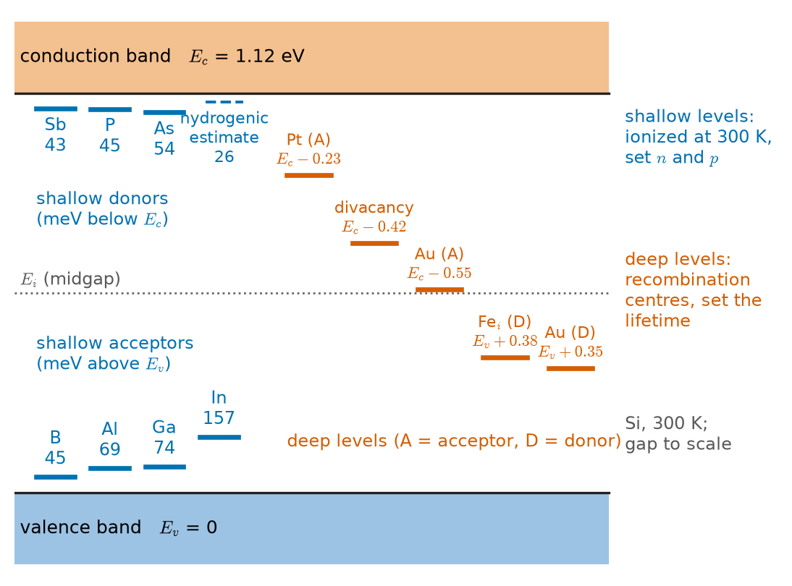
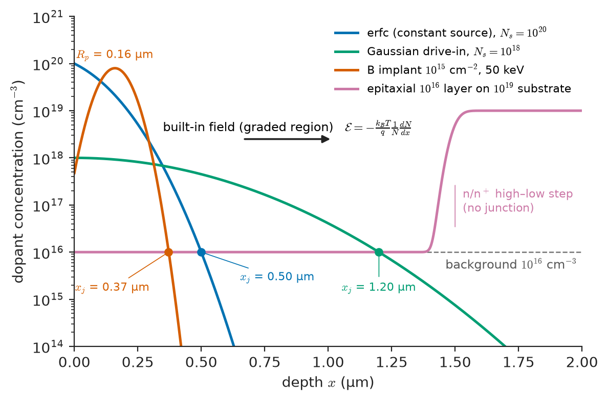
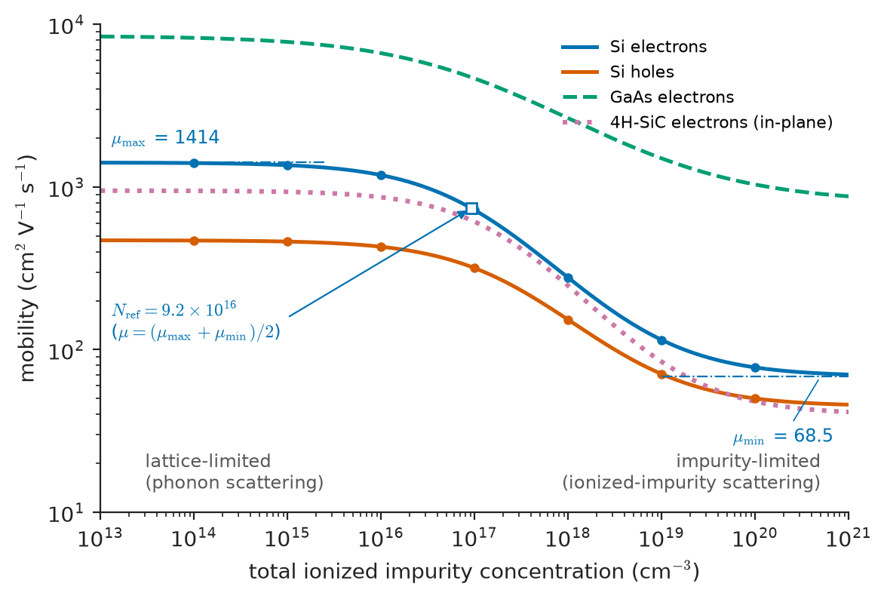
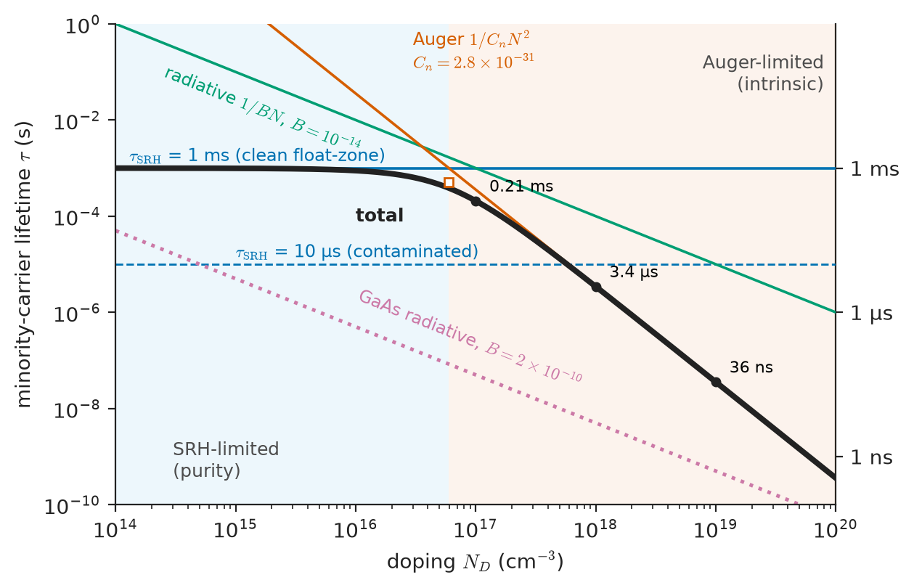
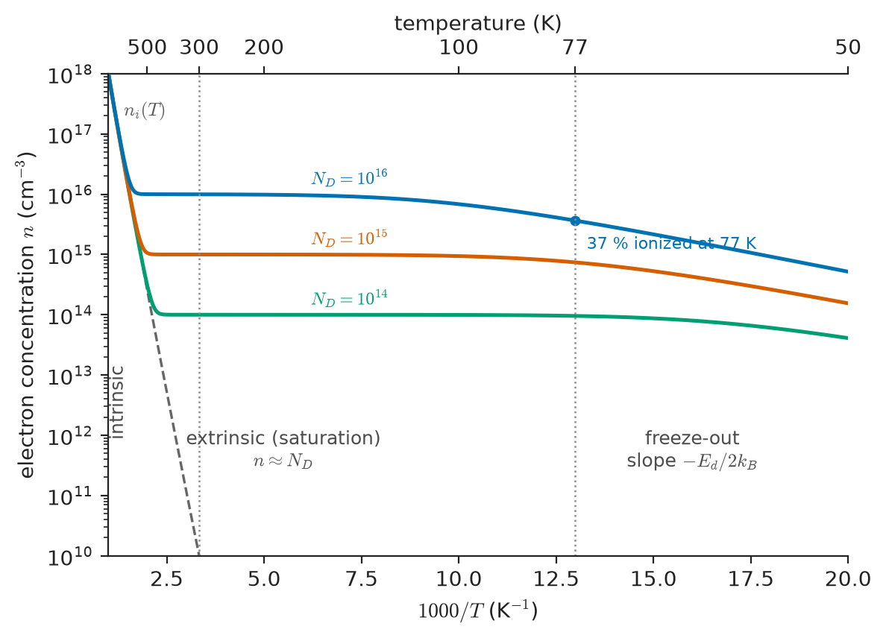
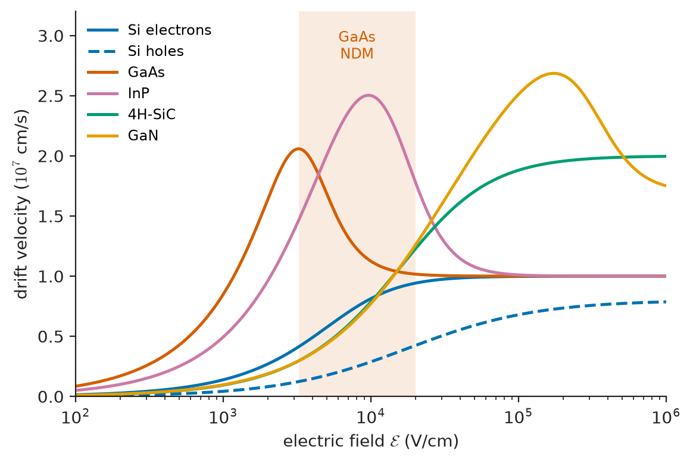

# Chapter 32 — Semiconductor Material Properties

*Part VII · Semiconductor and Photonic Materials*

A solar-cell factory changes the supplier of its silicon wafers. The new wafers have the same boron doping, the same resistivity of 1 Ω cm, the same thickness and the same surface finish, and they pass every incoming inspection. Yet the finished cells come off the line half a percentage point less efficient, and the loss costs millions. A minority-carrier lifetime map of a wafer finally finds the cause: the bulk lifetime is a few microseconds instead of the expected millisecond. Secondary-ion mass spectrometry finds interstitial iron at about $10^{12}$ atoms per cubic centimetre, twenty parts per *trillion*. Such a small amount of iron leaves every property on the incoming specification sheet unchanged, yet it reduces the distance that photogenerated electrons can diffuse before they recombine from nearly two millimetres to under a hundred micrometres. Chapter 31 described perfect crystals. This chapter is about real ones: doped on purpose, contaminated by accident, heated, and driven by strong fields. It shows why some properties of a semiconductor, such as its resistivity, are set by parts per million of impurity, while others, such as its lifetime, are destroyed by parts per trillion.

> **How do donors and acceptors set the carrier concentration and the Fermi level, and where does doping stop working?**
> **What limits how fast carriers move, at low fields and at high fields, and how are drift and diffusion related?**
> **How do carriers recombine, what sets the minority-carrier lifetime, and why are some impurities harmless while others are lethal at trace levels?**

| Concept | Engineering destination |
|---|---|
| Donors, acceptors, ionization energy | Choice of dopant; freeze-out in cryogenic and wide-gap devices |
| Carrier concentration and Fermi level | Resistivity specification of wafers and epilayers; contact design |
| Doping profiles | Junction depth, sheet resistance, built-in fields in graded layers |
| Mobility and Caughey–Thomas model | Resistivity-to-doping conversion; on-resistance; TCAD input |
| Drift, diffusion, Einstein relation | Every device current equation; diffusion length |
| SRH, radiative and Auger recombination | Leakage, switching speed, LED efficiency, solar-cell voltage |
| Minority-carrier lifetime | Wafer quality metric; bipolar power devices; lifetime control |
| Temperature dependence | Temperature coefficients; operating-temperature window |
| Velocity saturation, impact ionization | Short-channel currents; RF limits; breakdown field |
| Deep levels and defects | Contamination control, gettering, semi-insulating substrates, reliability |

**Roadmap.** Pure and doped material (32.1) → the dopant atom and its energy level (32.2) → solving for carrier density and Fermi level (32.3) → how doping varies in space (32.4) → mobility and scattering (32.5) → drift, diffusion and the Einstein relation (32.6) → recombination and generation mechanisms (32.7) → lifetime as a material property (32.8) → everything as a function of temperature (32.9) → strong fields: saturation and avalanche (32.10) → deep levels and defects (32.11).

> **Boundary.** This chapter treats the semiconductor as a material: its carrier densities, transport coefficients and recombination rates. How these quantities combine in p–n junctions, bipolar and field-effect transistors, and circuits belongs in the Electronics & Computing core. How dopants are introduced (diffusion furnaces, ion implantation, epitaxy) is covered in Chapter 50, and the atomic diffusion that underlies those processes in Chapter 8 and the kinetics of the Advanced Chemistry core.

---

## 32.1 Intrinsic and extrinsic semiconductors

Chapter 31 showed that a perfectly pure semiconductor contains equal numbers of electrons and holes, $n=p=n_i$, and that $n_i$ is tiny at room temperature: $1.0\times10^{10}\ \mathrm{cm^{-3}}$ in silicon, about one free carrier per $5\times10^{12}$ atoms. Such **intrinsic** material is useless for most purposes for three reasons:

1. Its resistivity ($3.4\times10^5\ \Omega$ cm for Si) is too high for most functions.
2. Its conductivity depends exponentially on temperature, doubling roughly every 9 K near room temperature in Si.
3. It has no built-in asymmetry between electrons and holes, so it cannot form a junction.

An **extrinsic** semiconductor is one in which the carrier concentrations are set by impurities, deliberately added (**doping**) or unintentionally present. Adding $10^{16}$ phosphorus atoms per cubic centimetre to silicon, 0.2 parts per million, raises the electron concentration by six orders of magnitude, makes $n$ independent of temperature over a wide range around room temperature, and lowers the hole concentration to $n_i^2/n=10^4\ \mathrm{cm^{-3}}$. The material is now **n-type**: electrons are the **majority carriers** and holes the **minority carriers**. Doping with boron instead gives **p-type** material.

Purity requirements follow directly. If a deliberately doped layer is to be controlled to ±5 %, unintentional shallow impurities must be well below that fraction of the intended doping. For a power-device drift layer at $10^{14}\ \mathrm{cm^{-3}}$ this means background donors and acceptors below about $10^{12}\ \mathrm{cm^{-3}}$, or 0.02 parts per billion. This is why semiconductor-grade silicon is purified to "nine nines" and beyond (Chapter 50), and why the intrinsic regime is practically reachable only at high temperature.

---

## 32.2 Donors and acceptors

### Substitutional dopants

A phosphorus atom (group V) substituting for silicon (group IV) in the diamond lattice uses four of its five valence electrons to complete the four covalent bonds to its neighbours. The fifth electron is not needed for bonding. It remains bound to the $\mathrm P^+$ ion core only by Coulomb attraction, weakened by the dielectric screening of the surrounding silicon. Very little energy is needed to free it into the conduction band. Phosphorus is a **donor**. Once ionized it becomes a fixed positive charge, $N_D^+$.

A boron atom (group III) has only three valence electrons. It completes its fourth bond by capturing an electron from the valence band, which leaves a mobile hole. Boron is an **acceptor**. Once ionized it becomes a fixed negative charge, $N_A^-$.

In III–V compounds the same counting applies by site. Group-VI atoms (S, Se, Te) on the group-V site and group-IV atoms (Si) on the group-III site are donors. Group-II atoms (Zn, Be, Mg) on the group-III site and group-IV atoms (C) on the group-V site are acceptors. A group-IV atom can be **amphoteric**: silicon in GaAs is a donor on a Ga site and an acceptor on an As site, and the balance depends on growth conditions.

### The hydrogenic model

The bound fifth electron of a donor resembles the electron of a hydrogen atom, with two changes: it moves through a dielectric of relative permittivity $\varepsilon_r$, and it has the effective mass $m^*$ of the conduction band (Chapter 31). Scaling the hydrogen results accordingly:

$$
E_d=\frac{m^*/m_0}{\varepsilon_r^2}\times13.6\ \mathrm{eV},\qquad a_d=\frac{\varepsilon_r}{m^*/m_0}\times0.0529\ \mathrm{nm}
$$

For silicon ($m^*=0.26\,m_0$ conductivity mass, $\varepsilon_r=11.7$): $E_d=13.6\times0.26/136.9=26$ meV and $a_d=0.0529\times11.7/0.26=2.4$ nm. For GaAs ($m^*=0.067\,m_0$, $\varepsilon_r=12.9$): $E_d=5.5$ meV and $a_d=10$ nm. The donor electron orbits over hundreds (Si) to thousands (GaAs) of lattice sites. This justifies treating the host as a continuum with an effective mass and a dielectric constant.

> **Status of the principle: hydrogenic donor model**
> *Approximate.* It assumes a large orbit (many lattice constants), a single isotropic band minimum and a pure Coulomb potential. It is close to measured values in GaAs (shallow donors 5.8–6 meV) and gives the right order of magnitude in Si, but it underestimates real binding energies (45 meV for P) because the electron spends part of its time near the impurity core, where screening fails and the potential is chemistry-specific (the "central-cell correction"). It fails completely for deep levels (Section 32.11).

### Ionization energies

| Host | Dopant | Type | Ionization energy (meV) | Notes |
|---|---|---|---|---|
| Si | P | donor | 45 | Standard n-type dopant |
| Si | As | donor | 54 | Low diffusivity; shallow junctions, emitters |
| Si | Sb | donor | 43 | Buried layers; low diffusivity |
| Si | B | acceptor | 45 | Practically the only p-type dopant |
| Si | Al | acceptor | 69 | Fast diffuser; deep p-wells in power devices |
| Si | Ga | acceptor | 74 | Used in some solar wafers (no B–O degradation) |
| Si | In | acceptor | 157 | Too deep for room-temperature use |
| Ge | P, As, B | both | 10–13 | Fully ionized even near 77 K |
| GaAs | Si (on Ga), Te | donor | 6 | |
| GaAs | Be, Zn, C | acceptor | 26–31 | C used in HBT bases |
| 4H-SiC | N | donor | 61 (hexagonal site), 125 (cubic site) | Two inequivalent lattice sites |
| 4H-SiC | Al | acceptor | 190–230 | Incomplete ionization at 300 K |
| GaN | Si | donor | 15–30 | |
| GaN | Mg | acceptor | 160–200 | Only a few per cent ionized at 300 K; H passivation |
| Diamond | B | acceptor | 370 | |
| Diamond | P | donor | 570–600 | |

Two patterns stand out. The shallow levels of Si, Ge and GaAs are fully ionized at room temperature. In the wide-gap materials, especially for acceptors, the larger effective mass and smaller permittivity push the levels deep (the hydrogenic $E_d$ scales as $m^*/\varepsilon_r^2$), so dopants are only partly ionized at room temperature. Poor p-type conductivity is the single largest materials obstacle in GaN, SiC, diamond and Ga$_2$O$_3$ (Chapter 33).

<!-- FIGURE 32.1 | figures/ch32/fig-32-1-dopant-levels.png | band-diagram | Measured energy levels of shallow dopants and representative deep impurities in the band gap of silicon, with the hydrogenic estimate for comparison. | Content: vertical band diagram of Si with Ev at 0 and Ec at 1.12 eV, the gap drawn to scale. Shallow donors as short bars just below Ec with labels and energies below Ec: Sb 0.043, P 0.045, As 0.054 eV. Shallow acceptors just above Ev: B 0.045, Al 0.069, Ga 0.074, In 0.157 eV. Dashed bar labelled hydrogenic estimate 0.026 eV below Ec. Deep levels near midgap in a different colour: Au acceptor Ec - 0.55 eV, Au donor Ev + 0.35 eV, Fe_i donor Ev + 0.38 eV, Pt acceptor Ec - 0.23 eV, divacancy Ec - 0.42 eV. Midgap dotted line labelled Ei. Side note: shallow levels set n and p; deep levels set lifetime. -->

*Figure 32.1 — Measured energy levels of shallow dopants and representative deep impurities in the band gap of silicon, with the hydrogenic estimate for comparison.*

Figure 32.1 places these levels in the silicon gap together with the deep levels discussed in Section 32.11.

### Compensation

If both donors and acceptors are present, electrons from the donors first fill the acceptors. Only the excess dopant contributes free carriers: for $N_D>N_A$, $n\approx N_D-N_A$. A sample with $N_D=10^{17}$ and $N_A=5\times10^{16}\ \mathrm{cm^{-3}}$ has the same electron concentration as one doped with $5\times10^{16}$ donors alone, but it contains three times as many ionized impurities to scatter those electrons (Section 32.5). Compensation is used deliberately to make semi-insulating substrates (Section 32.11) and to counter-dope regions during processing. It happens accidentally whenever background impurities are present.

### Heavy doping: degeneracy and the Mott transition

As doping increases, the donor orbits begin to overlap. In Si:P, at about $3.7\times10^{18}\ \mathrm{cm^{-3}}$, the donor electrons delocalize into an impurity band that merges with the conduction band, and the material conducts like a (poor) metal even at absolute zero. This is the **Mott transition**. A rough criterion is $N_D^{1/3}a_d\approx0.26$, which for Si gives $N_D\approx(0.26/2.4\ \mathrm{nm})^3\approx1.3\times10^{18}\ \mathrm{cm^{-3}}$, the right order of magnitude. Above this level:

- the ionization energy falls effectively to zero, and the material does not freeze out at low temperature;
- the Fermi level enters the band (**degenerate** doping), so Boltzmann statistics fail and full Fermi–Dirac integrals are needed;
- the band gap shrinks (**bandgap narrowing**) by tens of meV through carrier–carrier and carrier–impurity interactions. An empirical fit (Slotboom) gives about 80 meV at $10^{19}\ \mathrm{cm^{-3}}$ in Si, and since $n_i^2\propto e^{-E_g/k_BT}$, the effective $n_i^2$ rises by $e^{0.08/0.0259}\approx22$.

Degenerate doping is not a defect but a tool. It is how ohmic contacts are made: a heavily doped surface layer thins the barrier at a metal–semiconductor contact until electrons tunnel through it (Chapter 34).

---

## 32.3 Carrier concentration

### The neutrality condition

In a uniformly doped sample in equilibrium, the total charge must be zero:

$$
p+N_D^+=n+N_A^-
$$

Here $n$ and $p$ depend on $E_F$ through the expressions of Chapter 31, and so do the ionized fractions. A donor level of energy $E_d$ is neutral when occupied and ionized when empty, with occupation probability modified by spin degeneracy:

$$
N_D^+=\frac{N_D}{1+g_D\exp\!\left[(E_F-E_d)/k_BT\right]},\qquad N_A^-=\frac{N_A}{1+g_A\exp\!\left[(E_a-E_F)/k_BT\right]}
$$

with degeneracy factors $g_D=2$ for donors and $g_A=4$ for acceptors in Si, Ge and GaAs (the latter because of the two degenerate valence bands at $\Gamma$). Neutrality is one equation with one unknown, $E_F$. It can always be solved numerically. In three common regimes it has simple closed forms.

> **Status of the principle: charge neutrality in uniform material**
> *Derived.* It follows from Gauss's law: any net charge in a region larger than a few Debye lengths would produce fields that drive carriers until it is cancelled. The Debye length $L_D=\sqrt{\varepsilon k_BT/q^2N}$ is 41 nm in Si at $10^{16}\ \mathrm{cm^{-3}}$, so neutrality holds everywhere except within depletion regions and at interfaces.

### Full ionization (the extrinsic regime)

When dopants are fully ionized and $\lvert N_D-N_A\rvert\gg n_i$, the neutrality equation together with $np=n_i^2$ gives, for n-type material,

$$
n=\frac{N_D-N_A}{2}+\sqrt{\left(\frac{N_D-N_A}{2}\right)^2+n_i^2}\approx N_D-N_A,\qquad p=\frac{n_i^2}{n}
$$

and the Fermi level follows from $n=N_c\exp[-(E_c-E_F)/k_BT]$:

$$
E_c-E_F=k_BT\ln\frac{N_c}{n},\qquad E_F-E_i=k_BT\ln\frac{n}{n_i}
$$

The full square-root form remains valid as $n_i$ approaches the net doping and reduces to $n=n_i$ in the intrinsic limit.

**Worked example — Fermi level and ionization in phosphorus-doped silicon.** Take $N_D=10^{16}\ \mathrm{cm^{-3}}$, $E_c-E_d=45$ meV, $g_D=2$, $N_c=2.86\times10^{19}\ \mathrm{cm^{-3}}$ at 300 K.

*At 300 K.* Assuming full ionization, $n=10^{16}\ \mathrm{cm^{-3}}$ and $E_c-E_F=0.02585\ln(2.86\times10^{19}/10^{16})=0.02585\times7.96=0.206$ eV. The donor level lies $0.206-0.045=0.161$ eV $=6.2k_BT$ above $E_F$, so the fraction of donors still neutral is $1/(1+\tfrac12e^{6.2})\approx0.4$ %. The assumption is consistent: 99.6 % of donors are ionized. The hole density is $p=n_i^2/n=10^{20}/10^{16}=10^4\ \mathrm{cm^{-3}}$.

*At 77 K* (liquid nitrogen). $N_c$ scales as $T^{3/2}$, giving $N_c=2.86\times10^{19}\times(77/300)^{3/2}=3.72\times10^{18}\ \mathrm{cm^{-3}}$, and $k_BT=6.64$ meV. For a donor-only sample with $n=N_D^+$, the neutrality equation becomes a quadratic,

$$
\frac{n^2}{N_D-n}=\frac{N_c}{g_D}\exp\!\left(-\frac{E_c-E_d}{k_BT}\right)=\frac{3.72\times10^{18}}{2}\,e^{-6.78}=2.11\times10^{15}\ \mathrm{cm^{-3}}
$$

whose positive root is $n=3.7\times10^{15}\ \mathrm{cm^{-3}}$. Only 37 % of the donors are ionized, and $E_c-E_F=k_BT\ln(N_c/n)=6.64\times6.93=46$ meV: the Fermi level sits right at the donor level. A resistor designed at room temperature will have nearly three times its nominal resistance at 77 K from freeze-out alone, partly offset by higher mobility. This is why cryogenic electronics uses heavily (degenerately) doped resistors and contacts.

### Incomplete ionization at room temperature

The same quadratic applies to deep dopants at 300 K. For Al acceptors in 4H-SiC ($E_a\approx0.2$ eV, $g_A=4$, $N_v=2.5\times10^{19}\ \mathrm{cm^{-3}}$), $N_A=10^{17}\ \mathrm{cm^{-3}}$ gives $p\approx1.5\times10^{16}\ \mathrm{cm^{-3}}$, only 15 % ionized. At $N_A=10^{19}$ the ionized fraction falls to under 2 %. For Mg in GaN ($E_a\approx0.17$ eV, $N_v=4.6\times10^{19}\ \mathrm{cm^{-3}}$), $10^{19}\ \mathrm{cm^{-3}}$ of Mg gives $p\approx4\times10^{17}\ \mathrm{cm^{-3}}$, about 4 %. The ionized fraction then rises with temperature, so the p-type layers of wide-gap devices become *more* conductive as they heat up, the opposite of most semiconductor behaviour. (Real values are lower still, because the levels shift with doping and compensation reduces $p$.)

### Degenerate material

When $E_F$ comes within about $3k_BT$ of a band edge, $n=N_c\,\mathcal F_{1/2}(\eta)$, where $\eta=(E_F-E_c)/k_BT$ and $\mathcal F_{1/2}$ is the normalized Fermi–Dirac integral, and the law of mass action must be corrected for bandgap narrowing. In Si at 300 K this occurs above about $N_c e^{-3}\approx1.4\times10^{18}\ \mathrm{cm^{-3}}$. In GaAs, whose $N_c$ is only $4.4\times10^{17}\ \mathrm{cm^{-3}}$, n-type material becomes degenerate near $2\times10^{16}\ \mathrm{cm^{-3}}$. The light electron mass makes GaAs easy to push into degeneracy.

> **Status of the principle: $n\approx N_D-N_A$**
> *Approximate.* Valid for fully ionized shallow dopants, non-degenerate material and $N_D-N_A\gg n_i$: in Si, roughly from 150 K to 450 K for $10^{15}$–$10^{18}\ \mathrm{cm^{-3}}$. It fails at low temperature (freeze-out), at high temperature (intrinsic conduction), for deep dopants (SiC:Al, GaN:Mg) and in degenerate material.

---

## 32.4 Doping profiles

Real devices are not uniformly doped. The **doping profile** $N(x)$, the dopant concentration as a function of depth, is a materials property set by processing, and it controls junction depth, sheet resistance and internal fields. Chapter 50 explains how profiles are produced. Here they are treated as a given structure with electrical consequences. The standard profile shapes follow from the solutions of the diffusion equation (Chapter 8) or from the statistics of ion stopping.

| Process | Profile shape | Formula | Typical use |
|---|---|---|---|
| Epitaxial growth | Step (nearly uniform layers) | $N(x)=N_{\mathrm{epi}}$ for $x<t_{\mathrm{epi}}$ | Drift layers, HEMT and laser stacks |
| Diffusion from a constant surface source | Complementary error function | $N(x)=N_s\,\mathrm{erfc}\!\left(x/2\sqrt{Dt}\right)$ | Heavy emitters, solar-cell front layers |
| Drive-in of a fixed dose $Q$ | Gaussian at the surface | $N(x)=\dfrac{Q}{\sqrt{\pi Dt}}\exp\!\left(-\dfrac{x^2}{4Dt}\right)$ | Wells, base regions |
| Ion implantation (as implanted) | Gaussian centred at range $R_p$ | $N(x)=\dfrac{\Phi}{\sqrt{2\pi}\,\Delta R_p}\exp\!\left[-\dfrac{(x-R_p)^2}{2\Delta R_p^2}\right]$ | Almost all modern doping |
| Retrograde implant | Buried peak, low surface | Sum of Gaussians | CMOS wells, punch-through stops |
| Delta doping | Sheet of dopant, nm thick | $N_{2D}\,\delta(x-x_0)$ | HEMT supply layers |

Here $D$ is the dopant diffusivity at the process temperature, $t$ the time, $\Phi$ the implanted dose (atoms per cm²), $R_p$ the projected range and $\Delta R_p$ the straggle. For boron implanted at 50 keV into silicon, $R_p\approx0.16$ µm and $\Delta R_p\approx0.05$ µm. A dose of $10^{15}\ \mathrm{cm^{-2}}$ then peaks at $10^{15}/(2.507\times5.3\times10^{-6})=7.5\times10^{19}\ \mathrm{cm^{-3}}$. Figure 32.2 sketches the common shapes.

<!-- FIGURE 32.2 | figures/ch32/fig-32-2-doping-profiles.png | plot | Typical doping profiles in silicon: erfc and Gaussian diffusion profiles, an as-implanted Gaussian, and an epitaxial step, each meeting a uniform background to form a junction. | Content: semilog plot, x axis depth 0 to 2 µm, y axis concentration 1e14 to 1e21 cm^-3. Curves: (1) erfc profile with surface 1e20 and junction at 0.5 µm; (2) Gaussian drive-in with surface 1e18 and junction at 1.2 µm; (3) boron implant 1e15 cm^-2 at 50 keV, Gaussian peak 7.5e19 at Rp = 0.16 µm, straggle 0.05 µm; (4) epitaxial step 1e16 on a 1e19 substrate at 1.5 µm. Horizontal dashed line background 1e16 cm^-3; mark junction depths xj where curves cross it. Inset: built-in field arrow in the graded region. -->

*Figure 32.2 — Typical doping profiles in silicon: erfc and Gaussian diffusion profiles, an as-implanted Gaussian, and an epitaxial step, each meeting a uniform background to form a junction.*

### Junction depth

A **metallurgical junction** forms where the profile of one type crosses a background of the opposite type, $N(x_j)=N_B$. For a Gaussian drive-in profile, $x_j=2\sqrt{Dt\,\ln(N_0/N_B)}$, where $N_0=Q/\sqrt{\pi Dt}$ is the surface concentration. Because diffusion lengths scale as $\sqrt{Dt}$ and $D$ is exponential in temperature, every high-temperature step after doping moves the junction, and modern processes use short, rapid anneals to keep junctions within tens of nanometres (Chapter 50).

### Built-in field in a graded layer

A doping gradient creates an electric field even in equilibrium. In an n-type region with a donor gradient, electrons diffuse from high to low concentration, leaving the ionized donors behind. The resulting space charge builds a field that exactly opposes the diffusion. Setting the total electron current to zero (Section 32.6) gives

$$
\mathcal E=-\frac{k_BT}{q}\frac{1}{N}\frac{dN}{dx}
$$

For an exponential profile $N\propto e^{-x/\lambda}$ the field is uniform, $\mathcal E=k_BT/q\lambda$. Grading the doping from $10^{18}$ to $10^{16}\ \mathrm{cm^{-3}}$ over 1 µm gives $\mathcal E=0.02585\times\ln100/10^{-4}=1.2\times10^3$ V/cm. A field of this size speeds minority carriers across the graded base of a bipolar transistor and the graded front layer of a solar cell. It is a material structure that does work without any applied bias.

### Sheet resistance

For a thin doped layer the measurable quantity is the **sheet resistance** (Chapter 25 and the four-point probe of Chapter 52):

$$
R_s=\frac{1}{q\int_0^{x_j}\mu(N(x))\,N(x)\,dx}
$$

**Worked example — sheet resistance of an implanted layer.** A $10^{15}\ \mathrm{cm^{-2}}$ boron implant, fully activated by annealing, peaks near $7.5\times10^{19}\ \mathrm{cm^{-3}}$, where the Caughey–Thomas hole mobility of Section 32.5 is about 51 cm²/(V s), and has tails where the mobility is higher. Taking a concentration-weighted average of 70 cm²/(V s), $R_s\approx1/(1.602\times10^{-19}\times10^{15}\times70)=89\ \Omega$ per square. Measured values of 80–120 Ω per square are typical for such implants, the spread reflecting incomplete activation and the exact mobility average. Note that the sheet resistance depends on the dose, not the depth, as long as the mobility is roughly constant: it is the total number of carriers per unit area that conducts.

---

## 32.5 Carrier mobility

### Mobility as a scattering time

Chapter 25 defined mobility as drift velocity per unit field, $\mu=v_d/\mathcal E$, and related it to the mean time $\tau_m$ between momentum-randomizing collisions:

$$
\mu=\frac{q\tau_m}{m^*_{\mathrm{cond}}}
$$

The effective mass is set by the band (Chapter 31). The scattering time is set by everything that breaks the perfect periodicity of the crystal. Electrons with $\mu=1400\ \mathrm{cm^2/(V\,s)}$ and $m^*=0.26\,m_0$ have $\tau_m=\mu m^*/q=0.14\times0.26\times9.11\times10^{-31}/1.60\times10^{-19}=0.21$ ps between collisions. At a thermal velocity of about $10^7$ cm/s this corresponds to a mean free path of a few tens of nanometres.

### Scattering mechanisms

| Mechanism | Physical origin | Temperature dependence of $\mu$ | Important in |
|---|---|---|---|
| Acoustic phonons | Lattice strain deforms the band edges | $\propto T^{-3/2}$ (ideal) | All semiconductors |
| Optical phonons, non-polar | Optical vibrations of the two sublattices | Activated; steep above $\sim$200 K | Si, Ge (with acoustic: $T^{-2.2}$ to $T^{-2.4}$) |
| Polar optical phonons | Oscillating dipoles of ionic bonds | Dominant near 300 K | GaAs, InP, GaN, SiC |
| Ionized impurities | Coulomb deflection by $N_D^+$, $N_A^-$ | $\propto T^{3/2}/N_I$ | Doped material; low temperature |
| Neutral impurities | Short-range potential | Nearly independent of $T$ | Frozen-out material |
| Alloy disorder | Random potential in alloys | Weak | SiGe, AlGaN, InGaAs |
| Interface roughness, remote charges | Channel near a dielectric | Strong field dependence | MOSFET and HEMT channels (Chapter 34) |
| Dislocations, grain boundaries | Charged lines, barriers | Varies | GaN-on-Si, polycrystalline films |
| Carrier–carrier | Mutual Coulomb scattering | — | High injection |

Two mechanisms dominate bulk material. **Lattice (phonon) scattering** sets the maximum mobility of pure material and falls steeply with temperature. **Ionized-impurity scattering** grows with doping and becomes *weaker* at higher temperature, because faster carriers are deflected less by a Coulomb centre.

### Matthiessen's rule

If the mechanisms act independently, their scattering rates add:

$$
\frac{1}{\mu}=\frac{1}{\mu_L}+\frac{1}{\mu_I}+\cdots
$$

> **Status of the principle: Matthiessen's rule for mobility**
> *Empirical.* Adding scattering rates is exact only if every mechanism has the same energy dependence. Because phonon and impurity scattering weight carriers of different energy differently, the rule errs by 10–20 % where two mechanisms are comparable. It is used as a first estimate and as the conceptual basis of fitted models.

### The Caughey–Thomas model

Device engineers need mobility as a function of doping, accurate to a few per cent, without solving the Boltzmann transport equation. The standard answer is the **Caughey–Thomas** expression:

$$
\mu(N)=\mu_{\min}+\frac{\mu_{\max}-\mu_{\min}}{1+\left(N/N_{\mathrm{ref}}\right)^{\alpha}}
$$

Here $N$ is the *total* ionized impurity concentration ($N_D^++N_A^-$), $\mu_{\max}$ is the lattice-limited mobility of pure material, $\mu_{\min}$ the floor reached at very high doping, $N_{\mathrm{ref}}$ the doping at which the mobility is halfway between them, and $\alpha$ sets how sharp the transition is.

> **Status of the principle: Caughey–Thomas mobility model**
> *Empirical.* A four-parameter fit to Hall and resistivity data, not derived from scattering theory. It reproduces the measured mobility of Si, GaAs, SiC and GaN within about 5–10 % from $10^{13}$ to $10^{20}\ \mathrm{cm^{-3}}$ at a fixed temperature. Extensions (Arora, Masetti, Klaassen) add temperature dependence, distinguish donors from acceptors and include minority-carrier and carrier–carrier effects. It describes majority-carrier, low-field, bulk mobility only.

| Material, carrier | $\mu_{\max}$ (cm²/(V s)) | $\mu_{\min}$ (cm²/(V s)) | $N_{\mathrm{ref}}$ (cm⁻³) | $\alpha$ |
|---|---|---|---|---|
| Si, electrons | 1414 | 68.5 | $9.20\times10^{16}$ | 0.711 |
| Si, holes | 470.5 | 44.9 | $2.23\times10^{17}$ | 0.719 |
| GaAs, electrons (typical fit) | 8500 | 800 | $1\times10^{17}$ | 0.5 |
| 4H-SiC, electrons (in-plane, typical fit) | 950 | 40 | $2\times10^{17}$ | 0.76 |

The model gives the silicon values that every engineer uses to convert doping to resistivity:

| Doping (cm⁻³) | $\mu_n$ (cm²/(V s)) | $\mu_p$ (cm²/(V s)) | $\rho$, n-type (Ω cm) | $\rho$, p-type (Ω cm) |
|---|---|---|---|---|
| $10^{14}$ | 1404 | 469 | 44.5 | 133 |
| $10^{15}$ | 1362 | 462 | 4.6 | 13.5 |
| $10^{16}$ | 1184 | 429 | 0.53 | 1.45 |
| $10^{17}$ | 721 | 317 | 0.087 | 0.20 |
| $10^{18}$ | 277 | 153 | 0.022 | 0.041 |
| $10^{19}$ | 115 | 71 | 0.0054 | 0.0088 |
| $10^{20}$ | 78 | 50 | 0.00080 | 0.0013 |

Figure 32.3 plots these curves. Above about $10^{18}\ \mathrm{cm^{-3}}$ the mobility falls almost tenfold, so heavily doped regions conduct much less than their carrier density alone would suggest.

<!-- FIGURE 32.3 | figures/ch32/fig-32-3-mobility-vs-doping.png | plot | Electron and hole mobility of silicon at 300 K as a function of total ionized impurity concentration (Caughey–Thomas fit), with GaAs electrons and 4H-SiC electrons for comparison. | Content: log-log plot, x axis total impurity concentration 1e13 to 1e21 cm^-3, y axis mobility 10 to 10000 cm2/Vs. Si electrons from 1414 plateau through 1184 at 1e16, 721 at 1e17, 277 at 1e18, 115 at 1e19 to 78 at 1e20; Si holes from 470 through 429, 317, 153, 71, 50. Dashed GaAs electrons from about 8500 falling to about 2650 at 1e18 (table fit); dotted 4H-SiC electrons from about 950 falling to about 100 at 1e19. Mark mu_max, mu_min and N_ref for Si electrons with arrows. Annotate regions: lattice-limited (left) and impurity-limited (right). -->

*Figure 32.3 — Electron and hole mobility of silicon at 300 K as a function of total ionized impurity concentration (Caughey–Thomas fit), with GaAs electrons and 4H-SiC electrons for comparison.*

**Worked example — resistivity of a compensated sample.** A silicon layer contains $N_D=10^{17}$ and $N_A=5\times10^{16}\ \mathrm{cm^{-3}}$. The free electron density is $n=N_D-N_A=5\times10^{16}\ \mathrm{cm^{-3}}$, but the mobility must be evaluated at the total ionized impurity density, $N=1.5\times10^{17}\ \mathrm{cm^{-3}}$:

$$
\mu_n=68.5+\frac{1414-68.5}{1+(1.5\times10^{17}/9.2\times10^{16})^{0.711}}=68.5+\frac{1345.5}{1+1.415}=625\ \mathrm{cm^2/(V\,s)}
$$

Then $\rho=1/(qn\mu_n)=1/(1.602\times10^{-19}\times5\times10^{16}\times625)=0.20\ \Omega$ cm. An uncompensated sample with the same $n$ would have $\mu_n\approx885$ and $\rho\approx0.14\ \Omega$ cm. Reading the measured 0.20 Ω cm off the uncompensated resistivity table would suggest a simple n-type doping of about $3\times10^{16}\ \mathrm{cm^{-3}}$, while the sample actually contains $1.5\times10^{17}\ \mathrm{cm^{-3}}$ of dopant atoms, five times more. This is why resistivity alone cannot certify the purity of a wafer.

### Mobility in practice

Several further effects matter in real material.

- **Minority-carrier mobility** differs from majority-carrier mobility at high doping. Minority electrons in heavily doped p-type Si move up to twice as fast as majority electrons at the same doping, because they are not screened in the same way.
- **Hall mobility** $\mu_H=r_H\mu$, measured by the Hall effect, exceeds the drift mobility by the Hall factor $r_H\approx1.1$–1.2 for phonon scattering (Chapter 52).
- **Channel mobility** at a semiconductor–dielectric interface is lower than bulk mobility because of surface-roughness and Coulomb scattering by interface charge. It is about 200–400 cm²/(V s) for electrons in Si MOSFETs and only 20–50 cm²/(V s) in conventional 4H-SiC MOSFETs, where interface traps dominate (Chapter 34).
- **Strain** changes the effective masses and valley occupations. Biaxial tensile strain in Si raises electron mobility by up to about 80 %, and uniaxial compressive strain doubles hole mobility (Chapter 34).
- **Two-dimensional electron gases** at modulation-doped heterointerfaces separate carriers from their donors. The AlGaN/GaN 2DEG reaches 1500–2000 cm²/(V s) at room temperature, higher than doped bulk GaN (Chapter 33).

---

## 32.6 Drift and diffusion

### Two ways to make a current

Carriers move for two reasons. An electric field $\mathcal E$ makes them **drift**. A concentration gradient makes them **diffuse**, for the same statistical reason that ink spreads in water: more carriers cross a plane from the crowded side than from the sparse side. The current densities are

$$
J_n=qn\mu_n\mathcal E+qD_n\frac{dn}{dx},\qquad J_p=qp\mu_p\mathcal E-qD_p\frac{dp}{dx}
$$

where $D_n$ and $D_p$ are the **diffusion coefficients** (cm²/s). The sign difference arises because holes carry positive charge: electrons diffusing in $-x$ carry current in $+x$. The diffusion terms have the form of Fick's first law (Chapter 8).

> **Status of the principle: drift–diffusion current equations**
> *Approximate.* They follow from the Boltzmann transport equation in the limit of small departures from equilibrium (fields well below velocity saturation, gradients slow on the scale of the mean free path, about 10–50 nm). They underpin nearly all device simulation. They fail in very short channels (velocity overshoot, ballistic transport) and at high fields (Section 32.10), where hydrodynamic or Monte Carlo models are used.

### The Einstein relation

Mobility and diffusivity are not independent. Both describe random collisions of carriers with the lattice. Consider an n-type sample with a doping gradient in equilibrium (Section 32.4). No net current flows, so

$$
0=qn\mu_n\mathcal E+qD_n\frac{dn}{dx}
$$

In equilibrium the Fermi level is flat, so $n=N_c\exp[-(E_c-E_F)/k_BT]$ varies only because $E_c$ varies with position: $dn/dx=-(n/k_BT)\,dE_c/dx$. The field is related to the band slope by $q\mathcal E=dE_c/dx$ (bands bend in the direction of the electrostatic potential energy). Substituting gives $qn\mu_n\mathcal E=qD_n(n/k_BT)\,q\mathcal E$, so

$$
\frac{D_n}{\mu_n}=\frac{D_p}{\mu_p}=\frac{k_BT}{q}
$$

At 300 K, $k_BT/q=25.85$ mV. Electrons in lightly doped silicon with $\mu_n=1400\ \mathrm{cm^2/(V\,s)}$ have $D_n=36\ \mathrm{cm^2/s}$; holes with $\mu_p=450\ \mathrm{cm^2/(V\,s)}$ have $D_p=12\ \mathrm{cm^2/s}$.

> **Status of the principle: Einstein relation**
> *Derived.* It follows from requiring zero current in equilibrium with Boltzmann statistics. It is a special case of the fluctuation–dissipation theorem, which links any transport coefficient to the equilibrium fluctuations behind it. In degenerate material $D/\mu$ exceeds $k_BT/q$ (it becomes $(1/q)\,n/(dn/dE_F)$), and for hot carriers far from equilibrium the relation breaks down.

### Quasi-Fermi levels

Out of equilibrium, under illumination or injection, the electron and hole populations each reach thermal equilibrium among themselves in picoseconds, but not with each other. Each is described by its own **quasi-Fermi level**:

$$
n=n_i\,e^{(E_{Fn}-E_i)/k_BT},\qquad p=n_i\,e^{(E_i-E_{Fp})/k_BT},\qquad np=n_i^2\,e^{(E_{Fn}-E_{Fp})/k_BT}
$$

Combining these with the drift–diffusion equations gives a compact result: $J_n=n\mu_n\,dE_{Fn}/dx$ and $J_p=p\mu_p\,dE_{Fp}/dx$. **The gradient of the quasi-Fermi level drives the current**, whether it arises from a field or a concentration gradient. The splitting $E_{Fn}-E_{Fp}$ under illumination is the maximum voltage a solar absorber can deliver, the "implied open-circuit voltage" used to grade solar wafers before they are made into cells.

### Continuity and diffusion length

Carriers are conserved except where they are generated or recombine. For minority electrons in p-type material:

$$
\frac{\partial n}{\partial t}=\frac{1}{q}\frac{\partial J_n}{\partial x}+G-R
$$

In a field-free region with a small excess $\Delta n$ that recombines with lifetime $\tau_n$ (Section 32.8), $R-G_{\mathrm{th}}=\Delta n/\tau_n$, and in steady state

$$
D_n\frac{d^2\Delta n}{dx^2}=\frac{\Delta n}{\tau_n}\quad\Rightarrow\quad\Delta n(x)=\Delta n(0)\,e^{-x/L_n},\qquad L_n=\sqrt{D_n\tau_n}
$$

The **diffusion length** $L_n$ is the average distance a minority carrier diffuses before it recombines. It combines a transport property ($D$) and a recombination property ($\tau$), and it is the key quality parameter for any device that relies on collecting or injecting minority carriers.

**Worked example — what twenty parts per trillion of iron does.** Return to the solar wafer of the opening, p-type with $N_A\approx1.5\times10^{16}\ \mathrm{cm^{-3}}$ (1 Ω cm). Minority electrons have $\mu_n\approx1200\ \mathrm{cm^2/(V\,s)}$, so $D_n=1200\times0.02585=31\ \mathrm{cm^2/s}$. In clean material with $\tau_n=1$ ms, $L_n=\sqrt{31\times10^{-3}}=0.176$ cm $=1.8$ mm, more than ten times the 160 µm wafer thickness, so almost every photogenerated electron reaches the junction. Interstitial iron is a donor-like deep level at $E_v+0.38$ eV with an electron capture cross-section of about $5\times10^{-14}\ \mathrm{cm^2}$. With $N_t=10^{12}\ \mathrm{cm^{-3}}$ ($10^{12}/5\times10^{22}=2\times10^{-11}$, or 20 parts per trillion) and $v_{\mathrm{th}}\approx10^7$ cm/s, the SRH lifetime of Section 32.7 is $\tau_n=1/(\sigma_nv_{\mathrm{th}}N_t)=1/(5\times10^{-14}\times10^7\times10^{12})=2\ \mu$s. Then $L_n=\sqrt{31\times2\times10^{-6}}=7.9\times10^{-3}$ cm $=79$ µm, now *shorter* than the wafer. Carriers generated deep in the wafer by red and infrared light recombine before they are collected. The resistivity is unchanged, since $10^{12}$ donors in $1.5\times10^{16}$ acceptors is invisible, but the diffusion length has fallen by a factor of 22.

### Dielectric relaxation

How fast does a majority-carrier imbalance disappear? A local excess of charge $\rho$ in a material of conductivity $\sigma$ decays as $e^{-t/\tau_d}$ with the **dielectric relaxation time** $\tau_d=\varepsilon/\sigma$. For n-type Si at $10^{16}\ \mathrm{cm^{-3}}$ ($\rho=0.53\ \Omega$ cm), $\tau_d=1.04\times10^{-12}\times0.53=0.55$ ps. Majority carriers neutralize any charge imbalance almost instantly. This is why excess minority carriers are always accompanied by an equal excess of majority carriers (quasi-neutrality), and why only the minority-carrier lifetime governs the decay of the excess.

---

## 32.7 Recombination and generation

### The driving force

In equilibrium, carriers are generated thermally and recombine at equal rates, so that $np=n_i^2$. Whenever $np>n_i^2$ (excess carriers from light or injection), net **recombination** occurs. Whenever $np<n_i^2$ (in a reverse-biased depletion region, where carriers have been swept away), net **generation** occurs. All three mechanisms below have rates proportional to $np-n_i^2$ in some form. Recombination releases the energy $\approx E_g$ in one of three ways: as a photon, to a defect and then to lattice vibrations, or to a third carrier.

### Radiative (band-to-band) recombination

An electron in the conduction band falls directly into an empty valence-band state and emits a photon of energy close to $E_g$. The rate is proportional to the number of electrons and the number of holes available:

$$
U_{\mathrm{rad}}=B\left(np-n_i^2\right)
$$

The coefficient $B$ is large in direct-gap materials and small in indirect ones (Chapter 31). For low-level injection in p-type material ($\Delta n\ll p_0=N_A$), $U_{\mathrm{rad}}\approx BN_A\Delta n$, giving a radiative lifetime

$$
\tau_{\mathrm{rad}}=\frac{1}{BN_A}
$$

### Shockley–Read–Hall (trap-assisted) recombination

An electron is first captured by a localized state in the gap, a **trap** or **recombination centre** created by an impurity or defect, and then a hole is captured by the same trap, completing the recombination. The energy is released as phonons in two smaller steps, which is far more probable than emitting one large phonon. Shockley, Read and Hall balanced the four capture and emission processes in steady state and obtained

$$
U_{\mathrm{SRH}}=\frac{np-n_i^2}{\tau_{p0}\left(n+n_1\right)+\tau_{n0}\left(p+p_1\right)}
$$

with

$$
\tau_{n0}=\frac{1}{\sigma_nv_{\mathrm{th}}N_t},\qquad \tau_{p0}=\frac{1}{\sigma_pv_{\mathrm{th}}N_t},\qquad n_1=n_ie^{(E_t-E_i)/k_BT},\qquad p_1=n_ie^{(E_i-E_t)/k_BT}
$$

where $N_t$ is the trap density, $E_t$ its energy level, $\sigma_n$ and $\sigma_p$ its capture cross-sections for electrons and holes, and $v_{\mathrm{th}}\approx10^7$ cm/s the thermal velocity. The quantities $n_1$ and $p_1$ are the electron and hole densities the material would have if $E_F$ coincided with $E_t$; they describe thermal re-emission from the trap.

> **Status of the principle: Shockley–Read–Hall recombination**
> *Derived.* It follows from detailed balance of capture and emission at a single-level trap, given capture cross-sections that must be measured. It assumes non-interacting, single-level traps whose density is small compared with the carrier densities. Multi-level centres (Au, Pt), trap clusters at dislocations, and high trap densities need extensions.

Three conclusions follow from the formula, and all three are central to materials engineering.

1. **Mid-gap traps are the most effective.** If $E_t$ lies near a band edge, $n_1$ or $p_1$ is large and the trap re-emits its captured carrier before it can capture the opposite type. The denominator is smallest when $E_t\approx E_i$. Shallow dopants, with levels within 0.05 eV of a band edge, are not recombination centres. Gold, iron and vacancy complexes, with levels deep in the gap, are.
2. **In low-level injection only the minority-carrier capture matters.** In p-type material, $U_{\mathrm{SRH}}\approx\Delta n/\tau_{n0}$. The lifetime is set by how fast traps capture minority carriers, $\tau_{n0}=1/(\sigma_nv_{\mathrm{th}}N_t)$.
3. **The lifetime is inversely proportional to the trap density.** With $\sigma=10^{-15}\ \mathrm{cm^2}$, $v_{\mathrm{th}}=10^7$ cm/s and $N_t=10^{12}\ \mathrm{cm^{-3}}$, $\tau=100\ \mu$s. Every tenfold increase in contamination cuts the lifetime tenfold.

### Auger recombination

The energy released by an electron–hole recombination can be handed to a third carrier, an electron or a hole, which is kicked high into its band and then relaxes by emitting phonons. Because three carriers are involved, the rate grows as the cube of carrier density:

$$
U_{\mathrm{Aug}}=\left(C_nn+C_pp\right)\left(np-n_i^2\right)
$$

In n-type material with $n\approx N_D$, $\tau_{\mathrm{Aug}}=1/(C_nN_D^2)$. Auger recombination is negligible at moderate doping but dominates in heavily doped emitters, under high injection in power devices and concentrator solar cells, and in narrow-gap materials (infrared lasers and detectors), where $C$ is large.

### Coefficients

| Material | $B$ (cm³/s) | $C_n$ (cm⁶/s) | $C_p$ (cm⁶/s) | Comment |
|---|---|---|---|---|
| Si | $\approx1\times10^{-14}$ | $2.8\times10^{-31}$ | $9.9\times10^{-32}$ | Indirect; SRH or Auger dominates |
| Ge | $\approx6\times10^{-14}$ | $\sim10^{-31}$ | $\sim10^{-31}$ | |
| GaAs | $(1\text{–}7)\times10^{-10}$, typ. $2\times10^{-10}$ | $\sim10^{-30}$ | $\sim10^{-30}$ | Radiative usually dominates |
| GaN, InGaN | $\sim(1\text{–}2)\times10^{-11}$ | $\sim10^{-31}$–$10^{-30}$ | — | Auger implicated in LED "droop" |
| InGaAsP (1.55 µm) | $\sim10^{-10}$ | $\sim10^{-29}$–$10^{-28}$ | — | Auger limits laser temperature stability |

**Worked example — which mechanism wins?** Compare the three lifetimes at two doping levels.

*Silicon, n-type, $10^{17}\ \mathrm{cm^{-3}}$.* Radiative: $\tau=1/(10^{-14}\times10^{17})=1$ ms. Auger: $\tau=1/(2.8\times10^{-31}\times10^{34})=0.36$ ms. SRH in good float-zone material: about 1 ms. All three are comparable, giving an overall lifetime of about 0.2 ms.

*Silicon, n-type, $10^{19}\ \mathrm{cm^{-3}}$.* Radiative: $1/(10^{-14}\times10^{19})=10\ \mu$s. Auger: $1/(2.8\times10^{-31}\times10^{38})=36$ ns. Auger dominates by a factor of nearly 300. However clean the material, a heavily doped silicon emitter cannot have a lifetime above about 36 ns.

*GaAs, p-type, $10^{18}\ \mathrm{cm^{-3}}$.* Radiative: $\tau=1/(2\times10^{-10}\times10^{18})=5$ ns. A typical SRH lifetime in good epitaxial GaAs is tens of ns or more, so radiative recombination wins, and most of the recombination energy leaves as light. This is the materials basis of the GaAs LED.

### Surface recombination

A surface is a two-dimensional sheet of defects: dangling bonds, adsorbates and interface traps (Chapter 34). It recombines carriers at a rate per unit area $U_s=S\,\Delta n_s$, where $S$ is the **surface recombination velocity**. Bare, etched silicon has $S\sim10^4$–$10^5$ cm/s. A good thermal oxide or an Al$_2$O$_3$ or SiN$_x$ passivation layer reduces it to 1–10 cm/s. GaAs surfaces are notoriously poor ($S\sim10^6$ cm/s) and hard to passivate, one reason why GaAs never developed a native-oxide MOS technology.

### Generation

Net generation is the same physics run in reverse. Under illumination, absorbed photons generate pairs at a rate $G(x)=\alpha\Phi_0e^{-\alpha x}$, with $\alpha$ the absorption coefficient of Chapter 31. In a reverse-biased depletion region, $n$ and $p$ are both far below $n_i$, and the SRH expression gives net thermal generation $G\approx n_i/\tau_g$, with a generation lifetime $\tau_g$ of the order of $\tau_{n0}+\tau_{p0}$ for a mid-gap trap. This is the source of the generation leakage current in the opening of Chapter 31, proportional to $n_i$ and to the trap density. Under very high fields, carriers can also be generated by **impact ionization** (Section 32.10) or by band-to-band tunnelling.

---

## 32.8 Minority-carrier lifetime

### Combining the mechanisms

The mechanisms act in parallel, so their rates add, and the **bulk lifetime** is

$$
\frac{1}{\tau_b}=\frac{1}{\tau_{\mathrm{SRH}}}+\frac{1}{\tau_{\mathrm{rad}}}+\frac{1}{\tau_{\mathrm{Aug}}}
$$

Figure 32.4 shows how they combine for n-type silicon with an assumed SRH lifetime of 1 ms. Below about $10^{16}\ \mathrm{cm^{-3}}$, SRH recombination dominates and the lifetime measures cleanliness. Above about $10^{17}\ \mathrm{cm^{-3}}$ Auger takes over (the Auger and 1 ms SRH rates are equal at $n=\sqrt{10^3/2.8\times10^{-31}}=6\times10^{16}\ \mathrm{cm^{-3}}$), and the lifetime falls as $N^{-2}$, an intrinsic limit that no purification can raise. Radiative recombination is never dominant in silicon. In GaAs, by contrast, the radiative line would lie four orders of magnitude lower and would dominate over most of the doping range.

<!-- FIGURE 32.4 | figures/ch32/fig-32-4-lifetime-vs-doping.png | plot | Minority-carrier lifetime of n-type silicon versus doping, showing the SRH, radiative and Auger contributions and their combination; a GaAs radiative line is added for comparison. | Content: log-log plot, x axis doping 1e14 to 1e20 cm^-3, y axis lifetime 1e-10 to 1 s. Horizontal line tau_SRH = 1 ms (and dashed 10 µs for contaminated material). Radiative line 1/(B N) with B = 1e-14: 1 s at 1e14 down to 1 µs at 1e20. Auger line 1/(Cn N^2) with Cn = 2.8e-31: 0.36 ms at 1e17, 3.6 µs at 1e18, 36 ns at 1e19, 0.36 ns at 1e20. Bold total curve: about 1 ms below 1e16, 0.21 ms at 1e17, 3.4 µs at 1e18, 36 ns at 1e19. Separate dotted line GaAs radiative with B = 2e-10: 50 ns at 1e17, 5 ns at 1e18. Shade the regions labelled SRH-limited (purity) and Auger-limited (intrinsic). -->

*Figure 32.4 — Minority-carrier lifetime of n-type silicon versus doping, showing the SRH, radiative and Auger contributions and their combination; a GaAs radiative line is added for comparison.*

### Representative lifetimes

| Material and condition | Typical minority-carrier lifetime |
|---|---|
| Float-zone Si, lightly doped, clean | 1–30 ms |
| Czochralski Si solar wafers (n-type, gettered) | 1–10 ms |
| Czochralski Si, p-type B-doped, after light-induced degradation | 10–100 µs |
| Si with intentional Au or Pt (fast-recovery diodes) | 10 ns–1 µs |
| Heavily doped Si emitter ($10^{19}$–$10^{20}\ \mathrm{cm^{-3}}$) | 0.4–40 ns (Auger) |
| Epitaxial GaAs, $10^{17}$–$10^{18}\ \mathrm{cm^{-3}}$ | 1–50 ns (radiative) |
| 4H-SiC epilayer, as grown | 0.5–2 µs |
| 4H-SiC epilayer, after $Z_{1/2}$ reduction | 5–30 µs |
| GaN | 0.1–10 ns |

### Lifetime is a design variable

Long lifetime is not always wanted. A bipolar power device or solar cell needs minority carriers to survive long enough to cross thick regions, so it needs long lifetime. But the stored carriers in a power diode must be removed before it can block voltage again, and long lifetime means slow switching. Power-device makers therefore **reduce** the lifetime on purpose, by diffusing gold or platinum or by irradiating with electrons or protons, which create vacancy-related deep levels (Section 32.11). The penalty is higher generation leakage, because the same centres that speed recombination also speed generation. The material trade-off is fixed: shorter switching time costs leakage and forward voltage.

### Effective lifetime and surfaces

A measured lifetime is always an **effective** lifetime that includes the surfaces. For a wafer of thickness $W$ with equal, moderate recombination velocity $S$ on both faces,

$$
\frac{1}{\tau_{\mathrm{eff}}}\approx\frac{1}{\tau_b}+\frac{2S}{W}
$$

> **Status of the principle: effective-lifetime approximation**
> *Approximate.* It assumes a uniform excess-carrier profile across the wafer, valid when $SW/D\ll1$. For poorly passivated surfaces the correct limit is diffusion-limited, $1/\tau_s\approx\pi^2D/W^2$.

For a 160 µm wafer with $S=10$ cm/s, $2S/W=1250\ \mathrm{s^{-1}}$, a surface lifetime of 0.8 ms. With $S=1000$ cm/s it falls to 8 µs. This is why lifetime measurements (by photoconductance decay or microwave-detected photoconductance, Chapter 52) are made only after the surfaces have been passivated. Without passivation the measurement reports the surfaces, not the bulk.

---

## 32.9 Temperature dependence

Every quantity in this chapter depends on temperature, and the dependences differ in sign. That is why semiconductor devices have temperature coefficients that change sign, and why their operating windows are bounded on both sides.

### Carrier concentration: three regimes

For an n-type sample with fixed $N_D$, the electron concentration follows the curve of Figure 32.5.

1. **Freeze-out** (low $T$): donors are not fully ionized. Solving the neutrality quadratic at low temperature gives $n\approx\sqrt{N_cN_D/g_D}\,e^{-(E_c-E_d)/2k_BT}$, so the slope of $\ln n$ versus $1/T$ gives half the ionization energy (or the full energy in a compensated sample).
2. **Extrinsic** (saturation) regime: all donors are ionized and $n\approx N_D$, independent of temperature. For Si at $10^{15}$–$10^{17}\ \mathrm{cm^{-3}}$ this spans roughly 100–450 K. This is the regime devices are designed for.
3. **Intrinsic** regime (high $T$): $n_i$ exceeds $N_D$ and $n\approx n_i$, rising with the slope $E_g/2$ (Chapter 31).

<!-- FIGURE 32.5 | figures/ch32/fig-32-5-n-vs-temperature.png | plot | Electron concentration of n-type silicon versus inverse temperature, showing freeze-out, extrinsic and intrinsic regimes for three donor concentrations, with the intrinsic concentration for reference. | Content: semilog plot, x axis 1000/T from 1 to 20 K^-1 (top axis T: 1000, 500, 300, 200, 100, 77, 50 K), y axis n from 1e10 to 1e18 cm^-3. Curves for ND = 1e14, 1e15, 1e16 cm^-3 (P, Ed = 45 meV): flat plateau at ND in the middle; fall-off at low T with slope -Ed/2k (e.g. 1e16 sample at 37 percent at 77 K); merging into the n_i line at high T (1e15 sample departs near 470 to 545 K). Dashed n_i(T) line. Label regions freeze-out, extrinsic, intrinsic; mark 300 K and 77 K with vertical dotted lines. -->

*Figure 32.5 — Electron concentration of n-type silicon versus inverse temperature, showing freeze-out, extrinsic and intrinsic regimes for three donor concentrations, with the intrinsic concentration for reference.*

The extrinsic window is narrow at both ends for deep dopants and narrow-gap materials, and wide for shallow dopants in wide-gap materials, except that wide-gap materials often have deep dopants, so their window opens only above room temperature.

### Mobility

Lattice scattering grows with temperature, so in lightly doped material mobility falls. Empirically, for silicon,

$$
\mu_L(T)=\mu_L(300\ \mathrm K)\left(\frac{T}{300\ \mathrm K}\right)^{-\gamma},\qquad \gamma\approx2.4\ \text{(electrons)},\ 2.2\ \text{(holes)}
$$

steeper than the ideal acoustic-phonon $T^{-3/2}$ because optical phonons and intervalley scattering add to it. In heavily doped material, ionized-impurity scattering dominates and the mobility depends only weakly on temperature, and may even rise.

> **Status of the principle: power-law temperature dependence of lattice mobility**
> *Empirical.* The exponents are fitted to data between about 200 and 500 K. Theory gives $-3/2$ for pure acoustic-phonon scattering, and the measured excess reflects other phonon modes.

**Worked example — temperature coefficient of a diffused resistor.** A lightly doped n-type silicon resistor ($N_D=10^{15}\ \mathrm{cm^{-3}}$) operates from −40 °C to +125 °C. The carrier density is constant in the extrinsic regime ($n_i=5\times10^{12}\ \mathrm{cm^{-3}}$ at 125 °C, still 0.5 % of $N_D$). The resistance therefore follows $1/\mu$. Between 25 °C and 125 °C: $R(125)/R(25)=(398.15/298.15)^{2.42}=2.01$. The resistance doubles, an average temperature coefficient of about $+1.0\times10^{-2}\ \mathrm{K^{-1}}$, roughly 2.5 times that of copper. At −40 °C, $R(-40)/R(25)=(233.15/298.15)^{2.42}=0.55$. Integrated circuits that need stable resistors use heavily doped or polysilicon resistors, where impurity scattering flattens the temperature dependence, or thin-film metal alloys (Chapter 25).

### Recombination and generation

The SRH lifetime of a mid-gap centre changes only modestly with temperature (through $v_{\mathrm{th}}\propto T^{1/2}$ and temperature-dependent cross-sections). The generation rate, proportional to $n_i$, grows exponentially. Lifetimes in silicon usually *increase* with temperature, which raises the stored charge and switching losses of bipolar power devices when they are hot. The radiative coefficient $B$ falls with temperature (roughly as $T^{-3/2}$), and Auger coefficients change little. For lasers and LEDs, efficiency falls as temperature rises.

### High-field quantities

The saturation velocity falls slowly with temperature (in Si, empirically $v_{\mathrm{sat}}=2.4\times10^7/[1+0.8\exp(T/600\ \mathrm K)]$ cm/s, giving $1.03\times10^7$ cm/s at 300 K and $0.94\times10^7$ cm/s at 400 K). Impact-ionization coefficients also fall with temperature, because carriers lose more energy to phonons before reaching the threshold, so avalanche breakdown voltage *rises* with temperature. This positive temperature coefficient is the signature that distinguishes avalanche from tunnelling (Zener) breakdown, whose voltage falls with temperature as the gap shrinks.

### Summary table

| Quantity | Typical temperature dependence near 300 K | Sign of change on heating | Engineering consequence |
|---|---|---|---|
| $E_g$ | −0.25 meV/K (Si), −0.45 meV/K (GaAs) | Decreases | LED red shift; bandgap references |
| $n_i$ | Doubles every ~9 K (Si) | Increases | Leakage; intrinsic temperature limit |
| Dopant ionization | Activated for deep levels | Increases | p-GaN, p-SiC conduct better hot |
| Lattice mobility | $T^{-2.2}$–$T^{-2.4}$ (Si) | Decreases | Positive TCR; on-resistance rises with $T$ |
| $\tau_{\mathrm{SRH}}$ | Weak, usually increases | Increases | Switching losses rise with $T$ |
| $v_{\mathrm{sat}}$ | about −0.1 %/K | Decreases | RF power falls when hot |
| Impact ionization | Decreases | Breakdown voltage increases | Avalanche-rugged devices |

The positive temperature coefficient of resistance from falling mobility is a gift to power engineering: it lets MOSFETs be paralleled, because a hotter device conducts less and current shares itself. It is a property of the material, not the circuit.

---

## 32.10 High-field transport

### Velocity saturation

At low fields the drift velocity is $\mu\mathcal E$. As the field increases, carriers gain energy from the field faster than they can lose it to acoustic phonons, and they become **hot**. Once a carrier's energy reaches the optical-phonon energy $\hbar\omega_{\mathrm{op}}$ (63 meV in Si), it can emit an optical phonon and lose that energy in a single event. The velocity then stops rising and saturates at

$$
v_{\mathrm{sat}}\approx\sqrt{\frac{8\hbar\omega_{\mathrm{op}}}{3\pi m^*}}
$$

For Si with $\hbar\omega_{\mathrm{op}}=63$ meV this gives about $1.0\times10^7$ cm/s with the free-electron mass and $1.9\times10^7$ cm/s with the conductivity mass $0.26\,m_0$. The measured value, $1.0\times10^7$ cm/s, lies within this range. The estimate shows why materials with stiff, light-atom lattices and high optical-phonon energies (GaN, 92 meV; SiC, about 120 meV; diamond, 165 meV) have high saturation velocities.

> **Status of the principle: velocity-saturation estimate**
> *Approximate.* A simple energy-balance argument that assumes optical-phonon emission is instantaneous above threshold. It gives the right magnitude and the right material trends, but measured values are fitted for design.

For device simulation the measured velocity–field curve is fitted by the Caughey–Thomas form

$$
v(\mathcal E)=\frac{\mu_0\mathcal E}{\left[1+\left(\mu_0\mathcal E/v_{\mathrm{sat}}\right)^{\beta}\right]^{1/\beta}}
$$

with $\beta\approx2$ for electrons and $\beta\approx1$ for holes in Si at 300 K.

> **Status of the principle: Caughey–Thomas velocity–field model**
> *Empirical.* A fitted interpolation between ohmic and saturated regimes for materials with a monotonic velocity–field curve (Si, SiC, holes in general). It cannot describe the peak and negative slope of GaAs, InP and GaN electrons.

**Worked example — how far from ohmic is a short channel?** For silicon electrons with $\mu_0=1400\ \mathrm{cm^2/(V\,s)}$, $v_{\mathrm{sat}}=1.07\times10^7$ cm/s and $\beta=2$, at $\mathcal E=10$ kV/cm: $\mu_0\mathcal E=1.4\times10^7$ cm/s, the ratio $\mu_0\mathcal E/v_{\mathrm{sat}}=1.31$, so $v=1.4\times10^7/\sqrt{1+1.71}=8.5\times10^6$ cm/s, 39 % below the ohmic value. At 30 kV/cm, $v=1.04\times10^7$ cm/s, within 3 % of saturation. One volt across a 100 nm channel is a field of 100 kV/cm. In every modern short-channel transistor the carriers move at saturation velocity over most of the channel, so the current depends on $v_{\mathrm{sat}}$, not on $\mu$. This is why $v_{\mathrm{sat}}$ appears beside $\mu$ in every materials comparison of Chapter 33.

### Intervalley transfer and negative differential mobility

In GaAs, the light $\Gamma$-valley electrons ($m^*=0.067\,m_0$) are heated by fields of a few kV/cm until they reach the L valleys 0.29 eV higher (Chapter 31), where the mass is several times larger and the mobility much lower. As the field increases, more electrons transfer and the average velocity *falls*. The velocity peaks at about $2\times10^7$ cm/s near 3.5 kV/cm and then decreases toward $1\times10^7$ cm/s. A region of **negative differential mobility** ($dv/d\mathcal E<0$) is a material property that makes uniform current flow unstable: charge domains form and travel through the sample, producing microwave oscillations (the Gunn effect, used in microwave sources). InP shows the same effect with a higher peak velocity (about $2.5\times10^7$ cm/s), and GaN does so at much higher fields (peak $2.5$–$3\times10^7$ cm/s near 150–200 kV/cm) because its satellite valleys lie more than 1 eV higher. Figure 32.6 compares the curves.

<!-- FIGURE 32.6 | figures/ch32/fig-32-6-velocity-field.png | plot | Electron drift velocity versus electric field at 300 K for Si, GaAs, InP, 4H-SiC and GaN, and holes in Si, showing saturation and the negative differential mobility of materials with satellite valleys. | Content: log-log plot (or log x, linear y), x axis field 1e2 to 1e6 V/cm, y axis drift velocity 1e5 to 4e7 cm/s. Si electrons: ohmic slope 1400 cm2/Vs, saturating at 1.0e7 above about 30 kV/cm. Si holes: 450 cm2/Vs, saturating near 8e6 above 100 kV/cm. GaAs: steep rise (8500 cm2/Vs) to a peak of 2e7 at 3.5 kV/cm, falling to about 1e7 above 20 kV/cm. InP: peak 2.5e7 near 10 kV/cm, falling toward 1e7. 4H-SiC: 950 cm2/Vs, saturating at 2.0e7 above about 200 kV/cm. GaN: peak about 2.5 to 3e7 near 150 to 200 kV/cm, then slow fall toward 1.5 to 2e7. Mark the negative-differential-mobility region of GaAs with shading. -->

*Figure 32.6 — Electron drift velocity versus electric field at 300 K for Si, GaAs, InP, 4H-SiC and GaN, and holes in Si, showing saturation and the negative differential mobility of materials with satellite valleys.*

### Velocity overshoot and ballistic transport

Energy relaxation takes about 0.1–1 ps, longer than momentum relaxation. If carriers cross a high-field region in less than that time, their velocity can exceed $v_{\mathrm{sat}}$ for a short distance (**velocity overshoot**). In channels shorter than the mean free path, a fraction of carriers cross without scattering at all (**ballistic transport**). Both effects lie outside drift–diffusion and are treated in device physics, but their size is set by the material: light masses and high optical-phonon energies favour them.

### Impact ionization and the critical field

At still higher fields a hot carrier can gain more than about $1.5E_g$ between collisions. It can then break a bond on impact and create a new electron–hole pair. The new carriers are accelerated in turn, and the multiplication can run away into **avalanche breakdown**. The ionization rate per unit path length is described by Chynoweth's law:

$$
\alpha(\mathcal E)=\alpha_\infty\exp\!\left(-\frac{b}{\mathcal E}\right)
$$

For electrons in Si, $\alpha_\infty\approx7.0\times10^5\ \mathrm{cm^{-1}}$ and $b\approx1.23\times10^6$ V/cm. At 300 kV/cm, $\alpha=7.0\times10^5e^{-4.1}=1.2\times10^4\ \mathrm{cm^{-1}}$: an electron creates a pair every 0.9 µm. At 400 kV/cm, $\alpha=3.2\times10^4\ \mathrm{cm^{-1}}$. The steep exponential is why breakdown is sharp. Avalanche occurs when the ionization integral across the high-field region reaches unity, and this defines a **critical field** $\mathcal E_c$, roughly 0.3 MV/cm in Si at moderate doping.

> **Status of the principle: Chynoweth ionization law**
> *Empirical.* A fit to measured multiplication data over a limited field range, with separate parameters for electrons and holes and for different field ranges. Its exponential form is motivated by the probability that a carrier travels far enough without collision to reach the threshold energy.

The critical field is not strictly a constant. It rises slowly with doping, because the high-field region becomes narrower. An often-used fit for Si is $\mathcal E_c\approx4010\,N^{1/8}$ V/cm ($N$ in cm⁻³), giving 0.23 MV/cm at $10^{14}$ and 0.40 MV/cm at $10^{16}\ \mathrm{cm^{-3}}$. Across materials, the threshold energy scales with $E_g$, and an empirical correlation (Hudgins) captures the trend:

$$
\mathcal E_c\approx1.73\times10^5\,E_g^{2.5}\ \text{V/cm (indirect)},\qquad \mathcal E_c\approx2.38\times10^5\,E_g^{2}\ \text{V/cm (direct)}
$$

with $E_g$ in eV. This gives 0.23 MV/cm for Si, 0.48 MV/cm for GaAs, 2.7 MV/cm for GaN and 3.3 MV/cm for 4H-SiC, all within the range of measured values.

> **Status of the principle: critical field scaling with band gap**
> *Empirical.* A power-law fit across many semiconductors, useful for screening new materials. Individual materials deviate by tens of per cent, and the critical field also depends on doping, crystal orientation and temperature.

Because the drift-region resistance of a power device scales as $1/\mathcal E_c^3$ (Chapter 33), the step from Si to SiC, a factor of about ten in $\mathcal E_c$, is the single most important number in power electronics materials.

---

## 32.11 Defects and impurities in semiconductors

### Shallow versus deep

Section 32.2 treated shallow, hydrogenic dopants. Many impurities and native defects instead produce **deep levels**, localized states far from the band edges whose binding is set by the short-range chemistry of the defect, not by the long-range Coulomb tail. Deep levels do little to the carrier concentration at the concentrations at which they occur, but they control lifetime, leakage, compensation, trapping and noise.

| Host | Defect or impurity | Level(s) (eV) | Effect and use |
|---|---|---|---|
| Si | Au | $E_c-0.55$ (acceptor), $E_v+0.35$ (donor) | Classic lifetime killer; deliberate in fast diodes |
| Si | Pt | $E_c-0.23$, $E_v+0.36$ | Lifetime control with less leakage than Au |
| Si | Fe interstitial | $E_v+0.38$ | Solar-cell contaminant; pairs with B (Fe–B, $E_c-0.26$) |
| Si | Cu, Ni | Precipitates; various | Fast diffusers; form recombination-active precipitates |
| Si | Vacancy–oxygen (A centre) | $E_c-0.17$ | From electron irradiation; lifetime control |
| Si | Divacancy | $E_c-0.23$, $E_c-0.42$ | Radiation damage; detector degradation |
| Si | Oxygen thermal donors | $E_c-0.07$, $E_c-0.15$ | Formed at 350–500 °C in Cz-Si; shift resistivity |
| Si | Boron–oxygen complex | Deep | Light-induced degradation of p-type Cz solar cells |
| GaAs | EL2 (As antisite) | $E_c-0.75$ | Mid-gap donor; makes undoped GaAs semi-insulating |
| AlGaAs | DX centre (Si donor) | $\approx0.4$ (thermal) | Persistent photoconductivity; threshold shifts |
| 4H-SiC | $Z_{1/2}$ (carbon vacancy) | $E_c-0.65$ | Limits lifetime in SiC epilayers |
| 4H-SiC | EH$_{6/7}$ | $E_c-1.5$ | Carbon-vacancy related; deep recombination |
| GaN | C on N site | $E_v+0.9$ (approx.) | Semi-insulating buffers; current collapse |
| GaN | Fe | $E_c-0.5$ to $-0.6$ | Semi-insulating buffers |

### Three roles of deep levels

**Recombination centres.** A level near mid-gap with large capture cross-sections for both carriers is an efficient SRH centre (Section 32.7). Transition metals in Si (Fe, Au, Cu, Ni, Cr) are the main offenders. They come from furnace hardware, wafer handling, chemicals and stainless steel, and their diffusivities in Si at processing temperatures are so high (Cu and Ni cross a wafer in minutes at 1000 °C) that they cannot be kept out by masks.

**Traps.** A level near one band edge, with a large cross-section for only one carrier type, captures carriers and releases them later. Traps cause hysteresis, slow transients and noise: "current collapse" or dynamic on-resistance in GaN transistors, threshold drift, and $1/f$ noise in MOS devices. Chapter 34 treats the interface version.

**Compensation centres.** Deep levels can pin the Fermi level near mid-gap and make a material **semi-insulating**. Undoped GaAs with a net shallow-acceptor excess is compensated by EL2 donors, which pins $E_F$ near $E_c-0.75$ eV and gives resistivities of $10^7$–$10^8\ \Omega$ cm. InP is made semi-insulating with Fe, and GaN buffers with C or Fe. These are the substrates and buffers on which RF transistors are isolated (Chapter 33).

### Native defects and extended defects

**Point defects** such as vacancies, interstitials and antisites (Chapter 5) are present in equilibrium and are created in excess by implantation, irradiation and plasma processing. Implantation damage must be annealed out, both to activate dopants and to remove deep levels (Chapter 50). In SiC the carbon vacancy, which forms the $Z_{1/2}$ centre, is present at $10^{12}$–$10^{13}\ \mathrm{cm^{-3}}$ in as-grown epilayers and limits the lifetime to around a microsecond. Thermal oxidation or carbon implantation, which inject carbon interstitials to fill the vacancies, raise it tenfold.

**Dislocations** (Chapter 5) carry rows of dangling bonds. They act as lines of recombination centres, as leakage paths and as fast diffusion pipes for metals. Silicon wafers are essentially dislocation-free. Heteroepitaxial GaN on Si, SiC or sapphire contains $10^8$–$10^{10}$ threading dislocations per cm², and devices work only because the GaN gap and strong carrier localization make each dislocation less harmful than it would be in GaAs. In 4H-SiC, **basal-plane dislocations** can expand into stacking faults when electron–hole pairs recombine at them, raising the forward voltage of bipolar devices over time ("bipolar degradation", Chapter 44). Converting them into harmless threading-edge dislocations during epitaxy is a major materials achievement.

**Grain boundaries** in polycrystalline films (Chapter 34) carry interface states that trap carriers, create potential barriers and reduce effective mobility and lifetime.

### Gettering and passivation

Since contamination cannot be fully prevented, it is moved or neutralized.

- **Gettering** pulls metal impurities away from the device region into a sink: oxygen precipitates and dislocation loops deep in a Czochralski wafer (*intrinsic gettering*), a heavily phosphorus-doped layer or polysilicon layer on the back surface (*extrinsic gettering*), or the phosphorus emitter diffusion of a solar cell, which also getters iron.
- **Hydrogen passivation** binds atomic hydrogen to dangling bonds and to some impurities, removing their levels from the gap. It is essential for amorphous silicon (Chapter 33), for the Si/SiO$_2$ interface (the forming-gas anneal, Chapter 34) and for multicrystalline solar silicon. Hydrogen also passivates acceptors unintentionally: Mg in GaN grown by MOCVD is inactive until a post-growth anneal drives the hydrogen out, a discovery that made p-type GaN, and hence blue LEDs, possible.

### Light elements in silicon

Czochralski silicon contains $10^{17}$–$10^{18}\ \mathrm{cm^{-3}}$ of interstitial oxygen from the silica crucible (Chapter 50). It is electrically inactive as grown, but it strengthens the wafer against slip, forms gettering precipitates when heat-treated, creates **thermal donors** when held at 350–500 °C, and forms the boron–oxygen complexes responsible for light-induced degradation in p-type solar cells. Carbon ($10^{15}$–$10^{17}\ \mathrm{cm^{-3}}$) modifies oxygen precipitation. These are not dopants and not contaminants in the usual sense, but they decide how a wafer behaves through processing. Float-zone silicon, with oxygen below $10^{16}\ \mathrm{cm^{-3}}$, is used where the highest lifetime and resistivity are needed: power devices and radiation detectors.

### Measuring defects

Deep levels are identified and counted by **deep-level transient spectroscopy** (DLTS), which measures the thermal emission rate of trapped carriers as a function of temperature and gives $E_t$, $\sigma$ and $N_t$. Lifetime mapping, photoluminescence and SIMS complete the toolset (Chapter 52). Defect generation during service, by radiation, hot carriers and high-field stress, is the subject of Chapter 44.

> **Status of the principle: "deep levels set lifetime, shallow levels set conductivity"**
> *Approximate.* A useful rule that follows from the SRH result (only levels near mid-gap recombine efficiently) and from ionization statistics (only shallow levels are fully ionized at room temperature). It fails at high deep-level concentrations, where compensation alters conductivity (semi-insulating GaAs), and in wide-gap materials, where the "shallow" dopants are themselves 0.2 eV deep.

---

## What remains open

| Open question | Where it is answered |
|---|---|
| How do the material families compare in band gap, mobility, critical field, saturation velocity and thermal conductivity, and how do figures of merit rank them? | Chapter 33 |
| What happens to carriers at heterointerfaces, surfaces and dielectric interfaces: band offsets, 2DEGs, interface traps, channel mobility? | Chapter 34 |
| How are recombination and absorption exploited in LEDs, lasers, photodetectors and solar absorbers? | Chapter 35 |
| How does confinement change the density of states and transport in nanostructures and 2D materials? | Chapter 38 |
| How are doping profiles produced (diffusion, implantation, activation anneals) and how is contamination controlled during manufacture? | Chapters 8 and 50 |
| How are resistivity, Hall mobility, carrier density, lifetime and deep levels measured? | Chapter 52 |
| How are new defects generated in service (hot carriers, radiation, bipolar degradation), and how do they cause failure? | Chapter 44 |
| How do these properties enter p–n junction, BJT and MOSFET behaviour? | Electronics & Computing core |

**Next:** Chapter 33 applies these properties to the real material families, from silicon and germanium through the III–V compounds, SiC, GaN and the ultra-wide-gap materials to amorphous, organic and two-dimensional semiconductors, and compares them for power, RF, sensing and optoelectronics.
