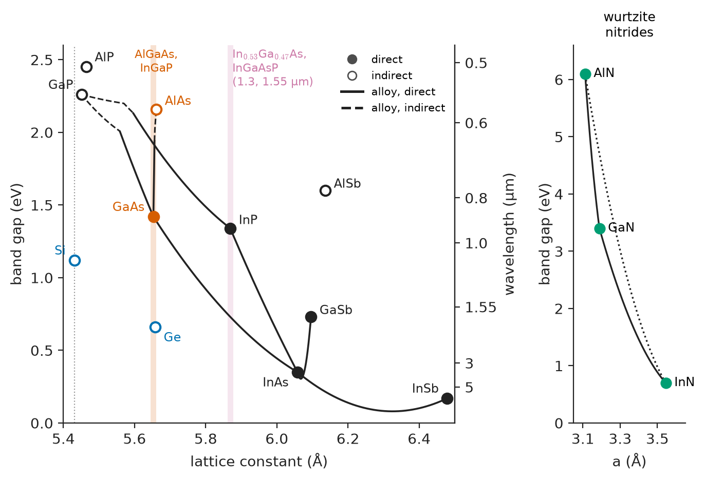
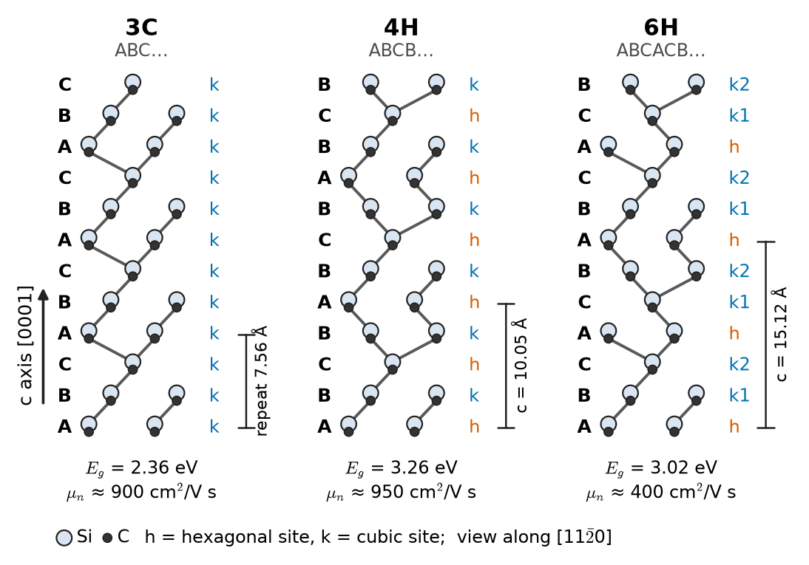
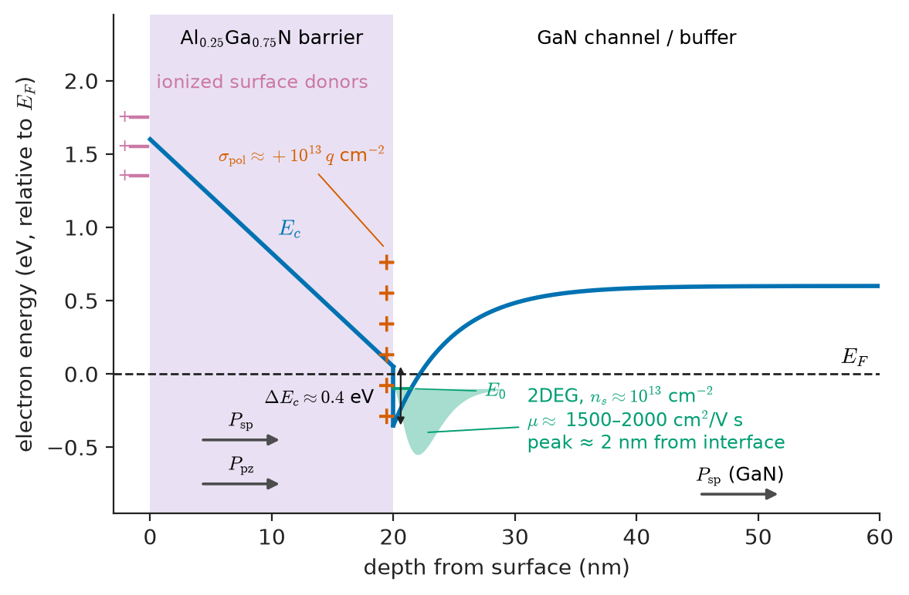
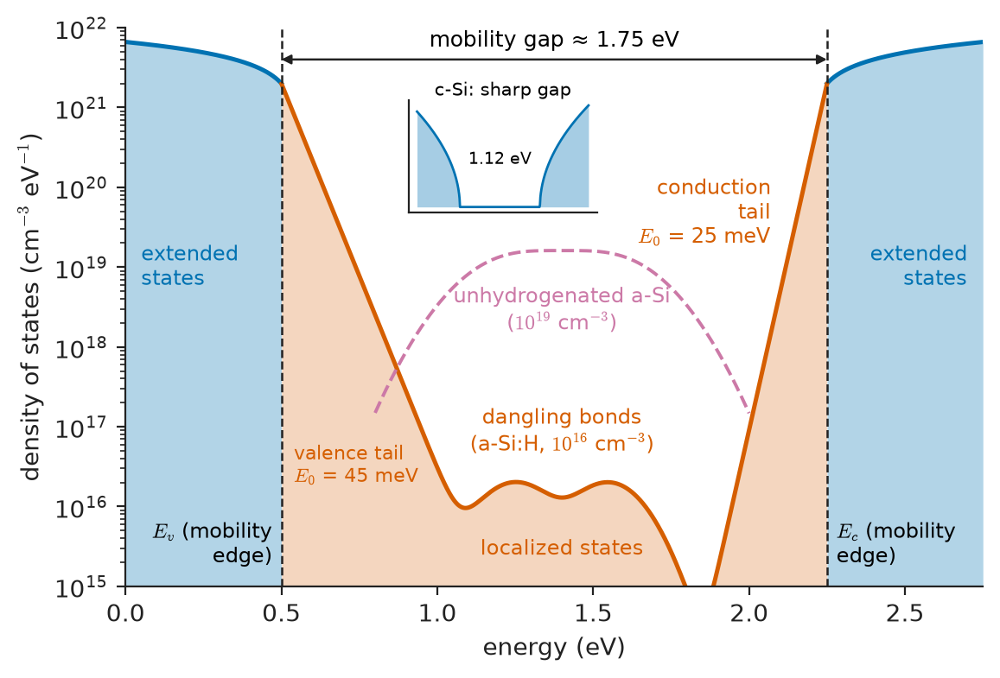
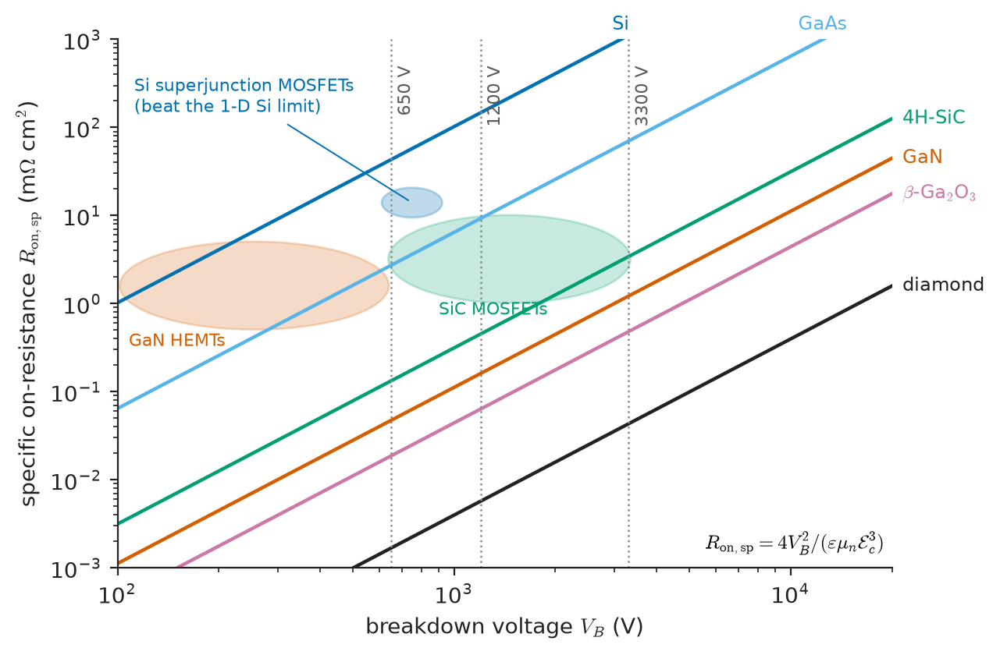
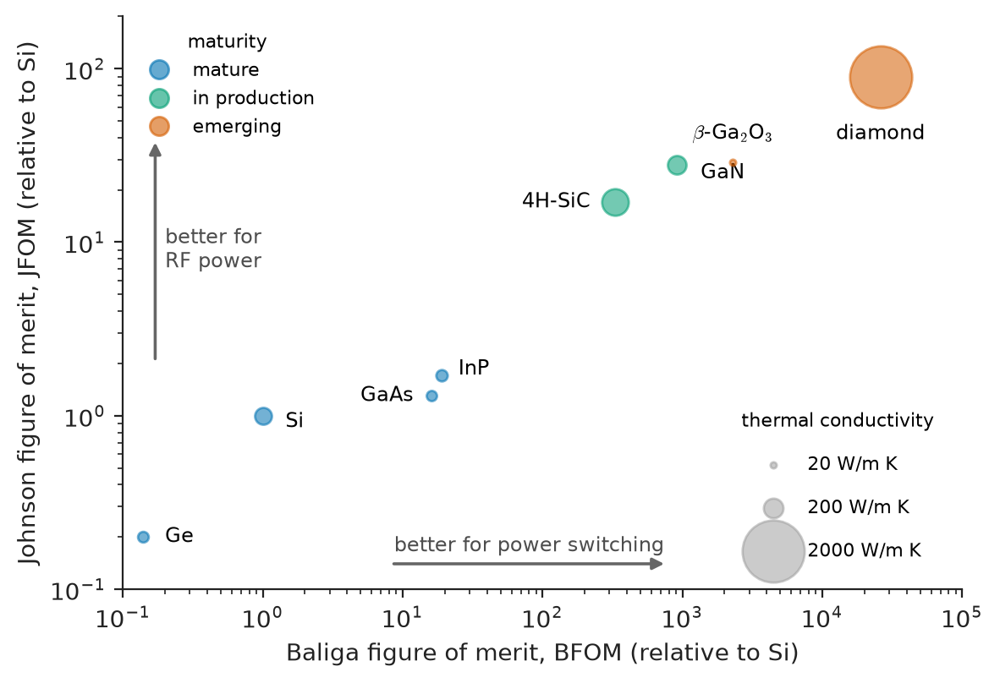

# Chapter 33 — Semiconductor Material Families

*Part VII · Semiconductor and Photonic Materials*

An electric-vehicle maker is redesigning its traction inverter for an 800 V battery. The existing design uses silicon IGBTs. A silicon carbide MOSFET of the same current rating costs about three times as much per die, yet the company switches, and the whole industry is doing the same. The drive-cycle losses fall by more than half, the cooling plate shrinks, and the extra range is worth more than the extra semiconductor cost. In the same year the company's radar supplier moves its power amplifiers to gallium nitride on silicon carbide, its lidar uses indium gallium arsenide detectors, its displays are driven by amorphous-oxide and polysilicon thin-film transistors, and the dashboard is lit by organic LEDs. Seven different semiconductors sit in one car, and each was chosen for reasons that trace back to the band structure and defect physics of Chapters 31 and 32. This chapter is the catalogue and the comparison: what each family offers, what limits it, and how an engineer ranks them for a given job.

> **What does each semiconductor family offer, and what holds it back?**
> **How do band gap, mobility, critical field, saturation velocity and thermal conductivity combine into figures of merit for power and RF?**
> **Why does silicon still dominate, and where has it lost to other materials?**

| Concept | Engineering destination |
|---|---|
| Silicon and germanium | Logic, memory, analog, sensors, power to about 1 kV; SiGe RF and photonics |
| III–V compounds, alloys, lattice matching | Band-gap engineering for lasers, detectors, HEMTs and HBTs |
| GaAs and InP | RF front-ends, mm-wave and THz transistors, 850 nm to 1.55 µm photonics |
| Silicon carbide | 650 V–3.3 kV power MOSFETs and diodes; high-temperature sensors |
| Gallium nitride | Fast power switches, RF power amplifiers, blue/green/UV LEDs and lasers |
| Ga$_2$O$_3$, diamond, AlN | Next-generation ultra-high-voltage power, extreme environments, heat spreading |
| Amorphous silicon and oxides | Large-area thin-film transistors, imagers, passivation layers |
| Organic semiconductors | OLED displays, flexible and printed electronics |
| Two-dimensional materials | Atomically thin channels, sensors, ultimate scaling |
| Baliga and Johnson figures of merit | First-pass material screening for power and RF |

**Roadmap.** The elemental semiconductors (33.1) → III–V compounds and alloy engineering (33.2) → GaAs and InP (33.3) → silicon carbide (33.4) → gallium nitride (33.5) → the ultra-wide-gap materials (33.6) → disordered and molecular semiconductors: amorphous silicon (33.7) and organics (33.8) → atomically thin materials (33.9) → systematic comparison for power, RF, sensing and optoelectronics (33.10).

> **Boundary.** This chapter compares materials. How a MOSFET, HEMT, HBT, LED or laser built from them operates belongs in the Electronics & Computing core. Interfaces and heterojunctions are developed in Chapter 34, optoelectronic devices' material requirements in Chapter 35, and 2D materials and nanostructures in depth in Chapter 38. Crystal growth and wafer manufacture are in Chapter 50. All property values are typical room-temperature values for good-quality material. Where values vary with growth method, orientation or doping, ranges are given.

---

## 33.1 Silicon and germanium

### Why silicon dominates

On band structure alone, silicon is unremarkable. Its gap is indirect, its electron mobility is a sixth of GaAs's, its critical field is a tenth of SiC's, and its thermal conductivity is a fifteenth of diamond's. It dominates semiconductor production, at over 95 % of devices by value, because of a combination of material properties that no other semiconductor matches.

1. **A near-perfect native oxide.** Thermal oxidation grows amorphous SiO$_2$, with a band gap of about 9 eV, a breakdown field above 10 MV/cm and an interface-trap density as low as about $10^{10}\ \mathrm{cm^{-2}\,eV^{-1}}$ after hydrogen annealing (Chapter 34). That oxide made the MOSFET and planar processing possible. The native oxides of Ge, GaAs and InP are unstable, water-soluble or electrically poor.
2. **Crystal perfection at scale.** Silicon is grown as dislocation-free single crystals 300 mm in diameter and two metres long, with purity of 9N–11N (Chapter 50). No other semiconductor comes close.
3. **Abundance and safety.** Silicon makes up 28 % of the Earth's crust by mass, and silicon and its oxide are non-toxic.
4. **A moderate, useful gap.** At 1.12 eV the gap is wide enough for low leakage up to about 150 °C (Chapter 31) and narrow enough for easy doping and low-voltage operation. It also matches the solar spectrum well (Chapter 40).
5. **Mechanical and thermal robustness.** Silicon is stronger than steel in flexure when defect-free, has a thermal conductivity of about 148 W/(m K), comparable to many engineering alloys and about five times that of alumina, and a low thermal expansion (2.6 ppm/K).
6. **Well-behaved dopants.** B, P, As and Sb are shallow, highly soluble and controllable, giving p- and n-type doping over $10^{13}$–$10^{21}\ \mathrm{cm^{-3}}$.

### Silicon's limits

The same properties set the boundaries of silicon's domain.

- **Indirect gap.** Radiative recombination is $10^4$ times slower than in GaAs (Chapter 31). Silicon makes excellent detectors and solar cells but very poor light emitters. Silicon photonics uses Ge for detection and bonded III–V material for lasers.
- **Moderate critical field** (about 0.3 MV/cm). A silicon power device needs a thick, lightly doped drift layer, and its on-resistance rises steeply with voltage (Section 33.10). Above about 600 V, silicon power devices must be bipolar (IGBTs), which conduct well but switch slowly.
- **Temperature.** Intrinsic conduction and leakage limit junction temperatures to about 150–175 °C.
- **Saturation velocity** (about $10^7$ cm/s) and mobility limit the highest-frequency analog circuits, though aggressive scaling has taken Si CMOS to transit frequencies of several hundred GHz.

### Germanium

Germanium was the material of the first transistor (1947) and lost to silicon in the 1960s for three reasons: its oxide is water-soluble and unstable, its 0.66 eV gap gives large leakage currents, and its intrinsic temperature (about 390 K at $10^{15}\ \mathrm{cm^{-3}}$, Chapter 31) is too low for many applications. It has returned in roles that use its strengths.

- **Highest hole mobility of the common semiconductors** (about 1900 cm²/(V s), four times Si) and high electron mobility (3900 cm²/(V s)), from its light conductivity masses (Chapter 31). Ge and high-Ge SiGe channels are used in advanced p-type transistors.
- **Direct gap close to the indirect gap.** The Γ-valley gap of 0.80 eV gives strong absorption at 1.55 µm. Ge-on-Si photodetectors are the standard detector of silicon photonics.
- **Lattice match to GaAs** (5.658 Å versus 5.653 Å) makes Ge the substrate and bottom junction of high-efficiency multi-junction space solar cells.
- **Radiation detection.** High-purity Ge, with net impurity concentrations near $10^{10}\ \mathrm{cm^{-3}}$, cooled to 77 K, gives the best energy resolution of any gamma-ray detector.

### Silicon–germanium alloys

Si and Ge are fully miscible, and Si$_{1-x}$Ge$_x$ alloys span lattice constants from 5.431 to 5.658 Å (a 4.2 % mismatch) and gaps from 1.12 to 0.66 eV. Thin SiGe layers grown on Si are compressively strained, which raises hole mobility and lowers the gap. These are used in SiGe heterojunction bipolar transistors (with $f_T$ and $f_{\max}$ of 300–700 GHz for mm-wave radar and optical links) and in strained-channel CMOS. Strain and critical thickness are treated in Chapter 34.

| Property (300 K) | Si | Ge | Units |
|---|---|---|---|
| Crystal structure | Diamond cubic | Diamond cubic | — |
| Lattice constant | 5.431 | 5.658 | Å |
| Density | 2.33 | 5.32 | g/cm³ |
| Melting point | 1414 | 938 | °C |
| Band gap | 1.12 (indirect) | 0.66 (indirect; direct 0.80) | eV |
| Relative permittivity | 11.7 | 16.0 | — |
| Electron / hole mobility | 1400 / 450 | 3900 / 1900 | cm²/(V s) |
| Intrinsic concentration | $1.0\times10^{10}$ | $2\times10^{13}$ | cm⁻³ |
| Critical field (about $10^{16}$ cm⁻³) | 0.3 | 0.1 | MV/cm |
| Electron saturation velocity | 1.0 | 0.6 | $10^7$ cm/s |
| Thermal conductivity | 148 | 60 | W/(m K) |
| Thermal expansion | 2.6 | 5.9 | ppm/K |
| Largest production wafer | 300 mm | 200 mm | — |

---

## 33.2 III–V compound semiconductors

### Structure and bonding

Combining a group-III element (Al, Ga, In) with a group-V element (N, P, As, Sb) gives an average of four valence electrons per atom, as in silicon, and the same tetrahedral bonding. The arsenides, phosphides and antimonides crystallize in the **zincblende** structure, the diamond structure with the two fcc sublattices occupied by different atoms (Chapter 2). The nitrides crystallize in the hexagonal **wurtzite** structure (Section 33.5). The bond is partly ionic, which, as Chapter 31 showed, widens the gap relative to the isoelectronic group-IV element. It also makes the compounds piezoelectric (Chapter 27), gives polar-optical-phonon scattering (Chapter 32), and makes {110} the natural cleavage planes, which form the mirrors of edge-emitting lasers.

### A continuous menu of band gaps

The real power of the III–V family is alloying. The binaries form solid solutions on each sublattice: Al$_x$Ga$_{1-x}$As, In$_x$Ga$_{1-x}$As, GaAs$_{1-y}$P$_y$, and quaternaries such as In$_{1-x}$Ga$_x$As$_y$P$_{1-y}$ and (Al$_x$Ga$_{1-x}$)$_{0.5}$In$_{0.5}$P. Their band gaps interpolate with the bowing law of Chapter 31, and their lattice constants follow **Vegard's law**:

$$
a(x)=x\,a_{AC}+(1-x)\,a_{BC}
$$

> **Status of the principle: Vegard's law**
> *Empirical.* A linear interpolation of the lattice constant with composition. It holds to within about 0.1 % for most III–V alloys, whose constituents have similar bonding, and fails more seriously for highly mismatched systems such as GaN–InN and for alloys with strong ordering.

| Binary | Lattice constant (Å) | $E_g$ at 300 K (eV) | Gap type |
|---|---|---|---|
| AlP | 5.464 | 2.45 | indirect |
| GaP | 5.451 | 2.26 | indirect |
| AlAs | 5.661 | 2.16 | indirect |
| GaAs | 5.653 | 1.42 | direct |
| InP | 5.869 | 1.34 | direct |
| AlSb | 6.136 | 1.6 | indirect |
| GaSb | 6.096 | 0.73 | direct |
| InAs | 6.058 | 0.35 | direct |
| InSb | 6.479 | 0.17 | direct |

Figure 33.1 plots band gap against lattice constant. It is the map on which every heterostructure is designed.

<!-- FIGURE 33.1 | figures/ch33/fig-33-1-bandgap-vs-lattice-constant.png | map | Band gap versus lattice constant for the group-IV and III–V semiconductors, with alloy lines; vertical bands mark the lattice constants of GaAs, InP and Si substrates. | Content: x axis lattice constant 5.4 to 6.5 Å, y axis band gap 0 to 2.6 eV, right axis wavelength (0.5, 0.6, 0.8, 1.0, 1.55, 3, 5 µm). Points: Si 5.431/1.12, Ge 5.658/0.66, GaP 5.451/2.26, AlP 5.464/2.45, AlAs 5.661/2.16, GaAs 5.653/1.42, InP 5.869/1.34, AlSb 6.136/1.6, GaSb 6.096/0.73, InAs 6.058/0.35, InSb 6.479/0.17. Filled symbols direct, open symbols indirect. Connect binaries with alloy curves (solid where direct, dashed where indirect): AlAs–GaAs, GaAs–InAs, InP–InAs, GaAs–GaP, InP–GaP, GaSb–InAs, InSb–InAs. Vertical shaded strips at 5.653 (GaAs, Ge) labelled AlGaAs, InGaP lattice-matched and 5.869 (InP) labelled In0.53Ga0.47As, InGaAsP 1.3 and 1.55 µm. Inset or separate small panel: wurtzite nitrides AlN (3.11 Å, 6.1 eV), GaN (3.19, 3.4), InN (3.54, 0.7) on the a-axis lattice constant. -->

*Figure 33.1 — Band gap versus lattice constant for the group-IV and III–V semiconductors, with alloy lines; vertical bands mark the lattice constants of GaAs, InP and Si substrates.*

### Lattice matching

A layer grown epitaxially on a substrate must either match its lattice constant or accommodate the mismatch by elastic strain (if thin) or misfit dislocations (if thick, Chapter 34). Dislocations are recombination centres and leakage paths (Chapter 32). High-quality optoelectronic and high-speed layers are therefore designed along the vertical lines of Figure 33.1.

- **On GaAs** (5.653 Å): AlAs differs by only 0.14 %, so the entire Al$_x$Ga$_{1-x}$As range is nearly lattice-matched. This accident of nature made GaAs/AlGaAs the first heterostructure system, and gave the double-heterostructure laser and the HEMT. Ga$_{0.51}$In$_{0.49}$P and AlGaInP are also matched (red LEDs, HBT emitters).
- **On InP** (5.869 Å): In$_{0.53}$Ga$_{0.47}$As, InAlAs and InGaAsP of chosen composition, covering 0.75–1.34 eV, which includes the 1.3 µm and 1.55 µm optical-fibre windows.

**Worked example — designing the 1.55 µm detector alloy.** Find the composition of In$_x$Ga$_{1-x}$As that is lattice-matched to InP, and its band gap. Vegard's law with $a_{\mathrm{InAs}}=6.0583$ Å and $a_{\mathrm{GaAs}}=5.6533$ Å requires $x\,6.0583+(1-x)\,5.6533=5.8687$, so $x=(5.8687-5.6533)/(6.0583-5.6533)=0.2154/0.4050=0.532$. With a bowing parameter $b\approx0.48$ eV, the gap is $E_g=0.532\times0.354+0.468\times1.424-0.48\times0.532\times0.468=0.188+0.666-0.119=0.736$ eV. The cut-off wavelength is $1.24/0.736=1.68$ µm. In$_{0.53}$Ga$_{0.47}$As absorbs strongly across both telecommunication windows (1.31 and 1.55 µm) while growing on InP without dislocations. This is why it is the standard material for fibre-optic photodiodes and for eye-safe lidar receivers. A composition error of 1 % in $x$ produces a mismatch of 0.07 %, which is tolerable in layers a few micrometres thick.

### Practical issues

- **Toxicity and handling.** Arsenic and phosphorus compounds, and the arsine and phosphine gases used in epitaxy, are highly toxic. Fabrication needs gas monitoring, abatement and waste handling (Chapter 59).
- **Brittleness and wafer size.** III–V wafers are mechanically weaker than Si. GaAs wafers reach 150 mm (200 mm in limited use), and InP 100–150 mm, and both cost far more per unit area than silicon.
- **No good native oxide.** Surfaces have high recombination velocities and high interface-trap densities, so III–V transistors use Schottky gates, heterojunction barriers or deposited high-κ dielectrics (Chapter 34).
- **Low thermal conductivity** of the arsenides and phosphides (Section 33.3) limits power density.

---

## 33.3 Gallium arsenide and indium phosphide

### Gallium arsenide

GaAs is the workhorse III–V compound. Its electron mobility of about 8500 cm²/(V s) (six times Si) and its direct 1.42 eV gap follow from the strongly curved Γ valley ($m^*=0.067\,m_0$, Chapter 31).

**Semi-insulating substrates.** Undoped GaAs grown by the liquid-encapsulated Czochralski or vertical-gradient-freeze methods is compensated by the EL2 mid-gap donor (Chapter 32), with resistivities of $10^7$–$10^8\ \Omega$ cm. Passive components and transmission lines can be built directly on the substrate with low RF loss, and devices are isolated by implantation. This is a decisive advantage over silicon, whose substrates conduct, for monolithic microwave integrated circuits (MMICs).

**Heterostructure transistors.** The AlGaAs/GaAs and InGaP/GaAs systems give pseudomorphic HEMTs (pHEMTs) with InGaAs channels for low-noise amplifiers and switches, and InGaP/GaAs HBTs that still dominate the power amplifiers of mobile handsets, where their high power-added efficiency at 1–6 GHz and a few volts of supply is hard to beat.

**Optoelectronics.** GaAs, AlGaAs and InGaAs give the 850–940 nm vertical-cavity lasers (VCSELs) of data-centre links, face recognition and automotive lidar, infrared LEDs, and the most efficient single-junction solar cells (about 29 %), used with InGaP and Ge in multi-junction space cells.

**Limits.** The thermal conductivity of 55 W/(m K), about a third of Si's, limits power density. The critical field (0.4 MV/cm) and saturation velocity (about $10^7$ cm/s, after the transient peak of $2\times10^7$ cm/s, Chapter 32) are only modestly better than Si's. The surface is hard to passivate, and arsenic toxicity and wafer cost restrict GaAs to applications where its RF or optical advantages are decisive.

### Indium phosphide

InP has a direct gap of 1.34 eV, electron mobility of about 5400 cm²/(V s), a higher peak velocity than GaAs (about $2.5\times10^7$ cm/s) because its L valleys lie about 0.6 eV above Γ, a slightly higher breakdown field (about 0.5 MV/cm) and better thermal conductivity (68 W/(m K)). Its importance comes from the alloys it supports.

- **The fastest transistors.** In$_{0.53}$Ga$_{0.47}$As channels on InP have electron mobilities of 10 000–14 000 cm²/(V s). InP HEMTs and InP/InGaAs HBTs reach $f_{\max}$ above 1 THz and are used in sub-THz communications, radio astronomy receivers and the lowest-noise cryogenic amplifiers.
- **Fibre-optic photonics.** InGaAsP and InGaAlAs on InP emit and detect at 1.3 and 1.55 µm. Practically every long-haul and data-centre laser, modulator and receiver is InP-based, and InP photonic integrated circuits combine all of them on one chip.
- **Semi-insulating substrates** are made by Fe doping, which provides a deep acceptor that compensates residual donors.

InP is more brittle and more expensive than GaAs, and its wafers are smaller. The high Auger coefficient of narrow-gap InGaAsP (Chapter 32) makes 1.55 µm lasers more temperature-sensitive than GaAs lasers. They are usually temperature-stabilized.

### Narrow-gap III–Vs

InAs (0.35 eV), InSb (0.17 eV) and their alloys have the lightest electron masses (0.023 and 0.014 $m_0$) and highest mobilities (up to about 40 000 and 77 000 cm²/(V s)) of any common semiconductors. Their high mobility makes them the material of choice for **Hall-effect magnetic sensors**, where the Hall voltage per unit current and field is proportional to mobility. Their small gaps make them mid-infrared detectors (3–5 µm), cooled to suppress the large $n_i$. Type-II InAs/GaSb superlattices are an engineered alternative to HgCdTe for infrared imaging (Chapter 35).

---

## 33.4 Silicon carbide

### Structure and polytypes

SiC is a covalent compound of two group-IV elements with a very strong, short Si–C bond (0.189 nm). Each atom is tetrahedrally bonded, and the structure is a stack of close-packed Si–C bilayers. The bilayers can stack in many sequences, called **polytypes**, which have the same chemistry but different band structures:

| Polytype | Stacking sequence | Hexagonality | $E_g$ (eV) | Electron mobility (cm²/(V s)) |
|---|---|---|---|---|
| 3C (cubic, zincblende) | ABC | 0 % | 2.36 | about 900 |
| 4H | ABCB | 50 % | 3.26 | about 950 (⊥ c), 1150 (∥ c) |
| 6H | ABCACB | 33 % | 3.02 | about 400 (⊥ c), 60–100 (∥ c) |

Figure 33.2 shows the stacking sequences.

<!-- FIGURE 33.2 | figures/ch33/fig-33-2-sic-polytypes.png | crystal | Stacking sequences of the 3C, 4H and 6H polytypes of silicon carbide, viewed along the [11-20] direction, with the hexagonal and cubic lattice sites marked. | Content: three side-by-side columns of Si–C bilayers drawn as zigzag chains (Si large light spheres, C small dark spheres) with positions A, B, C marked on the left. 3C: ABCABC... repeat 3 bilayers. 4H: ABCB repeat with c = 10.05 Å marked. 6H: ABCACB repeat with c = 15.12 Å. Mark hexagonal (h) and cubic (k) sites next to each bilayer (4H: h, k; 6H: h, k1, k2). Below each column print Eg (2.36, 3.26, 3.02 eV) and in-plane electron mobility (900, 950, 400 cm2/Vs). Arrow indicating the c axis. -->

*Figure 33.2 — Stacking sequences of the 3C, 4H and 6H polytypes of silicon carbide, viewed along the [11-20] direction, with the hexagonal and cubic lattice sites marked.*

**4H-SiC is the polytype of power electronics** because it combines the widest gap with high and nearly isotropic electron mobility. 6H-SiC has a strongly anisotropic mobility that is poor along the c axis, the direction current flows in a vertical power device. 3C-SiC can be grown on Si but contains high defect densities and has a smaller gap.

### Properties

4H-SiC has a band gap of 3.26 eV (indirect), a critical field of about 2–3 MV/cm (2.5 MV/cm is typical at the doping of a 1.2 kV drift layer), an electron saturation velocity of about $2\times10^7$ cm/s, and a thermal conductivity of 330–490 W/(m K) depending on orientation and doping (about 370 W/(m K) is typical), which is higher than copper's. Its intrinsic concentration at room temperature is about $10^{-8}\ \mathrm{cm^{-3}}$ (Chapter 31), so leakage is set by defects and the material remains extrinsic far above any temperature a package can survive. It is extremely hard (Mohs 9.5), chemically inert, and resistant to radiation.

### The defect story

SiC power devices became commercial in 2001 (Schottky diodes) and mainstream around 2018 (MOSFETs in electric vehicles) only after decades of defect reduction.

- **Growth.** SiC does not melt at atmospheric pressure. It sublimes above about 2700 °C. Boules are grown by physical vapour transport at about 2300 °C, slowly (0.2–0.5 mm/h) and with difficult thermal control (Chapter 50). This is the root of SiC's cost.
- **Micropipes**, hollow-core screw dislocations that destroy any device they cross, were once present at hundreds per cm². They are now below 0.1 cm⁻².
- **Basal-plane dislocations** in the epilayer expand into stacking faults when electron–hole pairs recombine on them, increasing the forward voltage of bipolar devices and of the body diode of MOSFETs (Chapter 32). Epitaxy on 4°-off-axis substrates converts more than 99 % of them into harmless threading-edge dislocations.
- **Point defects.** The $Z_{1/2}$ carbon-vacancy centre limits the bulk lifetime to about 1 µs (Chapter 32).
- **The oxide interface.** SiC is the only wide-gap semiconductor with a thermal native oxide, SiO$_2$, which made the SiC MOSFET possible. But the interface contains carbon-related defects, with trap densities of $10^{12}$–$10^{13}\ \mathrm{cm^{-2}\,eV^{-1}}$ near the conduction band, so channel mobility is only 20–50 cm²/(V s) even after nitridation anneals. In low-voltage SiC MOSFETs the channel, not the drift layer, dominates the on-resistance (Chapter 34).

### Doping

Nitrogen (donor, 61 and 125 meV for the two inequivalent sites) and aluminium (acceptor, about 0.2 eV) are the standard dopants. Dopant diffusion in SiC is negligibly slow, so all selective doping is by ion implantation, which needs implantation at elevated temperature and activation anneals at 1600–1800 °C with a carbon cap to protect the surface. Al acceptors are only partly ionized at room temperature (Chapter 32), so p-type SiC is resistive.

### Applications

SiC Schottky diodes and MOSFETs dominate new designs from 650 V to 3.3 kV: EV traction inverters and on-board chargers, solar and storage inverters, industrial drives, rail traction. Devices to 10 kV and beyond are emerging for medium-voltage grid applications. Semi-insulating SiC (vanadium-doped or high-purity) is also the preferred substrate for GaN RF transistors, because of its thermal conductivity. Wafers of 150 mm are mainstream and 200 mm is ramping. Substrate cost and yield remain the main obstacles to replacing silicon IGBTs completely.

---

## 33.5 Gallium nitride

### Structure and polarization

GaN crystallizes in the wurtzite structure ($a=3.189$ Å, $c=5.185$ Å). The Ga–N bond is short and strongly polar, and the wurtzite structure lacks inversion symmetry along the c axis. As a result, GaN and its alloys with AlN and InN carry a large **spontaneous polarization** along [0001], and any strain adds a **piezoelectric polarization** (Chapter 27). At an interface between two nitrides with different polarization, a fixed sheet of bound charge appears equal to the difference in polarization:

$$
\sigma_{\mathrm{pol}}=\left(P_{\mathrm{sp}}+P_{\mathrm{pz}}\right)_{\mathrm{AlGaN}}-P_{\mathrm{sp,GaN}}
$$

For Ga-face AlGaN grown on GaN, this charge is positive at the interface, of order $10^{13}\ q\ \mathrm{cm^{-2}}$ for 25–30 % Al. Electrons, supplied mostly by donor-like surface states on the AlGaN, accumulate in the triangular well on the GaN side to neutralize it, forming a **two-dimensional electron gas** (2DEG) without any intentional doping (Figure 33.3).

> **Status of the principle: polarization-induced 2DEG**
> *Derived.* The sheet charge follows from the discontinuity of polarization (Gauss's law applied to bound charge), with polarization constants taken from calculation and experiment. The electron density that actually forms also depends on the barrier thickness and surface states, and is predicted only approximately. It is measured, typically $(0.8\text{–}1.2)\times10^{13}\ \mathrm{cm^{-2}}$.

<!-- FIGURE 33.3 | figures/ch33/fig-33-3-algan-gan-2deg.png | band-diagram | Conduction-band diagram of an AlGaN/GaN heterostructure, showing the polarization sheet charge at the interface and the two-dimensional electron gas confined in the triangular well. | Content: horizontal axis depth from the surface 0 to 60 nm: 20 nm Al0.25Ga0.75N barrier then GaN. Vertical axis energy, with the Fermi level EF as a horizontal reference line. Conduction band Ec sloping down through the AlGaN (strong field from polarization), a conduction-band offset of about 0.4 eV up at the interface at 20 nm, then a sharp triangular well dipping below EF in the GaN with the first sub-band E0 marked and the electron density ns plotted as a shaded peak about 2 to 3 nm from the interface. Arrows for Psp and Ppz in the AlGaN and Psp in the GaN; plus signs at the interface labelled sigma_pol ~ +1e13 q cm^-2; surface donor states at x = 0. Label ns ≈ 1e13 cm^-2, mu ≈ 1500–2000 cm2/Vs. -->

*Figure 33.3 — Conduction-band diagram of an AlGaN/GaN heterostructure, showing the polarization sheet charge at the interface and the two-dimensional electron gas confined in the triangular well.*

The 2DEG combines a high sheet density with a mobility of 1500–2000 cm²/(V s), because the electrons are separated from ionized donors (Chapter 32). With $n_s=10^{13}\ \mathrm{cm^{-2}}$ and $\mu=1800\ \mathrm{cm^2/(V\,s)}$ its sheet resistance is $1/(qn_s\mu)=1/(1.602\times10^{-19}\times10^{13}\times1800)=350\ \Omega$ per square, together with GaN's critical field of 3.3 MV/cm. The **high-electron-mobility transistor** (HEMT) built on it is the basis of GaN power and RF electronics. Because the channel is on without a gate bias, making normally-off power switches requires additional structures (p-GaN gates, recessed gates or cascodes), which is a materials problem with device consequences.

### Substrates, dislocations and stress

Native GaN substrates exist but are small (50–100 mm) and expensive. Most GaN is grown heteroepitaxially:

| Substrate | Lattice mismatch with GaN (in-plane) | Thermal conductivity (W/(m K)) | Typical use |
|---|---|---|---|
| Sapphire (Al$_2$O$_3$) | about 16 % (after rotation) | 35–42 | LEDs (lowest cost) |
| 4H/6H-SiC (semi-insulating) | 3.5 % | about 370–490 | RF power HEMTs |
| Si(111) | about 17 % | 148 | Power HEMTs, some LEDs, 200 mm CMOS-line compatible |
| GaN (bulk) | 0 | 130–230 | Lasers, vertical power devices |

The mismatch to Si(111) follows from comparing the GaN $a$-axis constant with the Si surface-atom spacing $a_{\mathrm{Si}}/\sqrt2=3.840$ Å: $(3.189-3.840)/3.840=-17$ %. Heteroepitaxial GaN contains $10^8$–$10^{10}$ threading dislocations per cm², densities that would make GaAs or Si unusable. GaN devices work because the large gap, and in InGaN strong carrier localization, make each dislocation less damaging. The thermal-expansion mismatch on Si (5.6 versus 2.6 ppm/K) puts the GaN in tension by about 0.3 % on cooling from growth temperature, enough to crack it unless compressive AlGaN or AlN/GaN superlattice buffers are inserted. The buffers are made semi-insulating with C or Fe (Chapter 32), and the traps they introduce cause the dynamic on-resistance ("current collapse") that GaN reliability work still addresses (Chapters 34 and 44).

### Doping

Si and Ge are shallow donors. Mg is the only practical acceptor, with an ionization energy of 160–200 meV, so only a few per cent ionize at room temperature (Chapter 32), and hole mobilities are 10–30 cm²/(V s). In MOCVD growth, hydrogen passivates Mg, and p-type GaN only became possible when Amano and Akasaki (electron-beam irradiation, 1989) and Nakamura (thermal annealing, 1992) learned to activate it. This made the blue LED and the white LED possible (2014 Nobel Prize). Poor p-type conductivity still limits GaN bipolar devices and lasers.

### Applications

- **Power switching.** Lateral GaN-on-Si HEMTs, at 15–650 V, switch with very low charge and are used in compact chargers, data-centre power supplies, LiDAR drivers and motor drives. Their figure of merit (Section 33.10) exceeds SiC's at these voltages. Vertical GaN-on-GaN devices for higher voltages are under development.
- **RF power.** GaN-on-SiC HEMTs deliver 5–10 W per mm of gate width at frequencies to 100 GHz and beyond, about ten times GaAs, and have taken over radar, base-station and satellite power amplifiers.
- **Optoelectronics.** InGaN quantum wells emit from violet to green (blue LEDs reach external quantum efficiencies above 80 %), AlGaN emits in the UV, and GaN lasers write Blu-ray discs and drive projectors and automotive headlamps (Chapter 35).

---

## 33.6 Other wide-bandgap semiconductors

Materials with gaps above about 4 eV are called **ultra-wide-bandgap** (UWBG). Their critical fields, scaling roughly as $E_g^2$–$E_g^{2.5}$ (Chapter 32), promise power devices beyond SiC and GaN. Each has a serious materials obstacle.

### Gallium oxide (β-Ga$_2$O$_3$)

- **Gap** 4.8–4.9 eV, with an estimated critical field of about 8 MV/cm (fields above 5 MV/cm have been demonstrated in devices).
- **Melt growth.** Unlike SiC and GaN, β-Ga$_2$O$_3$ can be grown from the melt by edge-defined film-fed growth or Czochralski methods, like sapphire. Large, low-cost, low-defect substrates (100 mm, 150 mm demonstrated) are therefore realistic.
- **Controllable n-type doping** with Sn, Si or Ge from about $10^{15}$ to $10^{19}\ \mathrm{cm^{-3}}$.
- **Obstacles.** There is no p-type doping: the valence band is very flat (heavy holes) and holes self-trap on oxygen sites. The electron mobility is limited by polar-optical-phonon scattering to about 150–200 cm²/(V s). Most seriously, the thermal conductivity is only 11–27 W/(m K) (anisotropic), lower than GaAs, so heat removal must come from the top side or from bonding to SiC or diamond.

### Diamond

Diamond has the most extreme properties of any semiconductor: a gap of 5.47 eV (indirect), an estimated critical field of about 10 MV/cm, electron and hole mobilities of about 2000 cm²/(V s) or more in the purest CVD material, a saturation velocity of about $2.7\times10^7$ cm/s (electrons), and the highest thermal conductivity of any bulk material, 2000–2200 W/(m K). On paper, its Baliga figure of merit is tens of thousands of times silicon's (Section 33.10). In practice:

- **Dopants are deep.** Boron is an acceptor at 0.37 eV and phosphorus a donor at about 0.57 eV, so few carriers are free at room temperature. A hydrogen-terminated diamond surface develops a two-dimensional hole gas by surface transfer doping, which is the basis of most diamond transistors.
- **Substrates are small.** High-pressure–high-temperature and CVD single crystals are about 10 mm across. Mosaic and heteroepitaxial wafers of 50 mm are emerging.

Today diamond's main electronic role is as a **heat spreader**, polycrystalline CVD diamond bonded under GaN HEMTs and laser diodes. It also serves in radiation detectors and quantum sensors (nitrogen–vacancy centres).

### Aluminium nitride and AlGaN

AlN has a direct gap of 6.0–6.2 eV, a thermal conductivity of 285–320 W/(m K) for single crystals, and is strongly piezoelectric (Chapter 27). Bulk AlN substrates (50–100 mm) are used for deep-UV AlGaN LEDs (disinfection at 260–280 nm), and high-Al-content AlGaN channels are being explored for UWBG transistors. Doping becomes progressively harder as the Al fraction rises. Polycrystalline AlN ceramic (170–200 W/(m K)) is a standard power-module substrate (Chapter 51).

### Zinc oxide and others

ZnO (3.37 eV, direct) has an exciton binding energy of 60 meV, more than twice $k_BT$ at room temperature, which promises efficient excitonic UV emission, but reliable p-type doping has never been achieved. It is used instead as a transparent conductor (Al-doped ZnO), in varistors (Chapter 26), and as a piezoelectric (Chapter 27). Cubic boron nitride (about 6.4 eV) can be doped both n- and p-type but cannot yet be grown as device-quality films.

| UWBG material | Main advantage | Main obstacle | Status |
|---|---|---|---|
| β-Ga$_2$O$_3$ | Cheap melt-grown substrates; high $\mathcal E_c$ | No p-type; low thermal conductivity | Early commercial diodes and transistors |
| Diamond | Highest $\mathcal E_c$ and thermal conductivity | Deep dopants; small substrates | Heat spreaders, detectors, research devices |
| AlN/AlGaN | Very wide direct gap; high thermal conductivity | Doping at high Al content; substrate cost | Deep-UV LEDs; research transistors |
| cBN | Ambipolar doping possible | Film growth | Research |

---

## 33.7 Amorphous silicon

### Structure: bonds without long-range order

**Hydrogenated amorphous silicon** (a-Si:H) is deposited by plasma-enhanced chemical vapour deposition from silane at about 200–300 °C over areas of square metres, on glass, metal foil or polymer. Each Si atom is still tetrahedrally bonded to about four neighbours, but bond angles and lengths vary by several per cent, and there is no long-range order (Chapter 2). Some atoms end up with only three neighbours, leaving **dangling bonds**. In pure amorphous Si their density is $10^{19}$–$10^{20}\ \mathrm{cm^{-3}}$, pinning the Fermi level and making the material useless. Adding 8–15 at.% hydrogen during deposition saturates most of them and reduces the density to $10^{15}$–$10^{16}\ \mathrm{cm^{-3}}$. That reduction made a-Si:H dopable (Spear and LeComber, 1975) and created a large-area electronics industry.

### Electronic structure: band tails and a mobility gap

Because short-range bonding is preserved, a-Si:H still has a valence band and a conduction band (the tight-binding argument of Chapter 31 needs only bonds, not periodicity). Disorder has three effects, shown in Figure 33.4.

- **Band tails.** The distribution of bond angles and lengths smears the band edges into exponential tails of localized states, $g(E)\propto e^{-(E_c-E)/E_0}$, with characteristic energies $E_0\approx$ 45–50 meV (valence tail) and about 25 meV (conduction tail). The same exponential tail appears in the optical absorption edge (the Urbach edge).
- **Mobility edges.** States deep in the bands are extended and conduct. States in the tails are localized and do not. The energy separating them is the **mobility edge**, and the separation between the two mobility edges, about 1.7–1.8 eV, is the **mobility gap**.
- **Defect states.** The remaining dangling bonds form a band of deep states near mid-gap that act as recombination centres and traps.

<!-- FIGURE 33.4 | figures/ch33/fig-33-4-asi-density-of-states.png | plot | Density of states of hydrogenated amorphous silicon: extended band states, exponential band tails of localized states, mobility edges and mid-gap dangling-bond states. | Content: x axis energy from Ev - 0.5 eV to Ec + 0.5 eV (absolute scale 0 to about 2.3 eV with Ev = 0.5, Ec = 2.25), y axis log density of states 1e15 to 1e22 cm^-3 eV^-1. Square-root-like extended-state bands above Ec and below Ev; exponential valence tail with E0 = 45 meV and conduction tail with E0 = 25 meV extending into the gap; Gaussian dangling-bond bands near midgap with total density 1e16 cm^-3 (and a dashed variant 1e19 for unhydrogenated a-Si). Vertical dashed lines at the mobility edges Ev and Ec labelled mobility gap ≈ 1.75 eV. Shade localized states differently from extended states. Small inset: crystalline Si DOS with a sharp gap for comparison. -->

*Figure 33.4 — Density of states of hydrogenated amorphous silicon: extended band states, exponential band tails of localized states, mobility edges and mid-gap dangling-bond states.*

**Consequences.** Electrons in extended states have a mobility of about 10–20 cm²/(V s), but they spend most of their time trapped in tail states and released thermally. The resulting *effective* (trap-limited) mobility in thin-film transistors is only about 0.5–1 cm²/(V s). Because $k$ is not conserved in a disordered solid (Chapter 31), absorption above the gap is much stronger than in crystalline Si (about $10^5\ \mathrm{cm^{-1}}$ at 2.2 eV), so a few hundred nanometres absorb most visible light.

**The Staebler–Wronski effect.** Prolonged illumination creates additional dangling bonds, as the energy of recombination breaks weak Si–Si bonds. This reduces the efficiency of a-Si:H solar cells by 10–30 % in the first months of operation before it stabilizes. Annealing at about 150 °C reverses it. This metastability is a fundamental property of a hydrogenated disordered network and was one reason for the decline of a-Si:H thin-film photovoltaics.

### Applications and competitors

a-Si:H remains in use for display backplanes (large LCD panels), flat-panel X-ray imagers, and, as a thin intrinsic passivation layer, in the silicon **heterojunction** solar cells that hold the efficiency record for crystalline silicon (Chapter 40), because it passivates the c-Si surface almost perfectly. For higher-performance thin-film transistors two competitors have emerged:

| Thin-film channel material | Effective mobility (cm²/(V s)) | Process temperature | Main use |
|---|---|---|---|
| a-Si:H | 0.5–1 | 200–300 °C | Large LCD, X-ray imagers |
| Amorphous oxide (InGaZnO, IGZO) | 10–30 | Room temperature to 400 °C | Large OLED/LCD panels, low-leakage backplanes |
| Low-temperature polysilicon (LTPS) | 50–150 | Laser crystallization, < 500 °C on glass | Mobile OLED displays |
| Organic semiconductors | 0.1–10 | Room temperature to 150 °C | Flexible and printed circuits |

Amorphous oxides such as IGZO conduct well despite their disorder because their conduction band is built from spherical metal $s$ orbitals, whose overlap is insensitive to bond-angle disorder. This is a nice example of the tight-binding picture applied to a real material choice.

---

## 33.8 Organic semiconductors

### Molecular solids

Organic semiconductors are π-conjugated molecules (pentacene, rubrene, DNTT, C$_{60}$) or polymers (P3HT, PEDOT, diketopyrrolopyrrole copolymers) whose alternating single and double bonds produce delocalized π orbitals within each molecule (Advanced Chemistry core). The highest occupied molecular orbital (HOMO) plays the role of the valence-band edge and the lowest unoccupied orbital (LUMO) that of the conduction-band edge. Their separation, 1.5–3 eV, is set by the conjugation length.

Between molecules, however, there are only weak van der Waals forces. The intermolecular transfer integral $t$ is about 0.01–0.1 eV, compared with 1–3 eV in Si. In the tight-binding picture of Chapter 31, this gives bandwidths of a few tenths of an electron-volt at most and heavy effective masses. In real films the bands are further broken up by **energetic disorder**: each molecule's HOMO and LUMO energies are shifted by its particular environment, with a roughly Gaussian spread of width $\sigma\approx$ 0.05–0.15 eV.

### Transport by hopping

When the disorder exceeds the bandwidth, carriers localize on individual molecules or polymer segments and move by thermally activated **hopping** between them. The Gaussian disorder model (Bässler) describes the low-field mobility as

$$
\mu(T)=\mu_0\exp\!\left[-\left(\frac{2\sigma}{3k_BT}\right)^2\right]
$$

> **Status of the principle: Gaussian disorder model**
> *Empirical.* Derived from Monte Carlo simulation of hopping in a Gaussian density of states and fitted to time-of-flight data. It captures the strong temperature dependence and, with a further factor, the Poole–Frenkel-like field dependence ($\ln\mu\propto\sqrt{\mathcal E}$) of disordered organic films. It does not describe highly ordered single crystals, where band-like transport is observed.

With $\sigma=0.1$ eV at 300 K, the exponent is $(2\times0.1/(3\times0.02585))^2=(2.58)^2=6.65$, and the mobility is reduced by a factor of $e^{-6.65}=1.3\times10^{-3}$ from its disorder-free value $\mu_0$. Reducing disorder through molecular design and crystallinity has raised organic mobilities by five orders of magnitude since the 1980s.

| Organic material | Form | Typical mobility (cm²/(V s)) |
|---|---|---|
| P3HT (polymer) | Solution-processed film | 0.01–0.1 (holes) |
| Pentacene | Evaporated film | 0.5–3 (holes) |
| C$_{60}$ | Evaporated film | 0.5–5 (electrons) |
| DPP-based donor–acceptor polymers | Solution-processed film | 1–10 |
| C8-BTBT, DNTT | Small-molecule films | 1–10 or more |
| Rubrene | Single crystal | 10–40 (holes) |

### Excitons

Organic solids have low permittivity ($\varepsilon_r\approx3$–4) and localized states, so an absorbed photon creates a tightly bound electron–hole pair, a Frenkel **exciton**, with binding energy 0.3–1 eV, compared with a few meV in GaAs. Excitons do not separate into free carriers at room temperature on their own. Organic solar cells therefore need a donor–acceptor interface (a "bulk heterojunction") to split them, and now reach 19–20 % efficiency in the laboratory. In organic LEDs, conversely, excitons are formed deliberately and emit efficiently. Phosphorescent and thermally activated delayed-fluorescence emitters harvest both singlet and triplet excitons, giving internal quantum efficiencies near 100 %. OLED displays are the largest commercial application of organic semiconductors.

### Strengths and weaknesses

Organic semiconductors are processed at low temperature, from solution or by evaporation, onto flexible substrates over large areas, and their properties can be tuned by molecular synthesis. Against this they have low mobility, sensitivity to oxygen and water (which demands encapsulation, Chapter 51), limited thermal stability, and poorly controlled doping. Their thermal conductivity, about 0.1–0.5 W/(m K), makes self-heating a concern even at low power.

---

## 33.9 Two-dimensional materials

Layered crystals such as graphite, MoS$_2$ and hexagonal boron nitride consist of covalently bonded sheets held together by van der Waals forces. Single sheets can be isolated or grown, giving semiconductors, metals and insulators one atom (or three atoms) thick. Their electronic structure, size effects and synthesis are treated fully in Chapter 38. Here the question is how they compare as semiconductor materials.

| 2D material | Band gap | Typical room-temperature mobility (cm²/(V s)) | Notes |
|---|---|---|---|
| Graphene | 0 (semimetal, linear bands) | $10^4$ on SiO$_2$; $>10^5$ hBN-encapsulated | Cannot switch off; RF, sensors, transparent electrodes |
| MoS$_2$ (monolayer) | 1.8–1.9 eV direct (bulk 1.2–1.3 eV indirect) | 10–100 (phonon limit about 200) | n-type channel; leading 2D transistor candidate |
| WSe$_2$ (monolayer) | about 1.6 eV direct | 10–200 | p-type or ambipolar |
| Black phosphorus | 0.3 eV (bulk) to about 1.5–2 eV (monolayer), direct | 100–1000, anisotropic | Degrades in air |
| hBN | about 6 eV | Insulator | Atomically flat substrate and gate dielectric |

Three properties make 2D semiconductors attractive.

- **Thickness without surface damage.** A monolayer has no dangling bonds on its faces, so it can be thinned to under a nanometre without the mobility collapse that roughness and surface states cause in ultrathin silicon. This gives the best electrostatic control of a channel, the main argument for 2D materials at the end of transistor scaling.
- **Layer-dependent band structure.** MoS$_2$ changes from an indirect gap of about 1.2 eV in bulk to a direct gap of about 1.9 eV in a monolayer. Thickness becomes a design variable, an extreme form of the quantum confinement of Chapter 38.
- **Stacking.** Van der Waals heterostructures can be assembled without lattice matching, in contrast to the epitaxial constraints of Section 33.2.

Against these, wafer-scale growth of defect-free monolayers, low-resistance contacts and reliable doping remain unsolved, and mobilities of transition-metal dichalcogenides are lower than those of silicon. Graphene's lack of a gap gives on/off ratios of only about 10, which rules it out for logic. Two-dimensional materials are today used in sensors, photodetectors and research devices. Their role in mainstream electronics is a question for the 2030s.

---

## 33.10 Material comparison for power, RF, sensing and optoelectronics

### The master table

| Property (300 K) | Si | Ge | GaAs | InP | 4H-SiC | GaN | β-Ga$_2$O$_3$ | Diamond | AlN |
|---|---|---|---|---|---|---|---|---|---|
| $E_g$ (eV) | 1.12 | 0.66 | 1.42 | 1.34 | 3.26 | 3.39 | 4.85 | 5.47 | 6.1 |
| Gap type | I | I | D | D | I | D | I (nearly D) | I | D |
| $\varepsilon_r$ | 11.7 | 16.0 | 12.9 | 12.5 | 9.7 | 9.0 | 10 | 5.7 | 8.5 |
| $\mu_n$ (cm²/(V s)) | 1400 | 3900 | 8500 | 5400 | 950 | 1000–1300 (2DEG 1500–2000) | 150–200 | 2000–4500 | about 300 |
| $\mu_p$ (cm²/(V s)) | 450 | 1900 | 400 | 200 | 115 | 10–30 | — (no p-type) | 2000–3800 | about 14 |
| $\mathcal E_c$ (MV/cm) | 0.3 | 0.1 | 0.4 | 0.5 | 2.5 (2–3) | 3.3 | 8 (est.) | 10 (est.) | 12–15 (est.) |
| $v_{\mathrm{sat}}$ ($10^7$ cm/s) | 1.0 | 0.6 | 1.0 (peak 2) | 1.0 (peak 2.5) | 2.0 | 2.5 | 1.1–2 (est.) | 2.7 | about 1.5 |
| $\kappa$ (W/(m K)) | 148 | 60 | 55 | 68 | 330–490 | 130–230 | 11–27 | 2000–2200 | 285–320 |
| $n_i$ (cm⁻³) | $1\times10^{10}$ | $2\times10^{13}$ | $2\times10^{6}$ | $1\times10^{7}$ | $\sim10^{-8}$ | $\sim10^{-10}$ | $\sim10^{-22}$ | $\sim10^{-27}$ | negligible |
| Largest wafer (2026) | 300 mm | 200 mm | 150–200 mm | 100–150 mm | 150–200 mm | 200 mm (on Si); 100 mm bulk | 100–150 mm | about 10 mm (single crystal) | 50–100 mm |

Values marked "est." are theoretical or extrapolated, not yet measured in bulk breakdown. The critical field depends on doping (Chapter 32), and values here refer to the moderately doped drift layers of kilovolt-class devices.

### Power: the Baliga figure of merit

A unipolar power device (Schottky diode, MOSFET, HEMT) must block a voltage $V_B$ in its off state and conduct with as low a resistance as possible in its on state. Both are set by the **drift region**, a lightly doped layer of thickness $W$ and doping $N_D$. Its design is a materials problem that can be solved in four lines.

At breakdown, the field in a non-punch-through drift region is triangular, peaking at $\mathcal E_c$, and from Poisson's equation its slope is $qN_D/\varepsilon$. Therefore

$$
W=\frac{\varepsilon\mathcal E_c}{qN_D},\qquad V_B=\frac12\mathcal E_cW
$$

Eliminating $W$ gives the maximum doping allowed for a given blocking voltage and the corresponding thickness:

$$
N_D=\frac{\varepsilon\mathcal E_c^2}{2qV_B},\qquad W=\frac{2V_B}{\mathcal E_c}
$$

The specific on-resistance (resistance × area) of the drift region in the on state is $R_{\mathrm{on,sp}}=W/(q\mu_nN_D)$, so

$$
R_{\mathrm{on,sp}}=\frac{4V_B^2}{\varepsilon\mu_n\mathcal E_c^3}
$$

The denominator depends only on the material. It is the **Baliga figure of merit**:

$$
\mathrm{BFOM}=\varepsilon\mu_n\mathcal E_c^3
$$

> **Status of the principle: Baliga figure of merit and the unipolar limit**
> *Approximate.* Derived for a one-dimensional, uniformly doped, non-punch-through drift region with a constant critical field and constant mobility. Real devices add channel, substrate and contact resistance, and the critical field rises with doping. The resulting limit is optimistic by a factor of about two for Si, and it ignores switching losses and thermal limits entirely. It is a screening tool, not a design equation.

The cube of the critical field dominates. A tenfold increase in $\mathcal E_c$ is worth a thousandfold reduction in on-resistance, while mobility enters only linearly. This is why 4H-SiC, with a sixth of the mobility of GaAs, beats it by a factor of twenty, and why the critical fields marked "est." in the master table carry such large uncertainties in the FOM: changing the SiC critical field from 2.5 to 3.0 MV/cm raises its BFOM by $1.2^3=1.73$.

**Worked example — a 1200 V drift layer in silicon and in 4H-SiC.** For silicon, take $\varepsilon=11.7\times8.854\times10^{-14}=1.036\times10^{-12}$ F/cm, $\mu_n=1400\ \mathrm{cm^2/(V\,s)}$ and $\mathcal E_c=3\times10^5$ V/cm. Then

$$
N_D=\frac{1.036\times10^{-12}\times(3\times10^5)^2}{2\times1.602\times10^{-19}\times1200}=2.4\times10^{14}\ \mathrm{cm^{-3}},\qquad W=\frac{2\times1200}{3\times10^5}=8.0\times10^{-3}\ \mathrm{cm}=80\ \mu\mathrm m
$$

$$
R_{\mathrm{on,sp}}=\frac{4\times1200^2}{1.036\times10^{-12}\times1400\times(3\times10^5)^3}=\frac{5.76\times10^6}{3.92\times10^7}=0.147\ \Omega\,\mathrm{cm^2}
$$

For 4H-SiC, $\varepsilon=9.7\times8.854\times10^{-14}=8.59\times10^{-13}$ F/cm, $\mu_n=950\ \mathrm{cm^2/(V\,s)}$ and $\mathcal E_c=2.5\times10^6$ V/cm give $N_D=1.4\times10^{16}\ \mathrm{cm^{-3}}$, $W=9.6$ µm and

$$
R_{\mathrm{on,sp}}=\frac{5.76\times10^6}{8.59\times10^{-13}\times950\times1.5625\times10^{19}}=\frac{5.76\times10^6}{1.275\times10^{10}}=4.5\times10^{-4}\ \Omega\,\mathrm{cm^2}
$$

The SiC drift layer is about 8 times thinner, about 60 times more heavily doped, and has about 330 times lower specific resistance. For a 100 A device conducting at 1 V drop (10 mΩ), the silicon drift region alone would need an area of $0.147/0.01=14.7\ \mathrm{cm^2}$, a die nearly 4 cm on a side, which is impractical. That is why silicon at 1200 V must use the bipolar IGBT, which floods the drift region with carriers to lower its resistance at the cost of slow switching. The SiC drift region needs $0.045\ \mathrm{cm^2}$ (about 2 mm × 2 mm). Real 1200 V SiC MOSFETs reach total values of 2–3 mΩ cm², dominated by the channel and substrate rather than the drift layer, which is why the SiC/SiO$_2$ interface of Section 33.4 matters so much.

Repeating the calculation for each material with the master-table values gives the BFOM ranking and the "unipolar limit" lines of Figure 33.5.

| Material | Values used ($\varepsilon_r$, $\mu_n$, $\mathcal E_c$) | BFOM relative to Si | $R_{\mathrm{on,sp}}$ limit at 1200 V (mΩ cm²) |
|---|---|---|---|
| Ge | 16.0, 3900, 0.1 | 0.14 | 1040 |
| Si | 11.7, 1400, 0.3 | 1 | 147 |
| GaAs | 12.9, 8500, 0.4 | 16 | 9.3 |
| InP | 12.5, 5400, 0.5 | 19 | 7.7 |
| 4H-SiC | 9.7, 950, 2.5 | 330 | 0.45 |
| GaN | 9.0, 1250, 3.3 | 910 | 0.16 |
| β-Ga$_2$O$_3$ | 10, 200, 8 | 2300 | 0.064 |
| Diamond | 5.7, 2000, 10 | 26 000 | 0.0057 |

Published BFOM tables differ by factors of two or more because they use different critical fields and mobilities. Only the ordering, and the orders of magnitude, are robust.

<!-- FIGURE 33.5 | figures/ch33/fig-33-5-unipolar-limits.png | map | Theoretical unipolar limit of specific on-resistance versus breakdown voltage for Si, GaAs, 4H-SiC, GaN, β-Ga2O3 and diamond, with the operating windows of commercial devices. | Content: log-log plot, x axis breakdown voltage 100 V to 20 kV, y axis specific on-resistance 1e-3 to 1e3 mOhm cm2. Straight lines of slope 2 from Ron,sp = 4 VB^2/(eps mu Ec^3) using the table values: Si passing through 147 mOhm cm2 at 1200 V, GaAs 9.3, 4H-SiC 0.45, GaN 0.16, Ga2O3 0.064, diamond 0.0057 at 1200 V. Shaded clouds of commercial devices: Si superjunction MOSFETs near 600–900 V and 10–20 mOhm cm2 (below the Si line, labelled superjunction beats 1D limit), SiC MOSFETs 650–3300 V at 1–10 mOhm cm2, GaN HEMTs 100–650 V at 0.5–5 mOhm cm2. Vertical dotted lines at 650 V, 1200 V, 3300 V. -->

*Figure 33.5 — Theoretical unipolar limit of specific on-resistance versus breakdown voltage for Si, GaAs, 4H-SiC, GaN, β-Ga2O3 and diamond, with the operating windows of commercial devices.*

Two caveats keep this ranking honest. **Superjunction** silicon MOSFETs use alternating p and n pillars to break the one-dimensional assumption, and they beat the silicon line at 600–900 V. And the BFOM says nothing about the cost of the substrate, the quality of the gate dielectric, p-type doping, or **heat removal**, the next consideration.

### Thermal conductivity: where the heat goes

A device dissipating power $P$ over area $A$ through a die of thickness $t$ has a one-dimensional thermal resistance $t/(\kappa A)$ (Chapter 24). The temperature rise in the semiconductor itself varies inversely with $\kappa$.

**Worked example — temperature drop across the die.** A 1 mm × 1 mm hot spot dissipates 10 W through a 100 µm thick die. The temperature drop is $\Delta T=Pt/(\kappa A)=10\times10^{-4}/(\kappa\times10^{-6})=1000/\kappa$ (with $\kappa$ in W/(m K)): 6.8 K for Si, 18 K for GaAs, 15 K for InP, 7.7 K for GaN ($\kappa=130$), 2.7 K for 4H-SiC, 50 K for β-Ga$_2$O$_3$ ($\kappa=20$), and 0.5 K for diamond. Heat spreading in a real die reduces all of these numbers but not their ratios. GaN RF transistors, whose power densities exceed 5 W/mm of gate, are grown on SiC substrates to use SiC's conductivity, and the highest-power ones are bonded to diamond. Ga$_2$O$_3$, despite its high BFOM, would run 18 times hotter than SiC for the same loss unless it is thinned and bonded to a better conductor. Thermal conductivity can overrule the electrical figures of merit.

### RF: the Johnson figure of merit

A high-frequency transistor must be short, so that carriers cross it quickly, and it must withstand a voltage, so that it can deliver power. These conflict. The transit time across a region of length $L$ at saturation velocity is $L/v_{\mathrm{sat}}$, giving a cut-off frequency $f_T\approx v_{\mathrm{sat}}/2\pi L$, while the maximum voltage is about $\mathcal E_cL$. The product does not depend on $L$:

$$
V_{\max}f_T=\frac{\mathcal E_cv_{\mathrm{sat}}}{2\pi}\equiv\mathrm{JFOM}
$$

> **Status of the principle: Johnson figure of merit**
> *Approximate.* It assumes uniform saturated transport and a uniform critical field over the same length. It ignores parasitic capacitances, contact resistances, mobility (important at low fields and for noise) and thermal limits. Some authors quote its square, $(\mathcal E_cv_{\mathrm{sat}}/2\pi)^2$, so relative values in the literature may be the square of those given here.

| Material | $\mathcal E_c$ (MV/cm) | $v_{\mathrm{sat}}$ ($10^7$ cm/s) | JFOM (V/s) | JFOM relative to Si | $V_{\max}$ at $f_T=100$ GHz (V) |
|---|---|---|---|---|---|
| Ge | 0.1 | 0.6 | $9.5\times10^{10}$ | 0.2 | 1.0 |
| Si | 0.3 | 1.0 | $4.8\times10^{11}$ | 1 | 4.8 |
| GaAs | 0.4 | 1.0 | $6.4\times10^{11}$ | 1.3 | 6.4 |
| InP | 0.5 | 1.0 | $8.0\times10^{11}$ | 1.7 | 8.0 |
| 4H-SiC | 2.5 | 2.0 | $8.0\times10^{12}$ | 17 | 80 |
| GaN | 3.3 | 2.5 | $1.3\times10^{13}$ | 28 | 131 |
| β-Ga$_2$O$_3$ | 8 | 1.1 | $1.4\times10^{13}$ | 29 | 140 |
| Diamond | 10 | 2.7 | $4.3\times10^{13}$ | 90 | 430 |

GaN's place follows from this table: at 10 GHz it can sustain voltages of tens of volts, so for a given output power it presents a higher load impedance and needs less current, which simplifies matching and raises efficiency. Combined with the high 2DEG density and SiC's thermal conductivity, this is why GaN-on-SiC HEMTs replaced GaAs pHEMTs and silicon LDMOS in radar and base-station amplifiers. SiC's own low channel mobility keeps it out of RF. GaAs and InP still win where **low noise** and the highest frequencies at low voltage matter, because noise and $f_{\max}$ at small dimensions depend on low-field mobility and light effective mass, which the JFOM omits. A related index, Baliga's high-frequency figure of merit $\mu\mathcal E_c^2$, estimates switching loss in fast power converters. With the master-table values it ranks GaN (about 110 × Si) above Ga$_2$O$_3$ (about 100 ×), 4H-SiC (about 47 ×) and GaAs (about 11 ×), which is why GaN dominates the fastest power converters below 650 V. Figure 33.6 places all the materials on one map of the two figures of merit, with thermal conductivity shown as marker size, so that the trade-offs of this section can be seen at a glance.

<!-- FIGURE 33.6 | figures/ch33/fig-33-6-fom-map.png | map | Materials map for power and RF: Johnson figure of merit versus Baliga figure of merit (both relative to Si), with marker size proportional to thermal conductivity and colour indicating technology maturity. | Content: log-log scatter, x axis BFOM relative to Si from 0.1 to 1e5, y axis JFOM relative to Si from 0.1 to 200. Points: Ge (0.14, 0.2), Si (1, 1), GaAs (16, 1.3), InP (19, 1.7), 4H-SiC (330, 17), GaN (910, 28), beta-Ga2O3 (2300, 29), diamond (26000, 90). Bubble area proportional to thermal conductivity (Ga2O3 smallest at ~20 W/mK, diamond largest at ~2000 W/mK, SiC ~370, Si 148, GaN 130–230, GaAs 55). Colour: mature (Si, GaAs, InP), production (SiC, GaN), emerging (Ga2O3, diamond). Annotated arrows: power switching to the right, RF power upward. -->

*Figure 33.6 — Materials map for power and RF: Johnson figure of merit versus Baliga figure of merit (both relative to Si), with marker size proportional to thermal conductivity and colour indicating technology maturity.*

### Sensing

Sensor materials are chosen for different properties than power or RF materials. The quantity that converts the measurand into an electrical signal determines the choice.

| Sensing function | Key material property | Typical materials | Why |
|---|---|---|---|
| Magnetic field (Hall sensors) | High electron mobility | InSb, InAs, GaAs; Si for integrated sensors | Hall voltage ∝ $\mu$; Si integrates with signal processing |
| Temperature | Exponential $n_i$ or $E_g(T)$; mobility $T$-dependence | Si diodes and transistors; Ge for cryogenics | $V_{BE}$ changes about −2 mV/K; bandgap references |
| Strain and pressure | Piezoresistance (strain-induced valley repopulation) | Si (gauge factor about 100) | Large piezoresistive coefficients of Si; MEMS integration |
| High-temperature and harsh environments | Wide gap, chemical inertness | 4H-SiC, GaN, diamond | Low $n_i$ to 500 °C and beyond |
| Visible/NIR light | Absorption edge, low dark current | Si (to 1.1 µm), InGaAs (0.9–1.7 µm), Ge (to 1.6 µm) | Cut-off set by $E_g$ (Chapter 35) |
| Mid/long-wave IR | Narrow gap | InSb, HgCdTe, InAs/GaSb superlattices | Gaps of 0.1–0.3 eV, cooled |
| UV (solar-blind) | Wide gap | AlGaN, Ga$_2$O$_3$, diamond, SiC | Insensitive to visible light |
| Ionizing radiation | Gap (pair energy $\approx3E_g$), purity, $Z$ | Si, HPGe, CdZnTe, diamond, SiC | Signal per keV; radiation hardness |
| Gas and chemical | Surface states, adsorption | SnO$_2$, ZnO, WO$_3$, 2D materials, graphene | Surface-to-volume ratio (Chapters 34, 35, 38) |

Silicon dominates wherever the sensor can be integrated with its readout circuit: CMOS image sensors, MEMS pressure sensors and accelerometers, Hall sensors, temperature sensors. Other materials win where silicon's band gap or temperature range is wrong.

### Optoelectronics

For light emission only direct-gap materials qualify (Chapter 31), and the emission wavelength is set by the gap of the active layer:

| Wavelength band | Active material | Substrate | Application |
|---|---|---|---|
| Deep UV (210–280 nm) | AlGaN | AlN, sapphire | Disinfection, sensing |
| UV-A, violet, blue (365–470 nm) | InGaN/GaN | Sapphire, Si, SiC, GaN | White LEDs (with phosphor), lasers |
| Green (520–550 nm) | InGaN (high In) | Sapphire, GaN | Displays (efficiency gap "green gap") |
| Red, orange, amber (590–650 nm) | AlGaInP | GaAs | Automotive lamps, displays |
| Near-IR (780–980 nm) | AlGaAs/GaAs, InGaAs/GaAs | GaAs | VCSELs, sensing, pump lasers |
| Telecom (1.3–1.6 µm) | InGaAsP, InGaAlAs | InP | Fibre-optic lasers and modulators |
| Mid-IR (3–12 µm) | Quantum-cascade structures (InGaAs/InAlAs), GaSb-based | InP, GaSb | Gas sensing, spectroscopy |

For detection and photovoltaics, indirect-gap materials work well, as Chapter 31 showed: Si for visible imaging and solar cells, Ge and InGaAs for telecom wavelengths. Chapter 35 treats emission, absorption and the material requirements of each device class in detail.

### Selection summary

| Application | First-choice material(s) | Decisive properties | Main alternative |
|---|---|---|---|
| Logic and memory | Si (with SiGe, strained Si) | Native oxide, crystal perfection, scale, cost | 2D channels (future) |
| Power, < 100 V | Si MOSFETs | Cost, maturity | GaN HEMTs (speed) |
| Power, 100–650 V, fast switching | GaN-on-Si HEMTs | High BFOM, low charge, 2DEG | Si superjunction, SiC |
| Power, 650 V–3.3 kV | 4H-SiC MOSFETs and diodes | BFOM, thermal conductivity, native oxide | Si IGBT (cost) |
| Power, > 3.3 kV | Si IGBT and thyristors; 4H-SiC emerging | Bipolar conductivity modulation; SiC BFOM | Ga$_2$O$_3$, diamond (research) |
| RF power, 1–100 GHz | GaN-on-SiC HEMTs | JFOM, power density, thermal conductivity | GaAs pHEMT, Si LDMOS (< 4 GHz) |
| RF handset PAs | GaAs HBTs | Efficiency at low voltage, maturity | GaN, Si CMOS/SOI |
| Low-noise and sub-THz | InP HEMTs/HBTs, SiGe HBTs | Light $m^*$, high mobility | GaAs pHEMT |
| Hall sensors | InSb, InAs, GaAs, Si | Mobility; integration | Graphene (research) |
| Harsh-environment electronics | 4H-SiC | Low $n_i$, inertness | GaN, diamond |
| Visible and IR LEDs/lasers | InGaN, AlGaInP, (Al)GaAs, InGaAsP | Direct gap, lattice match | Organic (displays), perovskites (research) |
| Displays (backplane) | a-Si:H, IGZO, LTPS | Large area, low temperature | Organic TFTs |
| Flexible, printed electronics | Organic semiconductors, oxides | Low-temperature processing | — |

> **Status of the principle: figure-of-merit ranking**
> *Approximate.* Figures of merit compress the properties of a material into one number for a stated, idealized device. They correctly identify which materials can never compete for a task (Ge for power, Ga$_2$O$_3$ for heat-limited RF) and which might. The final choice is decided by factors outside the formula: substrate cost and size, defect density, dielectric interfaces, p-type doping, packaging, reliability and supply chain (Chapter 58).

---

## What remains open

| Open question | Where it is answered |
|---|---|
| How do band offsets, strain and critical thickness control heterostructures such as AlGaAs/GaAs, InGaAs/InP and AlGaN/GaN? | Chapter 34 |
| What sets interface-trap density at SiC/SiO$_2$, GaN/dielectric and high-κ/Si interfaces, and how does it limit channel mobility and reliability? | Chapter 34 |
| What are the material requirements for LEDs, lasers, photodetectors and solar absorbers built from these families? | Chapter 35 |
| How do graphene and other 2D materials behave as their thickness and lateral size shrink? | Chapter 38 |
| Which semiconductors make the best photovoltaic and thermoelectric materials? | Chapter 40 |
| How are Si, SiC, GaN, GaAs and Ga$_2$O$_3$ crystals and wafers grown, and how are they doped and implanted? | Chapter 50 |
| How do packages remove heat from SiC and GaN dies and cope with their thermal-expansion mismatch? | Chapter 51 |
| How do wide-gap devices degrade in service (bipolar degradation, current collapse, gate-oxide wear-out)? | Chapter 44 |
| How are figures of merit combined with cost, reliability and sustainability in a formal selection process? | Chapter 58 |

**Next:** Chapter 34 moves from bulk materials to the interfaces and thin films where devices are built: heterostructures and band alignment, surface and interface states, thin-film stress and defects, contacts and gate dielectrics.
