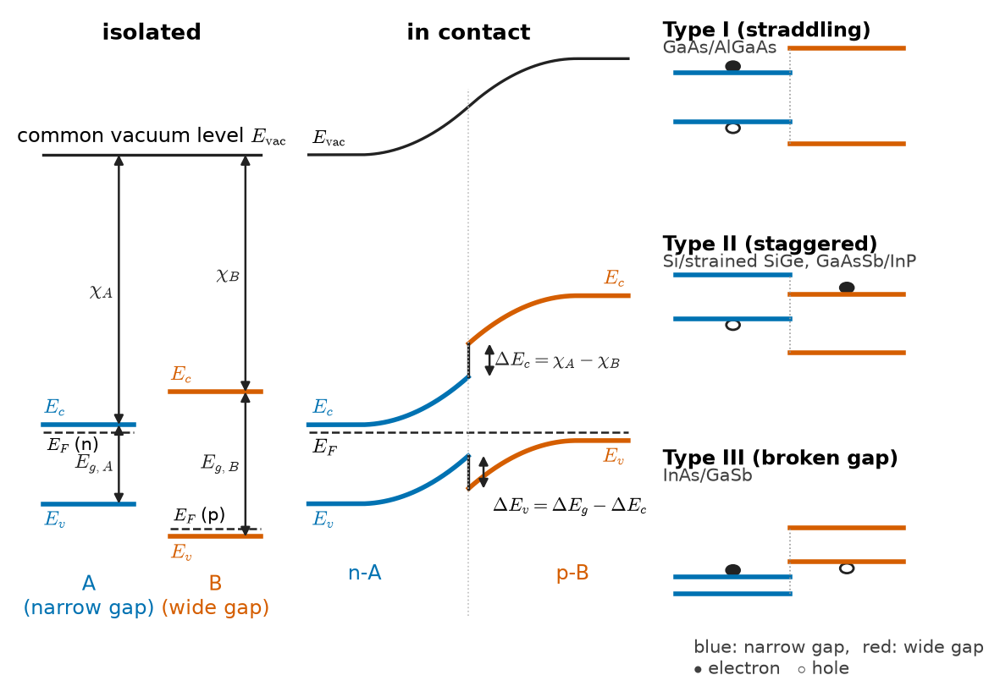
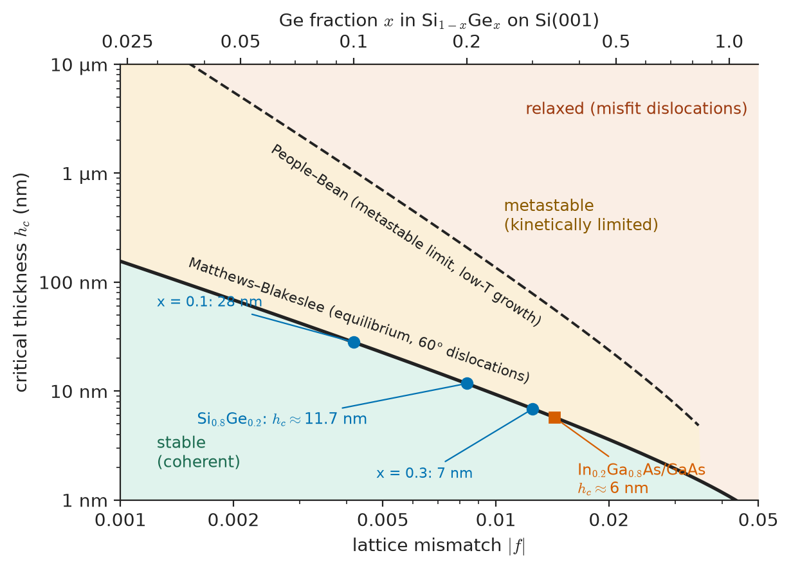
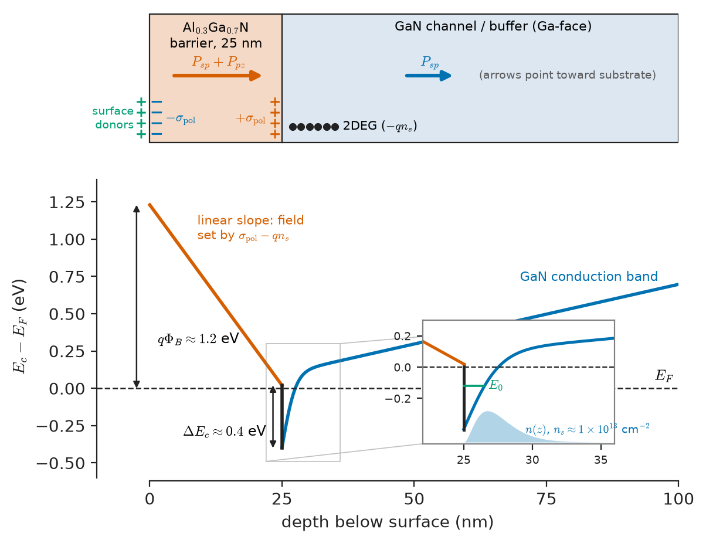
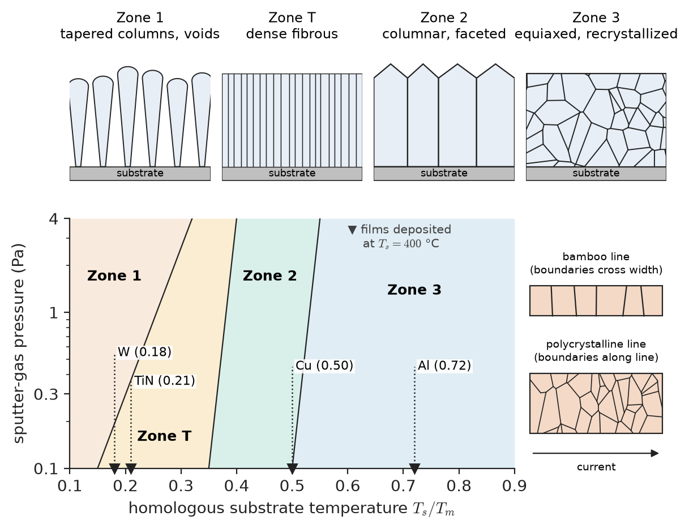
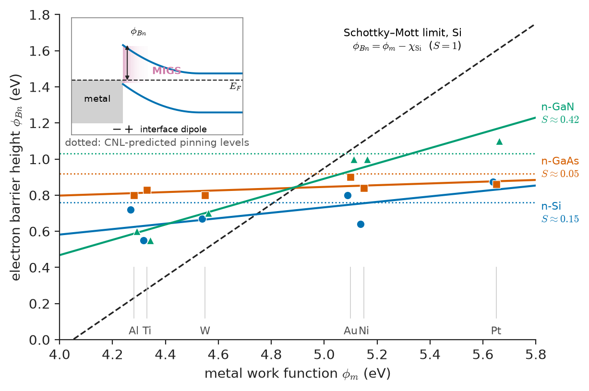
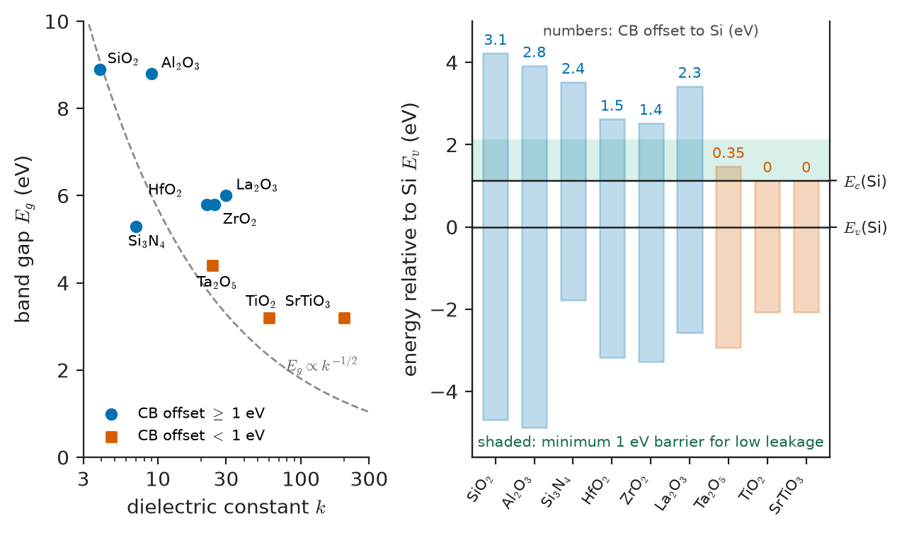

# Chapter 34 — Semiconductor Interfaces and Thin Films

*Part VII · Semiconductor and Photonic Materials*

Around 2005 the silicon industry hit a wall that had nothing to do with lithography. The gate insulator of a logic transistor, a film of silicon dioxide, had been thinned to about 1.2 nm, roughly five atomic layers. At that thickness electrons tunnel straight through it, and the gate leakage current density at 1 V reached the order of 10–100 A/cm². Multiplied over a billion transistors, this was the chip's whole power budget, spent on leakage. Thinning the oxide further was impossible, and keeping it thicker meant losing control of the channel. The fix was to change the material: hafnium-based oxides, with a permittivity five times that of SiO$_2$, deposited on a deliberately grown sub-nanometre SiO$_2$ layer and capped with a metal gate. Each part of that solution was an interface problem. Hafnia on bare silicon gives a poor interface, the metal's Fermi level is pinned by states at the high-k surface, and the new oxide traps charge in ways the old one never did.

A second example comes from the other end of the industry. Grow a 25 nm layer of AlGaN on GaN, with no dopant anywhere, and a sheet of about $10^{13}$ electrons per cm² appears at the interface, moving with a mobility near 2000 cm²/V s. That electron sheet is the channel of every GaN RF amplifier and power switch. Nothing in Chapter 32's doping theory predicts it. It comes from the crystal symmetry of the two materials and the discontinuity of their polarization at the interface.

In both cases the property that matters belongs to the boundary between two materials, not to either bulk material. This chapter treats interfaces and thin films as materials in their own right.

> **What decides how the bands of two semiconductors line up when they are joined, and why does the simple rule for it fail?**
> **How thick can a strained film grow before it relaxes by forming dislocations?**
> **Why does a metal on GaAs give almost the same barrier height whatever the metal?**
> **What does a thin film's stress, grain structure and interface trap density do to a device, and how is each measured and controlled?**

| Concept | Engineering destination |
|---|---|
| Band offsets, type I/II/III alignment | Quantum-well lasers, HEMTs, HBTs, infrared superlattices |
| Lattice mismatch, critical thickness | Strained-Si/SiGe channels, InGaAs wells, GaN-on-Si buffers |
| Polarization-induced 2DEG | GaN RF and power transistors |
| Surface states, Fermi-level pinning | Schottky barriers, GaAs MOS difficulty, passivation |
| Interface-trap density $D_{it}$ | Subthreshold swing, threshold stability, 1/f noise |
| Film stress, Stoney equation | Wafer bow, cracking, delamination, stress engineering of channels |
| Thin-film grain structure | Interconnect resistivity, electromigration, polysilicon resistors, gas sensors |
| Barrier height, specific contact resistivity | Ohmic contacts, Schottky diodes, contact resistance at small nodes |
| Gate-dielectric permittivity, band offsets, EOT | High-k/metal-gate CMOS, power MOSFET gates, memory |
| NBTI/PBTI, hot carriers, TDDB | Lifetime of transistors and gate stacks (failure analysis in Chapter 44) |

**Roadmap.** Joining two semiconductors (34.1) → how their bands align (34.2) → what happens at the interface: strain, dislocations and polarization charge (34.3) → the free surface and its states (34.4) → interface traps and their measure $D_{it}$ (34.5) → thin films as materials (34.6) → film stress and defects (34.7) → grain structure (34.8) → metal–semiconductor contacts (34.9) → gate dielectrics (34.10) → how interfaces wear out (34.11).

---

## 34.1 Semiconductor heterostructures

A *homojunction* joins two regions of the same semiconductor that differ only in doping, as in a silicon p–n junction. The band gap, electron affinity and permittivity are the same on both sides. A *heterojunction* joins two different semiconductors, for example GaAs and Al$_x$Ga$_{1-x}$As, or Si and Si$_{1-x}$Ge$_x$. A *heterostructure* is any stack containing one or more heterojunctions: a single interface, a quantum well (a thin narrow-gap layer between wider-gap layers), a superlattice (many alternating thin layers), or a graded layer.

The reason to build one is that a heterojunction gives the designer a second control alongside doping. Doping moves the Fermi level, so it moves both band edges together. A change of material moves the conduction-band edge and the valence-band edge *independently*, by amounts fixed by the two materials. This allows three things that doping alone cannot do:

1. **Carrier confinement.** A narrow-gap layer between wider-gap layers traps electrons and holes in the same thin region. The radiative rate is proportional to $np$ (Chapter 35), so confinement raises light emission efficiency. Every semiconductor laser since the 1970s depends on this.
2. **Separating carriers from their donors.** Electrons can be placed in an undoped layer next to a doped one. They are then free of ionized-impurity scattering (Chapter 32), which gives the high-mobility channel of the HEMT.
3. **Different barriers for electrons and holes.** In a heterojunction bipolar transistor, a wide-gap emitter blocks holes but not electrons, so the base can be heavily doped without losing gain.

The rest of Part VII's device physics (how a HEMT or an HBT works as a circuit element) belongs to Electronics & Computing. This chapter asks the materials questions behind the devices: how much do the band edges step, can the two crystals be joined without defects, and what charge sits at the interface?

> **Boundary.** The operation of heterojunction devices (HEMT transfer characteristics, HBT gain, laser threshold conditions) is treated in Electronics & Computing. Here the subject is the interface itself: its band offsets, strain, defects and charge.

The materials that can be combined are limited mainly by lattice constant. Figure 35.2 in the next chapter maps band gap against lattice constant for the common semiconductors. Materials on a vertical line in that map, such as GaAs and AlAs ($a$ = 5.653 and 5.661 Å) or InP and In$_{0.53}$Ga$_{0.47}$As, can be grown on one another almost without strain. Pairs far apart in lattice constant need the strain management of Section 34.3.

---

## 34.2 Band alignment

### The question

When two semiconductors A and B meet, each brings its own band gap. The difference $\Delta E_g=E_{g,B}-E_{g,A}$ must be shared between a conduction-band discontinuity $\Delta E_c$ and a valence-band discontinuity $\Delta E_v$:

$$
\Delta E_g=\Delta E_c+\Delta E_v
$$

The split is the most important number for a heterojunction. It decides whether electrons, holes or both are confined, and how strongly. It is a property of the interface, set by how the electron states of the two crystals match up. Doping does not change it. Doping changes how the bands bend *away* from the interface, but the steps *at* the interface stay fixed (to a good approximation) once the two materials and the interface structure are chosen.

### Anderson's electron-affinity rule

The simplest argument is due to Anderson (1962). Each semiconductor has an *electron affinity* $\chi$, the energy needed to take an electron from the conduction-band minimum to the vacuum level just outside the surface. If both materials are referred to a common vacuum level, the conduction-band edges sit at $-\chi_A$ and $-\chi_B$, and the valence-band edges at $-(\chi_A+E_{g,A})$ and $-(\chi_B+E_{g,B})$. Then

$$
\Delta E_c=\chi_A-\chi_B,\qquad \Delta E_v=(\chi_B+E_{g,B})-(\chi_A+E_{g,A})
$$

Once the two crystals are in contact, their Fermi levels equalize by charge transfer across the junction. The bands bend over a depletion or accumulation width set by the doping, as in a p–n junction. But according to Anderson, the *steps* $\Delta E_c$ and $\Delta E_v$ at the interface keep their vacuum-referenced values. Figure 34.1 shows the construction.

<!-- FIGURE 34.1 | figures/ch34/fig-34-1-band-alignment-types.png | band-diagram | Band alignment at heterojunctions: Anderson's vacuum-level construction (left) and the three alignment types (right). | Content: Left panel — two isolated semiconductors A (narrow gap) and B (wide gap) with a common vacuum level at top; mark χ_A, χ_B, E_g,A, E_g,B, E_c and E_v for each; then the joined junction showing ΔE_c and ΔE_v as vertical steps at the interface with band bending on either side and a flat E_F. Right panel — three small flat-band sketches labelled "Type I (straddling): GaAs/AlGaAs", "Type II (staggered): Si/strained SiGe, GaAsSb/InP", "Type III (broken gap): InAs/GaSb", with the narrow-gap CB/VB edges in blue and wide-gap edges in red, electron and hole locations marked by filled and open circles. -->

*Figure 34.1 — Band alignment at heterojunctions: Anderson's vacuum-level construction (left) and the three alignment types (right).*

> **Status of the principle: Anderson's electron-affinity rule**
> *Approximate.* It assumes the vacuum-referenced band edges of each bulk crystal carry over unchanged to the interface. This ignores the interface dipole formed when the bonds across the interface redistribute charge. The rule typically gives offsets to within a few tenths of an eV, which is often comparable with the offset itself.

### Why it fails

Anderson's rule is a natural first guess. It fails because the electron affinity is a *surface* property. It is measured at a crystal–vacuum surface that has its own reconstruction, dangling bonds and surface dipole (Section 34.4), and these change $\chi$ by tenths of an eV depending on crystal face and preparation. At a heterojunction there is no vacuum. Bonds run across the interface instead, and their charge redistributes. The result is an *interface dipole*, a sheet of charge pairs only an ångström or two thick, which adds a step $\delta$ in electrostatic potential:

$$
\Delta E_c=\chi_A-\chi_B+\delta
$$

Anderson's rule is the special case $\delta=0$. Three observations show that $\delta$ is not small.

- **GaAs/AlAs.** The electron affinities are about 4.07 eV for GaAs and 3.5 eV for AlAs. AlAs has an indirect gap of 2.16 eV and a direct (Γ) gap near 3.0 eV, so the Γ-point gap difference is about 1.6 eV. The measured valence-band offset is about 0.5 eV, which gives a Γ-point $\Delta E_c\approx1.0$ eV. For the much-used Al$_{0.3}$Ga$_{0.7}$As/GaAs pair the accepted split is about 65:35 between conduction and valence band. In the early 1970s it was believed to be 85:15. That error was found only by careful optical measurement on quantum wells, and it changed laser and HEMT designs.
- **Ge/GaAs.** Ge and GaAs have almost the same lattice constant, so they would seem an ideal test pair. Anderson predicts a valence-band offset of about 0.8 eV, but measurements give 0.4–0.6 eV, depending on the crystal orientation of the interface and on how it was prepared. The dependence on orientation shows the cause directly. A (100) Ge/GaAs interface is *polar*: the Ga–Ge or As–Ge bonds across it carry a net charge, and how that charge is arranged sets $\delta$.
- **Common-anion rule.** A related early rule held that compounds sharing an anion (GaAs and AlAs both have As) should have nearly equal valence-band maxima, because the valence band is formed mostly from anion p orbitals. That predicts $\Delta E_v\approx0$ for GaAs/AlAs. The measured 0.5 eV refutes it, because cation d-orbitals and bond-length differences shift the valence band too.

The missing physics is that the electron states of the two crystals must match across the interface. The modern view, due mainly to Tersoff (1984), assigns each semiconductor a *charge-neutrality level* (CNL, also called the branch point). This is the energy in the gap at which the gap states created by the interface change from mostly valence-like (neutral when filled) to mostly conduction-like (neutral when empty). If the two CNLs were offset, charge would flow across the interface, and the resulting dipole would push them back into near-alignment. The screening is strong in semiconductors with high optical permittivity. To first order, the offset is therefore set by aligning the CNLs, not the vacuum levels. First-principles calculations, together with this picture, now predict offsets to about 0.1–0.2 eV.

A useful consequence is *transitivity*. If offsets are a property of each material's CNL, then for three materials

$$
\Delta E_v(A/B)+\Delta E_v(B/C)+\Delta E_v(C/A)\approx0
$$

Transitivity holds to about 0.1 eV for most non-polar, lattice-matched systems. It fails where interface-specific chemistry dominates, such as polar interfaces, interdiffusion and strained layers. In those cases the offset depends on the growth sequence (A on B versus B on A) and on the growth conditions.

> **Status of the principle: Charge-neutrality-level alignment and transitivity**
> *Approximate.* It holds when the interface dipole is set mainly by screening of gap states rather than by specific bonding. It works well for lattice-matched, non-polar interfaces and is weaker for polar, strained or intermixed ones.

### Type I, II and III alignments

The relative positions of the two gaps define three alignment types (Figure 34.1).

- **Type I (straddling).** The narrow gap lies wholly inside the wide gap, so electrons and holes are both confined in the narrow-gap material. Examples are GaAs/AlGaAs, InGaN/GaN and InGaAs/InP. This is the alignment needed for LEDs and lasers, where electrons and holes must recombine in the same place.
- **Type II (staggered).** Both band edges of one material are shifted the same way. Electrons collect on one side and holes on the other, so they are spatially separated. Recombination happens across the interface at an energy *smaller* than either band gap. Examples are Si/strained Si$_{1-x}$Ge$_x$ (holes in the SiGe, the offset mainly in the valence band) and GaAs$_{0.5}$Sb$_{0.5}$/InP. Type II is useful where long carrier lifetimes or separation of charge are wanted: InAs/GaSb-type superlattice infrared detectors, and charge separation in organic and perovskite solar absorbers.
- **Type III (broken gap).** The conduction-band minimum of one material lies *below* the valence-band maximum of the other. The classic case is InAs/GaSb, with an overlap of about 0.15 eV. Electrons move from the GaSb valence band into the InAs conduction band without any doping, so the interface is semimetallic. Broken-gap interfaces are used in tunnel field-effect transistors and in very-long-wavelength infrared superlattices, where the effective gap of the stack is set by layer thickness rather than by either material.

Table 34.1 collects representative offsets. Strained systems (SiGe on Si, InGaAs on GaAs) have offsets that depend on the strain as well as on composition. Strain splits the degenerate valence bands and shifts the conduction-band valleys (Chapter 31).

**Table 34.1 — Representative band offsets at heterojunctions (300 K; typical literature values, ±0.05–0.1 eV)**

| Heterojunction (narrow / wide) | $\Delta E_g$ (eV) | $\Delta E_c$ (eV) | $\Delta E_v$ (eV) | Type | Main use |
|---|---|---|---|---|---|
| GaAs / Al$_{0.3}$Ga$_{0.7}$As | 0.37 | 0.24 | 0.13 | I | Lasers, HEMTs, HBTs |
| In$_{0.53}$Ga$_{0.47}$As / InP | 0.60 | 0.25 | 0.35 | I | 1.55 µm detectors, InP HBTs |
| In$_{0.53}$Ga$_{0.47}$As / In$_{0.52}$Al$_{0.48}$As | 0.71 | 0.50 | 0.21 | I | InP HEMTs |
| GaN / Al$_{0.3}$Ga$_{0.7}$N | ≈0.6 | ≈0.4 | ≈0.2 | I | GaN HEMTs |
| In$_{0.15}$Ga$_{0.85}$N / GaN | ≈0.5 | ≈0.3 | ≈0.2 | I | Blue LEDs |
| Si / strained Si$_{0.7}$Ge$_{0.3}$ (on Si) | ≈0.2 | ≈0 | ≈0.2 | I–II (weak) | pMOS channels, SiGe HBTs |
| InAs / GaSb | — | — | overlap ≈ 0.15 | III | Tunnel FETs, IR superlattices |
| Si / SiO$_2$ | 7.9 | 3.1–3.2 | 4.5–4.7 | I | Gate dielectric (Section 34.10) |

The last row is also a heterojunction, between a semiconductor and an amorphous insulator. The same offset concepts govern gate dielectrics, and for them the offsets set the tunnelling leakage (Section 34.10).

---

## 34.3 Heterojunction interfaces: strain, mismatch and polarization

### Lattice mismatch

Two crystals of the same structure but different lattice constants cannot both keep their natural spacing across a coherent interface. The *lattice mismatch* of a film (f) grown on a substrate (s) is

$$
f=\frac{a_s-a_f}{a_f}
$$

where $a$ is the relaxed lattice constant. Some authors use $a_s$ in the denominator. The difference is second order for mismatches of a few percent. Silicon (5.431 Å) and germanium (5.658 Å) differ by 4.2%. GaAs (5.653 Å) and InAs (6.058 Å) differ by 7.2%. Wurtzite GaN ($a=3.189$ Å) on sapphire is mismatched by about 16% in magnitude (measured on the 30°-rotated in-plane lattice), and GaN on Si(111) by about 17%.

A thin film that is mismatched to its substrate can still grow *pseudomorphically*. Its in-plane lattice constant is forced to equal the substrate's, giving a biaxial strain $\varepsilon_\parallel=f$. Through the Poisson effect the film responds by changing its out-of-plane spacing in the opposite sense. For a cubic (001) film, with elastic constants $C_{11}$ and $C_{12}$,

$$
\varepsilon_\perp=-\frac{2C_{12}}{C_{11}}\,\varepsilon_\parallel
$$

so the cell becomes tetragonal. This distortion is what X-ray diffraction measures to find the strain (Chapter 52). The strain energy stored per unit interface area grows in proportion to film thickness $h$:

$$
\frac{E_{\rm strain}}{A}=M\,f^2\,h,\qquad M=\frac{E}{1-\nu}
$$

where $M$ is the biaxial modulus (Chapter 11). Once the stored energy is large enough, it becomes favourable to relieve it by introducing *misfit dislocations* at the interface. These are extra or missing half-planes whose Burgers-vector component in the interface plane takes up the mismatch (Chapter 5).

### Critical thickness: the Matthews–Blakeslee criterion

Matthews and Blakeslee (1974) set up a force balance on a dislocation already present in the substrate. Such a dislocation is a *threading* dislocation, which runs up through the growing film to its surface. Two forces act on the segment threading the film:

- the **misfit stress** pushes the segment sideways, which would lay down a length of misfit dislocation along the interface and relieve strain. This force grows with film thickness $h$;
- the **line tension** of the new misfit segment resists, because creating dislocation line costs energy. That energy grows only logarithmically with $h$.

The film is stable against relaxation while line tension wins. Equating the two gives the critical thickness $h_c$:

$$
h_c=\frac{b\,(1-\nu\cos^2\alpha)}{8\pi\,\lvert f\rvert\,(1+\nu)\cos\lambda}\left[\ln\!\left(\frac{h_c}{b}\right)+1\right]
$$

Here $b$ is the magnitude of the Burgers vector, $\nu$ is Poisson's ratio, $\alpha$ is the angle between the dislocation line and its Burgers vector, and $\lambda$ is the angle between the Burgers vector and the in-plane direction normal to the line. In diamond and zinc-blende (001) films the common misfit dislocations are 60° dislocations with $b=a/\sqrt2$, so that $\alpha=60°$ and $\cos\lambda=1/2$. The equation is implicit in $h_c$ and is solved by iteration. Because $h_c$ appears only inside a logarithm on the right, it scales roughly as $1/f$.

> **Status of the principle: Matthews–Blakeslee critical thickness**
> *Approximate.* It is derived from linear elasticity and an equilibrium force balance on an existing threading dislocation. It gives the thickness above which relaxation is *energetically favourable*. It assumes that dislocations are available and mobile, so it is a lower bound. Films grown at low temperature, where dislocation nucleation and glide are kinetically limited, can exceed it by a large factor in a *metastable* state (the People–Bean regime): several times at large mismatch, and more than an order of magnitude at small mismatch. Such films relax when heated later in processing.

**Worked example — Critical thickness of Si$_{0.8}$Ge$_{0.2}$ on Si(001).** By Vegard's law the relaxed lattice constant of the alloy is $a=5.431+0.2(5.658-5.431)=5.4764$ Å. The mismatch is $\lvert f\rvert=(5.4764-5.431)/5.431=8.36\times10^{-3}$. Take $b=a_{\rm Si}/\sqrt2=0.384$ nm and $\nu=0.28$. For 60° dislocations, $\cos^2\alpha=0.25$ and $\cos\lambda=0.5$. The prefactor is

$$
\frac{1-0.28\times0.25}{8\pi\times8.36\times10^{-3}\times1.28\times0.5}=\frac{0.930}{0.1345}=6.92
$$

so, with $y=h_c/b$, the equation becomes $y=6.92(\ln y+1)$. Iterating from $y=30$: $6.92(3.401+1)=30.45$, then $6.92(3.416+1)=30.56$, converging to $y\approx30.6$. Hence $h_c\approx30.6\times0.384\ \mathrm{nm}\approx11.7$ nm. Repeating the calculation gives $h_c\approx28$ nm at $x=0.1$ and $\approx7$ nm at $x=0.3$. The SiGe channel layers of strained-pMOS devices and the bases of SiGe HBTs (20–30% Ge, tens of nm thick) therefore usually sit *above* the equilibrium curve. They survive because they are grown at 500–650 °C and the later thermal budget is limited. This is a materials constraint on the process flow, and it is why a "metastable" label belongs on such a layer's specification.

For In$_{0.2}$Ga$_{0.8}$As on GaAs ($\lvert f\rvert=1.43\%$) the same formula gives $h_c\approx6$ nm. Strained InGaAs quantum wells in 980 nm pump lasers are about 6–10 nm thick, at or just beyond this limit.

Figure 34.2 plots $h_c$ against mismatch for both systems.

<!-- FIGURE 34.2 | figures/ch34/fig-34-2-critical-thickness.png | plot | Critical thickness versus lattice mismatch: Matthews–Blakeslee equilibrium curve and the metastable limit observed in low-temperature growth. | Content: log-log axes; x = mismatch |f| from 0.001 to 0.05 (with a second top axis giving Ge fraction x in Si1−xGex, 0.025–1.0); y = h_c from 1 nm to 10 µm. Solid line: Matthews–Blakeslee for 60° dislocations, b = 0.384 nm, ν = 0.28 (passing through ≈28 nm at f = 0.0042, ≈11.7 nm at f = 0.0084, ≈7 nm at f = 0.0125). Dashed line: People–Bean metastable limit roughly 5–10× higher at low f. Shaded regions labelled "stable", "metastable (kinetically limited)", "relaxed (misfit dislocations)". Mark worked-example point Si0.8Ge0.2 and point In0.2Ga0.8As/GaAs (≈6 nm at f = 0.0143). -->

*Figure 34.2 — Critical thickness versus lattice mismatch: Matthews–Blakeslee equilibrium curve and the metastable limit observed in low-temperature growth.*

### What relaxation leaves behind

Above $h_c$, misfit dislocations form at the interface. Their ends cannot terminate inside the crystal, so each misfit segment is joined to threading arms that run up through the film. Threading dislocations pass through the active layers above. In silicon they are recombination centres that degrade minority-carrier lifetime (Chapter 32). In GaAs lasers they grow into dark-line defects under optical pumping and kill the device within hours.

The engineering response is a set of *buffer* strategies:

- **Graded buffers.** Composition is ramped slowly, for example 10% Ge per µm, so that misfit dislocations are spread through the thickness and threading arms can glide out to the wafer edge. Relaxed SiGe "virtual substrates" made this way reach threading densities of about $10^5$–$10^6$ cm$^{-2}$.
- **Strain-compensated stacks.** Layers in alternating compression and tension keep the average strain near zero, so a superlattice can be thicker in total than $h_c$ for any one layer.
- **Heavily mismatched growth with defect filtering.** GaN on sapphire, SiC or Si is grown with nucleation layers (low-temperature GaN or AlN) and interlayers that bend and annihilate dislocations. Threading densities are still $10^8$–$10^9$ cm$^{-2}$, 4–5 orders of magnitude worse than in GaAs. Blue LEDs still work at these densities, a puzzle taken up in Chapter 35.
- **Thermal-mismatch control.** GaN on Si(111) is grown at about 1000 °C. On cooling, GaN (α ≈ 5.6×10$^{-6}$ K$^{-1}$) contracts more than Si (2.6×10$^{-6}$ K$^{-1}$), so the film goes into tension and cracks. AlGaN interlayers are built in to pre-compress it. Stress is the subject of Section 34.7.

### Polarization charge and the 2DEG at AlGaN/GaN

The wurtzite nitrides have no inversion symmetry along the $c$-axis. Each Ga–N bond along $c$ is a dipole, and the four bonds of a tetrahedron do not cancel exactly, because the real cell differs slightly from an ideal tetrahedron. The crystal therefore has a *spontaneous polarization* $P_{sp}$ even when unstrained. It is also piezoelectric, so strain adds a *piezoelectric polarization* $P_{pz}$ (Chapter 27 introduced the piezoelectric coefficients $e_{ij}$).

Inside a uniform crystal a constant polarization produces no charge. Wherever $P$ changes abruptly, however, a fixed sheet charge appears, as at the end faces of any polarized dielectric:

$$
\sigma_{\rm pol}=-\Delta P\cdot\hat n,\qquad \sigma_{\rm pol}=P_{\rm GaN}-P_{\rm AlGaN}\ \text{(Ga-face, AlGaN on top)}
$$

AlGaN has a larger spontaneous polarization than GaN. When it is grown thin on relaxed GaN it is under biaxial tension (its relaxed $a$ is smaller), and its piezoelectric polarization then adds to the spontaneous part. For metal-face (Ga-face) growth both components point toward the substrate. The net result is a *positive* fixed sheet charge at the AlGaN/GaN interface. Electrons are drawn to it and collect in the triangular potential well on the GaN side, where the conduction-band offset $\Delta E_c$ holds them. This is the two-dimensional electron gas (2DEG), shown in Figure 34.3.

> **Status of the principle: Polarization sheet charge $\sigma=-\Delta P\cdot\hat n$**
> *Derived.* It follows from Gauss's law applied to the bound-charge density $\rho_b=-\nabla\cdot P$. The physics is exact; the uncertainty lies in the input values of $P_{sp}$ and the piezoelectric constants, which are known only to about ±10–20%.

Where do the electrons come from? Not from dopants. The accepted source is *donor-like surface states* at the AlGaN free surface (Section 34.4). As the barrier thickens, the field in the AlGaN raises the surface states above the Fermi level. They then empty, and their electrons go to the interface. Below a critical barrier thickness (about 3–5 nm for $x=0.3$) no 2DEG forms. The 2DEG density is set by the polarization charge, the barrier thickness $d$, and the surface barrier $\Phi_B$:

$$
n_s\approx\frac{\sigma_{\rm pol}}{q}-\frac{\varepsilon_0\varepsilon_r}{q^2 d}\left(q\Phi_B+E_F-\Delta E_c\right)
$$

where $E_F$ is measured from the GaN conduction-band edge at the interface.

> **Status of the principle: 2DEG density from charge balance**
> *Approximate.* It treats the AlGaN as a capacitor with a uniform field and the surface as pinned at $\Phi_B$, and neglects the quantum-well subband structure. It predicts the trend with $x$ and $d$ well, and overestimates $n_s$ by 10–40%.

**Worked example — Sheet density of an Al$_{0.3}$Ga$_{0.7}$N/GaN 2DEG.** Use linear interpolation between GaN and AlN for all parameters:

- spontaneous polarization $P_{sp}$: −0.029 C/m² (GaN), −0.081 C/m² (AlN), giving $P_{sp}(x=0.3)=-0.0446$ C/m²;
- lattice constants 3.189 Å and 3.112 Å, so $a(0.3)=3.1659$ Å and the in-plane strain is $\varepsilon=(3.189-3.1659)/3.1659=7.30\times10^{-3}$ (tensile);
- piezoelectric and elastic constants at $x=0.3$: $e_{31}=-0.523$ C/m², $e_{33}=0.949$ C/m², $C_{13}=104.5$ GPa, $C_{33}=395.4$ GPa.

The piezoelectric part is

$$
P_{pz}=2\varepsilon\left(e_{31}-e_{33}\frac{C_{13}}{C_{33}}\right)=2(7.30\times10^{-3})(-0.523-0.251)=-0.0113\ \mathrm{C/m^2}
$$

The total AlGaN polarization is $-0.0559$ C/m², so $\sigma_{\rm pol}=\lvert-0.0559-(-0.029)\rvert=0.0269$ C/m². Dividing by $q$ gives $1.68\times10^{17}$ m$^{-2}$, or $1.68\times10^{13}$ cm$^{-2}$.

Now the charge-balance correction for $d=25$ nm and $\varepsilon_r=9.4$. The capacitance term is $\varepsilon_0\varepsilon_r/(qd)=8.854\times10^{-12}\times9.4/(1.602\times10^{-19}\times25\times10^{-9})=2.08\times10^{16}$ m$^{-2}$ V$^{-1}$, which is $2.08\times10^{12}$ cm$^{-2}$ V$^{-1}$. Take $\Phi_B\approx0.84+1.3x=1.23$ V and $E_F\approx0.2$ eV (the Fermi level above the GaN conduction-band edge at the interface, which must leave room for the first subband and its electrons). The gap of Al$_{0.3}$Ga$_{0.7}$N is about 4.02 eV (with a bowing parameter of 1 eV), so $\Delta E_c\approx0.7\times(4.02-3.42)=0.42$ eV. The bracket is $1.23+0.2-0.42=1.01$ V, and the correction is $2.1\times10^{12}$ cm$^{-2}$. Then

$$
n_s\approx1.68\times10^{13}-0.21\times10^{13}\approx1.5\times10^{13}\ \mathrm{cm^{-2}}
$$

Measured values for this structure are typically $(1.0\text{–}1.3)\times10^{13}$ cm$^{-2}$. The gap comes from partial strain relaxation, the non-linear (bowed) polarization of the alloy, and surface-state details. With a 2DEG mobility of 2000 cm²/V s and $n_s=1.0\times10^{13}$ cm$^{-2}$, the sheet resistance is $R_{sh}=1/(qn_s\mu)=1/(1.602\times10^{-19}\times10^{17}\times0.2)\approx310\ \Omega/\square$. No doped silicon layer of comparable thickness comes close, because its electrons would scatter off the ionized donors.

The materials consequences go further than the channel itself:

- **The surface sets the channel.** Because the electrons come from surface states, anything that changes the surface changes $n_s$. A dielectric passivation layer, adsorbed water, or charge trapped under the gate under high-voltage stress can all do so. The resulting reduction of drain current after a voltage pulse is called *current collapse* and is a surface-state and trap phenomenon. Silicon nitride passivation and field plates are its standard remedies.
- **Normally-on by nature.** The 2DEG is present at zero gate bias. Power switches need normally-off behaviour, which calls for materials changes: a p-GaN layer under the gate, a recessed barrier, or fluorine implantation.

<!-- FIGURE 34.3 | figures/ch34/fig-34-3-algan-gan-2deg.png | band-diagram | Polarization charges and the conduction band at a Ga-face AlGaN/GaN interface. | Content: Top strip — layer stack: surface (donor-like states, +), AlGaN barrier 25 nm, GaN channel/buffer; arrows for P_sp and P_pz in AlGaN (both pointing toward substrate, longer total) and P_sp in GaN (shorter); fixed sheet charges +σ_pol at the AlGaN/GaN interface and −σ_pol at the AlGaN surface. Bottom — conduction-band energy vs depth (0–100 nm): E_c high at surface (qΦ_B ≈ 1.2 eV above E_F), linear slope through AlGaN, step ΔE_c ≈ 0.4 eV at interface, triangular well dipping below E_F in GaN with first subband E_0 and shaded electron density n_s ≈ 1×10^13 cm−2; flat E_F dashed line. -->

*Figure 34.3 — Polarization charges and the conduction band at a Ga-face AlGaN/GaN interface.*

---

## 34.4 Surface states

### Why a surface has states in the gap

A semiconductor's band gap exists because every atom is bonded to its neighbours. In silicon each atom forms four sp³ bonds, and the bonding–antibonding splitting opens the gap (Chapter 31, and the Advanced Chemistry core for the bonding itself). Cut the crystal and the surface atoms lose neighbours. Each lost neighbour leaves a *dangling bond*: a half-filled orbital whose energy lies roughly midway between the bonding and antibonding levels, which is inside the gap. A (001) silicon surface has $2/a^2=6.8\times10^{14}$ atoms per cm², each with two dangling bonds when unreconstructed. That gives more than $10^{15}$ states per cm². For comparison, a bulk dopant density of $10^{17}$ cm$^{-3}$ corresponds to only about $10^{12}$ charges per cm² in an 80 nm depletion layer.

Real surfaces lower their energy by *reconstruction*. On Si(001), neighbouring surface atoms pair into dimers, which halves the dangling-bond count and pushes most surface states toward the band edges. On cleaved GaAs(110), the surface relaxes so that filled As states drop into the valence band and empty Ga states rise into the conduction band. That leaves the clean (110) gap almost free of states, a celebrated exception. In practice, almost every surface that a device actually sees (oxidized, contaminated, metallized or etched) has defect-related states spread through the gap. Historically these are classified as *intrinsic* surface states (Tamm and Shockley states, from the termination of the periodic potential) and *extrinsic* states (from adsorbates, vacancies, antisites and disorder). For an engineer the distinction matters less than their density and energy distribution.

### Charge neutrality and band bending at a surface

Each surface state is either donor-like (neutral when filled, positive when empty) or acceptor-like (neutral when empty, negative when filled). As in Section 34.2, the surface states have a *charge-neutrality level* $E_{CNL}$. If the Fermi level at the surface lies above $E_{CNL}$, the surface carries net negative charge. If it lies below, the charge is net positive.

Consider an n-type semiconductor whose bulk Fermi level lies near $E_c$, well above $E_{CNL}$. Electrons move from the bulk into the surface states, which charges the surface negatively. That leaves a positive depletion region of ionized donors beneath it, and the bands bend upward toward the surface. Equilibrium is reached when

$$
Q_{ss}+Q_{sc}=0
$$

where $Q_{ss}$ is the surface-state charge and $Q_{sc}$ is the space charge in the semiconductor. The more surface states there are, the less the surface Fermi level has to move away from $E_{CNL}$ to supply the charge the bulk demands.

### Fermi-level pinning

*Fermi-level pinning* is the limit in which the surface-state density is so large that the surface Fermi level hardly moves from $E_{CNL}$, whatever the bulk doping or the metal deposited on top. The same pinning shows up at the metal–semiconductor contacts of Section 34.9 and at the high-k/metal-gate interfaces of Section 34.10.

**Worked example — How many states does it take to pin the Fermi level?** Take n-type silicon with $N_D=10^{17}$ cm$^{-3}$ and suppose the surface must accommodate a band bending of 0.5 V. The depletion width is

$$
W=\sqrt{\frac{2\varepsilon_s\psi_s}{qN_D}}=\sqrt{\frac{2\times11.7\times8.854\times10^{-12}\times0.5}{1.602\times10^{-19}\times10^{23}}}=80\ \mathrm{nm}
$$

and the space charge is $N_DW=10^{17}\times8.0\times10^{-6}=8.0\times10^{11}$ cm$^{-2}$. Surface states must hold the equal and opposite charge. If their density near $E_{CNL}$ is $D_{ss}=10^{14}$ cm$^{-2}$ eV$^{-1}$, they can absorb $8\times10^{11}$ cm$^{-2}$ with a Fermi-level shift of only $8\times10^{11}/10^{14}=8$ meV. The surface Fermi level is effectively locked to $E_{CNL}$. Changing the bulk doping by a factor of ten would barely move it. If instead $D_{ss}=10^{10}$ cm$^{-2}$ eV$^{-1}$ (well-passivated Si/SiO$_2$), the same charge would need an 80 eV shift, which is impossible. The surface is then free, and the band bending is controlled by the gate or bulk, as a MOSFET requires.

The rough dividing line, for typical doping, is

- $D_{ss}\gtrsim10^{13}$ cm$^{-2}$ eV$^{-1}$: strongly pinned;
- $D_{ss}\lesssim10^{11}$ cm$^{-2}$ eV$^{-1}$: essentially unpinned.

The difference between silicon and the III–V semiconductors largely comes down to which side of this line their oxidized surfaces fall on:

- **Si/SiO$_2$.** The thermally grown interface, annealed in hydrogen, has $D_{it}\approx10^{10}$ cm$^{-2}$ eV$^{-1}$ near midgap. This was the single fact that made the silicon MOSFET possible in the 1960s, and it was won by materials processing, not device design.
- **GaAs native oxides.** The surface Fermi level of oxidized GaAs is pinned about 0.7–0.8 eV below $E_c$, near midgap, by states associated with As antisites, As–As bonds and Ga oxides. This is why a GaAs MOSFET with a native oxide never worked, and why GaAs electronics used MESFETs and HEMTs (Schottky gates) instead. Atomic-layer-deposited Al$_2$O$_3$ and HfO$_2$ on carefully cleaned InGaAs now reach $D_{it}\approx10^{11}$–$10^{12}$ cm$^{-2}$ eV$^{-1}$, enough for research-grade III–V MOSFETs.
- **GaN and SiC.** The SiC/SiO$_2$ interface has $D_{it}$ rising to above $10^{12}$–$10^{13}$ cm$^{-2}$ eV$^{-1}$ near the conduction band of 4H-SiC. The causes are carbon clusters and near-interface oxide traps. These states trap channel electrons and limit the inversion mobility of SiC MOSFETs to about 20–50 cm²/V s, far below the bulk 950 cm²/V s. Nitridation anneals (NO, N$_2$O) were the key improvement. The SiC MOSFET's channel resistance is thus an interface-materials problem.

### Passivation

*Passivation* means reducing the electrically active surface-state density chemically. The main routes are:

- **Hydrogen.** H atoms bond to dangling bonds and move the bonding and antibonding levels out of the gap. Forming-gas anneals (N$_2$ + 5–10% H$_2$ at about 400–450 °C) cut Si/SiO$_2$ $D_{it}$ by roughly two orders of magnitude.
- **Growing the right oxide.** Thermal SiO$_2$ grows *into* silicon, so the interface is always fresh and never exposed to air. That makes it smoother and cleaner than any deposited interface.
- **Wide-gap capping.** On solar cells, Al$_2$O$_3$ passivates p-type Si by combining chemical passivation with a built-in negative fixed charge of about $10^{12}$–$10^{13}$ cm$^{-2}$. The charge repels minority electrons from the surface (*field-effect passivation*). Silicon nitride carries positive charge and serves n-type surfaces. Surface recombination velocities below 10 cm/s are achieved. This is the materials basis of PERC and TOPCon cells (Chapter 40).

---

## 34.5 Interface traps

### Definition and the quantity $D_{it}$

At a semiconductor–insulator interface, the surface states of Section 34.4 are called *interface traps*. They are located at the interface itself and can exchange charge with the semiconductor quickly (in nanoseconds to milliseconds) as the band bending changes. Their density per unit area per unit energy is

$$
D_{it}(E)=\frac{1}{q}\frac{dQ_{it}}{dE}\qquad[\mathrm{cm^{-2}\,eV^{-1}}]
$$

They must be distinguished from three other kinds of charge in a gate stack, which have different origins and different remedies:

| Charge type | Symbol | Location | Origin | Exchanges charge with Si? |
|---|---|---|---|---|
| Interface traps | $D_{it}$, $Q_{it}$ | At the interface | Dangling bonds (P$_b$ centres), strained bonds | Yes, fast |
| Fixed oxide charge | $Q_f$ | Within ~2 nm of the interface | Incompletely oxidized Si, structural | No |
| Oxide trapped charge | $Q_{ot}$ | Throughout the oxide | Electrons or holes caught in bulk oxide traps (stress, radiation) | Slowly or not |
| Mobile ionic charge | $Q_m$ | Moves through oxide with field and temperature | Na$^+$, K$^+$ contamination | No (drifts) |

Traps located 1–3 nm into the oxide that *can* exchange charge with the silicon by tunnelling, slowly, are called *border traps*. They blur the line between $Q_{it}$ and $Q_{ot}$ and cause much of the low-frequency (1/f) noise of MOSFETs.

At the Si/SiO$_2$ interface the main interface trap is the **P$_b$ centre**: a silicon atom at the interface bonded to three silicon atoms and missing its oxygen neighbour, leaving one dangling bond. Its electron spin makes it visible in electron paramagnetic resonance, which is how it was identified. On (100) silicon there are two variants, P$_{b0}$ and P$_{b1}$. P$_b$ centres are amphoteric. Each gives two levels in the gap, roughly 0.3 eV above $E_v$ and 0.3 eV below $E_c$, and together they produce the U-shaped $D_{it}(E)$ seen by measurement. Representative values are listed in Table 34.2.

**Table 34.2 — Typical midgap interface-trap densities (cm$^{-2}$ eV$^{-1}$)**

| Interface | As-formed | After best passivation |
|---|---|---|
| Si(100)/thermal SiO$_2$ | $10^{11}$–$10^{12}$ | $\approx10^{10}$ (H$_2$ anneal) |
| Si(111)/thermal SiO$_2$ | ~3× higher than (100) | ~$3\times10^{10}$ |
| Si/SiO$_x$/HfO$_2$ (high-k stack) | $10^{11}$–$10^{12}$ | $\approx(1\text{–}5)\times10^{10}$ |
| 4H-SiC/SiO$_2$ (near $E_c$) | $>10^{13}$ | $\sim10^{12}$ (NO anneal) |
| In$_{0.53}$Ga$_{0.47}$As/Al$_2$O$_3$ | $10^{12}$–$10^{13}$ | $\sim10^{11}$–$10^{12}$ |
| GaAs/native oxide | $>10^{13}$ (pinned) | — |

The preference for (100) silicon in CMOS comes straight from this table. It has fewer interface bonds per unit area than (111), so fewer of them are strained or broken.

### What $D_{it}$ does to a device

Interface traps act as a capacitance $C_{it}=q^2D_{it}$ (per unit area, per unit voltage of surface potential) in parallel with the depletion capacitance. When the gate voltage changes, part of the induced charge goes into the traps instead of moving the surface potential. The swing in the subthreshold region (Electronics & Computing derives the device expression) becomes

$$
S=\ln(10)\,\frac{kT}{q}\left(1+\frac{C_{dep}+C_{it}}{C_{ox}}\right)
$$

As a materials estimate, take $D_{it}=10^{12}$ cm$^{-2}$ eV$^{-1}$, which gives $C_{it}=1.602\times10^{-19}\times10^{12}=1.6\times10^{-7}$ F/cm², or 0.16 µF/cm². A 2 nm SiO$_2$ gate has $C_{ox}=3.9\varepsilon_0/t=1.73$ µF/cm². Ignoring $C_{dep}$, the swing rises from 59.5 mV/decade to $59.5\times1.093=65$ mV/decade. At $D_{it}=10^{13}$ the factor would be 1.93 and the swing about 115 mV/decade. At $10^{10}$ the effect is negligible. That is the sense in which $10^{10}$ is "good enough" and $10^{12}$ is not.

Interface traps also:

- **scatter carriers**: charged traps reduce channel mobility by Coulomb scattering, the SiC MOSFET problem of Section 34.4;
- **shift threshold voltage** as they fill. Because their occupation depends on bias and history, this causes instability, the subject of Section 34.11;
- **cause recombination**: at a surface, traps near midgap give surface recombination velocity $s=\sigma v_{th}N_{it}$, the surface counterpart of SRH bulk recombination (Chapter 32). This matters for solar cells and image sensors.

### Measuring $D_{it}$

$D_{it}$ is measured electrically (Chapter 52 treats the instruments). The *high–low frequency C–V* method compares a 1 MHz capacitance curve, where traps cannot follow the signal, with a quasi-static one, where they can; the difference is $C_{it}$. The *conductance method* detects the energy lost as traps capture and emit carriers, as a peak in $G_p/\omega$ against frequency, and resolves densities down to about $10^{9}$ cm$^{-2}$ eV$^{-1}$. On small transistors, *charge pumping* cycles the gate between accumulation and inversion so that each trap captures an electron and then a hole every cycle, giving a substrate current $I_{cp}=qfAN_{it}$.

---

## 34.6 Thin-film properties

### Why thin films are different materials

Almost every functional layer in an integrated circuit, display, LED or solar cell is a thin film, from a few nanometres to a few micrometres thick: gate dielectrics, metal lines, barrier layers, transparent conductors, silicide contacts, polysilicon gates and epitaxial quantum wells. A thin film of a given composition generally does *not* have the bulk properties of that composition. Four structural features cause the difference.

1. **A large surface-to-volume ratio.** A 10 nm copper film has two interfaces only about 40 atomic layers apart. Electrons scatter at both. The *size effect* in resistivity (Fuchs–Sondheimer for surfaces, Mayadas–Shatzkes for grain boundaries) was treated in Chapter 25. It raises copper's resistivity from 1.7 µΩ cm in bulk to 3–5 µΩ cm in 20 nm lines, and it is a central problem of interconnect scaling.
2. **Non-equilibrium microstructure.** Films are deposited far from equilibrium, by atoms arriving one at a time at a surface usually below a third of the material's melting temperature (Chapter 49 treats deposition processes). They therefore contain vacancies, voids, small grains, metastable phases and trapped gas that a bulk sample would anneal away.
3. **Substrate constraint.** The film is bonded to a substrate thousands of times thicker. It cannot change its in-plane dimensions freely, so any change in its natural size produces stress (Section 34.7). Thermal expansion, densification, phase change and epitaxial mismatch are all examples.
4. **Texture.** Grains often share a preferred orientation, for example (111) in fcc metals or (002) in wurtzite ZnO and AlN. Properties that depend on direction, such as the piezoelectric coefficient of AlN in RF filters or electromigration resistance in copper, then depend on texture as well as on composition.

### Representative property shifts

**Table 34.3 — Bulk versus thin-film properties (typical; film values depend strongly on deposition)**

| Material | Property | Bulk | Thin film (typical) | Main cause |
|---|---|---|---|---|
| Cu | Resistivity (µΩ cm) | 1.68 | 2.2 (100 nm), 3–5 (20 nm lines) | Surface and grain-boundary scattering |
| W (CVD/PVD) | Resistivity (µΩ cm) | 5.3 | 8–15 (β-phase up to 100+) | Metastable β-W, impurities |
| SiO$_2$ (PECVD vs thermal) | Wet etch rate in HF (relative) | 1 (thermal) | 3–10 | Lower density, Si–H and Si–OH bonds |
| SiO$_2$ | Breakdown field (MV/cm) | — | 10–14 (thermal), 5–8 (PECVD) | Defects, density |
| Si$_3$N$_4$ (LPCVD vs PECVD) | Stress (MPa) | — | +1000 to +1200 (LPCVD); −300 to +300 (PECVD, tunable) | Hydrogen content, ion bombardment |
| ITO | Resistivity (Ω cm) | — | $(1\text{–}3)\times10^{-4}$ | O vacancies and Sn donors; grain structure |
| AlN (sputtered, c-axis) | $d_{33}$ (pm/V) | 5.5 | 3–5.5 | Texture quality (rocking-curve width) |
| Al (pure) | Yield strength (MPa) | 10–35 (annealed) | 150–400 | Hall–Petch, small grains, substrate constraint |

The last row is a general rule. Thin metal films are much stronger than bulk metal of the same composition because dislocations are confined by the film thickness and by small grains. This "smaller is stronger" behaviour is why films can sustain the large stresses of Section 34.7 without yielding.

---

## 34.7 Film stress and defects

### Origins of stress

The total stress in a film is usually written as

$$
\sigma_{\rm total}=\sigma_{\rm th}+\sigma_{\rm int}+\sigma_{\rm ext}
$$

Each term has a distinct origin.

**Thermal stress** arises because the film is deposited or annealed at temperature $T_d$, and on cooling it would contract by a different amount from the substrate. For a thin film on a thick substrate,

$$
\sigma_{\rm th}=\frac{E_f}{1-\nu_f}\,(\alpha_s-\alpha_f)\,(T_d-T)
$$

A film with larger expansion coefficient than the substrate ends up in tension at room temperature (Chapter 24).

> **Status of the principle: Thermal-mismatch stress**
> *Approximate.* It assumes linear elasticity, temperature-independent $\alpha$ and $E$, a film much thinner than the substrate, and no stress relaxation (yielding, creep, cracking) during cooling. Metal films often violate the last assumption.

**Worked example — Aluminium on silicon.** An aluminium interconnect film is annealed at 400 °C and cooled to 25 °C. With $E_f=70$ GPa, $\nu_f=0.35$, $\alpha_f=23.1\times10^{-6}$ K$^{-1}$ and $\alpha_s=2.6\times10^{-6}$ K$^{-1}$:

$$
\sigma_{\rm th}=\frac{70\ \mathrm{GPa}}{0.65}\times(20.5\times10^{-6}\ \mathrm{K^{-1}})\times375\ \mathrm{K}=107.7\ \mathrm{GPa}\times7.69\times10^{-3}=828\ \mathrm{MPa}
$$

That is tensile and exceeds even a thin-film yield strength of 200–400 MPa. The film therefore yields plastically on cooling and ends near its yield stress. On reheating it goes into compression and relieves the stress by pushing material up through grain boundaries as *hillocks*, which can short to the level above. Under tension and current, voids form instead. Copper (α = 16.5×10$^{-6}$ K$^{-1}$) halves the mismatch, one of several materials reasons for the switch to copper (Chapter 51 and Chapter 44 continue the story).

**Intrinsic (growth) stress** develops during deposition itself:

- **Tensile intrinsic stress** comes from grain-boundary "zipping". As neighbouring islands touch, they snap together to remove surface energy, stretching the film. Vacancy annihilation and densification after growth add to it. This dominates in evaporated films and films grown at low adatom mobility.
- **Compressive intrinsic stress** comes from energetic particle bombardment in sputtering and PECVD. Ions and fast neutrals hammer atoms into interstitial positions (*atomic peening*), and noble gas (Ar) is trapped. Raising the sputter pressure scatters the arriving atoms and reduces their energy, so stress can be tuned from compressive to tensile. This is the standard knob.
- **Chemical and phase changes**: the loss of hydrogen from PECVD nitride on annealing, crystallization of amorphous films, and silicide formation. Silicidation consumes silicon and changes volume, giving GPa-level stress.

**Epitaxial (coherency) stress** is the mismatch strain of Section 34.3, $\sigma=Mf$. For the Si$_{0.8}$Ge$_{0.2}$ example, $M\approx180$ GPa and $f=0.84\%$, giving about 1.5 GPa of compression, sustained without plasticity because the layer is below $h_c$.

### Measuring stress: the Stoney equation

Stress in a film cannot be measured directly. Its effect on the substrate can. A film in tension tries to shrink and curls the wafer so that the film side becomes concave. A film in compression makes the film side convex. Stoney (1909) related the change in curvature to the film stress for a thin film on a thick plate:

$$
\sigma_f=\frac{E_s}{1-\nu_s}\,\frac{h_s^2}{6\,h_f}\left(\frac{1}{R}-\frac{1}{R_0}\right)
$$

Here $h_s$ and $h_f$ are the substrate and film thicknesses, $E_s/(1-\nu_s)$ is the substrate's biaxial modulus, and $R_0$ and $R$ are the radii of curvature before and after deposition. The film's elastic constants do not appear, which is the equation's great practical virtue. The film can be anything (amorphous, textured, unknown), and only the substrate needs to be characterized.

> **Status of the principle: Stoney equation**
> *Approximate.* It is derived from plate bending for a film much thinner than the substrate ($h_f/h_s\lesssim0.01$; the error is a few percent at $h_f/h_s\approx0.05$), uniform equibiaxial stress, an isotropic and homogeneous substrate, and deflections much smaller than the substrate thickness. Corrections exist for thick films and anisotropic substrates. For (001) silicon the biaxial modulus is isotropic in the plane and equals 180.5 GPa.

The curvature is measured by scanning a laser across the wafer and tracking the reflected spot angle, or by interferometry. Measuring before and after deposition removes the wafer's initial bow ($R_0$).

**Worked example — Stress in a PECVD silicon nitride film.** A 200 mm Si(001) wafer, 725 µm thick, is flat before deposition ($1/R_0=0$). After 400 nm of PECVD silicon nitride is deposited, the wafer bows convex on the film side with $R=150$ m. Then

$$
\sigma_f=\frac{180.5\times10^{9}\times(725\times10^{-6})^2}{6\times400\times10^{-9}\times150}=\frac{9.49\times10^{4}}{3.60\times10^{-4}}\ \mathrm{Pa}=2.64\times10^{8}\ \mathrm{Pa}
$$

The stress is about 264 MPa, compressive because the curvature is convex. The centre-to-edge bow over the 100 mm radius is $\delta=r^2/2R=(0.1)^2/300=33$ µm. That is large enough to trouble lithographic focus and wafer handling, which is why stress specifications for each layer exist. The film force per unit width, $\sigma_fh_f=106$ N/m, is the quantity that adds layer by layer. A stack of compressive and tensile films can be balanced to a flat wafer, a routine part of MEMS and backside-power process design.

Strain is not always a nuisance. Since the 90 nm node, CMOS has *deliberately* stressed the channel to raise mobility. Tensile nitride liners stretch nMOS channels, and embedded SiGe source/drain regions compress pMOS channels. Strain changes the band structure, splitting valleys and reducing the hole effective mass along the channel (Chapter 31), and can raise hole mobility by 50% or more. The materials property exploited is piezoresistance, the same effect used in silicon strain gauges (Chapter 35).

### Film defects

Beyond stress, thin films carry characteristic defects. Each has a structural origin and an electrical consequence.

- **Pinholes** are through-thickness holes from particles or incomplete coalescence. In dielectrics they cause shorts and early breakdown. Their density scales roughly with deposited area and inversely with thickness.
- **Voids and porosity** occur in low-mobility growth (Section 34.8). They raise resistivity, take up moisture (dielectric constant and leakage rise), and act as nucleation sites for electromigration voids.
- **Hillocks and whiskers** are compressive-stress relief by diffusion of material to the surface. Tin whiskers from pure-Sn finishes are the notorious packaging case (Chapter 51).
- **Cracking and delamination.** A tensile film cracks when its stored elastic energy per unit area, $\sigma^2h_f(1-\nu_f)/E_f$ up to a geometry factor, exceeds the fracture energy $\Gamma$ (Chapter 14). This sets a *critical cracking thickness* $h\propto E_f\Gamma/\sigma^2$, the fracture counterpart of Matthews–Blakeslee. Compressive films buckle and delaminate in "telephone-cord" patterns if adhesion is weak. Adhesion layers (Ti, Cr, Ta) under noble metals exist for this reason.
- **Contamination and non-stoichiometry**: hydrogen in PECVD films, oxygen in sputtered metals, nitrogen or oxygen vacancies in oxide and nitride films. These directly set leakage, trap density and optical absorption.

---

## 34.8 Grain boundaries in thin films

### How film microstructure forms

Most films grow by *nucleation, island growth, coalescence and thickening*. Atoms land, diffuse a distance set by temperature and the binding energy to the surface, meet others to form nuclei, and the islands grow until they touch. What follows depends overwhelmingly on how far an arriving atom can move before it is buried, which scales with the *homologous temperature* $T_s/T_m$ (substrate temperature over melting temperature, both in kelvin). The empirical zone models of Movchan–Demchishin (1969, evaporated films) and Thornton (1974, sputtered films, which adds sputter-gas pressure as a second axis) summarize the structures. Figure 34.4 shows the zones.

- **Zone 1** ($T_s/T_m\lesssim0.3$): adatoms barely move, and shadowing by taller grains produces tapered columns separated by voids. The films are porous and under tensile stress, with high resistivity and poor barrier properties. Sputtered at high pressure, even refractory metals look like this.
- **Zone T** (transition, sputtering only, at low pressure and $T_s/T_m\approx0.2$–$0.4$): ion bombardment densifies the film into fine fibrous grains with dense boundaries. Most sputtered barrier and electrode films (TiN, TaN, Mo) are deliberately in Zone T.
- **Zone 2** ($0.3\lesssim T_s/T_m\lesssim0.5$): surface diffusion is active, giving dense columnar grains whose width grows with $T_s$ and spans the film thickness. Grain boundaries run perpendicular to the substrate, along the current path in a vertical device but across the current path in a lateral line.
- **Zone 3** ($T_s/T_m\gtrsim0.5$): bulk diffusion and recrystallization give equiaxed grains approaching bulk microstructure.

Melting temperatures put common EEE films into very different zones at the same substrate temperature. At 400 °C (673 K), aluminium ($T_m=933$ K) is at 0.72 (Zone 3), copper (1358 K) at 0.50, tungsten (3695 K) at 0.18 (Zone 1/T), and TiN (3203 K) at 0.21.

> **Status of the principle: Structure-zone model**
> *Empirical.* It is a classification of observed microstructures by homologous temperature and, for sputtering, gas pressure and ion energy. The zone boundaries are approximate (±0.05–0.1 in $T_s/T_m$) and shift with deposition rate and impurities, but the scaling with $T_s/T_m$ reflects real diffusion-controlled kinetics.

<!-- FIGURE 34.4 | figures/ch34/fig-34-4-structure-zone-model.png | schematic | Structure-zone model of thin-film growth: microstructure versus homologous substrate temperature. | Content: Horizontal axis T_s/T_m from 0.1 to 0.9; vertical axis (Thornton version) sputter-gas pressure 0.1–4 Pa (back). Four cross-sectional sketches across the axis: Zone 1 (tapered columns with voids, domed tops), Zone T (dense fibrous grains, smooth top), Zone 2 (wide columnar grains spanning thickness, faceted top), Zone 3 (equiaxed recrystallized grains). Annotate typical examples at 400 °C: W and TiN (≈0.2), Cu (0.50), Al (0.72). Small inset: bamboo-structure interconnect line (grain boundaries crossing the line width) vs polycrystalline line (boundaries along the line). -->

*Figure 34.4 — Structure-zone model of thin-film growth: microstructure versus homologous substrate temperature.*

### Grain boundaries as electrical and transport features

Grain boundaries in thin films matter for three reasons, each continuing threads from Chapters 5 and 25.

**1. They scatter electrons.** In metal lines whose grain size is comparable with the electron mean free path (39 nm in Cu at 300 K), grain-boundary reflection adds a resistivity term that grows as the grain size $D$ shrinks (Mayadas–Shatzkes, Chapter 25). Copper interconnects are electroplated with small grains, then *self-anneal* at room temperature over hours to days, or are annealed at 100–400 °C, to grow large grains and lower resistivity by 10–20%.

**2. They are fast diffusion paths.** Atomic diffusion along grain boundaries has an activation energy roughly half that of lattice diffusion. In thin films this has two consequences:

- **Barrier failure.** Copper diffuses through grain boundaries in a columnar barrier film into the silicon, where it is a deep-level lifetime killer. Barriers are therefore made amorphous or nanocrystalline (TaN, TiN, Ta/TaN bilayers) so that no continuous straight boundary path crosses them.
- **Electromigration.** Under current, metal atoms drift along boundaries. When the grain size exceeds the line width, the boundaries run *across* the line in a *bamboo structure*, and no continuous boundary path runs along the line. Electromigration lifetime rises dramatically. Chapter 44 develops the failure model (Black's equation).

**3. They trap charge in semiconductors.** In polycrystalline silicon, oxide semiconductors and polycrystalline absorbers, the grain boundary carries a sheet of trap states, like a surface (Section 34.4) shared between two grains. Carriers trapped there leave depletion regions on both sides, raising a potential barrier $V_B$ at the boundary. In the simplest (Seto) model, for grain size $L$ and doping $N$, while the traps are not yet full:

$$
V_B=\frac{qNL^2}{8\varepsilon_s}
$$

For poly-Si with $L=100$ nm and $N=10^{17}$ cm$^{-3}$: $V_B=1.602\times10^{-19}\times10^{23}\times(10^{-7})^2/(8\times1.036\times10^{-10})=0.19$ V, about $7.5\,kT/q$. Current across each boundary must surmount it, so the effective mobility is reduced by roughly $e^{-7.5}\approx5\times10^{-4}$ relative to single crystal. Once $NL$ exceeds the trap sheet density $N_t$ (typically $10^{12}$–$10^{13}$ cm$^{-2}$), the traps fill and the barrier falls as $V_B=qN_t^2/(8\varepsilon_sN)$. This makes the resistivity of poly-Si a steep, non-monotonic function of doping, which is how poly-Si resistors are given a near-zero temperature coefficient by choosing the doping where the two effects balance.

> **Status of the principle: Seto grain-boundary barrier model**
> *Approximate.* It assumes a single trap level, uniform grain size, abrupt depletion and thermionic transport over the barrier. It captures the order of magnitude and the resistivity peak against doping, but real boundaries have a distribution of trap energies.

The same barrier physics is the working principle of metal-oxide gas sensors, where adsorbed oxygen at grain surfaces sets the barrier (Chapter 35), and it is one reason polycrystalline thin-film solar absorbers need grain-boundary passivation (CdCl$_2$ treatment of CdTe, Chapter 40).

---

## 34.9 Contact interfaces

### The problem

Every semiconductor device must eventually pass its current into a metal. The metal–semiconductor interface can behave as a rectifying diode (*Schottky contact*) or as a near-linear low-resistance path (*ohmic contact*). Which one appears, and how good it is, is decided by materials: the barrier height at the interface and the doping beneath it. At advanced CMOS nodes the source/drain contact resistance has become one of the largest resistances in the transistor. Contact engineering is now as much a materials problem as interconnect engineering.

### Barrier height: the Schottky–Mott rule

The Schottky–Mott picture is Anderson's rule applied to a metal. A metal of work function $\phi_m$ placed against an n-type semiconductor of electron affinity $\chi$ should form an electron barrier

$$
\phi_{Bn}=\phi_m-\chi
$$

and, for a p-type semiconductor, a hole barrier $\phi_{Bp}=E_g/q-(\phi_m-\chi)$, so that $\phi_{Bn}+\phi_{Bp}=E_g/q$. A metal with a large work function (Pt, 5.65 eV) on n-Si ($\chi=4.05$ eV) should give a 1.6 eV barrier. A low-work-function metal (Al, 4.28 eV) should give 0.23 eV. In practice the barrier heights on n-Si span only about 0.5–0.9 eV, and on n-GaAs nearly *every* metal gives 0.7–0.9 eV.

> **Status of the principle: Schottky–Mott rule**
> *Approximate.* It ignores the interface dipole and the interface states. It is followed closely only by very ionic semiconductors and insulators (SiO$_2$, ZnS, and to a degree GaN and SiC), and fails for covalent semiconductors such as Si, Ge and GaAs, where Fermi-level pinning dominates.

### Fermi-level pinning at contacts

The barrier is pinned for the same reasons as at a free surface (Section 34.4), with one added mechanism. The metal's conduction-electron wavefunctions decay into the semiconductor gap over a few ångströms, creating **metal-induced gap states** (MIGS) even at a perfect, defect-free interface. These states have a charge-neutrality level, as before. If the metal Fermi level lies away from $E_{CNL}$, charge flows into the MIGS and the resulting dipole pulls the barrier back toward the CNL value. Defects created by the metallization itself (vacancies, antisites, interfacial reaction products) add further pinning.

The degree of pinning is expressed by the slope parameter

$$
S=\frac{d\phi_{Bn}}{d\phi_m}
$$

$S=1$ is the Schottky–Mott limit (no pinning) and $S=0$ is complete pinning. A phenomenological model gives

$$
\phi_{Bn}=S(\phi_m-\chi)+(1-S)\left(E_g/q-\phi_{CNL}\right)
$$

with $\phi_{CNL}$ the CNL measured from the valence band. An empirical correlation (Kurtin, McGill and Mead, 1969; refined by Mönch and by Robertson) links $S$ to the semiconductor's optical permittivity $\varepsilon_\infty$, through $S\approx1/[1+0.1(\varepsilon_\infty-1)^2]$. Covalent semiconductors with large $\varepsilon_\infty$ screen strongly and are strongly pinned. Figure 34.5 plots measured barrier heights against metal work function.

> **Status of the principle: Pinning factor $S$ and its correlation with $\varepsilon_\infty$**
> *Empirical.* It is fitted to barrier-height data across many semiconductors. It captures the trend from ionic to covalent materials within about ±0.1 in $S$, but individual contacts depend on interface chemistry and processing.

**Table 34.4 — Representative Schottky barrier heights (eV, electron barrier on n-type unless noted; ±0.05–0.1 depending on preparation)**

| Metal / silicide | $\phi_m$ (eV) | n-Si | n-GaAs | n-GaN | n-4H-SiC |
|---|---|---|---|---|---|
| Al | 4.28 | 0.72 | 0.80 | ≈0.6 | — |
| Ti | 4.33 | 0.50–0.60 | 0.83 | ≈0.5–0.6 | 0.8–1.1 |
| W | 4.55 | 0.67 | 0.80 | ≈0.7 | — |
| Ni | 5.15 | 0.61–0.67 | 0.84 | 0.9–1.1 | 1.3–1.6 |
| Au | 5.1 | 0.80 | 0.90 | 0.9–1.1 | 1.6–1.8 |
| Pt | 5.65 | 0.85–0.90 | 0.86 | 1.0–1.2 | ≈1.6 |
| NiSi | — | 0.65 | — | — | — |
| PtSi | — | 0.84 (0.24 on p-Si) | — | — | — |
| Slope $S$ (typical) | | 0.1–0.3 | ≈0.07 | 0.3–0.4 | ≈0.4–0.5 |

The barrier on n-GaAs varies by only 0.1 eV over a 1.4 eV range of $\phi_m$. GaAs is the textbook case of near-complete pinning. Wide-gap and more ionic materials (GaN, SiC) show larger $S$, so the metal matters more. That is why Ni and Pt are chosen for Schottky gates on GaN and for SiC power Schottky diodes, and Ti for low-barrier SiC contacts.

<!-- FIGURE 34.5 | figures/ch34/fig-34-5-barrier-vs-workfunction.png | plot | Schottky barrier height versus metal work function: Schottky–Mott limit and Fermi-level pinning in Si, GaAs and GaN. | Content: x = metal work function 4.0–5.8 eV; y = electron barrier height φ_Bn 0–1.8 eV. Dashed line slope 1: Schottky–Mott limit for Si (φ_m − 4.05). Data points with fitted lines: n-Si (Al, Ti, W, Ni, Au, Pt; slope ≈ 0.2), n-GaAs (Al, Ti, W, Ni, Au, Pt; nearly flat at 0.8–0.9 eV, slope ≈ 0.07), n-GaN (slope ≈ 0.35). Horizontal dotted lines marking the CNL-predicted pinning level for each semiconductor. Inset: interface band diagram showing MIGS decaying into the semiconductor and the dipole. -->

*Figure 34.5 — Schottky barrier height versus metal work function: Schottky–Mott limit and Fermi-level pinning in Si, GaAs and GaN.*

### Current transport and specific contact resistivity

A contact is characterized by its **specific contact resistivity** $\rho_c$ (units Ω cm²), defined at zero bias as

$$
\rho_c=\left(\frac{\partial J}{\partial V}\right)^{-1}_{V=0}
$$

It is an interface property independent of contact area. A contact of area $A$ has resistance $R_c=\rho_c/A$ when current flows uniformly through it. In practice current crowding at the leading edge of planar contacts is accounted for by a transfer length, and $\rho_c$ is extracted by the transmission-line method (TLM) described in Chapter 52. Which transport mechanism dominates depends on doping, through the characteristic tunnelling energy

$$
E_{00}=\frac{q\hbar}{2}\sqrt{\frac{N}{m^*\varepsilon_s}}
$$

There are three regimes.

- **Thermionic emission** ($kT\gg E_{00}$, lightly doped): electrons go *over* the barrier. From the thermionic current $J=A^{**}T^2e^{-q\phi_B/kT}(e^{qV/kT}-1)$,

$$
\rho_c=\frac{k}{qA^{**}T}\exp\!\left(\frac{q\phi_B}{kT}\right)
$$

where $A^{**}$ is the effective Richardson constant (≈112 A cm$^{-2}$ K$^{-2}$ for n-Si, 8 for n-GaAs, 26 for n-GaN).

> **Status of the principle: Thermionic-emission contact resistivity**
> *Derived.* It follows from thermionic emission over a barrier, with Maxwell–Boltzmann statistics and negligible tunnelling. It is valid for $N\lesssim10^{17}$ cm$^{-3}$ in Si. Image-force lowering and barrier inhomogeneity make measured $\rho_c$ smaller than predicted.

- **Thermionic-field emission** ($kT\approx E_{00}$): electrons are thermally excited part-way up and tunnel through the thinner top of the barrier.
- **Field emission** ($kT\ll E_{00}$, degenerate doping): electrons tunnel straight through a depletion region only a few nm thick. Then $\rho_c\propto\exp\left(q\phi_B/E_{00}\right)$, so $\ln\rho_c$ falls linearly with $\phi_B/\sqrt N$.

**Worked example — Why ohmic contacts need heavy doping.** For n-Si at 300 K with $\phi_B=0.7$ eV and $A^{**}=112$ A cm$^{-2}$ K$^{-2}$, the prefactor is $k/(qA^{**}T)=8.617\times10^{-5}/(112\times300)=2.56\times10^{-9}$ Ω cm². The exponential is $\exp(0.7/0.02585)=\exp(27.08)=5.8\times10^{11}$. So

$$
\rho_c\approx2.56\times10^{-9}\times5.8\times10^{11}\approx1.5\times10^{3}\ \Omega\,\mathrm{cm^2}
$$

A 1 µm² contact ($10^{-8}$ cm²) would have $R_c\approx1.5\times10^{11}$ Ω. It is a diode, not a contact. Lowering the barrier to 0.5 eV gives $\rho_c\approx0.64$ Ω cm², and to 0.2 eV gives $5.9\times10^{-6}$ Ω cm². Barrier reduction alone is not enough, and pinning stops it anyway. The practical route is doping. At $N=10^{20}$ cm$^{-3}$ in Si (with $m^*=0.26m_0$ for tunnelling), $E_{00}=0.106$ eV, four times $kT$. Field emission dominates and the depletion width is about 3 nm. Silicide contacts on such layers reach $\rho_c\approx10^{-8}$–$10^{-9}$ Ω cm². Even then, at a modern contact of 20 nm × 20 nm ($4\times10^{-12}$ cm²), $\rho_c=10^{-9}$ Ω cm² gives $R_c=250$ Ω, and $10^{-8}$ gives 2.5 kΩ, comparable with the whole channel resistance. Contacts for the next nodes target $\rho_c\le2\times10^{-9}$ Ω cm². The materials levers are dopant activation above solid solubility (laser anneal, in-situ doped epitaxy), thin interfacial dielectrics that de-pin the Fermi level (metal–insulator–semiconductor contacts), and low-barrier silicides.

### Ohmic contact recipes as materials systems

Real ohmic contacts are rarely a single metal on a semiconductor. They are *reacted* multilayer systems whose chemistry makes a good interface.

- **Si: silicides.** TiSi$_2$, then CoSi$_2$, then NiSi (and Ni(Pt)Si) were adopted in turn as linewidths shrank. Each change was made because the previous silicide's phase transformation (C49→C54 TiSi$_2$ needs large grains) or silicon consumption failed in narrow lines. NiSi forms at low temperature (400–600 °C), consumes the least silicon per unit thickness of silicide, and has a resistivity of 14–20 µΩ cm. It degrades to high-resistivity NiSi$_2$ above about 700 °C, so it sets a thermal-budget limit on everything after it.
- **n-GaAs: Au–Ge–Ni.** On alloying at about 400–450 °C, Ge diffuses in and dopes the surface heavily n-type (Ge on Ga sites), Ni promotes the reaction, and Au carries current. The result is a tunnelling contact with $\rho_c\approx10^{-6}$ Ω cm².
- **n-GaN: Ti/Al/Ni/Au.** On annealing at 800–900 °C, Ti extracts nitrogen to form TiN, leaving nitrogen vacancies (donors) in the GaN surface. The heavily doped surface becomes tunnelling-thin. Al and Ni/Au protect against oxidation. $\rho_c\approx10^{-5}$–$10^{-6}$ Ω cm².
- **p-GaN** is notoriously hard. The Mg acceptor is deep (≈0.17 eV), so few holes are free, and the valence band of GaN lies 7.5 eV below vacuum, deeper than any metal's work function. Oxidized Ni/Au, or a transparent ITO contact on a heavily doped p$^{++}$ cap, give $\rho_c\approx10^{-3}$–$10^{-4}$ Ω cm². Such contacts limit LED and laser efficiency (Chapter 35).

Contact degradation over time (interdiffusion, intermetallic growth, oxidation) is treated in Chapter 44. The resistance of contacts between metal parts (connectors, relays) was covered in Chapter 25.

---

## 34.10 Material properties of gate dielectrics

### What a gate dielectric has to do

A gate dielectric separates a conductor (the gate) from a semiconductor channel and couples them capacitively. The capacitance per unit area $C=\varepsilon_0k/t$ sets how much channel charge a given gate voltage induces. The device wants $C$ large. The material must also meet several other requirements:

1. **High permittivity $k$**, so that $C$ is large at a physical thickness $t$ thick enough to block tunnelling.
2. **Large band offsets** to the semiconductor, at least about 1 eV for *both* electrons and holes. These offsets are the tunnelling barriers (Table 34.1, last row).
3. **A wide band gap and low defect density**, so that leakage paths through traps are few.
4. **Thermodynamic stability against the semiconductor** at process temperatures, so that it does not react to form silicate or silicide, or reduce the semiconductor.
5. **A good interface**: low $D_{it}$ (Section 34.5), low fixed charge, and low carrier scattering, so that channel mobility is not degraded.
6. **High breakdown strength and reliability** over ten years at the operating field (Section 34.11).
7. **Compatibility with the gate metal**: no Fermi-level pinning or reaction at the top interface.

For forty years thermally grown SiO$_2$ met all of these. It has $k=3.9$, an 8.9 eV gap, a 3.1–3.2 eV conduction-band offset and a 4.5–4.7 eV valence-band offset to Si, a breakdown field of 10–15 MV/cm, and an interface of $D_{it}\approx10^{10}$ cm$^{-2}$ eV$^{-1}$. Its one weakness is the low $k$.

### Direct tunnelling and why SiO$_2$ ran out

For thin barriers, electrons tunnel directly. In the simplest rectangular-barrier (WKB) picture, the transmission probability is

$$
T\approx\exp(-2\kappa t),\qquad \kappa=\frac{\sqrt{2m^*_{ox}q\phi_B}}{\hbar}
$$

where $\phi_B$ is the barrier (the conduction-band offset for electrons) and $m^*_{ox}$ is the tunnelling effective mass in the oxide. For SiO$_2$ with $\phi_B=3.1$ eV and $m^*_{ox}\approx0.4m_0$, $\kappa=5.7$ nm$^{-1}$. Every 0.1 nm of thinning multiplies the transmission by $e^{1.14}\approx3.1$, so every 0.2 nm multiplies the leakage by about 10. This matches the observed tenfold rise in gate leakage per 0.2 nm reduction in oxide thickness. Below about 1.2 nm, leakage of order 10–100 A/cm² at 1 V made SiO$_2$ (and nitrided SiON, $k\approx5$–6) unusable for high-performance logic.

> **Status of the principle: Exponential tunnelling through a thin dielectric**
> *Approximate.* It is the WKB result for a rectangular barrier at low field. It neglects image-force rounding, the field-induced triangular barrier shape, and the band structure of the oxide (which makes $m^*_{ox}$ an effective fitting parameter). It is good for trends and ratios, not absolute currents.

### High-k dielectrics and the equivalent oxide thickness

The solution is a thicker film of higher permittivity. The *equivalent oxide thickness* (EOT) of a dielectric layer is the thickness of SiO$_2$ that would give the same capacitance:

$$
\mathrm{EOT}=t_{hk}\,\frac{k_{\rm SiO_2}}{k_{hk}}=t_{hk}\,\frac{3.9}{k_{hk}}
$$

and for a stack of layers in series, the EOTs add:

$$
\mathrm{EOT}_{\rm stack}=\sum_i t_i\,\frac{3.9}{k_i}
$$

> **Status of the principle: Equivalent oxide thickness**
> *Derived.* It follows from series addition of parallel-plate capacitances. It is exact as electrostatics. The measured "capacitance equivalent thickness" in inversion is larger by 0.3–0.4 nm, because of the quantum-mechanical displacement of the channel charge from the interface and polysilicon gate depletion. Metal gates remove the latter.

It might seem that the highest-k material wins. It does not, because *permittivity and band gap trade off*. A high $k$ comes from soft, highly polarizable bonds and low-frequency polar phonons (Chapter 26 and Chapter 27). The same chemistry tends to give a small gap and small band offsets. The rough empirical relation is $E_g\propto k^{-1/2}$ across oxides. Breakdown field also falls with $k$, roughly as $E_{bd}\propto k^{-1/2}$ (McPherson). Figure 34.6 and Table 34.5 show the compromise.

**Table 34.5 — Gate-dielectric candidates (typical values; offsets to Si)**

| Dielectric | $k$ | $E_g$ (eV) | CB offset to Si (eV) | VB offset to Si (eV) | Stable on Si? | Comment |
|---|---|---|---|---|---|---|
| SiO$_2$ | 3.9 | 8.9 | 3.1–3.2 | 4.5–4.7 | Yes | Reference; best interface |
| Si$_3$N$_4$ | 7 | 5.3 | 2.4 | 1.8 | Yes | Traps; used as SiON |
| Al$_2$O$_3$ | 9 | 8.8 | 2.8 | 4.9 | Yes | ALD workhorse; III–V and GaN gates |
| HfO$_2$ | 20–25 | 5.7–5.9 | 1.4–2.0 | 2.6–3.4 | Yes (with SiO$_x$ IL) | Industry choice since 45 nm node |
| HfSiON | 12–15 | 6–7 | ≈1.8 | ≈3 | Yes | Amorphous to higher T |
| ZrO$_2$ | 25 | 5.8 | 1.4 | 3.3 | Marginal (silicide) | DRAM capacitors (ZrO$_2$/Al$_2$O$_3$/ZrO$_2$) |
| La$_2$O$_3$ | 30 | 6.0 | 2.3 | 2.6 | Hygroscopic | Used as thin cap for $V_t$ tuning |
| Ta$_2$O$_5$ | 22–26 | 4.4 | 0.3–0.4 | 3.0 | No | Offset too small |
| TiO$_2$ | 50–80 | 3.0–3.5 | ≈0 | ≈2 | No | No electron barrier |
| SrTiO$_3$ | ~150–300 | 3.2 | ≈0 | ≈2 | No | Paraelectric; DRAM research |

HfO$_2$ was selected because it combines $k\approx20$–25 with conduction- and valence-band offsets above about 1.4 eV. Hafnium also forms an oxide much more stable than SiO$_2$, so HfO$_2$ does not reduce the interfacial oxide. Ta$_2$O$_5$, TiO$_2$ and SrTiO$_3$ have high $k$ but almost no electron barrier, so electrons would leak over or through them by Schottky emission. They are excluded from gate use, though suited to capacitor dielectrics with suitable electrodes (Chapter 27).

<!-- FIGURE 34.6 | figures/ch34/fig-34-6-highk-band-offsets.png | plot | Band gap versus permittivity for gate-dielectric candidates, with band offsets to silicon. | Content: Left panel — scatter plot, x = dielectric constant k on log scale 3–300, y = band gap 0–10 eV; points labelled SiO2 (3.9, 8.9), Al2O3 (9, 8.8), Si3N4 (7, 5.3), HfO2 (22, 5.8), ZrO2 (25, 5.8), La2O3 (30, 6.0), Ta2O5 (24, 4.4), TiO2 (60, 3.2), SrTiO3 (200, 3.2); dashed guide line E_g ∝ k^−1/2. Right panel — band-offset bar chart relative to Si (Si gap 1.12 eV shown in centre, E_c and E_v of Si as horizontal lines): for each dielectric a vertical bar from its VB to its CB, with CB offset numbers (3.1, 2.8, 2.4, 1.5, 1.4, 2.3, 0.35, 0, 0) printed; a horizontal shaded band at +1 eV labelled "minimum barrier for low leakage". -->

*Figure 34.6 — Band gap versus permittivity for gate-dielectric candidates, with band offsets to silicon.*

**Worked example — EOT and leakage advantage of an HfO$_2$ stack.** A gate stack has a 0.5 nm SiO$_x$ interfacial layer (take $k=3.9$) under 2.0 nm of HfO$_2$ ($k=20$). Its EOT is

$$
\mathrm{EOT}=0.5+2.0\times\frac{3.9}{20}=0.5+0.39=0.89\ \mathrm{nm}
$$

giving $C=3.9\varepsilon_0/\mathrm{EOT}=3.9\times8.854\times10^{-14}/0.89\times10^{-7}=3.88$ µF/cm². An SiO$_2$ film of the same capacitance would be 0.89 nm thick, with WKB exponent $2\kappa t=2\times5.70\times0.89=10.15$ and $T\approx3.9\times10^{-5}$.

For the stack, take $\phi_B=1.5$ eV and $m^*\approx0.2m_0$ for HfO$_2$. Then $\kappa_{\rm HfO_2}=\sqrt{2\times0.2\times9.109\times10^{-31}\times1.5\times1.602\times10^{-19}}/1.055\times10^{-34}=2.81$ nm$^{-1}$. The exponent is $2(5.70\times0.5+2.81\times2.0)=16.93$, so $T\approx4.4\times10^{-8}$. The stack transmits about $3.9\times10^{-5}/4.4\times10^{-8}\approx900$ times less at equal capacitance. Measured reductions of two to four orders of magnitude are consistent with this crude estimate.

The example also shows the limits of high-k. The 0.5 nm interfacial layer alone contributes more than half the EOT. A thinner layer degrades mobility, because the channel is then closer to the soft polar phonons and charged defects of the HfO$_2$ ("remote phonon scattering"), and $D_{it}$ rises. A thicker one wastes EOT. Scaling below about 0.7–0.8 nm EOT therefore relies on *interfacial-layer scavenging*: metals in the gate stack (Ti, Hf) pull oxygen out of the SiO$_x$ during anneal.

### Materials problems that came with high-k

- **Crystallization.** Amorphous HfO$_2$ crystallizes near 400–600 °C into monoclinic grains. Grain boundaries are leakage paths and make $k$ vary from grain to grain. Adding Si (HfSiO) or N raises the crystallization temperature. Doped and thin HfO$_2$ can instead crystallize into a polar orthorhombic phase that is *ferroelectric*. This was discovered in 2011 and is now a materials basis for ferroelectric memories (Chapter 27).
- **Oxygen vacancies.** HfO$_2$ has a much higher density of oxygen vacancies than SiO$_2$. They give electron trap levels about 1–2 eV below the HfO$_2$ conduction band, which cause threshold instability (PBTI, Section 34.11), charge trapping, and trap-assisted leakage.
- **Fermi-level pinning at the gate.** Polysilicon gates on HfO$_2$ showed pinned threshold voltages because of Si–Hf bonds and oxygen vacancies at the top interface. This drove the move to *metal gates* (TiN, TaN, TiAl and others) with work functions selected for nMOS (≈4.1–4.3 eV) and pMOS (≈4.9–5.1 eV). Thin La$_2$O$_3$ or Al$_2$O$_3$ caps create interface dipoles that shift the effective work function by ±0.3–0.5 eV, an application of the interface-dipole physics of Section 34.2.
- **Mobility degradation** from remote Coulomb and soft-phonon scattering, as above.

For wide-gap power semiconductors, the dielectric problem is different. 4H-SiC (3.26 eV gap) leaves SiO$_2$ with only about 2.7 eV conduction-band offset, so the field in the oxide must be held below about 3–4 MV/cm for long-term reliability. On GaN, the 3.4 eV gap similarly limits the options to wide-gap Al$_2$O$_3$, SiO$_2$ and SiN$_x$. Interface trap densities there still exceed $10^{12}$ cm$^{-2}$ eV$^{-1}$, one reason p-GaN gates dominate GaN power devices.

---

## 34.11 Interface reliability

Interfaces are where most transistor wear-out begins. The bulk crystal is nearly perfect and very stable. The interface and the oxide next to it hold the weak bonds, the hydrogen, and the precursors of defects. Under voltage and temperature, these bonds slowly break or trap charge, and the transistor's threshold voltage, mobility and leakage drift. This section treats the *materials mechanisms*. Lifetime models, test protocols, failure analysis and accelerated-test statistics are in Chapter 44.

> **Boundary.** Here we identify which bonds and defects degrade and why. Device-level lifetime projection, circuit guard-banding and failure analysis belong to Chapter 44 (Material Degradation and Failure) and to Electronics & Computing.

### Bias-temperature instability (NBTI and PBTI)

*Negative bias-temperature instability* (NBTI) affects pMOS transistors held with negative gate bias (channel in inversion with holes) at elevated temperature, typically 100–150 °C at fields of 4–8 MV/cm. The threshold voltage becomes more negative, by tens of mV over a product lifetime, and the drive current falls. Two coupled materials mechanisms are involved:

1. **Interface-trap generation.** The Si–H bonds that passivated P$_b$ centres (Section 34.4) are broken with the help of inversion-layer holes and the field. The hydrogen released diffuses into the oxide. Each broken bond becomes a donor-like interface trap that is positively charged in a pMOS under bias. In the classic *reaction–diffusion* picture this gives a power law,

$$
\Delta V_{th}\propto t^{\,n},\qquad n\approx0.16\text{–}0.25
$$

2. **Hole trapping** in pre-existing defects in the oxide or near-interface layer. This component is larger in nitrided oxides (SiON), because nitrogen introduces hole traps. NBTI therefore grew worse as nitrogen was added to suppress boron penetration.

A characteristic of BTI is *partial recovery*. When stress is removed, part of the shift relaxes within microseconds to seconds as traps discharge. The measured degradation therefore depends on how quickly after stress the measurement is made, a long-running metrology difficulty.

*Positive bias-temperature instability* (PBTI) in nMOS was negligible with SiO$_2$. With HfO$_2$ it became significant: under positive gate bias, channel electrons tunnel into the oxygen-vacancy traps in the HfO$_2$ (Section 34.10), and the threshold shifts positive. The remedies are materials ones: reduce the oxygen-vacancy density (anneals, thin HfO$_2$, La or Al doping), and keep the HfO$_2$ thin so that traps sit beyond the tunnelling range of the band edges.

> **Status of the principle: Power-law time dependence of BTI**
> *Empirical.* The $t^n$ form is fitted over typically $10^0$–$10^5$ s of stress. The reaction–diffusion model gives $n=1/4$ or $1/6$ depending on the diffusing hydrogen species. Real data mix interface-trap generation and hole trapping with different kinetics, so extrapolation to ten years carries considerable uncertainty.

### Hot-carrier degradation

Near the drain of a short-channel transistor the lateral field is high, and a small fraction of carriers gain energies of several eV ("hot" carriers, Chapter 32's high-field transport). Two energies are material thresholds:

- an electron in Si needs about 3.1 eV, the Si/SiO$_2$ conduction-band offset, to be injected over the barrier into the oxide, where it can be trapped;
- the Si–H bond can be broken either by a single carrier with more than about 3 eV, or by several cooler carriers successively exciting its vibrational modes (the multiple-vibrational-excitation mechanism, which dominates at low supply voltages).

The damage is localized near the drain and degrades transconductance and saturation current. A striking result shows the bond-level nature of the mechanism. Replacing hydrogen by **deuterium** in the final passivation anneal improves hot-carrier lifetime by factors of 10–50. Deuterium is chemically identical, but its heavier mass gives the Si–D bond a vibrational frequency matched to Si lattice phonons. The bond then sheds vibrational energy into the lattice faster and is less easily ladder-climbed to dissociation. Engineering a transistor's lifetime by an isotope substitution is about as pure a materials effect as exists in electronics.

### Time-dependent dielectric breakdown (TDDB)

A dielectric held at a field well below its instantaneous breakdown strength eventually fails anyway. TDDB is the gradual generation of defects (electron traps, broken bonds, oxygen vacancies) by the current flowing through the dielectric. When enough traps happen to line up and form a conducting chain between the two electrodes, the dielectric breaks down. This is the *percolation model*. Its consequences are material-structural:

- **Thinner films fail sooner and more randomly.** A thinner film needs fewer traps to complete a path, so the critical trap density falls and the statistical spread widens. The Weibull shape factor $\beta$ of breakdown times decreases with thickness, from about 3 for a 10 nm oxide toward 1 for a 1–2 nm one. Chapter 44 treats the Weibull distribution.
- **Soft and progressive breakdown.** In ultra-thin films the first percolation path may carry only microamperes ("soft breakdown"), and the device continues to work with higher leakage.
- **Charge to breakdown** $Q_{bd}$ (in C/cm²), the total charge passed per unit area at failure, is a useful material figure: about 10–100 C/cm² for good thermal SiO$_2$, lower for deposited oxides.
- **Field acceleration** is described by competing empirical models. The *E-model* has $t_{BD}\propto\exp(-\gamma E)$, from field-enhanced bond breaking. The *1/E model* has $t_{BD}\propto\exp(G/E)$, from damage by tunnelling-current-driven hydrogen release or anode hole injection. Both fit data over limited ranges. Their extrapolations to use conditions differ by orders of magnitude, a point Chapter 44 takes up.

> **Status of the principle: Field-acceleration models of TDDB**
> *Empirical.* The E-model and the 1/E model are each fitted to accelerated-test data. Each has a physical motivation (thermochemical bond breaking, anode hole injection), and each fits over a limited range of field. Neither is established for extrapolation over many decades, so the choice of model is itself a reliability decision.

For high-k stacks, TDDB is a *two-layer* problem: the interfacial SiO$_x$ and the HfO$_2$ degrade at different rates and break down in sequence. In wide-gap power devices (SiC and GaN MOS gates), the smaller band offsets of Section 34.10 make carrier injection easier, so the allowed operating oxide field is set lower than in silicon.

**Table 34.6 — Interface reliability mechanisms at the material level**

| Mechanism | Device most affected | Material origin | Materials remedy |
|---|---|---|---|
| NBTI | pMOS, inversion, high T | Si–H bond breaking at interface; hole traps in SiON | Lower N near interface, better H passivation, optimized nitridation |
| PBTI | nMOS with high-k | Electron trapping in HfO$_2$ oxygen vacancies | Thin HfO$_2$, vacancy-reducing anneals, dopants |
| Hot carriers | Short-channel nMOS at drain | Si–H dissociation; injection over 3.1 eV barrier | Deuterium anneal, graded drain doping, lower field |
| TDDB | All gate dielectrics, capacitors | Trap generation and percolation | Thicker or higher-gap layers, lower defect density |
| Interface drift in SiC MOS | SiC power MOSFETs | Near-interface oxide traps and C defects | NO/N$_2$O anneals, alternative dielectrics |
| Current collapse in GaN HEMTs | GaN RF/power | Surface and buffer traps (Section 34.3) | SiN passivation, buffer doping control (C, Fe) |

---

## What remains open

| Open question | Where it is answered |
|---|---|
| How do these interfaces and films decide light absorption, emission and detection in real optoelectronic materials? | Chapter 35 |
| Which semiconductor families offer the substrates and alloys that heterostructures are built from? | Chapter 33 (families); Chapter 35 (band gap–lattice constant map) |
| How does quantum confinement in very thin layers change band gaps and densities of states? | Chapter 38 |
| How are passivated surfaces and grain boundaries engineered in solar absorbers? | Chapter 40 |
| How are thin films actually deposited, and how does processing set their microstructure? | Chapter 49 (principles); Chapter 50 (electronic-materials processes) |
| How do metallization, contacts and dielectrics fit into a manufacturing process, and what defects does processing introduce? | Chapter 50 |
| How does CTE mismatch stress act at package level, in solders and interconnects? | Chapter 51 |
| How are strain, interface traps, contact resistivity and film composition measured? | Chapter 52 |
| How do BTI, hot carriers, TDDB, electromigration and contact degradation become device failures, and how are lifetimes projected? | Chapter 44 |
| How are accelerated tests designed and lifetimes extrapolated statistically? | Chapter 44 |
| How do these interfaces operate inside transistors, diodes and lasers as circuit elements? | Electronics & Computing |

**Next:** Chapter 35 turns from charge at interfaces to the interaction of light and high-frequency fields with semiconductor and photonic materials: absorption, emission, detection, guiding and sensing.
