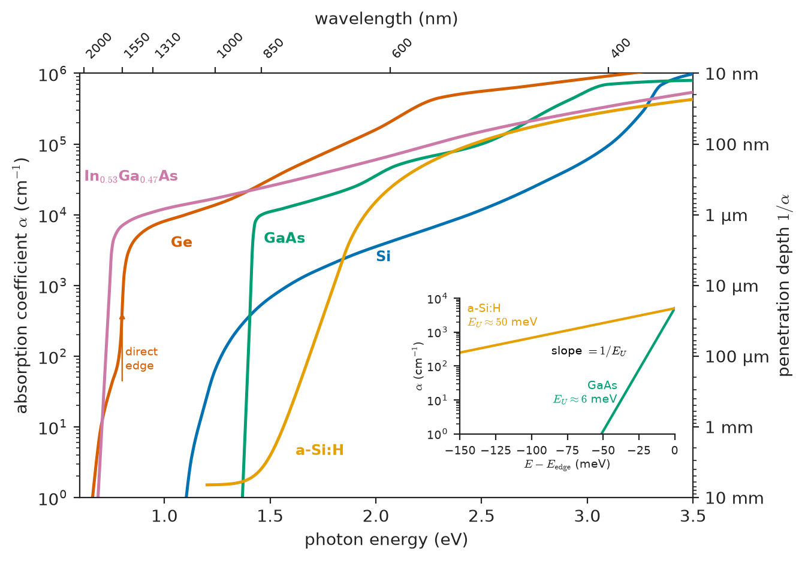
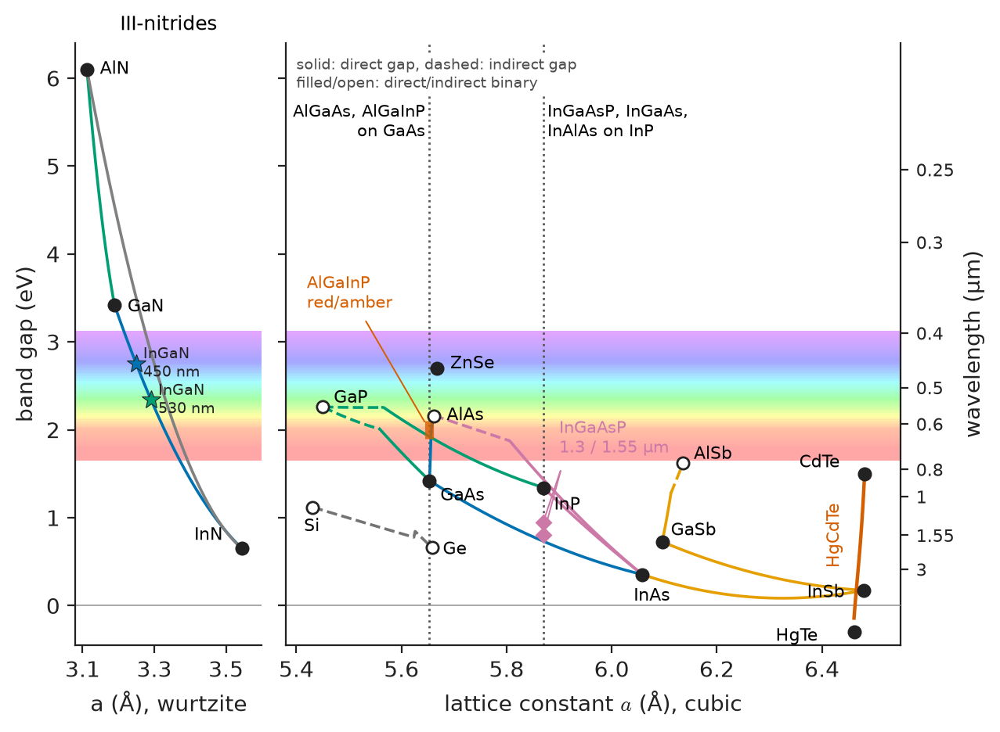
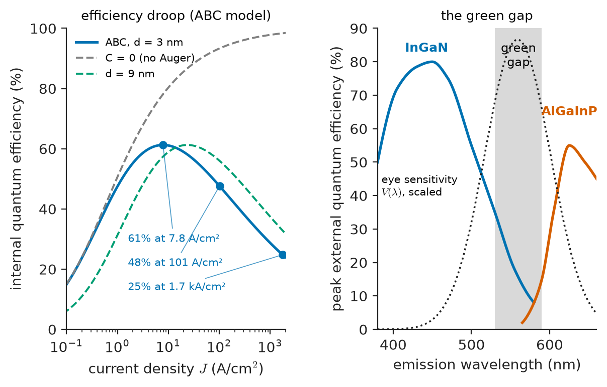
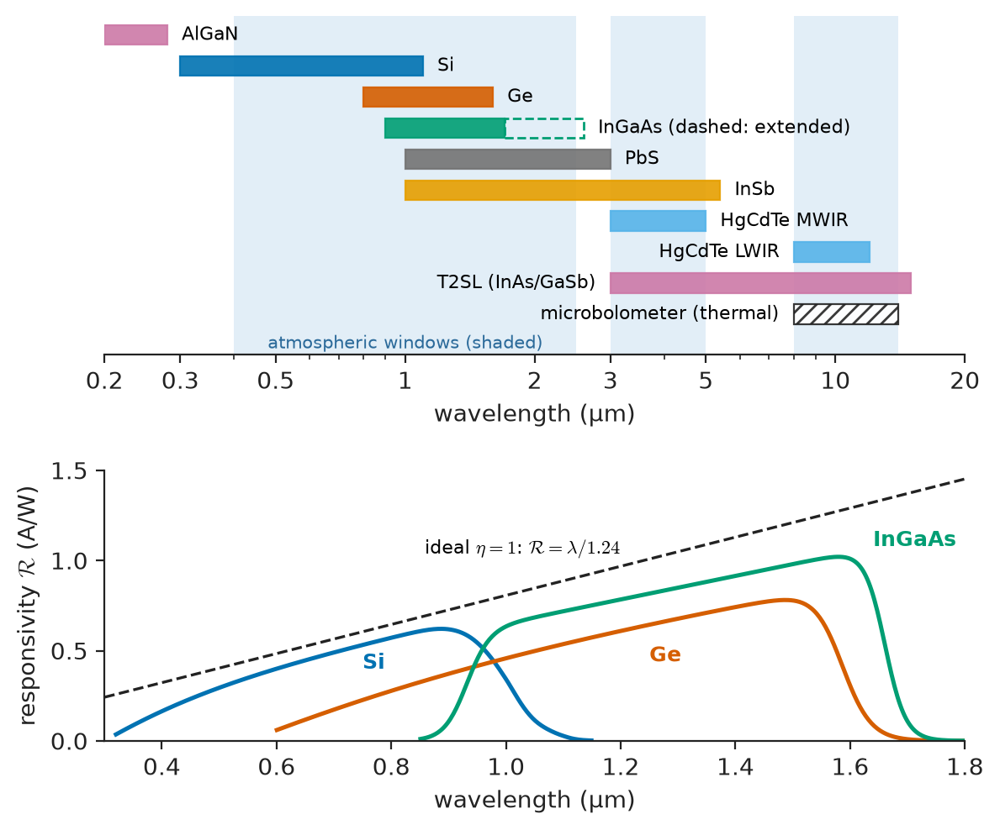
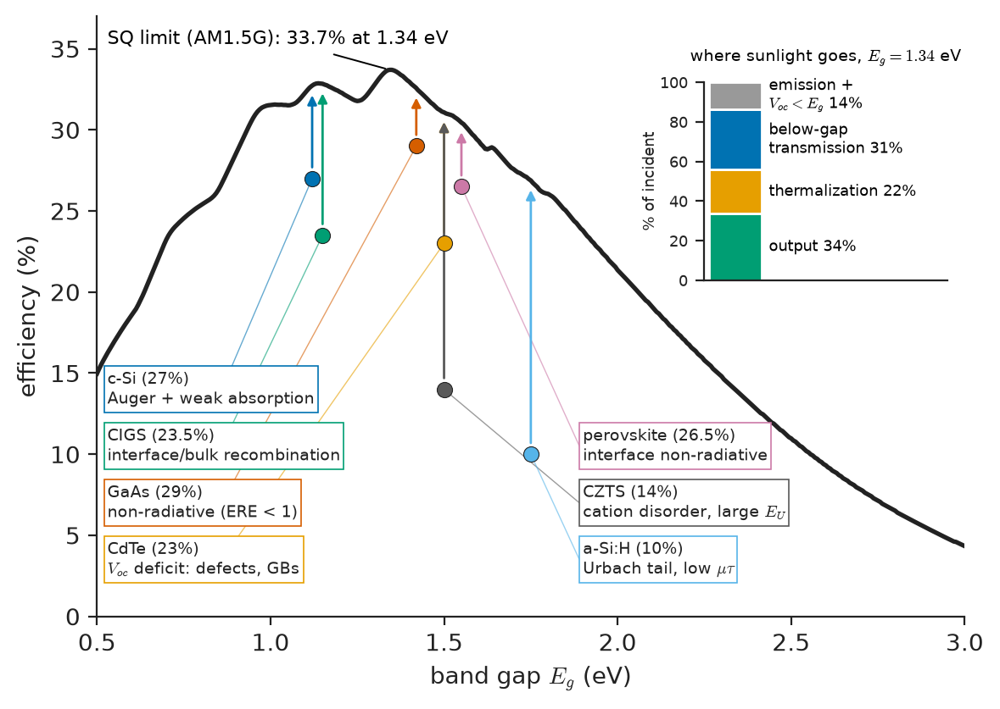
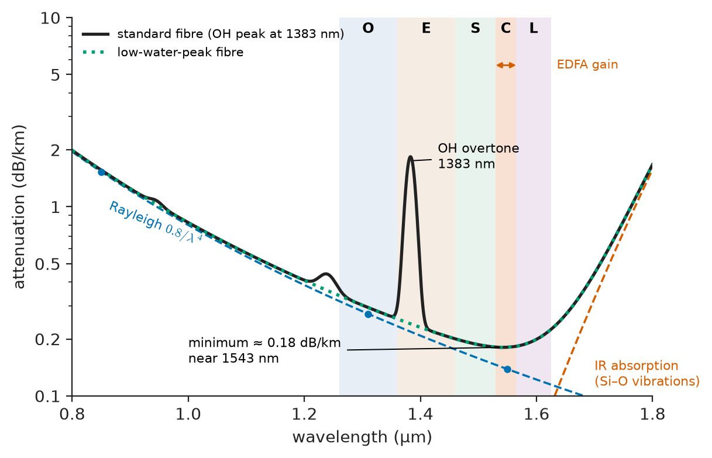

# Chapter 35 — Electronic and Optoelectronic Materials

*Part VII · Semiconductor and Photonic Materials*

Silicon carries almost all the world's computation and most of its solar power, yet there is no silicon light-emitting diode in a phone, a car headlamp or a fibre-optic transmitter. Meanwhile the blue LED inside every white lamp is made of InGaN grown on sapphire. Its epitaxial layers contain $10^8$–$10^9$ threading dislocations per cm², a defect density that would make a silicon transistor useless, and it still converts more than 70% of its electrical input into light. The two facts point the same way. Whether a material emits, absorbs, detects or guides light is decided by its band structure, its defects and its interfaces. A material that is excellent for one function can be hopeless for another.

An engineer choosing materials for an optical link meets this at every step. The laser at 1550 nm must be InGaAsP on InP, because silicon cannot emit. The fibre must be ultrapure silica, whose loss is limited by the scattering of light from frozen-in density fluctuations. The modulator may be lithium niobate or silicon, for different physical reasons. The detector must be germanium or InGaAs, because silicon is transparent at 1550 nm. The transistors in the receiver amplifier may be SiGe or InP, chosen for electron velocity rather than optical properties. Each choice follows from a material property that this chapter derives.

> **Why does a direct-gap material absorb and emit light so much more strongly than an indirect-gap one, and what decides the sharpness of the absorption edge?**
> **What material limits the efficiency of LEDs, the sensitivity and wavelength range of photodetectors, and the efficiency of solar cells?**
> **What makes a material suitable for guiding or modulating light?**
> **Which material properties decide performance at radio and microwave frequencies, and in sensors?**

| Concept | Engineering destination |
|---|---|
| Absorption coefficient, penetration depth | Detector and solar-cell thickness, photolithography, laser processing |
| Urbach tail | Solar-cell voltage loss, sub-gap absorption, material quality index |
| Radiative recombination coefficient $B$ | LED and laser efficiency, solar-cell limits |
| Photoconductive gain | Low-cost light sensors, X-ray imagers, IR photoconductors |
| Phosphors, activators, Stokes shift | White LEDs, displays, X-ray and γ-ray scintillators |
| Alloy band gap and lattice matching | LED colour, laser wavelength, detector cut-off |
| Efficiency droop, green gap | High-power LED design, micro-LED displays |
| Cut-off wavelength, dark current | IR cameras, optical receivers, spectroscopy |
| Shockley–Queisser limit, $V_{oc}$ loss | Choice of photovoltaic absorber (with Chapter 40) |
| Fibre loss, electro-optic coefficient, index contrast | Optical communications, silicon photonics, modulators |
| Saturation velocity, substrate loss, loss tangent | RF transistors, mm-wave circuits, antennas, PCBs |
| Transduction coefficients (TCR, gauge factor, Hall mobility) | Temperature, strain, magnetic, gas and IR sensors |

**Roadmap.** How light is absorbed and emitted (35.1) → materials whose conductivity responds to light (35.2) → materials that emit by luminescence (35.3) → emitters for LEDs and lasers (35.4) → detectors (35.5) → solar absorbers (35.6) → materials that guide and modulate light (35.7) → materials for high frequencies (35.8) → sensor materials (35.9).

> **Boundary.** This chapter explains the material mechanisms behind optoelectronic, RF and sensing devices. Device operation (diode equations, laser rate equations, transistor small-signal models) and circuit configurations belong to Electronics & Computing. The quantum mechanics of optical transitions (matrix elements, Fermi's golden rule) belongs to Engineering Physics. Bands, direct and indirect gaps, carrier statistics and recombination were set up in Chapters 31 and 32 and are used here without re-derivation.

---

## 35.1 Light absorption and emission in materials

### Photon energy and the band gap

A photon of wavelength $\lambda$ carries energy $E=h\nu=hc/\lambda$. In convenient units,

$$
E\,[\mathrm{eV}]=\frac{1239.8}{\lambda\,[\mathrm{nm}]}
$$

so 1550 nm corresponds to 0.80 eV, 850 nm to 1.46 eV, 550 nm (green) to 2.25 eV and 450 nm (blue) to 2.76 eV. A semiconductor absorbs a photon strongly by *interband* absorption, which lifts an electron from the valence band to the conduction band. Energy conservation requires $h\nu\ge E_g$. The same transition run backwards is *radiative recombination*, which emits a photon of energy close to $E_g$. Absorption and emission are two directions of one process, and a material that does one well does the other well, provided non-radiative paths do not compete (see radiative recombination, below).

### The absorption coefficient

Light of intensity $I_0$ entering a uniform absorbing material decays as

$$
I(x)=I_0\,e^{-\alpha x}
$$

where $\alpha$ (usually in cm$^{-1}$) is the *absorption coefficient* and $1/\alpha$ is the *penetration depth* (or absorption length). Within one penetration depth 63% of the light is absorbed. Within three, 95%. The absorption coefficient is related to the imaginary part $\kappa$ of the complex refractive index $\tilde n=n+i\kappa$ by $\alpha=4\pi\kappa/\lambda$, which links absorption to the dielectric function of Chapter 26.

> **Status of the principle: Beer–Lambert attenuation $I=I_0e^{-\alpha x}$**
> *Approximate.* It holds for a homogeneous medium at low intensity, where $\alpha$ does not depend on $I$. It fails at high intensity (saturable absorption, two-photon absorption), in strongly scattering media, and where interference in thin films matters. Surface reflection must be accounted for separately.

### Direct versus indirect absorption

The shape of $\alpha(h\nu)$ just above $E_g$ follows from conservation of crystal momentum. A photon carries almost no momentum on the scale of the Brillouin zone, so an optical transition is vertical in $k$-space.

- **Direct gap** (GaAs, InP, GaN, CdTe, InGaAs). The valence-band maximum and conduction-band minimum lie at the same $k$, so the photon alone can drive the transition. With parabolic bands the joint density of states rises as $(h\nu-E_g)^{1/2}$, which gives

$$
\alpha_{\rm dir}(h\nu)\approx A^*\,(h\nu-E_g)^{1/2}
$$

and $\alpha$ reaches $10^4$ cm$^{-1}$ within about 0.1 eV of the edge. A 1–2 µm layer of a direct-gap semiconductor absorbs nearly all light above its gap.

- **Indirect gap** (Si, Ge, AlAs, GaP, SiC). The band extrema lie at different $k$, so the transition needs a phonon to supply the momentum difference, by absorbing or emitting one. A three-body event (photon, electron, phonon) is a second-order process and much less probable:

$$
\alpha_{\rm ind}(h\nu)\propto\frac{(h\nu-E_g+E_p)^2}{e^{E_p/kT}-1}+\frac{(h\nu-E_g-E_p)^2}{1-e^{-E_p/kT}}
$$

where $E_p$ is the phonon energy (about 50–60 meV for the relevant phonons in Si). The edge is weak, rising only to 10–$10^3$ cm$^{-1}$ over the first few tenths of an eV. In silicon, strong absorption begins only once the photon energy approaches the direct gap at the Γ point (about 3.4 eV), near 365 nm.

> **Status of the principle: Square-root and quadratic absorption edges**
> *Approximate.* These are derived from first- and second-order perturbation theory with parabolic bands and constant matrix elements. They hold within a few tenths of an eV of the edge. Plotting $(\alpha h\nu)^2$ or $(\alpha h\nu)^{1/2}$ against $h\nu$ (a Tauc plot) to extract $E_g$ relies on this. They fail close to the edge, where excitons and band tails (the Urbach tail, below) dominate, and far above it, where band non-parabolicity matters.

Germanium shows both behaviours. Its indirect gap is 0.66 eV, but the direct gap at Γ is only 0.80 eV, so absorption jumps by two orders of magnitude near 1550 nm. That makes Ge a useful telecom detector (Section 35.5). Table 35.1 lists representative values, and Figure 35.1 plots $\alpha$ against photon energy.

**Table 35.1 — Absorption coefficient and penetration depth (300 K, typical values)**

| Material | $E_g$ (eV), type | Wavelength | $\alpha$ (cm$^{-1}$) | $1/\alpha$ |
|---|---|---|---|---|
| Si | 1.12, indirect | 400 nm | $9.5\times10^{4}$ | 0.11 µm |
| Si | | 600 nm | $4.1\times10^{3}$ | 2.4 µm |
| Si | | 850 nm | $5.4\times10^{2}$ | 19 µm |
| Si | | 1000 nm | 64 | 160 µm |
| Si | | 1100 nm | 3.5 | 2.9 mm |
| Ge | 0.66 indirect (0.80 direct) | 1310 nm | ≈ $7\times10^{3}$ | 1.4 µm |
| Ge | | 1550 nm | ≈ 460 | 22 µm |
| GaAs | 1.42, direct | 800 nm | ≈ $1.2\times10^{4}$ | 0.8 µm |
| In$_{0.53}$Ga$_{0.47}$As | 0.75, direct | 1550 nm | ≈ $7\times10^{3}$ | 1.4 µm |
| a-Si:H | ≈1.75 (mobility gap) | 600 nm | ≈ $4\times10^{4}$ | 0.25 µm |
| CH$_3$NH$_3$PbI$_3$ | ≈1.6, direct | 700 nm | ≈ $3\times10^{4}$ | 0.3 µm |
| GaN | 3.42, direct | 350 nm | ≈ $1\times10^{5}$ | 0.1 µm |

The table explains several engineering facts at once. A crystalline Si solar cell must be about 100–180 µm thick and needs light trapping to absorb its near-infrared photons. A GaAs or perovskite cell needs less than 1 µm. A silicon photodiode for 850 nm light must be tens of micrometres deep, which makes it slow, while a GaAs one needs only 1–2 µm.

<!-- FIGURE 35.1 | figures/ch35/fig-35-1-absorption-coefficient.png | plot | Absorption coefficient versus photon energy for direct- and indirect-gap semiconductors, with the Urbach tail. | Content: Main panel — log y-axis α from 1 to 10^6 cm−1; x-axis photon energy 0.6–3.5 eV with top axis wavelength (2000, 1550, 1310, 1000, 850, 600, 400 nm). Curves: Si (slow indirect rise from 1.1 eV, reaching 10^4 near 2.5 eV and 10^5 above 3.2 eV), Ge (indirect foot from 0.66 eV then steep step near 0.80 eV), GaAs (sharp rise at 1.42 eV to >10^4), In0.53Ga0.47As (sharp at 0.75 eV), a-Si:H (broad edge near 1.7 eV with long exponential tail). Right axis: penetration depth 1/α (10 mm to 10 nm). Inset — log α vs E near the edge of GaAs (E_U ≈ 6 meV) and a-Si:H (E_U ≈ 50 meV) showing straight-line Urbach tails, with slope 1/E_U marked. -->

*Figure 35.1 — Absorption coefficient versus photon energy for direct- and indirect-gap semiconductors, with the Urbach tail.*

### The Urbach tail

Measured below $E_g$, $\alpha$ does not drop to zero at the gap. It falls off exponentially:

$$
\alpha(h\nu)=\alpha_0\exp\!\left(\frac{h\nu-E_0}{E_U}\right),\qquad h\nu<E_0
$$

The *Urbach energy* $E_U$ measures how sharp the edge is. Its origin is disorder. Thermal vibrations (dynamic disorder) and structural defects, alloy fluctuations and strain (static disorder) make the local band edges vary from place to place, creating exponential *band tails* of localized states that extend into the gap. In a perfect crystal at low temperature $E_U$ approaches its phonon-limited minimum of a few meV. In an amorphous solid it is several tens of meV.

> **Status of the principle: Urbach rule**
> *Empirical.* The exponential shape is observed in crystalline, alloyed and amorphous materials over two to four decades of $\alpha$. Models of disorder-induced band tails reproduce it, but $\alpha_0$, $E_0$ and $E_U$ are fitted parameters, and the form fails deep in the gap where discrete defect levels dominate.

**Table 35.2 — Typical Urbach energies at 300 K**

| Material | $E_U$ (meV) | Comment |
|---|---|---|
| GaAs (high quality) | 6–7 | Near phonon limit |
| c-Si | 8–12 | Indirect edge complicates fitting |
| CH$_3$NH$_3$PbI$_3$ (perovskite) | 13–16 | Remarkably ordered for a solution-processed film |
| CdTe | 10–20 | Depends on CdCl$_2$ treatment |
| Cu(In,Ga)Se$_2$ | 15–30 | Composition fluctuations |
| Cu$_2$ZnSnS$_4$ (kesterite) | 40–70 | Cation disorder; large voltage loss |
| a-Si:H | 45–55 | Amorphous network |
| Organic semiconductors | 25–50 | Energetic disorder |

The Urbach energy is more than a spectroscopic curiosity. The tail states it describes trap carriers and act as recombination channels, and they set the minimum voltage loss of a solar absorber (Section 35.6). Kesterite solar cells have stalled near 13–15% efficiency largely because of their large $E_U$, while perovskites reached above 25% partly because theirs is small.

### Radiative recombination

The radiative recombination rate per unit volume is proportional to the product of electron and hole densities, since an electron must meet a hole:

$$
R_{\rm rad}=B\,(np-n_i^2)
$$

where $B$ (cm³/s) is the *radiative recombination coefficient*. The $n_i^2$ term ensures that in equilibrium emission balances absorption of the surrounding thermal radiation. Indeed $B$ is not independent of $\alpha$. Detailed balance (the van Roosbroeck–Shockley relation) fixes the spontaneous emission spectrum from the absorption spectrum, so a material that absorbs weakly near its gap also emits weakly. For a doped material under low injection ($p\approx N_A\gg n$), the radiative lifetime of minority electrons is

$$
\tau_{\rm rad}=\frac{1}{BN_A}
$$

> **Status of the principle: Radiative rate $R=B(np-n_i^2)$**
> *Derived.* It follows from detailed balance between absorption and emission (van Roosbroeck–Shockley) for non-degenerate carriers. It holds until carrier densities approach degeneracy (above about $10^{18}$–$10^{19}$ cm$^{-3}$ in direct-gap III–Vs), where phase-space filling makes the effective $B$ fall.

**Table 35.3 — Radiative recombination coefficients (300 K, typical)**

| Material | Gap type | $B$ (cm³/s) | $\tau_{\rm rad}$ at $10^{17}$ cm$^{-3}$ |
|---|---|---|---|
| Si | indirect | ≈ $5\times10^{-15}$ | ≈ 2 ms |
| Ge | indirect | ≈ $6\times10^{-14}$ | ≈ 0.16 ms |
| GaAs | direct | $(1\text{–}7)\times10^{-10}$ | 15–100 ns |
| InP | direct | ≈ $1\times10^{-10}$ | ≈ 100 ns |
| In$_{0.53}$Ga$_{0.47}$As | direct | ≈ $1\times10^{-10}$ | ≈ 100 ns |
| GaN / InGaN | direct | ≈ $(0.5\text{–}2)\times10^{-11}$ | ≈ 0.5–2 µs |

The direct-gap III–Vs have $B$ about $10^4$–$10^5$ times larger than silicon. Light emission is decided by the *competition* between radiative recombination and the non-radiative paths of Chapter 32: Shockley–Read–Hall (SRH) recombination through defects, with rate $\approx n/\tau_{SRH}$, and Auger recombination, with rate $\approx Cn^3$. The *internal quantum efficiency* is the radiative fraction:

$$
\eta_{\rm IQE}=\frac{R_{\rm rad}}{R_{\rm rad}+R_{\rm SRH}+R_{\rm Auger}}=\frac{1/\tau_{\rm rad}}{1/\tau_{\rm rad}+1/\tau_{\rm SRH}+1/\tau_{\rm Auger}}
$$

**Worked example — Why silicon does not glow.** Take p-type Si with $N_A=10^{17}$ cm$^{-3}$ and a good SRH lifetime of 100 µs. Then $\tau_{\rm rad}=1/(4.7\times10^{-15}\times10^{17})=2.1$ ms. Ignoring Auger, the IQE is

$$
\eta_{\rm IQE}=\frac{1}{1+\tau_{\rm rad}/\tau_{\rm SRH}}=\frac{1}{1+21.3}=4.5\%
$$

Of that light, most is then trapped by total internal reflection or reabsorbed. For GaAs at the same doping, with $B=2\times10^{-10}$ cm³/s, $\tau_{\rm rad}=1/(2\times10^{-10}\times10^{17})=50$ ns. Even with a modest SRH lifetime of 100 ns the IQE is $1/(1+0.5)=67\%$, and at $10^{18}$ cm$^{-3}$ ($\tau_{\rm rad}=5$ ns) it is $1/(1+0.05)=95\%$. Silicon *can* emit, and laboratory devices with exceptionally clean surfaces have reached about 1% external efficiency. But it must compete against defects for millisecond timescales, while GaAs only has to win over nanoseconds. That is why every commercial light source uses a direct-gap material.

---

## 35.2 Photoconductive materials

### Photoconductivity

The simplest optoelectronic effect is that light raises conductivity. Absorbed photons create excess electrons and holes at a generation rate $G$ (pairs per cm³ per s). In steady state each carrier lives for a lifetime $\tau$, so the excess densities are $\Delta n=\Delta p=G\tau$ and

$$
\Delta\sigma=q(\mu_n\Delta n+\mu_p\Delta p)=qG\tau(\mu_n+\mu_p)
$$

A *photoconductor* is just a slab of such a material between two ohmic contacts. Its response depends on the product $\mu\tau$, a key material figure of merit. It is the same product that appears in the diffusion length $L=\sqrt{D\tau}$ (Chapter 32).

### Photoconductive gain

The photoconductor has a property a simple photodiode lacks: *gain*. Suppose electron–hole pairs are generated between contacts a distance $L$ apart under bias $V$. An electron crosses the device in the *transit time*

$$
t_{tr}=\frac{L}{\mu_nE}=\frac{L^2}{\mu_nV}
$$

If the hole is trapped (immobile) or simply slower, the electron leaves at the anode before recombining. Charge neutrality then requires another electron to enter from the cathode. The electron *recirculates* until the trapped hole recombines, after a time $\tau$. Each absorbed photon therefore sends $\tau/t_{tr}$ electrons around the circuit:

$$
G_{\rm pc}=\frac{\tau}{t_{tr}}=\frac{\tau\mu_nV}{L^2}
$$

> **Status of the principle: Photoconductive gain $G=\tau/t_{tr}$**
> *Derived.* It follows from charge continuity with ohmic (injecting) contacts and a uniform field. It assumes the lifetime is not limited by sweep-out and the contacts can supply carriers freely. At high field, space-charge-limited current and carrier sweep-out cap the gain.

The price of gain is speed. The photocurrent rises and decays with time constant $\tau$, so the bandwidth is roughly $f_{3\,dB}\approx1/(2\pi\tau)$. The gain–bandwidth product, about $1/(2\pi t_{tr})$, is fixed by geometry and mobility, not by $\tau$. Lengthening the lifetime with traps buys gain and loses speed in equal measure.

**Worked example — A CdS light sensor.** A CdS photoresistor has electrode spacing $L=1$ mm, bias $V=10$ V, electron mobility 300 cm²/V s, and a trap-extended lifetime $\tau=1$ ms. The transit time is

$$
t_{tr}=\frac{(0.1\ \mathrm{cm})^2}{300\ \mathrm{cm^2/V\,s}\times10\ \mathrm{V}}=3.3\ \mathrm{\mu s}
$$

so the gain is $G=10^{-3}/3.3\times10^{-6}=300$ electrons per absorbed photon. The bandwidth is $1/(2\pi\times10^{-3})=160$ Hz, and the gain–bandwidth product is about 48 kHz. That is ideal for a street-light switch or a camera exposure meter and useless for data communication. Interdigitated electrodes, which shorten $L$ while keeping the illuminated area large, are the standard materials-and-geometry route to higher gain.

### Photoconductive materials in use

Gain in practical photoconductors usually comes from *sensitizing* centres. Deliberately added acceptor-like traps (Cu or Cl in CdS) capture holes and hold them for milliseconds, which slows recombination and lets electrons recirculate. This is defect engineering for a purpose, the reverse of the usual aim of removing traps. Table 35.4 lists the main materials.

**Table 35.4 — Photoconductive materials (typical)**

| Material | $E_g$ (eV) | Spectral range | Form | Use |
|---|---|---|---|---|
| CdS | 2.42 | 400–700 nm | Sintered or evaporated polycrystalline film | Light-dependent resistors (now restricted by RoHS) |
| CdSe | 1.74 | 500–750 nm | Polycrystalline | Light sensors |
| a-Se | ≈2.1 | X-ray, blue | Thick amorphous film (200–1000 µm) | Direct-conversion X-ray flat panels, mammography |
| PbS | 0.37 | 1–3 µm | Chemically deposited polycrystalline | Uncooled SWIR detectors, flame sensors |
| PbSe | 0.27 | 1.5–5 µm | Polycrystalline | MWIR gas analysers |
| HgCdTe | 0.1–0.3 | 3–14 µm | Epitaxial | Cooled IR photoconductors (older systems) |
| Si:As, Ge:Cu (extrinsic) | impurity levels ≈ 0.05 (Si:As), 0.04 (Ge:Cu) eV | 10–30 µm | Doped crystal at 4–30 K | Astronomy |

In PbS, PbSe and amorphous selenium the grain boundaries and band tails of Chapter 34 and Section 35.1 are part of the mechanism. PbS films must be oxidized (sensitized) to form the hole-trapping boundary layers that give useful gain. Amorphous selenium is valued for X-ray imaging because it can be deposited uniformly over 40 × 40 cm, has a high X-ray stopping power, and under a high field ($\approx10$ V/µm) collects charge with negligible lateral spread, giving very sharp images.

---

## 35.3 Luminescent materials

### Kinds of luminescence

*Luminescence* is light emitted by a material after it absorbs energy, in excess of its thermal radiation. It is classified by the source of excitation:

- **Photoluminescence**: excitation by light (phosphors in white LEDs, fluorescent lamps).
- **Electroluminescence**: excitation by current (LEDs, Section 35.4; thin-film EL displays).
- **Cathodoluminescence**: excitation by electrons (CRTs historically; electron-microscope analysis, Chapter 52).
- **Radioluminescence or scintillation**: excitation by X- or γ-rays (medical imaging, radiation detection).

It is also classified by decay time. *Fluorescence* comes from spin-allowed transitions and decays in nanoseconds to microseconds. *Phosphorescence* comes from spin- or parity-forbidden transitions, or from slow trap release, and lasts milliseconds to hours.

### Phosphors: host plus activator

Most practical phosphors are insulating crystalline *hosts* (oxides, nitrides, fluorides, sulfides) doped at 0.1–5% with an *activator* ion that does the emitting. The host's job is to hold the activator in a well-defined, rigid site, to be transparent to the emitted light, to conduct away heat, and to resist chemical attack. The activator's electron configuration decides the character of the emission.

- **4f→4f transitions in trivalent rare earths** (Eu$^{3+}$, Tb$^{3+}$). The 4f electrons are shielded by filled 5s and 5p shells, so the host barely affects them. Emission occurs in sharp lines at nearly fixed wavelengths (Eu$^{3+}$: 611 nm red; Tb$^{3+}$: 545 nm green). These transitions are parity-forbidden, so decay times are milliseconds.
- **5d→4f transitions in Ce$^{3+}$ and Eu$^{2+}$.** The 5d orbital extends out to the neighbouring ions, so its energy depends strongly on the host's *crystal field* and covalency (the nephelauxetic effect). The emission is broad (50–120 nm wide), allowed (decay of tens of ns to about 1 µs), and *tunable by choice of host*. Ce$^{3+}$ emits in the UV in fluorides, blue in some oxides, and yellow in YAG. This tunability is why Ce$^{3+}$ and Eu$^{2+}$ phosphors dominate white LEDs.
- **3d transition-metal ions** (Mn$^{2+}$, Mn$^{4+}$, Cr$^{3+}$). Their emission depends on the crystal field. Mn$^{4+}$ in fluorides gives narrow red lines near 630 nm.
- **Donor–acceptor pair** emission in semiconductors such as ZnS:Ag,Cl and ZnS:Cu,Al, the historic CRT phosphors.

### Stokes shift and the configuration-coordinate picture

The emitted photon always has less energy than the absorbed one. When the activator is excited, its electron distribution changes, so the equilibrium positions of the neighbouring ions shift. The excited ion relaxes to a new geometry by emitting phonons before it emits light, and after emission the ground state relaxes again. The energy difference between absorption and emission peaks is the *Stokes shift*. It is larger when the coupling between electron and lattice is stronger: small for 4f→4f, larger for 5d→4f.

The Stokes shift is an unavoidable energy loss. A white LED that converts a 450 nm blue photon to a 555 nm yellow one keeps only $450/555=81\%$ of the photon energy, even at 100% quantum yield. The 19% balance appears as heat in the phosphor layer.

### Quantum yield and thermal quenching

The *quantum yield* (QY) is the number of photons emitted per photon absorbed. The best LED phosphors reach QY above 90% at room temperature. The yield falls at high temperature because the excited state can cross over to the ground state non-radiatively, through the crossing point of the two configuration-coordinate parabolas, or by thermal ionization of the 5d electron into the host conduction band. A common description is

$$
\frac{I(T)}{I(0)}=\frac{1}{1+C\exp(-\Delta E/kT)}
$$

with $\Delta E$ an activation energy for quenching.

> **Status of the principle: Single-barrier thermal quenching**
> *Approximate.* It assumes one thermally activated non-radiative channel with a single barrier $\Delta E$. It fits many phosphors over a limited temperature range. Multiple channels and distributions of activator sites give broader quenching curves.

Thermal quenching is a design constraint, because phosphors in high-power LEDs run at 100–200 °C. YAG:Ce keeps about 90% of its room-temperature output at 150 °C. Substituting Gd for Y red-shifts the emission for warmer white light but lowers the quenching temperature. That is a typical colour-against-stability trade-off resolved by host chemistry.

**Table 35.5 — Representative luminescent materials (typical values)**

| Phosphor / scintillator | Transition | Excitation | Emission peak | Decay | Application |
|---|---|---|---|---|---|
| Y$_3$Al$_5$O$_{12}$:Ce$^{3+}$ (YAG:Ce) | 5d→4f | 440–470 nm | 550–560 nm, broad | ≈ 60–70 ns | White LEDs (with blue InGaN) |
| CaAlSiN$_3$:Eu$^{2+}$ | 5d→4f | UV–blue | ≈ 650 nm, broad | ≈ 1 µs | Warm-white and high-CRI LEDs |
| β-SiAlON:Eu$^{2+}$ | 5d→4f | UV–blue | ≈ 535 nm, FWHM ≈ 55 nm | ≈ 1 µs | LCD backlight green |
| K$_2$SiF$_6$:Mn$^{4+}$ (KSF) | 3d (spin-forbidden) | blue | 631 nm, lines < 10 nm wide | ≈ 8–10 ms | Wide-gamut display red |
| Y$_2$O$_3$:Eu$^{3+}$ | 4f→4f | 254 nm | 611 nm | ≈ 1–2 ms | Fluorescent lamps |
| ZnS:Ag,Cl | D–A pair | electrons, UV | 450 nm | µs | CRTs (historic), EL |
| Gd$_2$O$_2$S:Tb$^{3+}$ | 4f→4f | X-ray | 545 nm | ≈ 1 ms | X-ray intensifying screens |
| CsI:Tl | Tl$^+$ centre | X/γ-ray | ≈ 550 nm | ≈ 1 µs; ≈ 54,000 photons/MeV | Indirect X-ray flat panels |
| Lu$_{2(1-x)}$Y$_{2x}$SiO$_5$:Ce (LYSO) | 5d→4f | γ-ray | ≈ 420 nm | ≈ 40 ns; ≈ 30,000 photons/MeV | PET scanners |

Two further families are worth noting. *Quantum-dot* emitters (CdSe, InP, perovskite nanocrystals) set their colour by size rather than by activator. They give very narrow emission (FWHM 20–40 nm) and are treated in Chapter 38. *Persistent* phosphors such as SrAl$_2$O$_4$:Eu$^{2+}$,Dy$^{3+}$ store charge in deep traps and release it for hours, the materials basis of glow-in-the-dark exit signs.

---

## 35.4 LED and laser semiconductor materials

### What an emitter material must provide

From Section 35.1, a material for efficient electroluminescence needs:

1. a **direct band gap** of the right energy, $E_g\approx hc/\lambda$;
2. **low non-radiative recombination**: few deep-level defects and low Auger rate at the operating carrier density;
3. a **heterostructure partner** that is lattice-matched (or strain-managed, Chapter 34) and gives type-I confinement of both carriers;
4. **dopability** both n- and p-type, so that a junction can inject carriers;
5. for lasers, a **lower-index cladding** to confine the light, and optical gain at a reachable carrier density.

These requirements are met by the III–V and III–N alloy families, in three main systems that together cover the ultraviolet to the mid-infrared.

### Alloys, Vegard's law and bowing

The emission wavelength is tuned by alloying. For a ternary alloy A$_x$B$_{1-x}$C, the lattice constant follows Vegard's law (linear interpolation), while the band gap bows below the linear interpolation:

$$
a(x)=xa_{AC}+(1-x)a_{BC},\qquad E_g(x)=xE_{g,AC}+(1-x)E_{g,BC}-b\,x(1-x)
$$

The bowing parameter $b$ comes from the different sizes and electronegativities of the mixed atoms. It is 1.4 eV for InGaN, about 1 eV for AlGaN, and 0.48 eV for InGaAs. Quaternary alloys (In$_{1-x}$Ga$_x$As$_y$P$_{1-y}$, (Al$_x$Ga$_{1-x}$)$_{0.5}$In$_{0.5}$P) have two composition variables, so the band gap can be tuned while the lattice constant stays matched to a substrate. Figure 35.2 is the map engineers use to plan such alloys.

> **Status of the principle: Vegard's law and quadratic band-gap bowing**
> *Empirical.* Vegard's law holds for most III–V alloys to within about 0.1% in lattice constant. The quadratic bowing form fits band gaps with a composition-independent $b$ for most alloys, but $b$ itself depends on composition in highly mismatched alloys (InGaN at high In, GaAsN). Both describe random alloys and fail where atoms cluster or order.

<!-- FIGURE 35.2 | figures/ch35/fig-35-2-bandgap-lattice-map.png | map | Band gap versus lattice constant for the principal semiconductors, with the visible spectrum and alloy lines. | Content: x-axis lattice constant 5.4–6.5 Å for cubic materials, with a separate left inset for wurtzite nitrides (a = 3.1–3.6 Å). y-axis band gap 0–6.2 eV with right axis wavelength. Points: Si, Ge, GaP, GaAs, AlAs, InP, InAs, GaSb, AlSb, InSb, CdTe, ZnSe; nitride inset: AlN (3.11, 6.1), GaN (3.19, 3.42), InN (3.54, 0.65). Solid lines for direct-gap alloys, dashed for indirect. Coloured horizontal band for visible light 1.65–3.1 eV. Vertical dashed lines at GaAs and InP lattice constants labelled "AlGaAs, AlGaInP on GaAs" and "InGaAsP, InGaAs, InAlAs on InP". Annotate: InGaN blue (450 nm) and green (530 nm), AlGaInP red/amber, InGaAsP 1.3/1.55 µm, HgCdTe line from CdTe to HgTe (negative gap). -->

*Figure 35.2 — Band gap versus lattice constant for the principal semiconductors, with the visible spectrum and alloy lines.*

### The three emitter systems

**InGaN on GaN (violet, blue, green).** In$_x$Ga$_{1-x}$N spans from 3.42 eV (GaN) toward 0.65 eV (InN). With $b=1.43$ eV, $x=0.15$ gives $E_g=2.82$ eV (440 nm) and $x=0.3$ gives 2.29 eV (542 nm). In real quantum wells the polarization fields and strain shift the emission by a further 0.1–0.2 eV, so blue (450 nm) LEDs use about 15–18% In and green (530 nm) about 25–30%. The active layers are 2–3 nm quantum wells grown on GaN on sapphire, SiC or Si.

The puzzle of why InGaN emits efficiently despite $10^8$–$10^9$ cm$^{-2}$ threading dislocations is resolved by *carrier localization*. Indium composition fluctuates on the nanometre scale, and the quantum-well width fluctuates by about a monolayer. Together these create potential minima, about 10–50 meV deep, that trap carriers within a few nanometres of where they are created. Since dislocations are typically 0.3–1 µm apart, most carriers recombine radiatively before they can diffuse to one. In addition, hexagonal "V-pits" that open around dislocations form thinner, wider-gap sidewall wells, which repel carriers from the dislocation core. Both mechanisms are properties of the material's nanostructure, not of the device design.

**AlGaInP on GaAs (red, orange, amber, yellow).** (Al$_x$Ga$_{1-x}$)$_{0.5}$In$_{0.5}$P is lattice-matched to GaAs for all $x$. Its direct gap runs from 1.9 eV ($x=0$, about 650 nm) to the direct–indirect crossover near $x\approx0.53$, at about 2.3 eV (about 540 nm). Red (620–630 nm) devices are very efficient. Toward amber and yellow the efficiency collapses, because the active layer approaches the indirect crossover, where electrons spill into the X valleys and recombine non-radiatively. At the same time the conduction-band offset to the highest-Al cladding shrinks, so electrons leak out of the wells. High-brightness AlGaInP LEDs also needed a materials trick for extraction: the light-absorbing GaAs substrate is removed and the epitaxial layer is wafer-bonded to a transparent GaP or a reflective metal carrier.

**InGaAsP and InGaAs on InP (1.3–1.65 µm).** In$_{1-x}$Ga$_x$As$_y$P$_{1-y}$ is lattice-matched to InP when $y\approx2.2x$. Its gap then runs from 1.35 eV (InP) to 0.75 eV (In$_{0.53}$Ga$_{0.47}$As), covering the two silica-fibre windows at 1310 and 1550 nm (Section 35.7). This is why every long-haul telecom laser is an InP-based device. GaAs/AlGaAs (780–870 nm) and strained InGaAs/GaAs (900–1100 nm) cover the near-infrared for short-reach links, VCSELs, 3D sensing and pump lasers. AlGaN reaches the deep UV (210–360 nm). UV-C emitters for disinfection are held to external efficiencies of a few percent to about 10% by poor p-type conductivity (the Mg acceptor in AlGaN is 0.2–0.6 eV deep) and by high dislocation densities.

**Table 35.6 — LED and laser material systems (typical)**

| Active material | Substrate | Wavelength range | Typical best external efficiency (LED) | Main limitations |
|---|---|---|---|---|
| Al$_x$Ga$_{1-x}$N | AlN, sapphire | 210–360 nm | 2–10% (UV-C) | p-doping, dislocations, light extraction |
| In$_x$Ga$_{1-x}$N | sapphire, SiC, Si, GaN | 380–530 nm | 70–85% blue; 30–45% green | Droop, green gap |
| (Al$_x$Ga$_{1-x}$)$_{0.5}$In$_{0.5}$P | GaAs (removed) | 560–650 nm | 50–60% red; < 20% yellow-amber | Indirect crossover, electron leakage, thermal drop |
| Al$_x$Ga$_{1-x}$As / GaAs | GaAs | 650–870 nm | 40–60% | AlGaAs oxidation |
| In$_x$Ga$_{1-x}$As (strained) / GaAs | GaAs | 900–1100 nm | lasers | Critical thickness (Chapter 34) |
| In$_{1-x}$Ga$_x$As$_y$P$_{1-y}$ / InP | InP | 1100–1650 nm | lasers | Auger, temperature sensitivity |

### Efficiency droop as a materials problem

InGaN LEDs reach their peak internal efficiency at current densities of only a few A/cm². At the 35–100 A/cm² where high-power LEDs operate, efficiency falls by 20–40%. This *droop* limits how much light a given chip area can produce. It is understood today mainly as Auger recombination, plus carrier leakage and inhomogeneous injection, enhanced by features of the nitride material.

The *ABC model* expresses the competition with three coefficients. Writing $n$ for the carrier density in the active layer (assumed $n=p$):

$$
\eta_{\rm IQE}(n)=\frac{Bn^2}{An+Bn^2+Cn^3},\qquad J=qd\,(An+Bn^2+Cn^3)
$$

Here $A$ is the SRH coefficient (s$^{-1}$), $B$ the radiative coefficient, $C$ the Auger coefficient (cm$^6$/s), and $d$ the total active thickness. The IQE peaks where $An=Cn^3$, at $n^*=\sqrt{A/C}$.

> **Status of the principle: ABC recombination model**
> *Approximate.* It assumes uniform carrier density in the active region, $n=p$, Boltzmann statistics and density-independent coefficients. In reality $B$ and $C$ fall at high density (phase-space filling), carriers are unevenly distributed among quantum wells, and leakage over the barriers is omitted. Fitted coefficients are therefore effective values for a given structure, but the model captures the shape of droop well.

**Worked example — Droop in an InGaN quantum-well LED.** Take $A=10^7$ s$^{-1}$, $B=10^{-11}$ cm³/s, $C=10^{-30}$ cm$^6$/s and an active thickness $d=3$ nm. The peak is at $n^*=\sqrt{10^7/10^{-30}}=3.16\times10^{18}$ cm$^{-3}$. There $An=Cn^3=3.16\times10^{25}$ cm$^{-3}$s$^{-1}$ and $Bn^2=1.0\times10^{26}$ cm$^{-3}$s$^{-1}$, so

$$
\eta_{\rm IQE}^{\max}=\frac{1.0\times10^{26}}{3.16\times10^{25}+1.0\times10^{26}+3.16\times10^{25}}=61\%
$$

at $J=1.602\times10^{-19}\times3\times10^{-7}\ \mathrm{cm}\times1.63\times10^{26}=7.8$ A/cm². At $n=10^{19}$ cm$^{-3}$ the three rates are $10^{26}$, $10^{27}$ and $10^{27}$, so $\eta_{\rm IQE}=10^{27}/2.1\times10^{27}=48\%$ at $J=101$ A/cm². Raising the current density thirteenfold costs 21% of the relative efficiency. At $n=3\times10^{19}$ ($J\approx1.7$ kA/cm², laser-like densities) IQE falls to 25%.

The materials levers follow directly from the formula. Since droop sets in once $Cn^3$ rivals $Bn^2$, anything that lowers $n$ at a given current helps: thicker or more numerous quantum wells, and better hole transport so that carriers spread over all the wells. The nitride's polarization fields work against this. They tilt the quantum wells, separating electrons and holes (the quantum-confined Stark effect), which lowers the effective $B$ and so raises $n$ at a given current. Growth on *non-polar* or *semi-polar* GaN planes removes or reduces the fields, at the cost of more expensive substrates.

### The green gap

The peak external efficiency of LEDs plotted against wavelength shows a deep valley between about 530 and 590 nm, the *green gap*, illustrated in Figure 35.3. Both material systems fail there, for different reasons.

- **InGaN approaching green** needs 25–30% indium. Indium-rich InGaN must be grown at lower temperature (In–N bonds are weak and In desorbs), which raises point-defect densities. The lattice mismatch to GaN rises to about 3%, increasing strain and approaching the critical thickness of Chapter 34. The piezoelectric field grows with strain, which strengthens the Stark separation. Composition fluctuations become clustering. Each of these either adds non-radiative recombination or lowers the radiative rate.
- **AlGaInP approaching yellow** reaches its direct–indirect crossover, as above.

The green gap is therefore a materials limit, not a device-design limit. Its practical consequences are that white light is made from blue LEDs with phosphors rather than from red, green and blue chips, and that micro-LED displays struggle with the efficiency of their green and red pixels. Phosphor-converted green, InGaN red on relaxed InGaN templates, and nitride quantum dots are the active research routes.

<!-- FIGURE 35.3 | figures/ch35/fig-35-3-droop-and-green-gap.png | plot | Efficiency droop and the green gap. | Content: Left panel — internal quantum efficiency (0–70%) vs current density (0.1–1000 A/cm², log x) from the ABC model with A = 1e7 s−1, B = 1e−11 cm3/s, C = 1e−30 cm6/s, d = 3 nm: rising to a peak of 61% at ≈8 A/cm², 48% at 100 A/cm², 25% at ≈1.7 kA/cm²; dashed curves for C = 0 (no droop) and for d = 9 nm (droop pushed to higher J). Right panel — peak external quantum efficiency (0–90%, log or linear y) vs emission wavelength 380–660 nm: InGaN curve from ≈80% at 450 nm falling to ≈35% at 530 nm and <10% at 580 nm; AlGaInP curve from ≈55% at 625 nm falling to ≈15% at 590 nm and a few % at 570 nm; shaded "green gap" between 530 and 590 nm; human eye sensitivity V(λ) curve dotted, peaking at 555 nm inside the gap. -->

*Figure 35.3 — Efficiency droop and the green gap.*

### Laser materials beyond the gain medium

A semiconductor laser needs the same active materials plus three further material properties.

- **Transparency and gain.** Optical gain requires population inversion, which happens once the carrier density exceeds the *transparency density*, about $1\text{–}2\times10^{18}$ cm$^{-3}$ in GaAs and InGaAsP wells. Compressively strained quantum wells (Chapter 34) lower the in-plane hole effective mass, which reduces the transparency density and the threshold. That is the main reason strained-layer lasers replaced lattice-matched ones in the 1990s.
- **Index contrast for optical confinement.** The cladding must have a lower refractive index than the active region. Conveniently, wider-gap alloys usually have lower indices: at 850 nm GaAs has $n\approx3.6$ and AlAs $n\approx3.0$. In vertical-cavity lasers (VCSELs), the mirrors are *distributed Bragg reflectors* made of quarter-wave stacks of alternating high- and low-index layers. GaAs/AlAs gives enough contrast that 20–35 pairs exceed 99.5% reflectivity. GaN/AlN gives much less contrast and is badly mismatched, which is one reason blue VCSELs use dielectric (SiO$_2$/Ta$_2$O$_5$) mirrors.
- **Oxidation-defined apertures.** Al$_{0.98}$Ga$_{0.02}$As oxidizes laterally in steam to insulating Al$_2$O$_3$ at a controllable rate, forming the current and optical aperture of every modern VCSEL. It is a remarkable case of a materials reaction becoming a device structure.

Other laser materials follow the host-plus-activator logic of Section 35.3. Nd$^{3+}$:YAG emits at 1064 nm. Er$^{3+}$ in silica fibre, pumped at 980 or 1480 nm, gives optical gain from 1530 to 1565 nm with a 10 ms upper-state lifetime: the erbium-doped fibre amplifier on which long-haul optical networks depend.

---

## 35.5 Photodetector materials

### Cut-off wavelength and responsivity

A detector based on interband absorption responds only to photons with $h\nu\ge E_g$. Its *cut-off wavelength* is

$$
\lambda_c=\frac{hc}{E_g}=\frac{1.2398\ \mu\mathrm{m\,eV}}{E_g}
$$

> **Status of the principle: Cut-off wavelength $\lambda_c=hc/E_g$**
> *Derived.* It follows from energy conservation in interband absorption. The real response falls off gradually near $\lambda_c$ because of band tails (Section 35.1), phonon-assisted absorption in indirect materials, and the temperature dependence of $E_g$.

The *responsivity* is the photocurrent per watt of incident optical power:

$$
\mathcal R=\frac{I_{ph}}{P}=\eta\,\frac{q\lambda}{hc}=\eta\,\frac{\lambda\,[\mu\mathrm m]}{1.2398}\ \ \mathrm{A/W}
$$

where the quantum efficiency $\eta$ (electrons collected per incident photon) includes surface reflection $R_s$, absorption over the active thickness $d$, and collection:

$$
\eta\approx(1-R_s)\left(1-e^{-\alpha d}\right)\eta_{\rm coll}
$$

### Dark current and why IR detectors are cooled

The noise floor of a detector is largely its *dark current*, the current flowing with no light. In a diode it is dominated by thermal generation in or near the depletion region, which scales with $n_i$ or $n_i^2$. Since $n_i^2\propto T^3\exp(-E_g/kT)$ (Chapter 32), dark current rises exponentially as the gap narrows. A material with $\lambda_c=10$ µm ($E_g\approx0.12$ eV) at room temperature has $E_g/kT\approx4.8$, so its thermally generated carriers swamp any signal. Cooling to 77 K raises $E_g/kT$ to about 19. For a 0.1 eV gap, the factor $\exp(-E_g/kT)$ falls by $\exp[0.1(1/0.00664-1/0.02585)]=e^{11.2}\approx7\times10^4$, and with the $T^3$ factor the total reduction of $n_i^2$ is about $4\times10^6$. That is why long-wavelength infrared cameras use Stirling coolers or liquid nitrogen. Uncooled thermal detectors (Section 35.9) avoid the problem by not using interband absorption at all.

### The main detector materials

**Silicon** ($E_g=1.12$ eV, $\lambda_c=1.1$ µm). It is the material of all visible image sensors and of short-wavelength detectors, with very low dark current, mature processing and integration with CMOS readout. Its indirect gap gives a long absorption length in the near-IR (Table 35.1), so its responsivity falls beyond about 900 nm unless the junction is deep. The quantum efficiency in the visible exceeds 80% with anti-reflection coatings. For high gain at low light, silicon avalanche photodiodes benefit from a material asymmetry: the impact-ionization coefficient of electrons is much larger than that of holes ($\alpha_n/\alpha_p\approx20$–50 at moderate fields), which gives low excess noise.

**Germanium** ($E_g=0.66$ eV indirect, 0.80 eV direct, practical cut-off about 1.6 µm at 300 K). Ge has strong absorption at 1310 nm and adequate absorption at 1550 nm, and it can be grown epitaxially on silicon. Tensile strain of about 0.2%, from thermal mismatch on cooling, lowers its direct gap and extends the response to 1600 nm. Its drawback is higher dark current, from the small gap and from the misfit dislocations at the 4.2% mismatched Ge/Si interface (Chapter 34).

**In$_{0.53}$Ga$_{0.47}$As** ($E_g=0.75$ eV, $\lambda_c=1.65$ µm). Lattice-matched to InP, with a direct gap and a strong absorption of about $7\times10^3$ cm$^{-1}$ at 1550 nm, it is the standard telecom and short-wave-infrared detector material. "Extended" InGaAs with more indium (lattice-mismatched, on graded buffers) reaches 2.2–2.6 µm, at the cost of dislocation-driven dark current.

**HgCdTe** (Hg$_{1-x}$Cd$_x$Te). CdTe has a gap of 1.5 eV and HgTe a *negative* gap (a semimetal, about −0.3 eV). Between them the alloy gap can be set anywhere from 0 to 1.5 eV with almost no change in lattice constant (0.3% mismatch across the whole range), so a single substrate (CdZnTe) serves all wavelengths. An empirical fit (Hansen et al.) for the gap is

$$
E_g(x,T)=-0.302+1.93x-0.81x^2+0.832x^3+5.35\times10^{-4}\,T(1-2x)\ \ [\mathrm{eV}]
$$

> **Status of the principle: Hansen band-gap formula for HgCdTe**
> *Empirical.* It is a polynomial fit to optical and electrical data over $0\le x\le0.6$ and 4–300 K, accurate to about ±10 meV in that range.

At 77 K, $x=0.3$ gives $E_g=0.243$ eV ($\lambda_c=5.1$ µm, mid-wave IR), $x=0.22$ gives 0.115 eV ($\lambda_c=10.8$ µm, long-wave IR) and $x=0.2$ gives 0.083 eV ($\lambda_c=14.9$ µm). HgCdTe has a direct gap, high absorption, high electron mobility and a long intrinsic lifetime, and it remains the highest-performance IR material. Its weaknesses are materials ones. The Hg–Te bond is weak, so mercury vacancies form readily and act as acceptors. Composition uniformity is hard to achieve, and since $\lambda_c$ depends steeply on $x$ (near $x=0.22$, a change of 0.01 in $x$ shifts $\lambda_c$ at 77 K by more than 1 µm), uniformity matters a great deal. Wafers are also small and expensive. Competing materials are InSb (MWIR, 77 K), type-II InAs/GaSb superlattices (Chapter 34's broken-gap alignment, tunable from 3 to over 15 µm by layer thickness) and quantum-well infrared photodetectors.

Table 35.7 and Figure 35.4 summarize the spectral coverage and responsivity of these materials.

**Table 35.7 — Photodetector materials (typical)**

| Material | $E_g$ (eV) | $\lambda_c$ (µm) | Operating T | Typical peak responsivity | Use |
|---|---|---|---|---|---|
| Al$_x$Ga$_{1-x}$N ($x\ge0.45$) | ≥ 4.4 | ≤ 0.28 | 300 K | 0.1–0.2 A/W | Solar-blind UV, flame detection |
| Si | 1.12 | 1.1 | 300 K | 0.5–0.6 A/W at 800–900 nm | Imaging, 850 nm links, metrology |
| Ge (on Si) | 0.66 / 0.80 | ≈1.6 | 300 K | 0.8–1.0 A/W at 1550 nm (waveguide) | Silicon photonics receivers |
| In$_{0.53}$Ga$_{0.47}$As | 0.75 | 1.65 | 300 K or TE-cooled | ≈ 1.0 A/W at 1550 nm | Telecom, SWIR imaging |
| PbS | 0.37 | ≈3 | 300 K | photoconductive | Low-cost SWIR |
| InSb | 0.23 (77 K) | 5.4 | 77 K | — | MWIR imaging |
| Hg$_{0.7}$Cd$_{0.3}$Te | 0.24 (77 K) | 5.1 | 77–150 K | — | MWIR imaging |
| Hg$_{0.78}$Cd$_{0.22}$Te | 0.115 (77 K) | 10.8 | 77 K | — | LWIR imaging, thermography |
| InAs/GaSb superlattice | 0.05–0.4 (effective) | 3–25 | 77 K | — | MWIR/LWIR focal planes |
| VO$_x$ microbolometer | thermal | 8–14 (by absorber) | 300 K | TCR ≈ −2 to −3 %/K | Uncooled thermal cameras |

**Worked example — Matching absorber thickness to wavelength.** Compare three detectors with anti-reflection coatings ($R_s\approx0$) and full collection.

- *Si at 850 nm*, absorbing layer 10 µm, $\alpha=535$ cm$^{-1}$: $\alpha d=0.535$ and $\eta=1-e^{-0.535}=41\%$. The responsivity is $0.41\times0.85/1.2398=0.28$ A/W. Reaching $\eta=80\%$ needs $d=\ln5/535\ \mathrm{cm}=30$ µm. Carriers generated that deep diffuse slowly to the junction, which limits speed. This is why 850 nm receivers above about 10 Gb/s use GaAs photodiodes.
- *In$_{0.53}$Ga$_{0.47}$As at 1550 nm*, 2 µm thick, $\alpha\approx7\times10^3$ cm$^{-1}$: $\alpha d=1.4$, $\eta=75\%$, and $\mathcal R=0.75\times1.55/1.2398=0.94$ A/W.
- *Ge at 1550 nm*, 1 µm film on Si, $\alpha\approx460$ cm$^{-1}$: $\alpha d=0.046$ and $\eta=4.5\%$ for normal incidence. This is unusable. But if light travels *along* a Ge waveguide instead of across the film, the absorption length can be made 20–50 µm while the carriers cross only the 0.5–1 µm film thickness. With 20 µm, $\eta=1-e^{-0.92}=60\%$, and with 50 µm it is 90%. Separating the light path from the carrier path is the geometric solution that made germanium the standard detector of silicon photonics (Section 35.7).

<!-- FIGURE 35.4 | figures/ch35/fig-35-4-detector-materials.png | plot | Spectral coverage and responsivity of photodetector materials. | Content: Upper panel — horizontal bars on a log wavelength axis 0.2–20 µm showing the useful range of each material: AlGaN (0.2–0.28), Si (0.3–1.1), Ge (0.8–1.6), InGaAs (0.9–1.7, extended to 2.6 dashed), PbS (1–3), InSb (1–5.4), HgCdTe MWIR (3–5), HgCdTe LWIR (8–12), T2SL (3–15), microbolometer (8–14, hatched as "thermal"); atmospheric transmission windows shaded (0.4–2.5, 3–5, 8–14 µm). Lower panel — responsivity (A/W, 0–1.4) vs wavelength 0.3–1.8 µm: ideal η = 1 line R = λ/1.24 (dashed), measured-style curves for Si (peak ≈0.6 A/W near 900 nm, dropping to zero at 1.1 µm), Ge (peak ≈0.8 A/W near 1.5 µm), InGaAs (≈1.0 A/W at 1.55 µm). -->

*Figure 35.4 — Spectral coverage and responsivity of photodetector materials.*

---

## 35.6 Solar-cell absorber materials

Solar cells are treated in two places. This section asks what *intrinsic material property* limits the efficiency of a photovoltaic absorber. Chapter 40 treats photovoltaic absorbers as energy-conversion materials, including their processing, stability, cost and scalability, alongside thermoelectrics and batteries. Module and system engineering belong to Electrical Energy & Machines.

> **Boundary.** Only the material-level efficiency limit and the absorber properties that control it are treated here. Junction design and cell operation belong to Electronics & Computing. Absorber manufacturing, degradation and cost are in Chapter 40. PV system sizing is in Electrical Energy & Machines.

### The Shockley–Queisser limit as a material statement

Shockley and Queisser (1961) asked: what is the highest efficiency possible for an absorber of band gap $E_g$, if the *only* loss allowed is the one required by thermodynamics? They made four assumptions:

1. the absorber absorbs every photon with $h\nu\ge E_g$ and none below (a step-function absorptivity);
2. each absorbed photon creates exactly one electron–hole pair, which relaxes (thermalizes) to the band edges, losing $h\nu-E_g$ as heat;
3. the only recombination is *radiative*, as required by detailed balance, since a body that absorbs must also emit (Section 35.1);
4. the cell is at 300 K under the unconcentrated solar spectrum.

Two losses then fight each other. A large $E_g$ wastes all photons below the gap. A small $E_g$ absorbs most photons but throws away most of their energy as heat. The optimum under the AM1.5G spectrum is about 33.7% at $E_g\approx1.34$ eV. The curve is flat-topped: any gap between 1.1 and 1.4 eV allows 32–34%, as Figure 35.5 shows.

> **Status of the principle: Shockley–Queisser detailed-balance limit**
> *Derived.* It follows from detailed balance between absorbed sunlight and emitted thermal radiation for a single-gap absorber under the four assumptions above. It is a rigorous upper bound for that idealization. It is exceeded only by breaking an assumption: multiple junctions, concentration, or carrier multiplication.

Real absorbers fall short of the limit for three material reasons, each of which can be stated as a property.

**Incomplete absorption.** An absorber of finite thickness, especially an indirect one, does not absorb everything above the gap. Silicon needs about 100 µm plus light trapping.

**Non-radiative recombination.** Every non-radiative path lowers the open-circuit voltage. Detailed balance gives an exact relation (Ross, Rau) between voltage loss and the absorber's *external radiative efficiency* (ERE), the fraction of recombination events that produce a photon escaping the cell:

$$
V_{oc}=V_{oc}^{\rm rad}+\frac{kT}{q}\ln(\mathrm{ERE})
$$

> **Status of the principle: Voltage loss from external radiative efficiency**
> *Derived.* It follows from detailed balance and the reciprocity between light absorption and emission. It is exact under the assumptions that carriers are in quasi-equilibrium with uniform quasi-Fermi-level splitting and that the superposition principle holds.

A good solar cell must therefore also be a good LED, which ties this section to Section 35.4.

**Sub-gap tails.** A broad Urbach tail (Section 35.1) absorbs a little below the gap and therefore emits there too. It adds radiative recombination at energies below $E_g$ and lowers $V_{oc}^{\rm rad}$ itself.

**Worked example — Voltage loss from non-radiative recombination.** At 300 K, $kT/q=25.85$ mV. A GaAs cell with ERE ≈ 0.3 (a record-class device that is also an excellent LED) loses $0.02585\times\ln(1/0.3)=31$ mV relative to the radiative limit. A silicon cell with ERE ≈ 0.005 loses $0.02585\times\ln200=137$ mV. A polycrystalline thin-film absorber with ERE ≈ $10^{-4}$ loses $0.02585\times\ln10^4=238$ mV. Since the radiative-limit voltage is roughly $E_g/q-0.25$ to $-0.3$ V, the observed deficits $E_g/q-V_{oc}$ are about 0.3 V (GaAs), 0.37–0.4 V (Si), and 0.45–0.6 V (CdTe, CIGS, kesterite). The differences trace directly to defect densities and tail widths.

### What makes a good absorber

From the above, the material properties that matter are:

- **band gap** in or near 1.1–1.5 eV for a single junction, or a matched pair for tandems (about 1.7 eV on top of 1.1 eV);
- **absorption coefficient**: direct-gap absorbers need only 0.5–3 µm;
- **diffusion length** $L=\sqrt{D\tau}$ longer than the absorber thickness, so that carriers reach the junction. For silicon with $D\approx26$ cm²/s and $\tau=1$ ms, $L=\sqrt{0.026}\ \mathrm{cm}=1.6$ mm, so 150 µm is easily collected;
- **defect tolerance**: intrinsic defects with shallow rather than midgap levels, and benign grain boundaries. Lead-halide perovskites owe much of their success to this. Their band edges are formed from antibonding states, so vacancies tend to produce shallow levels;
- **small Urbach energy and high ERE**;
- **stability, abundance and non-toxicity**, which are taken up in Chapter 40.

**Table 35.8 — Solar absorber materials (typical; record efficiencies approximate as of the mid-2020s)**

| Absorber | $E_g$ (eV) | Type | SQ limit (≈) | Record cell efficiency (≈) | Typical thickness | Key material issue |
|---|---|---|---|---|---|---|
| c-Si | 1.12 | indirect | 33% (practical limit 29.4% with Auger) | 27% | 100–180 µm | Weak absorption; surface passivation (Chapter 34) |
| GaAs | 1.42 | direct | 33% | 29% | 1–3 µm | Cost of epitaxy and substrate |
| CdTe | 1.45–1.5 | direct | 32% | 23% | 2–4 µm | p-doping, grain boundaries, Cd |
| Cu(In,Ga)Se$_2$ | 1.0–1.2 | direct | 33% | 23–24% | 1.5–2.5 µm | Composition gradients, In and Ga supply |
| CH$_3$NH$_3$PbI$_3$-type perovskite | 1.5–1.6 | direct | 31–32% | 26–27% | 0.4–0.8 µm | Stability, ion migration, Pb |
| a-Si:H | 1.7–1.8 | (amorphous) | 28% | ≈ 10% (stabilized) | 0.3 µm | Urbach tail, light-induced degradation |
| Cu$_2$ZnSnS$_4$ | 1.5 | direct | 32% | ≈ 14–15% | 1–2 µm | Cation disorder, large $E_U$ |

<!-- FIGURE 35.5 | figures/ch35/fig-35-5-shockley-queisser.png | plot | Shockley–Queisser efficiency limit versus band gap, with real absorber materials. | Content: x-axis band gap 0.5–3.0 eV; y-axis efficiency 0–35%. Solid curve: SQ limit under AM1.5G, peaking at 33.7% near 1.34 eV with small dips from atmospheric absorption bands near 1.0–1.1 eV; plateau 32–34% between 1.1 and 1.45 eV, falling to ≈25% at 0.8 eV and ≈20% at 2.0 eV. Points (filled) for record cells: c-Si (1.12, 27%), GaAs (1.42, 29%), CdTe (1.5, 23%), CIGS (1.15, 23.5%), perovskite (1.55, 26.5%), a-Si:H (1.75, 10%), CZTS (1.5, 14%). Vertical arrows from each point to the curve labelled with the dominant material loss ("absorption + Auger", "non-radiative / E_U", etc.). Inset: spectral breakdown at E_g = 1.34 eV showing fractions lost to below-gap transmission, thermalization, and emission. -->

*Figure 35.5 — Shockley–Queisser efficiency limit versus band gap, with real absorber materials.*

---

## 35.7 Optical and photonic materials

A photonic material does not absorb or emit. Its job is to *guide*, *switch*, or *modulate* light with low loss. The relevant properties are the refractive index $n$ (and its contrast with neighbouring materials), the transparency window, the dispersion $dn/d\lambda$, and the electro-optic, thermo-optic and non-linear coefficients.

**Table 35.9 — Photonic materials at 1550 nm (typical)**

| Material | $n$ at 1550 nm | Transparency (µm) | Waveguide loss | Modulation mechanism | Role |
|---|---|---|---|---|---|
| SiO$_2$ (fibre, Ge-doped core) | 1.444–1.45 | 0.2–2.0 | 0.15–0.2 dB/km | — (very weak Kerr) | Transmission fibre, cladding |
| Si (SOI strip) | 3.48 | 1.1–8 | 1–3 dB/cm | Plasma dispersion, thermo-optic ($dn/dT=1.8\times10^{-4}$ K$^{-1}$) | Silicon photonics circuits |
| Si$_3$N$_4$ (LPCVD) | 1.99 | 0.4–6 | 0.001–0.5 dB/cm | Thermo-optic (weak) | Low-loss waveguides, filters, frequency combs |
| LiNbO$_3$ (thin film) | $n_e$ 2.14, $n_o$ 2.21 | 0.35–5 | 0.03–0.3 dB/cm | Pockels, $r_{33}=30.8$ pm/V | High-speed modulators |
| InP / InGaAsP | 3.17–3.4 | > 0.92 (InP; longer for quaternaries) | 1–3 dB/cm | Carrier injection, QCSE | Lasers, modulators, integrated transmitters |
| Ge | ≈ 4.28 | 1.6–14 | absorbing below ≈ 1.6 µm | Franz–Keldysh | Detectors, electro-absorption modulators |
| EO polymers | 1.6–1.8 | visible–IR | 1–2 dB/cm | Pockels, $r_{33}$ up to 100+ pm/V | Research modulators (thermal stability) |

### Silica optical fibre

Optical fibre is the lowest-loss engineered material for any wave. At 1550 nm standard fibre loses only about 0.2 dB/km. After 100 km, 1% of the light remains (20 dB). The record is about 0.14 dB/km in pure-silica-core fibre. The loss has three material contributions, shown in Figure 35.6.

1. **Rayleigh scattering.** Silica is a glass. Its density and composition fluctuations were frozen in at the glass transition (about 1200 °C) and are much smaller than the wavelength. They scatter as

$$
\alpha_R=\frac{A_R}{\lambda^4},\qquad A_R\approx0.7\text{–}0.9\ \mathrm{dB\,km^{-1}\,\mu m^4}
$$

At 1550 nm, with $A_R=0.8$, $\alpha_R=0.8/1.55^4=0.14$ dB/km. At 1310 nm it is 0.27 dB/km, and at 850 nm 1.5 dB/km. $A_R$ is set by the fictive temperature and the dopant level. Pure-silica cores, which lack germania's composition fluctuations, have the lowest values.

> **Status of the principle: Rayleigh $\lambda^{-4}$ scattering loss**
> *Derived.* It follows from dipole scattering by inhomogeneities much smaller than the wavelength. The coefficient $A_R$ is a material parameter set by the thermodynamic density fluctuations frozen in at the fictive temperature and by compositional fluctuations from dopants.

2. **Infrared absorption.** Si–O bond vibrations have their fundamental near 9 µm. The tail of their overtones and combinations rises steeply beyond 1.6 µm, which closes the window on the long side.
3. **Impurity absorption.** Transition-metal ions (Fe, Cu) must be below parts per billion. The O–H vibration overtone at 1383 nm was once a strong peak of about 2 dB/km. Fibre-preform processes in dry chlorine have reduced it below the Rayleigh level in "low-water-peak" fibres.

The minimum of Rayleigh plus infrared loss falls near 1550 nm. That, plus the erbium amplifier band (Section 35.4), fixed the wavelength of long-haul communications. The core is raised in index by about 0.35% with GeO$_2$, or the cladding is lowered with fluorine, to form the guide. Material dispersion in silica passes through zero near 1.27 µm, and fibre-design (waveguide) dispersion shifts the total zero to 1.31 µm in standard single-mode fibre.

<!-- FIGURE 35.6 | figures/ch35/fig-35-6-silica-fibre-loss.png | plot | Attenuation spectrum of silica optical fibre and its material contributions. | Content: log y-axis attenuation 0.1–10 dB/km; x-axis wavelength 0.8–1.8 µm. Dashed curve: Rayleigh scattering 0.8/λ^4 (1.5 dB/km at 0.85 µm, 0.27 at 1.31, 0.14 at 1.55). Dashed rising curve: infrared Si–O vibrational absorption tail, steep beyond 1.6 µm. Solid total for standard fibre with an OH peak at 1.383 µm (≈1–2 dB/km, older fibre) and a low-water-peak variant (dotted, no peak). Mark minimum ≈0.18–0.2 dB/km near 1.55 µm. Shade telecom bands O (1260–1360), E, S, C (1530–1565), L (1565–1625 nm) along the top; show EDFA gain band over C. -->

*Figure 35.6 — Attenuation spectrum of silica optical fibre and its material contributions.*

### Lithium niobate: electro-optic modulation

To put data on light at tens of gigabits per second, an engineer needs a material whose refractive index changes, linearly and fast, with an applied field. That is the *Pockels* (linear electro-optic) effect, introduced in Chapter 27. It exists only in non-centrosymmetric crystals. For a field along the optic (c) axis of LiNbO$_3$ acting on light polarized along it,

$$
\Delta n_e=-\tfrac12\,n_e^3\,r_{33}\,E
$$

> **Status of the principle: Linear electro-optic (Pockels) effect**
> *Approximate.* It is the first term of an expansion of the optical impermeability in the applied field. It is accurate for fields well below breakdown and for frequencies below the relevant lattice resonances. At very high fields the quadratic (Kerr) term and photorefractive effects appear.

The electronic and ionic response of LiNbO$_3$ is fast (into the hundreds of GHz) and the effect is pure phase with no absorption. The material is a ferroelectric, poled into a single domain, with $r_{33}=30.8$ pm/V. For two decades it was used as Ti-diffused waveguides in bulk wafers. Since about 2018 *thin-film lithium niobate on insulator* (TFLN), a 300–600 nm LiNbO$_3$ layer bonded on SiO$_2$, has confined light so tightly that the electrodes can sit a few micrometres apart.

**Worked example — Half-wave voltage of a thin-film LiNbO$_3$ modulator.** A push–pull Mach–Zehnder modulator has an electrode gap $d=5$ µm, a field–optical-mode overlap $\Gamma=0.7$, length $L=1$ cm, and works at $\lambda=1.55$ µm with $n_e=2.138$. The voltage needed for a $\pi$ phase difference between the two arms is

$$
V_\pi=\frac{\lambda\,d}{2\,n_e^3\,r_{33}\,\Gamma\,L}=\frac{1.55\times10^{-6}\times5\times10^{-6}}{2\times9.77\times30.8\times10^{-12}\times0.7\times0.01}=1.84\ \mathrm{V}
$$

so $V_\pi L\approx1.8$ V cm. Reported TFLN devices have $V_\pi L\approx2$–2.5 V cm. The older Ti:LiNbO$_3$ devices, with gaps of 15–20 µm and weaker overlap, need about 10–15 V cm. The materials change from bulk to thin film, not any new physics, gave a fivefold improvement, enough to drive the modulator directly from CMOS voltages.

### Silicon photonics

Silicon is transparent beyond 1.1 µm, can be patterned with CMOS tools, and comes as silicon-on-insulator (SOI) wafers. The Si/SiO$_2$ index contrast (3.48 against 1.44) is enormous compared with fibre (0.5%). A 450 × 220 nm silicon strip guides light around bends a few micrometres in radius, against centimetres for fibre, so thousands of components fit on a millimetre-scale chip. Silicon's material limits are the reasons silicon photonics is a *heterogeneous* platform:

- **No emission.** Silicon has an indirect gap (Section 35.1). Lasers are InP-based dies bonded or flip-chipped onto the silicon, or quantum-dot lasers grown epitaxially on silicon.
- **No Pockels effect.** Silicon's crystal is centrosymmetric, so $r=0$. Modulators use the *plasma-dispersion effect*: free carriers lower the refractive index and add absorption. At 1550 nm (the empirical Soref–Bennett relations),

$$
\Delta n=-\left(8.8\times10^{-22}\Delta N+8.5\times10^{-18}\Delta P^{0.8}\right),\qquad \Delta\alpha=8.5\times10^{-18}\Delta N+6.0\times10^{-18}\Delta P
$$

with densities in cm$^{-3}$ and $\Delta\alpha$ in cm$^{-1}$. Injecting $\Delta N=\Delta P=10^{18}$ cm$^{-3}$ gives $\Delta n=-3.0\times10^{-3}$, but also $\Delta\alpha=14.5$ cm$^{-1}$ (63 dB/cm), so the index change comes with loss. A $\pi$ phase shift needs $L_\pi=\lambda/(2\lvert\Delta n\rvert)=0.26$ mm of such a region. Depletion-mode modulators trade efficiency for speed (above 50 GHz).

> **Status of the principle: Soref–Bennett plasma-dispersion relations**
> *Empirical.* They are fits to Kramers–Kronig transforms of measured free-carrier absorption in silicon at 1310 and 1550 nm, valid for carrier densities of about $10^{17}$–$10^{20}$ cm$^{-3}$.

- **Thermo-optic tuning** ($dn/dT=1.8\times10^{-4}$ K$^{-1}$) is strong. Ring resonators must be actively stabilized, since a 1 K change shifts a resonance by about 0.08 nm.
- **Two-photon absorption** at 1550 nm (two photons together exceed $E_g$) limits optical power and non-linear devices. Si$_3$N$_4$, with its 5 eV gap, is chosen for high-power and frequency-comb applications.
- **Detection** uses epitaxial Ge (Section 35.5).

Sidewall roughness from etching scatters light in proportion to the square of the index contrast, which is why silicon wire waveguides lose 1–3 dB/cm while lower-contrast nitride guides can lose under 0.01 dB/cm.

---

## 35.8 Material properties for high-frequency electronics

At radio and microwave frequencies, from hundreds of MHz to hundreds of GHz, three material questions dominate. How fast can carriers move? How much does the substrate absorb? How much do the dielectrics and conductors dissipate? Circuit topology belongs to Electronics & Computing. The material answers set the ceiling that topology cannot exceed.

### Transport: mobility and saturation velocity

The transit time of carriers under a transistor gate sets its current-gain cut-off frequency, roughly $f_T\approx v/(2\pi L_g)$. At low fields, velocity rises as $v=\mu E$. In short channels the field exceeds 10 kV/cm and carriers reach the *saturation velocity* $v_{sat}$, limited by optical-phonon emission (Chapter 32, high-field transport). In III–V materials the velocity overshoots before the electrons transfer into heavier upper valleys. A high mobility matters for low access resistance and low-field gain. A high $v_{sat}$, and peak velocity, matter for the intrinsic speed.

The power a transistor can deliver at frequency $f$ also depends on the field the material can withstand before breakdown. The *Johnson figure of merit* combines the two:

$$
f_T\,V_{br}\approx\frac{E_{br}\,v_{sat}}{2\pi}
$$

> **Status of the principle: Johnson figure of merit**
> *Approximate.* It is derived from the transit time across a region whose length is set by breakdown, for a uniform field at saturation velocity. It ranks materials for power at frequency within about a factor of two. Real devices depart from it because of field non-uniformity, velocity overshoot and thermal limits.

**Table 35.10 — Material properties for high-frequency electronics (300 K, typical)**

| Material | $E_g$ (eV) | $\mu_n$ (cm²/V s) | $v_{sat}$ (10$^7$ cm/s) | $E_{br}$ (MV/cm) | $\kappa$ (W/m K) | $\varepsilon_r$ | Johnson FOM (V GHz) |
|---|---|---|---|---|---|---|---|
| Si | 1.12 | 1400 | 1.0 | 0.3 | 150 | 11.7 | ≈ 480 |
| GaAs | 1.42 | 8500 | 1.0 (peak 2) | 0.4 | 46 | 12.9 | ≈ 640 |
| InP | 1.34 | 5400 | 1.0 (peak 2.5) | 0.5 | 68 | 12.5 | ≈ 800 |
| In$_{0.53}$Ga$_{0.47}$As | 0.75 | 12000 | ≈1 (peak ≈3) | ≈0.2 | 5 | 13.9 | — |
| 4H-SiC | 3.26 | 950 | 2.0 | 2.5–3 | 370–490 | 9.7 | ≈ 8000 |
| GaN | 3.42 | 1000 (bulk); 1500–2200 (2DEG) | 2.5 (peak ≈3) | 3.3 | 130–230 | 9.0 | ≈ 13000 |
| Diamond | 5.47 | 2000–4500 | 1.5–2.7 | ≈ 10 | 2000 | 5.7 | — |

The table explains the division of labour in RF electronics. InP and InGaAs HEMTs and HBTs give the highest $f_T$ (above 1 THz in research devices) for low-noise amplifiers and sub-THz receivers. GaAs serves handset power amplifiers. GaN dominates high-power RF (base stations, radar), because its breakdown field and 2DEG (Chapter 34) give ten to twenty times the power density of GaAs, though its moderate thermal conductivity forces GaN-on-SiC substrates. SiGe and CMOS win on integration, with $f_T$ of 300–500 GHz in SiGe HBTs. The Ge in the base grades the band gap and so builds in a field that speeds electrons across, an application of Chapter 34's heterostructures.

### Substrate loss

Passive components (inductors, transmission lines, antennas) on a chip see the substrate as part of their dielectric. A semiconducting substrate of conductivity $\sigma$ and permittivity $\varepsilon$ has an effective loss tangent

$$
\tan\delta_{\rm sub}=\frac{\sigma}{\omega\varepsilon}
$$

It behaves as a conductor below its *dielectric relaxation frequency* $f_{rel}=\sigma/(2\pi\varepsilon)$ and as a lossy dielectric above it.

**Worked example — Why RF front ends need high-resistivity substrates.** For silicon, $\varepsilon=11.7\varepsilon_0=1.036\times10^{-10}$ F/m.

- Standard CMOS substrate, $\rho=10$ Ω cm ($\sigma=10$ S/m): $f_{rel}=10/(2\pi\times1.036\times10^{-10})=15$ GHz, and at 10 GHz $\tan\delta=1.5$. The substrate is closer to a conductor than to a dielectric. An on-chip inductor's quality factor collapses to below about 10, and transmission lines lose several dB per cm.
- High-resistivity silicon, $\rho=1$ kΩ cm: $f_{rel}=154$ MHz, and at 10 GHz $\tan\delta=0.015$.
- At 10 kΩ cm: $\tan\delta=1.5\times10^{-3}$, comparable with a good PCB laminate.

There is an interface catch. Fixed positive charge in the buried oxide of an SOI wafer (Chapter 34's $Q_f$) induces an electron accumulation layer in high-resistivity silicon just beneath it. This *parasitic surface conduction* layer has a sheet resistance of only kΩ/□, which undoes the benefit of the high resistivity. RF-SOI wafers for smartphone switches therefore insert a *trap-rich* polysilicon layer under the buried oxide. Its grain-boundary traps (Chapter 34) pin the Fermi level and immobilize the induced carriers, restoring effective resistivities above 1 kΩ cm. It is a case where deliberately adding interface traps is the solution.

The other RF substrates are intrinsically insulating. Semi-insulating GaAs ($10^7$–$10^9$ Ω cm, from Cr doping or the EL2 deep donor), semi-insulating SiC (above $10^9$ Ω cm, vanadium-doped or high-purity), and sapphire are the common choices.

### Low-loss dielectrics and conductors

Off-chip, the PCB laminate, ceramic substrate or package dielectric carries the signal. The dielectric attenuation of a TEM transmission line is approximately

$$
\alpha_d\approx\frac{27.3\sqrt{\varepsilon_r}\,\tan\delta}{\lambda_0}\ \ \mathrm{dB\ per\ unit\ length}
$$

with $\lambda_0$ the free-space wavelength in the same length unit. Loss mechanisms in dielectrics (dipolar relaxation, ionic resonance, conduction) were treated in Chapter 26, and laminate construction is in Chapter 51. Here the point is ranking. At 28 GHz ($\lambda_0=10.7$ mm), FR-4 ($\varepsilon_r=4.4$, $\tan\delta=0.02$) loses about 1.07 dB/cm, a hydrocarbon-ceramic laminate such as RO4350B (3.48, 0.0037) about 0.18 dB/cm, and PTFE (2.1, 0.0003) about 0.01 dB/cm. FR-4 is therefore excluded from mm-wave signal layers.

> **Status of the principle: Dielectric attenuation $\alpha_d\propto\sqrt{\varepsilon_r}\tan\delta/\lambda_0$**
> *Approximate.* It holds for a TEM or quasi-TEM line fully filled by a low-loss dielectric ($\tan\delta\ll1$). Microstrip with fields partly in air needs an effective-permittivity correction.

**Table 35.11 — Low-loss dielectric materials (typical, near 10 GHz)**

| Material | $\varepsilon_r$ | $\tan\delta$ | Typical use |
|---|---|---|---|
| PTFE | 2.1 | 0.0002–0.0004 | Coaxial cable, mm-wave laminates |
| PTFE–glass/ceramic laminate | 2.2–3.0 | 0.0009–0.0015 | Radar, satellite boards |
| Hydrocarbon–ceramic laminate | 3.4–3.7 | 0.003–0.004 | 5G, automotive radar boards |
| Liquid-crystal polymer | 2.9–3.0 | 0.002–0.004 | Flexible mm-wave circuits, antennas-in-package |
| Polyimide | 3.3–3.5 | 0.003–0.008 | Flex circuits |
| FR-4 (epoxy–glass) | 4.2–4.7 | 0.015–0.025 | General PCBs below ≈ 3 GHz |
| Fused silica | 3.8 | 0.0001–0.0002 | Thin-film circuits, interposers |
| Alumina (99.6%) | 9.8 | 0.0001–0.0002 | Thin-film microwave substrates |
| AlN | 8.6–8.9 | 0.0003–0.001 | High-power RF packages |
| LTCC | 5.9–7.8 | 0.001–0.002 | Multilayer RF modules |
| Sapphire | 9.4 (⊥c), 11.6 (∥c) | < 0.0001 | Low-loss substrates, resonators |
| High-resistivity Si (10 kΩ cm) | 11.7 | ≈ 0.0015 | RF-SOI, interposers |

Conductor loss completes the picture. At high frequency, current crowds into a skin depth $\delta_s=\sqrt{\rho/(\pi f\mu)}$, which is 0.65 µm in copper at 10 GHz (Chapter 25). Surface roughness of the copper foil comparable with $\delta_s$ lengthens the current path and can double conductor loss. Smooth "very-low-profile" foils are a materials response. Dielectric resonators and their high-$Q$ ceramics are covered in Chapter 27.

---

## 35.9 Sensor materials

A sensor material converts a physical or chemical quantity into an electrical one. Its quality is described by a *transduction coefficient* (the fractional change of a property per unit of the quantity), by selectivity to the wanted quantity over others, by stability, and by noise. Most mechanisms in this book have a sensing counterpart. Table 35.12 collects them, and the most important are developed below.

**Table 35.12 — Sensor materials and their transduction coefficients (typical)**

| Quantity | Mechanism | Material | Figure of merit |
|---|---|---|---|
| Temperature | Metal resistivity (Chapter 25) | Pt (RTD) | $\alpha=0.00385$ K$^{-1}$ (IEC 60751) |
| Temperature | Semiconducting oxide, hopping conduction | Mn–Ni–Co–O spinel (NTC thermistor) | $B=3000$–4500 K; ≈ −4.4 %/K at 25 °C ($B=3950$ K) |
| Temperature | Ferroelectric grain-boundary barriers (Chapter 27) | Doped BaTiO$_3$ (PTC thermistor) | Resistance rise of $10^3$–$10^5$ above $T_C$ |
| IR radiation (thermal) | Temperature coefficient of resistance | VO$_x$, a-Si:H microbolometers | TCR ≈ −2 to −3 %/K |
| IR radiation (thermal) | Pyroelectric effect (Chapter 27) | LiTaO$_3$, PZT | $p\approx2\times10^{-4}$ C m$^{-2}$ K$^{-1}$ |
| Strain, pressure | Metal geometry change | Constantan, Karma foils | Gauge factor ≈ 2 |
| Strain, pressure | Piezoresistance (band-structure change) | p-type Si ⟨110⟩, n-type Si ⟨100⟩ | Gauge factor ≈ +100 to +175 (p), −100 to −130 (n) |
| Force, acceleration | Piezoelectric (Chapter 27) | AlN, PZT, quartz | $d_{33}\approx5$ (AlN), 300–600 (PZT); $d_{11}\approx2.3$ (quartz) pC/N |
| Magnetic field | Hall effect | InSb, InAs, GaAs, Si | $\mu_n$ = 78 000, 33 000, 8500, 1400 cm²/V s |
| Magnetic field | Magnetoresistance (Chapters 28–29) | NiFe (AMR), multilayers (GMR), MgO junctions (TMR) | Δ$R/R$ = 2–3%, 10–20%, 100–600% |
| Gas | Surface depletion of grains | SnO$_2$, WO$_3$, ZnO (200–400 °C) | Resistance ratio 10–1000 for ppm-level gases |
| Humidity | Water uptake changes permittivity | Polyimide, porous Al$_2$O$_3$ | ≈ 0.2–0.5 pF per % RH (typical element) |
| Light | Photoconduction, photodiodes | Sections 35.2, 35.5 | Responsivity, gain |

### Temperature sensing materials

**Platinum** is used for resistance thermometers because its resistivity is reproducible, its temperature coefficient is stable, and it resists oxidation up to about 850 °C. The standard Pt100 curve, $R(T)=R_0(1+AT+BT^2)$ above 0 °C (Callendar–Van Dusen), gives $\alpha=0.00385$ K$^{-1}$ between 0 and 100 °C. The coefficient depends on purity and strain, through Matthiessen's rule (Chapter 25). Thin-film Pt elements on alumina must be annealed to reach the standard value, since grain-boundary and defect scattering lower it.

**NTC thermistors** are sintered ceramics of mixed transition-metal oxides with the spinel structure. Conduction is by electrons hopping between Mn$^{3+}$ and Mn$^{4+}$ ions on octahedral sites, a thermally activated process. Their resistance follows

$$
R(T)=R_{25}\exp\!\left[B\left(\frac1T-\frac{1}{298.15\ \mathrm K}\right)\right],\qquad \alpha=\frac{1}{R}\frac{dR}{dT}=-\frac{B}{T^2}
$$

For $B=3950$ K at 25 °C, $\alpha=-3950/298.15^2=-4.4\%$/K, about ten times the sensitivity of platinum. The cost is non-linearity and lower stability, from cation redistribution between lattice sites during ageing.

> **Status of the principle: B-parameter thermistor equation**
> *Empirical.* It is an Arrhenius-type fit valid over about 50 K around the reference temperature to within a fraction of a kelvin. The three-term Steinhart–Hart equation extends the range to better than 0.01 K over wider spans.

### Piezoresistive silicon

When silicon is strained, its conduction-band valleys shift relative to each other and its valence bands split and warp (Chapter 31). Carriers redistribute among valleys with different effective masses, so the conductivity changes by much more than the geometry alone would produce. The *piezoresistive coefficients* express this: for p-type silicon, $\pi_{44}\approx138\times10^{-11}$ Pa$^{-1}$, giving gauge factors of 100–175 along ⟨110⟩. For a metal foil the gauge factor is about 2. Silicon pressure sensors, accelerometers and the strain engineering of transistor channels in Chapter 34 all use the same physics. The coefficients fall with doping and temperature, so sensor diffusions are designed at doping levels that balance sensitivity against temperature drift.

### Hall-effect materials

A current $I$ through a slab of thickness $t$ in a perpendicular field $B$ produces a transverse Hall voltage $V_H=IB/(qnt)$ (Chapter 52 uses this for characterization). The *current sensitivity* $S_I=V_H/(IB)=1/(qnt)$ favours a low carrier density in a thin layer. For a given power dissipation, the output favours high mobility. InSb ($\mu_n\approx78\,000$ cm²/V s), InAs and GaAs are therefore used for discrete Hall elements. An InSb film 1 µm thick with $n=2\times10^{16}$ cm$^{-3}$ gives $S_I=1/(1.602\times10^{-19}\times2\times10^{22}\times10^{-6})\approx310$ V/(A T). InSb's small gap makes its carrier density, and therefore its sensitivity, strongly temperature-dependent. GaAs is chosen when stability matters, and silicon when the Hall plate must be integrated with CMOS electronics, which is the case in most current sensors and brushless-motor encoders.

### Metal-oxide gas sensors

Tin dioxide ($E_g=3.6$ eV, n-type from oxygen vacancies) is the archetypal chemoresistive material. In air at 200–400 °C, oxygen adsorbs on the grain surfaces and captures electrons, forming O$_2^-$, O$^-$ and O$^{2-}$ species. This creates a depletion layer at every grain surface and a potential barrier at every grain boundary. It is the grain-boundary barrier of Chapter 34 (Section 34.8), now set by surface chemistry rather than by bulk traps. A reducing gas (CO, H$_2$, ethanol) reacts with the adsorbed oxygen, returns electrons to the grains, lowers the barriers, and raises the conductance by orders of magnitude.

The microstructure is the design variable. When the grain diameter $D$ is less than about twice the Debye length $L_D$ (about 3 nm in SnO$_2$ at operating temperature), each grain is fully depleted and the sensitivity rises sharply. Nanocrystalline films with 5–10 nm grains and noble-metal catalysts (Pt, Pd) on the surface, which spill reactive species onto the oxide, are the standard recipe. The chemistry of adsorption and catalysis belongs to the Advanced Chemistry core. The material lessons are that grain size sets sensitivity, that grain growth at operating temperature sets drift, and that selectivity remains the weak point, because any reducing gas lowers the barrier. Arrays of different oxides with pattern recognition are the usual workaround.

---

## What remains open

| Open question | Where it is answered |
|---|---|
| How do magnetic materials provide the magnetoresistive and Hall-complementary sensors and the inductors of RF circuits? | Chapters 28 and 29 |
| How does quantum confinement tune emission and absorption in quantum dots, nanowires and 2D materials? | Chapter 38 |
| How are photovoltaic absorbers manufactured, stabilized and scaled, and how do they compare with other energy-conversion materials? | Chapter 40 |
| How are epitaxial optoelectronic layers, oxide films and dielectrics grown, and how does processing set their defect densities? | Chapters 49 and 50 |
| How are RF laminates, LTCC and packages built, and how do their CTE and moisture behaviour affect high-frequency performance? | Chapter 51 |
| How are absorption spectra, photoluminescence, Hall mobility and dielectric loss measured? | Chapter 52 |
| How do LEDs, lasers, detectors and RF transistors degrade (dark-line defects, phosphor quenching, current collapse)? | Chapter 44 |
| How are optoelectronic and RF materials selected against cost, reliability and environmental constraints (Cd, Pb, Hg, In)? | Chapter 58 |
| How do LEDs, lasers, photodiodes, modulators and RF amplifiers operate as devices and in circuits? | Electronics & Computing |

**Next:** Chapter 36 (Optical and Photonic Materials) widens the view from semiconductors to all optical materials — how structure sets refractive index, absorption and colour, and how fibres, nonlinear crystals and photonic structures guide and control light.
