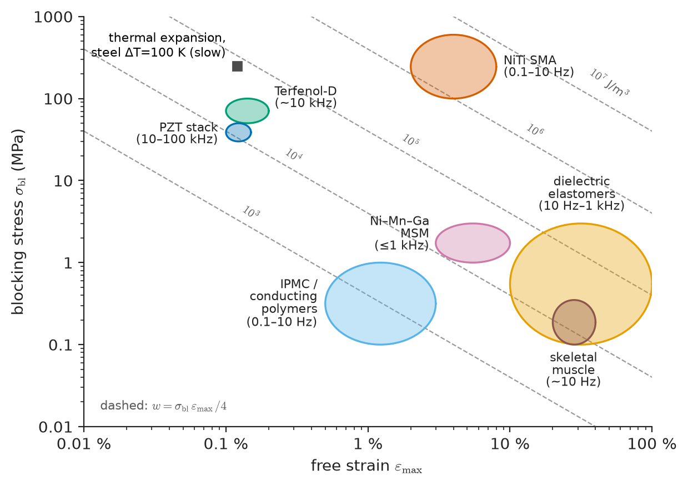
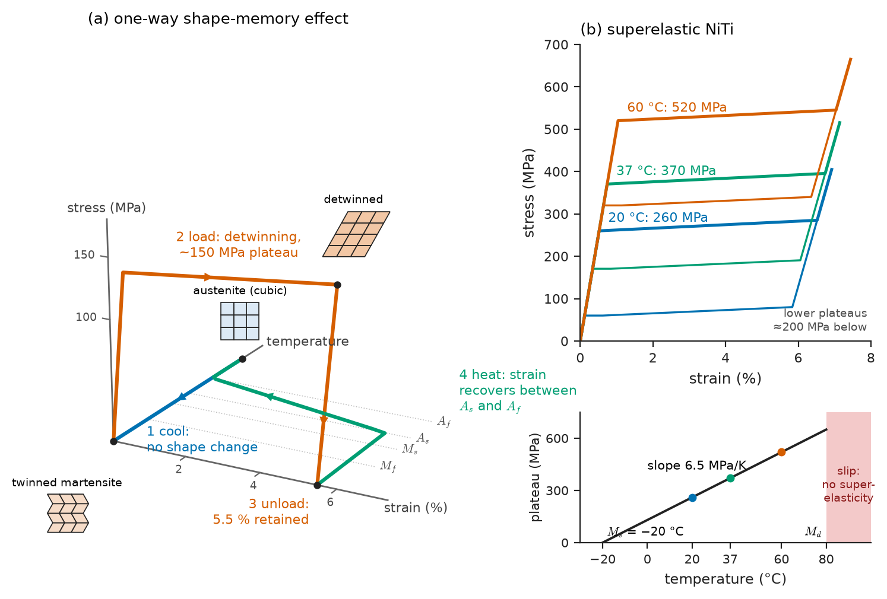
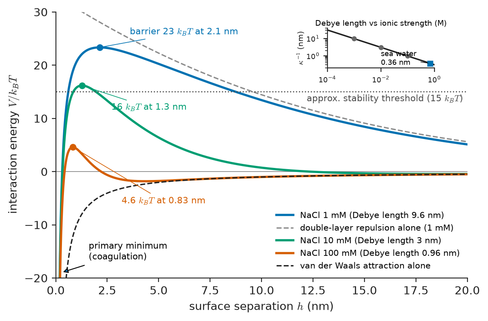
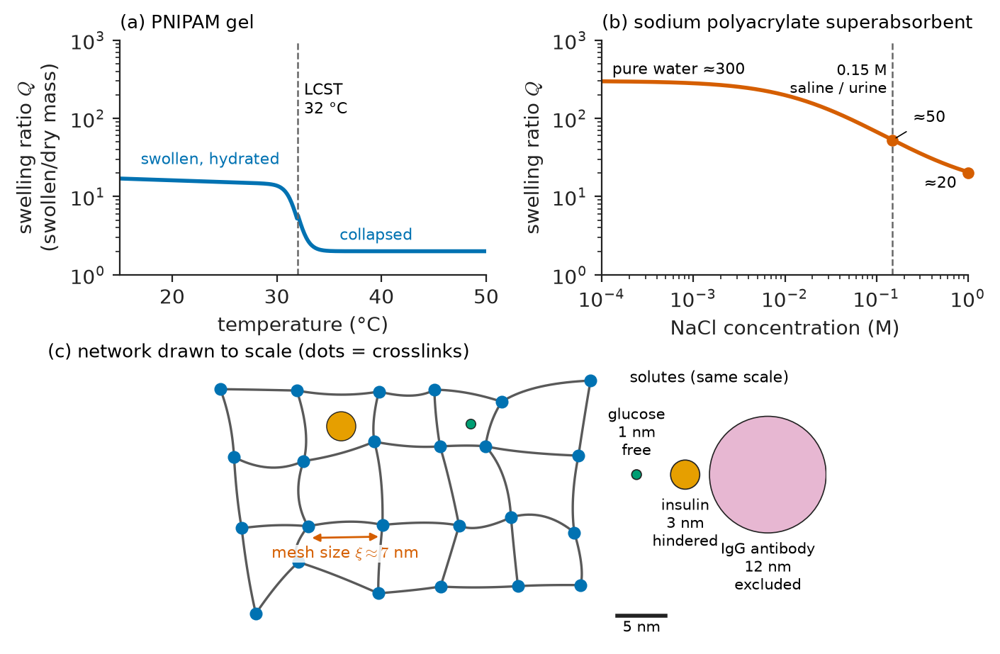
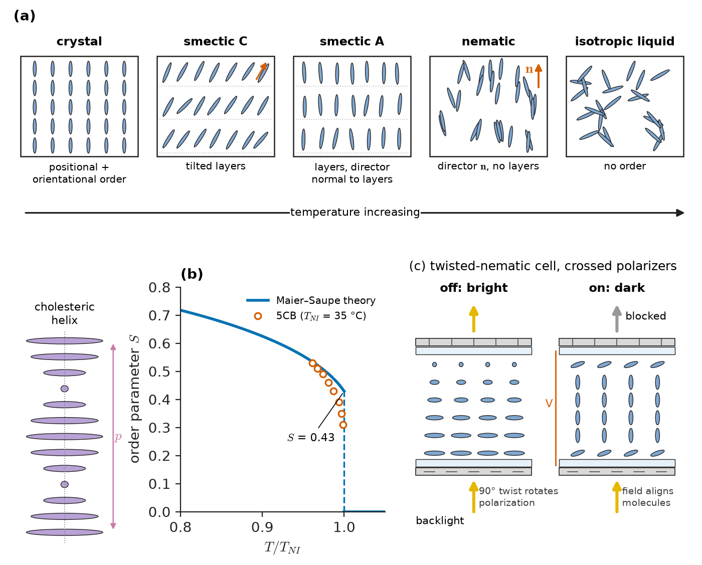
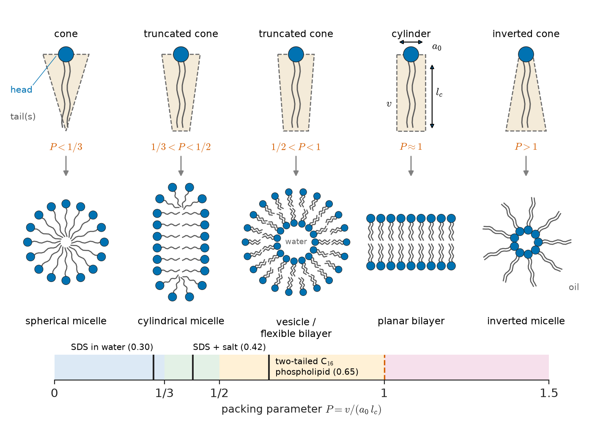

# Chapter 37 — Smart and Soft Materials

*Part VIII · Advanced and Emerging Materials*

A self-expanding stent for a femoral artery is crimped to 2 mm, threaded through a catheter and released inside the vessel, where it springs open to 7 mm and pushes gently and steadily against the wall for years, flexed half a million times a day by walking. It is laser-cut from a nickel–titanium tube, and no ordinary metal could do this job: steel crimped by 70 % in diameter would deform permanently, and a polymer would creep and lose its grip. A few metres away in the same hospital, an infusion pump's piezoelectric sensor detects air bubbles, the patient's contact lenses are a hydrogel that is 40 % water, and the monitor shows the patient's heart rate on a liquid-crystal display. None of these materials is used for its strength or stiffness. Each is used because it *responds*: to temperature, stress, electric or magnetic field, water, or ions. This chapter is about such materials. The first half treats "smart" solids that convert one form of energy into mechanical work; the second half treats "soft" matter (colloids, gels, liquid crystals and self-assembled structures) whose structure is held together by forces comparable to thermal energy and can therefore be reshaped by small stimuli.

> **How can a solid change shape on command, recover 8 % strain, or sense a force, and what limits the stroke, force and speed of such a material?**
> **Why do particles in a paint stay dispersed, why does a gel swell, and how do molecules arrange themselves into micelles, membranes and display pixels without being placed?**

| Concept | Engineering destination |
|---|---|
| Thermoelastic martensite, shape memory | Pipe couplings, actuator wires, deployable space structures, thermal valves |
| Superelasticity, Clausius–Clapeyron slope | Self-expanding stents, orthodontic arch wires, seismic dampers, eyeglass frames |
| Magnetostriction, magnetic shape memory | Sonar projectors, vibration energy harvesters, torque sensors, fast valves |
| Piezoelectric stacks and sensors | Diesel injectors, nanopositioners, ultrasound probes, structural-health monitoring |
| Electroactive polymers | Soft robots, haptics, artificial muscles, adaptive lenses |
| DLVO theory, Debye length | Ceramic slips, paints, concrete admixtures, water treatment, drug suspensions |
| Gels and hydrogels, swelling, mesh size | Contact lenses, superabsorbents, wound dressings, drug release, soft actuators |
| Liquid-crystal order parameter, Fréedericksz transition | Displays, aramid fibre spinning, thermochromic sensors |
| Self-assembly, packing parameter | Detergents, lipid nanoparticles, block-copolymer lithography, colloidal crystals |

**Roadmap.** What makes a material "smart" and how actuators are compared (37.1) → shape-memory alloys (37.2) → magnetostrictive and magnetic shape-memory materials (37.3) → piezoelectric actuators and sensors (37.4) → electroactive polymers (37.5) → the soft-matter energy scale and colloid stability (37.6) → gels and hydrogels (37.7) → liquid crystals (37.8) → self-assembly as a design tool (37.9).

---

## 37.1 Smart materials and how to compare actuators

A **smart** (or *active*, *responsive*) material couples two physical domains strongly enough that the coupling can be used in a device: a mechanical strain produced by heat, electric field or magnetic field (an **actuator**), or an electrical signal produced by strain (a **sensor**). Every solid has such couplings (all solids expand when heated, all dielectrics strain slightly in a field), so the word is about magnitude: a smart material's coupling is large enough, reversible enough and fast enough to do work.

Three numbers characterise an actuator material:

- the **free strain** $\varepsilon_{\max}$, reached with no external load;
- the **blocking stress** $\sigma_{\mathrm{bl}}$, the stress at which the strain is suppressed completely;
- the **bandwidth**, the highest frequency at which the full stroke can be cycled.

For a material whose output falls linearly from $\varepsilon_{\max}$ at zero load to zero at $\sigma_{\mathrm{bl}}$, the maximum work per unit volume delivered to a matched load is

$$
w_{\max}=\tfrac14\,\sigma_{\mathrm{bl}}\,\varepsilon_{\max}
$$

and the specific power is roughly that work times the cycling frequency. Table 37.1 and Figure 37.1 compare the main families.

**Table 37.1 — Representative actuator materials (typical values; grade and drive conditions vary)**

| Material | Stimulus | Free strain | Blocking stress | Work density (J/m³) | Bandwidth |
|---|---|---|---|---|---|
| NiTi shape-memory wire | Heating (Joule) | 4–6 % (one-way, polycrystal) | 200–600 MPa | $\sim10^{6}$–$10^{7}$ | 0.1–10 Hz (cooling-limited) |
| Ni–Mn–Ga magnetic shape memory (single crystal) | Magnetic field ~0.7 T | 6 % (up to 10–12 %) | 2–3 MPa | $\sim4\times10^{4}$ | up to ~1 kHz |
| Terfenol-D | Magnetic field | 0.1–0.2 % | 50–100 MPa | $\sim2\times10^{4}$–$5\times10^{4}$ | ~10 kHz |
| PZT stack | Electric field ~2 kV/mm | 0.1–0.15 % | 30–50 MPa | $\sim10^{4}$ | 10–100 kHz |
| Dielectric elastomer (acrylic, silicone) | Electric field 50–150 MV/m | 10–100 % | 0.1–3 MPa | $\sim10^{4}$–$10^{6}$ | 10 Hz–1 kHz |
| Ionic polymer–metal composite | 1–3 V | ~1–3 % (bending) | 0.1–1 MPa | $\sim10^{3}$ | 0.1–10 Hz |
| Skeletal muscle (reference) | Nerve signal | 20–40 % | 0.1–0.35 MPa | $\sim10^{4}$ | ~10 Hz |
| Thermal expansion, steel ($\Delta T=100$ K) | Heating | 0.12 % | ~250 MPa | $\sim7\times10^{4}$ | slow |

<!-- FIGURE 37.1 | figures/ch37/fig-37-1-actuator-map.png | map | Actuator materials trade free strain against blocking stress; shape-memory alloys deliver the highest work density but are among the slowest. | Content: log-log Ashby-style map, x-axis free strain 1e-4 to 1 (0.01 % to 100 %), y-axis blocking stress 0.01 MPa to 1000 MPa. Labelled envelopes: PZT stack (strain 1e-3 to 1.5e-3, stress 30-50 MPa), Terfenol-D (1e-3 to 2e-3, 50-100 MPa), Ni-Mn-Ga MSM (0.03-0.1, 1-3 MPa), NiTi SMA (0.02-0.08, 100-600 MPa), dielectric elastomers (0.1-1, 0.1-3 MPa), IPMC/conducting polymers (0.005-0.03, 0.1-1 MPa), muscle (0.2-0.4, 0.1-0.35 MPa), thermal expansion of steel (1e-3, 250 MPa). Diagonal dashed lines of constant work density sigma*eps/4 = 1e3, 1e4, 1e5, 1e6, 1e7 J/m3. Small text next to each envelope gives typical bandwidth (e.g. "kHz", "Hz"). -->

*Figure 37.1 — Actuator materials trade free strain against blocking stress; shape-memory alloys deliver the highest work density but are among the slowest.*

The map shows the central trade-off: large strain comes with low stress (soft polymers, magnetically driven twin boundaries), large stress with small strain (ceramics, magnetostrictives), and the one family that combines both, shape-memory alloys, is limited by how fast heat can be removed. Choosing an actuator material is therefore a design problem of the kind treated in Chapter 58: stroke, force, frequency, efficiency, mass and cost cannot all be maximised.

---

## 37.2 Shape-memory alloys

### 37.2.1 The phenomenon

In the late 1960s the US Navy needed a reliable way to join titanium hydraulic tubes in the F-14 fighter without welding. The solution was a coupling sleeve of nickel–titanium machined slightly *smaller* than the tube, cooled in liquid nitrogen, expanded mechanically by about 4 %, slipped over the tube ends while still cold, and then allowed to warm up. On warming, the sleeve "remembered" its original diameter, shrank and gripped the tubes with a contact pressure high enough to seal against 35 MPa of hydraulic fluid. Over a million such couplings were installed without a reported leak. Two properties are at work: the **shape-memory effect** (a deformation applied at low temperature is recovered on heating) and **superelasticity** (at a slightly higher temperature, very large strains are recovered simply on unloading).

### 37.2.2 Thermoelastic martensite

Both effects come from the martensitic transformation of Chapter 10, but of a special kind. In steel, martensite forms with a large shape change, its interfaces are pinned by plastic deformation, and the transformation is irreversible in practice. In shape-memory alloys the transformation is **thermoelastic**:

- the parent phase (**austenite**, for NiTi the ordered B2 cubic structure) transforms to a low-symmetry martensite (monoclinic B19′ in NiTi) by a small, coordinated shear;
- the lattice correspondence is unique: every martensite variant can revert only to the original orientation of austenite;
- the shape change is accommodated **elastically and by twinning**, not by dislocation slip, so the interfaces stay mobile and the transformation hysteresis is small (20–40 K in NiTi).

Because martensite has lower symmetry than austenite, one austenite grain can form up to 12 crystallographically equivalent **variants** in NiTi (24 habit-plane variants). On cooling without load, the variants form in self-accommodating groups, twinned against each other so that the overall shape of the grain barely changes. Four temperatures describe the transformation: martensite start and finish $M_s$, $M_f$ on cooling, and austenite start and finish $A_s$, $A_f$ on heating.

The shape-memory cycle (Figure 37.2a) is then:

1. Cool below $M_f$: twinned, self-accommodated martensite, no shape change.
2. Deform at low temperature: the twin boundaries move, so the variants best oriented for the applied stress grow at the expense of others (**detwinning**). Strains of 6–8 % (single crystals up to ~10 %) are produced at low stress (100–200 MPa in NiTi) with no dislocation slip.
3. Unload: the detwinned martensite stays deformed.
4. Heat above $A_f$: every variant reverts to the single original austenite orientation, so the original shape returns.

This is a **one-way** effect: cooling again does not restore the deformed shape. **Two-way** memory can be "trained" by thermomechanical cycling, which leaves oriented dislocation arrays whose stress fields favour particular variants on cooling, but the two-way strain is smaller (~2 %) and less stable.

### 37.2.3 Superelasticity and the Clausius–Clapeyron relation

Above $A_f$, austenite is the stable phase at zero stress. But a stress that does work on the transformation strain lowers the Gibbs energy of the martensite variant aligned with it, so martensite can be *induced by stress*. On unloading, it is unstable and reverts. The result (Figure 37.2b) is a flag-shaped stress–strain curve: linear elastic austenite, an upper **plateau** at which stress-induced martensite forms and a band of transformed material propagates along the specimen, then elastic martensite; on unloading, a lower plateau at which it reverts, recovering 6–8 % strain with a hysteresis loop whose area is energy dissipated as heat.

The plateau stress rises with temperature, because the further one is above the equilibrium temperature, the more mechanical work must be supplied to make martensite stable. Treating stress and strain as a pair of conjugate variables like $-p$ and $V$, the two-phase equilibrium obeys a Clausius–Clapeyron relation (the thermodynamics is recapped from Chapter 6):

$$
\frac{d\sigma}{dT}=-\frac{\Delta S}{\varepsilon_{\mathrm{tr}}}=-\frac{\Delta H}{T_0\,\varepsilon_{\mathrm{tr}}}
$$

where $\Delta S$ and $\Delta H$ are the entropy and enthalpy of the austenite → martensite transformation per unit volume (both negative: the transformation releases heat), $\varepsilon_{\mathrm{tr}}$ is the transformation strain in the loading direction and $T_0$ the equilibrium temperature at zero stress.

> **Status of the principle: Clausius–Clapeyron relation for stress-induced martensite**
> *Derived.* It follows from equilibrium between two phases under uniaxial stress; it assumes a fixed transformation strain and neglects hysteresis and texture, and in polycrystals is obeyed by the measured plateau stresses to within 10–20 % over about 100 K above $A_f$.

**Worked example — the stress–temperature slope of NiTi and a stent's plateau.** NiTi has a latent heat of about 20 J/g and density 6450 kg/m³, so $\lvert\Delta H\rvert\approx 2.0\times10^{4}\times6450=1.29\times10^{8}$ J/m³. With $T_0\approx300$ K and a polycrystalline transformation strain $\varepsilon_{\mathrm{tr}}\approx0.06$:

$$
\frac{d\sigma}{dT}\approx\frac{1.29\times10^{8}}{300\times0.06}=7.2\times10^{6}\ \mathrm{Pa\,K^{-1}}\approx7\ \mathrm{MPa/K}
$$

Measured slopes for superelastic NiTi are 5–8 MPa/K. A stent alloy (Ni-rich, about Ni-50.8 at.% Ti) is processed so that the stress-induced transformation would start at zero stress at about $M_s=-20$ °C. Taking a slope of 6.5 MPa/K, the upper plateau at body temperature is $6.5\times(37-(-20))=6.5\times57\approx370$ MPa, and the device delivers a nearly constant outward force over a wide range of vessel diameters, the property clinicians call "biased stiffness". The same slope is a warning: a NiTi part designed at room temperature becomes about 100 MPa stiffer in its plateau 15 K warmer, and if it is used above the temperature $M_d$ (typically 50–100 K above $A_f$) the stress for slip falls below the stress for transformation, the alloy deforms plastically, and superelasticity is lost.

<!-- FIGURE 37.2 | figures/ch37/fig-37-2-sma-cycle-superelastic.png | plot | Shape memory and superelasticity are two faces of the same reversible martensitic transformation, separated by temperature. | Content: (a) schematic 3D-style stress-strain-temperature path for the one-way effect: cooling austenite to twinned martensite (no strain), loading to 6 % strain at ~150 MPa plateau (detwinning), unloading with 5.5 % retained strain, heating through As-Af (strain recovers to 0); small crystal sketches at each corner (cubic austenite, twinned variants, detwinned variant). (b) Stress-strain curves of superelastic NiTi at 20, 37 and 60 C: elastic slope ~40-60 GPa to upper plateau at about 260, 370 and 520 MPa, plateau length ~6 %, lower plateaus about 200 MPa lower, full recovery; inset stress vs temperature line with slope 6.5 MPa/K from Ms = -20 C, Md marked near 80 C. -->

*Figure 37.2 — Shape memory and superelasticity are two faces of the same reversible martensitic transformation, separated by temperature.*

### 37.2.4 Alloys and engineering

**NiTi (nitinol)** dominates: it has the largest recoverable strain, good fatigue and corrosion resistance (a protective TiO₂ film, Chapter 39), and transformation temperatures that move by roughly 10–20 K for each 0.1 at.% change in nickel content around equiatomic. That sensitivity makes melting and composition control (vacuum induction plus vacuum arc remelting, carbon and oxygen held below a few hundred ppm) the critical processing step. Ageing Ni-rich alloys precipitates Ni₄Ti₃, which raises the matrix Ti content and shifts the transformation temperatures upward, and also strengthens the austenite against slip. Cold working followed by **shape setting** at 450–550 °C while clamped in a fixture fixes the "remembered" shape; this is how stents, guidewires and arch wires are formed.

Other families fill niches. Cu–Zn–Al and Cu–Al–Ni are cheaper and have higher transformation temperatures but are brittle in polycrystalline form because of their elastic anisotropy and coarse grains. Fe–Mn–Si alloys show a modest (~2–4 %) one-way effect through an FCC → HCP transformation and are used in prestressing strips for retrofitting concrete. **High-temperature SMAs** (NiTiHf, NiTiPd, NiTiPt) push $A_f$ above 100–250 °C for aerospace actuators near engines; Boeing flew NiTi torque tubes that twist trailing-edge surfaces on an engine chevron and a wing in test programmes.

Design limits are as important as the effect itself:

- **Speed.** Heating by electric current is fast; cooling is by conduction and convection. A 0.25 mm wire in still air cycles at about 1 Hz; thinner wires and liquid cooling are faster.
- **Efficiency.** Most of the input energy heats the wire. The worked example below shows an efficiency of about 2 %, typical of thermal actuators, which is why SMAs suit low-duty-cycle tasks (valves, latches, deployment) rather than continuous motion.
- **Functional fatigue.** Each cycle leaves some dislocations, so the plateau stress drifts down and the recoverable strain shrinks; designs that limit strain to 2–3 % achieve $10^{6}$–$10^{7}$ cycles. Structural fatigue of stents (Chapter 14) is assessed on strain amplitude, not stress, for this reason.

**Worked example — a NiTi actuator wire.** A 0.25 mm NiTi wire, 100 mm long, lifts a load by recovering 4 % strain against a recovery stress of 150 MPa. Its cross-section is $A=\pi(0.125\times10^{-3})^2=4.91\times10^{-8}$ m², so the force is $150\times10^{6}\times4.91\times10^{-8}=7.4$ N and the stroke $0.04\times100=4.0$ mm. The mechanical work is $7.4\times0.004=29$ mJ per cycle. Heating the wire (mass $6450\times4.91\times10^{-8}\times0.1=3.2\times10^{-5}$ kg) by 60 K with $c_p\approx450$ J kg⁻¹ K⁻¹, and supplying the latent heat of 20 J/g, needs $3.2\times10^{-5}\times(450\times60+2.0\times10^{4})=1.5$ J. The efficiency is $0.029/1.5\approx2$ %. The wire is an excellent force-to-mass actuator (7 N from 0.03 g) and a poor energy converter.

Civil engineers use superelastic NiTi bars and cables for the hysteresis rather than the stroke: in seismic dampers and beam–column connections, each loading cycle dissipates the loop area (about 10–20 MJ/m³ per cycle at 6 % strain) and the structure recentres afterwards, which steel dampers that yield plastically cannot do.

---

## 37.3 Magnetostrictive and magnetic shape-memory materials

### 37.3.1 Magnetostriction

When a ferromagnet is magnetized, its domains rotate (Chapter 28) and the crystal lattice distorts slightly along the magnetization direction, because the spin–orbit coupling ties the magnetic moment to the shape of the electron orbitals and therefore to the bond lengths. The saturation **magnetostriction** $\lambda_s$ is the fractional length change at saturation. In iron and nickel it is tens of parts per million ($\lambda_s\approx-35$ ppm for Ni, a contraction), which is a nuisance in transformers (the 100 Hz hum, Chapter 29) but too small for actuation.

Rare-earth–iron Laves compounds change this. **Terfenol-D** (Tb₀.₃Dy₀.₇Fe₂) has $\lambda_s$ of 1500–2000 ppm at room temperature; the terbium–dysprosium ratio is chosen so that the large but opposite-signed anisotropies of TbFe₂ and DyFe₂ cancel, letting a modest field (about 50–200 kA/m) rotate the magnetization. It is grown as directionally solidified <112>-textured rods, operated under a compressive prestress of 10–20 MPa that orients the domains perpendicular to the rod so that the field can rotate them all, and used in high-power, low-frequency **sonar projectors**, active vibration control and fast valves. It is brittle (fracture toughness about 1 MPa m^1/2) and expensive.

**Galfenol** (Fe–Ga, 17–19 at.% Ga) gives 250–400 ppm but is ductile and machinable, can carry tension and bending, and is used in energy harvesters on vibrating machinery and in torque sensors. The **inverse** (Villari) effect, a change of magnetization with stress, makes magnetostrictive materials sensors as well: a shaft of Fe–Ni or Fe–Ga under torque changes permeability along its helix directions, which a non-contact coil detects, the basis of torque sensors in electric power steering.

### 37.3.2 Magnetic shape-memory alloys

A much larger strain is obtained by combining the twinned martensite of Section 37.2 with magnetic anisotropy. In the Heusler alloy **Ni₂MnGa** (and off-stoichiometric Ni–Mn–Ga), the martensite is ferromagnetic and strongly anisotropic: the short $c$ axis of the tetragonal (or modulated) martensite cell is the easy axis of magnetization. A field applied along a crystal direction makes the variant whose easy axis points along the field favoured by the magnetic anisotropy energy $K_u$ per volume. If the twin boundaries are mobile enough, the favoured variant grows by twin-boundary motion and the crystal changes shape by the twinning strain $\varepsilon_0=1-c/a$, about 6 % in five-layer modulated martensite and up to 10–12 % in other modulations.

The largest stress the field can exert on a twin boundary is set by the anisotropy energy:

$$
\sigma_{\mathrm{mag}}^{\max}\approx\frac{K_u}{\varepsilon_0}
$$

With $K_u\approx2\times10^{5}$ J/m³ and $\varepsilon_0=0.06$, $\sigma_{\mathrm{mag}}^{\max}\approx3.3$ MPa. Twin boundaries in good single crystals move at about 0.1–1 MPa, so the margin is narrow: the blocking stress is only 2–3 MPa and polycrystals, whose grain boundaries obstruct twinning, show little strain. Magnetic shape-memory alloys therefore combine large strain with fast (kHz) response, because no heat must flow, but small force. Prototypes include fast valves, micropumps and positioners. Unlike NiTi, the effect is limited by magnetism, not by heat transfer, and the material's Curie temperature (about 100 °C) and martensite start temperature cap the operating range.

> **Status of the principle: Anisotropy limit on magnetic shape-memory stress**
> *Approximate.* The output stress cannot exceed the magnetic energy available per unit transformation strain; real devices fall below it because of demagnetizing fields, twinning stress and incomplete saturation.

---

## 37.4 Piezoelectric actuators and sensors (recap)

Chapter 27 explained the origin of piezoelectricity: a crystal without a centre of symmetry polarizes under stress (direct effect) and strains under field (converse effect), linked by the third-rank tensor $d_{ij}$ of Chapter 4. Ferroelectric ceramics such as **lead zirconate titanate** (PZT) near the morphotropic phase boundary are poled to give large coefficients, $d_{33}=300$–600 pC/N (equivalently pm/V). Here the materials engineer's question is how such a ceramic becomes an actuator or a sensor.

**Table 37.2 — Typical piezoelectric materials**

| Material | $d_{33}$ (pC/N) | Coupling $k_{33}$ | Curie/usable temperature | Notes |
|---|---|---|---|---|
| Quartz (SiO₂) | 2.3 ($d_{11}$) | 0.1 | 573 °C ($\alpha$–$\beta$) | Very stable; resonators, force sensors |
| PZT, "hard" (PZT-4) | 290 | 0.70 | 330 °C | Low loss; sonar, ultrasonic welding |
| PZT, "soft" (PZT-5H) | 590 | 0.75 | 190 °C | Large strain; actuators, imaging |
| PMN–PT single crystal | 1500–2500 | 0.9 | ~100 °C (phase change) | High-end medical ultrasound |
| (K,Na)NbO₃-based (lead-free) | 200–400 | 0.5–0.6 | 200–400 °C | RoHS-driven replacement |
| AlN thin film | 5 | 0.3 | > 1000 °C | MEMS microphones, RF filters |
| PVDF (poled polymer) | −20 to −30 | 0.15–0.2 | ~80 °C | Flexible sensors, hydrophones |

### 37.4.1 Multilayer stack actuators

A single PZT plate 1 mm thick under 1 kV extends by only $d_{33}V\approx0.5$ µm. To get useful stroke at moderate voltage, the ceramic is tape-cast into layers 50–100 µm thick interleaved with electrodes and co-fired (the same process as multilayer capacitors, Chapter 49). The layers are mechanically in series and electrically in parallel, so the stroke is

$$
\Delta L=n\,d_{33}\,V
$$

for $n$ layers at voltage $V$.

**Worked example — a stack for a common-rail injector.** A stack of $n=100$ layers, each 0.1 mm thick, with an effective $d_{33}=500$ pm/V driven at 150 V (field 1.5 kV/mm) gives $\Delta L=100\times500\times10^{-12}\times150=7.5$ µm. For a 10 mm × 10 mm stack 10 mm long with an open-circuit modulus of about 60 GPa, the stiffness is $k=EA/L=60\times10^{9}\times10^{-4}/0.01=6.0\times10^{8}$ N/m (600 N/µm), so the blocking force is $k\,\Delta L=6.0\times10^{8}\times7.5\times10^{-6}=4.5$ kN. A hydraulic amplifier converts this short, powerful, sub-millisecond stroke into the needle lift of a diesel or gasoline direct-injection valve, which can then deliver several small injections per combustion cycle. The same stacks drive nanopositioners in lithography steppers and atomic-force microscopes, where 7.5 µm with sub-nanometre resolution is ideal.

Engineering limits come from the ceramic: it is weak in tension (stacks are mechanically preloaded in compression), shows hysteresis of 10–15 % in strain and creep at high fields, depoles if heated towards the Curie temperature or driven by reverse fields beyond the coercive field, and suffers electrode-edge cracking and silver migration in humid service. Lead-free substitutes (KNN, BNT, BaTiO₃-based) are improving but have not matched soft PZT across temperature.

### 37.4.2 Sensors and transducers

In the direct mode a force $F$ along the poling axis produces a charge $Q=d_{33}F$; a quartz or PZT disc in a load washer turns 100 N into 230 pC or 40 nC respectively, read by a charge amplifier. Piezoelectric **accelerometers** (a seismic mass on a ceramic element) monitor bearings and engines; **ultrasound** transducers emit and receive at 1–20 MHz for medical imaging and for non-destructive testing of welds and composites (Chapter 52); thin PZT or PVDF patches bonded to an aircraft panel or a bridge girder send and receive guided waves for **structural-health monitoring**, detecting cracks and disbonds from changes in the signal. Because charge leaks away through finite resistance, piezoelectric sensors measure dynamic, not static, forces.

> **Boundary.** The crystal physics of piezo- and ferroelectricity is treated in more depth, with electrical equivalent circuits, in Chapter 27.

---

## 37.5 Electroactive polymers

Polymers offer what ceramics cannot: strains of tens of percent, low density, compliance that matches biological tissue, and easy shaping. **Electroactive polymers** (EAPs) are polymers that change shape in an electric field. They divide into two groups.

### 37.5.1 Electronic (field-driven) EAPs

**Dielectric elastomers** are not active materials in the crystal sense at all: they are soft, incompressible rubbers (acrylic, silicone, polyurethane) coated on both faces with compliant electrodes (carbon grease, carbon nanotube mats). A voltage charges the film as a capacitor, the opposite charges on the electrodes attract each other and like charges on each electrode repel, so the film is squeezed in thickness and, being incompressible, expands in area. The effective compressive stress is the **Maxwell pressure**

$$
p=\varepsilon_0\varepsilon_r E^2
$$

(twice the electrostatic energy density, because the in-plane expansion also does work).

**Worked example — a dielectric-elastomer membrane.** An acrylic film ($\varepsilon_r=4.7$, Young's modulus about 1 MPa) is 50 µm thick and driven at 3 kV, so $E=3000/(50\times10^{-6})=60$ MV/m. The Maxwell pressure is $p=8.854\times10^{-12}\times4.7\times(6.0\times10^{7})^{2}=0.15$ MPa, and the small-strain thickness strain is $p/Y\approx0.15/1.0=15$ %. In practice the film is prestretched biaxially (which thins it and stiffens it against instability), and area strains above 100 % have been demonstrated. Two failure modes bound the design: **electrical breakdown** (Chapter 26), and **pull-in** or electromechanical instability, in which thinning raises the field, which thins the film further, a positive feedback that collapses an unstretched film at about 1/3 thickness reduction. Prestretch and strain-stiffening elastomers move the instability past breakdown.

Kilovolt drive is the main practical drawback, but dielectric elastomers give the best combination of strain, efficiency (energy not used mechanically can be recovered from the capacitor) and speed among polymer actuators; they are used in haptic feedback, tunable lenses, loudspeakers and soft grippers, and run in reverse as **generators** that harvest wave energy.

**Ferroelectric and electrostrictive polymers** form the second electronic class: PVDF and its copolymer P(VDF-TrFE) are piezoelectric when poled (Table 37.2), and terpolymers such as P(VDF-TrFE-CFE), in which bulky comonomers break up long-range ferroelectric order into nanodomains (a relaxor), give electrostrictive strains of 4–7 % at about 150 MV/m with elastic modulus near 0.5 GPa, much stiffer than elastomers.

### 37.5.2 Ionic EAPs

Ionic EAPs work at 1–5 V because the active process is ion migration, not field-induced stress. In an **ionic polymer–metal composite** (IPMC) a Nafion-type ionomer membrane, swollen with water or an ionic liquid and plated with platinum or gold, bends when a voltage drives mobile cations and their hydration water towards the cathode side, which swells while the anode side shrinks. **Conducting polymers** such as polypyrrole and PEDOT change volume by a few percent as ions enter and leave on oxidation and reduction (the same chemistry as a battery electrode, Chapter 40). Ionic EAPs are slow (diffusion-limited, seconds), need to stay wet or use ionic liquids, and hold a deflection only while current flows, but their low voltage suits medical devices such as active catheters.

A further, rapidly growing class is **liquid-crystal elastomers** (Section 37.8): crosslinked networks of mesogenic chains that contract by 30–400 % along their director when heated through the nematic–isotropic transition or when photoisomerizable groups are illuminated, offering light-driven, untethered soft actuators.

---

## 37.6 Soft matter and colloid stability

### 37.6.1 The soft-matter energy scale

The second half of the chapter changes scale. A steel lattice is held by bonds of a few electronvolts; thermal energy at room temperature is $k_BT=4.1\times10^{-21}$ J $=25.7$ meV at 25 °C, about a hundredth of that, so thermal motion only rattles the atoms. In **soft matter** (colloids, polymers in solution, gels, liquid crystals, surfactant assemblies, biological membranes) the structural units are large (nanometres to micrometres) and are held together by interactions of order $1$–$100\,k_BT$: van der Waals attraction between particles, screened electrostatic repulsion, hydrogen bonds, the hydrophobic effect, entropy of chains. As a result, soft matter is easily deformed (moduli of Pa to MPa), responds strongly to temperature, salt, pH and solvent, and organises itself by the balance of energy and entropy. That responsiveness is both the difficulty (a paint that settles, a sauce that separates) and the design opportunity (a gel that swells on cue, a membrane that forms by itself).

### 37.6.2 Colloids

A **colloid** is a dispersion of one phase in another with at least one dimension between about 1 nm and 1 µm: solid particles in liquid (*sols* and *suspensions*: paints, inks, ceramic slips, cement paste, blood), liquid droplets in liquid (*emulsions*: milk, mayonnaise, metalworking fluids, asphalt emulsions), gas in liquid or solid (*foams*: firefighting foams, polyurethane insulation), and liquid or solid in gas (*aerosols*). In this size range particles undergo Brownian motion strong enough to resist sedimentation for a time, but their huge interfacial area (Chapter 38) gives a large driving force to reduce it by aggregation. A colloid is therefore almost never in equilibrium; its "stability" is kinetic, meaning that a barrier prevents particles from coming into contact.

### 37.6.3 DLVO theory

The classical theory of that barrier, due to Derjaguin, Landau, Verwey and Overbeek (DLVO), adds two interactions between particles in an electrolyte.

**Van der Waals attraction.** Correlated dipole fluctuations attract any two bodies of the same material through any medium. For two spheres of radius $R$ at surface separation $h\ll R$,

$$
V_A(h)=-\frac{A_H R}{12h}
$$

where $A_H$ is the **Hamaker constant**, of order $10^{-20}$ J for oxides and polymers in water and $10^{-19}$ J for metals in water.

**Electrical double-layer repulsion.** Most surfaces in water carry charge (from dissociation of surface groups, such as Si–OH → SiO⁻, or adsorption of ions), balanced by a diffuse cloud of counter-ions. The cloud's thickness is the **Debye length** $\kappa^{-1}$, which falls with ionic strength $I$; for a 1:1 electrolyte in water at 25 °C

$$
\kappa^{-1}\approx\frac{0.304}{\sqrt{I/\mathrm{(mol\,L^{-1})}}}\ \mathrm{nm}
$$

(9.6 nm at 1 mM, 3.0 nm at 10 mM, 0.96 nm at 100 mM, and about 0.4 nm in sea water). When the clouds of two particles overlap, the osmotic pressure of the excess ions pushes them apart. For spheres with surface potential $\psi_0$ (in practice the measured **zeta potential**) and $\kappa R\gg1$, a common approximation is

$$
V_R(h)=2\pi\varepsilon_0\varepsilon_r R\,\psi_0^{2}\ln\!\left(1+e^{-\kappa h}\right)
$$

The total $V=V_A+V_R$ (Figure 37.3) has a deep **primary minimum** at contact (irreversible aggregation, *coagulation*), a **barrier** at about a Debye length from contact if repulsion is strong enough, and sometimes a shallow **secondary minimum** further out (weak, reversible *flocculation*). If the barrier is above about $15$–$25\,k_BT$, collisions almost never surmount it and the colloid is stable for months; below a few $k_BT$ it coagulates in seconds to minutes.

> **Status of the principle: DLVO theory**
> *Approximate.* It treats the medium as a continuum, the ions as point charges obeying Poisson–Boltzmann statistics and the forces as additive; it predicts trends with salt, valence and particle size well, but fails at separations below about 1–2 nm, where hydration forces, ion specificity and surface roughness dominate, and it ignores steric and depletion forces.

**Worked example — when does a suspension coagulate?** Oxide particles of diameter 100 nm ($R=50$ nm) in water ($\varepsilon_r=78.5$) have $A_H=1.0\times10^{-20}$ J and a surface potential of 30 mV. Evaluating $V(h)/k_BT$ numerically with the two expressions above at 25 °C ($k_BT=4.12\times10^{-21}$ J):

| NaCl concentration | Debye length | Barrier height | Position of barrier |
|---|---|---|---|
| 1 mM | 9.6 nm | $23\,k_BT$ | 2.1 nm |
| 10 mM | 3.0 nm | $16\,k_BT$ | 1.3 nm |
| 100 mM | 0.96 nm | $4.6\,k_BT$ | 0.8 nm |

At 1 mM the dispersion is stable; at 100 mM thermal collisions cross the barrier routinely and the particles coagulate. (In reality the surface potential also falls as salt is added, which makes the collapse sharper.) Multivalent counter-ions are far more effective: the critical coagulation concentration varies roughly as $z^{-6}$ for highly charged surfaces (the **Schulze–Hardy rule**), which is why water-treatment plants dose aluminium or iron(III) salts to coagulate clay and organic colloids before filtration, and why a few millimoles of Ca²⁺ can destabilise a ceramic slip that tolerated ten times as much Na⁺.

<!-- FIGURE 37.3 | figures/ch37/fig-37-3-dlvo-potential.png | plot | DLVO interaction energy between two 100 nm oxide particles: adding salt shrinks the Debye length and collapses the barrier that keeps the colloid stable. | Content: x-axis surface separation h 0-20 nm, y-axis V/kBT from -20 to +30. Curves for NaCl 1 mM (barrier 23 kBT at 2.1 nm), 10 mM (16 kBT at 1.3 nm), 100 mM (4.6 kBT at 0.8 nm), computed with A_H = 1e-20 J, R = 50 nm, psi0 = 30 mV, eps_r = 78.5, T = 298 K. Dashed curves: van der Waals attraction alone (black) and double-layer repulsion alone for 1 mM (grey). Horizontal dotted line at 15 kBT labelled "approx. stability threshold"; labels "primary minimum (coagulation)" near h -> 0, "barrier". Inset: Debye length vs ionic strength 1e-4 to 1 M log-log line, sea water marked. -->

*Figure 37.3 — DLVO interaction energy between two 100 nm oxide particles: adding salt shrinks the Debye length and collapses the barrier that keeps the colloid stable.*

### 37.6.4 Beyond DLVO: engineering colloid stability

Engineers control colloids with four tools:

- **Charge (electrostatic stabilisation).** Adjusting pH away from the particle's **isoelectric point** (where zeta potential is zero: about pH 9 for alumina, 2–3 for silica, 6–7 for titania) raises $\lvert\psi_0\rvert$. Alumina slips for slip casting are dispersed at pH ~4 or with polyelectrolyte dispersants.
- **Steric stabilisation.** Polymer chains grafted or adsorbed on the surface (polyethylene glycol on drug nanoparticles, polycarboxylate ethers on cement grains) repel because compressing them costs conformational entropy. This works at high ionic strength, where electrostatics fail; polycarboxylate **superplasticisers** let concrete be placed at water–cement ratios of 0.3–0.4 (Chapter 18) and are the largest-tonnage colloid stabilisers in industry.
- **Depletion.** Non-adsorbing polymer or micelles in solution push large particles together (their exclusion zones overlap, raising the free volume available to the small species), which is used to cream emulsions deliberately and to assemble colloidal crystals.
- **Bridging.** Long polymer chains adsorbed on two particles at once flocculate them: polyacrylamide flocculants in mineral processing and water treatment.

Colloidal processing matters well beyond chemistry. Ceramic powder processing (Chapter 17) needs a well-dispersed, high-solids slip to give a dense, flaw-free green body; agglomerates become the strength-limiting flaws of Chapter 14. Paints, inks for printed electronics, magnetorheological fluids in automotive dampers, and lipid nanoparticles that carry mRNA vaccines are all colloids whose performance is decided by the balance in Figure 37.3.

---

## 37.7 Gels and hydrogels

### 37.7.1 What a gel is

A **gel** is a three-dimensional network that spans its container and holds a large volume of liquid. It is solid in the sense that it has an equilibrium shear modulus and does not flow, yet it may be more than 90 % solvent. When the solvent is water, the gel is a **hydrogel**. Gels are classified by how the network is held together:

- **Chemical gels** have covalent crosslinks: polyacrylamide for electrophoresis, poly(2-hydroxyethyl methacrylate) (pHEMA) and silicone hydrogels for contact lenses, sodium polyacrylate superabsorbents. They are permanent.
- **Physical gels** have reversible junctions: crystallites (poly(vinyl alcohol) freeze–thaw gels), helices (gelatin, agarose, carrageenan), ionic bridges (alginate crosslinked by Ca²⁺), hydrophobic associations or entanglements. They melt or dissolve on heating, on changes in salt, or under stress, and often heal.
- **Colloidal gels** are networks of aggregated particles, such as a fumed-silica gel or a weak clay drilling mud; they are often thixotropic (they flow under shear and re-form at rest).
- **Sol–gel** inorganic gels (silica from hydrolysis of tetraethoxysilane) are precursors to glasses, aerogels and coatings (Chapter 49).

### 37.7.2 Swelling and elasticity

A dry, crosslinked hydrophilic network placed in water swells until two free-energy contributions balance: the **mixing** free energy, which favours more water (Flory–Huggins theory, Chapter 20, with interaction parameter $\chi$), and the **elastic** free energy of the stretched strands, which resists (rubber elasticity, Chapter 20). For a polyelectrolyte network, the osmotic pressure of the counter-ions trapped inside adds a third, often dominant, swelling term. The **Flory–Rehner** balance predicts that the equilibrium swelling ratio rises as crosslink density falls, as $\chi$ falls (better solvent) and as fixed charge rises; and that salt in the surrounding water, by reducing the ion osmotic pressure difference, collapses a polyelectrolyte gel. That is why a sodium polyacrylate superabsorbent in a nappy absorbs about 300 times its mass of pure water but only 30–50 times its mass of urine (Figure 37.4b).

> **Status of the principle: Flory–Rehner swelling theory**
> *Approximate.* Combines mean-field mixing with affine rubber elasticity; it predicts trends and orders of magnitude, but the uniform-network assumption fails for real gels with heterogeneous crosslinking, dangling ends and loops.

The shear modulus of a swollen network follows rubber elasticity: $G\approx\nu k_BT$, where $\nu$ is the number density of elastically active strands. Because a gel is mostly solvent, its strands are long and dilute and $G$ ranges from about 10 Pa (soft biological gels) to 1 MPa (contact lenses, cartilage substitutes). The **mesh size** $\xi$, the typical spacing between crosslinks, governs which molecules can diffuse through the gel; a scaling estimate is $\xi\approx(k_BT/G)^{1/3}$.

**Worked example — mesh size of a hydrogel.** A hydrogel used for cell encapsulation has $G=10$ kPa at 25 °C. Then $\xi\approx(4.12\times10^{-21}/1.0\times10^{4})^{1/3}=7.4\times10^{-9}$ m, about 7 nm. Glucose (about 1 nm) and oxygen diffuse freely, small proteins such as insulin (about 3 nm) diffuse with hindrance, and antibodies (about 10–15 nm) and immune cells are excluded. A softer gel with $G=1$ kPa has $\xi\approx16$ nm and lets antibodies through. Tuning stiffness therefore also tunes permeability, which is a constraint in designing immunoisolating capsules (Chapter 39): one cannot make the gel tougher by crosslinking it more without also closing the mesh.

### 37.7.3 Responsive and tough hydrogels

Because swelling is a balance of small free-energy terms, gels can be made to respond to stimuli:

- **Temperature.** Poly(N-isopropylacrylamide) (PNIPAM) has a lower critical solution temperature near 32 °C: below it the chains are hydrated and the gel is swollen; above it hydrophobic association wins and the gel expels most of its water within seconds to minutes (volume changes of 10× are common; Figure 37.4a). This is used for cell-sheet harvesting, valves in microfluidics and on-demand drug release.
- **pH and ions.** Gels with acidic or basic groups swell when ionised: poly(acrylic acid) gels swell at high pH, chitosan gels at low pH, which allows release in a chosen part of the gut.
- **Specific molecules.** Glucose-responsive gels (with phenylboronic acid groups) for insulin delivery; DNA-crosslinked gels.

Classic hydrogels are brittle: a polyacrylamide gel has a fracture energy of about 10 J/m², because a crack breaks only the strands that cross it. **Double-network** gels (a stiff, brittle, highly crosslinked polyelectrolyte network interpenetrated by a soft, stretchable one) and hybrid ionic–covalent gels (alginate–polyacrylamide) reach $10^{3}$–$10^{4}$ J/m², comparable to cartilage, because the first network fractures sacrificially over a large zone around the crack and dissipates energy, an analogue of the process-zone toughening of ceramics (Chapter 14). Such gels open applications in soft robotics, stretchable ionic conductors and load-bearing tissue replacements.

<!-- FIGURE 37.4 | figures/ch37/fig-37-4-hydrogel-swelling.png | plot | Hydrogels swell or collapse in response to temperature, salt and crosslink density; PNIPAM collapses sharply near 32 C. | Content: (a) swelling ratio Q (mass swollen/mass dry, log y-axis 1-1000) vs temperature 15-50 C for PNIPAM gel: Q ~ 15-20 below 30 C, sharp drop to ~2 between 31 and 34 C, transition at 32 C labelled LCST. (b) Swelling ratio of a sodium polyacrylate superabsorbent vs NaCl concentration (log x 1e-4 to 1 M): ~300 in pure water, ~50 at 0.15 M (saline / urine marked), ~20 at 1 M. (c) schematic network showing crosslinks, mesh size xi ~ 7 nm, with glucose (1 nm), insulin (3 nm) and IgG antibody (12 nm) circles drawn to scale. -->

*Figure 37.4 — Hydrogels swell or collapse in response to temperature, salt and crosslink density; PNIPAM collapses sharply near 32 C.*

---

## 37.8 Liquid crystals

### 37.8.1 Phases between crystal and liquid

A crystal has long-range positional and orientational order; a liquid has neither. **Liquid crystals** (introduced in Chapter 2) are fluids with orientational order and, in some phases, partial positional order. They form from strongly anisotropic molecules or particles, either rod-like (*calamitic*: cyanobiphenyls, aramid chains) or disc-like (*discotic*: triphenylenes, graphene-oxide platelets). Two ways of reaching them are distinguished:

- **Thermotropic** liquid crystals change phase with temperature: the display mixtures, main-chain liquid-crystal polymers (Chapter 20), mesophase pitch for carbon fibres.
- **Lyotropic** liquid crystals change phase with concentration in a solvent: surfactant–water systems, cell membranes, aramid (poly-p-phenylene terephthalamide) in concentrated sulfuric acid, cellulose nanocrystals in water.

The principal phases (Figure 37.5) are:

- **Nematic (N):** molecules point on average along a direction called the **director** $\mathbf{n}$, with no positional order. The fluid flows like a liquid but is optically birefringent.
- **Smectic A and C:** molecules also stack in layers; in smectic A the director is normal to the layers, in smectic C it is tilted.
- **Cholesteric (chiral nematic, N\*):** in chiral molecules the director twists helically with a pitch $p$ of 0.1–10 µm; when $p$ is comparable to the wavelength of light, the helix selectively reflects colour, and since pitch changes with temperature, cholesterics serve as thermometers and in thermochromic inks.
- **Columnar:** discotic molecules stack into columns that pack in a 2D lattice.

### 37.8.2 The order parameter

How ordered a nematic is, is measured by the scalar **order parameter**

$$
S=\left\langle\tfrac12\left(3\cos^{2}\theta-1\right)\right\rangle
$$

where $\theta$ is the angle between a molecular axis and the director and the average is over all molecules. $S=1$ for perfect alignment and $S=0$ for an isotropic liquid. In real nematics $S$ falls from about 0.6–0.8 deep in the nematic phase to about 0.3–0.45 at the nematic–isotropic transition $T_{NI}$, where it drops discontinuously to zero (a weakly first-order transition). The **Maier–Saupe** mean-field theory, which treats each molecule as feeling an orienting potential proportional to $S$, predicts the jump at $S\approx0.43$ and a universal curve of $S$ versus $T/T_{NI}$ that fits many compounds reasonably well.

> **Status of the principle: Maier–Saupe mean-field theory of nematic order**
> *Approximate.* Mean-field treatment of anisotropic attractions; it reproduces the first-order N–I transition and the shape of $S(T)$, but ignores the steric (excluded-volume) contribution that Onsager showed is decisive for lyotropic rods, and overestimates order near $T_{NI}$.

Macroscopic anisotropy follows from $S$: refractive indices along and across the director differ (birefringence $\Delta n=0.05$–0.3), and so do the dielectric constants (dielectric anisotropy $\Delta\varepsilon=\varepsilon_\parallel-\varepsilon_\perp$, positive for cyanobiphenyls with their strong axial dipole). Elastic resistance to distorting the director field is described by three Frank constants for splay, twist and bend, $K_{11},K_{22},K_{33}$, all of order 1–20 pN.

<!-- FIGURE 37.5 | figures/ch37/fig-37-5-liquid-crystal-phases.png | schematic | Liquid-crystal phases are intermediate between crystal and isotropic liquid; the nematic order parameter falls with temperature and drops to zero at the clearing point. | Content: (a) row of five boxes with rod-shaped molecules: crystal (positional + orientational order), smectic C (tilted layers), smectic A (layers, director normal), nematic (director n arrow, no layers), isotropic liquid; temperature arrow increasing left to right. Small inset of a cholesteric helix with pitch p. (b) Order parameter S vs T/T_NI from 0.8 to 1.05: Maier-Saupe curve rising from S ~ 0.43 at T/T_NI = 1 to ~0.7 at 0.85, dropping to 0 above 1; points for 5CB (T_NI = 35 C). (c) Twisted-nematic cell schematic, off state (90 degree twist, light passes crossed polarizers) and on state (molecules aligned with field, dark). -->

*Figure 37.5 — Liquid-crystal phases are intermediate between crystal and isotropic liquid; the nematic order parameter falls with temperature and drops to zero at the clearing point.*

### 37.8.3 Displays and the Fréedericksz transition

A liquid-crystal display uses electric fields to rotate the director, and polarizers to turn director rotation into contrast. In the classic **twisted-nematic** (TN) cell, a nematic layer about 5 µm thick sits between glass plates whose alignment layers (rubbed polyimide) are at 90° to each other; the director twists through 90° across the cell and guides the polarisation of light through crossed polarizers (bright state). A field across the cell, acting on positive $\Delta\varepsilon$, tilts the molecules towards the field; above a threshold the twist unwinds, the polarisation is no longer rotated, and the pixel goes dark. The threshold is that of the **Fréedericksz transition**, where the dielectric torque first beats the elastic restoring torque; for a pure splay geometry

$$
V_{\mathrm{th}}=\pi\sqrt{\frac{K_{11}}{\varepsilon_0\,\Delta\varepsilon}}
$$

independent of cell thickness (both the field and the elastic torque scale with thickness).

**Worked example — the threshold voltage of a nematic cell.** For $K_{11}=10$ pN and $\Delta\varepsilon=10$, $V_{\mathrm{th}}=\pi\sqrt{1.0\times10^{-11}/(8.854\times10^{-12}\times10)}=\pi\times0.336=1.06$ V. This is the reason liquid-crystal displays could be driven directly by low-voltage CMOS circuits and battery power: no other electro-optic effect switched so much light for so little energy (microwatts per square centimetre), which made the LCD the dominant display technology for three decades. Faster, wider-viewing-angle modes (in-plane switching, vertical alignment) keep the same physics with different geometries; response times of a few milliseconds are set by rotational viscosity and $d^2/K$.

### 37.8.4 Liquid crystals in structural materials

The same order produces the world's strongest organic fibres. Aramid (Kevlar, Twaron) is spun from a nematic solution in sulfuric acid: the rigid chains are already aligned in nematic domains, shear in the spinneret aligns the domains, and the fibre emerges with $S$ near 1 and a tensile strength of about 3–3.6 GPa and modulus of 70–130 GPa (Chapter 22). Mesophase pitch carbon fibres (moduli up to 900 GPa) and thermotropic liquid-crystal polymers (Vectra, used for precision moulded connectors because their melt flows easily and shrinks very little) exploit the same idea. Liquid-crystal elastomers (Section 37.5) bring orientational order and rubber elasticity together.

---

## 37.9 Self-assembly and soft-matter design

### 37.9.1 Self-assembly as a minimisation problem

**Self-assembly** is the spontaneous organisation of components into ordered structures by interactions encoded in the components themselves, without external placement. It operates whenever the interactions are a few $k_BT$: strong enough to define a preferred arrangement, weak enough that wrongly placed units can detach and try again (error correction). Covalent bonds are too strong to self-correct at room temperature; for that reason, molecular self-assembly uses hydrophobic, hydrogen-bonding, electrostatic and van der Waals interactions. The products include micelles, vesicles and bilayer membranes from surfactants and lipids; microphase-separated domains in block copolymers (Chapter 20); colloidal crystals; DNA nanostructures; and protein assemblies from viral capsids to collagen fibrils.

### 37.9.2 Amphiphiles and the packing parameter

An **amphiphile** has a hydrophilic head and a hydrophobic tail: soaps, detergents, phospholipids, block copolymers in selective solvents. Above the **critical micelle concentration** (CMC: 8 mM for sodium dodecyl sulfate, SDS; micromolar or lower for lipids) the tails hide from water inside aggregates. Which aggregate forms is decided, to a good first approximation, by geometry. The **packing parameter** (Israelachvili, Mitchell and Ninham) is

$$
P=\frac{v}{a_0\,l_c}
$$

where $v$ is the volume of the hydrophobic tail, $l_c$ its maximum extended length and $a_0$ the optimal head-group area at the aggregate surface (set by the balance of head-group repulsion and tail attraction). Simple geometry then gives the preferred shape (Figure 37.6):

| Packing parameter $P$ | Preferred aggregate | Example |
|---|---|---|
| $< 1/3$ | Spherical micelles | SDS in pure water |
| $1/3$–$1/2$ | Cylindrical (worm-like) micelles | SDS + salt; viscoelastic fracturing fluids |
| $1/2$–$1$ | Flexible bilayers, vesicles | Phospholipids (two tails) |
| $\approx 1$ | Planar bilayers | Lipids with small heads |
| $> 1$ | Inverted micelles | Lipids in oil; lipid nanoparticle cores |

For saturated hydrocarbon chains of $n$ carbons, Tanford's estimates are $l_c\approx(0.154+0.1265\,n)$ nm and $v\approx(0.0274+0.0269\,n)$ nm³.

> **Status of the principle: Packing-parameter rule**
> *Approximate.* A geometric argument that assumes incompressible tails and a fixed head-group area; it predicts aggregate shape and its shifts with salt, temperature and chain number reliably, but not aggregate size distributions or the effects of specific head-group chemistry.

**Worked example — why salt turns soap into "worms" and why lipids make membranes.** For SDS ($n=12$), $l_c=0.154+0.1265\times12=1.67$ nm and $v=0.0274+0.0269\times12=0.350$ nm³. In pure water the charged sulfate heads repel strongly and $a_0\approx0.7$ nm², giving $P=0.350/(0.7\times1.67)=0.30$: spherical micelles. Adding salt screens the head-group repulsion (shorter Debye length, Section 37.6) and $a_0$ falls to about 0.5 nm², so $P=0.350/(0.5\times1.67)=0.42$: the micelles grow into long cylinders that entangle like polymer chains, and the solution becomes viscoelastic. This is exactly how surfactant-based fracturing fluids and many shampoos are thickened. A phospholipid with two C₁₆ tails has $v=2\times(0.0274+0.0269\times16)=0.916$ nm³ and $l_c=2.18$ nm; with $a_0\approx0.65$ nm², $P=0.916/(0.65\times2.18)=0.65$, so it forms bilayers and vesicles, which is why cell membranes, liposomes and the lipid shell of mRNA vaccine nanoparticles assemble themselves.

<!-- FIGURE 37.6 | figures/ch37/fig-37-6-packing-parameter.png | schematic | The packing parameter of an amphiphile predicts whether it forms spherical micelles, cylinders, bilayers or inverted structures. | Content: top row of molecular shape sketches (cone, truncated cone, cylinder, inverted cone) with head area a0, tail volume v and length lc marked. Below each, the aggregate: spherical micelle (P < 1/3), cylindrical micelle (1/3-1/2), vesicle/flexible bilayer (1/2-1), planar bilayer (~1), inverted micelle (> 1). A horizontal P axis from 0 to 1.5 with markers: SDS in water (0.30), SDS + salt (0.42), two-tailed C16 phospholipid (0.65). -->

*Figure 37.6 — The packing parameter of an amphiphile predicts whether it forms spherical micelles, cylinders, bilayers or inverted structures.*

### 37.9.3 Designing with self-assembly

Engineers now use self-assembly deliberately:

- **Block-copolymer lithography.** A polystyrene-*b*-poly(methyl methacrylate) film microphase-separates into lamellae or cylinders with a period of 10–50 nm set by chain length (Chapter 20). Guided by a coarse lithographic pre-pattern (*directed self-assembly*), it multiplies pattern density for semiconductor manufacturing and hard-disk media (Chapter 49).
- **Colloidal crystals.** Monodisperse silica or polymer spheres settle or evaporate into FCC arrays whose period, comparable to the wavelength of light, produces structural colour (natural opals) and photonic band gaps (Chapter 36); infiltrating and removing them gives inverse opals for catalysts and battery electrodes.
- **DNA nanotechnology.** Because base pairing is programmable, DNA origami folds a long strand into almost any 2D or 3D shape with 2–5 nm precision, used as templates to place nanoparticles and as drug carriers.
- **Mesoporous materials.** Surfactant micelles as templates around which silica condenses (MCM-41, SBA-15) give ordered pores 2–30 nm wide with surface areas around 1000 m²/g, for catalysis, separation and drug loading.
- **Biological and bio-inspired assembly.** Collagen fibrils assemble from triple helices and mineralise into bone (Chapter 39); nacre's brick-and-mortar layering of aragonite platelets and protein gives toughness thousands of times that of aragonite alone and inspires ceramic laminates.

The common rules of soft-matter design follow from the $k_BT$ scale: interactions must be weak enough for annealing out errors, assembly is sensitive to temperature, solvent and salt, defects are thermodynamically present and must be managed (annealing block-copolymer films, slow evaporation for colloidal crystals), and the structures are fragile unless they are fixed afterwards by crosslinking, mineralisation or conversion into an inorganic replica. The limits of self-assembly are mainly those of long-range order and defect density, which still prevent it from replacing lithography outright.

---

## What remains open

| Open question | Where it is answered |
|---|---|
| How does the martensite crystallography and habit plane follow from the lattice change? | Chapter 10 (martensitic transformations) |
| What makes a crystal piezoelectric or ferroelectric, and how are ferroelectric domains switched? | Chapter 27 (ferroelectric and piezoelectric materials) |
| Why are rare-earth magnetostrictive and permanent-magnet alloys supply-critical? | Chapters 29 and 59 |
| How do nanoparticles and 2D sheets change properties purely through size? | Chapter 38 |
| How do hydrogels, NiTi and other responsive materials behave inside the body, and how are they qualified? | Chapter 39 |
| How do ion intercalation and conducting polymers store energy as well as actuate? | Chapter 40 |
| How do Flory–Huggins mixing and rubber elasticity derive from chain statistics? | Chapter 20 |
| How is the fatigue of superelastic and piezoceramic devices predicted and analysed after failure? | Chapters 14 and 44 |
| How are surfaces, adsorption and wetting, which control colloids, characterised? | Chapter 45 |
| How are soft materials imaged without destroying their water-filled structure? | Chapter 53 (cryo-EM, SAXS) |
| How can molecular simulation predict self-assembled structures? | Chapter 56 |

**Next:** Chapter 38 shrinks materials to the nanoscale and asks which properties change when surfaces, confinement and grain boundaries take over from the bulk.
