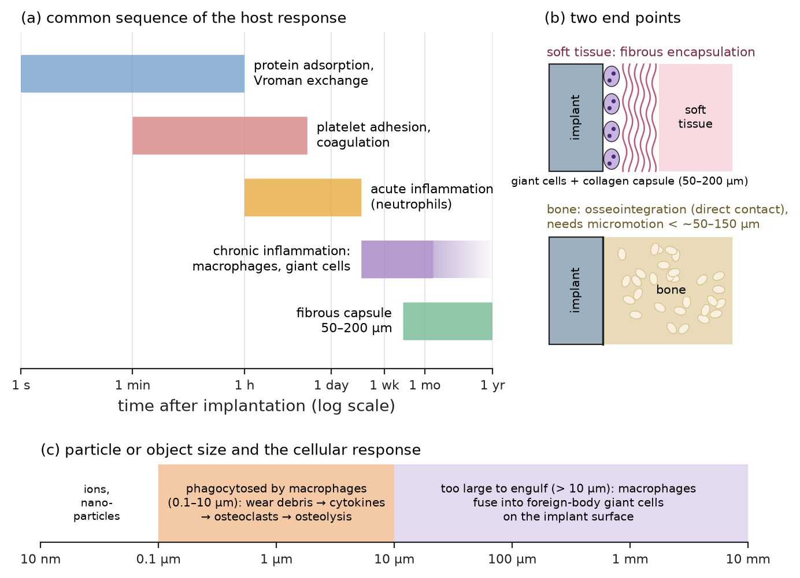
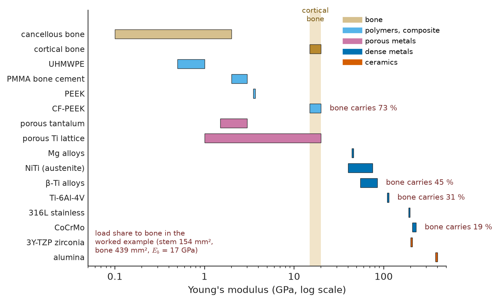
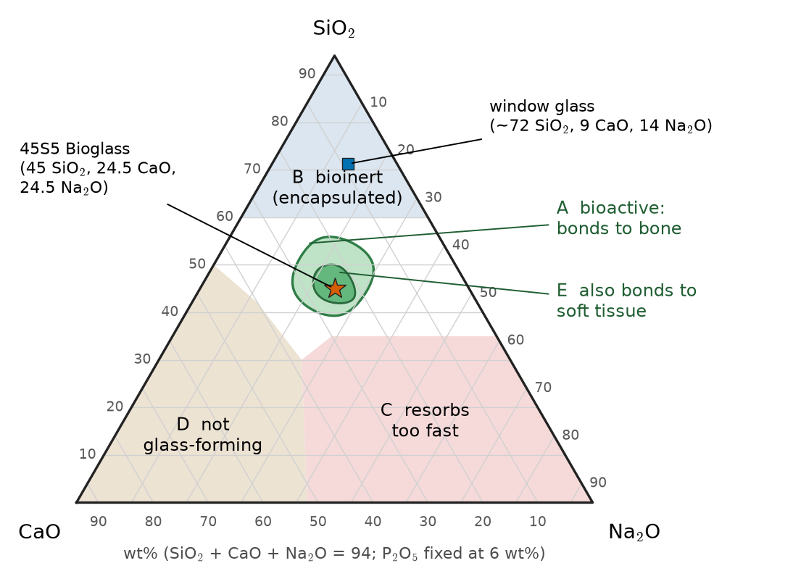
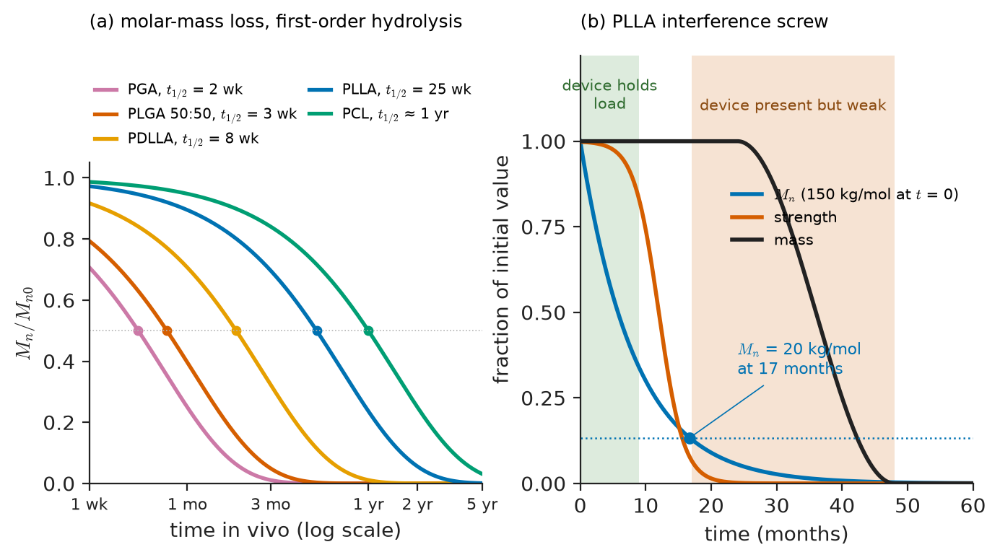
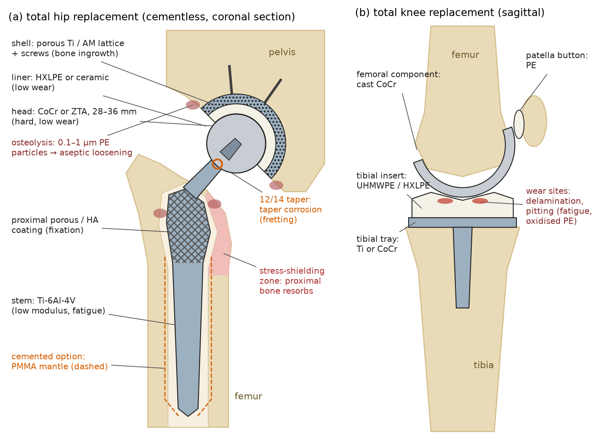
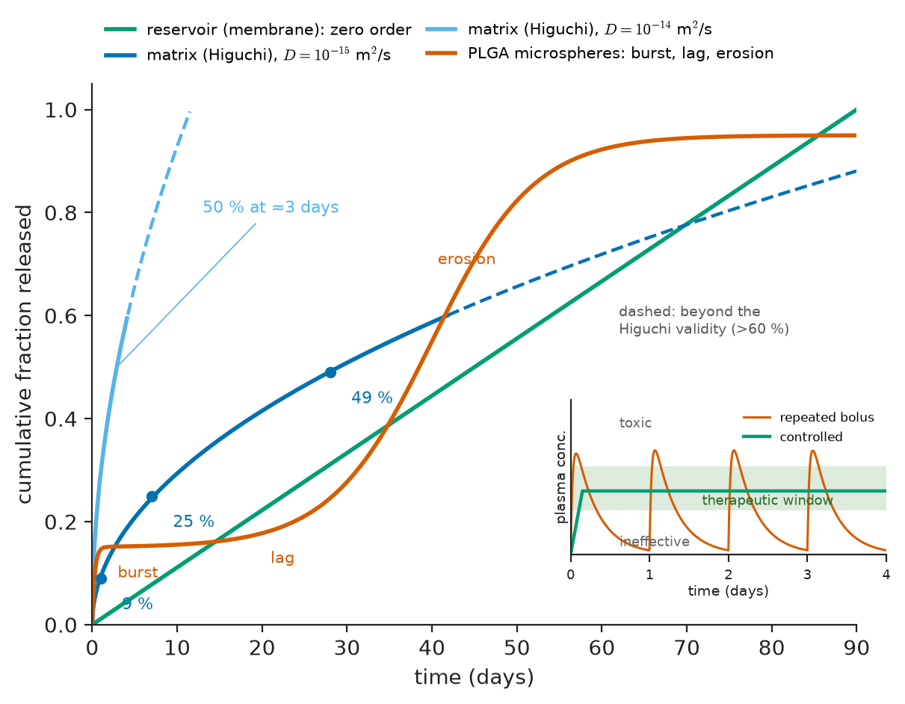

# Chapter 39 — Biomaterials

*Part VIII · Advanced and Emerging Materials*

In 2010 a large orthopaedic manufacturer recalled a metal-on-metal hip replacement worldwide. Its cobalt–chromium ball and cup had been designed to eliminate the plastic wear debris that had loosened earlier hips, and in a hip simulator it wore far less than polyethylene. In patients it behaved differently. A cup set at a steep angle let the ball ride on its edge, the lubricating film broke down, and the joint shed billions of nanometre-sized metal particles and cobalt and chromium ions. Some patients developed soft-tissue masses, destroyed muscle and raised blood cobalt; within five years about a quarter to a third of the devices had to be revised, against a few percent for conventional hips. Nothing in the alloy's datasheet was wrong. Its hardness, strength and corrosion resistance were excellent. The failure came from the interaction of the material with a living host: how the body responded to particles and ions of a size, number and chemistry that the design had not anticipated. Biomaterials engineering is the discipline of anticipating that interaction. This chapter describes how the body responds to an implanted material, surveys the metals, ceramics, polymers and hydrogels that are used, follows them into hips, knees, teeth and arteries, and ends with drug delivery and the sterilization, testing and regulation that stand between a material and a patient.

> **What makes a material acceptable to the body, and why is "biocompatibility" a property of a material in an application rather than of the material alone?**
> **How do the stiffness, corrosion, wear and degradation of implant materials decide whether an implant lasts five years or thirty?**

| Concept | Engineering destination |
|---|---|
| Protein adsorption, inflammation, foreign-body response | Surface design of implants, sensors, catheters and encapsulated cells |
| Stress shielding, modulus mismatch | Hip-stem and bone-plate design, porous and low-modulus titanium |
| Passivity and corrosion in body fluid | Alloy selection, modular junctions, ion release limits |
| Bioinert, bioactive and resorbable ceramics | Joint bearings, bone-graft substitutes, coatings, dental crowns |
| Hydrolytic degradation of PLA, PGA, PCL | Resorbable sutures, screws, stents and drug-release matrices |
| Hydrogels and scaffolds | Wound dressings, contact lenses, tissue engineering, cell therapy |
| Wear and particle-induced osteolysis | Bearing couples in hips and knees, crosslinked polyethylene |
| Controlled-release kinetics | Drug-eluting stents, depot injections, lipid nanoparticles |
| Sterilization, ISO 10993, device classes | Getting a material into a regulated product |

**Roadmap.** The host response (39.1) → metallic biomaterials and corrosion in the body (39.2) → ceramics and glasses (39.3) → polymers and biodegradable polymers (39.4) → hydrogels, scaffolds and tissue engineering (39.5) → implants as material systems: hips, knees, teeth, stents (39.6) → drug delivery (39.7) → sterilization, testing and regulation (39.8).

> **Boundary.** The biology of inflammation and wound healing is summarised only as far as it sets materials requirements; physiology and immunology belong to the life sciences. Electrochemistry fundamentals belong to Advanced Chemistry; the corrosion mechanisms used here are developed in Chapters 42 and 43.

---

## 39.1 The host response

### 39.1.1 What biocompatibility means

A **biomaterial** is a material intended to interface with biological systems to evaluate, treat, augment or replace a tissue, organ or function. The classic definition of **biocompatibility** (Williams) is "the ability of a material to perform with an appropriate host response in a specific application". Every word matters. *Perform*: the material must do its job, so a perfectly inert material that breaks is not biocompatible. *Appropriate host response*: the body always responds; the question is whether the response suits the purpose. A bone screw should be incorporated into bone, a blood-contacting catheter should not trigger clotting, a degradable suture should be resorbed without inflammation, and an encapsulated islet-cell device should be ignored by the immune system yet let insulin out. *Specific application*: the same material can be excellent in one site and unacceptable in another. Cobalt–chromium is a fine femoral head against polyethylene and a poor one against itself under edge loading; polyethylene is a durable bearing in a knee and a source of osteolysis when it wears quickly in a hip.

### 39.1.2 The sequence of events

When any material is implanted, the body responds in a sequence that is broadly the same for every material (Figure 39.1); what differs is the intensity and the end-point.

1. **Protein adsorption (seconds to minutes).** Before any cell arrives, the surface is coated by a layer of proteins from blood and tissue fluid: albumin, fibrinogen, fibronectin, vitronectin, immunoglobulins, complement proteins. Small, abundant proteins arrive first and are displaced over minutes to hours by larger proteins with higher affinity (the **Vroman effect**). Adsorption often unfolds the proteins, exposing binding sites. Cells never see the material itself, only this conditioned protein layer, whose composition and conformation are set by the surface chemistry, charge, hydrophobicity and roughness (the surface science of Chapter 45). Hydrophobic surfaces adsorb and denature more protein; highly hydrated, neutral surfaces (polyethylene glycol brushes, zwitterionic polymers) resist adsorption.
2. **Blood–material interactions (minutes to hours).** On blood-contacting surfaces, adsorbed fibrinogen binds platelets, the coagulation cascade and complement are activated, and a provisional matrix (a clot) forms around tissue implants. For devices in flowing blood, such as stents, valves and catheters, this **thrombogenicity** is the dominant concern and is controlled by surface chemistry (heparin coatings), surface smoothness and flow design.
3. **Acute inflammation (hours to days).** Neutrophils migrate to the site, attracted by the injury of implantation itself, and release enzymes and reactive oxygen species. This phase subsides within days if the implant is clean and sterile.
4. **Chronic inflammation and the foreign-body reaction (days to weeks).** Macrophages adhere to the protein layer. If they cannot phagocytose the material (anything larger than about 10 µm), they fuse into **foreign-body giant cells** that sit on the surface for the life of the implant, releasing degradative agents. Small particles (0.1–10 µm), such as wear debris, are engulfed and activate macrophages to release cytokines that recruit bone-resorbing osteoclasts.
5. **Fibrous encapsulation (weeks to months).** Fibroblasts lay down a collagen capsule, typically 50–200 µm thick, that walls off the implant. For a soft-tissue implant such as a pacemaker can, this is acceptable; for a glucose sensor it blocks diffusion and degrades the signal within weeks; for a breast implant, contraction of the capsule is the main complication.

Against bone, a different end-point is possible. If the implant is stable (micromotion below about 50–150 µm) and the surface is suitable, bone forms directly on it without an intervening fibrous layer: **osseointegration**, discovered by Brånemark with titanium in the 1950s–60s and the basis of dental implants and cementless joint replacements.

<!-- FIGURE 39.1 | figures/ch39/fig-39-1-host-response-timeline.png | flowchart | The host response to an implanted material follows a common sequence from protein adsorption to fibrous encapsulation or, against bone, osseointegration. | Content: horizontal logarithmic time axis from 1 s to 1 year (labels: seconds, minutes, hours, days, weeks, months). Bands stacked vertically: protein adsorption and Vroman exchange (1 s-1 h); platelet adhesion and coagulation (minutes-hours); acute inflammation with neutrophils (hours-3 days); chronic inflammation, macrophages and foreign-body giant cells (3 days-weeks, continuing faintly); fibrous capsule 50-200 um (weeks-months). At right, two alternative end-points drawn as small cross-sections: soft tissue: implant + giant cells + collagen capsule; bone: implant in direct contact with bone (osseointegration, requires micromotion < ~50-150 um). Side panel: particle-size scale showing phagocytosed particles 0.1-10 um leading to osteolysis. -->

*Figure 39.1 — The host response to an implanted material follows a common sequence from protein adsorption to fibrous encapsulation or, against bone, osseointegration.*

### 39.1.3 Classes of tissue–material response

Hench's classification of how bone responds to a material, extended to tissue in general, is a useful vocabulary:

| Response | Interface | Examples |
|---|---|---|
| Toxic | Surrounding tissue dies | Released Cd, Pb, V in high doses; unreacted monomers |
| Bioinert (nearly inert) | Thin fibrous layer; no bond | Alumina, zirconia, UHMWPE, PEEK, CoCr |
| Osseointegrating | Direct bone apposition, mechanical interlock | Titanium and its alloys, tantalum |
| Bioactive | Chemical bond to bone (and some to soft tissue) | Hydroxyapatite, bioactive glasses, glass-ceramics |
| Resorbable | Material replaced by tissue | Tricalcium phosphate, PLA/PGA, Mg alloys |

The material's chemistry sets which column it falls into; its form (particles or a solid, smooth or porous, stable or moving) decides how strong the response is. Wear debris of an inert polymer can provoke a stronger reaction than a bulk implant of a less inert metal, which is the central lesson of joint replacement (Section 39.6).

> **Status of the principle: Biocompatibility as an application-specific response**
> *Empirical.* It is a definition grounded in clinical experience, not a derived law; materials cannot be ranked by a single biocompatibility number, and every claim must be supported by testing in a relevant model (Section 39.8).

---

## 39.2 Metallic biomaterials

Metals carry load: hip stems, bone plates and screws, spinal rods, dental implants, stents, pacemaker cases and guidewires. Three alloy families dominate (Table 39.1), all relying on a passive oxide film for corrosion resistance.

**Table 39.1 — Metallic and reference materials for implants (typical values)**

| Material | Standard (typical) | Young's modulus (GPa) | Yield strength (MPa) | Main uses |
|---|---|---|---|---|
| Cortical bone (reference) | — | 15–20 (longitudinal) | 100–150 (tension) | — |
| Cancellous bone (reference) | — | 0.1–2 | 2–20 (compression) | — |
| 316L stainless steel | ASTM F138 | 193 | 170 (annealed) to 690 (cold-worked) | Fracture plates, screws, temporary devices |
| CoCrMo, cast | ASTM F75 | 210–230 | 450–520 | Knee femoral components, hip cups |
| CoCrMo, wrought/forged | ASTM F1537 | 210–230 | 830–1000 | Femoral heads, hip stems |
| CP titanium grade 4 | ASTM F67 | 105 | 480 | Dental implants, porous coatings |
| Ti-6Al-4V ELI | ASTM F136 | 110–114 | 795–880 | Hip stems, spinal implants, bone plates |
| β-Ti alloys (Ti-13Nb-13Zr, Ti-35Nb-7Zr-5Ta) | ASTM F1713, F1813 | 55–85 | 500–900 | Low-modulus stems, research |
| NiTi (superelastic) | ASTM F2063 | 40–75 (austenite) | Plateau 350–550 | Self-expanding stents, orthodontic wires |
| Tantalum (porous trabecular) | — | 1.5–3 (porous) | 35–50 (compression) | Acetabular augments, bone ingrowth |
| Magnesium alloys (WE43-type) | — | 45 | 150–250 | Resorbable screws, stents |

### 39.2.1 Stainless steel

Austenitic **316L** (Fe–17Cr–12Ni–2.5Mo, carbon below 0.03 % to avoid sensitization, Chapter 15) is cheap, easy to form, and strong when cold-worked. Its passive Cr₂O₃-rich film is less stable in chloride than titanium's oxide, and pitting and crevice corrosion under screw heads and plate contacts are well documented; it also contains nickel, a common sensitizer. It is therefore used mainly for temporary devices (fracture fixation removed after healing, surgical instruments) and in low-cost settings. Nitrogen-strengthened, nickel-free austenitic steels (Fe–Cr–Mn–Mo–N) address both concerns.

### 39.2.2 Cobalt–chromium alloys

**CoCrMo** (Co–28Cr–6Mo) is hard, wear resistant and strong, with a stable chromium-oxide film. Cast F75 is used for complex shapes such as knee femoral components; wrought and forged F1537 for femoral heads and highly loaded stems. Carbides (M₂₃C₆) at grain boundaries harden the cast alloy and, at bearing surfaces, influence wear. CoCr's high modulus contributes to stress shielding (below), and its wear and corrosion products (Co²⁺, Cr³⁺, chromium-oxide particles) are the concern exposed by metal-on-metal hips. **CoNiCrMo** (MP35N) and **CoCrWNi** (L605) are used for thin-strut cardiovascular stents and pacemaker leads, where their strength and radiopacity allow struts of 60–90 µm.

### 39.2.3 Titanium and its alloys

Titanium (Chapter 16) combines low density (4.5 g/cm³), the lowest modulus of the common implant metals, good fatigue strength and an exceptionally stable TiO₂ passive film that reforms in milliseconds when scratched. Bone grows directly on it. **CP titanium** (grade 4, strengthened by oxygen) is used for dental implants; **Ti-6Al-4V ELI** (extra-low interstitials, for fracture toughness) is the workhorse for hip stems and spinal devices. Concern about aluminium and vanadium release led to vanadium-free α+β alloys (Ti-6Al-7Nb) and to **β alloys** of Ti with Nb, Zr, Ta and Mo, which are free of toxic elements and have moduli as low as 55 GPa. Additive manufacturing (Chapter 48) now builds titanium acetabular cups and spinal cages with integral porous lattices (pore sizes 300–700 µm, porosity 60–80 %) into which bone grows.

Titanium's weaknesses are tribological: it galls and wears badly in sliding contact and is never used as a bearing surface without a hard coating; and its notch sensitivity in fatigue means that surface treatments for bone ingrowth (grit blasting, porous coatings sintered at high temperature) can reduce fatigue strength by 50 % or more, which must be allowed for in stem design.

### 39.2.4 Stress shielding

Bone is a living material that adapts its density to the stresses it carries (an observation summarised as **Wolff's law**): underloaded bone is resorbed. A stiff stem inside a femur carries a large part of the load that bone used to carry, and the bone around the upper part of the stem thins over years, which can loosen the implant and complicate revision surgery.

**Worked example — load sharing between a femoral stem and bone.** Model the femoral shaft as a cortical-bone tube with outer diameter 28 mm and inner diameter 15 mm, so its area is $A_b=\tfrac{\pi}{4}(28^2-15^2)=439$ mm², and a solid stem of diameter 14 mm, $A_s=154$ mm², bonded to it and loaded axially. The two deform together (equal strain), so each carries load in proportion to its axial stiffness $EA$. The fraction of the load carried by bone is

$$
f_b=\frac{E_bA_b}{E_bA_b+E_sA_s}
$$

With $E_b=17$ GPa: for Ti-6Al-4V ($E_s=110$ GPa), $f_b=17\times439/(17\times439+110\times154)=7463/(7463+16\,940)=0.31$; for CoCr (210 GPa), $f_b=0.19$; for a β-titanium alloy (60 GPa), $f_b=0.45$; and for a carbon-fibre-reinforced PEEK stem (18 GPa), $f_b=0.73$. A titanium stem thus leaves the bone at this section with about one third of its natural strain, a CoCr stem with about a fifth. The calculation explains why low-modulus alloys, hollow stems and porous structures are pursued (Figure 39.2).

> **Status of the principle: Equal-strain load sharing (stress shielding estimate)**
> *Approximate.* Assumes a perfectly bonded, axially loaded, uniform composite section; real stems are tapered, bending-loaded and partly bonded, and load transfer is concentrated near the ends. The trend with modulus is right; the absolute numbers come from finite-element models.

It also shows where the simple picture fails. Very flexible "isoelastic" stems tried in the 1980s and 1990s did not do better clinically: they bent more under bending loads, raising shear stresses and micromotion at the bone–implant interface above the 50–150 µm limit for bone ingrowth, so they loosened for a different reason. The design target is not the lowest modulus but a balance between load transfer to bone and stability of the interface, a multi-objective selection problem of the kind treated in Chapter 58.

<!-- FIGURE 39.2 | figures/ch39/fig-39-2-modulus-comparison.png | plot | Implant metals are 3-15 times stiffer than cortical bone, which causes stress shielding; low-modulus alloys, porous metals and composites narrow the gap. | Content: horizontal bar chart, log x-axis Young's modulus 0.05-500 GPa. Bars (ranges): cancellous bone 0.1-2, cortical bone 15-20 (highlighted band across the chart), UHMWPE 0.5-1, PMMA bone cement 2-3, PEEK 3.6, CF-PEEK 15-20, porous tantalum 1.5-3, porous Ti lattice 1-20, Mg alloys 45, NiTi 40-75, beta-Ti 55-85, Ti-6Al-4V 110-114, 316L 193, CoCrMo 210-230, 3Y-TZP zirconia 200-210, alumina 380-400. Right-hand annotation: bone load share from the worked example at 154/439 mm2 area ratio: CF-PEEK 73 %, beta-Ti 45 %, Ti-6Al-4V 31 %, CoCr 19 %. -->

*Figure 39.2 — Implant metals are 3-15 times stiffer than cortical bone, which causes stress shielding; low-modulus alloys, porous metals and composites narrow the gap.*

### 39.2.5 Corrosion in the body

Body fluid is an aggressive electrolyte: about 0.15 M chloride, pH 7.4, 37 °C, with dissolved oxygen lower than in air-saturated water and with proteins and cells that can both adsorb on and attack surfaces. After surgery or in inflamed tissue, pH may fall to about 5 and reactive oxygen species are produced. Implant alloys survive because they are **passive** (Chapter 42): a nanometre-thin oxide film reduces the dissolution current density to $10^{-2}$–$10^{-1}$ µA/cm². Problems arise where the film is damaged or the local chemistry changes (Chapter 43):

- **Crevice and pitting corrosion** under screw heads and in plate–screw contacts, mainly in stainless steel.
- **Fretting corrosion** and **tribocorrosion** where micromotion repeatedly scrapes off the film, most notoriously at the tapered junction between a modular femoral head and the stem (*taper corrosion* or *trunnionosis*), which can release metal debris even from metal-on-polyethylene hips.
- **Galvanic corrosion** between dissimilar alloys; CoCr and Ti are close enough in the passive state to be combined, but stainless steel is not mixed with them.

Even passive dissolution releases ions continuously, and Faraday's law (Chapter 42) converts current to mass.

**Worked example — ion release from passive implants.** A 316L fracture plate and screws expose 50 cm² to tissue fluid and dissolve passively at $i=0.1$ µA/cm². The current is $I=5\times10^{-6}$ A, and over one year ($t=3.156\times10^{7}$ s) the charge is 158 C. Treating the alloy as dissolving to Fe²⁺, Cr³⁺, Ni²⁺ and Mo³⁺ in proportion to its composition gives an equivalent weight of about 25.5 g/equivalent, so the mass dissolved is

$$
m=\frac{ItM}{nF}=\frac{158\times25.5}{96\,485}=0.042\ \mathrm{g}
$$

about 42 mg per year, a uniform thinning of only about 1 µm, structurally irrelevant, but containing about 5 mg of nickel ions each year at the site, enough to matter for a patient with nickel allergy. A titanium implant of the same area with $i=0.01$ µA/cm² and Ti⁴⁺ ($M/n=47.87/4$) releases $5\times10^{-7}\times3.156\times10^{7}\times47.87/(4\times96\,485)=2.0$ mg per year. The difference of a factor of 20, together with titanium's low toxicity, is a large part of why titanium dominates permanent implants.

### 39.2.6 Biodegradable metals

For temporary functions (holding a fracture until it heals, keeping an artery open for six months) a metal that corrodes away safely avoids a second operation. **Magnesium** alloys (with rare earths, zinc, calcium) corrode in body fluid with hydrogen evolution; resorbable Mg compression screws and a drug-eluting Mg coronary scaffold are on the market in some regions. The challenge is controlling the rate, because hydrogen bubbles and loss of strength before healing are both unacceptable; purity (Fe, Ni, Cu below tens of ppm, since they form cathodic particles), grain refinement and coatings are used. **Iron** alloys corrode too slowly and **zinc** alloys at intermediate rates, and both are under development for stents.

---

## 39.3 Ceramic biomaterials

Ceramics (Chapter 17) bring hardness, wear resistance and chemical stability, and in calcium-phosphate and glass form, the ability to bond to bone. Their limitation is brittleness, which Chapter 14's fracture mechanics and Weibull statistics govern.

**Table 39.2 — Ceramic biomaterials (typical values)**

| Material | Young's modulus (GPa) | Flexural strength (MPa) | $K_{IC}$ (MPa m^1/2) | Response | Uses |
|---|---|---|---|---|---|
| Alumina (medical grade, high purity, fine grain) | 380–400 | 500–600 | 4 | Bioinert | Femoral heads, liners |
| Zirconia-toughened alumina (ZTA) | 350–360 | 1000–1400 | 6–7 | Bioinert | Hip heads and liners, knee components |
| 3Y-TZP zirconia | 200–210 | 900–1200 | 5–10 | Bioinert | Dental crowns, bridges, implants |
| Hydroxyapatite (dense) | 80–110 | 50–120 | 0.8–1.2 | Bioactive | Coatings, granules, small fillers |
| β-tricalcium phosphate | ~30–70 (dense) | 30–90 | ~1 | Resorbable | Bone-graft substitutes |
| Bioactive glass 45S5 | 35 | 40–60 | ~0.6 | Bioactive (bonds to bone and soft tissue) | Bone fillers, dental remineralisation |
| Pyrolytic carbon | 20–30 | 300–500 | 1–2 | Thromboresistant | Mechanical heart-valve leaflets |

### 39.3.1 Bioinert ceramics: alumina and zirconia

High-purity, fine-grained **alumina** was introduced for hip heads in the 1970s because its hardness and wettability give very low wear against itself or polyethylene. Early heads fractured at rates of several per thousand; refinement of grain size (to below 2 µm), purity, hot isostatic pressing and proof testing reduced fracture to a few per 100 000. **Zirconia** (3 mol% yttria-stabilised tetragonal zirconia polycrystal, 3Y-TZP) is tougher because of transformation toughening (Chapter 14): the stress field at a crack tip converts metastable tetragonal grains to monoclinic with a 4 % volume expansion, which closes the crack. That same metastability is its weakness: in warm water the tetragonal-to-monoclinic transformation can proceed spontaneously from the surface (**low-temperature degradation**, or ageing), roughening and weakening it. In 2001 one manufacturer's change from batch to tunnel-furnace sintering produced zirconia hip heads that aged rapidly; several hundred fractured and the product was recalled. Today, **zirconia-toughened alumina**, with about 17–25 % zirconia dispersed in an alumina matrix that constrains it against ageing, is the standard ceramic bearing, combining alumina's stability with zirconia's toughness. In dentistry, monolithic zirconia crowns and bridges have largely replaced porcelain fused to metal, and translucent zirconias with more yttria (4–5 mol%, more cubic phase) trade toughness for aesthetics.

### 39.3.2 Bioactive ceramics and glasses

**Hydroxyapatite** (HA), Ca₁₀(PO₄)₆(OH)₂, is the mineral of bone and teeth, though biological apatite is nanocrystalline, carbonate-substituted and calcium-deficient. Synthetic HA bonds directly to bone, but it is too weak and brittle to bear load on its own, so it is used as plasma-sprayed coatings 50–150 µm thick on titanium stems and cups (to speed fixation), as porous granules and blocks for filling bone defects, and in composites. **Tricalcium phosphate** (β-TCP) is more soluble and resorbs over months to years; biphasic HA/TCP mixtures tune the rate.

**Bioactive glasses**, discovered by Hench in 1969, bond to bone faster than HA and even to soft tissue. The original **45S5** composition (45 SiO₂, 24.5 Na₂O, 24.5 CaO, 6 P₂O₅ wt%) has much less silica and much more modifier than window glass. In body fluid it undergoes a sequence of surface reactions: Na⁺ exchanges with H⁺ from solution, silanol groups form and condense to a silica-rich gel layer, calcium and phosphate migrate through it and from solution, and a layer of hydroxycarbonate apatite crystallises within hours to days. Collagen and cells attach to this apatite, and released soluble silicon and calcium stimulate bone-forming cells. Bioactivity depends on composition in the Na₂O–CaO–SiO₂ system (Figure 39.3): above about 60 wt% SiO₂ the network is too connected to react, and the glass is inert. Bioactive glasses are used as bone-defect fillers, in toothpaste for sensitive teeth, and as borate-glass fibres in wound dressings. **Glass-ceramics** (apatite–wollastonite, A-W) give higher strength (about 200 MPa in bending) with retained bioactivity for vertebral and iliac spacers.

> **Status of the principle: Composition–bioactivity map for silicate glasses**
> *Empirical.* Derived from animal implantation studies of soda–lime–phosphosilicate glasses; it is explained qualitatively by network connectivity and dissolution rate but does not transfer quantitatively to other glass systems (borate, phosphate) or to glass-ceramics.

<!-- FIGURE 39.3 | figures/ch39/fig-39-3-bioactive-glass-diagram.png | map | Bone bonding of soda-lime-silica glasses depends on composition: only a region rich in modifiers and low in silica bonds to bone, and a smaller region also bonds to soft tissue. | Content: Gibbs triangle (wt%) SiO2 (top), CaO (left), Na2O (right), at constant 6 wt% P2O5. Region A (bioactive, bonds to bone) as a lens roughly 40-55 wt% SiO2 with CaO 15-30 and Na2O 15-30; inner region E (bonds to soft tissue too) around 45S5; 45S5 point marked (45 SiO2, 24.5 CaO, 24.5 Na2O). Region B (bioinert, encapsulated) above ~60 wt% SiO2; region C (resorbs too fast) below ~35 wt% SiO2; region D (not glass-forming) toward high CaO. Window glass (~72 SiO2, 9 CaO, 14 Na2O) marked in region B. -->

*Figure 39.3 — Bone bonding of soda-lime-silica glasses depends on composition: only a region rich in modifiers and low in silica bonds to bone, and a smaller region also bonds to soft tissue.*

---

## 39.4 Polymeric biomaterials

Polymers are the most widely used biomaterials by number of devices: catheters, tubing, sutures, blood bags, intraocular lenses, vascular grafts, heart-valve components, bone cement and joint bearings.

### 39.4.1 Biostable polymers

| Polymer | Key properties | Uses |
|---|---|---|
| UHMWPE (molar mass 2–6 × 10⁶ g/mol) | Tough, low friction, wear resistant; $E\approx0.5$–1 GPa | Hip liners, knee tibial inserts |
| PMMA | Rigid, transparent; $E\approx2$–3 GPa | Bone cement, intraocular lenses (historically), dentures |
| PEEK, CF-PEEK | $E\approx3.6$ GPa (unfilled), 15–20 GPa (CF); radiolucent | Spinal cages, trauma plates |
| Silicone (PDMS) | Soft, flexible, gas-permeable, stable | Catheters, shunts, breast implants, lens materials |
| Polyurethanes | Tough, elastic, blood-compatible grades | Catheters, pacemaker-lead insulation, heart pumps |
| PET (Dacron), ePTFE | Fibrous/porous, strong, stable | Large-diameter vascular grafts, sutures, sewing cuffs |
| Polypropylene | Strong monofilament | Sutures, hernia mesh |

Several of these were engineering polymers adopted with little modification, and their failures taught biomaterials science. **PMMA bone cement** is mixed in the operating theatre from a powder (pre-polymerised PMMA beads, initiator, radiopacifier such as BaSO₄ or ZrO₂) and liquid monomer; it grouts the stem into bone as a space filler, not an adhesive. Its exothermic polymerisation reaches peak temperatures of 60–80 °C at the cement surface, its residual monomer is cytotoxic, and its porosity and fatigue cracking contribute to aseptic loosening; vacuum mixing and antibiotic-loaded cements are refinements. **Polyester-urethane** foam coatings on breast implants degraded in the body, and early polyether-urethane lead insulation suffered environmental stress cracking and metal-ion oxidation (Chapter 21), problems solved by polycarbonate-urethanes and silicone–urethane copolymers. Long-term oxidation of gamma-sterilized UHMWPE is discussed in Section 39.8.

### 39.4.2 Biodegradable polymers

A **biodegradable** (or bioresorbable) polymer breaks down in the body into products that are metabolised or excreted. The workhorses are aliphatic polyesters, which degrade by **hydrolysis** of their ester bonds (Chapter 21):

| Polymer | $T_g$ (°C) | $T_m$ (°C) | Modulus (GPa) | Typical loss of strength | Typical complete resorption |
|---|---|---|---|---|---|
| Poly(glycolic acid), PGA | 35–40 | 220–230 | 6–7 | 2–4 weeks | 6–12 months |
| Poly(L-lactic acid), PLLA | 55–65 | 170–180 | 3–4 | 6–12 months | 2–5 years |
| Poly(DL-lactic acid), PDLLA (amorphous) | 50–60 | — | 1.5–2 | 1–2 months | 12–16 months |
| PLGA 50:50 | 45–55 | — (amorphous) | 1–2 | 1–2 months | 1–2 months |
| Poly(ε-caprolactone), PCL | −60 | 58–63 | 0.2–0.4 | > 1 year | 2–4 years |

Degradation rate follows chemistry and structure. PGA is more hydrophilic than PLA (no methyl group), so water penetrates faster. Crystallinity slows hydrolysis because water enters amorphous regions first, so PLLA (semicrystalline) lasts far longer than amorphous PDLLA. Copolymerising lactide and glycolide disrupts crystallinity, so PLGA 50:50 degrades faster than either homopolymer. PCL, hydrophobic and with a long methylene sequence, degrades over years and is used for long-term implants and drug depots.

Hydrolysis is random chain scission, so to a first approximation the number-average molar mass decreases exponentially,

$$
M_n(t)=M_{n0}\,e^{-kt}
$$

while mass is lost only after chains have become short enough (a few kg/mol) to dissolve. Strength falls once $M_n$ drops below a few times the entanglement molar mass. A device therefore keeps its shape long after it has lost its strength (Figure 39.4).

> **Status of the principle: First-order kinetics of polyester hydrolysis**
> *Approximate.* Assumes random scission with a constant water concentration and no autocatalysis; it describes thin films and fibres well, but thick devices degrade faster inside than at the surface because acidic degradation products accumulate and catalyse hydrolysis.

**Worked example — how long does a resorbable device keep its strength?** A PLLA interference screw has initial $M_n=150$ kg/mol and loses molar mass with a half-life of 25 weeks in vivo ($k=\ln2/25=0.0277$ per week). If strength is effectively lost when $M_n$ reaches 20 kg/mol, the time is $t=\ln(150/20)/0.0277=73$ weeks, about 17 months, ample for a ligament graft to integrate with bone. A PLGA 50:50 suture with $M_n=100$ kg/mol and a half-life of 3 weeks reaches 20 kg/mol in $\ln5/(\ln2/3)=7.0$ weeks, which suits soft-tissue closure. The thick screw also illustrates the autocatalysis warning: lactic acid trapped in its core lowers the local pH, interior degradation can outrun the surface, and late, sudden release of acidic fragments has caused sterile inflammatory reactions, one reason resorbable devices are kept thin or buffered with calcium carbonate or phosphate fillers.

<!-- FIGURE 39.4 | figures/ch39/fig-39-4-polyester-degradation.png | plot | Biodegradable polyesters lose molar mass first, strength next and mass last; PGA and PLGA degrade in weeks, PLLA and PCL over years. | Content: (a) normalised number-average molar mass Mn/Mn0 (0-1) vs time on log axis 1 week to 5 years for PLGA 50:50 (half-life 3 weeks), PGA (~2 weeks), PDLLA (~8 weeks), PLLA (25 weeks), PCL (~1 year), exponential decays. (b) For PLLA screw: three curves vs time in months (0-60): Mn (falls first, crossing 20 kg/mol at ~17 months from 150 kg/mol), strength (retained to ~6 months then falling to near zero by ~18 months), mass (unchanged until ~24 months then falling to 0 at ~48 months). Shaded band "device holds load" and "device present but weak". -->

*Figure 39.4 — Biodegradable polyesters lose molar mass first, strength next and mass last; PGA and PLGA degrade in weeks, PLLA and PCL over years.*

Biodegradable polymers have mixed clinical history. Resorbable sutures (PGA, polyglactin) and PLGA drug depots are unquestioned successes. The everolimus-eluting PLLA coronary scaffold, approved in 2016, was withdrawn in 2017: its struts had to be about 150 µm thick (twice those of metallic stents) to compensate for the polymer's low stiffness and strength, and thrombosis rates were higher than for metal stents, a reminder that a material that is right in principle must also be right in the dimensions the mechanics imposes.

---

## 39.5 Hydrogels, tissue scaffolds and tissue engineering

### 39.5.1 Hydrogels in medicine

Hydrogels (Chapter 37) resemble soft tissue: they are mostly water, soft (moduli of 0.1 kPa to 1 MPa) and permeable to nutrients. Their medical uses include:

- **Contact lenses.** pHEMA lenses (about 38 % water) were followed by silicone-hydrogel lenses, which combine hydrophilic monomers with siloxane-rich domains so that oxygen can diffuse through the silicone phase, raising oxygen transmissibility several-fold, the critical property for corneal health.
- **Wound dressings** of alginate, hydrocolloid and polyurethane hydrogels that keep the wound moist and absorb exudate.
- **Injectable fillers and lubricants**, mostly crosslinked hyaluronic acid, used in dermatology and for knee injections.
- **Cell encapsulation**: alginate microcapsules that let insulin, glucose and oxygen pass while excluding antibodies and immune cells, depending on the mesh size calculated in Chapter 37. The fibrotic capsule of Section 39.1 is the main obstacle; chemically modified alginates that reduce macrophage adhesion are being tested.
- **Drug delivery** (Section 39.7) and **soft electronics** interfaces with nerve tissue.

### 39.5.2 Scaffolds and tissue engineering

**Tissue engineering** aims to regenerate tissue rather than replace it with a permanent implant. The classical recipe combines three elements: cells (the patient's own or stem cells), a **scaffold** that gives them a three-dimensional structure, and signals (growth factors, mechanical loading). The scaffold must meet materials requirements that are in tension with one another:

- **Porosity and pore size.** Interconnected porosity of 70–90 % with pores of 100–500 µm for bone (so that blood vessels can grow in, with 300 µm or larger favoured) or 20–150 µm for soft tissues; but high porosity reduces stiffness and strength, which scale roughly as the square of relative density for open-cell foams.
- **Degradation matched to tissue formation**, so that the scaffold hands over load gradually: PLGA, PCL, collagen, β-TCP and bioactive glass are chosen for their rates.
- **Surface chemistry and stiffness** that direct cell behaviour: stem cells on substrates as soft as brain tissue (~1 kPa) tend toward neural lineages, on ~10 kPa toward muscle, and on stiffer substrates toward bone. Peptide sequences such as RGD (arginine–glycine–aspartic acid) are grafted to promote attachment.
- **Manufacturability** in patient-specific shapes: salt leaching, freeze-drying, electrospinning (fibres of 0.1–5 µm resembling the collagen of extracellular matrix), and increasingly 3D printing and bioprinting of cell-laden hydrogel "bioinks" (Chapter 48).

Commercial success has come mainly in simpler tissues (skin substitutes, cartilage cell implantation, bone-graft substitutes, decellularised tissue matrices); complex, vascularised organs remain research targets, limited above all by the need to supply oxygen beyond a diffusion distance of about 100–200 µm.

---

## 39.6 Implants as material systems

### 39.6.1 Total hip replacement

More than a million total hip replacements are performed worldwide each year, and registries report that about 95 % survive ten years. A hip (Figure 39.5) combines several materials, each chosen for a different function: a **stem** in the femur (Ti-6Al-4V or CoCr, cemented with PMMA or press-fitted with a porous or HA-coated surface for bone ingrowth), a **head** (CoCr, ZTA or alumina, 28–36 mm in diameter) fitted on a taper, a **liner** (polyethylene or ceramic) and an **acetabular shell** (titanium, porous coated or AM lattice) in the pelvis.

The bearing couple has dominated the history of hip design because of the wear–particle–osteolysis chain. Each step releases particles of polyethylene of 0.1–1 µm, the size range macrophages phagocytose. Activated macrophages release cytokines that recruit osteoclasts, which resorb bone around the implant (**osteolysis**), leading to aseptic loosening, historically the commonest reason for revision.

**Worked example — wear debris from a polyethylene liner.** Wear of polyethylene against a polished CoCr head follows Archard's law (Chapter 45), $V=k\,F\,s$, with a wear factor of about $k=1\times10^{-6}$ mm³/(N m) for conventional UHMWPE in hip simulators. Take an average joint force of 2000 N, a sliding distance of about 25 mm per step and one million steps a year ($s=25$ km). The yearly wear volume is $V=10^{-6}\times2000\times25\,000=50$ mm³, which for a 28 mm head corresponds to a linear penetration of about $50/(\pi\times14^2)=0.08$ mm per year, in line with the 0.1–0.2 mm per year measured on retrieved conventional liners. If the debris is spheres of 0.5 µm diameter (volume $6.5\times10^{-11}$ mm³), the 50 mm³ amounts to about $8\times10^{11}$ particles a year. Clinical experience shows osteolysis becomes common when linear wear exceeds about 0.1 mm per year.

> **Status of the principle: Archard wear law**
> *Empirical.* Wear volume proportional to load and sliding distance fits steady-state sliding wear with a constant wear factor; in hips, the factor depends on cross-shear (multidirectional motion), lubrication, counterface roughness and third-body particles, so simulator tests under realistic kinematics are mandatory.

The response was a materials solution. **Highly crosslinked polyethylene** (HXLPE), irradiated with 50–100 kGy of gamma or electron radiation and then remelted or annealed to eliminate the free radicals that would cause oxidation, or stabilised with vitamin E, reduces the wear factor by 80–95 % (because crosslinks resist the orientation-softening of chains under multidirectional sliding), at some cost in fatigue toughness. Registry data now show markedly lower revision for osteolysis with HXLPE. **Ceramic-on-ceramic** bearings (ZTA on ZTA) wear least of all, but can fracture and occasionally squeak. **Metal-on-metal** bearings, revived for large heads with low volumetric wear, failed as the chapter's opening describes, because their nanometre debris and ions provoked adverse local tissue reactions; most large-head MoM hips were withdrawn after 2010. The lesson is that wear *volume* is not the only metric: particle size, number, chemistry and the dissolved-ion load decide the biological response.

<!-- FIGURE 39.5 | figures/ch39/fig-39-5-hip-knee-materials.png | schematic | A total hip and a total knee replacement are multi-material systems; each component is chosen for stiffness, wear, corrosion or fixation. | Content: (a) cross-section of a hip in pelvis and femur: Ti-6Al-4V stem with porous/HA-coated proximal region in femoral canal (cementless) or PMMA cement mantle (cemented, alternative shown dashed); CoCr or ZTA head 28-36 mm on 12/14 taper (taper corrosion site marked); HXLPE or ceramic liner; porous Ti or AM-lattice acetabular shell with screws. Labels with material, function and typical failure mode (aseptic loosening, osteolysis from 0.1-1 um particles, taper corrosion, stress shielding zone in proximal femur). (b) Knee: CoCr femoral component, UHMWPE/HXLPE tibial insert, Ti or CoCr tibial tray, PE patella button; wear sites (delamination, pitting) marked. -->

*Figure 39.5 — A total hip and a total knee replacement are multi-material systems; each component is chosen for stiffness, wear, corrosion or fixation.*

### 39.6.2 Total knee replacement

A knee replacement articulates a cast **CoCr femoral component** against a polyethylene **tibial insert** locked into a titanium or CoCr **tibial tray**. Its kinematics differ from the hip: rolling and sliding over a smaller, less conforming contact give high contact stresses (often above polyethylene's yield stress of about 20 MPa) and cyclic subsurface stresses. The historical failure mode was fatigue **delamination** and pitting of the insert, aggravated by oxidation of gamma-irradiated polyethylene sterilised in air and stored for years. Sterilisation in inert gas, remelted HXLPE and vitamin-E stabilisation have largely solved oxidation, and knee survival now matches hips at about 90–95 % at 15 years.

### 39.6.3 Dental implants

A dental implant is a threaded titanium (CP grade 4, Ti-6Al-4V or Ti–Zr) screw placed in the jaw bone, which osseointegrates over 3–6 months and then carries an abutment and crown. Ten-year survival above 95 % rests on surface engineering: grit blasting and acid etching create micro- and nano-roughness (Ra about 1–2 µm), increasing bone-to-implant contact and the torque needed to remove the screw several-fold relative to machined surfaces. Ceramic implants of zirconia are an alternative for metal-sensitive patients. The crown itself is now commonly monolithic zirconia or lithium-disilicate glass-ceramic (Chapter 17). The main long-term threat is **peri-implantitis**, a bacterial infection of the tissue around the implant, which links surface roughness (good for bone, bad for biofilm) to a trade-off between osseointegration and cleanability. Dental amalgam (Hg–Ag–Sn–Cu), used for 150 years and still among the most durable fillings, is being phased down under the Minamata Convention on mercury in favour of resin composites and glass-ionomer cements.

### 39.6.4 Cardiovascular stents and other blood-contacting devices

A coronary **stent** is a mesh tube expanded inside a narrowed artery to keep it open. Balloon-expandable stents must deform plastically to a larger diameter and then resist the artery's recoil: a high yield strength to resist recoil, but low enough to expand at balloon pressures, plus high ductility, radiopacity for X-ray visibility, and fatigue resistance for about 40 million heart beats a year. The first stents were 316L stainless steel with struts around 140 µm; CoCr (L605, MP35N) and platinum–chromium alloys, stronger and more radiopaque, allowed struts of 60–90 µm, which reduce vessel injury and restenosis. Self-expanding peripheral stents use superelastic NiTi (Chapter 37), whose constant plateau force and kink resistance suit vessels in the leg and neck that are bent and compressed.

Bare-metal stents reduced acute closure but 20–30 % of arteries renarrowed within months as smooth-muscle cells proliferated through the mesh (**in-stent restenosis**). **Drug-eluting stents** (DES) coat the struts with a thin polymer layer (5–15 µm) carrying an antiproliferative drug (sirolimus, everolimus, zotarolimus, paclitaxel) released over weeks to months, reducing restenosis below 10 %. Their polymers (originally durable PBMA/PEVA and SIBS, now fluoropolymers or biodegradable PLGA and PLLA) must not crack or delaminate when the stent expands by 200–300 %, must release the drug at the right rate (Section 39.7), and must not themselves provoke inflammation, which was linked to late stent thrombosis in early designs. Stent fatigue qualification simulates ten years of pulsation, about 400 million cycles.

Other blood-contacting devices show the same structure–property logic: mechanical heart valves use pyrolytic carbon leaflets for wear resistance and thromboresistance (but require lifelong anticoagulation), while bioprosthetic valves of glutaraldehyde-fixed bovine pericardium avoid anticoagulation but calcify and wear out in 10–20 years; large-diameter vascular grafts of woven PET or expanded PTFE work, but small-diameter (< 6 mm) synthetic grafts thrombose, a problem tissue engineering is attacking.

---

## 39.7 Drug delivery systems

### 39.7.1 Why control release?

A tablet or injection produces a concentration peak followed by decay: too high at first (toxicity), too low later (no effect), and repeated dosing is needed. A **controlled-release** system keeps the concentration in a therapeutic window for a defined time, targets the site where it is needed, protects fragile drugs (proteins, nucleic acids) from degradation, and improves adherence. Materials engineering provides the release mechanism.

### 39.7.2 Release mechanisms

- **Diffusion through a membrane (reservoir systems).** A drug core surrounded by a rate-controlling polymer membrane releases at a constant rate as long as the core concentration stays saturated (**zero order**), by Fick's first law (Chapter 8): $dM/dt=ADK\Delta C/\ell$ for membrane area $A$, thickness $\ell$, partition coefficient $K$. Examples are transdermal patches (nicotine, fentanyl), contraceptive implants in ethylene–vinyl acetate rods and intrauterine systems.
- **Diffusion from a matrix (monolithic systems).** Drug dispersed in a polymer matrix at concentration $C_0$ above its solubility $C_s$ in the polymer dissolves at a receding front. Higuchi's analysis gives the cumulative release per unit area
$$
Q=\sqrt{D\,(2C_0-C_s)\,C_s\,t}
$$
so release scales as $\sqrt t$: fast at first, slowing with time.
- **Degradation- and erosion-controlled release.** In PLGA microspheres and implants, the drug is released as the polymer hydrolyses (Section 39.4), with an initial burst from surface drug, a lag, and then erosion-controlled release over weeks to months. Monthly and three-monthly injections of peptide hormones (leuprolide) and of antipsychotics use this mechanism.
- **Osmotic systems.** A tablet with a semipermeable shell draws water in at a constant rate and pumps drug solution through a laser-drilled orifice at zero order.
- **Stimulus-responsive systems.** Hydrogels that swell with pH, temperature or glucose (Chapter 37) release in a chosen environment.
- **Nanocarriers.** Liposomes (lipid bilayers, Chapter 37) carry doxorubicin in a polyethylene-glycol-coated "stealth" form that circulates for days; **lipid nanoparticles** of ionisable lipids, cholesterol, phospholipid and PEG-lipid protect mRNA and release it into cells, the basis of mRNA vaccines; polymeric micelles and nanoparticles of PLGA and PEG–PLA carry poorly soluble drugs. Passive accumulation in tumours through leaky blood vessels was once expected to deliver large fractions of a dose; in practice typically less than 1 % of injected nanoparticles reach a solid tumour, and targeting remains a central research problem.

> **Status of the principle: Higuchi square-root-of-time release**
> *Approximate.* Derived for a planar matrix with $C_0\gg C_s$, perfect sink conditions and a constant diffusivity; it fits the first 50–60 % of release from many matrix systems but not swelling or eroding matrices, where empirical power laws $M_t/M_\infty=kt^n$ are fitted instead.

**Worked example — release from a drug-eluting stent coating.** A coating 10 µm thick contains drug at $C_0=200$ kg/m³ (20 wt% loading), solubility in the polymer $C_s=1$ kg/m³, and diffusivity $D=1\times10^{-15}$ m²/s. The drug load per unit area is $C_0\ell=200\times10^{-5}=2\times10^{-3}$ kg/m² (200 µg/cm², close to commercial loadings). After one day ($t=8.64\times10^{4}$ s), $Q=\sqrt{10^{-15}\times399\times1\times8.64\times10^{4}}=1.86\times10^{-4}$ kg/m², 9 % of the load; after 7 days 25 %; after 28 days 49 %. Half the drug is released when $Q=10^{-3}$ kg/m², at $t=(10^{-3})^2/(10^{-15}\times399)=2.5\times10^{6}$ s, about 29 days, matching the one-to-three-month window over which smooth-muscle proliferation must be suppressed. Because $Q\propto\sqrt{D}$, a tenfold change in diffusivity (a different polymer, or a different crystallinity of the same one) changes the release time tenfold, which is why coating morphology must be controlled as tightly as composition (Figure 39.6).

<!-- FIGURE 39.6 | figures/ch39/fig-39-6-drug-release-profiles.png | plot | Release mechanism sets the shape of the release curve: zero order from reservoirs, square root of time from matrices, burst-lag-erosion from degrading polyesters. | Content: cumulative fraction released (0-1) vs time in days (0-90). Curves: reservoir system (straight line reaching 1 at 90 days); Higuchi matrix with D = 1e-15 m2/s, C0 = 200, Cs = 1 kg/m3, 10 um coating (9 % at 1 day, 25 % at 7 days, 49 % at 28 days, dashed beyond 60 %); same with D = 1e-14 (half release at ~3 days); PLGA microsphere degradation-controlled (15 % burst at day 1, lag to day ~20, sigmoidal erosion phase to ~90 % at day 60). Shaded horizontal band on an inset plasma-concentration vs time graph showing therapeutic window, with conventional repeated bolus dosing oscillating outside it and controlled release staying inside. -->

*Figure 39.6 — Release mechanism sets the shape of the release curve: zero order from reservoirs, square root of time from matrices, burst-lag-erosion from degrading polyesters.*

---

## 39.8 Sterilization, testing and regulation

### 39.8.1 Sterilization

Every implant must be sterile, and every sterilization method interacts with the material. Sterility is defined statistically by a **sterility assurance level** (SAL): the probability that a single item is non-sterile after the process, normally $10^{-6}$ for implants. Microbial death under a constant lethal condition is first order, so the surviving population falls by a factor of ten in each **D-value** of exposure:

$$
N(t)=N_0\,10^{-t/D}
$$

> **Status of the principle: Log-linear microbial inactivation**
> *Empirical.* First-order kinetics fitted to survivor curves of standard bioindicator organisms; real curves show shoulders and tails (clumped or resistant subpopulations), which is why validated processes add safety margins.

**Worked example — designing a steam cycle.** A device carries a bioburden of $10^{3}$ organisms and must reach SAL $10^{-6}$, a reduction of $10^{9}$, or 9 D-values. For a resistant spore with $D_{121}=1.5$ min at 121 °C, the exposure is $9\times1.5=13.5$ min, which is why the standard steam cycle is 15 minutes at 121 °C. With a $z$-value of 10 K (the temperature rise that reduces $D$ tenfold), at 134 °C $D=1.5\times10^{-1.3}=0.075$ min and 9 D-values take 0.68 min; the common 3-minute cycle at 134 °C carries a large margin.

The materials consequences differ by method:

| Method | Conditions | Suited to | Materials concerns |
|---|---|---|---|
| Steam (autoclave) | 121 °C 15 min or 134 °C 3 min, saturated steam | Metals, ceramics, glass, some polymers (PP, PSU, PEEK) | Hydrolysis of polyesters; distortion above $T_g$; zirconia ageing |
| Ethylene oxide | 30–60 °C, gas, humidity, aeration | Heat-sensitive polymers, complex devices, catheters | Toxic, carcinogenic residues (limits in ISO 10993-7); long aeration |
| Gamma radiation | 25 kGy typical (Co-60) | Single-use disposables, packaged implants | Chain scission and crosslinking: PE oxidation, PTFE and PP embrittlement, yellowing of PC and PVC |
| Electron beam | 25 kGy in seconds | Thin, low-density products | Same chemistry as gamma; limited penetration |
| Hydrogen peroxide plasma/vapour | 40–50 °C | Heat- and moisture-sensitive instruments | Not for cellulose or liquids; limited lumen penetration |

The polyethylene story is the clearest example. Gamma irradiation in air creates free radicals in UHMWPE; trapped in crystalline regions, they react with oxygen over years on the shelf and in the body, causing chain scission, embrittlement and the delamination of knee inserts of the 1990s. Changing the sterilization atmosphere to inert gas, then remelting and vitamin E stabilisation, solved a problem that was not visible in any short-term test.

### 39.8.2 Biological and mechanical testing

**Biological evaluation** follows the ISO 10993 series, organised as risk management (ISO 14971) rather than a fixed checklist. The type and duration of body contact (surface, external communicating, implant; limited < 24 h, prolonged up to 30 days, long-term > 30 days) determine which end-points must be addressed: chemical characterisation of extractables and leachables (part 18) and toxicological risk assessment, cytotoxicity (part 5), sensitisation and irritation (parts 10 and 23), systemic toxicity (part 11), genotoxicity (part 3), implantation (part 6), haemocompatibility (part 4), and degradation products of polymers, ceramics and metals (parts 13–15). Increasingly, chemical characterisation and existing data replace animal tests where they can.

**Mechanical and functional testing** reproduces the loads of service on the finished device, not just on material coupons: fatigue of femoral stems under a cyclic load of several kilonewtons for 5–10 million cycles (ISO 7206-4), hip and knee wear in joint simulators for 5 million cycles with lubricant of bovine serum (ISO 14242, ISO 14243), fatigue of stents for 400 million cycles of simulated pulsation with finite-element analysis of strain amplitude, and corrosion tests of modular tapers under fretting. The metal-on-metal story shows the limits: simulators run with ideal cup positioning missed the edge-loading conditions that occurred in patients. Since then, standards have added adverse-condition testing.

### 39.8.3 Regulation

Medical devices are regulated by risk class. In the United States, the Food and Drug Administration places devices in Class I (low risk, such as bandages), Class II (moderate, such as many orthopaedic screws and catheters) and Class III (life-sustaining or implanted high-risk devices, such as heart valves and coronary stents). Most Class II devices reach the market by a **510(k)** notification showing substantial equivalence to an existing device; Class III devices require **premarket approval** with clinical evidence. In the European Union the Medical Device Regulation (EU 2017/745) uses Classes I, IIa, IIb and III, with notified bodies auditing technical files and quality systems (ISO 13485), and it has tightened clinical-evidence and post-market surveillance requirements, partly in response to the metal-on-metal hip and breast-implant scandals. Joint registries, which track every implant and revision in a country, provide the long-term field data that no laboratory test can, and were the first to signal the metal-on-metal problem.

For the materials engineer, regulation has three consequences. A material's history matters: a grade with a long record in a similar application (Ti-6Al-4V ELI, CoCrMo, UHMWPE) can be justified by equivalence, while a new alloy or polymer needs the full biological evaluation, so innovation in biomaterials is slow and expensive. Processing is part of the material: a change of supplier, sintering furnace, sterilization method or surface treatment can require re-validation, as the zirconia recall showed. And the evidence is never complete: post-market surveillance treats every implanted device as part of a continuing experiment, so the structure–property–performance chain of this book is extended here by a final link, the patient's outcome.

---

## What remains open

| Open question | Where it is answered |
|---|---|
| How is the passive film formed and broken, and how are pitting, crevice and fretting corrosion analysed? | Chapters 42 and 43 |
| How do Archard wear, lubrication regimes and contact mechanics apply to joint bearings? | Chapter 45 |
| Why is titanium processed as α, α+β or β alloys, and how does that set its properties? | Chapter 16 |
| How does transformation toughening work in zirconia, and why do ceramics follow Weibull statistics? | Chapters 14 and 17 |
| How does hydrolytic degradation depend on polymer chemistry and crystallinity? | Chapters 20 and 21 |
| How are porous titanium implants and scaffolds made by additive manufacturing and qualified? | Chapter 48 |
| How are failed implants investigated and their failure statistics analysed? | Chapter 44 |
| How are surfaces of implants characterised (XPS, contact angle, roughness) and protein layers studied? | Chapters 45 and 52 |
| How can multi-objective selection balance modulus, strength, corrosion and cost for an implant? | Chapter 58 |
| How do the lifecycle and resource footprint of single-use medical devices compare? | Chapter 59 |

**Next:** Chapter 40 turns from the body to energy, asking which material properties limit how efficiently energy can be converted and stored, and whether those materials can be made at the scale the energy transition needs.
