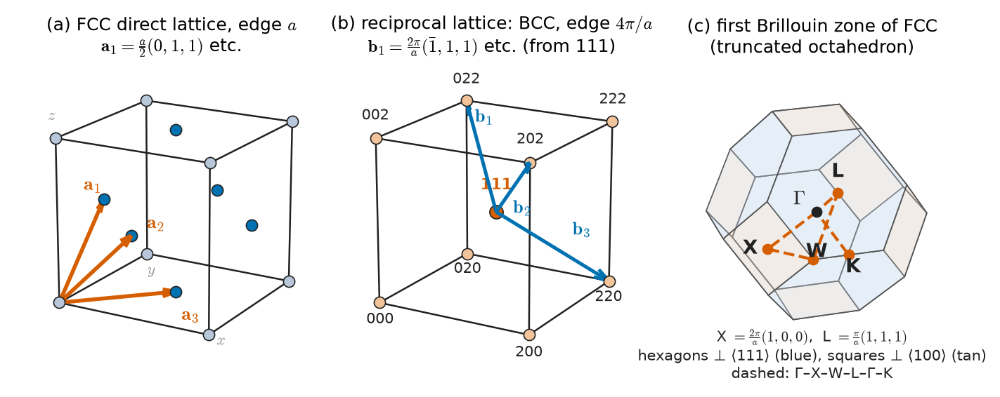
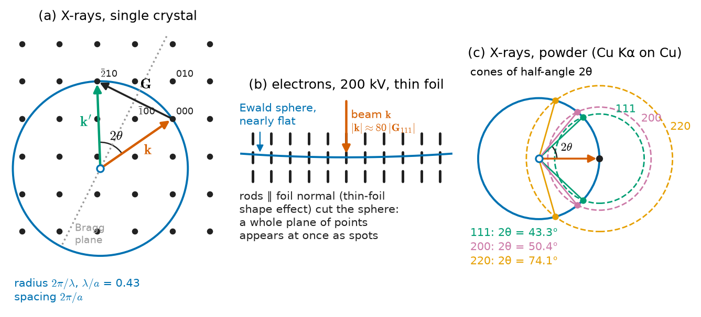
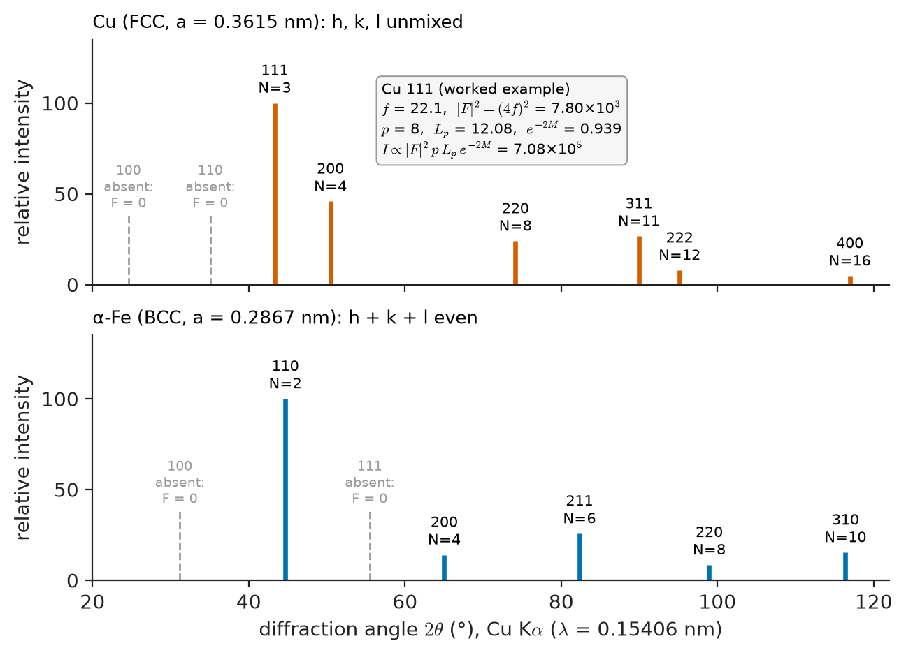
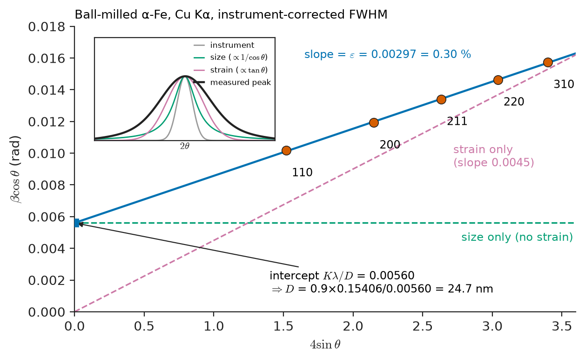
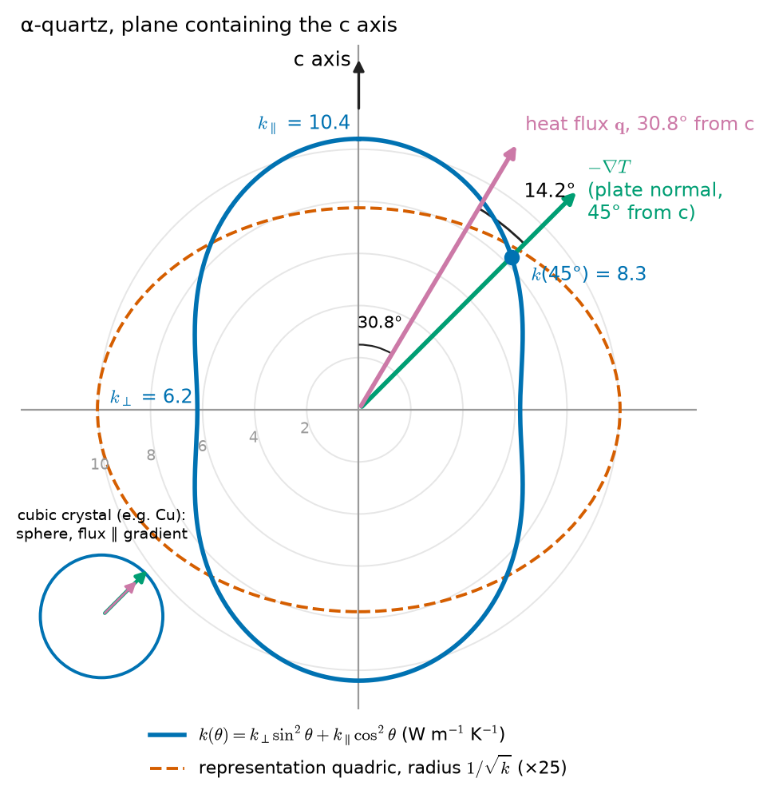
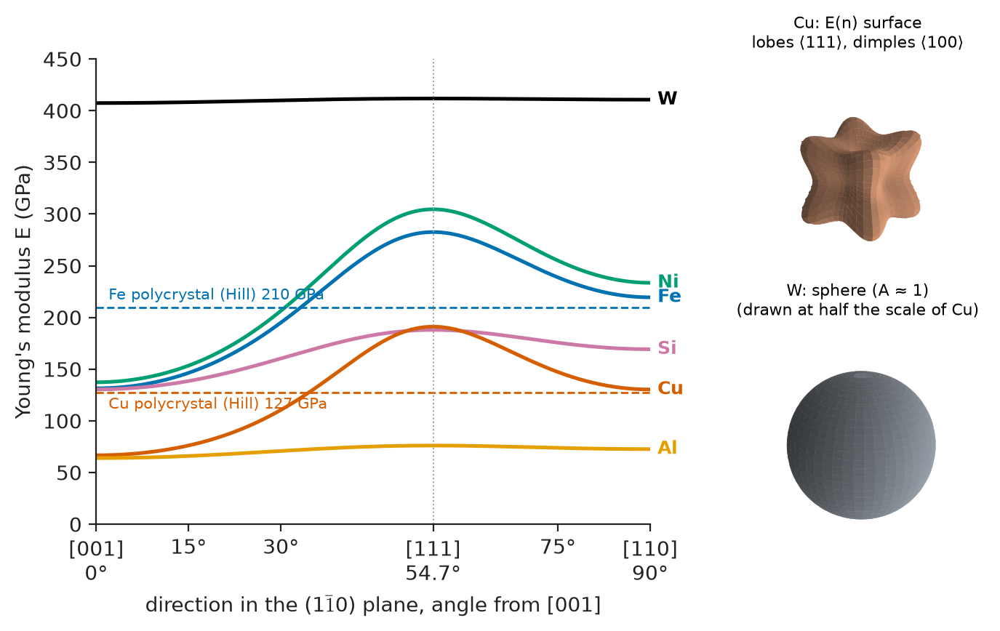

# Chapter 4 — Reciprocal Space, Diffraction and Tensor Properties

*Part I · Structure of Materials*

A batch of carburized and quenched transmission gears fails a bench test: several gear teeth pit and spall after a fraction of their design life. Hardness readings are on specification and the metallographic sections look normal. The laboratory then puts a tooth in an X-ray diffractometer. Alongside the broad peaks of martensite sit small, sharp peaks at angles where body-centred iron has no reflections at all; they belong to face-centred austenite. Comparing integrated intensities gives about 30 % retained austenite in the case, three times the specified limit. Under contact stress the austenite slowly transforms, the case swells and the residual compressive stress that protects the surface is lost. The diffractometer found in twenty minutes what a microscope could not see, and the same pattern also showed, through the width of the martensite peaks, how heavily strained that martensite was.

Elsewhere, an engineer specifying single-crystal nickel-superalloy turbine blades finds that they are always grown with $\langle 001\rangle$ along the blade axis. The reason is stiffness: Young's modulus of a nickel crystal along $\langle001\rangle$ is less than half its value along $\langle111\rangle$, and a lower modulus means lower thermal stress. Yet the thermal and electrical conductivities of the same cubic crystal are identical in every direction. Both facts follow from one principle of symmetry.

> **How does a crystal's periodic structure turn into the diffraction pattern we measure, and what can the positions, intensities and widths of the peaks tell us?**
> **Why do some properties of a crystal depend on direction and others do not, and how much direction dependence does the crystal's symmetry allow?**

| Concept | Engineering destination |
|---|---|
| Reciprocal lattice, Brillouin zones | Electron bands (Ch 31), phonons and heat capacity (Ch 24), diffraction indexing |
| Bragg's law, Laue condition, Ewald sphere | X-ray, electron and neutron diffraction (Ch 52–53), phase identification, texture (Ch 46) |
| Structure factor, systematic absences | Identifying FCC, BCC and ordered phases; γ′ in superalloys; retained austenite in steels |
| Intensity factors | Quantitative phase analysis, Rietveld refinement, temperature measurement from the Debye–Waller factor |
| Peak broadening (Scherrer, Williamson–Hall) | Crystallite size of catalysts and nanopowders; dislocation density in cold-worked and milled metals |
| Neumann's principle | Deciding which properties a crystal or a textured part can possibly show |
| Rank-2 tensors | Thermal expansion of HCP metals and ceramics, anisotropic conduction in graphite, permittivity of sapphire substrates |
| Rank-3 tensors | Piezoelectric sensors and actuators: quartz, PZT, AlN (Ch 27, 37) |
| Rank-4 tensors | Anisotropic stiffness of single-crystal blades, silicon MEMS, textured sheet, composites and wood (Ch 11, 22) |

**Roadmap.** The reciprocal lattice and Brillouin zones (4.1) → the diffraction condition in three equivalent forms (4.2) → which reflections appear: the structure factor (4.3) → how strong they are (4.4) → how wide they are (4.5) → symmetry and properties: Neumann's principle (4.6) → tensor properties of rank 2, 3 and 4 (4.7) → why cubic crystals conduct isotropically but deform anisotropically (4.8).

---

## 4.1 The reciprocal lattice and Brillouin zones

### Why a second lattice is useful

Chapter 2 described a crystal by its direct lattice: basis vectors $\mathbf a_1,\mathbf a_2,\mathbf a_3$ and a motif. Many questions, however, are about *which waves fit the crystal*. X-rays, neutrons, lattice vibrations and conduction electrons all respond to the periodicity of families of lattice planes, each characterised by a normal and a spacing $d_{hkl}$. Both fit into one vector, normal to the planes and of length inversely proportional to their spacing. The set of all such vectors forms a lattice of its own, the **reciprocal lattice**.

### Definition

The reciprocal basis vectors are

$$
\mathbf b_1=2\pi\,\frac{\mathbf a_2\times\mathbf a_3}{V_c},\qquad
\mathbf b_2=2\pi\,\frac{\mathbf a_3\times\mathbf a_1}{V_c},\qquad
\mathbf b_3=2\pi\,\frac{\mathbf a_1\times\mathbf a_2}{V_c}
$$

where $V_c=\mathbf a_1\cdot(\mathbf a_2\times\mathbf a_3)$ is the volume of the direct unit cell. They satisfy $\mathbf a_i\cdot\mathbf b_j=2\pi\,\delta_{ij}$. A general reciprocal-lattice vector is

$$
\mathbf G_{hkl}=h\,\mathbf b_1+k\,\mathbf b_2+l\,\mathbf b_3
$$

with integer $h,k,l$, and it has two properties that make it the natural language of diffraction:

1. $\mathbf G_{hkl}$ is perpendicular to the lattice planes with Miller indices $(hkl)$;
2. its length is $\lvert\mathbf G_{hkl}\rvert=2\pi/d_{hkl}$.

Crystallographers often drop the $2\pi$, so that $\lvert\mathbf G\rvert=1/d$; this chapter keeps it.

> **Status of the principle: reciprocal-lattice properties**
> *Derived.* Both properties follow from the definition by vector algebra; they hold exactly for any lattice, of any symmetry.

For a cubic lattice of edge $a$, $\mathbf b_i=(2\pi/a)\,\hat{\mathbf x}_i$, so $\lvert\mathbf G_{hkl}\rvert=(2\pi/a)\sqrt{h^2+k^2+l^2}$ and

$$
d_{hkl}=\frac{a}{\sqrt{h^2+k^2+l^2}}
$$

the plane-spacing formula of Chapter 2, now obtained in one line. For copper, $a=0.3615$ nm and $d_{111}=0.2087$ nm, so $\lvert\mathbf G_{111}\rvert=30.1\ \mathrm{nm^{-1}}$. Every point of the reciprocal lattice is one family of planes; every family of planes is one point.

### The reciprocal of FCC is BCC

Take the primitive vectors of the FCC lattice, $\mathbf a_1=\tfrac a2(0,1,1)$, $\mathbf a_2=\tfrac a2(1,0,1)$, $\mathbf a_3=\tfrac a2(1,1,0)$. Working through the definition gives $\mathbf b_1=\tfrac{2\pi}{a}(-1,1,1)$ and its permutations, which are the primitive vectors of a **body-centred cubic** lattice with conventional cube edge $4\pi/a$. Conversely, the reciprocal of BCC is FCC. The hexagonal lattice is its own reciprocal type, rotated by $30^\circ$ about the $c$ axis. These pairs matter because they tell us, without calculation, the pattern of allowed reflections from FCC and BCC metals (Section 4.3).

### Brillouin zones

The Wigner–Seitz cell of the reciprocal lattice — the region of reciprocal space closer to one lattice point than to any other — is the **first Brillouin zone**. Its faces are the perpendicular bisector planes of the shortest reciprocal-lattice vectors, so every point $\mathbf k$ on a zone face satisfies

$$
\mathbf k\cdot\hat{\mathbf G}=\tfrac12\lvert\mathbf G\rvert
$$

That is precisely the condition, derived in Section 4.2, for a wave of wavevector $\mathbf k$ to be Bragg-reflected by the planes $\mathbf G$. A wave travelling in the crystal with $\mathbf k$ on a zone face is reflected back on itself and forms a standing wave. For electrons this opens the energy gaps that separate metals, semiconductors and insulators (Chapter 31); for lattice vibrations it caps the phonon wavevector and fixes the Debye cut-off of the heat capacity (Chapter 24).

For FCC metals, whose reciprocal lattice is BCC, the first Brillouin zone is a **truncated octahedron**: eight hexagonal faces normal to $\langle111\rangle$ and six square faces normal to $\langle100\rangle$ (Figure 4.1). For BCC metals it is a rhombic dodecahedron with twelve faces normal to $\langle110\rangle$. High-symmetry points carry standard labels ($\Gamma$ at the centre, $X$ and $L$ at the square and hexagonal face centres) used in band and phonon diagrams.

<!-- FIGURE 4.1 | figures/ch04/fig-4-1-fcc-reciprocal-brillouin.png | crystal | The FCC direct lattice, its BCC reciprocal lattice, and the first Brillouin zone (truncated octahedron) with high-symmetry points. | Content: three panels. (a) FCC conventional cube of edge a with the three primitive vectors a1 = (a/2)(0,1,1), a2 = (a/2)(1,0,1), a3 = (a/2)(1,1,0) drawn as arrows from the origin. (b) Reciprocal lattice drawn as a BCC cube of edge 4π/a, with b1 = (2π/a)(−1,1,1) etc. as arrows; points labelled with (hkl) indices of the conventional cubic reflections: 000, 111, 200, 220. (c) First Brillouin zone: truncated octahedron centred at Γ, eight hexagonal faces normal to ⟨111⟩ and six square faces normal to ⟨100⟩, points Γ, X (2π/a)(1,0,0), L (π/a)(1,1,1), K and W marked; dashed line Γ–X–W–L–Γ–K as used in band diagrams. -->

*Figure 4.1 — The FCC direct lattice, its BCC reciprocal lattice, and the first Brillouin zone (truncated octahedron) with high-symmetry points.*

> **Status of the principle: Brillouin-zone construction**
> *Fundamental.* It expresses the translational symmetry of the crystal in wavevector space (Bloch's theorem, treated in the Engineering Physics book); it holds for any wave in any perfectly periodic crystal and blurs, but does not vanish, in alloys and defected crystals.

> **Boundary.** The quantum mechanics of electrons in a periodic potential, and the derivation of Bloch's theorem, belong to the Engineering Physics book. This chapter uses the reciprocal lattice as a geometric tool; Chapters 24 and 31 use it for phonons and electrons.

---

## 4.2 Bragg's law, the Laue condition and the Ewald sphere

### Bragg's law

In 1913 W. L. Bragg pictured diffraction as reflection of X-rays from successive lattice planes. Rays reflected from adjacent planes of spacing $d$ travel paths that differ by $2d\sin\theta$, where $\theta$ is the glancing angle between the beam and the planes. They reinforce when that difference is a whole number of wavelengths:

$$
n\lambda=2d\sin\theta
$$

Because a reflection of order $n$ from planes $(hkl)$ is geometrically identical to first-order reflection from planes $(nh\,nk\,nl)$ with spacing $d/n$, the order is usually absorbed into the indices and Bragg's law written $\lambda=2d_{hkl}\sin\theta$. The detector, which sits at angle $2\theta$ from the incident beam, records peaks at the "two-theta" positions of the pattern.

> **Status of the principle: Bragg's law**
> *Derived.* It follows from constructive interference of waves scattered by a periodic array of planes; it fixes peak positions exactly for an ideal infinite crystal, and is modified slightly only by refraction (significant at grazing incidence) and by the finite size of real crystals (Section 4.5).

Bragg's law has two immediate consequences. First, since $\sin\theta\le1$, only planes with $d\ge\lambda/2$ can diffract. With Cu K$\alpha_1$ radiation, $\lambda=0.15406$ nm, the smallest accessible spacing is 0.0770 nm; for copper this admits reflections up to $h^2+k^2+l^2=22$. Second, the wavelength must be comparable to interatomic spacings. Laboratory X-ray tubes (Cu, Co, Mo targets, $\lambda=0.07$–$0.18$ nm), thermal neutrons from reactors and spallation sources (0.1–0.4 nm), and electrons in a transmission microscope (2.51 pm at 200 kV) all qualify.

| Probe | Typical wavelength | Scatters from | Penetration in metals | Typical engineering use |
|---|---|---|---|---|
| Laboratory X-rays (Cu K$\alpha$) | 0.154 nm | Electron density, $\propto Z$ | 1–50 µm | Phase identification, lattice parameters, residual stress, texture |
| Synchrotron X-rays (high energy) | 0.01–0.1 nm | Electron density | mm to cm | Strain mapping inside components, in-situ processing (Ch 53) |
| Thermal neutrons | 0.1–0.4 nm | Nuclei (and magnetic moments) | cm | Residual stress in welds and rails, hydrogen and lithium positions, magnetic order |
| Electrons (200 kV TEM) | 2.5 pm | Electrostatic potential | 10–200 nm | Phases, orientation and defects in individual grains and precipitates (Ch 52) |

### The Laue condition

Max von Laue's earlier description treats each lattice point as a scatterer. An incident plane wave of wavevector $\mathbf k$ (magnitude $2\pi/\lambda$) is scattered elastically into $\mathbf k'$ with $\lvert\mathbf k'\rvert=\lvert\mathbf k\rvert$. Waves scattered from lattice points separated by a lattice vector $\mathbf R$ differ in phase by $(\mathbf k'-\mathbf k)\cdot\mathbf R$; they all add in phase only if this is a multiple of $2\pi$ for every $\mathbf R$. Since $\mathbf G\cdot\mathbf R$ is a multiple of $2\pi$ exactly when $\mathbf G$ is a reciprocal-lattice vector, the condition for diffraction is

$$
\Delta\mathbf k=\mathbf k'-\mathbf k=\mathbf G_{hkl}
$$

The scattering vector must equal a reciprocal-lattice vector. Taking magnitudes, $\lvert\Delta\mathbf k\rvert=2k\sin\theta=(4\pi/\lambda)\sin\theta$ and $\lvert\mathbf G\rvert=2\pi/d$, which reproduces Bragg's law. Squaring $\mathbf k'=\mathbf k+\mathbf G$ with $k'=k$ gives $2\mathbf k\cdot\mathbf G+G^2=0$, the zone-face condition used in Section 4.1: a wave is diffracted exactly when its wavevector ends on a Brillouin-zone face.

> **Status of the principle: Laue condition**
> *Derived.* It is equivalent to Bragg's law but more general, because it treats all three dimensions at once and leads directly to the structure factor; it assumes elastic, single (kinematic) scattering.

### The Ewald sphere

Paul Ewald turned the Laue condition into a drawing (Figure 4.2). Place the end of the incident wavevector $\mathbf k$ at the origin of reciprocal space and draw a sphere of radius $k=2\pi/\lambda$ centred at its tail. Every scattered wavevector $\mathbf k'$ of the same length ends on this sphere. Diffraction occurs for each reciprocal-lattice point that lies on the sphere, and the diffracted beam points from the sphere's centre to that point.

The construction explains how every diffraction experiment works.

- **Single crystal, monochromatic beam.** In general no point lies exactly on the sphere; rotating the crystal sweeps points through it one at a time (four-circle diffractometers).
- **Single crystal, white beam (Laue method).** A range of wavelengths gives a shell of spheres, and every point inside the shell diffracts. Laue patterns check the orientation of single-crystal turbine blades and silicon boules to a fraction of a degree.
- **Powder or polycrystal.** Randomly oriented grains spread each $\mathbf G$ over a sphere of radius $\lvert\mathbf G\rvert$; its intersection with the Ewald sphere gives a cone of diffracted rays of half-angle $2\theta$. Every family with $d\ge\lambda/2$ diffracts at once, which makes powder diffraction the workhorse of phase identification.
- **Electron diffraction.** At 200 kV, $k=2\pi/\lambda\approx2500$ nm$^{-1}$, eighty times $\lvert\mathbf G_{111}\rvert$ of copper. The sphere is almost flat, and the reciprocal-lattice points of a thin foil are stretched into rods along the foil normal, so a whole plane of points appears at once as a spot pattern.

<!-- FIGURE 4.2 | figures/ch04/fig-4-2-ewald-sphere.png | schematic | The Ewald construction: diffraction occurs when a reciprocal-lattice point lies on the sphere of radius 2π/λ; X-ray and electron cases compared. | Content: panel (a) 2D square reciprocal lattice (spacing 2π/a, points labelled 000, 100, 010, 110, 200...); incident wavevector k drawn ending at 000; Ewald circle of radius 2π/λ with λ/a ≈ 0.43 (Cu Kα on Cu-like cell); one point (e.g. 1̄1 or 2̄0) lying on the circle; scattered vector k' from circle centre to that point; G = k' − k drawn; angle 2θ between k and k' marked; Bragg planes shown as the perpendicular bisector of G. Panel (b) same lattice with an electron Ewald sphere of radius ~80× the lattice spacing, appearing nearly flat; reciprocal-lattice points drawn as short vertical rods (thin-foil shape effect) intersecting the sphere over a whole row. Panel (c) powder case: concentric circles of radius |G| for 111, 200, 220 intersecting the Ewald circle, giving diffraction cones of half-angle 2θ. -->

*Figure 4.2 — The Ewald construction: diffraction occurs when a reciprocal-lattice point lies on the sphere of radius 2π/λ; X-ray and electron cases compared.*

> **Status of the principle: kinematic (single-scattering) approximation**
> *Approximate.* It assumes each photon, neutron or electron scatters once; it is excellent for X-rays and neutrons in powders and small crystals and fails for electrons in all but very thin foils and for large, perfect crystals, where multiple (dynamical) scattering redistributes intensity between beams.

### Indexing a powder pattern

For a cubic crystal, Bragg's law and the plane-spacing formula combine to

$$
\sin^2\theta=\frac{\lambda^2}{4a^2}\,(h^2+k^2+l^2)
$$

so the values of $\sin^2\theta$ for successive peaks stand in the ratio of integers $N=h^2+k^2+l^2$. Simple cubic gives 1, 2, 3, 4, 5, 6, 8, ...; BCC gives 2, 4, 6, 8, 10, ... (equivalently 1, 2, 3, 4, 5); FCC gives 3, 4, 8, 11, 12, 16, ... The pattern of ratios identifies the Bravais lattice and the first peak gives $a$. Why particular values of $N$ are missing is the subject of the next section.

---

## 4.3 The structure factor and systematic absences

### Adding up the motif

The Laue condition says where diffraction *can* occur. Whether it does, and how strongly, depends on what sits at each lattice point. If the unit cell contains atoms $j$ at fractional coordinates $(x_j,y_j,z_j)$, each with atomic scattering factor $f_j$ (Section 4.4), the amplitude scattered into reflection $hkl$ is proportional to the **structure factor**

$$
F_{hkl}=\sum_j f_j\,\exp\!\big[2\pi i\,(hx_j+ky_j+lz_j)\big]
$$

and the intensity to $\lvert F_{hkl}\rvert^2$. The phases of the waves from different atoms in the cell either reinforce or cancel.

> **Status of the principle: structure factor**
> *Derived.* It is the Fourier transform of the electron (or nuclear) density of one unit cell, sampled at the reciprocal-lattice points; it holds within the kinematic approximation and is the basis of all crystal-structure determination.

### Centred lattices

**Body-centred cubic.** Treat BCC as a simple cubic cell with atoms at $(0,0,0)$ and $(\tfrac12,\tfrac12,\tfrac12)$:

$$
F=f\left[1+e^{\pi i(h+k+l)}\right]=
\begin{cases}2f & h+k+l\ \text{even}\\ 0 & h+k+l\ \text{odd}\end{cases}
$$

The $(100)$ reflection of α-iron is absent because the body-centre atoms lie on planes exactly halfway between the cube faces and scatter in antiphase.

**Face-centred cubic.** With atoms at $(0,0,0)$, $(\tfrac12,\tfrac12,0)$, $(\tfrac12,0,\tfrac12)$, $(0,\tfrac12,\tfrac12)$:

$$
F=f\left[1+e^{\pi i(h+k)}+e^{\pi i(h+l)}+e^{\pi i(k+l)}\right]=
\begin{cases}4f & h,k,l\ \text{all even or all odd}\\ 0 & \text{mixed}\end{cases}
$$

So FCC copper, aluminium, nickel and austenite show 111, 200, 220, 311, 222, ..., and never 100, 110 or 210. These **systematic absences** are what the reciprocal lattice already predicted: the allowed points of FCC form a BCC array, and vice versa.

**Diamond cubic.** Silicon and germanium have an FCC lattice with a two-atom motif, at $(0,0,0)$ and $(\tfrac14,\tfrac14,\tfrac14)$. The structure factor is the FCC result multiplied by $1+e^{\pi i(h+k+l)/2}$, which vanishes when $h+k+l=4n+2$. Silicon therefore lacks 200 and 222 as well as all mixed reflections; its powder pattern with Cu K$\alpha$ shows 111 (28.44°), 220 (47.30°), 311 (56.12°), 400 (69.13°) and 331 (76.37°).
**Hexagonal close-packed.** With atoms at $(0,0,0)$ and $(\tfrac13,\tfrac23,\tfrac12)$, $F=0$ when $h+2k=3n$ and $l$ is odd. The $(0001)$ basal reflection of titanium, magnesium and zinc is therefore absent; $(0002)$ is present.

### Compounds and ordered alloys

When the atoms in the motif differ, cancellation becomes partial. In rock-salt NaCl, with Na on the FCC sites and Cl displaced by $(\tfrac12,0,0)$,

$$
F=\begin{cases}4\,(f_{\mathrm{Na}}+f_{\mathrm{Cl}}) & h,k,l\ \text{all even}\\ 4\,(f_{\mathrm{Na}}-f_{\mathrm{Cl}}) & h,k,l\ \text{all odd}\\ 0 & \text{mixed}\end{cases}
$$

The all-odd reflections are weak because Na$^+$ (10 electrons) and Cl$^-$ (18) partly cancel. In KCl the ions are isoelectronic, the odd reflections almost vanish, and the pattern mimics a simple cubic crystal of half the true lattice parameter.

Order–disorder transformations (Chapter 3) are detected the same way. In disordered β-brass (CuZn) the two sites of the CsCl-type cell are occupied at random and the pattern is BCC. Below about 460 °C copper orders onto the corners and zinc onto the body centres; reflections with $h+k+l$ odd appear with $F\propto\eta\,(f_{\mathrm{Cu}}-f_{\mathrm{Zn}})$, where $\eta$ is the long-range order parameter. These **superlattice reflections** have intensity proportional to $\eta^2$. In nickel-base superalloys the γ′ phase Ni$_3$(Al,Ti) is an ordered L1$_2$ version of the FCC matrix; its 100 and 110 superlattice spots are how γ′ precipitates are imaged and sized (Chapters 10 and 16).

| Lattice or structure | Allowed reflections | First reflections ($N=h^2+k^2+l^2$) | Examples |
|---|---|---|---|
| Simple cubic | all | 100, 110, 111, 200 (1, 2, 3, 4) | α-Po; ordered B2 superlattice lines |
| BCC | $h+k+l$ even | 110, 200, 211, 220 (2, 4, 6, 8) | α-Fe, W, Mo, Cr, β-Ti |
| FCC | $h,k,l$ unmixed | 111, 200, 220, 311 (3, 4, 8, 11) | Cu, Al, Ni, γ-Fe, Au |
| Diamond cubic | unmixed, and not $h+k+l=4n+2$ | 111, 220, 311, 400 (3, 8, 11, 16) | Si, Ge, diamond |
| Rock salt | unmixed; odd set weak | 111, 200, 220, 311 | NaCl, MgO, NiO, TiC |
| HCP | not ($h+2k=3n$ with $l$ odd) | $10\bar10$, $0002$, $10\bar11$ | Ti, Mg, Zn, Zr |

### Retained austenite, again

The opening failure can now be read. Martensite in a carburized case is body-centred tetragonal, close to BCC: its strong peaks with Cu K$\alpha$ are near 44.7° (110) and 65.0° (200), and α-iron with $a=0.2867$ nm gives 44.67°, 65.02°, 82.33° and 98.94° for 110, 200, 211 and 220. Austenite is FCC with $a\approx0.359$ nm, and its 111, 200 and 220 reflections fall at about 43.6°, 50.8° and 74.7°. Because the two lattices have different absences, their peaks interleave, and the ratio of integrated intensities, corrected by the factors of Section 4.4, gives the volume fraction of each phase. The same principle measures monoclinic zirconia in a toughened ceramic or anatase versus rutile in a titania photocatalyst.

---

## 4.4 Diffracted intensities

The integrated intensity of a powder reflection — the area under its peak — can be written

$$
I_{hkl}=S\;\lvert F_{hkl}\rvert^2\;p_{hkl}\;L_p(\theta)\;e^{-2M}\;A(\theta)
$$

where $S$ is a scale factor common to all peaks of one phase. Each remaining factor has a physical origin.

### Atomic scattering factor

X-rays are scattered by electrons. In the forward direction an atom scatters as $Z$ electrons; at higher angles, waves from different parts of the electron cloud get out of phase and the **atomic scattering factor** $f$ falls. It depends on $\sin\theta/\lambda$ and is tabulated (International Tables) or computed from a four-Gaussian fit. For copper, $f=29$ at zero angle, about 22 at the 111 reflection ($\sin\theta/\lambda=0.240\ \text{Å}^{-1}$) and about 15 at 311 ($0.459\ \text{Å}^{-1}$). Close to an absorption edge of the scattering atom, small "anomalous" corrections $f'$ and $f''$ appear; Cu K$\alpha$ on copper or iron is close enough to their edges that $f'\approx-2$ to $-4$, and iron-containing samples also fluoresce strongly under Cu radiation, which is why steels are usually measured with Co or Cr tubes.

Neutrons scatter from nuclei, which are points: the scattering length does not fall with angle and varies irregularly with $Z$, so neutron diffraction locates hydrogen in hydrides and lithium in battery cathodes, and distinguishes neighbours such as Fe, Co and Ni.

### Multiplicity

In a powder, all planes of a family $\{hkl\}$ diffract at the same angle. The **multiplicity** $p$ counts them: in cubic crystals $p=6$ for $\{100\}$, 12 for $\{110\}$, 8 for $\{111\}$, 24 for $\{hk0\}$ and $\{hhl\}$, and 48 for general $\{hkl\}$. Lower symmetry splits families, which is why the 200 peak of tetragonal martensite or BaTiO$_3$ splits into a 2:1 doublet.

### Lorentz–polarization factor

The **Lorentz factor** accounts for the time each reciprocal-lattice point spends in reflecting position and the fraction of each cone intercepted by the detector; the **polarization factor** $(1+\cos^22\theta)/2$ for the partial polarization of an unpolarized beam on scattering. For a powder diffractometer they combine to

$$
L_p=\frac{1+\cos^22\theta}{\sin^2\theta\,\cos\theta}
$$

which is large at low angles and passes through a minimum near $2\theta\approx100^\circ$.

### Debye–Waller factor

Atoms vibrate about their sites. The vibrations smear the electron density and reduce the coherently diffracted intensity by the **Debye–Waller factor**

$$
e^{-2M}=\exp\!\left(-2B\,\frac{\sin^2\theta}{\lambda^2}\right),\qquad B=8\pi^2\langle u^2\rangle
$$

where $\langle u^2\rangle$ is the mean-square displacement of an atom along the scattering vector. For copper at room temperature $B\approx0.55\ \text{Å}^2$, a root-mean-square displacement of $\sqrt{0.55/8\pi^2}=0.083\ \text{Å}$. The lost intensity reappears as diffuse background. Because $\langle u^2\rangle$ rises roughly linearly with temperature, high-angle peaks fade on heating, which in-situ diffraction must correct for; static displacements from solutes and defects add to $B$ in the same way.

> **Status of the principle: Debye–Waller factor**
> *Approximate.* The Gaussian form is exact for harmonic vibrations; it needs corrections for strongly anharmonic solids near melting and for static disorder that is not Gaussian.

### Absorption

In the symmetric (Bragg–Brentano) geometry with a fully absorbing sample, the irradiated volume is independent of angle and $A$ is a constant; thin films and grazing-incidence geometry need explicit corrections. Penetration depth also sets what is measured: in steel, most of the signal comes from the top few micrometres, exactly the region of the gear tooth that failed.

**Worked example — The powder pattern of copper.** Cu K$\alpha_1$ ($\lambda=0.15406$ nm) on FCC copper ($a=0.3615$ nm). Take $f$ from the four-Gaussian fit for neutral Cu, $B=0.55\ \text{Å}^2$, and $F=4f$ for the allowed reflections.

For 111: $d=0.3615/\sqrt3=0.2087$ nm, $\sin\theta=0.15406/(2\times0.2087)=0.3691$, $\theta=21.66^\circ$, $2\theta=43.32^\circ$. Then $\sin\theta/\lambda=0.240\ \text{Å}^{-1}$, $f=22.1$, $F=88.3$, $\lvert F\rvert^2=7.80\times10^3$, $p=8$, $L_p=(1+\cos^243.32^\circ)/(\sin^221.66^\circ\cos21.66^\circ)=12.08$, $e^{-2M}=\exp(-2\times0.55\times0.240^2)=0.939$. Product: $7.80\times10^3\times8\times12.08\times0.939=7.08\times10^5$.

Repeating for the next reflections and normalising to 111:

| $hkl$ | $d$ (nm) | $2\theta$ (°) | $f$ | $p$ | $L_p$ | $e^{-2M}$ | Calculated $I$ | Reference pattern $I$ |
|---|---|---|---|---|---|---|---|---|
| 111 | 0.2087 | 43.32 | 22.1 | 8 | 12.08 | 0.939 | 100 | 100 |
| 200 | 0.1807 | 50.45 | 20.7 | 6 | 8.55 | 0.919 | 46 | 46 |
| 220 | 0.1278 | 74.12 | 16.8 | 12 | 3.71 | 0.845 | 24 | 20 |
| 311 | 0.1090 | 89.93 | 14.8 | 24 | 2.83 | 0.793 | 27 | 17 |
| 222 | 0.1044 | 95.14 | 14.2 | 8 | 2.74 | 0.777 | 8 | 5 |

The positions are exact; the intensities agree at low angles and are 20–50 % high at higher angles. The anomalous correction $f'\approx-2$ lowers the calculated 220 and 311 values to 22 and 24; surface roughness and residual texture account for the rest. No single factor dominates, so quantitative work (phase fractions, Rietveld refinement, Chapter 52) must model them all.

<!-- FIGURE 4.3 | figures/ch04/fig-4-3-cu-fe-powder-patterns.png | plot | Calculated powder patterns of FCC copper and BCC α-iron with Cu Kα radiation: the different systematic absences make the two lattices instantly distinguishable. | Content: two stacked stick patterns sharing x-axis 2θ from 30° to 120°. Top (Cu, FCC, a = 0.3615 nm): sticks at 43.32 (111, height 100), 50.45 (200, 46), 74.12 (220, 24), 89.93 (311, 27), 95.14 (222, 8), 116.93 (400, ~5); labelled with hkl and N = 3, 4, 8, 11, 12, 16. Bottom (α-Fe, BCC, a = 0.2867 nm): sticks at 44.67 (110, 100), 65.02 (200, ~20), 82.33 (211, ~30), 98.94 (220, ~10), 116.4 (310, ~12); labelled with hkl and N = 2, 4, 6, 8, 10. Thin grey dashed sticks at the positions of forbidden reflections (Cu 100, 110; Fe 100, 111) labelled "absent: F = 0". Inset table of the f, p, Lp and Debye–Waller factors for Cu 111 from the worked example. -->

*Figure 4.3 — Calculated powder patterns of FCC copper and BCC α-iron with Cu Kα radiation: the different systematic absences make the two lattices instantly distinguishable.*

---

## 4.5 Peak broadening: size and strain

An infinite, perfect crystal would give infinitely sharp peaks (apart from the natural width of the X-ray line). Real peaks have widths, and the widths carry information about the microstructure. Three contributions add.

1. **Instrumental broadening** from the finite source size, slits, wavelength spread and detector resolution, measured with a strain-free coarse-grained standard (LaB$_6$, Si or corundum powders).
2. **Size broadening** from crystallites (coherently diffracting domains) that are too small for destructive interference to be complete just off the Bragg angle.
3. **Strain broadening** from non-uniform elastic strain — different crystallites, or different parts of one crystallite, having slightly different $d$-spacings.

A *uniform* strain does not broaden a peak; it shifts it. That is the basis of residual-stress measurement by the $\sin^2\psi$ method, in which the shift of a high-angle peak is measured as the sample is tilted (Chapter 52).

### The Scherrer equation

A crystallite with $N$ planes of spacing $d$ in the diffraction direction behaves like a diffraction grating with $N$ lines: the angular width of its peak is inversely proportional to $N$. The result, due to Scherrer (1918), is

$$
D=\frac{K\lambda}{\beta\cos\theta}
$$

where $\beta$ is the integral breadth or full width at half maximum of the size-broadened peak in radians of $2\theta$, $D$ is a volume-weighted thickness of the crystallites normal to the diffracting planes, and $K$ is a shape factor of about 0.9 (0.89–0.94 for common shapes and width definitions).

> **Status of the principle: Scherrer equation**
> *Approximate.* It follows from the interference of a finite stack of planes; it measures coherently diffracting domain size rather than grain size, is meaningful only for domains below about 100–200 nm (above that the broadening is lost in the instrumental width), and overestimates size whenever strain broadening is ignored.

**Worked example — Crystallite size of a ceria catalyst support.** Cerium dioxide (fluorite structure, $a=0.5411$ nm) is the oxygen-storage component of automotive three-way catalysts; its crystallite size controls surface area and sinters during engine ageing. The 111 reflection sits at $2\theta=28.55^\circ$ with Cu K$\alpha$. A fresh support shows a FWHM of 0.80°; the instrument, measured on a LaB$_6$ standard, contributes 0.10°.

Assuming Gaussian profiles, widths add in quadrature: $\beta=\sqrt{0.80^2-0.10^2}=0.794^\circ=0.01385$ rad. With $\theta=14.27^\circ$, $\cos\theta=0.969$:

$$
D=\frac{0.9\times0.15406\ \mathrm{nm}}{0.01385\times0.969}=10.3\ \mathrm{nm}
$$

If the profiles are instead treated as Lorentzian, widths subtract linearly, $\beta=0.70^\circ$, and $D=11.7$ nm. The 13 % difference is typical of the systematic uncertainty of a single-peak Scherrer estimate; it is still ample to track the crystallite growth that degrades oxygen storage when the catalyst is aged at high temperature.

### Strain broadening and the Williamson–Hall plot

If the lattice spacing varies from place to place with a characteristic microstrain $\varepsilon$ (a width of the distribution of $\Delta d/d$), differentiating Bragg's law gives a broadening

$$
\beta_\varepsilon=4\,\varepsilon\tan\theta
$$

Size broadening varies as $1/\cos\theta$ and strain broadening as $\tan\theta$, so measuring several reflections separates them. Adding the two contributions (the simplest assumption, valid for Lorentzian profiles) and multiplying by $\cos\theta$ gives the **Williamson–Hall** relation

$$
\beta\cos\theta=\frac{K\lambda}{D}+4\varepsilon\sin\theta
$$

A plot of $\beta\cos\theta$ against $4\sin\theta$ is a straight line with intercept $K\lambda/D$ and slope $\varepsilon$.

> **Status of the principle: Williamson–Hall analysis**
> *Approximate.* It assumes additive size and strain widths and isotropic strain; in elastically anisotropic metals the strain broadening depends on $hkl$ (the plot scatters), which the modified Williamson–Hall and Warren–Averbach methods correct using dislocation contrast factors.

**Worked example — Ball-milled iron powder.** Mechanical alloying in a ball mill produces nanocrystalline metal powders for oxide-dispersion-strengthened steels used in fusion and fission reactor cladding. A milled α-iron powder measured with Cu K$\alpha$ gives instrument-corrected widths (FWHM, degrees of $2\theta$):

| $hkl$ | $2\theta$ (°) | $\beta$ (°) | $\beta\cos\theta$ (rad) | $4\sin\theta$ |
|---|---|---|---|---|
| 110 | 44.67 | 0.63 | 0.01017 | 1.520 |
| 200 | 65.02 | 0.81 | 0.01192 | 2.150 |
| 211 | 82.33 | 1.02 | 0.01340 | 2.633 |
| 220 | 98.94 | 1.29 | 0.01463 | 3.040 |
| 310 | 116.37 | 1.71 | 0.01573 | 3.399 |

A least-squares line through the last two columns has slope $0.00297$ and intercept $0.00560$ rad. Thus $\varepsilon=0.30\,\%$ and

$$
D=\frac{0.9\times0.15406}{0.00560}=24.7\ \mathrm{nm}
$$

Had the 110 peak alone been put into the Scherrer equation, the answer would have been 13.6 nm; from the 310 peak alone, 8.8 nm. The disagreement is the signature of strain broadening, and ignoring it would understate the crystallite size by a factor of two to three. A microstrain of 0.3 % in iron corresponds, through the models of Chapter 12, to a dislocation density of order $10^{16}\ \mathrm{m^{-2}}$, typical of severely deformed metal.

<!-- FIGURE 4.4 | figures/ch04/fig-4-4-williamson-hall.png | plot | Williamson–Hall plot for ball-milled α-iron: the intercept gives crystallite size, the slope microstrain. | Content: x-axis 4 sin θ from 0 to 3.6; y-axis β cos θ (rad) from 0 to 0.018. Five data points from the worked-example table (1.520, 0.01017), (2.150, 0.01193), (2.633, 0.01340), (3.040, 0.01464), (3.399, 0.01573), labelled 110, 200, 211, 220, 310. Least-squares line y = 0.00560 + 0.00297x extrapolated to x = 0, intercept marked "Kλ/D → D = 24.7 nm", slope labelled "ε = 0.30 %". Dashed horizontal line at y = 0.00560 labelled "size only (no strain)"; dashed line through origin with slope 0.0045 labelled "strain only" for contrast. Inset: schematic of a single peak broken into instrumental, size and strain widths. -->

*Figure 4.4 — Williamson–Hall plot for ball-milled α-iron: the intercept gives crystallite size, the slope microstrain.*

In every case the number is a *coherent-domain* size: a grain divided into subgrains, or containing twins and stacking faults, diffracts as several smaller domains, so diffraction sizes are usually smaller than grain sizes measured by microscopy (Chapter 5).

---

## 4.6 Neumann's principle

### From symmetry of structure to symmetry of properties

The second half of this chapter turns from diffraction to properties. A crystal of quartz conducts heat faster along its $c$ axis than across it; a copper crystal conducts heat equally in all directions but is three times stiffer along $\langle111\rangle$ than along $\langle100\rangle$. To decide which properties *may* depend on direction, and how, we need a rule connecting the symmetry of the structure to the symmetry of a property. It was stated by Franz Neumann in the nineteenth century:

> *The symmetry elements of any physical property of a crystal must include the symmetry elements of the point group of the crystal.*

If a crystal is unchanged by a rotation, then any measurement on it must also be unchanged by that rotation, because nothing physical distinguishes the rotated crystal from the original. The property may have *more* symmetry than the crystal, but never less.

> **Status of the principle: Neumann's principle**
> *Fundamental.* It follows from the invariance of physical laws under coordinate transformations; it holds for any equilibrium property of a perfect crystal, and constrains (but does not determine) the property's values.

### Consequences

Neumann's principle has three kinds of consequence, all used routinely.

- **Properties that must vanish.** A centre of symmetry inverts every vector. Any property that relates a vector to a symmetric second-rank quantity, such as piezoelectricity (polarization from stress), changes sign under inversion and so must be zero in the 11 centrosymmetric point groups. Pyroelectricity, a spontaneous polarization vector, is allowed only in the 10 polar point groups.
- **Properties that must be equal.** A threefold axis along $[111]$ in a cubic crystal permutes $x\to y\to z$, so any property must have equal components along the three cube axes.
- **The number of independent constants.** For each crystal system, the principle fixes how many numbers must be measured to characterise a property completely (Sections 4.7–4.8).

The principle applies to *any* object with a symmetry, not only single crystals. A random polycrystal is statistically isotropic, so it has no piezoelectric effect even if each grain is piezoelectric; a sintered PZT ceramic must be **poled** in a strong field, lowering its symmetry to $\infty m$, before it becomes a transducer. A rolled sheet has orthorhombic sample symmetry, which governs its stiffness and the earing of deep-drawn cans (Chapter 46); a unidirectional fibre composite is transversely isotropic (Chapter 22); wood is orthotropic (Chapter 18).

> **Boundary.** The mathematics of tensors and their transformation belongs to The Mathematics Universe; this chapter states what materials engineers need and applies it.

---

## 4.7 Tensor properties

### Properties as tensors

Many properties relate one directional quantity to another. Thermal conductivity relates the heat-flux vector $\mathbf q$ to the temperature-gradient vector $\nabla T$; in general the two need not be parallel:

$$
q_i=-k_{ij}\,\frac{\partial T}{\partial x_j}
$$

(summation over repeated indices). The nine coefficients $k_{ij}$ form a **second-rank tensor**: on rotation of axes by a matrix $a_{ij}$ they transform as $k'_{ij}=a_{ik}a_{jl}k_{kl}$. The **rank** of a property tensor equals the number of indices, which is the sum of the ranks of the two quantities it connects: vector–vector gives rank 2; vector–rank-2 (polarization from stress) gives rank 3; rank-2–rank-2 (stress from strain) gives rank 4.

| Rank | Property | Relation | Examples |
|---|---|---|---|
| 0 (scalar) | Density, heat capacity | — | Any crystal |
| 1 (vector) | Pyroelectric coefficient | $\Delta P_i=p_i\,\Delta T$ | LiTaO$_3$, PVDF, tourmaline |
| 2 | Electrical and thermal conductivity, permittivity, permeability | $J_i=\sigma_{ij}E_j$, $q_i=-k_{ij}\,\partial_jT$, $D_i=\varepsilon_{ij}E_j$ | All crystals |
| 2 | Thermal expansion | $\varepsilon_{ij}=\alpha_{ij}\,\Delta T$ | All crystals |
| 3 | Piezoelectric coefficients | $P_i=d_{ijk}\,\sigma_{jk}$ | Quartz, PZT, AlN, ZnO, PVDF |
| 4 | Elastic stiffness and compliance | $\sigma_{ij}=C_{ijkl}\,\varepsilon_{kl}$ | All crystals |
| 4 | Electrostriction, photoelasticity | $\varepsilon_{ij}=M_{ijkl}E_kE_l$ | PMN relaxors, glass stress birefringence |

### Rank 2: conductivity, permittivity and thermal expansion

The conductivity, permittivity and thermal-expansion tensors are **symmetric** ($k_{ij}=k_{ji}$, which for transport coefficients follows from Onsager's reciprocal relations), so they have at most six independent components. Any symmetric tensor can be diagonalised by choosing **principal axes**; along those axes, flux and gradient are parallel and the property takes its three principal values. The value along an arbitrary unit direction $\mathbf n$ is

$$
k(\mathbf n)=n_i\,k_{ij}\,n_j=k_1n_1^2+k_2n_2^2+k_3n_3^2
$$

and the surface $k_{ij}x_ix_j=1$ is an ellipsoid, the **representation quadric**. Neumann's principle then fixes its shape:

| Crystal system | Independent components | Shape of quadric | Examples |
|---|---|---|---|
| Cubic | 1 | Sphere (isotropic) | Cu, Fe, Si, NaCl, MgO, spinel |
| Tetragonal, hexagonal, trigonal | 2 ($k_\parallel$, $k_\perp$ to the unique axis) | Ellipsoid of revolution | Zn, Ti, Mg, quartz, sapphire, rutile, graphite, β-Sn |
| Orthorhombic | 3 | General ellipsoid, axes fixed by symmetry | Olivine, aragonite, U (α) |
| Monoclinic | 4 | One axis fixed | Gypsum, monoclinic ZrO$_2$ |
| Triclinic | 6 | Fully general | Plagioclase feldspars |

Typical anisotropies are large. Representative room-temperature values:

| Material | Property | Parallel to $c$ | Perpendicular to $c$ | Consequence |
|---|---|---|---|---|
| α-quartz | Thermal conductivity (W m$^{-1}$ K$^{-1}$) | about 10.4 | about 6.2 | Oriented cuts for oscillator and sensor plates |
| α-quartz | Thermal expansion ($10^{-6}$ K$^{-1}$) | about 7.1 | about 13.2 | Cracking of quartz grains in fired ceramics and in concrete aggregate during fires |
| Zinc | Thermal expansion ($10^{-6}$ K$^{-1}$) | about 60 | about 15 | Thermal ratcheting and roughening of zinc coatings and castings |
| β-tin | Thermal expansion ($10^{-6}$ K$^{-1}$) | about 30 | about 15 | Grain-scale stresses in Sn-based solder joints under thermal cycling |
| Sapphire (α-Al$_2$O$_3$) | Relative permittivity | about 11.6 | about 9.4 | Microwave substrates and LED wafers must be cut and specified by orientation |
| Graphite | Electrical conductivity | about $10^3$ times lower than in-plane | about $2\times10^{6}$ S m$^{-1}$ | Anisotropic electrodes, heat spreaders, pyrolytic-graphite components |

**Worked example — Heat flow in a quartz plate.** A quartz plate is cut with its normal at $45^\circ$ to the $c$ axis, and a temperature gradient of $1000$ K m$^{-1}$ is imposed across its thickness. With $k_\parallel=10.4$ and $k_\perp=6.2$ W m$^{-1}$ K$^{-1}$, the conductivity along the plate normal is

$$
k(45^\circ)=k_\perp\sin^245^\circ+k_\parallel\cos^245^\circ=\tfrac12(6.2+10.4)=8.3\ \mathrm{W\,m^{-1}\,K^{-1}}
$$

The heat flux, however, is not parallel to the gradient. Resolving the gradient into components along and across $c$, the flux components are $10.4\times707=7350$ and $6.2\times707=4380$ W m$^{-2}$, so the flux is tilted at $\arctan(4380/7350)=30.8^\circ$ from the $c$ axis, $14.2^\circ$ away from the plate normal towards $c$. In a plate heated on one face, the hottest region on the opposite face is displaced sideways. The same off-axis flow appears in graphite heat spreaders and in anisotropic composites (Chapter 22), and it is why thermal-property data for non-cubic materials must state the direction.

<!-- FIGURE 4.5 | figures/ch04/fig-4-5-quartz-conductivity-quadric.png | plot | Direction dependence of a rank-2 property: thermal conductivity of α-quartz in a plane containing the c axis, and the tilt of heat flux away from the temperature gradient. | Content: polar plot in the plane containing c (vertical). Curve k(θ) = 6.2 sin²θ + 10.4 cos²θ W m⁻¹ K⁻¹, ranging from 10.4 along c to 6.2 perpendicular; mark k(45°) = 8.3. Representation-quadric ellipse (semi-axes 1/√k) drawn dashed in a second colour. Arrows at 45° from c: temperature gradient −∇T along the plate normal (45°) and heat flux q at 30.8° from c, angle between them 14.2° marked. Small inset: a circle labelled "cubic crystal (e.g. Cu): sphere, flux ∥ gradient". -->

*Figure 4.5 — Direction dependence of a rank-2 property: thermal conductivity of α-quartz in a plane containing the c axis, and the tilt of heat flux away from the temperature gradient.*

Thermal expansion can even be negative along some directions: cordierite (Mg$_2$Al$_4$Si$_5$O$_{18}$) contracts along $c$ and expands across it. In extruded cordierite honeycombs for catalytic converters, aligned grains and microcracks between them bring the bulk expansion down to about $1\times10^{-6}$ K$^{-1}$, low enough to survive cold-start thermal shock. The volume coefficient is the trace, $\alpha_V=\alpha_1+\alpha_2+\alpha_3$; for quartz, $7.1+2\times13.2=33.5\times10^{-6}$ K$^{-1}$. Anisotropic expansion also stresses non-cubic polycrystals: neighbouring grains mismatch by $\Delta\alpha\,\Delta T$, and coarse-grained alumina and TiB$_2$ microcrack on cooling while fine-grained versions do not, because stored elastic energy scales with grain volume but crack energy with boundary area (Chapter 17).

> **Status of the principle: representation of rank-2 properties by an ellipsoid**
> *Derived.* It follows from the symmetry of the tensor and holds for any linear relation between two vectors (or a scalar and a symmetric tensor); it fails when the response becomes non-linear, as in conduction at very high fields.

### Rank 3: piezoelectricity

In a piezoelectric crystal a stress produces an electric polarization (the direct effect) and an electric field produces a strain (the converse effect), with the same coefficients:

$$
P_i=d_{ijk}\,\sigma_{jk},\qquad \varepsilon_{jk}=d_{ijk}\,E_i
$$

Because $\sigma_{jk}$ is symmetric, the 27 components of $d_{ijk}$ reduce to 18, which are written in **Voigt notation** as a $3\times6$ matrix $d_{i\lambda}$ with the index pairs $11\to1$, $22\to2$, $33\to3$, $23\to4$, $13\to5$, $12\to6$. Neumann's principle removes most of them. All 11 centrosymmetric point groups have $d=0$, and so does the non-centrosymmetric cubic class 432, leaving **20 piezoelectric point groups**. α-Quartz (trigonal, 32) has only two independent coefficients, $d_{11}=2.3$ pC N$^{-1}$ and $d_{14}\approx0.7$ pC N$^{-1}$. A poled ceramic ($\infty m$) has three, $d_{33}$, $d_{31}$ and $d_{15}$, the same set as wurtzite AlN and ZnO (6mm).

| Material | Symmetry | $d_{33}$ or main coefficient (pC N$^{-1}$) | Uses |
|---|---|---|---|
| α-quartz | 32 | $d_{11}=2.3$ | Frequency standards, force and pressure sensors |
| AlN (thin film) | 6mm | about 5 | RF filters in phones, MEMS microphones |
| ZnO | 6mm | about 12 | Surface-acoustic-wave devices, energy harvesters |
| PVDF (poled polymer) | mm2 | about $-25$ to $-33$ | Flexible sensors, hydrophones, wearable devices |
| PZT ceramic (soft) | $\infty m$ | 300–600 | Ultrasonic transducers, fuel injectors, actuators, sonar |
| PMN–PT single crystal | 4mm (poled) | 1500–2500 | Medical ultrasound arrays |

**Worked example — A quartz force sensor and a PZT actuator.** A quartz load washer in a machine-tool dynamometer is cut so that a compressive force along its $x_1$ axis produces charge on the faces normal to $x_1$ through $d_{11}$. Because the charge per area is $d_{11}\sigma$ and $\sigma=F/A$, the total charge is independent of area: $Q=d_{11}F$. For a cutting force of 100 N, $Q=2.3\times10^{-12}\times100=2.3\times10^{-10}$ C. Across the sensor's own capacitance of 10 pF this would give 23 V, but the charge leaks away through any finite resistance, which is why piezoelectric force sensors use charge amplifiers and measure dynamic rather than static loads. Run the converse effect in a soft PZT actuator with $d_{33}=400$ pC N$^{-1}$ under a field of 2 kV mm$^{-1}$: the strain is $400\times10^{-12}\times2\times10^{6}=8\times10^{-4}$, so a 10 mm multilayer stack extends by 8 µm. That stroke, delivered in microseconds against kilonewton forces, drives piezoelectric diesel injectors and the nanopositioners of scanning-probe microscopes.

> **Status of the principle: linear piezoelectric equations**
> *Approximate.* They are the leading term of the coupled electromechanical response; valid for quartz to very high stresses, but in ferroelectric ceramics such as PZT only at low fields, beyond which domain switching makes the response non-linear and hysteretic (Chapter 27).

> **Boundary.** Ferroelectric domains, poling and the electrical side of piezoelectric devices are treated in Chapter 27; actuators and sensors return in Chapter 37.

### Rank 4: elasticity

Hooke's law for a crystal relates two symmetric second-rank tensors, stress and strain:

$$
\sigma_{ij}=C_{ijkl}\,\varepsilon_{kl},\qquad \varepsilon_{ij}=S_{ijkl}\,\sigma_{kl}
$$

The stiffness tensor $C_{ijkl}$ has 81 components. Symmetry of stress and strain reduces them to 36, written as a $6\times6$ Voigt matrix $C_{\lambda\mu}$. The existence of a strain-energy function, $W=\tfrac12C_{\lambda\mu}\varepsilon_\lambda\varepsilon_\mu$, makes that matrix symmetric, leaving at most **21 independent elastic constants** (triclinic). Neumann's principle reduces the count further:

| Symmetry | Independent elastic constants | Engineering examples |
|---|---|---|
| Triclinic | 21 | Some minerals; general anisotropic composites |
| Monoclinic | 13 | Monoclinic zirconia, some polymers |
| Orthorhombic (orthotropic) | 9 | Rolled sheet, wood, laminated composites in their principal axes |
| Tetragonal | 6 | β-Sn, tetragonal zirconia, TiO$_2$ |
| Hexagonal (transversely isotropic) | 5 | Ti, Mg, Zn, ZnO, unidirectional fibre composites, columnar coatings |
| Cubic | 3 ($C_{11}$, $C_{12}$, $C_{44}$) | Cu, Al, Ni and superalloys, Fe, W, Si, GaAs, MgO |
| Isotropic | 2 ($E$ and $\nu$, or $K$ and $G$) | Glasses, random polycrystals, amorphous polymers |

> **Status of the principle: generalized Hooke's law with 21 independent constants**
> *Fundamental* in structure (it follows from the symmetry of stress and strain and the existence of a strain-energy function), *approximate* in its linear form, which holds for small strains, typically below 0.1–0.5 % in metals and ceramics (Chapter 11).

---

## 4.8 Why cubic crystals are isotropic in conduction but anisotropic in elasticity

### Second rank: the sphere

Apply Neumann's principle to a rank-2 tensor in a cubic crystal. A fourfold (or twofold) axis along $z$ sends $x\to y$, $y\to-x$; requiring $k_{ij}$ to be unchanged forces $k_{11}=k_{22}$ and $k_{12}=k_{13}=k_{23}=0$. The threefold axis along $[111]$ then forces $k_{33}=k_{11}$. All cubic point groups contain four threefold axes, so for every cubic crystal

$$
k_{ij}=k\,\delta_{ij}
$$

The representation quadric is a sphere. Conductivity, permittivity, susceptibility, diffusivity and thermal expansion of copper, iron, silicon or spinel are the same in every direction — exactly, by symmetry alone. Textured copper conductors and silicon wafers of any orientation have the same resistivity, and cubic ceramics such as MgO and stabilised zirconia do not microcrack from expansion anisotropy.

> **Status of the principle: isotropy of rank-2 properties in cubic crystals**
> *Derived.* A direct consequence of Neumann's principle and cubic point symmetry; it holds for every linear rank-2 property and fails only for higher-rank (or non-linear) properties.

### Fourth rank: the cube

The same symmetry operations applied to $C_{ijkl}$ leave three independent constants, and the stiffness matrix of any cubic crystal is

$$
C=\begin{pmatrix}
C_{11}&C_{12}&C_{12}&0&0&0\\
C_{12}&C_{11}&C_{12}&0&0&0\\
C_{12}&C_{12}&C_{11}&0&0&0\\
0&0&0&C_{44}&0&0\\
0&0&0&0&C_{44}&0\\
0&0&0&0&0&C_{44}
\end{pmatrix}
$$

An isotropic solid has the same form but with only two independent constants, because isotropy additionally requires $C_{44}=(C_{11}-C_{12})/2$. Nothing in cubic symmetry enforces that relation. The two shear moduli of a cubic crystal — $C_{44}$ for shear on $\{100\}$ planes and $(C_{11}-C_{12})/2$ for shear on $\{110\}$ planes along $\langle1\bar10\rangle$ — are set by different bond geometries and are generally different. Their ratio is the **Zener anisotropy ratio**

$$
A=\frac{2C_{44}}{C_{11}-C_{12}}
$$

with $A=1$ for an isotropic solid. Physically, a fourth-rank tensor contains direction products of the form $n_1^2n_2^2$, which a threefold axis cannot average away. The direction-dependent Young's modulus of a cubic crystal follows from the compliances $S_{11}$, $S_{12}$ and $S_{44}$:

$$
\frac{1}{E(\mathbf n)}=S_{11}-2\left(S_{11}-S_{12}-\tfrac12S_{44}\right)\left(n_1^2n_2^2+n_2^2n_3^2+n_3^2n_1^2\right)
$$

The bracketed orientation function is 0 along $\langle100\rangle$, $1/4$ along $\langle110\rangle$ and $1/3$ along $\langle111\rangle$, so $E$ has its extreme values along the cube axes and the body diagonals.

> **Status of the principle: directional Young's modulus of a cubic crystal**
> *Derived.* It follows from transforming the cubic compliance tensor to an arbitrary direction; it is exact within linear elasticity for a single crystal under uniaxial stress.

| Crystal | $C_{11}$ (GPa) | $C_{12}$ (GPa) | $C_{44}$ (GPa) | $A$ | $E_{\langle100\rangle}$ (GPa) | $E_{\langle110\rangle}$ (GPa) | $E_{\langle111\rangle}$ (GPa) |
|---|---|---|---|---|---|---|---|
| Tungsten | 522 | 204 | 161 | 1.01 | 407 | 410 | 411 |
| Aluminium | 108 | 61 | 28.5 | 1.22 | 64 | 73 | 76 |
| Silicon | 166 | 64 | 79.6 | 1.56 | 130 | 169 | 188 |
| α-Iron | 231 | 135 | 116 | 2.41 | 132 | 220 | 283 |
| Nickel | 247 | 147 | 125 | 2.51 | 136 | 233 | 304 |
| Gold | 193 | 164 | 41.5 | 2.85 | 43 | 81 | 115 |
| Copper | 168 | 121 | 75.4 | 3.21 | 67 | 130 | 191 |
| NaCl | 49.1 | 12.8 | 12.8 | 0.71 | 44 | 35 | 33 |

Values are typical room-temperature handbook constants. Tungsten is almost isotropic by coincidence; NaCl has $A<1$, so its stiffest direction is $\langle100\rangle$.

<!-- FIGURE 4.6 | figures/ch04/fig-4-6-cubic-youngs-modulus.png | plot | Young's modulus versus direction in cubic crystals, in the (1-10) plane from [001] through [111] to [110]: cubic symmetry permits strong elastic anisotropy. | Content: x-axis angle from [001] in the (1-10) plane, 0° to 90°, with ticks labelled [001] (0°), [111] (54.7°), [110] (90°); y-axis E (GPa) 0–450. Curves computed from the formula with the table's constants: W (flat ~407–411), Al (64 → 76 → 73), Si (130 → 188 → 169), Fe (132 → 283 → 220), Ni (136 → 304 → 233), Cu (67 → 191 → 130). Dashed horizontal lines for polycrystal Hill averages: Cu 127, Fe ~210. Inset: 3D surface of E(n) for Cu showing lobes along ⟨111⟩ and dimples along ⟨100⟩, and a sphere for W. -->

*Figure 4.6 — Young's modulus versus direction in cubic crystals, in the (1-10) plane from [001] through [111] to [110]: cubic symmetry permits strong elastic anisotropy.*

**Worked example — Stiffness of a copper crystal and of copper polycrystal.** From the constants in the table, inverting the cubic stiffness matrix gives $S_{11}=0.01500$, $S_{12}=-0.00628$ and $S_{44}=1/C_{44}=0.01326\ \mathrm{GPa^{-1}}$. Then $S_{11}-S_{12}-\tfrac12S_{44}=0.01500+0.00628-0.00663=0.01465\ \mathrm{GPa^{-1}}$ and

$$
E_{\langle100\rangle}=\frac{1}{0.01500}=66.7\ \mathrm{GPa},\qquad
E_{\langle111\rangle}=\frac{1}{0.01500-\tfrac23\times0.01465}=191\ \mathrm{GPa}
$$

A factor of 2.9 between the softest and stiffest directions. What does a randomly oriented polycrystal show? Assuming every grain has the same strain (Voigt bound) gives shear modulus $G_V=(C_{11}-C_{12}+3C_{44})/5=54.6$ GPa; assuming the same stress (Reuss bound) gives $G_R=5/[4(S_{11}-S_{12})+3S_{44}]=40.0$ GPa. The bulk modulus is the same in both, $K=(C_{11}+2C_{12})/3=137$ GPa, because a cubic crystal compresses isotropically under hydrostatic pressure. With $E=9KG/(3K+G)$, the bounds are $E_V=145$ GPa and $E_R=109$ GPa, and their mean (the Hill estimate) is 127 GPa, close to the 125–130 GPa measured on untextured copper. A polycrystal is isotropic only on average: individual grains still carry stresses that differ by tens of percent from the average, which concentrates stress at grain boundaries in fatigue (Chapter 14) and scatters ultrasound in coarse-grained austenitic welds, making them notoriously difficult to inspect.

### Where elastic anisotropy is engineered

- **Single-crystal turbine blades.** For nickel, $E_{\langle001\rangle}=136$ GPa against $E_{\langle111\rangle}=304$ GPa. A blade grown with $\langle001\rangle$ along its axis (the natural growth direction of dendrites in directional solidification, Chapter 9) has the lowest available stiffness, so a given thermal strain $\alpha\Delta T$ produces the lowest thermal stress. Thermal-fatigue life improves several-fold over randomly oriented cast blades (Chapters 16 and 41).
- **Silicon MEMS.** In a standard (100) wafer, beams along $\langle110\rangle$ have $E=169$ GPa and beams along $\langle100\rangle$ have 130 GPa. Resonant frequencies, which scale as $\sqrt E$, differ by 14 % between the two orientations; accelerometer and gyroscope designers must use the orientation-dependent modulus, not a handbook "isotropic" value.
- **Textured sheet and films.** Steel sheet with a strong $\{111\}$ texture is stiffer and draws more deeply than random sheet; copper films with $\langle111\rangle$ fibre texture develop higher thermal stress on silicon than random films (Chapter 49).

The same logic applies to every rank-4 property: photoelasticity, electrostriction and magnetostriction are also anisotropic in cubic crystals (Chapter 28). Plastic yielding, governed by slip systems and Schmid factors (Chapter 13), is direction-dependent too.

---

## What remains open

| Open question | Where it is answered |
|---|---|
| What are the vacancies, dislocations and grain boundaries that broaden peaks and limit coherent domain size? | Chapter 5 (defects); Chapter 12 (dislocations and their strain fields) |
| How are elastic constants related to bonding, and how is anisotropic Hooke's law used in design? | Chapter 11 |
| How do electron waves form bands at Brillouin-zone boundaries? | Chapter 31; foundations in the Engineering Physics book |
| How do phonons on the Brillouin zone set heat capacity, expansion and thermal conductivity? | Chapter 24 |
| How are orthotropic and transversely isotropic stiffness matrices handled for composite plies and wood? | Chapters 22 and 18 |
| How do piezoelectric and ferroelectric materials work as devices? | Chapters 27 and 37 |
| How is diffraction done in practice: Rietveld refinement, residual stress, texture, EBSD? | Chapter 52 |
| What do synchrotron, neutron, PDF and 4D-STEM methods add? | Chapter 53 |
| How do textures form during rolling, recrystallization and additive manufacturing? | Chapters 10, 46 and 48 |

**Next:** Chapter 5 turns from the ideal crystal to the real one — the point, line, planar and volume defects that diffraction detects and that control almost every property in this book.
