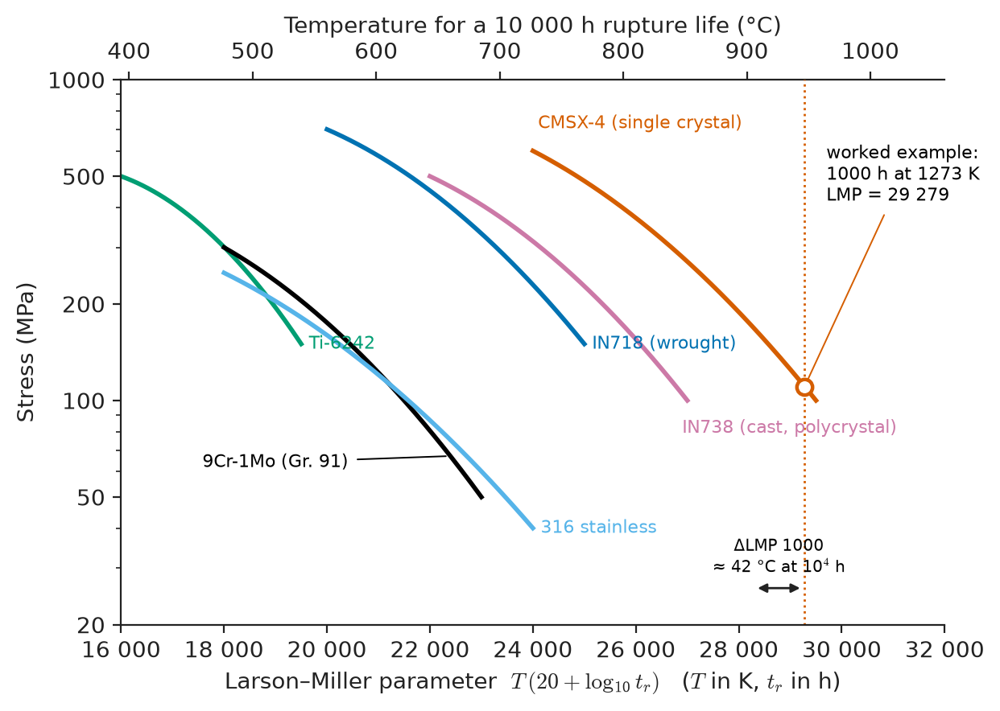
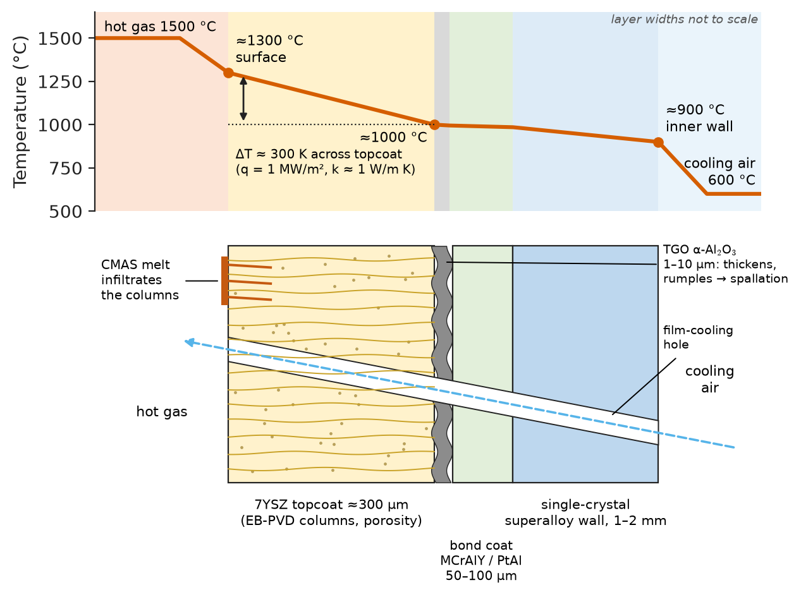
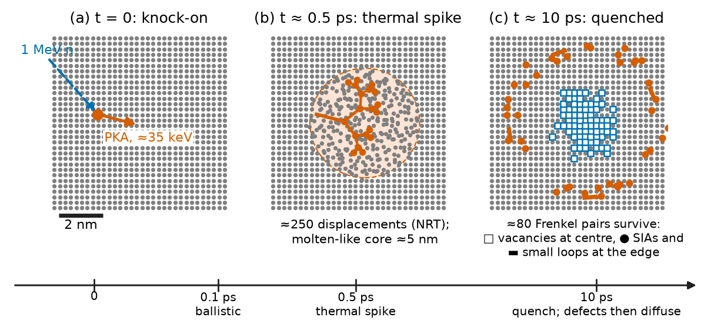
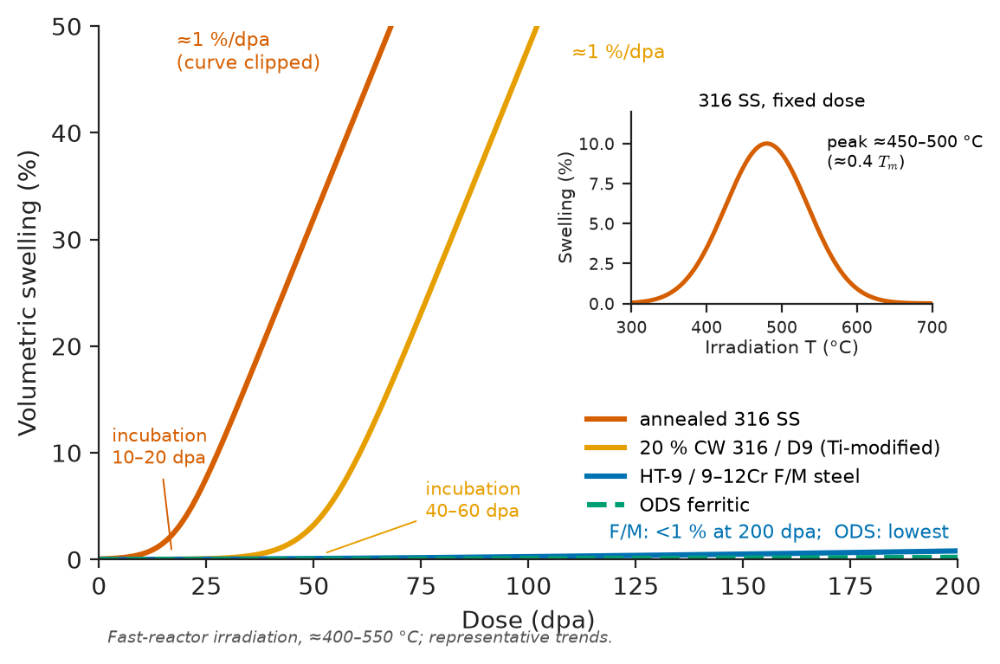
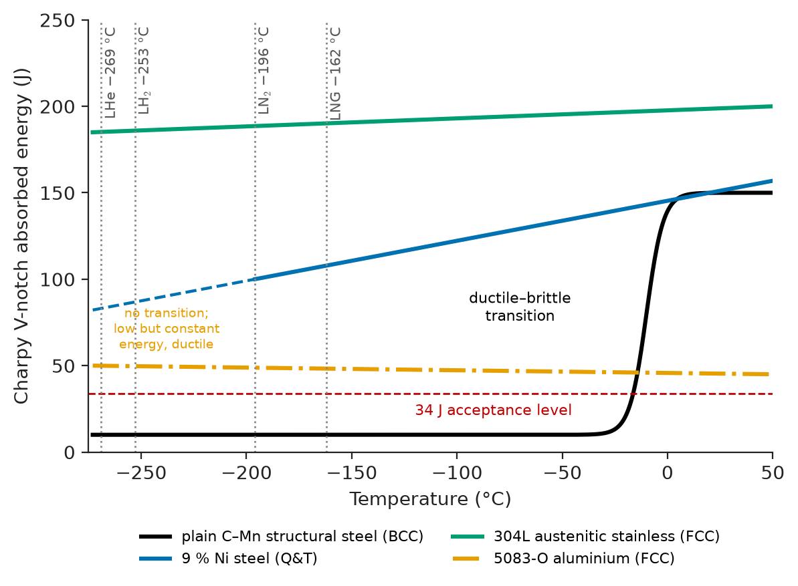
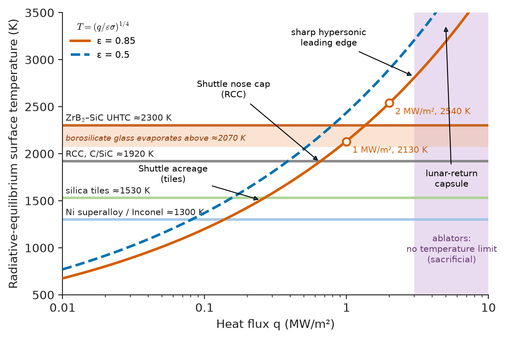

# Chapter 41 — Materials for Extreme Environments

*Part VIII · Advanced and Emerging Materials*

The first-stage turbine blade of a modern jet engine sits in gas at about 1500 °C, some 150 °C above the melting point of the nickel alloy it is made of. It rotates at more than 10,000 revolutions per minute, so each gram of blade near the tip pulls outward with a force of a few hundred newtons, and it must do this for some 20,000 hours between overhauls without creeping more than a fraction of a millimetre toward the casing. Two metres away, the fan blade shrugs off bird strikes at −50 °C. A few hundred kilometres away a reactor pressure vessel absorbs a slow rain of fast neutrons that knock each of its atoms out of place again and again over sixty years, while its steel's ductile–brittle transition creeps upward toward the temperature of an emergency cooling injection. An LNG carrier's tank holds liquid at −162 °C in a membrane only 0.7 mm thick, and a re-entry capsule's heat shield is designed to burn away. These components share one feature: the environment has removed the safety margins that ordinary service allows. This chapter collects what materials science knows about such environments, where the physics of creep, diffusion, fracture and defects from earlier chapters is pushed to its limits.

> **What sets the temperature ceiling of a structural material, and how do coatings, cooling and composites raise it?**
> **How does radiation damage a crystal, and why do some alloys survive a hundred displacements per atom while others swell and crack?**
> **Why do some metals stay tough at cryogenic temperatures while others shatter, and what do aerospace, hypersonic and space service add?**

| Concept | Engineering destination |
|---|---|
| Homologous temperature, creep, Larson–Miller parameter | Turbine blades, boiler tubes, furnace hardware, rocket nozzles |
| Superalloys, refractory metals, ceramics, CMCs, thermal barrier coatings | Gas turbines, reactors, hypersonic vehicles |
| Protective oxide scales, hot corrosion | Turbine and boiler life, waste incinerators, petrochemical crackers |
| Displacements per atom, swelling, embrittlement, helium | Reactor vessels, core internals, fuel cladding, fusion first wall |
| Fuel and cladding behaviour | Fission reactor safety and burnup |
| Specific stiffness and damage-tolerant design | Airframes, engine discs, launch vehicles |
| Ductile–brittle transition, thermal contraction, Invar | LNG and liquid-hydrogen tanks, superconducting magnets |
| Ablation, radiative cooling, atomic oxygen, outgassing | Re-entry shields, leading edges, satellites |

**Roadmap.** What makes an environment extreme (41.1) → high-temperature materials (41.2) and their chemical attack (41.3) → radiation damage (41.4) and nuclear materials (41.5) → aerospace structures (41.6) → cryogenic service (41.7) → hypersonic flight and space (41.8).

> **Boundary.** The creep, fracture and fatigue mechanics used here are developed in Chapter 14, the alloys in Chapters 15 and 16, the ceramics and composites in Chapters 17, 22 and 23, and the corrosion science in Chapters 42 and 43. Nuclear reactions and neutron physics belong to Engineering Physics; radiation damage in semiconductors is treated in Chapter 32.

---

## 41.1 What makes an environment extreme

An environment is extreme for a material when it activates a degradation mechanism that is negligible in ordinary service. Temperature does this through the **homologous temperature** $T/T_m$ (both in kelvin): diffusion-controlled processes such as creep, coarsening and oxidation become important above about $0.4T_m$ for metals and $0.5T_m$ for ceramics (Chapters 8 and 14). Radiation does it by creating point defects far above their thermal-equilibrium concentration. Low temperature does it by suppressing the thermally activated dislocation motion that makes BCC metals ductile. Chemistry does it by dissolving or oxidizing the protective layers on which materials depend, and the vacuum, ultraviolet light and atomic oxygen of orbit add mechanisms that never occur on the ground.

**Table 41.1 — Representative extreme environments (typical values).**

| Component | Temperature | Other loads | $T/T_m$ of material | Dominant mechanisms |
|---|---|---|---|---|
| HP turbine blade (Ni single crystal) | ≈1100 °C metal, ≈1500 °C gas | Centrifugal stress 150–250 MPa; thermal cycling | ≈0.83 | Creep, oxidation, thermomechanical fatigue |
| Ultra-supercritical boiler tube | 600–650 °C | Steam at 25–30 MPa | ≈0.5 | Creep, steam oxidation |
| Ethylene cracker tube (HP-40 cast steel) | 1000–1100 °C | Hydrocarbons | ≈0.8 | Creep, carburization |
| Light-water reactor pressure vessel | ≈290 °C | Fast neutrons, ≈0.1 dpa over 60 years | ≈0.3 | Irradiation embrittlement |
| Fast-reactor fuel cladding | 400–650 °C | 100–200 dpa | 0.4–0.5 | Void swelling, irradiation creep |
| Fusion divertor (tungsten) | up to ≈1200 °C surface | ≈10 MW/m² heat flux; He and H plasma | ≈0.4 | Recrystallization, cracking, He blistering |
| LNG tank | −162 °C | Thermal cycling | — | Brittle fracture, contraction |
| Re-entry heat shield | 1500–3000 °C surface | Shear, oxidation | ablating | Ablation, oxidation |
| Low-Earth-orbit surface | −100 to +120 °C | Atomic oxygen, UV, vacuum | — | Erosion, outgassing, cycling |

---

## 41.2 High-temperature materials

### What a high-temperature material must do

A material for hot structural service must resist creep (Chapter 14), keep its microstructure stable for tens of thousands of hours, form a protective oxide (Section 41.3), resist thermomechanical fatigue as the component heats and cools, and, in anything that flies or rotates, do all this at low density, since the centrifugal stress in a rotating blade scales with its density. No single material does everything, so the hottest components are **material systems**: a creep-resistant substrate, a bond coat that forms a protective oxide, a ceramic thermal barrier and internal cooling.

### Nickel-base superalloys

Nickel-base superalloys (Chapter 16) owe their strength to the **γ/γ′ microstructure**: 60–70 vol% of cuboidal, coherent precipitates of ordered Ni$_3$(Al,Ti,Ta) (γ′, L1$_2$ structure) in an FCC nickel solid solution (γ). A dislocation entering γ′ creates an antiphase boundary (Chapter 3) and must travel in pairs; the yield strength of γ′ even rises with temperature up to about 800 °C because cross-slip locks screw dislocations. Refractory solutes (Re, W, Mo, Ta, Ru) slow diffusion and therefore creep and γ′ coarsening. The FCC matrix keeps good ductility and toughness at all temperatures.

Processing has been as important as alloying. Conventionally cast blades fail by creep cavitation on transverse grain boundaries. **Directional solidification** aligns columnar grains along the blade axis, removing transverse boundaries; **single-crystal** casting, with a helical grain selector, removes boundaries altogether, so grain-boundary strengtheners (C, B, Zr), which lower the melting point, can be omitted and the solution-heat-treatment temperature raised. Each step added roughly 25–50 °C of metal-temperature capability; together with cooling and coatings they let turbine entry temperatures exceed the alloy's melting point.

**Worked example — what 50 °C costs in creep life.** Creep-rupture data are compared through the Larson–Miller parameter $\mathrm{LMP}=T(C+\log_{10}t_r)$, with $T$ in kelvin, $t_r$ in hours and $C\approx20$ (Chapter 14). A blade alloy has a rupture life of 1000 h at 1000 °C (1273 K) at its design stress, so

$$
\mathrm{LMP}=1273\times(20+3)=29\,279
$$

At the same stress the life at 950 °C (1223 K) is $\log_{10}t_r=29\,279/1223-20=3.94$, so $t_r=8700$ h; at 1050 °C (1323 K), $\log_{10}t_r=2.13$ and $t_r=135$ h. A 50 °C overtemperature cuts life by a factor of about 7, and 50 °C of extra cooling multiplies it by nearly 9. This exponential sensitivity is why a few tens of degrees from a better coating or alloy are worth decades of development (Figure 41.1).

> **Status of the principle: Larson–Miller parameter**
> *Empirical.* It follows from an Arrhenius rate with a single activation energy; it interpolates well within the tested range for one alloy and microstructure, but extrapolations far beyond the data, or across a change of creep mechanism, are unreliable.

<!-- FIGURE 41.1 | figures/ch41/fig-41-1-larson-miller-alloys.png | plot | Larson-Miller master curves rank high-temperature alloys: each 1000 units of LMP is worth roughly 40-50 C at constant life. | Content: log y-axis stress 20-1000 MPa vs x-axis LMP = T(K)(20+log t_h) from 16,000 to 32,000. Representative curves: 9Cr-1Mo (Grade 91) steel (300 MPa at 18,000 to 50 MPa at 23,000), 316 stainless (250 MPa at 18,000 to 40 MPa at 24,000), Ti-6242 (500 MPa at 16,000 to 150 MPa at 19,500), wrought Ni superalloy IN718 (700 MPa at 20,000 to 150 MPa at 25,000), cast polycrystal IN738 (500 MPa at 22,000 to 100 MPa at 27,000), single-crystal CMSX-4 (600 MPa at 24,000 to 100 MPa at 29,500). Mark the worked-example point LMP 29,279. Secondary top axis: temperature for 10,000 h life. -->

*Figure 41.1 — Larson-Miller master curves rank high-temperature alloys: each 1000 units of LMP is worth roughly 40-50 C at constant life.*

### Refractory metals

Molybdenum (melting point 2623 °C), niobium (2477 °C), tantalum (3017 °C) and tungsten (3422 °C) keep useful strength far above any superalloy. Their weaknesses are equally fundamental. They oxidize catastrophically: MoO$_3$ and WO$_3$ volatilize above about 700–800 °C, so these metals serve in vacuum or inert gas (furnace elements and heat shields, X-ray targets, glass-melting electrodes) or under coatings. They are dense (W 19.3 g/cm³, Mo 10.2 g/cm³), and the BCC metals Mo and W have ductile–brittle transitions near or above room temperature, made worse by interstitial oxygen and recrystallization. Niobium alloy C-103 with a silicide coating forms the radiation-cooled nozzle extensions of upper-stage rocket engines; molybdenum TZM, with fine TiC and ZrC particles, serves in forging dies and furnace hardware; tungsten is the plasma-facing armour of fusion devices (Section 41.5). Refractory high-entropy alloys and Mo–Si–B alloys aim to combine strength above 1200 °C with self-protecting oxides.

### Ceramics and ceramic-matrix composites

Covalent ceramics (SiC, Si$_3$N$_4$) keep their strength to 1200–1400 °C, are a third of the density of superalloys and form protective silica (Chapter 17). Monolithic, they are flaw-sensitive (Weibull moduli of 10–20) and so are used where stresses are modest or compressive: silicon nitride bearing balls and turbocharger rotors, SiC heat-exchanger tubes and kiln furniture.

**Ceramic-matrix composites** (Chapter 23) supply the missing toughness. In SiC/SiC, silicon carbide fibres are embedded in a SiC matrix with a thin boron nitride or pyrolytic carbon interphase that deflects cracks along the fibres, so cracks bridge rather than run straight through. The composite fails gracefully, with a stress–strain curve that bends over rather than snapping. SiC/SiC operates to about 1300 °C at a density of about 2.7 g/cm³, and has entered service in turbine shrouds, combustor liners and low-pressure turbine blades, where it saves cooling air and weight. Carbon–carbon composites keep strength above 2000 °C in inert atmosphere and serve as aircraft and racing-car brakes and rocket nozzles, but they oxidize above about 450 °C and need SiC conversion coatings or short service times.

### Thermal barrier coatings

A **thermal barrier coating** (TBC) is a ceramic layer, 100–500 µm thick, on the hot surface of an internally cooled metal part. The standard topcoat is zirconia stabilized with 7–8 wt% yttria (7YSZ), chosen for a rare combination: low thermal conductivity (about 2–3 W m$^{-1}$ K$^{-1}$ dense, 0.8–1.2 W m$^{-1}$ K$^{-1}$ with the porosity and microcracks of the coating), the highest thermal expansion of common oxides (about 11 ppm/K, closest to the metal), phase stability to about 1200 °C, and toughness from its metastable tetragonal phase (Chapter 14). Plasma spraying gives a splat structure with low conductivity; electron-beam physical-vapour deposition gives columns that open and close as the metal expands, tolerating strain better on blades.

Between the topcoat and the superalloy is an aluminium-rich **bond coat** (MCrAlY or Pt-modified aluminide) that grows a **thermally grown oxide** (TGO) of α-Al$_2$O$_3$, because zirconia is transparent to oxygen. The TGO is the TBC's life clock: as it thickens to about 5–10 µm, the compressive stress it stores on cooling, and the bond coat's rumpling, drive delamination and spallation of the topcoat (Figure 41.2). A newer threat is CMAS, calcium–magnesium–aluminosilicate deposits from ingested sand and volcanic ash, which melt on the hot surface, infiltrate the porous topcoat and stiffen it so that it spalls on cooling.

**Worked example — how much a coating buys.** A blade wall carries a heat flux $q=1$ MW/m² from the gas to the cooling air. Through a 300 µm topcoat of conductivity $k=1.0$ W m$^{-1}$ K$^{-1}$, Fourier's law gives the temperature drop

$$
\Delta T=\frac{q\,t}{k}=\frac{10^6\times3\times10^{-4}}{1.0}=300\ \mathrm K
$$

By the Larson–Miller arithmetic above, even a third of that drop multiplies creep life by an order of magnitude. Conversely, losing a patch of coating by spallation exposes the metal to a temperature rise of a couple of hundred kelvin, which is why TBC spallation is treated as a life-limiting event rather than a cosmetic one.

> **Status of the principle: one-dimensional Fourier conduction through a coating**
> *Approximate.* Valid for a uniform layer much thinner than the component's curvature, with constant conductivity; radiation through the translucent ceramic, sintering of the topcoat (which raises $k$ with time) and edge effects modify it.

<!-- FIGURE 41.2 | figures/ch41/fig-41-2-tbc-system-temperature-profile.png | schematic | A thermal barrier coating system: the ceramic topcoat carries most of the temperature drop, and the thermally grown oxide at the bond coat sets its life. | Content: cross-section of a cooled turbine blade wall, left to right: hot gas (1500 C), 7YSZ topcoat 300 um (columnar EB-PVD texture, porosity), TGO alumina 1-10 um, MCrAlY or PtAl bond coat 50-100 um, single-crystal superalloy wall 1-2 mm, cooling air (600 C). Overlaid temperature profile: gas 1500 C, topcoat surface ~1300 C, topcoat/bond-coat interface ~1000 C (300 K drop across topcoat), metal inner wall ~900 C. Callouts: CMAS infiltration at surface, TGO thickening and rumpling leading to spallation, film-cooling hole. -->

*Figure 41.2 — A thermal barrier coating system: the ceramic topcoat carries most of the temperature drop, and the thermally grown oxide at the bond coat sets its life.*

**Table 41.2 — High-temperature structural materials (typical values).**

| Material | Density (g/cm³) | Approx. maximum service temperature | Oxidation protection | Typical use |
|---|---|---|---|---|
| Ti-6242 / near-α Ti | 4.5 | ≈550 °C | Limited (α-case) | Compressor discs and blades |
| γ-TiAl | 3.9–4.2 | ≈750 °C | Marginal alumina | Low-pressure turbine blades |
| 9–12 % Cr ferritic steels | 7.8 | ≈620 °C | Chromia | Steam pipes, boiler headers |
| Ni superalloy, single crystal | 8.6–9.0 | ≈1100 °C metal (higher with TBC) | Alumina via bond coat | HP turbine blades |
| Nb alloy C-103 (coated) | 8.9 | ≈1300 °C | Silicide coating | Rocket nozzle extensions |
| Mo-TZM | 10.2 | ≈1400 °C (vacuum/inert) | None in air | Furnace hardware, dies |
| W | 19.3 | >2000 °C (vacuum/inert) | None in air | Fusion armour, filaments |
| Si$_3$N$_4$, SiC (monolithic) | 3.2 | 1200–1400 °C | Silica | Bearings, heat exchangers |
| SiC/SiC CMC | 2.6–2.8 | ≈1300 °C (with EBC) | Silica + environmental barrier | Shrouds, liners, LPT blades |
| C/C composite | 1.6–1.9 | >2000 °C inert; ≈450 °C in air unprotected | SiC coating | Brakes, nozzles, leading edges |

---

## 41.3 High-temperature oxidation and hot corrosion

Every material in Table 41.2 survives in air only behind a slow-growing, adherent oxide. The thermodynamics (Ellingham diagrams, Chapter 6) and kinetics (Wagner's parabolic law, the Pilling–Bedworth ratio) of oxide growth are developed in Chapter 42; here the question is which scale to rely on.

- **Chromia (Cr$_2$O$_3$)** formers, alloys with about 18–25 % Cr, protect up to about 950–1000 °C. Above that, chromia oxidizes further to volatile CrO$_3$ (and in steam to CrO$_2$(OH)$_2$), so the scale thins as it grows.
- **Alumina (α-Al$_2$O$_3$)** formers, alloys with enough Al (about 5 % in FeCrAl, or via aluminide coatings), grow scales one to two orders of magnitude more slowly and protect to about 1300 °C. Small additions of reactive elements (Y, Hf, Zr) segregate to the scale's grain boundaries, slow its growth and dramatically improve adhesion.
- **Silica (SiO$_2$)** on SiC and Si$_3$N$_4$ is the slowest-growing scale of all, but water vapour converts it to volatile Si(OH)$_4$. In a gas turbine's combustion products, silica recedes at rates of the order of micrometres per hour, so SiC/SiC parts need **environmental barrier coatings** of rare-earth silicates (Yb$_2$Si$_2$O$_7$). At low oxygen pressure SiC oxidizes *actively* to gaseous SiO and recedes rapidly, a concern for re-entry.

**Hot corrosion** is accelerated attack under a thin molten salt film. Sodium sulfate, formed from sulfur in fuel and sodium chloride in marine air, condenses on turbine parts. In **Type I** (high-temperature) hot corrosion, at about 850–950 °C, the molten Na$_2$SO$_4$ dissolves the protective oxide (fluxing) and leads to sulfidation beneath it. In **Type II** (low-temperature) hot corrosion, at about 650–750 °C, low-melting eutectics with cobalt or nickel sulfates cause pitting. Vanadium from residual fuel oil forms vanadates that melt near 600–700 °C, which is why heavy-fuel boilers and marine diesels need special alloys or fuel additives. Related attacks include sulfidation in coal gasifiers, chloride attack in waste-to-energy boilers, and carburization and **metal dusting** in petrochemical furnaces, where carbon diffuses into nickel–chromium alloys and disintegrates them into graphite and metal powder. The materials responses are higher chromium for hot corrosion, alumina-forming coatings, and silicon and aluminium additions against carburization.

---

## 41.4 Radiation damage

### Displacements and the dpa

A fast neutron carries no charge and passes through the electron cloud untouched until it collides with a nucleus. In an elastic collision a neutron of energy $E$ can transfer at most

$$
T_{max}=\frac{4A}{(1+A)^2}E
$$

to a nucleus of mass number $A$. The struck atom, the **primary knock-on atom** (PKA), recoils through the lattice and displaces others if it gives them more than the **displacement threshold energy** $E_d$, about 25–40 eV for metals (40 eV is the conventional value for iron). The resulting **displacement cascade** (Figure 41.3) lasts a few picoseconds: a core of a few nanometres is briefly molten-like, most displaced atoms recombine, and the survivors are vacancies at the centre and self-interstitials, singly and in small clusters, around the edge.

The standard measure of damage is the number of **displacements per atom** (dpa), estimated by the Norgett–Robinson–Torrens (NRT) model, which counts the displacements a PKA of damage energy $T_{dam}$ would create:

$$
N_d=\frac{0.8\,T_{dam}}{2E_d}
$$

where $T_{dam}$ is the PKA energy minus what it loses to electronic excitation.

> **Status of the principle: NRT displacement estimate**
> *Approximate.* A binary-collision estimate that counts displacements, not surviving defects; molecular dynamics shows that only about a third survive cascade recombination. The dpa is nonetheless the accepted exposure unit because it lets damage from different neutron spectra and ion beams be compared.

**Worked example — damage from one fast neutron in steel.** For a 1 MeV neutron striking iron ($A=55.85$),

$$
T_{max}=\frac{4\times55.85}{56.85^2}\times1\ \mathrm{MeV}=0.0691\ \mathrm{MeV}=69\ \mathrm{keV}
$$

For isotropic elastic scattering the average transfer is half of this, about 35 keV. Roughly a quarter goes into electronic excitation, leaving $T_{dam}\approx25$ keV, so $N_d=0.8\times25\,000/(2\times40)=250$ displacements, of which some 80 survive as Frenkel pairs. In a fast-reactor core with a flux of $2\times10^{15}$ neutrons cm$^{-2}$ s$^{-1}$ and a spectrum-averaged displacement cross-section of about 400 barn ($4\times10^{-22}$ cm²), the damage rate is $2\times10^{15}\times4\times10^{-22}=8\times10^{-7}$ dpa/s, or $8\times10^{-7}\times3.16\times10^7\approx25$ dpa per year: each atom in the cladding is knocked out of its site about twenty-five times a year. By contrast a light-water reactor pressure vessel, shielded by water and core internals, accumulates only about 0.1 dpa in sixty years.

**Table 41.3 — Typical radiation exposures (approximate).**

| Component | Temperature | Damage | Helium generation |
|---|---|---|---|
| LWR pressure vessel (60 years) | ≈290 °C | 0.05–0.15 dpa | Negligible |
| LWR core baffle bolts (60 years) | 300–380 °C | up to ≈80–100 dpa | Several appm/dpa (Ni transmutation) |
| LWR Zr-alloy cladding (fuel life) | 300–400 °C | ≈10–15 dpa | — |
| Fast-reactor cladding and ducts | 400–650 °C | 100–200 dpa | Low |
| Fusion first wall (DEMO-class), per full-power year | 300–550 °C | ≈10–20 dpa | ≈10–15 appm/dpa |
| Spallation neutron-source target window | 100–400 °C | ≈5–10 dpa/year | Hundreds of appm/dpa |

<!-- FIGURE 41.3 | figures/ch41/fig-41-3-displacement-cascade.png | schematic | A fast neutron's knock-on atom creates a displacement cascade: most displaced atoms recombine within picoseconds, leaving a vacancy-rich core and interstitial clusters at the periphery. | Content: three panels on a 2D atomic lattice of Fe (~30x30 atoms). (a) t = 0: 1 MeV neutron enters, transfers ~35 keV to a PKA (arrow). (b) t ~ 0.5 ps: branching cascade, ~250 atoms displaced (NRT count), disordered thermal-spike core ~5 nm across shaded. (c) t ~ 10 ps: surviving ~80 Frenkel pairs: vacancies (open squares) clustered at the centre, self-interstitials and small dislocation loops (filled dots, short lines) at the edge. Scale bar 2 nm; timeline arrow below. -->

*Figure 41.3 — A fast neutron's knock-on atom creates a displacement cascade: most displaced atoms recombine within picoseconds, leaving a vacancy-rich core and interstitial clusters at the periphery.*

### Consequences of displacement damage

Surviving defects migrate, recombine, cluster or annihilate at sinks (dislocations, grain boundaries, surfaces), and their fate depends on temperature in the same way as the processes of Chapters 8 and 10.

- **Irradiation hardening and embrittlement** (roughly $T<0.35T_m$). Interstitial loops, vacancy clusters and solute clusters obstruct dislocations, raising yield strength and lowering work-hardening capacity and uniform elongation. In BCC steels the hardening raises the ductile–brittle transition temperature (Chapter 14). In reactor pressure-vessel steels (bainitic SA508 and A533B), copper precipitates as nanometre clusters, with nickel, manganese and silicon, and shifts the transition by tens of degrees; older vessels with 0.2–0.3 % Cu shifted by 100 °C or more. Modern steels limit copper below about 0.05 %, and surveillance capsules of the vessel steel, placed nearer the core, are tested periodically to measure the shift before the vessel itself reaches that dose.
- **Void swelling** (roughly $0.3$–$0.55T_m$). Interstitials are absorbed slightly more readily by dislocations than vacancies are (dislocation bias), so excess vacancies condense into voids, stabilized by dissolved gas. After an incubation dose, annealed austenitic 316 stainless steel swells at about 1 % per dpa, so cladding and ducts of early fast reactors swelled by tens of percent and bowed. Ferritic–martensitic steels (9–12 % Cr) swell an order of magnitude less, because their BCC structure, high sink density and low bias suppress it (Figure 41.4).
- **Radiation-induced segregation.** Defect fluxes to grain boundaries drag or deplete solutes; in stainless steels, chromium is depleted and nickel and silicon enriched at boundaries, which, together with hardening, causes **irradiation-assisted stress-corrosion cracking** of core internals (Chapter 43).
- **Irradiation creep and growth.** Under stress, irradiation produces creep at temperatures where thermal creep is negligible, at rates proportional to dose; anisotropic crystals such as zirconium and graphite change shape even without stress (irradiation growth).
- **Helium embrittlement.** Transmutation reactions of the $(n,\alpha)$ type generate helium, which is insoluble, diffuses to grain boundaries and forms bubbles that turn creep fracture intergranular at high temperature. Thermal neutrons do this in nickel-bearing alloys through $^{58}$Ni; the 14 MeV neutrons of deuterium–tritium fusion produce tens to a hundred times more helium per dpa in steel than fast-reactor spectra (about 10–15 against 0.1–0.3 appm He/dpa), which is why fusion materials must be tested in dedicated high-energy neutron sources.

<!-- FIGURE 41.4 | figures/ch41/fig-41-4-void-swelling-dose.png | plot | Void swelling grows roughly linearly after an incubation dose; ferritic-martensitic steels swell an order of magnitude less than austenitic steels. | Content: x-axis dose 0-200 dpa, y-axis volumetric swelling 0-50 %. Curves (fast-reactor irradiation, ~400-550 C): annealed 316 SS (incubation ~10-20 dpa then ~1 %/dpa, reaching ~40 % at 60 dpa, curve clipped), 20 % cold-worked 316 / D9 Ti-modified (incubation ~40-60 dpa then ~1 %/dpa), HT-9 / 9-12Cr F/M steel (<1 % up to 200 dpa), ODS ferritic (lowest). Inset: swelling vs irradiation temperature 300-700 C for 316 SS at fixed dose, bell-shaped with peak near 450-500 C (~0.4 T_m). -->

*Figure 41.4 — Void swelling grows roughly linearly after an incubation dose; ferritic-martensitic steels swell an order of magnitude less than austenitic steels.*

---

## 41.5 Nuclear materials

### Fuels

The standard fuel is **uranium dioxide**, pressed and sintered into pellets about 8 mm in diameter. It is chosen for its fluorite structure, which accommodates fission products and the extra oxygen they release, its melting point of about 2850 °C, and its inertness in hot water. Its handicap is low thermal conductivity, about 2.5–3 W m$^{-1}$ K$^{-1}$ at operating temperature and falling further with burnup as fission products and defects scatter phonons (Chapter 24).

**Worked example — fuel centreline temperature.** In a cylindrical pellet generating heat uniformly, the temperature difference between centre and surface depends only on the **linear heat rating** $q'$ (power per unit length of fuel rod), not on the pellet radius:

$$
T_0-T_s=\frac{q'}{4\pi k}
$$

At a typical average rating of 20 kW/m and $k=3$ W m$^{-1}$ K$^{-1}$, $T_0-T_s=20\,000/(4\pi\times3)=530$ K, so with a pellet surface at about 450 °C the centre runs near 1000 °C. At a peak rating of 40 kW/m and $k=2.5$ W m$^{-1}$ K$^{-1}$, $T_0-T_s=40\,000/(4\pi\times2.5)=1270$ K and the centre approaches 1700 °C. Fuel temperature, not neutronics, limits the power a rod may produce, and it drives the release of fission gases (xenon and krypton) from the pellet into the rod, raising its internal pressure.

> **Status of the principle: centreline temperature of a cylindrical heat source**
> *Derived* from steady radial heat conduction with uniform heat generation and constant conductivity; in real pellets, temperature-dependent $k$, radial power depression and cracking require numerical fuel-performance codes, but the result gives the correct scale.

With burnup (typically 45–60 MWd per kg of uranium in light-water reactors), pellets swell with solid and gaseous fission products, crack, and at the high-burnup rim develop a fine-grained, porous "rim structure". Swelling eventually closes the pellet–cladding gap, and **pellet–cladding interaction**, mechanical contact aided by corrosive iodine, can crack the cladding during rapid power increases. Mixed oxide (U,Pu)O$_2$ recycles plutonium. Accident-tolerant fuels include U$_3$Si$_2$ and UN, denser and with several times the thermal conductivity of UO$_2$. **TRISO particles** for high-temperature gas reactors coat sub-millimetre kernels of UO$_2$ or uranium oxycarbide with porous carbon, pyrolytic carbon and a SiC pressure vessel a few tens of micrometres thick, so that each particle retains its fission products to about 1600 °C.

### Cladding

Light-water reactor fuel is clad in **zirconium alloys** (Zircaloy-4, Zr–Nb alloys such as ZIRLO and M5) because zirconium's thermal-neutron absorption cross-section, about 0.18 barn, is an order of magnitude below iron's 2.6 barn, it resists hot water well, and it is ductile. Its service limitations are materials science: waterside corrosion to ZrO$_2$, with 10–20 % of the corrosion hydrogen absorbed into the metal; precipitation of brittle zirconium hydride platelets, which, if reoriented radially by hoop stress during cooling, embrittle the tube; and irradiation growth of the HCP crystal. In a loss-of-coolant accident the reaction

$$
\mathrm{Zr}+2\,\mathrm{H_2O}\rightarrow\mathrm{ZrO_2}+2\,\mathrm{H_2}
$$

accelerates above about 1200 °C, releasing about 6.8 MJ per kilogram of zirconium in addition to decay heat, together with hydrogen that can explode outside the core, as happened at Fukushima Daiichi in 2011. **Accident-tolerant cladding** responds with chromium-coated zirconium (a protective chromia layer), FeCrAl alloys (an alumina former, but with higher neutron absorption that requires thinner walls), and SiC/SiC composite tubes.

### Structural materials

Light-water reactor **pressure vessels** are forged bainitic low-alloy steels (SA508 Grade 3), clad internally with austenitic stainless steel against corrosion, and their life is governed by irradiation embrittlement (Section 41.4). **Core internals** are austenitic stainless steels (304, 316), limited by irradiation-assisted stress-corrosion cracking and, at high doses, swelling. Advanced fission reactors push temperatures higher. Sodium-cooled fast reactors use ferritic–martensitic steels (Grade 91, HT-9) for their swelling resistance, and **oxide-dispersion-strengthened** (ODS) ferritic steels contain $10^{23}$–$10^{24}$ nanoclusters of Y–Ti–O per cubic metre that pin dislocations for creep strength and trap helium in tiny, harmless bubbles. High-temperature gas reactors at 750–950 °C use nickel alloys (Alloy 617, 800H) and nuclear-grade graphite, whose dimensional changes under irradiation limit its life. Molten-salt reactors use Ni–Mo–Cr alloys (Hastelloy N type) that resist fluoride salts, which dissolve chromium rather than form passive films.

### Fusion first wall and plasma-facing materials

The first wall and blanket of a deuterium–tritium fusion reactor face the harshest combination known: 14 MeV neutrons with high helium production, surface heat fluxes of about 1 MW/m² on the first wall and up to 10–20 MW/m² on the divertor, and bombardment by hydrogen isotopes and helium from the plasma.

- **Plasma-facing armour** is tungsten: the highest melting point of any metal, a low sputtering yield and low tritium retention. Its problems are a ductile–brittle transition between about 200 and 400 °C (worse after irradiation), recrystallization above about 1200 °C, which raises that transition further, and surface damage from helium (nanometre bubbles and "fuzz") and from transient heat pulses.
- **Structural blanket steels** are **reduced-activation ferritic–martensitic** (RAFM) steels such as EUROFER97, in which molybdenum and niobium, whose transmutation products stay radioactive for millennia, are replaced by tungsten and tantalum, so that the structure can be recycled or disposed of as low-level waste within about a century. Their window is roughly 350–550 °C: below it irradiation embrittlement, above it loss of creep strength. ODS variants and SiC/SiC composites aim to widen the window.
- **Breeding materials** produce the tritium fuel from lithium: ceramic pebbles of Li$_4$SiO$_4$ or Li$_2$TiO$_3$, or liquid lead–lithium, whose corrosion of steels and magnetohydrodynamic drag are design problems in their own right.

---

## 41.6 Aerospace materials

### Lightweighting

In aircraft and launch vehicles, mass is the master variable. A kilogram removed from an airliner's structure reduces fuel burn for every flight of its 25–30-year life, and a kilogram removed from a launch vehicle's upper stage becomes a kilogram of payload. The materials question is therefore never "how strong?" but "how strong or stiff per unit mass, in the right loading mode?". For a tie loaded in tension the merit index of stiffness is $E/\rho$; for a panel in bending or buckling at fixed stiffness it is $E^{1/3}/\rho$ (performance indices are derived in Chapter 58).

**Table 41.4 — Specific stiffness of aerospace structural materials (typical values).**

| Material | $E$ (GPa) | $\rho$ (g/cm³) | $E/\rho$ (GPa cm³/g) | $E^{1/3}/\rho$ (GPa$^{1/3}$ cm³/g) |
|---|---|---|---|---|
| Steel (300M, high-strength) | 205 | 7.85 | 26 | 0.75 |
| Ti-6Al-4V | 114 | 4.43 | 26 | 1.09 |
| Al 7075-T6 | 71 | 2.81 | 25 | 1.47 |
| Al–Li 2099-T8 | 78 | 2.63 | 30 | 1.62 |
| Mg alloy AZ31 | 45 | 1.77 | 25 | 2.01 |
| CFRP, quasi-isotropic laminate | 60 | 1.55 | 39 | 2.53 |
| CFRP, unidirectional (fibre direction) | 135 | 1.58 | 85 | 3.25 |

The metals all have nearly the same $E/\rho$, about 25 GPa cm³/g, because modulus and density both scale with atomic packing and bond density; alloying hardly changes it. Lithium is the exception, the only element that both lowers density and raises modulus of aluminium, which is why third-generation Al–Li alloys (2050, 2099, 2196) are used in fuselage and wing structure. For thin panels, where $E^{1/3}/\rho$ governs, low-density materials gain enormously, and carbon-fibre composites win outright; they make up about half the structural mass of the newest wide-body airliners (Chapters 22 and 23). Titanium carries the hot and highly loaded parts (engine pylons, landing-gear beams, fan blades) and is galvanically compatible with carbon fibre, whereas aluminium in contact with CFRP corrodes (Chapter 43). In engines, the materials sequence along the gas path follows temperature: titanium in the fan and compressor, nickel superalloys and CMCs in the combustor and turbine, with γ-TiAl in the last turbine stages.

### Fatigue-critical design

Aircraft structures are designed for fatigue more than for static strength, because they experience a pressurization cycle on every flight and millions of gust and manoeuvre cycles. The history of the discipline is a sequence of materials lessons: the de Havilland Comet losses of 1954, from fatigue cracks at window corners in a pressurized fuselage; the F-111 wing-pivot failure of 1969, from an undetected manufacturing flaw; and the 1988 Aloha Airlines fuselage separation, from multiple-site cracking at corroded lap joints in an aircraft that had flown nearly 90,000 cycles. Three design philosophies resulted:

- **Safe-life**: the part is retired after a demonstrated life with a large scatter factor (helicopter rotor components, landing gear).
- **Fail-safe**: multiple load paths so that the failure of one member is not catastrophic.
- **Damage tolerance**: assume a crack of the largest size that inspection might miss, predict its growth by fracture mechanics, and set inspection intervals so that it will be found before it reaches critical size. This is now mandatory for primary airframe structure and, for rotating engine parts, is combined with probabilistic assessments of melt-related defects such as hard-alpha inclusions in titanium.

**Worked example — setting an inspection interval.** A wing lower-skin panel of 7075-T6 ($K_{Ic}\approx28$ MPa m$^{1/2}$) sees a ground–air–ground stress range $\Delta\sigma=100$ MPa (with $R\approx0$, so $\sigma_{max}=100$ MPa) once per flight. Eddy-current inspection reliably finds edge cracks of $a_0=2$ mm. With a geometry factor $Y=1.12$, the critical crack size is

$$
a_c=\frac1\pi\left(\frac{K_{Ic}}{Y\sigma_{max}}\right)^2=\frac1\pi\left(\frac{28}{1.12\times100}\right)^2=0.0199\ \mathrm m\approx20\ \mathrm{mm}
$$

Integrating the Paris law $da/dN=C(\Delta K)^m$ (Chapter 14) with $\Delta K=Y\Delta\sigma\sqrt{\pi a}$, representative constants $C=1\times10^{-11}$ m/cycle (with $\Delta K$ in MPa m$^{1/2}$) and $m=3$:

$$
N=\frac{a_0^{-1/2}-a_c^{-1/2}}{\tfrac12\,C\,(Y\Delta\sigma\sqrt\pi)^3}=\frac{22.36-7.07}{0.5\times10^{-11}\times(198.5)^3}=3.9\times10^5\ \text{cycles}
$$

Halving this for scatter in growth rate and stress gives an inspection interval of about 200,000 flights, far beyond an airliner's life, so this location is not fatigue-critical at this stress. At a stress hot-spot of twice the nominal value, the growth rate rises by $2^3=8$ and $a_c$ falls by $2^2=4$, to 5 mm, so $N=(22.36-14.14)/(8\times3.91\times10^{-5})\approx26\,000$ cycles: fifteen times shorter, and an inspection interval of about 13,000 flights. The cubic dependence on stress is why design detail (fillet radii, fastener holes, cold-expanded holes and residual compressive stresses) matters more than alloy choice.

> **Status of the principle: damage-tolerant life by Paris-law integration**
> *Empirical* in its growth law and constants, which are fitted to test data for each alloy, environment and load ratio; it is reliable between the near-threshold and near-critical regimes but must be corrected for load sequence (overload retardation) and short-crack behaviour.

---

## 41.7 Cryogenic materials

### Ductile or brittle in the cold

Cryogenic engineering spans liquefied natural gas (−162 °C, 111 K), liquid oxygen (90 K), liquid nitrogen (77 K), liquid hydrogen (20 K) and liquid helium (4.2 K). The first question for any structural material is whether it stays tough. **FCC metals**—austenitic stainless steels, aluminium, copper and nickel alloys—have no ductile–brittle transition: their dislocations glide on close-packed planes with a negligible Peierls barrier (Chapter 12), and strength and often toughness rise as temperature falls. **BCC metals**, including ordinary ferritic steels, need thermal activation for screw dislocations to move, so below their transition temperature yield strength soars past the cleavage stress and they fracture in a brittle manner (Chapter 14). This is why the steel of the *Titanic* and the welded Liberty ships cracked in cold seas, and why a carbon-steel pipe exposed to an LNG spill can shatter.

The cryogenic materials palette follows directly (Figure 41.5):

- **9 % nickel steel**, quenched and tempered, is a ferritic steel whose nickel content and fine microstructure (with a little stable retained austenite) push its transition below −196 °C. It is the standard for large land-based LNG storage tanks: cheaper and stronger than austenitic steel, tough enough to meet Charpy requirements at −196 °C.
- **Austenitic stainless steels** (304L, 316LN) serve down to 4 K in liquid-hydrogen and liquid-helium systems and in the cases of superconducting magnets; nitrogen additions stabilize the austenite against strain-induced martensite and raise strength.
- **Aluminium alloys** such as 5083-O are used for spherical LNG ship tanks and, as 2219 and Al–Li 2195, for rocket propellant tanks of liquid hydrogen and oxygen.
- **Titanium alloys** in extra-low-interstitial grades (Ti-5Al-2.5Sn ELI) are used for hydrogen-rocket pressure vessels, where oxygen and nitrogen content must be minimized to keep toughness.

<!-- FIGURE 41.5 | figures/ch41/fig-41-5-cryogenic-charpy.png | plot | FCC metals and 9 % Ni steel stay tough at cryogenic temperatures, while ordinary ferritic steel becomes brittle below its transition. | Content: x-axis temperature -270 to +50 C, y-axis Charpy V-notch absorbed energy 0-250 J. Curves: plain carbon structural steel (upper shelf ~150 J above 0 C, transition -20 to 0 C, lower shelf ~10 J below -50 C), 9 % Ni steel (~150 J at 20 C falling slowly to ~100 J at -196 C), 304L austenitic stainless (~200 J nearly flat to -269 C), 5083-O aluminium (plotted as notch toughness, flat). Vertical dashed lines at LNG (-162 C), LN2 (-196 C), LH2 (-253 C), LHe (-269 C). Horizontal dashed line at 34 J acceptance level. -->

*Figure 41.5 — FCC metals and 9 % Ni steel stay tough at cryogenic temperatures, while ordinary ferritic steel becomes brittle below its transition.*

### Thermal contraction and Invar

Cooling a structure from room temperature to cryogenic temperature contracts it by a fraction that, for most metals, is a few tenths of a percent, most of it occurring before 77 K because thermal expansion falls with heat capacity (Chapter 24). Integrated contraction from 293 K to 4 K is about 0.30 % for austenitic stainless steel, 0.42 % for aluminium alloys, 0.33 % for copper and 0.17 % for Ti-6Al-4V; polymers contract far more (epoxy about 1 %, PTFE about 2 %).

**Worked example — contraction of an LNG transfer line.** A 100 m stainless steel line cooled from 20 °C to −196 °C contracts by about 0.28 %, or $0.0028\times100=0.28$ m: 280 mm that must be absorbed by bellows, expansion loops or sliding supports, or it appears as a thermal stress of order $E\varepsilon=195\ \mathrm{GPa}\times0.0028\approx550$ MPa, more than double the yield strength of annealed 304L. The same line in **Invar** (Fe–36 % Ni) would contract by about 0.04 %, or 40 mm.

Invar's near-zero expansion (about 1.2 ppm/K at room temperature) comes from magnetism: in this ferromagnetic alloy, the spontaneous magnetization expands the lattice (a magnetovolume effect), and as the alloy cools the growing magnetization compensates the normal anharmonic contraction. The membrane tanks of most LNG carriers are lined with 0.7 mm Invar sheet that needs no expansion corrugations; Invar also serves in precision instruments, composite-moulding tools for CFRP aerospace parts, and shadow masks.

### Polymers, composites and insulation

Most polymers become glassy and brittle far below their glass transitions; PTFE, polyimides and some polyethylenes retain useful ductility and are used for seals, while elastomeric O-rings fail. Composites microcrack at cryogenic temperatures because fibre and matrix contract differently; leakage of liquid hydrogen through microcracked laminates caused the failure of a composite hydrogen tank in 1999 and delayed composite cryotanks for a decade.

Insulation is a materials system of its own. Closed-cell polyurethane foam (thermal conductivity about 0.02 W m$^{-1}$ K$^{-1}$) insulates LNG tanks and rocket tanks; foam shed from the Space Shuttle's external tank struck the wing leading edge of *Columbia* in 2003 and led to its loss. Vacuum-jacketed perlite powder and **multilayer insulation**, tens of layers of aluminized polyester separated by spacers in vacuum, which suppress radiation layer by layer to give effective conductivities of order $10^{-5}$ W m$^{-1}$ K$^{-1}$, serve liquid-hydrogen and helium vessels and spacecraft.

---

## 41.8 Hypersonic and space environments

### Hypersonic flight and re-entry

Air brought to rest against a vehicle's nose at Mach number $M$ reaches the stagnation temperature $T_0=T(1+\tfrac{\gamma-1}{2}M^2)$; with $\gamma=1.4$ and an ambient 220 K, that is 1320 K at Mach 5, 2380 K at Mach 7 and about 4600 K at Mach 10 (real-gas effects lower the last figure). The surface does not reach $T_0$, because it radiates heat away. A surface that loses its heat input $q$ only by radiation reaches the **radiative-equilibrium temperature**

$$
T_{rad}=\left(\frac{q}{\varepsilon\sigma_{SB}}\right)^{1/4}
$$

**Worked example — leading-edge temperature.** For a heat flux of 1 MW/m² and emissivity $\varepsilon=0.85$, $T_{rad}=[10^6/(0.85\times5.67\times10^{-8})]^{1/4}=2130$ K (about 1860 °C); at 2 MW/m², 2540 K. Because $T$ rises only as $q^{1/4}$, a high emissivity is worth as much as a large increase in temperature capability, and sharp leading edges, which concentrate heat flux, push surface temperatures past 2000 °C.

> **Status of the principle: radiative equilibrium**
> *Approximate.* A steady energy balance assuming all incident heat is reradiated; conduction into the structure, catalytic recombination of dissociated air on the surface, and ablation alter the real temperature.

Three strategies follow (Figure 41.6):

- **Reusable insulating and radiating surfaces.** The Space Shuttle's tiles were rigid silica-fibre foam (density about 0.14 g/cm³) that could be held at 1260 °C on one face and touched on the other; its nose cap and wing leading edges were reinforced carbon–carbon with a SiC coating, good to about 1650 °C.
- **Ablators.** Capsules returning from the Moon or from interplanetary trajectories meet heat fluxes of several MW/m² for minutes. Charring ablators (Avcoat on Apollo and Orion; phenolic-impregnated carbon ablator, PICA, on sample-return and commercial capsules) absorb heat by pyrolysis of their resin, block convective heating with the gas this releases, and radiate from a hot char surface, sacrificing millimetres to centimetres of thickness.
- **Ultra-high-temperature ceramics.** ZrB$_2$ and HfB$_2$ (melting points above 3200 °C), usually with 20–30 vol% SiC for oxidation resistance, and carbides such as HfC and TaC (melting points near 3900 °C) are candidates for sharp leading edges of hypersonic cruise vehicles. Their oxides are refractory, but the borosilicate glass that protects them evaporates above about 1800 °C, and their fracture toughness is only 3–5 MPa m$^{1/2}$, so fibre-reinforced UHTC composites are under development.

<!-- FIGURE 41.6 | figures/ch41/fig-41-6-radiative-equilibrium-tps.png | plot | Radiative-equilibrium surface temperature versus heat flux, with the temperature capabilities of thermal-protection materials. | Content: log x-axis heat flux 0.01-10 MW/m^2, y-axis surface temperature 500-3500 K. Curves for emissivity 0.85 (solid) and 0.5 (dashed), T = (q/(eps sigma))^0.25; mark worked-example points (1 MW/m^2, 2130 K) and (2 MW/m^2, 2540 K). Horizontal bands: Ni superalloy / Inconel blankets (~1300 K), silica tiles (~1530 K), RCC and C/SiC (~1920 K), ZrB2-SiC UHTC (~2300 K, limited by borosilicate evaporation), ablators (no limit, sacrificial; shaded region above 3 MW/m^2). Annotations: Shuttle acreage, Shuttle nose cap, hypersonic sharp leading edge, lunar-return capsule. -->

*Figure 41.6 — Radiative-equilibrium surface temperature versus heat flux, with the temperature capabilities of thermal-protection materials.*

### The space environment

Spacecraft materials face a different set of extremes.

- **Vacuum.** Polymers, adhesives and lubricants outgas volatile species that condense on cold optics and sensors; space-qualified materials must lose less than 1 % of their mass and leave less than 0.1 % of collectable condensable material in a standard vacuum bake. Clean metal surfaces in contact can cold-weld, so mechanisms use dissimilar materials and solid lubricants such as MoS$_2$.
- **Atomic oxygen.** In low Earth orbit, ultraviolet light dissociates the thin residual atmosphere, and a spacecraft moving at 7.8 km/s strikes the oxygen atoms with about 5 eV each. Polymers erode: polyimide (Kapton) loses about $3.0\times10^{-24}$ cm³ per incident atom. At an annual fluence of $10^{21}$–$10^{22}$ atoms/cm², depending on altitude and solar activity, that is $3\times10^{-24}\times10^{21}=3\times10^{-3}$ cm, or 30 µm to 300 µm, per year, enough to destroy a thin film in months. Protective SiO$_2$ coatings, silicone-based and fluorinated polymers, and metals that form stable oxides are used.
- **Ultraviolet and charged-particle radiation** darken polymers and glasses and shift the absorptance of thermal-control coatings, so a radiator that starts white ends its mission warmer; cerium-doped cover glasses protect solar cells. Radiation damage in semiconductors is covered in Chapter 32.
- **Thermal cycling.** A satellite in low orbit passes in and out of Earth's shadow about sixteen times a day, swinging between roughly −100 and +120 °C, some 5800 cycles a year; mismatched expansion between solar-cell glass, cells, interconnects and substrate is a principal fatigue mechanism of solar arrays (Chapter 44).
- **Micrometeoroids and debris.** Particles at 10 km/s carry far more energy per unit mass than explosives; Whipple shields, a thin sacrificial bumper spaced in front of the wall, shatter and spread the particle so the wall survives.

---

## What remains open

| Open question | Where it is answered |
|---|---|
| What are the thermodynamics and kinetics of oxide-scale growth, and why do some scales protect and others spall? | Chapter 42 |
| How do stress-corrosion cracking, hydrogen embrittlement and irradiation-assisted cracking proceed, and how are they prevented? | Chapter 43 |
| How are lives of hot parts, reactor components and spacecraft predicted, and how are failures analysed? | Chapter 44 |
| How do coatings, surface engineering and wear behave in extreme environments? | Chapters 45, 49 |
| How are single-crystal blades, ODS steels and CMCs manufactured, and how are they joined? | Chapters 46–48 |
| How are radiation damage and helium bubbles observed at the atomic scale? | Chapters 53, 54 |
| How are radiation cascades and creep simulated, and how are new alloys designed computationally? | Chapters 56, 57 |
| How are materials selected when temperature, mass, cost and supply risk all compete? | Chapter 58 |

**Next:** Part IX opens with Chapter 42, which develops the thermodynamics and kinetics of corrosion in water and of oxidation in hot gas, the chemistry that underlies the protective scales on which so many materials in this chapter depend.
