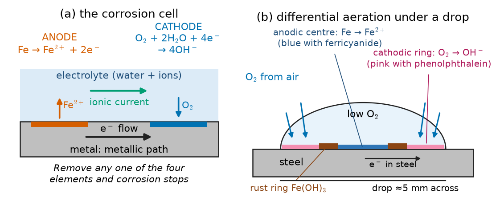
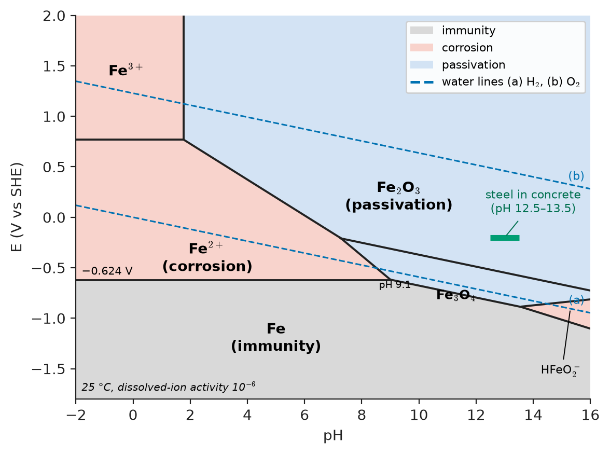
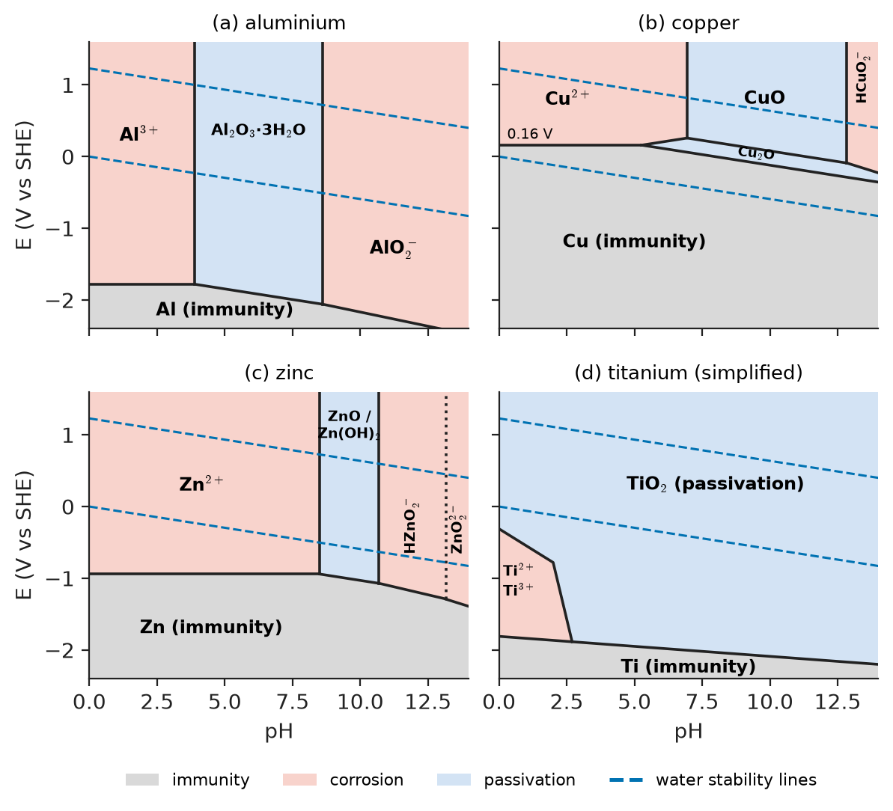
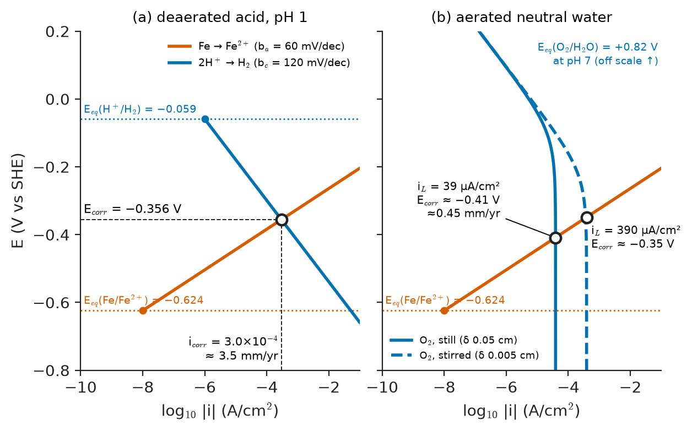
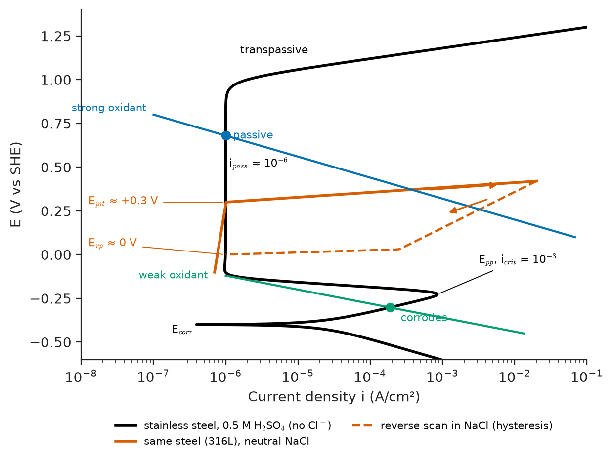
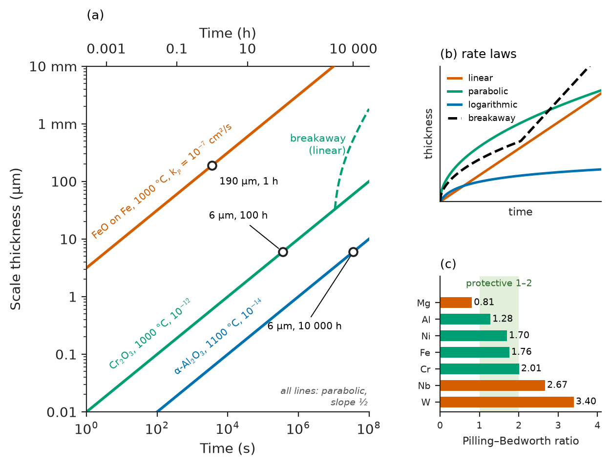

# Chapter 42 — Thermodynamics and Kinetics of Corrosion

*Part IX · Corrosion, Degradation and Surfaces*

A water utility digs up two sections of the same ductile-iron main, laid in the same year and carrying the same water. The section buried in well-drained sand is nearly as thick as when it was cast. The section fifty metres away, where the trench crosses waterlogged clay, has lost half its wall and is perforated in two places. In a chemical plant nearby, a 304 stainless-steel tank has served for twenty years in dilute nitric acid without measurable loss, yet a 304 heat-exchanger tube in brackish cooling water developed pits deep enough to leak in eighteen months. The steel of the turbine casing of the plant's gas turbine, meanwhile, grows a grey oxide in hot air at a rate that can be predicted to the micrometre from its temperature. None of these outcomes depends on strength, stiffness or toughness. They depend on the thermodynamics that decides whether a metal can react with its environment, and on the kinetics that decide how fast it does. Corrosion is estimated to cost the world economy of the order of 3 % of its gross domestic product each year, and studies suggest that a fifth to a third of that could be saved by applying what is already known. This chapter supplies the science behind that knowledge.

> **When is a metal thermodynamically able to corrode in water or air, and what does it corrode to?**
> **What sets the rate of corrosion, and how is an electrical current turned into millimetres per year?**
> **Why do some metals, such as stainless steel, aluminium and titanium, survive in environments where they ought to dissolve, and when does that protection fail?**

| Concept | Engineering destination |
|---|---|
| Corrosion cell: anode, cathode, electrolyte, metallic path | Diagnosing any corrosion problem, from car bodies to buried pipes |
| Electrode potentials, galvanic series | Choosing compatible metals for joints, fasteners and heat exchangers |
| Pourbaix diagrams | Water treatment, boiler chemistry, concrete reinforcement, cathodic protection |
| Butler–Volmer and Tafel kinetics | Interpreting polarization tests; designing inhibitors and coatings |
| Mixed-potential theory, Evans diagrams | Predicting corrosion potential and rate, galvanic coupling, effect of oxygen |
| Faraday's law, polarization resistance | Corrosion allowances, monitoring probes, inspection intervals |
| Passivity and its breakdown | Stainless-steel grade selection; pitting and crevice resistance |
| Wagner theory, parabolic law, Pilling–Bedworth ratio | Furnace parts, turbines, boilers, hot rolling scale losses |

**Roadmap.** The corrosion cell (42.1) → thermodynamics: potentials and the galvanic series (42.2) and Pourbaix diagrams (42.3) → kinetics: Butler–Volmer and Tafel (42.4) and mixed potentials (42.5) → turning current into rate (42.6) → passivity and its breakdown (42.7) → corrosion in hot gas (42.8).

> **Boundary.** The thermodynamics of electrochemical cells, the Nernst equation, standard electrode potentials and the derivation of the Butler–Volmer equation are electrochemistry fundamentals taught in the Advanced Chemistry book. They are recapped here and applied to metals and alloys, not derived. The forms that corrosion takes in structures, and how to prevent them, are the subject of Chapter 43.

---

## 42.1 The electrochemical corrosion cell

### Four necessary elements

Aqueous corrosion is an electrochemical process. A metal surface in contact with water carries two kinds of reaction at once. At **anodic** sites the metal is oxidized and passes into solution as ions, releasing electrons:

$$
\mathrm{M}\rightarrow\mathrm{M}^{n+}+n\,e^-
$$

for example $\mathrm{Fe}\rightarrow\mathrm{Fe^{2+}}+2e^-$. At **cathodic** sites those electrons are consumed by a reduction. In neutral and alkaline water open to air the dominant cathodic reaction is oxygen reduction,

$$
\mathrm{O_2}+2\,\mathrm{H_2O}+4\,e^-\rightarrow4\,\mathrm{OH^-}
$$

and in acid, or in the absence of oxygen, hydrogen evolution, $2\mathrm{H^+}+2e^-\rightarrow\mathrm{H_2}$ (or $2\mathrm{H_2O}+2e^-\rightarrow\mathrm{H_2}+2\mathrm{OH^-}$ in neutral water). Other oxidants, such as Fe$^{3+}$, Cu$^{2+}$, dissolved chlorine or nitric acid, can also serve.

A corrosion cell therefore needs four elements (Figure 42.1): an **anode**, a **cathode**, an **electrolyte** that carries ionic current between them, and a **metallic path** that carries electrons. Remove any one and corrosion stops. This simple statement underlies every protection method in Chapter 43: coatings separate the metal from the electrolyte, insulating gaskets break the metallic path between dissimilar metals, deaeration removes the cathodic reactant, and cathodic protection makes the whole structure a cathode.

The anodic and cathodic sites may be microscopic and constantly shifting, giving fairly uniform attack, or fixed and separated, giving localized attack. Differences in composition (phases, inclusions, welds), in surface condition (mill scale, scratches), in stress, or in the environment (oxygen concentration, temperature, flow) fix the sites. The ferrous corrosion products then react further: Fe$^{2+}$ meets OH$^-$ and dissolved oxygen to precipitate hydrated ferric oxide, rust, often at some distance from the anode.

### The water main and differential aeration

The pipe in the opening paragraph corroded by **differential aeration**. Where it passed through sand, oxygen reached the whole surface. Where it passed through saturated clay, oxygen could not diffuse in. The oxygen-starved section became anodic and the well-aerated section, close by and electrically connected through the pipe wall, became the cathode. Because the cathode was large and the anode small, the anode's current density, and therefore its rate of metal loss, was high. The same mechanism concentrates attack beneath a droplet of salt water (Evans's classic drop experiment: the oxygen-poor centre corrodes while rust forms in a ring near the edge), under deposits, in crevices and at the waterline of a partially immersed steel pile.

<!-- FIGURE 42.1 | figures/ch42/fig-42-1-corrosion-cell-drop.png | schematic | The corrosion cell needs an anode, a cathode, an electrolyte and a metallic path; under a salt-water drop, differential aeration makes the oxygen-poor centre anodic. | Content: (a) generic cell: metal bar with anodic region (Fe -> Fe2+ + 2e-), cathodic region (O2 + 2H2O + 4e- -> 4OH-), electron flow through metal (arrow), ionic current through electrolyte (arrows), all four elements labelled. (b) cross-section of an NaCl droplet ~5 mm across on steel: high O2 at periphery (cathodic ring, OH- produced, pink with phenolphthalein indicator), low O2 at centre (anodic, Fe2+ produced, blue with ferricyanide indicator), brown rust ring Fe(OH)3 between them; O2 diffusion arrows from air. -->

*Figure 42.1 — The corrosion cell needs an anode, a cathode, an electrolyte and a metallic path; under a salt-water drop, differential aeration makes the oxygen-poor centre anodic.*

---

## 42.2 Thermodynamics: potentials and the galvanic series

### Electrode potentials (recap)

Whether a metal can corrode is decided by the Gibbs energy of the overall reaction, $\Delta G=-nFE$, where $E$ is the cell potential: the reaction is possible if the potential of the cathodic reaction lies above that of the anodic reaction. Each half-reaction has an equilibrium potential given by the **Nernst equation**,

$$
E=E^\circ-\frac{RT}{nF}\ln\frac{a_{\mathrm{red}}}{a_{\mathrm{ox}}}=E^\circ+\frac{0.05916}{n}\log_{10}\frac{a_{\mathrm{ox}}}{a_{\mathrm{red}}}\quad(25\ ^\circ\mathrm C)
$$

where $E^\circ$ is the standard potential relative to the standard hydrogen electrode (SHE) and the $a$ are activities (roughly, molar concentrations of dissolved species and partial pressures of gases). For a metal dissolving to its ions, $E=E^\circ+(0.05916/n)\log a_{\mathrm{M}^{n+}}$. In corrosion engineering an ion activity of $10^{-6}$ is conventionally taken as the threshold of "corrosion": below it the metal is considered not to dissolve measurably.

> **Status of the principle: Nernst equation**
> *Fundamental.* It follows from the equilibrium condition on electrochemical potentials. It gives the equilibrium potential only; it says nothing about rates, and real solutions require activities, not concentrations.

The two cathodic reactions available in water have potentials that depend on pH:

$$
E_{\mathrm{H^+/H_2}}=-0.0592\,\mathrm{pH},\qquad E_{\mathrm{O_2/H_2O}}=1.229-0.0592\,\mathrm{pH}\quad(\mathrm V\ \mathrm{SHE},\ 1\ \mathrm{atm},\ 25\ ^\circ\mathrm C)
$$

These lines bound the stability of water. Any metal whose equilibrium potential lies below the hydrogen line can, in principle, be corroded by water alone with hydrogen evolution; any metal below the oxygen line can be corroded by aerated water. Only gold and platinum lie above both over most of the pH range.

**Table 42.1 — Standard reduction potentials of metals at 25 °C (the emf series).**

| Electrode reaction | $E^\circ$ (V vs SHE) | Equilibrium potential at $a=10^{-6}$ (V) |
|---|---|---|
| $\mathrm{Au^{3+}}+3e^-\rightarrow\mathrm{Au}$ | +1.50 | +1.38 |
| $\mathrm{O_2}+4\mathrm{H^+}+4e^-\rightarrow2\mathrm{H_2O}$ | +1.229 | (pH-dependent) |
| $\mathrm{Ag^+}+e^-\rightarrow\mathrm{Ag}$ | +0.80 | +0.44 |
| $\mathrm{Cu^{2+}}+2e^-\rightarrow\mathrm{Cu}$ | +0.34 | +0.16 |
| $2\mathrm{H^+}+2e^-\rightarrow\mathrm{H_2}$ | 0.000 | (pH-dependent) |
| $\mathrm{Ni^{2+}}+2e^-\rightarrow\mathrm{Ni}$ | −0.25 | −0.43 |
| $\mathrm{Fe^{2+}}+2e^-\rightarrow\mathrm{Fe}$ | −0.447 | −0.62 |
| $\mathrm{Cr^{3+}}+3e^-\rightarrow\mathrm{Cr}$ | −0.74 | −0.86 |
| $\mathrm{Zn^{2+}}+2e^-\rightarrow\mathrm{Zn}$ | −0.76 | −0.94 |
| $\mathrm{Ti^{2+}}+2e^-\rightarrow\mathrm{Ti}$ | −1.63 | −1.81 |
| $\mathrm{Al^{3+}}+3e^-\rightarrow\mathrm{Al}$ | −1.66 | −1.78 |
| $\mathrm{Mg^{2+}}+2e^-\rightarrow\mathrm{Mg}$ | −2.37 | −2.55 |

### The galvanic series

The emf series describes pure metals in contact with their own ions at unit activity, a condition never met in service. Engineers instead use a **galvanic series**: the measured corrosion potentials of real alloys in a specified environment, most often flowing seawater (Table 42.2). The two rankings differ in instructive ways. Titanium and aluminium, near the bottom of the emf series, sit much higher in the galvanic series, and stainless steels appear twice, because each develops a passive oxide film that changes its effective potential (Section 42.7). The galvanic series is thus not a thermodynamic table; it is an empirical record of how metals actually behave, kinetics and films included.

**Table 42.2 — Galvanic series in flowing seawater at about 25 °C (approximate corrosion potentials).**

| Alloy | Potential (V vs saturated calomel electrode) |
|---|---|
| Graphite, platinum | +0.2 to +0.3 |
| Titanium, Alloy 625, super-austenitic stainless | −0.05 to +0.06 |
| 316 stainless steel (passive) | −0.05 to −0.10 |
| 70/30 copper–nickel | −0.18 to −0.25 |
| Copper, brasses | −0.30 to −0.37 |
| 316 stainless steel (active, in crevices) | −0.43 to −0.54 |
| Carbon steel, cast iron | −0.60 to −0.72 |
| Aluminium alloys | −0.76 to −1.0 |
| Zinc | −0.98 to −1.03 |
| Magnesium | −1.60 to −1.63 |

When two metals are electrically connected in an electrolyte, the one lower in the series tends to become the anode and corrode faster, and the one higher is protected. The farther apart they are, the greater the driving force; whether the coupling is damaging depends on kinetics and the area ratio (Section 42.5 and Chapter 43). This is why steel bolts in a copper-alloy seawater pump fail quickly, while zinc and aluminium anodes protect ship hulls.

> **Status of the principle: galvanic series**
> *Empirical.* A ranking of measured corrosion potentials valid only for the environment and conditions in which it was measured; it predicts the direction of galvanic action but not its rate.

---

## 42.3 Pourbaix diagrams

### Construction

A **Pourbaix diagram** (potential–pH diagram) maps the thermodynamically stable species of a metal–water system as a function of electrode potential and pH, at a chosen temperature and dissolved-ion activity (usually 25 °C and $10^{-6}$). It is assembled from the equilibria of three kinds of reaction:

- **Electron transfer without $\mathrm{H^+}$** (for example $\mathrm{Fe^{2+}}+2e^-\rightleftharpoons\mathrm{Fe}$): a horizontal line, independent of pH.
- **$\mathrm{H^+}$ transfer without electrons** (for example $\mathrm{Fe^{2+}}+2\mathrm{H_2O}\rightleftharpoons\mathrm{Fe(OH)_2}+2\mathrm{H^+}$): a vertical line at a fixed pH.
- **Both** (for example $\mathrm{Fe_2O_3}+6\mathrm{H^+}+2e^-\rightleftharpoons2\mathrm{Fe^{2+}}+3\mathrm{H_2O}$): a sloping line with slope $-0.0592\,m/n$ V per pH unit, where $m$ is the number of protons and $n$ the number of electrons.

The resulting regions are labelled by their practical meaning: **immunity**, where the metal itself is stable and cannot corrode; **corrosion**, where a soluble ion is stable above $10^{-6}$; and **passivation**, where a solid oxide or hydroxide is stable and may, if it is adherent and compact, protect the metal. Superimposing the two water lines shows which oxidants are available.

**Worked example — the boundaries of the iron diagram.** At $a_{\mathrm{Fe^{2+}}}=10^{-6}$ and 25 °C:

- Immunity–corrosion boundary: $E=-0.447+(0.05916/2)\times(-6)=-0.447-0.177=-0.624$ V, horizontal.
- Fe$_2$O$_3$/Fe$^{2+}$ boundary, from $\mathrm{Fe_2O_3}+6\mathrm{H^+}+2e^-\rightleftharpoons2\mathrm{Fe^{2+}}+3\mathrm{H_2O}$ with $E^\circ=0.728$ V: $E=0.728-0.1775\,\mathrm{pH}-0.0592\log a_{\mathrm{Fe^{2+}}}=1.083-0.1775\,\mathrm{pH}$. With $m=6$ and $n=2$, the slope is $-0.0592\times6/2=-0.1775$ V per pH unit.
- Fe$_3$O$_4$/Fe boundary, from $\mathrm{Fe_3O_4}+8\mathrm{H^+}+8e^-\rightleftharpoons3\mathrm{Fe}+4\mathrm{H_2O}$ with $E^\circ=-0.085$ V: $E=-0.085-0.0592\,\mathrm{pH}$. It meets the $-0.624$ V line at $\mathrm{pH}=(0.624-0.085)/0.0592=9.1$.

So iron corrodes as Fe$^{2+}$ at all pH below about 9 if its potential is above −0.62 V, while above pH 9 the stable product is magnetite and then haematite. Since the hydrogen line ($-0.0592$ pH) lies above −0.62 V at all pH below about 10.5, iron in deaerated acid or neutral water is thermodynamically able to corrode with hydrogen evolution; in aerated water the oxygen line lies far above it.

> **Status of the principle: Pourbaix diagram**
> *Derived* from equilibrium thermodynamics (the Nernst equation and solubility products) for a stated temperature and ion activity. It predicts what can happen, never how fast; it ignores kinetics, non-equilibrium films, alloying and complexing ions such as chloride, and it does not show whether an oxide is protective.

<!-- FIGURE 42.2 | figures/ch42/fig-42-2-pourbaix-iron.png | plot | The Pourbaix diagram of iron at 25 C and 10^-6 activity: iron is immune below -0.62 V, corrodes as Fe2+ in acid and neutral water, and is covered by oxides in alkaline water. | Content: x-axis pH -2 to 16, y-axis E (V vs SHE) -1.8 to +2.0. Computed lines at a = 10^-6: Fe2+/Fe horizontal at -0.624 V from pH -2 to 9.1; Fe3O4/Fe E = -0.085 - 0.0592 pH (pH 9.1 to ~14); Fe2O3/Fe2+ E = 1.083 - 0.1775 pH (pH 1.76 to 7.3); Fe3O4/Fe2+ E = 1.512 - 0.2366 pH (pH 7.3 to 9.0); Fe2O3/Fe3O4 E = 0.221 - 0.0592 pH (pH 7.3 to 16); Fe3+/Fe2+ horizontal at 0.771 V (pH < 1.76); Fe2O3/Fe3+ vertical at pH 1.76; small HFeO2- region at pH > ~14 at low potential. Dashed water lines (a) E = -0.0592 pH and (b) E = 1.229 - 0.0592 pH. Shade regions: immunity (grey), corrosion (red tint), passivation (blue tint). Mark the point of steel in concrete (pH 12.5-13.5, about -0.2 V) inside the passive region. -->

*Figure 42.2 — The Pourbaix diagram of iron at 25 C and 10^-6 activity: iron is immune below -0.62 V, corrodes as Fe2+ in acid and neutral water, and is covered by oxides in alkaline water.*

### Iron, aluminium, copper, zinc and titanium compared

The diagrams of the main engineering metals explain much of their practical behaviour (Figure 42.3).

- **Iron** (Figure 42.2) is passive only in alkaline solution. That is why steel reinforcement survives in concrete, whose pore solution has a pH of 12.5–13.5, until carbonation lowers the pH or chloride breaks the film (Chapters 18 and 43); and why boiler water is dosed to pH 9–10 so that a protective magnetite layer forms on the tubes.
- **Aluminium** is **amphoteric**: its oxide dissolves in both acid and base. At $10^{-6}$ activity, Al$_2$O$_3$ (as the hydrate) is stable only between about pH 4 and 8.6; below, aluminium dissolves as Al$^{3+}$, above, as aluminate AlO$_2^-$. Its immunity region lies near −1.8 V, far below the water line, so aluminium in water is always thermodynamically unstable; its usefulness rests entirely on its oxide film in near-neutral water. This is why aluminium must not be cleaned with strong alkali, why it is attacked by wet fresh concrete and mortar, and why aluminium cooking pots are pitted by salty, acidic foods.
- **Zinc** is also amphoteric, passive roughly between pH 8.5 and 11 (where ZnO or Zn(OH)$_2$ is stable) and soluble outside. In the atmosphere it forms a protective basic carbonate patina, the basis of galvanizing, but it corrodes rapidly in acid rain and in hot alkaline water.
- **Copper** has an immunity region that reaches *above* the hydrogen line: copper is thermodynamically stable in water free of oxidants. It corrodes only when oxygen or another oxidant is present, which is why copper water pipes last decades in most supplies but are attacked by aerated acidic water, ammonia (which complexes copper ions and is not shown on the simple diagram) and oxidizing acids. In near-neutral to alkaline aerated water, Cu$_2$O and CuO films protect.
- **Titanium** has a TiO$_2$ passive region spanning essentially the whole pH range at potentials above the very negative immunity line, which is why titanium resists seawater, chlorides, wet chlorine and oxidizing acids, and is the material of choice for seawater heat exchangers, chlorine plants and implants (Chapter 39). It corrodes in hot reducing acids (hydrochloric, sulfuric) and in fluoride solutions, which form soluble fluoro-complexes.

The diagrams' limitations are as instructive as their predictions. A "passive" region only shows that a solid is stable; whether it protects depends on its structure and adherence, which thermodynamics cannot predict. Chloride is absent from the standard diagrams, yet it is the cause of most pitting. Alloys have no single diagram, and high temperature shifts all the lines. Pourbaix diagrams are therefore maps of possibility, to be combined with the kinetics of the following sections.

<!-- FIGURE 42.3 | figures/ch42/fig-42-3-pourbaix-al-cu-zn-ti.png | plot | Simplified Pourbaix diagrams of aluminium, copper, zinc and titanium at 10^-6 activity: aluminium and zinc are amphoteric, copper is immune in oxidant-free water, titanium is passive at almost all pH. | Content: 2x2 panels, each x-axis pH 0-14, y-axis E (V vs SHE) -2.4 to +1.6, with dashed water lines. (a) Al: immunity below ~ -1.8 V (sloping below -1.8 at higher pH); corrosion Al3+ for pH < 3.9; passivation Al2O3.3H2O for pH 3.9-8.6; corrosion AlO2- for pH > 8.6. (b) Cu: immunity below 0.16 V at low pH and below 0.471 - 0.0592 pH (Cu2O/Cu) at higher pH, i.e. immunity region above the hydrogen line; Cu2+ corrosion for pH < ~6.9 above 0.16 V; Cu2O and CuO passivation in neutral-alkaline. (c) Zn: immunity below -0.94 V; Zn2+ corrosion for pH < 8.5; ZnO/Zn(OH)2 passivation pH 8.5-10.7; HZnO2-/ZnO2(2-) corrosion pH > 10.7. (d) Ti: immunity below ~ -1.8 to -2.2 V; narrow Ti2+/Ti3+ corrosion region at pH < ~2 and low potential; TiO2 passivation across pH 0-14 elsewhere. -->

*Figure 42.3 — Simplified Pourbaix diagrams of aluminium, copper, zinc and titanium at 10^-6 activity: aluminium and zinc are amphoteric, copper is immune in oxidant-free water, titanium is passive at almost all pH.*

---

## 42.4 Electrode kinetics: Butler–Volmer and Tafel

### Overpotential and exchange current

Thermodynamics fixes the direction; kinetics fixes the rate. At its equilibrium potential $E_{eq}$, an electrode is not inert: the forward and backward reactions proceed at equal and opposite rates, each with a current density $i_0$, the **exchange current density**. Displacing the potential by an **overpotential** $\eta=E-E_{eq}$ lowers the activation barrier in one direction and raises it in the other. For a single-step reaction controlled by charge transfer, the net current density is the **Butler–Volmer equation**:

$$
i=i_0\left[\exp\left(\frac{\alpha_a nF\eta}{RT}\right)-\exp\left(-\frac{\alpha_c nF\eta}{RT}\right)\right]
$$

where $\alpha_a$ and $\alpha_c$ are the anodic and cathodic transfer coefficients (often about 0.5).

> **Status of the principle: Butler–Volmer equation**
> *Derived* from transition-state theory for a charge-transfer-controlled electrode reaction (the derivation belongs to Advanced Chemistry). It assumes that mass transport is fast and that the surface is unchanged by the reaction; multistep reactions, adsorbed intermediates and films change the effective coefficients.

The exchange current density is a property of the reaction *on a particular surface*, and it varies enormously. Hydrogen evolution is fast on platinum and slow on zinc, lead and mercury (Table 42.3). This is not a detail. It explains why zinc dissolves only slowly in acid despite its strongly negative potential (its own surface catalyses hydrogen evolution poorly), why touching zinc with a platinum wire makes it fizz, and why trace impurities of noble metals in magnesium or zinc accelerate their corrosion.

**Table 42.3 — Exchange current densities for hydrogen evolution in acid at 25 °C (approximate).**

| Electrode metal | $i_0$ for $2\mathrm{H^+}+2e^-\rightarrow\mathrm{H_2}$ (A/cm²) |
|---|---|
| Pt | $\approx10^{-3}$ |
| Ni | $\approx10^{-5}$–$10^{-6}$ |
| Fe | $\approx10^{-6}$ |
| Cu | $\approx10^{-7}$ |
| Zn | $\approx10^{-10}$–$10^{-11}$ |
| Pb, Hg | $\approx10^{-12}$–$10^{-13}$ |

### The Tafel regime

When the overpotential exceeds about 50 mV, one exponential in the Butler–Volmer equation dominates and the other can be dropped. For an anodic reaction,

$$
\eta_a=b_a\log_{10}\frac{i}{i_0},\qquad b_a=\frac{2.303\,RT}{\alpha_a nF}
$$

and similarly for a cathodic reaction with slope $b_c$. This is the **Tafel equation**: overpotential is linear in the logarithm of current density. The **Tafel slope** $b$ for $\alpha=0.5$, $n=1$ at 25 °C is $2.303\times8.314\times298/(0.5\times96\,485)=0.118$ V per decade, the value often observed for hydrogen evolution; anodic dissolution of iron typically shows 40–60 mV per decade. Plotting potential against $\log\lvert i\rvert$ turns Tafel kinetics into straight lines, which is the basis of the Evans diagram.

> **Status of the principle: Tafel equation**
> *Approximate.* The high-overpotential limit of Butler–Volmer; it fails near equilibrium (below about 50 mV), where both directions matter, and at high currents, where mass transport limits the rate.

### Concentration polarization

When a reactant must diffuse to the surface, its supply sets an upper bound. For a reactant of bulk concentration $C_b$ and diffusion coefficient $D$ crossing a diffusion boundary layer of thickness $\delta$, the **limiting current density** is

$$
i_L=\frac{nFDC_b}{\delta}
$$

Oxygen reduction in neutral water is the most important case: oxygen is sparingly soluble (about 8 mg/L, or $2.5\times10^{-7}$ mol/cm³, in air-saturated water at 25 °C) and diffuses slowly ($D\approx2\times10^{-5}$ cm²/s). In still water $\delta$ is about 0.05 cm, so

$$
i_L=\frac{4\times96\,485\times2\times10^{-5}\times2.5\times10^{-7}}{0.05}=3.9\times10^{-5}\ \mathrm{A/cm^2}=39\ \mu\mathrm A/\mathrm{cm^2}
$$

Stirring, flow or higher temperature thins the boundary layer and raises $i_L$, which is why steel corrodes faster in flowing water than in still water.

---

## 42.5 Mixed-potential theory and Evans diagrams

### The corrosion potential

A corroding metal is not at the equilibrium potential of either of its reactions. It sits at a single **mixed potential**, the **corrosion potential** $E_{corr}$, at which the total rate of oxidation equals the total rate of reduction, so that no net current flows out of the isolated specimen. This is the **Wagner–Traud** principle: any electrochemical reaction can be divided into partial oxidation and reduction reactions; there can be no net accumulation of charge; and the partial reactions proceed independently, each according to its own kinetics.

> **Status of the principle: mixed-potential theory**
> *Derived* from charge conservation and the independence of partial reactions. It holds when the partial reactions do not interact; strong adsorption, film formation or local separation of anodes and cathodes (with ohmic drop between them) require refinements.

An **Evans diagram** (Figure 42.4) plots the anodic line of the metal and the cathodic line of the oxidant on axes of potential against $\log\lvert i\rvert$. Their intersection gives $E_{corr}$ and the **corrosion current density** $i_{corr}$. The diagram makes the controlling factors visible at a glance: whichever line is steeper, or whichever reaction is limited by mass transport, controls the rate.

**Worked example — steel in deaerated acid.** Take iron in deaerated acid at pH 1, with these representative values: for iron dissolution, $E_{eq}=-0.624$ V (taking $a_{\mathrm{Fe^{2+}}}=10^{-6}$), $i_0=10^{-8}$ A/cm², $b_a=0.060$ V/decade; for hydrogen evolution on iron, $E_{eq}=-0.0592\times1=-0.059$ V, $i_0=10^{-6}$ A/cm², $b_c=0.120$ V/decade. At $E_{corr}$ the two Tafel lines meet:

$$
-0.624+0.060\log\frac{i}{10^{-8}}=-0.059-0.120\log\frac{i}{10^{-6}}
$$

Collecting terms, $0.180\log i=-0.059+0.624+0.060\times(-8)+0.120\times(-6)=-0.635$, so $\log i=-3.53$ and $i_{corr}=3.0\times10^{-4}$ A/cm² $=0.30$ mA/cm². Substituting back, $E_{corr}=-0.624+0.060\times(-3.53+8)=-0.356$ V. Using the conversion of Section 42.6 (1 µA/cm² corresponds to 11.6 µm/year for iron), the rate is $300\times0.0116=3.5$ mm per year, typical of steel in dilute hydrochloric acid. Changing the assumed Fe$^{2+}$ activity by a factor of 10 moves $E_{eq}$ by 30 mV but $i_{corr}$ by only a factor of about 1.5, because the cathodic line is steeper. Doubling the cathodic exchange current density (for instance, by a noble-metal impurity on the surface) raises $i_{corr}$ by a factor of $2^{0.12/0.18}=1.6$.

<!-- FIGURE 42.4 | figures/ch42/fig-42-4-evans-diagram-iron.png | plot | Evans diagram for iron: the corrosion potential and current lie where the anodic and cathodic lines cross; in aerated neutral water, the oxygen limiting current controls the rate. | Content: y-axis E (V vs SHE) -0.8 to +0.2, x-axis log10 |i| (A/cm^2) from -10 to -1. (a) Deaerated pH 1 (worked example): Fe anodic Tafel line from (-8, -0.624) with slope +0.060 V/decade; H2 cathodic line from (-6, -0.059) with slope -0.120 V/decade; intersection Ecorr = -0.356 V, icorr = 3.0e-4 A/cm^2 marked. (b) Same axes, aerated neutral water: O2 reduction line becoming vertical at iL = 3.9e-5 A/cm^2 (still water) and at 3.9e-4 (stirred, delta = 0.005 cm); intersections with Fe anodic line marked. Dashed lines show equilibrium potentials. -->

*Figure 42.4 — Evans diagram for iron: the corrosion potential and current lie where the anodic and cathodic lines cross; in aerated neutral water, the oxygen limiting current controls the rate.*

### What mixed-potential theory explains

- **Oxygen-controlled corrosion.** In aerated neutral water the cathodic reaction is oxygen reduction at its limiting current. The anodic line of iron crosses the vertical part of the cathodic curve, so $i_{corr}=i_L\approx39$ µA/cm², or about $39\times0.0116=0.45$ mm/year in still water. The rate is set by oxygen diffusion, not by the steel, which is why ordinary carbon steels of different compositions corrode at similar rates in natural waters, why deaeration of boiler feedwater (to a few parts per billion of oxygen) is so effective, and why flow accelerates attack.
- **Galvanic coupling.** Connecting a metal to a more noble one adds the noble metal's cathodic area, on which the oxidant is also reduced. The couple settles at a new mixed potential, raising the corrosion of the active metal and lowering that of the noble one. When the cathodic reaction is diffusion-limited, the total cathodic current is proportional to the cathode's area, so the anode's corrosion rate scales with the area ratio $A_c/A_a$: a small anode coupled to a large cathode corrodes catastrophically. Steel rivets in a copper plate fail quickly; copper rivets in a steel plate do little harm.
- **Inhibitors and coatings.** Anodic inhibitors raise or steepen the anodic line; cathodic inhibitors lower the cathodic exchange current density or block oxygen access. Both lower $i_{corr}$, and the Evans diagram shows which is more effective in a given case.

---

## 42.6 Corrosion rate from current: Faraday's law

### Converting current to penetration

Every $n$ electrons released correspond to one metal atom lost, so **Faraday's law** gives the mass lost per unit area and time from the corrosion current density: $\dot m=i_{corr}M/(nF)$. Dividing by the density $\rho$ gives the penetration rate. In practical units,

$$
\mathrm{CR}\ (\mathrm{mm/year})=3.27\times10^{-3}\,\frac{i_{corr}\,M}{n\rho}
$$

with $i_{corr}$ in µA/cm², $M$ in g/mol and $\rho$ in g/cm³. The constant 3.27×10⁻³ collects the seconds in a year, Faraday's constant and the unit conversions.

> **Status of the principle: Faraday's law of electrolysis**
> *Fundamental* as charge conservation applied to a reaction of known stoichiometry. Converting the result to a penetration rate assumes uniform attack over the area counted and a known valence; for localized attack the local rate can be orders of magnitude higher than the average.

**Table 42.4 — Penetration rate for a corrosion current density of 1 µA/cm² (computed from Faraday's law).**

| Metal | Valence $n$ | $M$ (g/mol) | $\rho$ (g/cm³) | mm/year per µA/cm² |
|---|---|---|---|---|
| Fe (carbon steel) | 2 | 55.85 | 7.87 | 0.0116 |
| Ni | 2 | 58.69 | 8.90 | 0.0108 |
| Cu | 2 | 63.55 | 8.96 | 0.0116 |
| Zn | 2 | 65.38 | 7.13 | 0.0150 |
| Al | 3 | 26.98 | 2.70 | 0.0109 |
| Ti | 4 | 47.87 | 4.51 | 0.0087 |
| Mg | 2 | 24.31 | 1.74 | 0.0228 |

A useful rule follows: for most structural metals, **1 µA/cm² is roughly 10 µm per year**. Typical corrosion rates and their engineering significance are summarized in Table 42.5.

**Table 42.5 — Typical uniform corrosion rates (order of magnitude).**

| Situation | Rate |
|---|---|
| Passive stainless steel or titanium in water | <1 µm/year |
| Zinc in a rural atmosphere | ≈1 µm/year |
| Carbon steel in a rural to urban atmosphere | 10–50 µm/year |
| Carbon steel in a marine splash zone | 0.2–0.5 mm/year |
| Carbon steel in aerated seawater, immersed | ≈0.1–0.2 mm/year |
| Carbon steel in dilute hydrochloric acid | several mm/year |

Rates below about 0.1 mm/year are usually acceptable for structural steel with a corrosion allowance; above about 1 mm/year a material is rarely acceptable without protection.

### Measuring the corrosion current

The corrosion current cannot be measured directly with an ammeter, because anodic and cathodic currents flow on the same surface. Two electrochemical methods (developed with others in Chapter 43) infer it:

- **Tafel extrapolation.** The specimen is polarized a few hundred millivolts on either side of $E_{corr}$; the linear Tafel regions are extrapolated back to $E_{corr}$, where they meet at $i_{corr}$.
- **Linear polarization resistance.** Within about ±10 mV of $E_{corr}$, the Butler–Volmer expressions are nearly linear, and the slope of the potential–current curve, the **polarization resistance** $R_p=\Delta E/\Delta i$, is inversely proportional to the corrosion rate. This is the **Stern–Geary relation**:

$$
i_{corr}=\frac{B}{R_p},\qquad B=\frac{b_ab_c}{2.303\,(b_a+b_c)}
$$

**Worked example — a corrosion probe in a cooling-water system.** A linear-polarization probe in a cooling circuit reads $R_p=1000$ Ω cm². With Tafel slopes $b_a=0.060$ V and $b_c=0.120$ V per decade,

$$
B=\frac{0.060\times0.120}{2.303\times0.180}=0.0174\ \mathrm V,\qquad i_{corr}=\frac{0.0174}{1000}=1.74\times10^{-5}\ \mathrm{A/cm^2}=17.4\ \mu\mathrm{A/cm^2}
$$

For carbon steel this is $17.4\times0.0116=0.20$ mm/year. If the water treatment is improved and $R_p$ rises tenfold to $10^4$ Ω cm², the rate falls to 0.02 mm/year. Because $R_p$ can be measured every few minutes without damaging the probe, the method is the basis of online corrosion monitoring in refineries, cooling systems and pipelines.

> **Status of the principle: Stern–Geary relation**
> *Approximate.* Derived from the linearization of two Tafel reactions near $E_{corr}$; it assumes both reactions are activation-controlled, that the solution resistance is small or corrected, and that the Tafel slopes are known. Uncertainty in $B$ typically limits accuracy to a factor of about two.

---

## 42.7 Passivity and passive-film breakdown

### The active–passive transition

Iron dissolves rapidly in dilute sulfuric acid but hardly at all in concentrated nitric acid, a far stronger oxidant. Faraday noticed this in the 1830s; the explanation is **passivity**. Above a certain potential, metals such as iron, chromium, nickel, titanium and aluminium form a continuous oxide film only 1–5 nm thick, which conducts ions so poorly that the dissolution current falls by three to six orders of magnitude.

The **anodic polarization curve** of a passivating metal (Figure 42.5) has a characteristic shape. Just above $E_{corr}$ the metal dissolves actively, with current rising along a Tafel line. At the **primary passivation potential** $E_{pp}$ the current reaches a maximum, the **critical current density** $i_{crit}$, and then falls abruptly to the **passive current density** $i_{pass}$, which remains nearly constant over a range of several hundred millivolts. At still higher potentials the current rises again: in the **transpassive** region the film itself oxidizes to soluble species (chromium to dichromate) or oxygen is evolved.

This shape explains the apparent paradox of the opening paragraph and of iron in acids. A metal is passive only if the cathodic reaction can supply a current larger than $i_{crit}$ at potentials above $E_{pp}$, so that the mixed potential falls in the passive range. A weak oxidant (dilute non-oxidizing acid) intersects the anodic curve in the active region, giving rapid corrosion; a strong oxidant (nitric acid, dissolved oxygen in neutral water for stainless steel) intersects it in the passive region, giving negligible corrosion. A low $i_{crit}$ and a low $E_{pp}$ are what alloying for passivity seeks. **Anodic protection** (Chapter 43) exploits the same curve by holding a structure electronically at a potential in its passive range.

> **Status of the principle: passivity**
> *Empirical* in its parameters ($E_{pp}$, $i_{crit}$, $i_{pass}$, $E_{pit}$), which are measured for each alloy and environment. The underlying physics, a thin oxide with very low ionic conductivity whose growth and dissolution balance, is well established, but no model yet predicts the parameters from first principles.

### Why chromium makes steel stainless

On iron the passive film is a mixed iron oxide that is stable only at high pH or high potential, so iron needs either alkalinity (as in concrete) or a strong oxidant to stay passive. Chromium forms a highly protective, chromium-rich oxide (essentially Cr$_2$O$_3$ with hydroxide and some iron) at much lower potentials and over a much wider pH range. When iron is alloyed with chromium, $i_{crit}$ and $E_{pp}$ fall sharply above roughly 10.5–12 % Cr, the threshold for "stainless" steel: the film forms spontaneously in air and in aerated water, is a few nanometres thick, and self-repairs within milliseconds if scratched, provided oxygen is present. Nickel stabilizes austenite and lowers active dissolution; molybdenum and nitrogen strengthen the film against chloride.

Typical passive current densities of stainless steels are below 1 µA/cm², which by Table 42.4 corresponds to less than about 10 µm per year: the 304 tank in nitric acid in the opening paragraph lives in this regime.

<!-- FIGURE 42.5 | figures/ch42/fig-42-5-active-passive-curve.png | plot | Anodic polarization curve of a stainless steel: active dissolution, passivation above E_pp, a broad passive range, and breakdown by pitting in chloride or transpassive dissolution without it. | Content: y-axis E (V vs SHE) -0.6 to +1.4, x-axis log10 i (A/cm^2) from -8 to -1. Curve 1 (stainless steel in 0.5 M H2SO4, no chloride): Ecorr ~ -0.4 V, active peak at E_pp ~ -0.2 V with i_crit ~ 1e-3, passive plateau i_pass ~ 1e-6 from -0.1 to +0.9 V, transpassive rise above ~1.0 V. Curve 2 (same steel in neutral NaCl): passive from Ecorr to E_pit ~ +0.3 V (316L) where current rises steeply; return (reverse-scan) branch with repassivation potential E_rp ~ 0 V (hysteresis loop). Add two cathodic lines: weak oxidant crossing in active region (marked 'corrodes'), strong oxidant crossing in passive region (marked 'passive'). -->

*Figure 42.5 — Anodic polarization curve of a stainless steel: active dissolution, passivation above E_pp, a broad passive range, and breakdown by pitting in chloride or transpassive dissolution without it.*

### Breakdown of passivity: pitting

Passivity is a metastable condition, and its local failure is far more dangerous than uniform corrosion because it concentrates all the anodic current on a tiny area. **Chloride** ions are the principal agent. Above a critical **pitting potential** $E_{pit}$, chloride adsorbs on the film at weak points, often at sulfide inclusions (MnS in stainless steels) or where the film is thin, and breaks it locally. Once a pit starts, it sustains itself: metal ions hydrolyse inside it (for example $\mathrm{Cr^{3+}}+3\mathrm{H_2O}\rightarrow\mathrm{Cr(OH)_3}+3\mathrm{H^+}$), the pH inside falls to 1–2, chloride migrates in to balance charge, and the acidic chloride solution cannot repassivate. The surrounding passive surface serves as a large cathode. On reversing the potential scan, the pit repassivates only below a lower **repassivation potential**, and the difference between $E_{pit}$ and $E_{rp}$ measures how hard it is to stop pits once they grow. Crevices behave similarly, the occluded geometry producing the acidic chloride solution without needing a pit to nucleate first (Chapter 43).

The resistance of stainless steels to chloride pitting is ranked by the empirical **pitting resistance equivalent number**,

$$
\mathrm{PREN}=\%\mathrm{Cr}+3.3\,\%\mathrm{Mo}+16\,\%\mathrm N
$$

(compositions in weight percent), and measured as a **critical pitting temperature** (CPT), above which pits initiate in a standard ferric chloride test.

> **Status of the principle: pitting resistance equivalent number**
> *Empirical.* A regression of pitting resistance on composition for wrought stainless steels; it ignores microstructure (inclusions, σ-phase, weld segregation), so a weld or a poorly heat-treated part can perform well below its PREN.

**Table 42.6 — Pitting resistance of stainless steels (typical compositions and values).**

| Grade | Cr (%) | Mo (%) | N (%) | PREN | Approximate CPT in ferric chloride (°C) | Typical service |
|---|---|---|---|---|---|---|
| 304 / 304L | 18 | — | 0.05 | ≈19 | <10 | Fresh water, food, nitric acid |
| 316 / 316L | 17 | 2.1 | 0.05 | ≈25 | 15–25 | Mildly chloride-bearing water |
| 2205 duplex | 22 | 3.1 | 0.17 | ≈35 | 30–45 | Brackish water, chemical plant |
| 2507 super-duplex | 25 | 3.8 | 0.27 | ≈42 | 70–85 | Seawater, offshore piping |
| 6 % Mo super-austenitic | 20 | 6.2 | 0.20 | ≈44 | 60–80 | Seawater, bleach plants |

A PREN of about 40 or more is generally needed for reliable service in ambient seawater. The 304 heat-exchanger tube of the opening paragraph, with a PREN of about 19 in brackish water, was operating above its pitting potential. Passive aluminium alloys and titanium show the same kind of breakdown, aluminium readily in chloride, titanium only in extreme conditions (hot concentrated chlorides, fluorides). The forms of localized corrosion that follow from film breakdown, and how to design against them, are the subject of Chapter 43.

---

## 42.8 High-temperature oxidation

### Thermodynamics: will an oxide form?

In hot dry gas there is no electrolyte, yet the same separation of anodic and cathodic processes occurs: the oxide scale itself acts as a solid electrolyte, conducting ions and electrons. Whether a metal can oxidize is decided by the standard Gibbs energy of formation of its oxide, compared on an **Ellingham diagram** (Chapter 6). At the temperatures of furnaces, turbines and boilers, virtually all engineering metals except gold, silver and platinum can be oxidized by air, and the oxygen partial pressure in equilibrium with a metal and its oxide is extremely low (for Cr/Cr$_2$O$_3$ at 1000 °C, about $10^{-22}$ atm). Practical high-temperature alloys therefore never rely on thermodynamic immunity; they rely on growing a scale so slowly, and so adherently, that it protects.

### Rate laws

Three rate laws describe most oxidation data (Figure 42.6):

- **Linear**, $x=k_lt$: the scale is porous, cracked or volatile and offers no barrier; the rate is set by a surface reaction or gas transport. Magnesium and the alkali metals, tungsten and molybdenum above the temperature at which their oxides volatilize, and carbon all oxidize linearly.
- **Parabolic**, $x^2=k_pt$: a compact scale whose growth is controlled by diffusion through it. Most protective high-temperature oxidation is parabolic.
- **Logarithmic**, $x=k_e\log(at+1)$: thin films at low temperature (aluminium and copper near room temperature), where transport is driven by electric fields across a few nanometres and slows rapidly.

Combinations are common. **Breakaway oxidation** is a transition from parabolic to linear when a protective scale cracks or the alloy beneath runs out of the element that formed it.

### Wagner's theory of parabolic oxidation

Wagner's theory (1933) explains the parabolic law and predicts its rate constant. Assume a dense, adherent scale of thickness $x$, with local equilibrium at both its interfaces: at the metal–scale interface the oxygen activity is that of the metal–oxide equilibrium, and at the scale–gas interface it is that of the gas. The chemical potential difference across the scale is therefore fixed. Ions and electrons move through the scale under this gradient, by way of point defects (cation vacancies in NiO, FeO and Cr$_2$O$_3$; oxygen vacancies in ZrO$_2$; Chapter 5), coupled so that no net charge flows. The flux of ions is then inversely proportional to the scale thickness, $J\propto1/x$, and since the growth rate is proportional to the flux,

$$
\frac{dx}{dt}=\frac{k'}{x}\quad\Rightarrow\quad x^2=2k't\equiv k_pt
$$

Wagner's analysis expresses the rate constant in terms of the self-diffusion coefficients of the cation $D_M$ and anion $D_O$ in the oxide, integrated across the range of oxygen activity $a_O$ that the scale spans:

$$
k'=\int_{a_O^{\,i}}^{a_O^{\,o}}\left(\frac{z_M}{\lvert z_O\rvert}D_M+D_O\right)d\ln a_O
$$

where $z_M$ and $z_O$ are the ionic charges and the superscripts denote the metal–scale (inner) and scale–gas (outer) interfaces.

> **Status of the principle: Wagner's parabolic oxidation theory**
> *Derived* from coupled ionic and electronic transport through a dense scale with local equilibrium at its interfaces. It predicts measured rate constants within a factor of a few for simple oxides such as NiO, CoO and FeO when lattice diffusion controls; for chromia and alumina, grain-boundary diffusion in fine-grained scales usually dominates, and the parabolic form remains but the constant must be measured.

The theory ties oxidation resistance to defect chemistry. Wüstite, FeO, is highly non-stoichiometric (Fe$_{1-\delta}$O with $\delta$ up to about 0.15), so iron cations diffuse through it very fast; NiO is nearly stoichiometric and grows slowly; Cr$_2$O$_3$ and above all α-Al$_2$O$_3$ have very low defect concentrations and grow orders of magnitude more slowly still. Doping a scale changes its defect concentration: Li$^+$ in NiO lowers the cation-vacancy concentration and slows oxidation (Cr$^{3+}$ raises it and speeds oxidation), while reactive-element additions (Y, Hf) slow alumina growth by blocking grain-boundary transport (Chapter 41).

**Worked example — three scales compared.** Representative parabolic rate constants (in thickness units) at about 1000 °C are $k_p\approx10^{-7}$ cm²/s for FeO on iron, $10^{-12}$ cm²/s for Cr$_2$O$_3$ on a chromia-forming alloy and, at 1100 °C, $10^{-14}$ cm²/s for α-Al$_2$O$_3$ on an alumina former. With $x=\sqrt{k_pt}$:

- Iron, 1 h ($t=3600$ s): $x=\sqrt{10^{-7}\times3600}=0.019$ cm, or 190 µm. In 100 h, 1.9 mm. Plain steel is unusable in air at this temperature, and a steel slab reheated for rolling loses a measurable fraction of its mass as scale.
- Chromia former, 100 h ($3.6\times10^5$ s): $x=\sqrt{10^{-12}\times3.6\times10^5}=6.0\times10^{-4}$ cm, or 6 µm; after 10,000 h, 60 µm, which is why chromia-forming alloys serve for long periods only up to about 950–1000 °C.
- Alumina former, 10,000 h ($3.6\times10^7$ s): $x=\sqrt{10^{-14}\times3.6\times10^7}=6.0\times10^{-4}$ cm, or 6 µm.

The alumina former grows in 10,000 hours the scale the chromia former grows in 100, and the iron in under four seconds. Because $x\propto\sqrt{k_p}$, a hundredfold smaller rate constant means a tenfold thinner scale at any time. The rate constant itself depends on temperature through the Arrhenius law, typically with activation energies of 150–400 kJ/mol, so a 100 °C rise often increases $k_p$ by an order of magnitude.

> **Status of the principle: parabolic rate law**
> *Approximate.* Holds while the scale is dense, adherent and thicker than a few tens of nanometres, and while the alloy can keep supplying the scale-forming element. Cracking, spallation, volatilization or depletion of that element end it.

### The Pilling–Bedworth ratio

A protective scale must also cover the metal. Pilling and Bedworth (1923) compared the volume of oxide formed with the volume of metal consumed:

$$
\mathrm{PBR}=\frac{V_{\mathrm{oxide}}}{V_{\mathrm{metal}}}=\frac{M_{\mathrm{ox}}\,\rho_{\mathrm M}}{n\,M_{\mathrm M}\,\rho_{\mathrm{ox}}}
$$

where $M_{\mathrm{ox}}$ and $\rho_{\mathrm{ox}}$ are the molar mass and density of the oxide, $M_{\mathrm M}$ and $\rho_{\mathrm M}$ those of the metal, and $n$ the number of metal atoms per oxide formula unit.

**Worked example — magnesium, aluminium and iron.** For MgO ($M=40.30$, $\rho=3.58$ g/cm³) on Mg ($M=24.31$, $\rho=1.74$ g/cm³), $\mathrm{PBR}=40.30\times1.74/(1\times24.31\times3.58)=0.81$. For Al$_2$O$_3$ (101.96, 3.99) on Al (26.98, 2.70), $\mathrm{PBR}=101.96\times2.70/(2\times26.98\times3.99)=1.28$. For FeO (71.84, 5.74) on Fe (55.85, 7.87), $\mathrm{PBR}=71.84\times7.87/(1\times55.85\times5.74)=1.76$.

**Table 42.7 — Pilling–Bedworth ratios (computed from handbook densities).**

| Metal | Oxide | PBR | Behaviour |
|---|---|---|---|
| K, Na, Ca | K$_2$O, Na$_2$O, CaO | 0.44–0.65 | Porous, non-protective |
| Mg | MgO | 0.81 | Non-protective at high temperature (linear) |
| Al | Al$_2$O$_3$ | 1.28 | Protective |
| Zr | ZrO$_2$ | 1.55 | Protective, but cracks at high thickness |
| Cu | Cu$_2$O | 1.68 | Protective |
| Ni | NiO | 1.70 | Protective |
| Fe | FeO | 1.76 | Protective but fast-growing |
| Ti | TiO$_2$ | 1.78 | Protective at moderate temperature |
| Si | SiO$_2$ | 1.88 | Protective |
| Cr | Cr$_2$O$_3$ | 2.01 | Protective |
| Nb | Nb$_2$O$_5$ | 2.67 | Cracks and spalls |
| Mo | MoO$_3$ | 3.29 | Volatile above ≈700 °C |
| W | WO$_3$ | 3.40 | Cracks; volatile at high temperature |

A ratio below 1 means the oxide cannot cover the metal and is porous; a ratio between about 1 and 2 allows a continuous, moderately compressed scale; a ratio well above 2 generates large compressive growth stresses that crack and spall it. The magnesium alloys that burn in air, and the niobium alloys that need silicide coatings (Chapter 41), illustrate the two extremes.

> **Status of the principle: Pilling–Bedworth ratio**
> *Empirical* as a predictor of protectiveness. It is a useful first screen, but it ignores the direction of scale growth (outward cation diffusion creates new oxide at the gas side and generates little stress), thermal-expansion mismatch on cooling, plasticity of scale and metal, and volatility; several metals with "good" ratios form non-protective scales and vice versa.

<!-- FIGURE 42.6 | figures/ch42/fig-42-6-oxidation-kinetics-pbr.png | plot | Oxidation kinetics: protective scales grow parabolically, with rate constants spanning seven orders of magnitude from FeO to alumina; breakaway marks the loss of protection. | Content: (a) log-log plot, x-axis time 1 s to 10^8 s (secondary axis hours 0.001-30,000), y-axis scale thickness 0.01 um to 10 mm. Parabolic lines (slope 1/2): FeO on Fe at 1000 C (k_p = 1e-7 cm^2/s; 190 um at 1 h), Cr2O3 at 1000 C (1e-12; 6 um at 100 h), Al2O3 at 1100 C (1e-14; 6 um at 10,000 h). Mark the three worked-example points. Dashed linear branch from the Cr2O3 line at ~3000 h labelled 'breakaway'. (b) inset: schematic thickness vs time on linear axes showing linear, parabolic, logarithmic and breakaway curves. (c) inset bar: PBR values Mg 0.81, Al 1.28, Ni 1.70, Fe 1.76, Cr 2.01, Nb 2.67, W 3.40 with shaded protective band 1-2. -->

*Figure 42.6 — Oxidation kinetics: protective scales grow parabolically, with rate constants spanning seven orders of magnitude from FeO to alumina; breakaway marks the loss of protection.*

### Selective oxidation of alloys

Engineering alloys protect themselves by **selective oxidation**: an alloy containing enough of an element whose oxide is both thermodynamically more stable and slower-growing than the base metal's will form a continuous scale of that oxide, which then controls the rate. Chromium in nickel- and iron-based alloys forms chromia; aluminium in nickel aluminides, FeCrAl alloys and aluminide coatings forms alumina; silicon in silicides and SiC forms silica. The alloy must contain a critical minimum concentration, so that the element diffuses to the surface fast enough to keep the scale continuous and to heal it if it cracks: roughly 15–20 % Cr for chromia formers, or about 5 % Al with chromium present in FeCrAl, where chromium helps the alumina form (the "third-element effect"). Below the critical level, internal oxidation occurs: oxygen diffuses into the alloy and precipitates particles of the reactive element's oxide inside the metal instead of forming a protective surface layer. The design of oxidation-resistant alloys and coatings in Chapter 41, and of the hot-corrosion-resistant compositions in gas turbines, is an application of these rules.

---

## What remains open

| Open question | Where it is answered |
|---|---|
| What forms does corrosion take in real structures, and how are galvanic, pitting, crevice and intergranular attack prevented? | Chapter 43 |
| How do stress, hydrogen and cyclic loading combine with corrosion to crack metals? | Chapter 43 |
| How are cathodic-protection systems and coatings sized and tested, and how are polarization and impedance measurements made? | Chapter 43 |
| How do ceramics, polymers, composites and concrete degrade, and how are corrosion failures investigated? | Chapter 44 |
| How are surfaces structured, and how do adsorption and surface energy govern adhesion and wear? | Chapter 45 |
| How are corrosion-resistant coatings deposited? | Chapters 47, 49 |
| How are passive films and oxide scales characterized? | Chapters 52, 53 |
| Where do the Gibbs energies, Ellingham diagrams and point-defect equilibria used here come from? | Chapters 5, 6; Advanced Chemistry |

**Next:** Chapter 43 turns from the principles of corrosion to the forms it takes in real structures, from galvanic and pitting attack to stress-corrosion cracking, and to the coatings, inhibitors and cathodic protection that engineers use to stop it.
