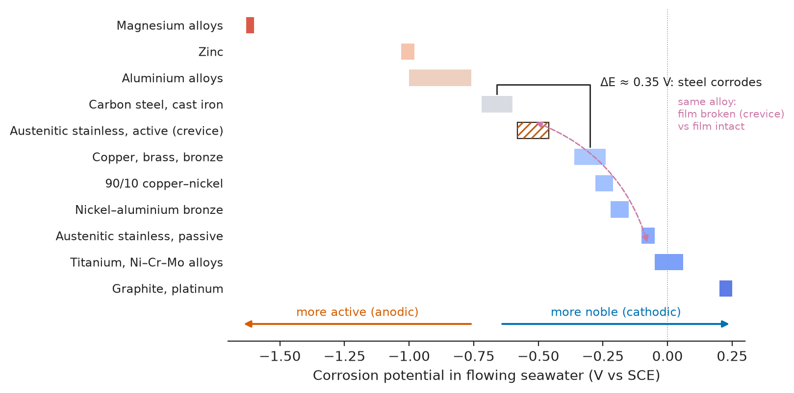
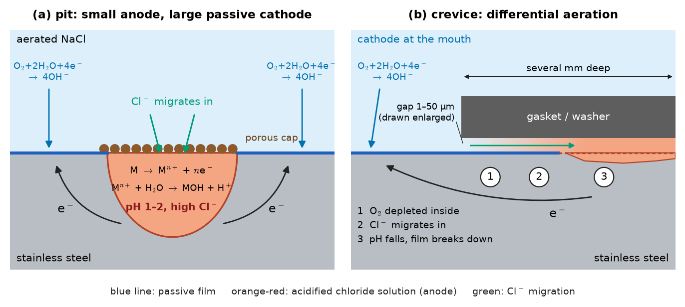
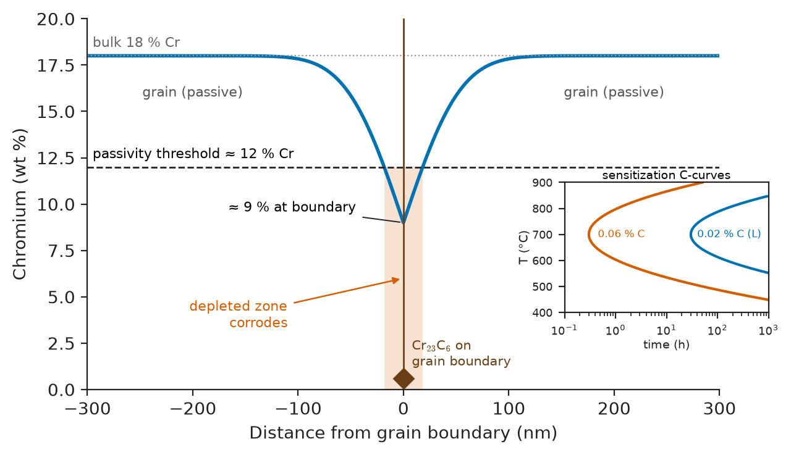
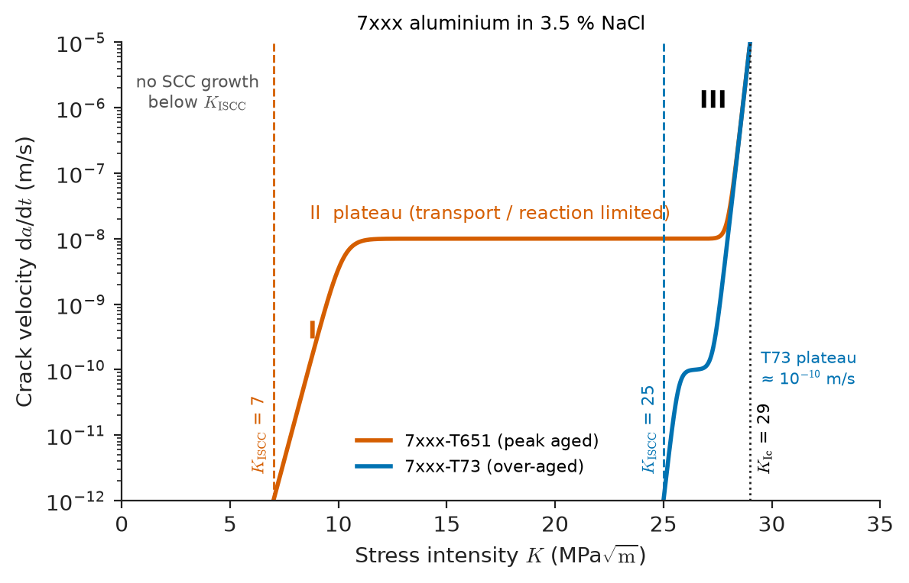
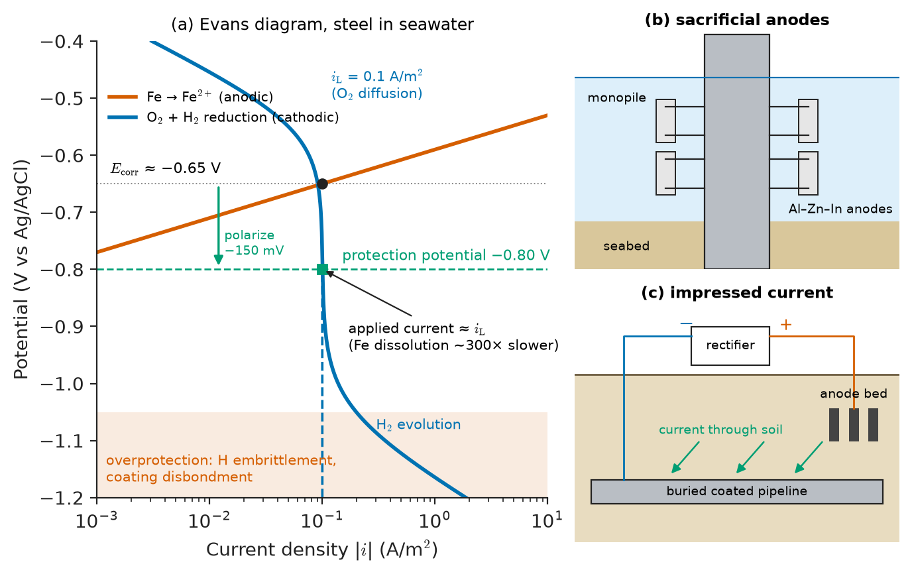
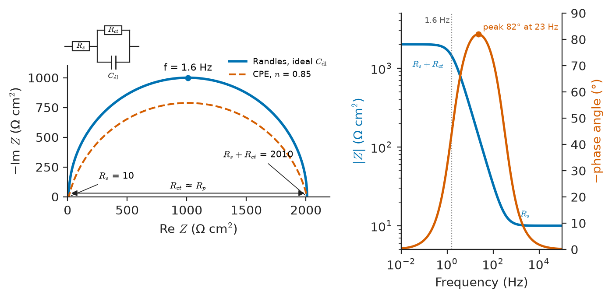

# Chapter 43 — Forms of Corrosion and Protection

*Part IX · Corrosion, Degradation and Surfaces*

In May 1985 the suspended concrete ceiling of an indoor swimming pool in Uster, Switzerland, fell onto the pool area, killing twelve people. The ceiling had hung for thirteen years from stainless-steel rods. The rods showed almost no loss of section and were loaded well below yield, yet their fracture surfaces revealed branched cracks driven by sustained tension and chloride-laden condensate from the pool air. The steel had not wasted away; it had cracked. Chapter 42 explained why metals corrode and how fast the electrochemistry runs. This chapter asks *where* and *in what form* the attack concentrates, because the distribution of attack, not its total amount, decides whether a structure fails. A millimetre per year spread evenly over a tank wall is a maintenance item; the same metal loss concentrated in a pit, a crevice, a grain boundary or a crack tip is a catastrophe.

> **Why does corrosion that removes almost no metal sometimes destroy a component, while heavy uniform rusting is harmless?**
> **How do galvanic coupling, pitting, crevices, sensitization, stress and hydrogen turn a slow chemical process into localized failure?**
> **How are coatings, inhibitors and cathodic or anodic protection sized and verified, and how are corrosion rates measured?**

| Concept | Engineering destination |
|---|---|
| Uniform corrosion rate and corrosion allowance | Wall thickness of tanks, pipes and steel piles; atmospheric-category design of bridges |
| Galvanic series and area ratio | Fastener selection, dissimilar-metal joints in ships, aircraft and cars |
| Pitting resistance equivalent number, critical pitting temperature | Choosing stainless grades for seawater, chemical plant, desalination |
| Crevice geometry and differential aeration | Flange gaskets, lap joints, tube-sheet design, fastener heads |
| Sensitization and intergranular attack | Low-carbon and stabilized stainless grades, weld procedures, marine aluminium |
| Stress-corrosion cracking, $K_{\rm ISCC}$ | Pressure vessels, pipelines, aircraft forgings, nuclear steam generators |
| Hydrogen embrittlement, hardness limits | High-strength fasteners, sour-gas equipment, hydrogen pipelines |
| Corrosion fatigue | Offshore structures, pump shafts, implants, steel wire ropes |
| MIC, dealloying, erosion–corrosion, cavitation | Water mains, oil pipelines, heat-exchanger tubes, pump impellers and propellers |
| Coatings, galvanizing, inhibitors | Structural steel, automotive bodies, cooling water and oil production |
| Cathodic and anodic protection | Buried pipelines, offshore platforms and wind foundations, ship hulls, acid tanks |
| Salt spray, polarization, EIS | Qualification of coatings and alloys, field corrosion monitoring |

**Roadmap.** Uniform and galvanic attack, where the whole surface or a whole metal is anodic (43.1–43.2) → localized attack on passive metals: pitting, crevice and intergranular corrosion (43.3–43.5) → corrosion combined with stress: SCC, hydrogen embrittlement, corrosion fatigue (43.6–43.8) → biological, chemical and mechanical accelerants: MIC, dealloying, erosion–corrosion, cavitation (43.9) → protection by material, coating and inhibitor (43.10) → electrochemical protection, cathodic and anodic, with sizing (43.11–43.12) → how corrosion is tested and measured (43.13).

---

## 43.1 Uniform corrosion

### Rate, allowance and the corrosion map of a structure

Uniform (general) corrosion proceeds at roughly equal rate over the whole exposed surface. Anodic and cathodic sites exist, as Chapter 42 showed, but they are microscopic and shift continually, so on average every point is anodic for the same fraction of time. Uniform corrosion consumes the largest tonnage of metal of any form, but it is the least dangerous, because it is predictable: once a rate is known, a **corrosion allowance** is added to the wall thickness, or a coating is chosen whose life matches the inspection interval.

The rate is quoted as penetration per year. Faraday's law (Chapter 42) converts a corrosion current density to penetration. For iron dissolving as Fe$^{2+}$:

$$
\mathrm{CR}=\frac{i\,M}{nF\rho}=\frac{i\times55.85\ \mathrm{g\,mol^{-1}}}{2\times96\,485\ \mathrm{C\,mol^{-1}}\times7.87\ \mathrm{g\,cm^{-3}}}
$$

which gives 1.16 mm/year for $i=1$ A/m$^2$, or the useful rule that **1 µA/cm$^2$ corresponds to about 11.6 µm/year for steel**.

| Environment (carbon steel unless stated) | Typical uniform corrosion rate |
|---|---|
| Dry indoor air (ISO 9223 category C1) | below 1.3 µm/year |
| Rural atmosphere (C2) | 1.3–25 µm/year |
| Urban or mild industrial (C3) | 25–50 µm/year |
| Industrial or coastal (C4) | 50–80 µm/year |
| Severe marine or industrial (C5) | 80–200 µm/year |
| Zinc in C3 atmosphere | 0.7–2.1 µm/year |
| Seawater immersion, quiescent | 0.1–0.2 mm/year |
| Splash zone of offshore structure | 0.3–0.5 mm/year, locally more |
| Undisturbed soil | 0.01–0.05 mm/year |
| Aerated fresh water, ambient | 0.05–0.15 mm/year |

The ISO atmospheric categories are first-year rates measured on standard coupons. Rates fall with time as the rust layer thickens, roughly as a power law $d=At^{n}$ with $n$ between 0.3 and 0.8; **weathering steels** (Cor-Ten type, with small additions of Cu, Cr, Ni and P) exploit this by forming a dense, adherent rust that slows corrosion to a few micrometres per year in suitable atmospheres. They fail where the rust never dries out, a reminder that a protective film is a property of material *and* environment.

> **Status of the principle: Corrosion allowance from a uniform rate**
> *Empirical.* The rates are measured or categorized for each environment; adding rate × design life to the wall is valid only if attack stays uniform. It provides no protection against pitting, cracking or galvanic acceleration, which this chapter treats separately.

Uniform corrosion governs buried steel piles, storage tanks, ship plating and rebar in carbonated concrete (Chapter 44). At small dimensions there is no allowance at all: a 1 µm bond pad or a 50 µm stent strut makes even slow uniform corrosion a design limit.

---

## 43.2 Galvanic corrosion

### The galvanic series

When two different metals are in electrical contact in a common electrolyte, the one with the more negative corrosion potential becomes the anode of a macroscopic cell and corrodes faster; the other is cathodically protected. Standard electrode potentials (Chapter 42) are a poor guide, because real metals carry oxide films and alloys have no standard potential. Engineers use instead the **galvanic series**: corrosion potentials measured in a specified environment, usually flowing seawater (Figure 43.1).

| Metal or alloy | Corrosion potential in seawater (V vs SCE, typical) |
|---|---|
| Magnesium alloys | −1.60 to −1.63 |
| Zinc | −0.98 to −1.03 |
| Aluminium alloys | −0.76 to −1.00 |
| Carbon steel, cast iron | −0.60 to −0.72 |
| Austenitic stainless steel, active (in crevices) | −0.46 to −0.58 |
| Copper, brass, bronze | −0.24 to −0.36 |
| 90/10 copper–nickel | −0.21 to −0.28 |
| Nickel–aluminium bronze | −0.15 to −0.22 |
| Austenitic stainless steel, passive | −0.05 to −0.10 |
| Titanium, Ni–Cr–Mo alloys | −0.05 to +0.06 |
| Graphite, platinum | +0.20 to +0.25 |

Note that stainless steel appears twice. A passive stainless surface is noble; the same alloy inside a crevice, where the film has broken down, is active. Passive metals move along the series as their film state changes.

<!-- FIGURE 43.1 | figures/ch43/fig-43-1-galvanic-series.png | plot | Galvanic series of engineering metals in flowing seawater, with the active–passive double entry for stainless steel. | Content: horizontal bar chart; x-axis corrosion potential in V vs SCE from -1.7 to +0.3; one bar per row of the text table, spanning its range; austenitic SS active as a hatched bar. Arrow along bottom 'more active (anodic)' to the left, 'more noble (cathodic)' to the right. A bracket between steel and copper labelled 'ΔE ≈ 0.35 V: steel corrodes'. -->

*Figure 43.1 — Galvanic series of engineering metals in flowing seawater, with the active–passive double entry for stainless steel.*

> **Status of the principle: Galvanic series**
> *Empirical.* Measured corrosion potentials in one electrolyte at one flow rate and temperature; the order can change in other environments (zinc and steel reverse in some hot waters above about 60 °C), and the series ranks risk without giving rates.

### Why area ratio controls the rate

The potential difference says which metal corrodes; the rate is set by kinetics. In near-neutral aerated water the cathodic reaction, oxygen reduction, is usually limited by oxygen diffusion to the surface. The total cathodic current is then the limiting current density times the **cathode** area, and all of that current must be supplied by the anode. The galvanic current density on the anode is therefore

$$
i_a\approx i_{\rm L}\,\frac{A_c}{A_a}
$$

A small anode coupled to a large cathode is the worst case.

**Worked example — rivets and plates in seawater.** Take an oxygen-limited cathodic current density of $i_{\rm L}=0.1$ A/m$^2$ in quiescent seawater. In design A, a copper plate of area $A_c=1$ m$^2$ is held by carbon-steel rivets whose total wetted area is $A_a=0.01$ m$^2$ (area ratio 100). In design B the materials are swapped: a steel plate of 1 m$^2$ with copper rivets of 0.01 m$^2$.

*Design A.* The anodic current density on the rivets is

$$
i_a=0.1\times\frac{1}{0.01}=10\ \mathrm{A\,m^{-2}}
$$

and with 1.16 mm/year per A/m$^2$ the rivets corrode at about 11.6 mm/year. Rivet heads a few millimetres thick are gone within months.

*Design B.* The steel plate already corrodes at about $0.1\times1.16=0.116$ mm/year on its own. The copper rivets add a cathodic current of only $0.1\times0.01=0.001$ A, spread over 1 m$^2$ of steel: an extra 1.2 µm/year, about 1 % of the self-corrosion rate. The copper rivets themselves are protected.

The same metals, the same potential difference, a ten-thousand-fold difference in damage. This is the reason behind the rules **"fasteners more noble than the parts they join"** and **"never paint only the anode"**: painting the anodic member of a couple leaves small holidays (coating defects) as tiny anodes facing a huge bare cathode. If only one member can be coated, coat the cathode.

### Galvanic corrosion across engineering

- **Aerospace and automotive**: carbon-fibre composites conduct and sit near graphite in the series, so aluminium or magnesium touching CFRP corrodes rapidly unless isolated by glass plies, sealant or titanium fasteners.
- **Marine and civil**: bronze propellers on steel hulls, aluminium superstructures on steel ships (joined by explosion-welded transition strips), copper pipe screwed into galvanized steel.
- **Electronics**: pores in gold-over-nickel platings create small-anode geometries.
- **Biomedical**: a Co–Cr head on a Ti-alloy hip stem; small potential differences plus micromotion give **fretting-crevice corrosion** at the taper.

Sacrificial anodes and zinc coatings (Sections 43.10–43.11) are galvanic corrosion engineered to happen to the right metal.

---

## 43.3 Pitting corrosion

### Breakdown of passivity

Stainless steels, aluminium, titanium and nickel alloys owe their usefulness to a passive film a few nanometres thick (Chapter 42). **Pitting** is the local breakdown of that film, usually by chloride ions, at a weak point: a manganese sulfide inclusion in stainless steel, an intermetallic particle in aluminium, a scratch or a weld-heat tint. The rest of the surface remains passive and serves as a large cathode, so the pit is a tiny anode with a huge cathode, the area-ratio problem of Section 43.2 appearing on a single metal.

### The autocatalytic pit

A pit, once started, sustains itself (Figure 43.2):

1. Metal dissolves at the pit bottom: $\mathrm{M\to M^{n+}+n\,e^-}$.
2. The metal cations hydrolyse, for example $\mathrm{Cr^{3+}+3H_2O\to Cr(OH)_3+3H^+}$, acidifying the pit solution to pH 1–2 or below.
3. To keep the solution electrically neutral, chloride ions migrate into the pit from outside.
4. The concentrated acid chloride solution prevents repassivation, so dissolution continues.

A cap of corrosion product or undercut metal over the mouth preserves the aggressive chemistry, so pits can perforate a tube wall while weight loss is negligible.

<!-- FIGURE 43.2 | figures/ch43/fig-43-2-pit-crevice-cells.png | schematic | Autocatalytic chemistry of a corrosion pit and of a crevice, both driven by a small acidified anode coupled to a large passive cathode. | Content: two cross-section panels of stainless steel in aerated NaCl. (a) Pit under a porous cap: 'M → M^n+ + ne⁻', hydrolysis 'M^n+ + H2O → MOH + H⁺', 'pH 1–2, high Cl⁻', Cl⁻ migrating in; O2 reduction on the passive surface outside, electron arrows through the metal. (b) Crevice under a gasket, gap ~1–50 µm, several mm deep, stages '1 O2 depleted', '2 Cl⁻ migrates in', '3 pH falls, film breaks down'; cathode at the mouth. Acidic regions red-orange, passive film thin blue line. -->

*Figure 43.2 — Autocatalytic chemistry of a corrosion pit and of a crevice, both driven by a small acidified anode coupled to a large passive cathode.*

### Pitting potential and critical pitting temperature

On a polarization curve, a passive metal in chloride solution shows a sharp rise in current at the **pitting potential** $E_{\rm pit}$. If the potential is then swept back, the current stays high until the **repassivation potential** $E_{\rm rp}$, below which pits stop growing. Pitting occurs in service when the free corrosion potential, raised by oxygen, chlorination or a noble couple, reaches $E_{\rm pit}$. $E_{\rm pit}$ falls with rising chloride concentration and temperature; for a given alloy and solution there is a fairly sharp **critical pitting temperature** (CPT) below which pits do not propagate at any potential.

Alloying raises resistance. Chromium forms the film, molybdenum and nitrogen help it repair in acid chloride. An empirical index ranks stainless steels:

$$
\mathrm{PREN}=\%\mathrm{Cr}+3.3\,(\%\mathrm{Mo}+0.5\,\%\mathrm{W})+16\,\%\mathrm N
$$

(with 30 instead of 16 sometimes used for the nitrogen term in austenitic grades).

| Alloy (typical composition, wt %) | PREN | CPT in ferric chloride (ASTM G48 type), typical | Typical use |
|---|---|---|---|
| 304 (18Cr–8Ni, 0.05N) | 19 | below 5 °C | Food, architecture, dry indoor |
| 316L (17Cr–12Ni–2.1Mo) | 24–25 | 10–20 °C | Chemical plant, mildly saline |
| 2205 duplex (22Cr–5Ni–3.1Mo–0.17N) | 35 | 30–40 °C | Brackish water, oil and gas |
| 2507 super duplex (25Cr–7Ni–4Mo–0.27N) | 42–43 | 70–80 °C | Seawater systems, offshore |
| 6Mo superaustenitic (20Cr–18Ni–6.1Mo–0.2N) | 43 | 60–70 °C | Seawater, bleach plants |

A rule of thumb in offshore practice is that ambient seawater needs PREN of at least 40, which is why 316L is not a seawater alloy despite its "marine grade" nickname.

> **Status of the principle: PREN**
> *Empirical.* A linear regression of pitting resistance on composition for wrought stainless steels in chloride; it ignores microstructure (sigma phase, inclusions, weld segregation, surface finish), so two alloys of equal PREN can differ markedly, and it says nothing about stress-corrosion cracking.

### Pitting in other metals

Aluminium alloys pit around cathodic intermetallics (Al$_2$CuMg, Al$_7$Cu$_2$Fe), which is why 2xxx aircraft sheet is clad with pure aluminium. Because pit depths are statistically distributed, pipeline integrity uses **extreme-value (Gumbel) statistics** to predict the deepest pit over a large area from small coupons, weakest-link reasoning met again in Chapter 44.

---

## 43.4 Crevice corrosion

A crevice is any narrow gap into which solution can enter but not circulate: under a gasket or washer, at a lap joint, between a tube and a tube sheet, under a barnacle or a deposit. The mechanism has the same end point as pitting but a different start (Figure 43.2b):

1. Initially the metal inside and outside corrodes at the same low passive rate, consuming oxygen.
2. Oxygen inside the crevice is used up and cannot be replenished; the cathodic reaction moves outside, to the crevice mouth.
3. Metal ions accumulate inside; chloride migrates in to balance them; hydrolysis lowers the pH.
4. When the crevice solution reaches a critical acidity and chloride content, the passive film breaks down and active dissolution begins, driven by the large cathode outside.

The first stage is an **incubation period** that can last months, so crevice corrosion often appears long after commissioning. Tight, deep crevices are the most dangerous, and the ohmic drop along them lets the tip sit in the active range while the mouth stays passive. Crevices initiate attack at lower temperatures than open surfaces: the **critical crevice temperature** of a stainless steel is typically 15–30 °C below its CPT.

A related form, **differential-aeration corrosion**, attacks carbon steel under deposits, at the waterline of a partly filled tank and in soil where a pipe crosses from sand into clay: the oxygen-starved region becomes anodic. **Filiform corrosion** is the crevice mechanism running under a paint film on steel, aluminium or magnesium, producing thread-like tracks from a scratch.

Defences are mainly design (welded rather than bolted joints, continuous welds, non-absorbent gaskets, sealed gaps, drainage) and, for seawater, crevice-resistant alloys (super duplex, 6Mo, titanium, Ni–Cr–Mo).

---

## 43.5 Intergranular corrosion

### Sensitization of stainless steels

Grain boundaries are higher in energy and chemically different from grain interiors (Chapter 5). **Intergranular corrosion** is attack confined to a narrow band along the boundaries, which can disintegrate a component into loose grains while the surface looks intact.

The classic case is the **sensitization** of austenitic stainless steel. Held between roughly 500 and 800 °C, during welding or slow cooling or a stress-relief treatment, carbon combines with chromium to precipitate Cr$_{23}$C$_6$ carbides on grain boundaries. Carbon diffuses quickly; chromium slowly (Chapter 8). The carbides therefore draw chromium from a thin zone next to the boundary, and the chromium content there falls below the roughly 12 % needed for passivity (Figure 43.3). That depleted zone corrodes actively in acids while the grains stay passive. In welded 304, the sensitized band lies a few millimetres from the fusion line, where the heat-affected zone spent longest in the dangerous range: **weld decay**.

<!-- FIGURE 43.3 | figures/ch43/fig-43-3-sensitization-profile.png | plot | Chromium depletion next to a grain boundary carrying Cr23C6 carbides in sensitized 304 stainless steel. | Content: x-axis distance from grain boundary -300 to +300 nm; y-axis Cr 0–20 wt %. Bulk 18 %, V-shaped trough to ~9 % at the boundary, ~100 nm wide each side; dashed line at 12 % 'passivity threshold'; shaded band below 12 % 'depleted zone corrodes'. Inset: time–temperature–sensitization C-curves (time 0.1–1000 h log, 400–900 °C), nose near 700 °C at ~0.1–1 h for 0.06 %C, ~10–100 h for 0.02 %C (L grade). -->

*Figure 43.3 — Chromium depletion next to a grain boundary carrying Cr23C6 carbides in sensitized 304 stainless steel.*

The remedies come straight from the mechanism:

- **Less carbon**: L grades (304L, 316L) with C ≤ 0.03 % precipitate too little carbide in normal welding times; the C-curve of the time–temperature–sensitization diagram moves to longer times.
- **Stabilization**: titanium (321) or niobium (347) ties carbon up as TiC or NbC, which form at higher temperature, leaving chromium in solution. A stabilized steel can still suffer **knife-line attack** in a very narrow band next to a weld where the stabilizing carbides were dissolved and chromium carbides formed on reheating.
- **Solution annealing**: heating to about 1050 °C dissolves the carbides, and rapid cooling prevents their re-precipitation.

### Intergranular attack in other alloys

- **Al–Mg (5xxx) alloys** with more than about 3 % Mg, used for ship hulls, slowly precipitate anodic β-phase (Al$_3$Mg$_2$) on grain boundaries at temperatures as low as 50–70 °C (decks in tropical sun), and then corrode and crack intergranularly in seawater.
- **High-strength 2xxx and 7xxx aluminium** suffers **exfoliation**: attack along pancake-shaped grains of rolled plate, where voluminous corrosion product wedges the layers apart like leaves of a book. Over-aged tempers (7075-T73, -T76) trade a little strength for resistance.

Susceptibility is screened by standard acid exposures (ASTM A262 for stainless steels, the nitric-acid mass-loss test ASTM G67 for 5xxx aluminium).

---

## 43.6 Stress-corrosion cracking

### The three necessary conditions

**Stress-corrosion cracking (SCC)** is the growth of cracks under the combined action of a sustained tensile stress and a specific corrosive environment, in a susceptible material. All three must be present: remove any one and SCC stops. The stress need not be applied: residual stresses from welding, cold forming or interference fits are the usual cause, and they can approach the yield strength. The environment is often surprisingly mild, and it is specific: a system that cracks readily in one environment may be immune in another.

| Alloy system | Environment that causes SCC | Typical engineering case |
|---|---|---|
| Austenitic stainless steels | Chloride solutions above about 50–60 °C; also caustic, polythionic acids | Hot-water pipes under insulation, pool hangers, chemical plant |
| Carbon and low-alloy steels | Hot caustic; nitrates; carbonate–bicarbonate; anhydrous ammonia; near-neutral groundwater | Boiler caustic embrittlement, gas-pipeline cracking, ammonia tanks |
| Brass (Cu–Zn) | Ammonia and amines | "Season cracking" of cartridge cases; plumbing fittings |
| High-strength aluminium (2xxx, 7xxx) | Moist air, chloride; worst in short-transverse direction | Aircraft forgings and extrusions |
| Titanium alloys | Hot salt; methanol; N$_2$O$_4$ | Compressor discs, spacecraft propellant tanks |
| Nickel alloys (Alloy 600) | High-temperature pure water | Steam-generator tubes and nozzles in pressurized-water reactors |
| Glass, silicate ceramics | Water vapour | Slow crack growth (Chapter 44) |
| Glassy polymers | Specific organic liquids, detergents | Environmental stress cracking (Chapter 44) |

Cracks may run between grains (intergranular, typical of sensitized stainless steel, brass in ammonia, aluminium alloys) or through them (transgranular, typical of chloride SCC of austenitic stainless steel), often with heavy branching that distinguishes them from fatigue cracks in failure analysis.

### Fracture mechanics of SCC

Linear-elastic fracture mechanics (Chapter 14) gives the engineering description. A pre-cracked specimen held at constant stress intensity $K$ in the environment shows cracking only above a threshold $K_{\rm ISCC}$, often far below the fracture toughness $K_{\rm Ic}$. Above the threshold the crack velocity has three stages (Figure 43.4): stage I, rising steeply with $K$; stage II, a plateau where velocity is independent of $K$ and is controlled by transport of the environment to the crack tip or by the electrochemical reaction there; and stage III, accelerating to fast fracture as $K$ approaches $K_{\rm Ic}$.

<!-- FIGURE 43.4 | figures/ch43/fig-43-4-scc-velocity-k.png | plot | Stress-corrosion crack velocity versus stress intensity, with threshold, plateau and final fracture. | Content: x-axis K 0–35 MPa√m; y-axis da/dt 1e-12 to 1e-5 m/s (log). 7xxx aluminium in 3.5 % NaCl: 'T651' with K_ISCC = 7 MPa√m and plateau ~1e-8 m/s; 'T73' with K_ISCC = 25 MPa√m and plateau ~1e-10 m/s; both rising near K_Ic = 29 MPa√m. Label stages I, II, III; dashed verticals at K_ISCC. -->

*Figure 43.4 — Stress-corrosion crack velocity versus stress intensity, with threshold, plateau and final fracture.*

The threshold gives a design rule. For a surface crack of depth $a$ under stress $\sigma$, $K\approx1.12\,\sigma\sqrt{\pi a}$, and SCC cannot grow if

$$
a<a_{\rm SCC}=\frac{1}{\pi}\left(\frac{K_{\rm ISCC}}{1.12\,\sigma}\right)^{2}
$$

For 7075-T651 aluminium loaded in the short-transverse direction, $K_{\rm ISCC}$ is about 7 MPa√m. Under a residual or assembly stress of 200 MPa, $a_{\rm SCC}=(1/\pi)(7/224)^2=3.1\times10^{-4}$ m, about 0.3 mm: any machining mark or corrosion pit is enough. In the over-aged T73 temper, $K_{\rm ISCC}$ rises to about 25 MPa√m and the tolerable flaw grows to about 4 mm, a size that inspection can find. That is why aircraft forgings were changed from T6 to T73 tempers after service cracking in the 1960s, accepting about 10–15 % lower strength.

> **Status of the principle: $K_{\rm ISCC}$ threshold**
> *Empirical.* A threshold measured on pre-cracked specimens in one environment, temperature and potential; it assumes a long, sharp crack (it does not cover initiation from smooth surfaces or short cracks) and it can drift with test duration, so it is quoted with the test standard and time.

### Mechanisms

No single mechanism explains all SCC. The two most widely supported are:

- **Slip–dissolution (film rupture)**: crack-tip strain ruptures the passive film, bare metal dissolves until the film reforms, and repeated cycles advance the crack at a rate set by the charge per rupture and the tip strain rate. It underlies crack-growth models for stainless steels and nickel alloys in reactor water.
- **Hydrogen-assisted cracking**: hydrogen from the crack-tip cathodic reaction embrittles the metal ahead of the tip (Section 43.7); it dominates in high-strength steels, many aluminium alloys and titanium.

### Controlling SCC

Three necessary conditions give three routes: lower the tensile stress (stress relief, shot peening); change the environment (remove chlorides or oxygen, control potential, keep insulation dry); or change the material (duplex instead of austenitic steel in hot chloride, over-aged tempers, Alloy 690 instead of 600 in steam generators).

---

## 43.7 Hydrogen embrittlement

### Sources and transport of hydrogen

Hydrogen dissolves interstitially in metals and diffuses rapidly even at room temperature. Atomic hydrogen enters steel from cathodic reactions (acid corrosion, excessive cathodic protection and above all H$_2$S, which poisons recombination to H$_2$ and drives far more atoms into the metal), from processing (pickling, electroplating, welding with damp consumables) and from gaseous hydrogen in vessels, pipelines and refinery hydrotreaters.

Its lattice diffusivity in ferritic steel at room temperature is of order $10^{-9}$–$10^{-8}$ m$^2$/s, but dislocations, grain boundaries, carbide interfaces and voids act as **traps** that lower the effective diffusivity to $10^{-11}$–$10^{-10}$ m$^2$/s in commercial steels. With $D_{\rm eff}=10^{-10}$ m$^2$/s, hydrogen penetrates the 5 mm half-thickness of a 10 mm plate in a time of order $L^2/D=(5\times10^{-3})^2/10^{-10}=2.5\times10^5$ s, about three days. Hydrogen picked up during plating must therefore be baked out promptly (typically 190–220 °C for several hours, within a few hours of plating) before it diffuses to a stress concentration.

### Embrittlement mechanisms and susceptibility

Hydrogen concentrates where the lattice is dilated: in the hydrostatic tension zone ahead of a crack or notch. There it lowers the cohesive strength of the lattice and interfaces (**hydrogen-enhanced decohesion**, HEDE) and makes dislocations more mobile in a localized band (**hydrogen-enhanced localized plasticity**, HELP). The consequence is delayed fracture: a bolt that was tightened correctly breaks hours or days later, without warning, with an intergranular or quasi-cleavage fracture surface.

Susceptibility rises steeply with strength. Ferritic steels below about 700–800 MPa tensile strength are rarely affected in ordinary service; above about 1000–1200 MPa (hardness above about 35–39 HRC) they are highly susceptible. Hence the hardness limits that govern hydrogen-exposed equipment:

| Situation | Typical rule |
|---|---|
| Carbon and low-alloy steel in sour (H$_2$S) service | Hardness ≤ 22 HRC (about 250 HV), including weld heat-affected zones (NACE MR0175/ISO 15156) |
| Electroplated high-strength fasteners | Bake after plating if hardness > about 32–39 HRC; avoid zinc plating above class 12.9 |
| Cathodically protected high-strength steels in seawater | Potential not more negative than about −1.0 to −1.05 V vs Ag/AgCl |
| Steel for gaseous hydrogen pipelines | Lower-strength grades, toughness and hardness limits, fatigue curves measured in hydrogen |

> **Status of the principle: Hardness limits for hydrogen service**
> *Empirical.* Derived from service experience and threshold tests on carbon and low-alloy steels; they encode the strong correlation between strength and hydrogen susceptibility but are not transferable to other alloy families or to different microstructures at equal hardness.

### Hydrogen damage without applied stress

In low-strength steels hydrogen recombines to H$_2$ at elongated MnS inclusions, and the gas pressure causes **blistering** and stepwise **hydrogen-induced cracking (HIC)** parallel to the plate surface; sour-service line pipe therefore has very low sulfur and calcium-treated, rounded inclusions. At refinery temperatures hydrogen reacts with carbides to form methane (**high-temperature hydrogen attack**), and Cr–Mo steels are chosen from empirical Nelson curves.

The energy transition makes hydrogen embrittlement a central materials question again: repurposing natural-gas pipelines for hydrogen raises fatigue crack-growth rates in pipeline steels by an order of magnitude or more at a given $\Delta K$, so existing defects must be reassessed (Chapter 40).

---

## 43.8 Corrosion fatigue

Fatigue in an inert environment and corrosion without stress are each understood; their combination is worse than either. **Corrosion fatigue** is crack initiation and growth under cyclic stress in a corrosive environment. Corrosion pits act as notches for initiation; at the crack tip, the environment dissolves freshly slipped metal or supplies hydrogen, accelerating growth per cycle.

Two features matter for design:

- **No endurance limit.** A steel that has a fatigue limit in air (Chapter 14) loses it in seawater: the S–N curve continues to fall at long lives because corrosion keeps creating new initiation sites. The fatigue strength at $10^8$ cycles of a carbon steel in seawater can be a third or less of its in-air endurance limit.
- **Frequency matters.** In air, fatigue life depends on cycles, not time. In an environment, a slower cycle gives more time for corrosion per cycle, so crack growth per cycle increases as frequency falls. High-frequency laboratory tests therefore overestimate the life of offshore structures loaded by waves at 0.1–0.3 Hz.

Offshore design codes (for example DNV-RP-C203) give separate S–N curves for welded steel details in air, in seawater with cathodic protection, and in seawater under free corrosion; the free-corrosion curves have no cut-off and give lives about a factor of three shorter than those in air. Cathodic protection restores much of the in-air behaviour, though very negative potentials can accelerate crack growth by hydrogen charging. Corrosion fatigue also governs wire ropes, mooring chains, pump shafts and orthopaedic implants loaded about $10^6$ times a year in body fluid (Chapter 39).

---

## 43.9 Microbial, selective, flow-induced and cavitation corrosion

### Microbially influenced corrosion

Bacteria and archaea do not corrode metal directly, but their **biofilms** change the local chemistry under them. **Microbially influenced corrosion (MIC)** involves:

- **Sulfate-reducing bacteria** (SRB, such as *Desulfovibrio*), anaerobes that reduce sulfate to sulfide under deposits, producing iron sulfide and deep pits in carbon steel.
- **Acid-producing bacteria**, generating organic acids under the biofilm.
- **Iron- and manganese-oxidizing bacteria**, building tubercles (differential aeration) and depositing manganese oxides that ennoble stainless steels toward pitting.

MIC is diagnosed from clustered, cup-shaped pits under deposits, iron sulfide in the deposit, microbial culture or DNA sequencing, and the operating history. Classic cases are hydrotest water left for weeks in new stainless piping, sprinkler systems, water-injection pipelines and tank bottoms; mitigation is biocides, pigging, draining and drying, and cathodic protection.

### Selective leaching (dealloying)

**Selective leaching** removes the more active element of an alloy, leaving a porous, weak residue of the nobler one with the original shape:

- **Dezincification** of brasses with more than about 15 % Zn: zinc dissolves, leaving spongy red copper. Plug-type dezincification can perforate a fitting under water pressure. Small additions of arsenic, antimony or phosphorus inhibit it (admiralty and naval brasses, dezincification-resistant brass for plumbing).
- **Graphitic corrosion** of grey cast iron: the iron matrix corrodes, leaving a graphite network held by corrosion products. A cast-iron water main can look sound and keep its shape while having almost no strength, failing when the ground moves or the pressure surges.
- **Dealuminification** of aluminium bronzes and **denickelification** of copper–nickel in hot or polluted water.

The same process is used deliberately to make nanoporous gold and other high-surface-area catalysts and electrodes (Chapter 38).

### Erosion–corrosion and flow-accelerated corrosion

Flow increases corrosion in two ways: it brings more oxygen to the surface, and above a critical velocity it strips or prevents the protective film. **Erosion–corrosion** shows smooth grooves, gullies and horseshoe-shaped pits oriented with the flow, typically at bends, tees, pump casings and the inlet ends of heat-exchanger tubes, where turbulence is greatest; entrained sand or bubbles make it worse.

| Tube or pipe material in seawater | Typical maximum design velocity |
|---|---|
| Copper | about 1 m/s |
| Admiralty brass, aluminium brass | 2–2.5 m/s |
| 90/10 copper–nickel | 2.5–3.5 m/s |
| 70/30 copper–nickel | 3–4.5 m/s |
| Super duplex stainless, titanium | above 10 m/s (practically unlimited by erosion–corrosion) |

**Flow-accelerated corrosion (FAC)** is the carbon-steel version in hot deoxygenated water and wet steam of power plants. The magnetite film dissolves into the fast-flowing water, the wall thins uniformly downstream of fittings, and the pipe eventually bursts. FAC ruptures killed workers at Surry, USA (1986) and Mihama, Japan (2004). Remedies are chromium-bearing steels (even 0.1 % Cr helps markedly; 1.25–2.25 % Cr steels are essentially immune), higher-pH water chemistry and ultrasonic wall-thickness programmes.

### Cavitation damage

Where the local pressure in a liquid falls below its vapour pressure (on the suction side of pump impellers, on propeller blades, in hydro-turbine runners, in diesel-engine cylinder liners vibrating in coolant), vapour bubbles form and then collapse when they move into higher-pressure regions. Collapse near a surface produces a micro-jet and shock wave with local pressures of hundreds of megapascals or more, repeated millions of times. The sponge-like damage combines surface fatigue with film removal. Resistance correlates with hardness and work-hardening capacity (Stellite overlays, nickel–aluminium bronze propellers, martensitic stainless turbine runners) or with impact absorption (elastomeric coatings); the first defence is hydraulic, keeping pressures above the vapour pressure.

---

## 43.10 Protection by material selection, coatings and inhibitors

### Material selection and design

The cheapest corrosion protection is chosen at the drawing board. Corrosion handbooks contain thousands of material–environment ratings, but they condense into a short list of pairings that usually work:

| Environment | Materials that usually work |
|---|---|
| Atmosphere (mild) | Painted or galvanized carbon steel, weathering steel, aluminium |
| Seawater, ambient | Super duplex, 6Mo stainless, titanium, 90/10 or 70/30 Cu–Ni, coated steel with CP |
| Dilute sulfuric acid | Lead, high-silicon cast iron, Alloy 20, carbon steel only for concentrated acid |
| Hydrochloric acid | Ni–Mo alloys (Hastelloy B type), tantalum, polymers and FRP, rubber-lined steel |
| Hot caustic | Nickel and nickel alloys |
| Oxidizing acids (nitric) | Austenitic stainless steels, titanium |
| Human body | Ti–6Al–4V and CP Ti, Co–Cr–Mo, 316LVM stainless (short-term), alumina and zirconia |
| Reinforced concrete in chloride exposure | Adequate cover and low-permeability concrete; stainless or epoxy-coated rebar where severe |

Polymers and fibre-reinforced plastics (Chapters 21 and 23), ceramics and glass linings replace metals entirely in many chemical services. Design rules are collected in Section 43.12.

### Coatings

Coatings protect in three ways:

1. **Barrier**: organic paints and linings (epoxy, polyurethane, fluoropolymer) and glass or vitreous enamel separate metal from electrolyte. No organic coating is impermeable to water and oxygen; good systems work because of very low ionic permeability and excellent wet adhesion, and they are built in several coats (primer, intermediate and top coat, with total dry film thicknesses of 250–500 µm for marine steelwork) so that pores do not line up.
2. **Sacrificial**: coatings of a more active metal (zinc, zinc–aluminium, aluminium) on steel corrode preferentially and protect the steel at scratches and cut edges by galvanic action. Zinc-rich primers carry zinc dust at high loading for the same effect.
3. **Inhibitive**: primers containing inhibitive pigments (formerly chromates, now phosphates, molybdates and other alternatives) release inhibitor into water that penetrates.

**Noble metallic coatings** (nickel, chromium, tin on steel) protect only while continuous; at a pore the substrate is a small anode in a bad area ratio. **Conversion coatings** (phosphate on steel, trivalent-chromium or zirconium treatments, anodized Al$_2$O$_3$ 5–25 µm thick on aluminium) add corrosion resistance and paint adhesion. Deposition processes are covered in Chapter 49.

### Galvanizing

In **hot-dip galvanizing** clean steel is dipped into molten zinc at about 450 °C. Zinc and iron react to form a sequence of Fe–Zn intermetallic layers (Γ, δ, ζ) capped by nearly pure zinc (η), metallurgically bonded to the steel. The coating protects first as a barrier, by the slow-corroding zinc and its basic zinc carbonate patina, and then sacrificially at damage. Because zinc corrodes at a known rate in each atmospheric category, coating life is estimated as thickness divided by rate. A typical minimum mean thickness on steel over 6 mm thick is 85 µm (ISO 1461); at the C3 zinc rate of 0.7–2.1 µm/year this lasts roughly 40–120 years before the first maintenance, and in a C5 marine environment (4.2–8.4 µm/year) about 10–20 years. Silicon in the steel accelerates the Fe–Zn reaction (the Sandelin effect) and gives thick, brittle coatings, so steels for galvanizing have controlled silicon. Continuously galvanized car-body sheet carries only about 7–20 µm per side, often as galvannealed Zn–Fe or Zn–Al–Mg.

### Inhibitors

An **inhibitor** is a substance added in small concentration to an environment to reduce corrosion. Classes follow from which branch of the Evans diagram (Chapter 42) they suppress:

- **Anodic (passivating) inhibitors** such as chromate, nitrite and molybdate raise the anodic polarization and promote passivity. They are "dangerous" inhibitors: below a critical concentration they leave small unpassivated areas that pit faster than with no inhibitor at all.
- **Cathodic inhibitors** such as zinc salts, polyphosphates and controlled calcium carbonate scaling precipitate films on cathodic sites; they are "safe" because underdosing merely gives less protection.
- **Mixed and film-forming inhibitors**, typically organic amines, imidazolines and phosphate esters, adsorb on the whole surface (Chapter 45) and are the workhorses of oil and gas production, injected continuously into wells and pipelines.
- **Oxygen scavengers** (sulfite and hydrazine substitutes) in boiler feedwater, and **vapour-phase inhibitors** in packaging for machined parts.

Benzotriazole on copper, calcium nitrite admixture for rebar and inhibited engine antifreeze are everyday examples. The efficiency of an inhibitor is $(\mathrm{CR}_0-\mathrm{CR})/\mathrm{CR}_0$, usually measured by the polarization and impedance methods of Section 43.13.

---

## 43.11 Cathodic protection

### Principle and criteria

If the potential of a metal is lowered toward its equilibrium potential, the anodic dissolution current falls exponentially (Tafel kinetics, Chapter 42). **Cathodic protection (CP)** supplies electrons to the structure from an external anode so that the whole surface becomes a cathode. The protective current must equal the cathodic current at the protected potential, which in aerated water is essentially the oxygen-limited current density on bare metal (Figure 43.5).

<!-- FIGURE 43.5 | figures/ch43/fig-43-5-cathodic-protection.png | plot | Cathodic protection of steel: Evans diagram showing the shift from the free corrosion potential to the protection potential, and the two ways of supplying the current. | Content: left panel E–log|i| plot: current density 1e-3 to 10 A/m² (log), potential -1.2 to -0.4 V vs Ag/AgCl. Fe anodic Tafel line; O2-reduction cathodic curve with diffusion plateau i_L = 0.1 A/m², hydrogen evolution below about -1.05 V. Mark E_corr ≈ -0.65 V, protection potential -0.80 V, arrow 'applied current ≈ i_L', shaded zone below -1.05 V 'overprotection'. Right panel: small schematics of (a) sacrificial Al-Zn-In anodes on a monopile and (b) rectifier, anode bed and buried pipeline. -->

*Figure 43.5 — Cathodic protection of steel: Evans diagram showing the shift from the free corrosion potential to the protection potential, and the two ways of supplying the current.*

Practical protection criteria are potentials measured against a reference electrode near the surface:

| Structure and environment | Typical protection criterion |
|---|---|
| Carbon steel in seawater | −0.80 V vs Ag/AgCl/seawater or more negative |
| Carbon steel in soil | −0.85 V vs Cu/CuSO$_4$ (IR-free, "instant-off") |
| Steel with active sulfate-reducing bacteria | −0.95 V vs Cu/CuSO$_4$ |
| Alternative criterion | at least 100 mV of cathodic polarization from the free corrosion potential |
| Limit for high-strength steel, coated structures | not more negative than about −1.05 to −1.10 V vs Ag/AgCl (hydrogen embrittlement, coating disbondment) |
| Steel in concrete | 100 mV depolarization criterion |

> **Status of the principle: Protection potential criteria**
> *Empirical.* The −0.85 V (Cu/CuSO$_4$) and −0.80 V (Ag/AgCl) values are close to the potentials at which the iron dissolution rate becomes negligible (roughly the iron equilibrium potential at low ferrous ion activity), but they were established by field experience; they apply to carbon steel and must be corrected for IR drop in the electrolyte and adjusted for temperature and bacteria.

### Sacrificial (galvanic) anodes

A sacrificial anode is a more active metal connected to the structure. It needs no power supply, cannot be connected the wrong way round and rarely overprotects, but its driving voltage is small (about 0.25 V for aluminium or zinc anodes on steel in seawater), so it suits low-resistivity electrolytes.

| Anode alloy | Typical closed-circuit potential | Practical electrochemical capacity | Use |
|---|---|---|---|
| Al–Zn–In | −1.05 V vs Ag/AgCl | about 2000–2500 Ah/kg | Offshore structures, ship hulls, seawater |
| Zinc | −1.03 V vs Ag/AgCl | about 780 Ah/kg | Seawater, brackish water, ballast tanks |
| Magnesium (high-potential) | −1.75 V vs Cu/CuSO$_4$ | about 1100–1200 Ah/kg | Soil and fresh water (high resistivity), water heaters |

### Impressed-current cathodic protection

**Impressed-current cathodic protection (ICCP)** uses a DC power supply (transformer–rectifier or solar) with its positive terminal on inert anodes: mixed-metal-oxide-coated titanium, high-silicon cast iron, graphite or platinized niobium. Its adjustable driving voltage of up to tens of volts protects kilometres of pipeline in resistive soil, ship hulls and the rebar of whole bridge decks. Its drawbacks are the need for power and monitoring and **stray-current interference**: current picked up by a neighbouring pipeline corrodes it where it leaves again (DC railways are notorious sources).

### Sizing a cathodic protection system

The design logic (codified in DNV-RP-B401 for offshore structures and ISO 15589 for pipelines) is: area to protect by zone → design current densities (high **initial** values to polarize bare steel and build calcareous deposits, lower **mean** values for the life, **final** values for repolarization), multiplied by a coating breakdown factor for coated steel → anode mass from the mean current → number and geometry of anodes so that their output, limited by anode-to-electrolyte resistance, meets the initial and final demands.

**Worked example — sacrificial anodes for an offshore wind monopile.** The submerged and buried bare steel of a monopile foundation has area $A=1500$ m$^2$. Design current densities in this sea area are $i_{\rm initial}=0.15$ A/m$^2$ and $i_{\rm mean}=0.06$ A/m$^2$; the design life is 25 years. Anodes are Al–Zn–In, capacity $\varepsilon=2000$ Ah/kg, utilization factor $u=0.9$ (slender stand-off anodes), each 1.5 m long with an equivalent radius of 0.1 m, in seawater of resistivity $\rho=0.3$ Ω m.

*Mean current and mass.* $I_{\rm mean}=1500\times0.06=90$ A. The net anode mass is

$$
M=\frac{I_{\rm mean}\,t_{\rm life}\times8760\ \mathrm{h/yr}}{u\,\varepsilon}=\frac{90\times25\times8760}{0.9\times2000}=1.10\times10^{4}\ \mathrm{kg}
$$

that is 11 tonnes, or 44 anodes of 250 kg.

*Initial current.* The demand is $1500\times0.15=225$ A. The resistance of one slender anode (Dwight's formula) is

$$
R_a=\frac{\rho}{2\pi L}\left[\ln\!\left(\frac{4L}{r}\right)-1\right]=\frac{0.3}{2\pi\times1.5}\left[\ln(60)-1\right]=0.0318\times3.09=0.098\ \Omega
$$

With a driving voltage of $\Delta E=-0.80-(-1.05)=0.25$ V, each anode delivers $I_a=0.25/0.098=2.54$ A. Meeting 225 A needs $225/2.54=89$ anodes.

So the current, not the mass, governs this design: 44 anodes would hold enough aluminium for 25 years but could not polarize the structure at the start. The designer either installs about 89 anodes, carrying far more mass than needed, or changes the geometry: longer, more slender anodes have lower resistance per kilogram and can satisfy both checks with less metal. The same calculation for a 0.5 m diameter coated pipeline 10 km long (area $\pi\times0.508\times10\,000=1.60\times10^4$ m$^2$), with 5 % mean coating breakdown and 20 mA/m$^2$ on bare steel in soil, gives a current of only $1.60\times10^4\times0.05\times0.02=16$ A, the reason a good coating plus a modest impressed-current system protects long pipelines economically.

> **Status of the principle: Dwight's anode resistance formula**
> *Approximate.* The resistance of a long thin cylinder in an infinite uniform electrolyte, valid for $L\gg r$ and for anodes far from each other and from the structure; closely spaced anodes interact and their combined resistance is higher than the parallel value.

---

## 43.12 Anodic protection and design rules

### Anodic protection

For metals that passivate, there is a second electrochemical option: raise the potential into the passive range instead of lowering it. **Anodic protection** uses a potentiostat to hold the structure at a potential between the passivation potential and the transpassive or pitting potential (Chapter 42). Once the film has formed, the current needed is tiny, the passive current density, often below 1 µA/cm$^2$, so power consumption is low and the system protects even in very aggressive media.

It protects steel and stainless tanks, coolers and pipes in concentrated sulfuric and phosphoric acid and in pulp-mill caustic. It works only where the passive range is wide and stable, it cannot be used with chlorides (pitting at the raised potential), and a control failure that drops the metal into the active range causes rapid attack.

| | Cathodic protection | Anodic protection |
|---|---|---|
| Applicable metals | All | Only active–passive metals |
| Environment | Weak to moderate (soil, water, seawater, concrete) | Weak to very aggressive acids and alkalis |
| Operating current | Moderate to high | Very low (passive current) |
| Effect of failure | Corrosion returns slowly | Rapid active corrosion |
| Risks | Hydrogen embrittlement, coating disbondment, stray currents | Pitting if chlorides present; loss of control |

### Design rules for corrosion protection

The chapter's mechanisms condense into rules applied on drawings and specifications:

1. **Design for the worst environment**, including condensation, deposits, stagnant periods, cleaning chemicals, hydrotest water and shutdowns, not only the nominal one.
2. **Design against a form of attack**, not just a rate: pitting and SCC need different materials from uniform corrosion.
3. **Couple metals close in the galvanic series**, keep the anode large, and isolate.
4. **Eliminate crevices and dead legs**; weld rather than bolt; seal unavoidable gaps.
5. **Control stress and hardness** where SCC or hydrogen are possible.
6. **Respect velocity limits** and design for smooth flow.
7. **Combine coatings with CP** for buried and submerged steel: the coating carries most of the protection, CP covers the holidays.
8. **Design for inspection**: CP test points, coupons and probes, wall-thickness monitoring locations.

---

## 43.13 Corrosion testing

### Exposure and accelerated tests

**Field and immersion tests** measure mass loss and pit depth on weighed coupons (ASTM G1, G31): slow but faithful. Specialized tests probe particular forms: U-bend, C-ring and slow-strain-rate tests for SCC, pre-cracked specimens for $K_{\rm ISCC}$, ferric chloride at rising temperature for CPT, NACE TM0177 and TM0284 for sour-service cracking and HIC.

The **neutral salt-spray test** (ASTM B117, ISO 9227) exposes panels continuously to a 5 % NaCl fog at 35 °C. It is reproducible and simple but correlates poorly with service: no wet–dry cycles, no ultraviolet, no pollutants, and zinc corrodes unrealistically fast in permanent wetness. **Cyclic corrosion tests** (alternating salt, humidity and drying, as in SAE J2334 and ISO 16701) rank coatings much more like outdoor exposure and are now the automotive norm.

> **Status of the principle: Accelerated salt-spray ranking**
> *Empirical.* A standardized exposure useful for quality control of a given coating process; acceleration factors relative to service are not constant across materials or environments, so it should not be used to predict life or to compare unlike coating systems.

### Polarization methods

The electrochemical methods of Chapter 42 turn into routine measurements:

- **Potentiodynamic polarization**: the potential is swept and current recorded. Tafel extrapolation of both branches to the corrosion potential gives $i_{\rm corr}$; the anodic branch of a passive metal shows the passive current density, $E_{\rm pit}$, and on reversal (cyclic polarization) the repassivation potential and the hysteresis that measures susceptibility to localized attack.
- **Linear polarization resistance (LPR)**: a small sweep of ±10–20 mV around $E_{\rm corr}$ gives a straight line whose slope is the **polarization resistance** $R_p=\Delta E/\Delta i$. Linearizing the Butler–Volmer equation near $E_{\rm corr}$ gives the Stern–Geary relation:

$$
i_{\rm corr}=\frac{B}{R_p},\qquad B=\frac{\beta_a\beta_c}{2.303\,(\beta_a+\beta_c)}
$$

where $\beta_a$ and $\beta_c$ are the Tafel slopes in V/decade. LPR is fast and non-destructive, so it is used in field corrosion probes in cooling-water, oil and chemical systems.

> **Status of the principle: Stern–Geary relation**
> *Derived.* Follows from linearizing mixed-potential Butler–Volmer kinetics for small overpotentials, assuming both partial reactions are activation-controlled and the Tafel slopes are known; it fails for diffusion-limited cathodes (where $\beta_c\to\infty$ and $B=\beta_a/2.303$), for localized corrosion, and in high-resistivity media without IR correction.

### Electrochemical impedance spectroscopy

**Electrochemical impedance spectroscopy (EIS)** applies a small sinusoidal potential (about 10 mV) over a range of frequencies, typically 100 kHz to 10 mHz, and measures the complex impedance $Z(\omega)$. The simplest model of a corroding electrode is the **Randles circuit**: the solution resistance $R_s$ in series with a parallel combination of the charge-transfer resistance $R_{ct}$ and the double-layer capacitance $C_{dl}$:

$$
Z(\omega)=R_s+\frac{R_{ct}}{1+j\omega R_{ct}C_{dl}}
$$

On a **Nyquist plot** ($-\mathrm{Im}\,Z$ against $\mathrm{Re}\,Z$) this traces a semicircle from $R_s$ at high frequency to $R_s+R_{ct}$ at low frequency, with its top at $\omega=1/(R_{ct}C_{dl})$ (Figure 43.6). The diameter $R_{ct}$ plays the role of $R_p$ in the Stern–Geary relation. Real electrodes give depressed semicircles, modelled with constant-phase elements, and extra arcs or diffusion (Warburg) tails. For coated metals, EIS is the main laboratory tool: the high-frequency capacitance of the coating rises as it absorbs water, and its pore resistance falls as ionic paths open, giving early warning long before rust is visible.

<!-- FIGURE 43.6 | figures/ch43/fig-43-6-eis-randles.png | plot | Electrochemical impedance of a corroding electrode modelled by a Randles circuit: Nyquist and Bode plots. | Content: left: Nyquist plot, Re Z 0–2200 and −Im Z 0–1100 Ω cm² (equal aspect); semicircle from R_s = 10 to 2010 Ω cm² for C_dl = 50 µF/cm², apex marked 'f = 1.6 Hz'; dashed depressed semicircle (CPE exponent 0.85); inset circuit R_s – (R_ct ∥ C_dl). Right: Bode plot 10 mHz–100 kHz, |Z| (log) and phase angle with peak near 20 Hz (82°; the −Im Z apex is at 1.6 Hz). -->

*Figure 43.6 — Electrochemical impedance of a corroding electrode modelled by a Randles circuit: Nyquist and Bode plots.*

**Worked example — corrosion rate of a cooling-water pipe from LPR and EIS.** A probe in a recirculating cooling-water system gives a polarization resistance $R_p=2000$ Ω cm$^2$ on carbon steel. Tafel slopes measured on a laboratory sample are $\beta_a=\beta_c=0.12$ V/decade.

$$
B=\frac{0.12\times0.12}{2.303\times(0.12+0.12)}=\frac{0.0144}{0.5527}=0.0261\ \mathrm V
$$

$$
i_{\rm corr}=\frac{B}{R_p}=\frac{0.0261}{2000}=1.30\times10^{-5}\ \mathrm{A\,cm^{-2}}=13\ \mu\mathrm{A\,cm^{-2}}
$$

With 11.6 µm/year per µA/cm$^2$, the uniform rate is about 0.15 mm/year, too high for a cooling system designed for perhaps 0.05 mm/year, so the inhibitor dose is reviewed. An EIS check on the same probe, with $R_s=10$ Ω cm$^2$, $R_{ct}\approx2000$ Ω cm$^2$ and $C_{dl}=50$ µF/cm$^2$, should show a semicircle 2000 Ω cm$^2$ wide with its apex at $f=1/(2\pi\times2000\times50\times10^{-6})=1.6$ Hz; an LPR sweep must be slow compared with this to measure $R_p$ rather than capacitive charging. If the oxygen-reduction cathode were diffusion-limited, $B$ would become $\beta_a/2.303=0.052$ V and the corrosion rate estimate would double: the Tafel slopes are the largest uncertainty in the method.

> **Boundary.** The derivation of Butler–Volmer kinetics and of the double-layer structure belongs to the Advanced Chemistry book; this section uses only their results.

---

## What remains open

| Open question | Where it is answered |
|---|---|
| Thermodynamic and kinetic foundations: Pourbaix diagrams, mixed potentials, Tafel kinetics, Faraday's law, passivity | Chapter 42 |
| Why grain boundaries and carbides form where they do, and how diffusion controls sensitization | Chapters 5, 8 and 10 |
| Fracture mechanics, fatigue and the endurance limit that corrosion removes | Chapter 14 |
| Stainless, duplex and aluminium alloy metallurgy behind the corrosion-resistant grades | Chapters 15 and 16 |
| Rebar corrosion, carbonation and chloride ingress in concrete; polymer environmental stress cracking | Chapter 44 |
| Adsorption of inhibitors, surface energy and the wear part of erosion–corrosion | Chapter 45 |
| Corrosion of implants in the body; hydrogen for energy; oxidation in extreme environments | Chapters 39, 40 and 41 |
| Weld heat-affected zones and residual stress that drive weld decay and SCC | Chapter 47 |
| Coating deposition processes: PVD, CVD, electroplating, thermal spray | Chapter 49 |
| Surface analysis of passive films and corrosion products (XPS, AES, SIMS) | Chapter 52 |
| Selecting a material for a corrosive duty against cost and other properties | Chapter 58 |

**Next:** Chapter 44 widens the view from corrosion to every way that metals, ceramics, polymers, composites and concrete degrade in service, and to the methods by which engineers analyse failures and predict reliability.
