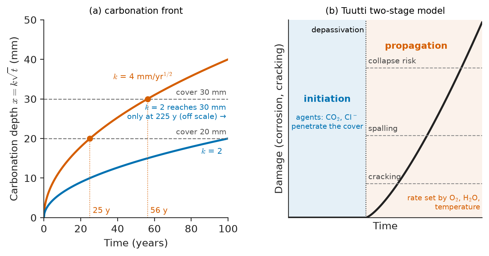
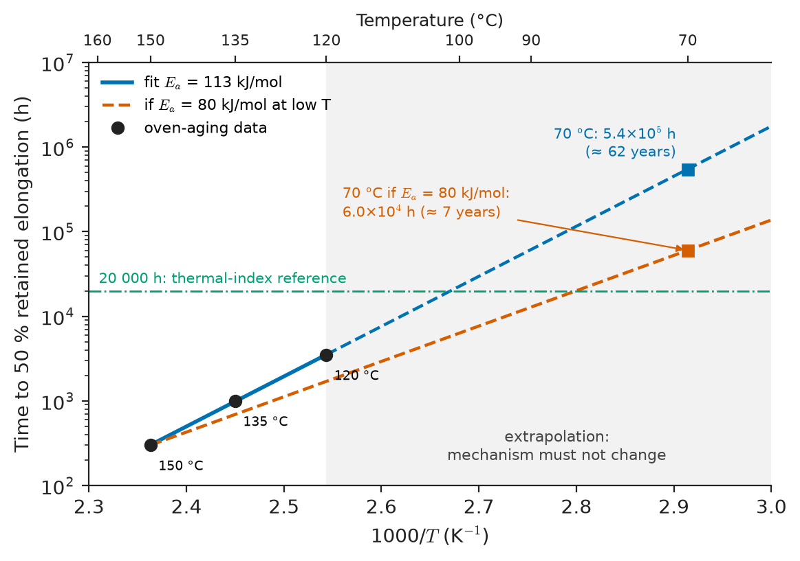
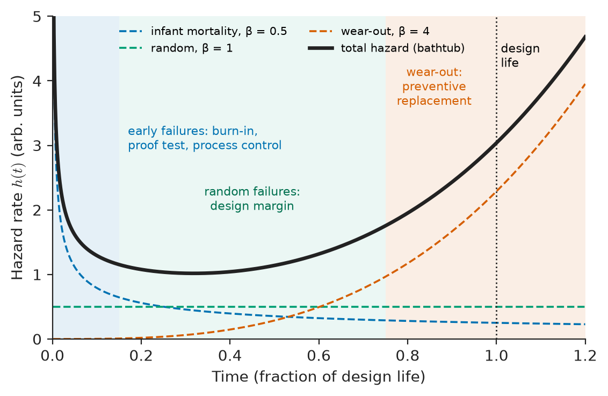
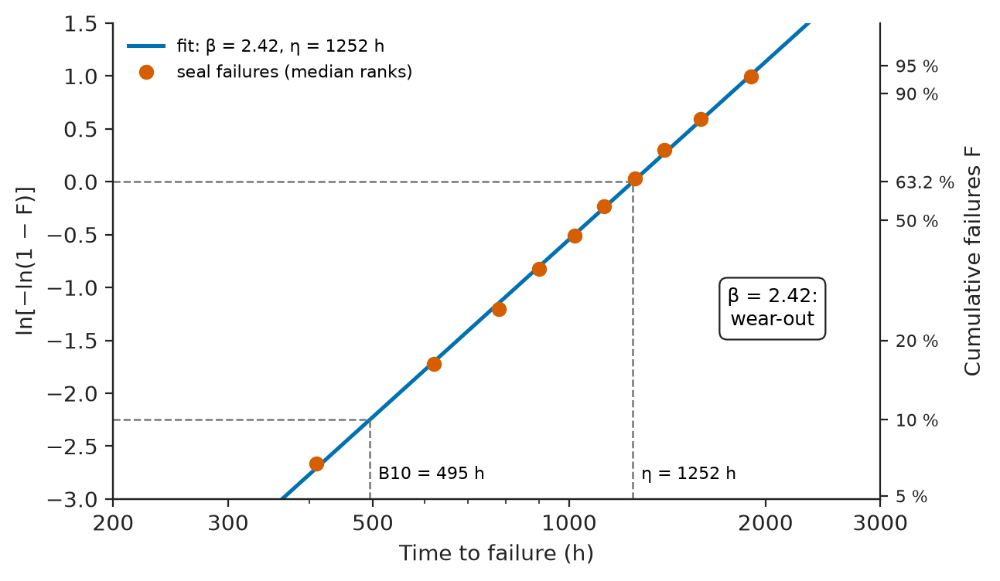
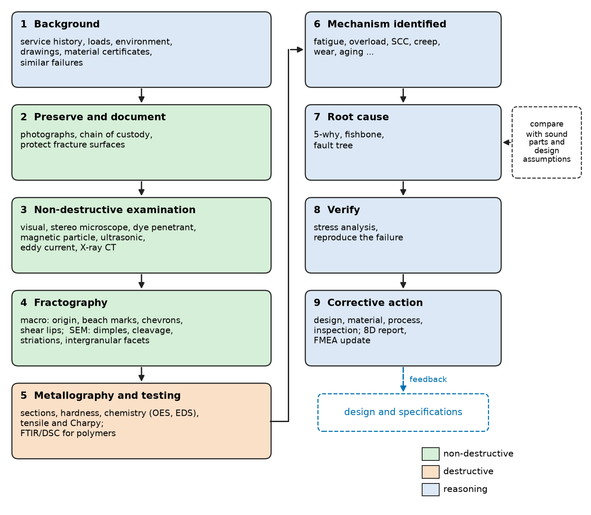
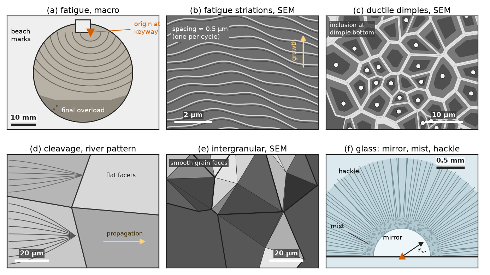
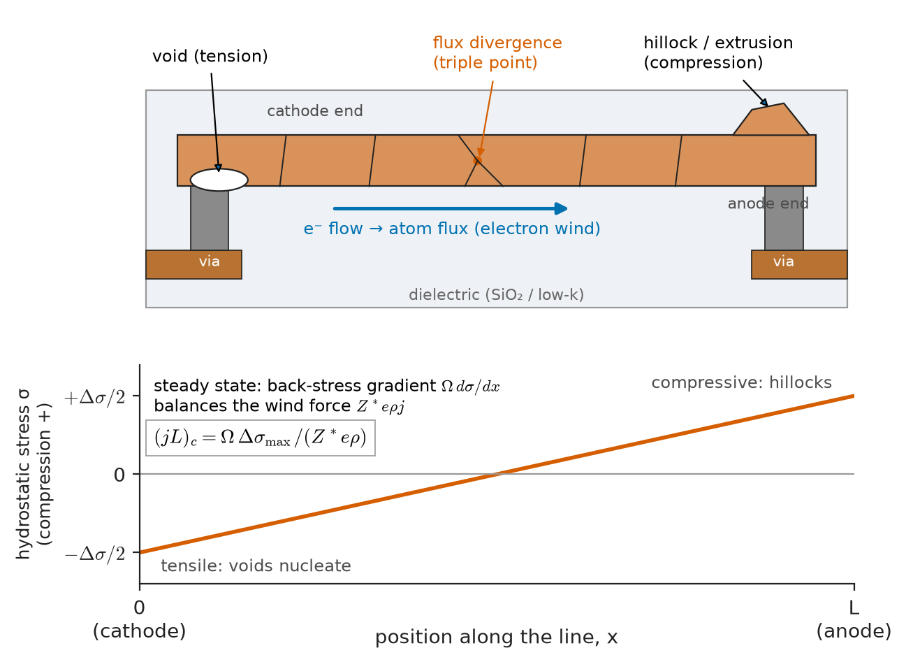
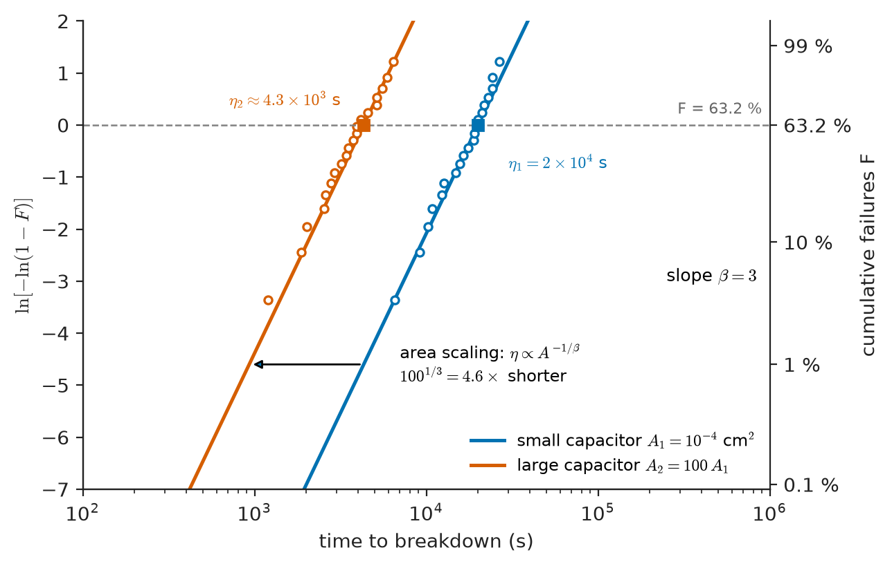
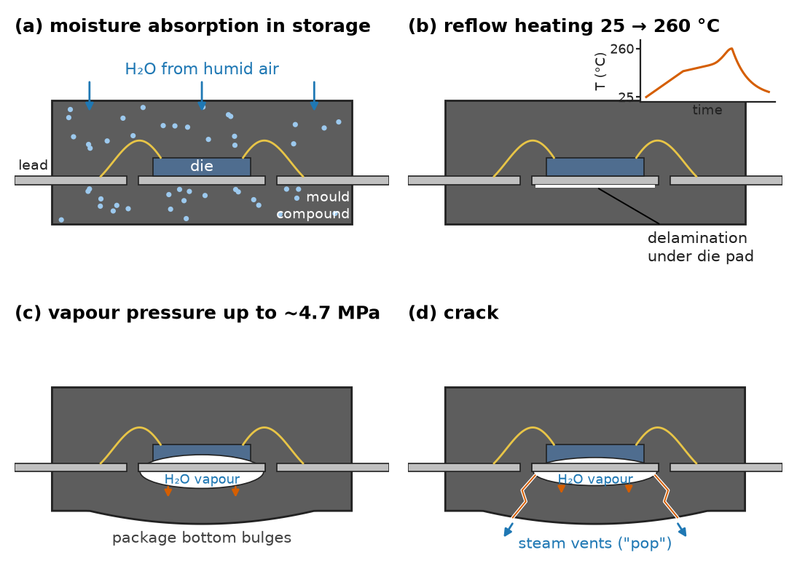

# Chapter 44 — Degradation and Failure Analysis

*Part IX · Corrosion, Degradation and Surfaces*

On 3 June 1998 a high-speed train passing Eschede in northern Germany at about 200 km/h derailed and struck a road bridge; 101 people died. The cause was a steel wheel tyre, part of a rubber-sprung wheel design adopted to reduce vibration. Each revolution flexed the tyre; over years of service a fatigue crack grew from its inner surface, helped by the tyre's wear to a thinner section that raised the cyclic stress. The crack grew silently until the remaining ligament broke. No single property of the steel was inadequate on the day the wheel entered service. What failed was the link between a degradation mechanism (fatigue crack growth), its rate under real service loads, and the inspection that should have caught it. This chapter is about that link: how materials of every class lose their properties in service, how the rate of loss is modelled and extrapolated, how failures are statistically distributed, and how an engineer reconstructs a failure from the broken parts to a root cause that can be corrected.

> **By what mechanisms do metals, ceramics, polymers, composites and concrete degrade in service, and what do those mechanisms have in common?**
> **Why do life laws (Paris, Coffin–Manson, Larson–Miller, Arrhenius, square-root ingress) take the forms they do, and how far can they be extrapolated?**
> **How are failures statistically described, and how does an investigation get from fracture surfaces to a root cause?**

| Concept | Engineering destination |
|---|---|
| Driving force, mechanism, rate, end-of-life criterion | A common template for any life prediction |
| Carbonation and chloride ingress, Tuutti model | Concrete cover and durability design of bridges, tunnels, marine structures |
| Slow crack growth, hydrothermal aging of zirconia | Glass panels, ceramic implants, ceramic turbine and armour components |
| Moisture uptake, matrix cracking, delamination | Composite airframes, wind-turbine blades, pressure vessels |
| Thermo-oxidation, photo-oxidation, hydrolysis, stabilizers | Outdoor plastics, pipes, cable insulation, medical polymers |
| Arrhenius extrapolation of oven aging | Thermal ratings and service lives of polymers and adhesives |
| Paris law, Miner's rule, Larson–Miller | Inspection intervals in aircraft, rail, bridges; creep life of boilers and turbines |
| Weibull distribution, bathtub curve, B10 life | Maintenance intervals, warranty, spare-part planning, ceramic design |
| Fractography: dimples, cleavage, striations, beach marks, mirror–mist–hackle | Identifying the failure mechanism from broken parts |
| 5-why, fishbone, fault tree, 8D, FMEA | Turning a failure into a design, material or process change |

**Roadmap.** A common framework (44.1) → degradation in each material class, with concrete as a worked case (44.2) → polymer aging and weathering, with Arrhenius extrapolation (44.3) → wear-out laws and life prediction (44.4) → reliability statistics: Weibull and the bathtub curve (44.5) → failure-analysis methodology, fractography and root cause (44.6) → case studies across industries (44.7).

---

## 44.1 A common framework for degradation

Every degradation process, whatever the material, can be described by the same four questions:

1. **Driving force.** What free energy or mechanical energy is being released? Chemical potential differences drive corrosion and oxidation (Chapter 42); stored elastic energy drives crack growth (Chapter 14); interfacial and grain-boundary energy drive coarsening (Chapter 9); photon energy drives photo-oxidation.
2. **Mechanism and rate-controlling step.** Diffusion, an interfacial reaction, dislocation motion, bond rupture at a crack tip. The slowest step sets the rate, and its dependence on temperature, stress and environment sets the form of the life law.
3. **Damage variable.** What accumulates: crack length, pit depth, carbonation depth, wall loss, oxidized fraction, molecular weight, inelastic strain.
4. **End-of-life criterion.** The damage at which the component no longer performs: crack length at which $K=K_{\rm Ic}$, depth at which rebar depassivates, elongation at break falling to 50 % of its initial value, wall thickness at the pressure-design minimum.

Most life laws then take one of a few mathematical forms:

| Rate-controlling physics | Typical life law | Examples |
|---|---|---|
| Thermally activated reaction | $t\propto\exp(E_a/RT)$ | Polymer oxidation, intermetallic growth, Arrhenius aging |
| Diffusion through a growing layer | $x\propto\sqrt{t}$ | Carbonation of concrete, parabolic oxidation, case depth |
| Cyclic damage accumulation | $N\propto(\Delta\sigma)^{-m}$ or $(\Delta\varepsilon_p)^{-1/c}$ | Basquin, Coffin–Manson, Paris |
| Stress-assisted activated flow | $\dot\varepsilon\propto\sigma^n\exp(-Q/RT)$ | Creep, stress relaxation |
| Sliding contact | $V\propto Fs/H$ | Archard wear (Chapter 45) |
| Weakest-link initiation | Weibull distribution of lives | Ceramic strength, dielectric breakdown, bearing fatigue |

The power of the framework is diagnostic as much as predictive. If accelerated tests at two temperatures fail by different mechanisms, no extrapolation from one to the other is valid. If a failure shows a mechanism the design never considered, the life model was never the problem; the list of mechanisms was.

---

## 44.2 Degradation across material classes

### Metals

Corrosion in all its forms (Chapters 42–43), fatigue, creep (Chapter 14) and wear (Chapter 45) are the dominant mechanisms. Less visible but equally important are **microstructural changes in service**, where the material slowly moves toward equilibrium at its operating temperature:

- **Coarsening of strengthening precipitates**: γ′ in nickel superalloy turbine blades coarsens and rafts under stress, lowering creep strength (Chapter 41); precipitation-hardened aluminium over-ages if run warm.
- **Spheroidization and graphitization** of carbon steel boiler and refinery tubes held for decades near 450–550 °C: lamellar pearlite turns into spheroidal carbides or graphite nodules, lowering strength and creep resistance.
- **Embrittling precipitation**: temper embrittlement of Cr–Mo steels (impurity segregation to grain boundaries around 350–575 °C); 475 °C embrittlement and sigma-phase formation in ferritic and duplex stainless steels; irradiation hardening and embrittlement of reactor-pressure-vessel steels (Chapter 41).
- **Hydrogen and liquid-metal embrittlement** (Chapter 43), and strain aging that raises yield strength and lowers toughness after cold forming.

The common consequence of most embrittling processes is a rise in the ductile–brittle transition temperature (Chapter 14), monitored in nuclear plants by surveillance Charpy specimens irradiated alongside the vessel.

### Ceramics and glasses

Ceramics do not creep or corrode much at ambient temperature, but they are brittle and therefore sensitive to anything that extends existing flaws.

- **Slow crack growth (static fatigue).** Water molecules react with strained Si–O–Si bonds at a crack tip in silicate glass, breaking them at stresses below the fast-fracture value. Crack velocity follows an empirical power law, $v=v_0(K_{\rm I}/K_{\rm Ic})^{n}$, with $n$ about 15–20 for soda-lime glass in water and 30–60 for alumina and silicon nitride. A large $n$ means strength depends weakly on load duration; a small $n$ means a glass panel under permanent load (aquarium, glass floor, façade under snow) must be designed to a stress well below its short-term strength, typically a third to a half.
- **Hydrothermal aging of zirconia.** Yttria-stabilized tetragonal zirconia (3Y-TZP) can transform spontaneously to monoclinic at body or room temperature in the presence of water, starting at the surface and spreading inward with a volume increase that roughens and microcracks it. In 2001 a batch of zirconia femoral heads for hip replacements failed in vivo after a change in the sintering process accelerated this aging; zirconia-toughened alumina composites largely replaced monolithic zirconia for that application.
- **Thermal shock** (Chapter 24), **erosion** by particles, and **chemical attack** of refractories by slags and of glass by alkaline solutions.

### Polymers

Polymers degrade chemically (oxidation, hydrolysis, photolysis), physically (physical aging below $T_g$, plasticizer loss, swelling) and mechanically (creep, crazing, environmental stress cracking). Section 44.3 treats them in detail because their aging is the most strongly temperature- and environment-dependent of all classes.

### Composites

Fibre composites degrade at three length scales (Chapters 22–23):

- **Matrix.** Epoxy matrices absorb 1–6 wt % water at saturation, which plasticizes them and lowers $T_g$, roughly 10–20 °C per percent of absorbed water. The design allowables of aircraft structures are therefore set at "hot/wet" conditions. Ultraviolet light degrades unprotected matrix surfaces, which is why composite surfaces are painted or gel-coated.
- **Interface.** Water and cyclic loading weaken the fibre–matrix bond; glass fibres themselves suffer stress corrosion in water and acids (the reason for corrosion-resistant E-CR glass in chemical pipes).
- **Laminate.** Under fatigue, damage progresses through transverse matrix cracking, then delamination between plies, then fibre breakage. Stiffness falls progressively (often by 10–20 % before final failure) rather than staying constant until a single crack runs, which makes stiffness monitoring useful. Low-velocity impact can create **barely visible impact damage** (BVID), internal delaminations that reduce compressive strength by up to half; design allowables assume such damage is present and undetected.

Wind-turbine blades, where root and spar-cap laminates see about $10^8$–$10^9$ load cycles in a 20–25-year life, are the most demanding fatigue application of composites; leading-edge erosion by rain at tip speeds near 90 m/s is their main surface degradation.

### Concrete

Reinforced concrete degrades mainly through its steel. Concrete pore solution has a pH of about 12.5–13.5, which keeps the rebar passive (Chapter 42). Two processes destroy that passivity:

- **Carbonation**: atmospheric CO$_2$ diffuses in and reacts with calcium hydroxide, lowering the pH to about 9. The carbonation front advances approximately as

$$
x=k\sqrt{t}
$$

because the rate is controlled by diffusion of CO$_2$ through the already carbonated layer. The coefficient $k$ is typically 2–6 mm/year$^{1/2}$ for structural concretes sheltered from rain, lower for dense, low water–cement-ratio concrete and in permanently wet conditions.
- **Chloride ingress** from seawater or de-icing salt, described by Fick's second law with an apparent diffusion coefficient of order $10^{-12}$–$10^{-11}$ m$^2$/s. When the chloride content at the rebar exceeds a critical value, commonly taken as about 0.4 % by mass of cement, the passive film breaks down locally, giving pitting of the rebar.

> **Status of the principle: Square-root-of-time carbonation law**
> *Approximate.* Derived from diffusion through a carbonated layer with a sharp reaction front and constant boundary conditions; real coefficients are fitted to exposure data and vary with moisture, cement type and curing, and the law overestimates penetration where wetting and drying alternate.

Tuutti's model divides the service life of a reinforced-concrete element into an **initiation period**, while the carbonation or chloride front travels through the cover, and a **propagation period**, while the rebar corrodes until cracking, spalling or loss of section reaches an unacceptable level (Figure 44.1). Rust occupies two to six times the volume of the steel it replaces, so only a few tens of micrometres of corrosion are needed to crack the cover.

<!-- FIGURE 44.1 | figures/ch44/fig-44-1-tuutti-concrete-life.png | plot | Tuutti's two-stage service-life model for reinforced concrete, with square-root carbonation fronts for two concretes. | Content: left panel: x-axis time 0–100 years; y-axis carbonation depth 0–50 mm; curves x = k√t for k = 4 and k = 2 mm/yr^0.5; horizontal dashed lines at cover 20 mm and 30 mm; intersections marked at 25 y (k = 4, 20 mm), 56 y (k = 4, 30 mm), 225 y off-scale arrow (k = 2, 30 mm). Right panel: schematic damage (corrosion, cracking) versus time: flat 'initiation' segment until depassivation, then rising 'propagation' line with thresholds 'cracking', 'spalling', 'collapse risk'; CO2 and Cl⁻ labelled as initiation agents, O2 and H2O and temperature as propagation rate factors. -->

*Figure 44.1 — Tuutti's two-stage service-life model for reinforced concrete, with square-root carbonation fronts for two concretes.*

**Worked example — cover depth for carbonation.** A bridge pier in a sheltered urban location is made of concrete with a measured carbonation coefficient $k=4$ mm/year$^{1/2}$. How long before the carbonation front reaches the reinforcement for covers of 20 mm and 30 mm, and what does a denser concrete with $k=2$ mm/year$^{1/2}$ achieve?

$$
t=\left(\frac{c}{k}\right)^{2}:\qquad t_{20}=\left(\frac{20}{4}\right)^2=25\ \text{years},\qquad t_{30}=\left(\frac{30}{4}\right)^2=56\ \text{years}
$$

With $k=2$ mm/year$^{1/2}$ and 30 mm cover, $t=(30/2)^2=225$ years. Because time scales with the square of the cover and inversely with the square of $k$, a 50 % increase in cover more than doubles the initiation period, and halving $k$ quadruples it. This is why durability codes (EN 206 and EN 1992, ACI 318) specify both minimum cover and maximum water–cement ratio for each exposure class, and why construction tolerance on cover, often ±10 mm, is a durability parameter: a 30 mm nominal cover placed at 20 mm loses more than half its life.

Other concrete degradation mechanisms are chemical attack of the paste: **sulfate attack** (expansive ettringite and gypsum, resisted by low-C$_3$A cements), **alkali–silica reaction** (reactive silica aggregate swelling as an alkali silicate gel, which has cracked dams and bridges worldwide), **freeze–thaw damage** of saturated paste (resisted by 4–7 % entrained air), and acid and seawater attack (Chapter 18).

---

## 44.3 Polymer aging and weathering

### Thermo-oxidation

Most polymers in service oxidize. The process is a free-radical chain reaction, **autoxidation**:

- Initiation: heat, light, residual catalyst or mechanical stress generates a polymer radical, $\mathrm{RH\to R^{\bullet}}$.
- Propagation: $\mathrm{R^{\bullet}+O_2\to ROO^{\bullet}}$, then $\mathrm{ROO^{\bullet}+RH\to ROOH+R^{\bullet}}$.
- Branching: hydroperoxides decompose, $\mathrm{ROOH\to RO^{\bullet}+{}^{\bullet}OH}$, each producing two new radicals, so the reaction accelerates after an induction period.
- Termination: radicals combine.

The radicals cause **chain scission** (molecular weight falls, polymer becomes brittle: polypropylene, polyethylene) or **cross-linking** (polymer hardens and cracks: many rubbers), and they create carbonyl groups detectable by infrared spectroscopy (Chapter 52). Polypropylene, with a tertiary hydrogen on every repeat unit, oxidizes much faster than polyethylene and is useless outdoors or hot without stabilization.

**Stabilizers** interrupt the cycle: primary antioxidants (hindered phenols, aromatic amines) donate hydrogen to peroxy radicals; secondary antioxidants (phosphites, thioesters) decompose hydroperoxides harmlessly. Their consumption defines an **induction period**, during which properties barely change, followed by rapid embrittlement once the stabilizer is depleted. The remaining stabilizer is measured by the **oxidation induction time** (OIT), the time to the onset of the oxidation exotherm in a DSC at, for example, 200 °C in oxygen, a routine test for polyethylene pipes and geomembranes.

### Photo-oxidation and weathering

Solar ultraviolet radiation between 290 and 400 nm carries 300–410 kJ/mol per photon, comparable to C–C and C–H bond energies. Chromophores (carbonyl groups, catalyst residues, aromatic rings) absorb it and initiate radicals, so photo-oxidation adds to thermo-oxidation at the surface. Outdoor plastics chalk, yellow, lose gloss and develop surface microcracks that act as notches; garden furniture and unprotected polypropylene ropes embrittle in a few summers. Weathering adds moisture, temperature cycling and pollutants.

Protection comes from **UV absorbers** (benzotriazoles, benzophenones), **hindered-amine light stabilizers** (HALS), which scavenge radicals regeneratively and are the most effective for polyolefins, and **pigments**: 2–3 % of well-dispersed carbon black makes polyethylene pipe and cable jacket essentially UV-proof for decades. Accelerated weathering uses xenon-arc or fluorescent UV lamps with water spray (ISO 4892, ASTM G154/G155), but because the lamp spectrum, temperature and wetting differ from sunlight, results rank materials rather than predict outdoor life; reference outdoor sites in Florida (hot, humid) and Arizona (hot, high UV) remain the benchmarks.

### Hydrolysis, environmental stress cracking and physical aging

- **Hydrolysis** breaks ester, amide, carbonate and urethane linkages: PET and polycarbonate lose molecular weight in hot water or steam; polyester polyurethanes crumble in humid tropical climates; polyamides absorb water and some hydrolyse in hot glycol coolants. In biomedical PLA and PLGA, hydrolysis is the designed degradation route (Chapter 39).
- **Environmental stress cracking (ESC)** is the polymer analogue of SCC: a liquid that does not dissolve the polymer (detergent on polyethylene, alcohols or oils on polycarbonate and ABS, cleaning agents on medical housings) plasticizes the craze fibrils at a stressed surface and allows cracks to grow at stresses far below those needed in air. It is the most common cause of plastic part failures in practice. Slow crack growth of polyethylene pipe under internal pressure is the related long-term mechanism, which is why modern PE100 and PE100-RC pipe resins are rated for resistance to it.
- **Physical aging** of glassy polymers below $T_g$: the non-equilibrium glass slowly densifies (Chapter 20), raising modulus and yield stress and lowering toughness and creep rate, with no chemical change. It is reversible by heating above $T_g$.
- **Loss of plasticizer** from flexible PVC (cables, hoses, medical tubing) by evaporation or migration into contacting materials leaves it stiff and cracked.

### Arrhenius extrapolation

Thermal life is estimated by aging specimens in ovens at several elevated temperatures until a property (commonly elongation at break) falls to an end-of-life value, often 50 % of its initial value. If one reaction controls the rate at all test temperatures, the life follows

$$
L(T)=L_0\exp\!\left(\frac{E_a}{RT}\right)
$$

and a plot of $\ln L$ against $1/T$ (Figure 44.2) is a straight line that can be extrapolated to the service temperature. Standards such as IEC 60216 and UL 746B use this procedure to define thermal indices: the temperature at which life reaches a reference value such as 20 000 h. A useful consequence is the rule that life roughly halves for every 10 °C rise near the test temperature; with $E_a=113$ kJ/mol it halves every 6.7 K near 90 °C.

> **Status of the principle: Arrhenius aging extrapolation**
> *Empirical.* Its form follows from thermally activated reaction kinetics, but applied to the property loss of a real material it is a fit valid only while one mechanism dominates. Extrapolation across a glass transition or melting range, across a change from stabilizer-controlled to oxidation-controlled behaviour, or from diffusion-limited oxidation in thick specimens at high temperature (where oxygen cannot reach the interior fast enough) to homogeneous oxidation at service temperature, is unsafe.

<!-- FIGURE 44.2 | figures/ch44/fig-44-2-arrhenius-polymer-aging.png | plot | Arrhenius plot of oven-aging life of a polyolefin cable jacket with extrapolation to service temperatures, showing the sensitivity to activation energy. | Content: x-axis 1000/T in K⁻¹ from 2.3 to 3.0 with a secondary top axis in °C (160, 150, 135, 120, 100, 90, 70, 60); y-axis time to 50 % retained elongation in hours, log scale 1e2 to 1e7. Three data points: 150 °C 300 h, 135 °C 1000 h, 120 °C 3500 h. Solid fitted line Ea = 113 kJ/mol extrapolated (dashed) to 70 °C giving 5.4e5 h; second dashed line from the 150 °C point with Ea = 80 kJ/mol giving 6.0e4 h at 70 °C. Horizontal reference line at 20 000 h 'thermal index'. Shaded band beyond the data labelled 'extrapolation: mechanism must not change'. -->

*Figure 44.2 — Arrhenius plot of oven-aging life of a polyolefin cable jacket with extrapolation to service temperatures, showing the sensitivity to activation energy.*

**Worked example — service life of a cable jacket from oven aging.** A polyolefin cable jacket compound is aged at three temperatures, and the time for the elongation at break to fall to 50 % of its initial value is recorded:

| Aging temperature | 150 °C (423.15 K) | 135 °C (408.15 K) | 120 °C (393.15 K) |
|---|---|---|---|
| Time to end of life | 300 h | 1000 h | 3500 h |

A least-squares fit of $\ln L$ against $1/T$ gives a slope $E_a/R=1.362\times10^4$ K, so $E_a=1.362\times10^4\times8.314=113$ kJ/mol (1.17 eV). The fitted line reproduces the data to within 2 % (302, 986 and 3523 h). Extrapolating from 150 °C:

$$
L(70\ ^\circ\mathrm C)=300\times\exp\!\left[1.362\times10^4\left(\frac{1}{343.15}-\frac{1}{423.15}\right)\right]=300\times\exp(7.50)\approx5.4\times10^{5}\ \mathrm h\approx62\ \text{years}
$$

At 90 °C the same calculation gives about $6.1\times10^4$ h, roughly 7 years: a 20 K rise in conductor temperature cuts the life ninefold.

The fragility of the extrapolation is the real lesson. Three points spanning 30 K are being projected 50 K beyond the data, across more than two decades of time. If the true activation energy at lower temperatures were 80 kJ/mol rather than 113 kJ/mol (a common situation when a different, lower-barrier process dominates at low temperature), the life at 70 °C would be about $6\times10^4$ h, about 7 years instead of 62. That is why long-life ratings require test temperatures as close to service as practical, at least four temperatures, a check for linearity, and confirmation by OIT or infrared spectroscopy that the same chemistry is occurring at each temperature.

---

## 44.4 Wear-out mechanisms and life prediction

### The catalogue of life laws

Wear-out failures are those whose probability rises with age because damage accumulates. The laws that predict them have appeared in earlier chapters; collected here, they form the toolkit of life prediction:

| Mechanism | Life law | Typical parameters | Status |
|---|---|---|---|
| High-cycle fatigue | Basquin: $\sigma_a=\sigma_f'(2N_f)^b$ | $b\approx-0.05$ to $-0.12$ | Empirical |
| Low-cycle fatigue | Coffin–Manson: $\Delta\varepsilon_p/2=\varepsilon_f'(2N_f)^c$ | $c\approx-0.5$ to $-0.7$ | Empirical |
| Fatigue crack growth | Paris: $da/dN=C(\Delta K)^m$ | $m\approx3$ (steels), 3–4 (Al alloys) | Empirical |
| Variable-amplitude fatigue | Miner: $\sum n_i/N_i=1$ | failure at sum 0.3–3 in practice | Empirical |
| Creep rupture | Larson–Miller: $P=T(C+\log_{10}t_r)$ | $C\approx20$ ($t_r$ in h, $T$ in K) | Empirical |
| Thermally activated aging | Arrhenius: $L\propto\exp(E_a/RT)$ | $E_a$ 50–150 kJ/mol for polymers | Empirical |
| Humidity-driven corrosion | Peck: $L\propto\mathrm{RH}^{-n}\exp(E_a/kT)$ | $n\approx2.7$, $E_a\approx0.8$ eV | Empirical |
| Diffusion-controlled ingress | $x=k\sqrt t$ | carbonation $k$ 2–6 mm/year$^{1/2}$ | Approximate |
| Sliding wear | Archard: $V=KFs/H$ | $K$ from $10^{-8}$ to $10^{-2}$ | Empirical |

The electronic-specific laws (Black's equation for electromigration, TDDB models for dielectrics, Norris–Landzberg for solder joints) are applied to their mechanisms in Chapters 34, 50 and 51.

Each law is used in the same way: measure its parameters under accelerated conditions, compute an **acceleration factor** between test and service, and convert test life to service life. Each carries the same caveat: the mechanism must be the same in test and service.

### Damage-tolerant design with the Paris law

For safety-critical structures that cannot be guaranteed crack-free (airframes, rail axles and wheels, pressure vessels, bridges), the design philosophy is **damage tolerance**: assume a crack of the largest size that inspection could miss, calculate how long it takes to grow to a critical size, and inspect at a fraction (typically half or a third) of that interval. With $\Delta K=Y\Delta\sigma\sqrt{\pi a}$ and constant $Y$, integrating the Paris law from initial size $a_0$ to critical size $a_c$ gives, for $m\neq2$,

$$
N_f=\frac{2}{(m-2)\,C\,(Y\Delta\sigma\sqrt{\pi})^{m}}\left[a_0^{(2-m)/2}-a_c^{(2-m)/2}\right]
$$

> **Status of the principle: Paris-law crack-growth integration**
> *Empirical.* The Paris law is a fit to the intermediate (stage II) region of crack-growth data; it ignores the threshold below which cracks do not grow, the acceleration near $K_{\rm Ic}$, load-sequence effects (overload retardation) and short-crack behaviour, so lives computed from it are reliable only for long cracks under roughly constant-amplitude loading.

**Worked example — inspection interval for a cracked steel plate.** A ferrite–pearlite steel plate in a crane girder carries a constant-amplitude stress range $\Delta\sigma=100$ MPa ($R=0$, so $\sigma_{\max}=100$ MPa). Ultrasonic inspection can reliably find edge cracks of 2 mm and larger. Paris constants are $C=6.9\times10^{-12}$ m/cycle and $m=3$ (with $\Delta K$ in MPa√m), $K_{\rm Ic}=100$ MPa√m, and $Y=1.12$.

*Critical crack size:*

$$
a_c=\frac{1}{\pi}\left(\frac{K_{\rm Ic}}{Y\sigma_{\max}}\right)^2=\frac{1}{\pi}\left(\frac{100}{112}\right)^2=0.254\ \mathrm m
$$

(in practice the plate width or net-section yielding would limit this first; we keep it to see its influence).

*Cycles from 2 mm to $a_c$:* with $m=3$, the bracket is $a_0^{-1/2}-a_c^{-1/2}=22.36-1.99=20.37$ m$^{-1/2}$, and $(Y\Delta\sigma\sqrt\pi)^3=(112\times1.7725)^3=(198.5)^3=7.82\times10^6$:

$$
N_f=\frac{2\times20.37}{6.9\times10^{-12}\times7.82\times10^{6}}=7.5\times10^{5}\ \text{cycles}
$$

Three sensitivities follow directly. Taking $a_c=50$ mm instead of 254 mm reduces $N_f$ only to $6.6\times10^5$ cycles: almost all the life is spent while the crack is small, so the critical size hardly matters. Halving the detectable crack to 1 mm raises $N_f$ to $1.10\times10^6$ cycles: better inspection buys life directly. Raising the stress range by 25 % to 125 MPa cuts $N_f$ to $3.8\times10^5$ cycles (and $a_c$ to 0.16 m), because life scales as $\Delta\sigma^{-3}$. At 300 lifts a day the 2 mm case allows about 7 years of crack growth, so an inspection every two to three years gives two chances to find the crack before it is critical. The Eschede tyre of the opening was an object lesson in the last sensitivity: wear thinned the section, raising the stress range in service beyond what the original assessment had assumed.

### Variable loads and Miner's rule

Real loads vary. **Miner's rule** assumes that each cycle at amplitude $\sigma_i$ consumes a fraction $1/N_i$ of life, where $N_i$ is the constant-amplitude life at that amplitude, and that failure occurs when $\sum n_i/N_i=1$. Load histories are reduced to counts of cycles by rainflow counting. The rule ignores load sequence (a high-low sequence is more damaging than low-high) and the fact that small cycles below the endurance limit become damaging once a crack exists, so design codes often limit the damage sum to 0.5 or less, or extend S–N curves below the endurance limit with a shallower slope.

### Creep life and the Larson–Miller parameter

Creep-rupture data are extrapolated with time–temperature parameters (Chapter 14). With the Larson–Miller parameter, a stress that causes rupture in 1000 h at 650 °C (923.15 K) has $P=923.15\times(20+3)=2.123\times10^4$; at the same stress and 600 °C (873.15 K), $\log_{10}t_r=2.123\times10^4/873.15-20=4.32$, so $t_r\approx2.1\times10^4$ h. A 50 K reduction in temperature buys a factor of 21 in life. Power-plant steam pipes and reformer tubes are managed this way, with remaining-life assessment by replica metallography of creep cavities on the outer surface.

---

## 44.5 Reliability statistics

### Describing a population of lives

Nominally identical components fail at different times, because flaws, loads and environments vary. Reliability engineering describes the population by:

- the cumulative failure probability $F(t)$ and the **reliability** $R(t)=1-F(t)$;
- the probability density $f(t)=dF/dt$;
- the **hazard rate** $h(t)=f(t)/R(t)$, the instantaneous failure rate of survivors, which tells whether old components are more or less likely to fail than new ones.

### The Weibull distribution

The most widely used life distribution in mechanical and materials reliability is the two-parameter Weibull:

$$
F(t)=1-\exp\!\left[-\left(\frac{t}{\eta}\right)^{\beta}\right],\qquad h(t)=\frac{\beta}{\eta}\left(\frac{t}{\eta}\right)^{\beta-1}
$$

where $\eta$ is the **characteristic life** (63.2 % failed) and $\beta$ the **shape parameter**. Its flexibility comes from $\beta$: $\beta<1$ gives a falling hazard (infant mortality from manufacturing defects), $\beta=1$ a constant hazard (random failures, the exponential distribution), and $\beta>1$ a rising hazard (wear-out; $\beta\approx2$–4 for fatigue and wear, larger for tightly controlled processes). Its physical justification is the weakest-link argument already used for ceramic strength (Chapter 14): a component that fails when its worst element fails follows Weibull statistics. Mean life is $\mathrm{MTTF}=\eta\,\Gamma(1+1/\beta)$. The **B10 life**, the time by which 10 % have failed, is standard for bearings and many mechanical parts:

$$
t_{B10}=\eta\left[-\ln(0.9)\right]^{1/\beta}
$$

The **lognormal** distribution is an alternative when damage grows multiplicatively (fatigue lives of many metals, electromigration); with limited data the two are hard to distinguish, but they diverge in the low-percentile tail that matters for safety.

> **Status of the principle: Weibull life distribution**
> *Empirical.* Justified by weakest-link reasoning where failure starts at the worst of many independent flaws, but in reliability practice it is a flexible fit; extrapolation to failure fractions far below those observed is sensitive to the fitted $\beta$, and mixed populations (defective plus sound) need separate distributions.

### The bathtub curve

Over the life of a product population, the hazard rate typically follows the **bathtub curve** (Figure 44.3): a falling early-failure region (defective units failing; addressed by burn-in, proof testing and process control), a flat region of random failures (overloads, accidents; addressed by margins), and a rising wear-out region (fatigue, wear, aging; addressed by life prediction and preventive replacement). The curve is a composite: each region is a different population or mechanism, and each has its own Weibull $\beta$. Many well-designed mechanical products show little flat region at all, and electronic products often wear out only after obsolescence.

<!-- FIGURE 44.3 | figures/ch44/fig-44-3-bathtub-curve.png | plot | The bathtub curve as the sum of three Weibull hazard populations. | Content: x-axis time (normalized, 0 to 1.2 of design life, linear); y-axis hazard rate h(t) (arbitrary units, linear, 0 to 5). Three dashed component hazards: infant mortality Weibull β = 0.5 decaying; random β = 1 constant at 0.5; wear-out β = 4 rising from about 0.6 of life. Solid total curve as their sum showing the bathtub. Shaded regions labelled 'early failures: burn-in, proof test, process control', 'random failures: design margin', 'wear-out: preventive replacement'. Vertical dashed line at 'design life'. -->

*Figure 44.3 — The bathtub curve as the sum of three Weibull hazard populations.*

### Fitting data and reading the result

Failure times are ranked, each is assigned an estimated cumulative probability by **median ranks**, $F_i\approx(i-0.3)/(n+0.4)$ (Bernard's approximation), and $\ln[-\ln(1-F)]$ is plotted against $\ln t$. A straight line confirms the Weibull form; its slope is $\beta$ and its intercept gives $\eta$ (Figure 44.4). Maximum-likelihood estimation is preferred for censored data (units still running when the test ends).

**Worked example — Weibull analysis of hydraulic pump seals.** Ten seals from a test rig fail at 410, 620, 780, 900, 1020, 1130, 1260, 1400, 1590 and 1900 h. Median ranks run from $F_1=0.7/10.4=0.067$ to $F_{10}=9.7/10.4=0.933$. A least-squares fit of $\ln[-\ln(1-F_i)]$ on $\ln t_i$ gives

$$
\beta=2.42,\qquad \eta=1252\ \mathrm h
$$

The shape parameter well above 1 identifies wear-out. The B10 life is

$$
t_{B10}=1252\times(0.1054)^{1/2.42}=1252\times0.395=495\ \mathrm h
$$

and the mean life is $\mathrm{MTTF}=1252\times\Gamma(1.413)=1252\times0.887=1110$ h (the sample mean is 1101 h). The hazard rate rises from $5.2\times10^{-4}$ per hour at 500 h to $2.5\times10^{-3}$ per hour at 1500 h, nearly fivefold. Because failures are wear-out, preventive replacement pays: replacing seals at 500 h accepts about a 10 % chance of an in-service failure per seal, whereas running to failure would see half of them fail before 1080 h. If instead $\beta$ had come out near 1, preventive replacement would be pointless, since a new seal would be no more reliable than an old one. Ten failures give $\beta$ with a 90 % confidence interval of roughly ±40 %, so a decision that depends on the B1 life rather than the B10 would need more data.

<!-- FIGURE 44.4 | figures/ch44/fig-44-4-weibull-seals.png | plot | Weibull probability plot of ten pump-seal failures with the fitted line, characteristic life and B10 life. | Content: x-axis time to failure in h, log scale 200–3000; y-axis ln(−ln(1−F)) from −3 to 1.5 with right-hand labels F = 5 %, 10 %, 20 %, 50 %, 63.2 %, 90 %, 95 %. Ten data points at t = 410, 620, 780, 900, 1020, 1130, 1260, 1400, 1590, 1900 h with median ranks (i−0.3)/10.4. Fitted line β = 2.42, η = 1252 h. Horizontal dashed lines at F = 10 % and 63.2 % with vertical drops at 495 h (B10) and 1252 h (η). Text box 'β = 2.42: wear-out'. -->

*Figure 44.4 — Weibull probability plot of ten pump-seal failures with the fitted line, characteristic life and B10 life.*

---

## 44.6 Failure analysis: methodology, fractography and root cause

### Principles

Failure analysis is the systematic reconstruction of how and why a component failed. Three principles govern it:

1. **Preserve evidence.** Fracture surfaces are damaged by fitting broken halves together, by cleaning, by corrosion after the event and by careless sectioning. Every destructive step removes information; proceed from non-destructive to destructive and document each step.
2. **Collect the history.** Design drawings, material certificates, manufacturing and repair records, operating loads and environment, time in service and similar failures elsewhere. Clustering of failures by production lot, supplier, site or season points directly to a class of causes.
3. **Distinguish mechanism from root cause.** "Fatigue crack from a weld toe" is a mechanism. The root cause is why the conditions for it existed: a weld detail with a high stress concentration, a change in welding procedure, a load spectrum underestimated in design, an inspection that missed the crack. Only a root cause can be corrected.

### The workflow

Figure 44.5 summarizes the standard sequence.

<!-- FIGURE 44.5 | figures/ch44/fig-44-5-failure-analysis-workflow.png | flowchart | Failure-analysis workflow from the failed part to verified corrective action. | Content: top-to-bottom flowchart: (1) 'Background: service history, loads, environment, drawings, material certificates, similar failures'; (2) 'Preserve and document: photographs, chain of custody, protect fracture surfaces'; (3) 'Non-destructive examination: visual, stereo microscope, dye penetrant, magnetic particle, ultrasonic, eddy current, X-ray CT'; (4) 'Fractography: macro (origin, beach marks, chevrons, shear lips) and SEM (dimples, cleavage, striations, intergranular)'; (5) 'Metallography and testing: sections, hardness, chemistry (OES, EDS), tensile and Charpy, FTIR/DSC for polymers'; (6) 'Mechanism identified'; (7) 'Root cause: 5-why, fishbone, fault tree' with side input 'compare with sound parts and design assumptions'; (8) 'Verify: stress analysis, reproduce failure'; (9) 'Corrective action: design, material, process, inspection; 8D report, FMEA update'. Dashed feedback arrow from 9 to 'design and specifications'. Non-destructive steps green, destructive orange, reasoning steps blue. -->

*Figure 44.5 — Failure-analysis workflow from the failed part to verified corrective action.*

Non-destructive examination comes first: visual inspection and stereo microscopy to locate the origin and the sequence of fracture; dye-penetrant and magnetic-particle inspection to find other cracks; ultrasonic, eddy-current and radiographic or CT inspection to find subsurface defects. Then the fracture surfaces are examined macroscopically and in the SEM, sections are cut through the origin for metallography (Chapter 52), hardness and chemical composition are checked against specification, and mechanical tests on material from the failed part confirm or exclude a materials deficiency. For polymers, FTIR, DSC and molecular-weight measurements reveal oxidation, wrong grade or degradation in moulding. Stress analysis, by hand or finite elements, checks whether the loads the evidence implies are consistent with the design.

### Reading fracture surfaces

Fractography is the most powerful single tool, because the fracture surface records how the crack grew (Figure 44.6).

| Feature | Scale | Meaning |
|---|---|---|
| Beach marks (clamshell marks) | Macroscopic | Successive positions of a fatigue crack front, from changes in load or environment; they point back to the origin |
| Ratchet marks | Macroscopic | Steps between multiple fatigue origins; many ratchets indicate high stress or a stress concentration |
| Chevron (herringbone) marks | Macroscopic | Fast brittle fracture in plate; the chevrons point back toward the origin |
| Shear lips | Macroscopic | Ductile final fracture under plane stress near free surfaces; small lips mean low toughness or high constraint |
| Dimples (microvoid coalescence) | SEM, 1–50 µm | Ductile overload; elongated or parabolic dimples indicate shear or tearing |
| Cleavage facets with river patterns | SEM | Brittle transgranular fracture in BCC metals below the transition temperature |
| Intergranular facets | SEM | Weak grain boundaries: temper embrittlement, hydrogen, SCC, creep cavitation, sensitization |
| Fatigue striations | SEM, 0.1–1 µm spacing | One striation per load cycle in ductile metals; spacing gives local crack growth rate |
| Branched cracks | Section | Stress-corrosion cracking |
| Mirror, mist and hackle | Glass, ceramics | Smooth mirror around the origin, then misty and rough hackle zones as the crack accelerates and branches |
| Crazes, stretched fibrils, slow-crack-growth bands | Polymers | Environmental stress cracking or slow crack growth |

Two quantitative readings are routine. Striation spacing measured at several distances from the origin, compared with the Paris law, estimates the stress range that grew the crack. In glasses and ceramics, the mirror radius $r_m$ is related to the fracture stress by $\sigma_f\sqrt{r_m}=A$, with mirror constant $A\approx2$ MPa√m for soda-lime glass; a mirror of radius 0.5 mm therefore indicates a fracture stress of about $2/\sqrt{5\times10^{-4}}\approx89$ MPa, which tells the analyst whether the pane broke at a normal service load from a damaged edge or under an abnormal load.

<!-- FIGURE 44.6 | figures/ch44/fig-44-6-fractography-features.png | micrograph-style | Characteristic fracture-surface features used to identify failure mechanisms. | Content: six-panel montage of stylized SEM/macro views, each with a scale bar and label: (a) macro view of a fatigued shaft cross-section with origin at a keyway, beach marks and a final-overload zone (scale 10 mm); (b) fatigue striations, spacing ~0.5 µm (scale 2 µm); (c) equiaxed ductile dimples with inclusions at their bottoms (scale 10 µm); (d) cleavage facets with river patterns converging in the propagation direction (scale 20 µm); (e) intergranular facets showing smooth grain faces (scale 20 µm); (f) glass fracture origin with mirror, mist and hackle zones and the mirror radius r_m marked (scale 0.5 mm). -->

*Figure 44.6 — Characteristic fracture-surface features used to identify failure mechanisms.*

> **Status of the principle: Fracture-mirror relation**
> *Empirical.* The relation $\sigma_f\sqrt{r_m}=A$ follows dimensionally from crack-branching at a critical stress intensity, but $A$ is measured for each material and the relation assumes a sharp origin and nearly uniform stress over the mirror.

### Root-cause tools

- **5-why analysis**: asking *why* repeatedly until a controllable cause is reached. For a fatigued pump shaft: Why did it break? Fatigue from the keyway. Why? Rotating bending stress above the fatigue strength at the keyway corner. Why? The corner radius was 0.1 mm instead of the drawn 0.5 mm. Why? A worn cutter was used and the radius is not inspected. Why? The inspection plan lists the radius as non-critical. The last answer is actionable.
- **Ishikawa (fishbone) diagrams**: candidate causes grouped under materials, methods, machines, measurement, environment and people, so none is overlooked.
- **Fault-tree analysis**: top-down logical decomposition of the failure into AND/OR combinations of basic events, used where several conditions must coincide (SCC needs stress AND environment AND susceptible material).
- **8D** (eight disciplines): team, problem description, containment, root cause and escape point, corrective action, validation, prevention of recurrence, closure. The materials engineer's work concentrates in root cause and validation.
- **FMEA**: the forward-looking counterpart, listing for a new design each potential failure mode, its effect, cause and controls, and ranking it before release. The mechanisms of Chapters 42–45 are the vocabulary of a good FMEA, and lessons from failure analysis feed back into it.

> **Boundary.** Formal reliability engineering (confidence bounds, accelerated-test planning, system reliability block diagrams) and the statistics behind it belong to The Mathematics Universe and engineering-management courses.

---

## 44.7 Case studies across industries

The value of case studies is in the pattern. In almost every major materials failure the mechanism was known at the time; what failed was the recognition that the mechanism applied, the estimate of its rate, or the inspection meant to catch it.

| Case | Industry | Mechanism | Root cause and lesson |
|---|---|---|---|
| Liberty ships and T2 tankers (1940s) | Marine | Brittle fracture of welded hulls in cold seas | Steel with high ductile–brittle transition temperature, welded continuous hulls letting cracks run between plates, square hatch corners; led to Charpy toughness requirements and modern fracture mechanics |
| de Havilland Comet (1954) | Aerospace | Fatigue of pressurized fuselage | Cyclic pressurization stresses at cut-out corners underestimated; led to full-scale fatigue testing and fail-safe design |
| Silver Bridge, Ohio (1967) | Civil | Brittle fracture of an eyebar from a small crack grown by stress corrosion and corrosion fatigue | Non-redundant eyebar chain, a crack hidden in an uninspectable location; led to US national bridge inspection standards |
| Aloha Airlines 243 (1988) | Aerospace | Multiple-site fatigue at fuselage lap joints after disbonding and corrosion | High-cycle, humid, salt environment; inspection intervals based on flight hours not cycles; led to aging-aircraft programmes |
| Space Shuttle Challenger (1986) | Aerospace | Loss of elastomer resilience at low temperature in field-joint O-rings | Seals operated far below qualified temperature; viscoelastic recovery too slow to follow joint opening (Chapter 14) |
| Eschede ICE (1998) | Rail | Fatigue fracture of a resilient wheel tyre | Cyclic stresses in a thinning tyre underestimated; inspection unable to detect internal cracks |
| Zirconia femoral heads (2001) | Biomedical | Hydrothermal aging and fracture of 3Y-TZP | Process change in sintering altered microstructure in some batches; showed that a processing change can create a new degradation mechanism |
| Davis-Besse reactor head (2002) | Energy | Boric-acid wastage of carbon-steel head, after PWSCC of a nozzle let coolant leak | Leak indications missed for years; only the stainless cladding held pressure |
| Metal-on-metal hip implants (2010 recalls) | Biomedical | Wear and corrosion debris causing tissue reactions | Wear in edge-loading conditions not captured by standard simulator tests (Chapter 45) |
| Silver-sulfide resistor failures | Electronics | Sulfidation of silver electrodes through termination gaps | Office-environment components used in sulfur-rich industrial air |

Three lessons recur.

**First, interactions defeat single-mechanism analysis.** Silver Bridge needed a stress-corrosion crack to start a brittle fracture; Davis-Besse needed SCC to create the leak that drove wastage; Aloha needed disbonding to load the rivets that fatigued. Fault trees with AND gates describe these failures better than any single life law.

**Second, the service condition, not the material, was usually misjudged.** Comet's designers knew about fatigue; they underestimated the stress at the corners. Challenger's O-ring compound was suitable within its qualified temperature range. Eschede's tyre steel was adequate for the stress the design assumed. The engineering response is a materials engineer's insistence on the real environment, real loads and real temperature, measured not assumed.

**Third, processing changes are silent design changes.** A sintering change made zirconia heads age; a welding procedure change or a new supplier's steel can move a transition temperature. Every process change to a safety-critical part therefore needs the same qualification as the original design.

> **Status of the principle: Case-study lessons**
> *Empirical.* Generalizations drawn from investigated failures; they are heuristics for where to look, not laws, and each case report should be read in its original investigation for the details that matter.

---

## 44.8 Wear-out of electronic materials

Electronic assemblies add wear-out mechanisms of their own: current densities high enough to move atoms, fields close to breakdown in nanometre-thin dielectrics, hot carriers in transistor channels, moisture in plastic packages and contacts that carry current through a few microscopic spots. The life laws below follow the same pattern as Section 44.4 — a driving force, an Arrhenius temperature dependence and a fitted exponent — and are the ones Chapters 34, 50 and 51 rely on.

### Translating test cycles to the field: Norris–Landzberg

Thermal-cycling tests are run with larger temperature swings and shorter cycles than the field to obtain failures in weeks. The **acceleration factor** $AF=N_{\rm field}/N_{\rm test}$ relates the two. Norris and Landzberg extended Coffin–Manson to include the effects of frequency and peak temperature (which control creep during each cycle):

$$
AF=\frac{N_{\rm field}}{N_{\rm test}}=\left(\frac{\Delta T_{\rm test}}{\Delta T_{\rm field}}\right)^{n}\left(\frac{f_{\rm field}}{f_{\rm test}}\right)^{m}\exp\!\left[\frac{E_a}{k}\left(\frac{1}{T_{\max,\rm field}}-\frac{1}{T_{\max,\rm test}}\right)\right]
$$

The first factor is Coffin–Manson ($n$ about 2 for SnPb, 2–2.7 for SAC). The second says that slower field cycles give more time for creep per cycle and hence *fewer* cycles to failure ($m\approx1/3$ for SnPb, smaller for SAC). The third says that a hotter peak temperature causes more damage per cycle.

> **Status of the principle: Norris–Landzberg acceleration factor**
> *Empirical.* Fitted to thermal-cycling data for specific solder alloys and package types; parameters differ between SnPb and SAC and between studies, and the model assumes the same failure mechanism in test and field (it fails if test temperatures exceed a laminate $T_g$ or cause a different crack path).

**Worked example — field life of a BGA from a thermal-cycling test.** A SAC BGA assembly survives a characteristic life of $N_{\rm test}=2000$ cycles in a −40/+125 °C test ($\Delta T=165$ K, $T_{\max}=398$ K) at 24 cycles/day. In the field it sees $\Delta T=50$ K with $T_{\max}=75$ °C (348 K), twice a day. Using SAC parameters reported by Pan and co-workers ($n=2.65$, $m=0.136$, $E_a/k=2185$ K):

$$
\left(\frac{165}{50}\right)^{2.65}=3.3^{2.65}=23.7
$$

$$
\left(\frac{2}{24}\right)^{0.136}=0.713
$$

$$
\exp\!\left[2185\left(\frac{1}{348.15}-\frac{1}{398.15}\right)\right]=\exp(2185\times3.607\times10^{-4})=\exp(0.788)=2.20
$$

$$
AF=23.7\times0.713\times2.20=37.1
$$

The expected field characteristic life is $2000\times37.1\approx74\,000$ cycles, which at two cycles per day is about 100 years. The margin is comfortable, but notice which term dominates: the $\Delta T$ ratio. If the field swing were 80 K instead of 50 K (an outdoor enclosure in sunlight), the first factor would fall to $(165/80)^{2.65}=6.8$ and the field life to roughly 30 years. The model is only as good as the field temperature profile, which is often the least known input.

### Electromigration

#### The mechanism

A copper interconnect on a modern chip carries current densities of order 1 MA/cm$^2$ ($10^{10}$ A/m$^2$), a million times the density in household wiring. At these densities, conduction electrons transfer momentum to metal ions as they scatter, producing a net force on the ions in the direction of electron flow, the **electron wind**. Writing it as an effective charge,

$$
F=Z^*e\,E=Z^*e\,\rho j
$$

where $\rho j$ is the local electric field and $Z^*$ is an effective valence (negative, of magnitude of a few to tens, because the wind force exceeds the direct electrostatic force on the ion). The force biases the random diffusion of atoms, giving an atomic flux, by the Nernst–Einstein relation,

$$
J_a=\frac{C\,D}{kT}\,Z^*e\rho j
$$

with $C$ the atomic concentration and $D$ the diffusivity along the fastest path (grain boundaries in aluminium, the top interface with the capping dielectric in copper damascene lines).

A uniform flux does no harm: atoms leave one end and arrive at the other. Damage occurs where the flux is **divergent**: where more atoms leave a region than arrive, a void forms; where more arrive than leave, material piles up as a hillock or extrusion (Figure 44.7). Flux divergences occur at grain-boundary triple points, at changes in grain structure, at the ends of lines where they meet tungsten or copper vias (which act as blocking boundaries), and wherever temperature or current density changes. A void that grows across the line, or under a via, opens the circuit; an extrusion can short to a neighbour.

<!-- FIGURE 44.7 | figures/ch44/fig-44-7-electromigration-blech.png | schematic | Electromigration in an interconnect line: void at the cathode end, hillock at the anode end, and the back-stress that defines the Blech length. | Content: top panel: side view of a metal line between two vias embedded in dielectric; electron flow arrow e⁻ from left (cathode) to right (anode); void drawn at the left via interface, hillock/extrusion at the right end; grain boundaries drawn as vertical lines with a triple point labelled 'flux divergence'. Bottom panel: plot of hydrostatic stress σ along the line x from 0 to L: linear from −Δσ/2 (tensile, void side) to +Δσ/2 (compressive, hillock side) at steady state; annotation 'back-stress gradient Ω dσ/dx balances Z*eρj'; caption formula (jL)_c = ΩΔσ_max/(Z*eρ). -->

*Figure 44.7 — Electromigration in an interconnect line: void at the cathode end, hillock at the anode end, and the back-stress that defines the Blech length.*

#### Black's equation

The median time to failure of a population of test lines is described by Black's equation:

$$
t_{50}=A\,j^{-n}\exp\!\left(\frac{E_a}{kT}\right)
$$

The temperature term reflects thermally activated diffusion, and $E_a$ identifies the dominant path: about 0.5–0.7 eV for grain-boundary diffusion in pure aluminium, 0.7–0.9 eV for Al–0.5 % Cu (copper segregates to grain boundaries and blocks them, the original materials fix for electromigration), 0.8–1.0 eV for copper lines with a SiN cap (interface diffusion), and above 1.5 eV for copper with metallic caps (CoWP or cobalt) that strengthen the weakest interface. The current exponent $n$ is about 2 when lifetime is controlled by void nucleation (which requires a critical stress to build up) and about 1 when it is controlled by void growth. Failure times of a population follow a lognormal distribution, with shape parameter $\sigma$ typically 0.3–0.6.

> **Status of the principle: Black's equation**
> *Empirical.* The Arrhenius factor reflects diffusion, and the current exponent can be rationalized by nucleation and growth models, but $A$, $n$ and $E_a$ are fitted for each metallization; Joule heating in the test (which raises the true line temperature above the oven temperature) and a change of mechanism between test and use invalidate extrapolation.

**Worked example — extrapolating an electromigration test.** Copper test lines with a SiN cap are stressed at $T_{\rm test}=300$ °C (573 K) and $j_{\rm test}=2$ MA/cm$^2$, giving $t_{50}=150$ h with lognormal $\sigma=0.5$. The design must guarantee that fewer than 0.1 % of lines fail in 10 years at $T_{\rm use}=105$ °C (378 K) and $j_{\rm use}=1$ MA/cm$^2$. Take $E_a=0.90$ eV and $n=2$.

$$
\frac{E_a}{k}=\frac{0.90}{8.617\times10^{-5}}=1.044\times10^{4}\ \mathrm K
$$

$$
AF=\left(\frac{j_{\rm test}}{j_{\rm use}}\right)^{2}\exp\!\left[1.044\times10^{4}\left(\frac{1}{378.15}-\frac{1}{573.15}\right)\right]=4\times\exp(9.40)=4\times1.20\times10^{4}=4.8\times10^{4}
$$

So $t_{50,\rm use}=150\times4.8\times10^4=7.2\times10^6$ h. For a lognormal distribution, the 0.1 % point lies 3.09 standard deviations below the median in $\ln t$:

$$
t_{0.1\%}=t_{50}\,e^{-3.09\sigma}=7.2\times10^{6}\times e^{-1.545}=7.2\times10^{6}\times0.213=1.5\times10^{6}\ \mathrm h\approx175\ \text{years}
$$

The requirement (87 600 h) is met with a large margin. Two sensitivities deserve attention. If the true activation energy were 0.75 eV, the temperature factor would drop from $1.2\times10^4$ to about 2500 and the 0.1 % life to about 37 years: still acceptable, but the margin depends heavily on an uncertain parameter. And a chip has millions of lines, not one; the allowed failure fraction per line is correspondingly far smaller (Section 44.5), pushing further into the tail where the lognormal assumption is least tested.

#### The Blech length: short lines are immune

Blech observed that short aluminium stripes did not electromigrate at all below a critical length. The reason is mechanical. As atoms pile up at the anode end of a line confined by stiff dielectric, they create compressive stress there, while the cathode end goes into tension. The stress gradient pushes atoms back, a **back-stress** flux opposing the wind. Steady state is reached when the two forces on an atom balance:

$$
Z^*e\rho j=\Omega\frac{d\sigma}{dx}\approx\Omega\frac{\Delta\sigma}{L}
$$

where $\Omega$ is the atomic volume and $\Delta\sigma$ the stress difference between the line ends. If $\Delta\sigma$ needed for balance is less than the stress that nucleates a void or cracks the dielectric, $\Delta\sigma_{\max}$, the line never fails. This gives a critical **current-density–length product**:

$$
(jL)_c=\frac{\Omega\,\Delta\sigma_{\max}}{Z^*e\rho}
$$

> **Status of the principle: Blech criterion**
> *Derived.* Follows from a force balance between electron wind and stress gradient in a confined line at steady state; the critical stress and effective $Z^*$ are measured, so $(jL)_c$ is in practice an empirically determined material-and-process parameter.

Measured values for passivated aluminium and copper lines are typically a few thousand A/cm. For example, with $(jL)_c=3000$ A/cm and $j=2$ MA/cm$^2$, segments shorter than $L_c=3000/(2\times10^{6})$ cm $=15$ µm are immune. Design rules exploit this: wiring is broken into short segments between vias, and electromigration checks credit "Blech-short" segments.

#### Other electromigration sites

- **Grain structure**: when the line width is smaller than the grain size, grains span the line like bamboo, eliminating continuous grain-boundary paths. Bamboo aluminium lines last far longer; in copper, the interface dominates instead.
- **Solder bumps and microbumps**: flip-chip bumps carry 10$^4$ A/cm$^2$ on average, but **current crowding** where the thin on-chip trace enters the bump raises the local density by an order of magnitude. Tin's anisotropic diffusion (much faster along the c-axis) makes bump life depend on tin grain orientation (EBSD, Chapter 52), and electromigration dissolves the under-bump metallization into the solder.
- **Joule heating**: current also heats the line; temperature enters exponentially, so thermal design and electromigration design cannot be separated.

### Dielectric breakdown

#### Instantaneous versus time-dependent breakdown

Chapter 26 described dielectric strength: the field at which an insulator breaks down within a short ramp test, by electronic avalanche, thermal runaway, electromechanical collapse or discharge. Most real insulation operates far below that strength but still fails eventually. **Time-dependent dielectric breakdown (TDDB)** is the wear-out of an insulator under a constant field below its short-term strength.

For thin gate oxides the mechanism is understood in outline. Under field and current, defects (electron traps) are generated at random positions in the oxide. When enough defects line up to form a conducting chain between the electrodes, the oxide breaks down (the **percolation model**). The random positions explain why breakdown times are statistically distributed and why thinner oxides, needing fewer defects to bridge, have broader distributions. How the defect generation rate depends on field is contested, which produces competing lifetime models.

#### Field-acceleration models

**E model (thermochemical).** Defects are created by field-enhanced breaking of weak bonds, with an activation barrier lowered linearly by the field acting on the bond dipole:

$$
t_{\rm BD}=A_E\exp(-\gamma E)\exp\!\left(\frac{E_a}{kT}\right)
$$

**1/E model (anode hole injection).** Defects are created by charge injection: electrons tunnelling through the oxide (Fowler–Nordheim current, exponential in $-B/E$) create holes at the anode that return and damage the oxide:

$$
t_{\rm BD}=A_G\exp\!\left(\frac{G}{E}\right)
$$

**Power-law (voltage) model.** For ultrathin oxides (below about 5 nm) at low voltage, $t_{\rm BD}\propto V^{-N}$ with $N$ of 40 or more fits data better than either.

> **Status of the principle: E and 1/E TDDB models**
> *Empirical.* Each has a physical motivation, but both fit accelerated data equally well over the narrow range of fields that can be tested; they diverge by orders of magnitude when extrapolated to use fields. The E model predicts shorter life at low field and is therefore the conservative choice for qualification.

#### Weibull statistics and area scaling

Breakdown times of nominally identical capacitors scatter. They are described by the **Weibull distribution**, the statistics of the weakest link:

$$
F(t)=1-\exp\!\left[-\left(\frac{t}{\eta}\right)^{\beta}\right]
$$

where $F$ is the cumulative fraction failed, $\eta$ the characteristic life (63.2 % failed) and $\beta$ the shape parameter (Weibull slope). Plotting $\ln[-\ln(1-F)]$ against $\ln t$ gives a straight line of slope $\beta$ (Figure 44.8). Weibull statistics are derived in more detail in Section 44.5.

The weakest-link character gives a powerful scaling law. A capacitor of area $A$ can be viewed as $A/A_0$ independent elements of area $A_0$, and it survives only if all survive: $1-F_A=(1-F_{A_0})^{A/A_0}$. Substituting the Weibull form,

$$
\eta_{A_2}=\eta_{A_1}\left(\frac{A_1}{A_2}\right)^{1/\beta}
$$

Larger areas fail sooner. A product chip has far more total gate area than a test capacitor, so test data must be scaled down. Because $\beta$ falls with oxide thickness (percolation needs fewer defects in thin oxides), area scaling is most severe for the thinnest oxides.

<!-- FIGURE 44.8 | figures/ch44/fig-44-8-tddb-weibull-area.png | plot | Weibull plot of time-dependent dielectric breakdown for test capacitors of two areas, showing area scaling. | Content: x-axis ln(time) labelled time to breakdown in s from 1e2 to 1e6 (log scale); y-axis Weibull scale ln(−ln(1−F)) from −7 to 2 with right-hand labels F = 0.1%, 1%, 10%, 63.2%, 99%. Two parallel straight lines of slope β = 3: 'small capacitor A₁ = 1e-4 cm²' with η = 2e4 s; 'large capacitor A₂ = 100 A₁' shifted left by factor 100^(1/3) = 4.6 (η ≈ 4.3e3 s). Scattered data points around each line. Horizontal dashed line at F = 63.2% intersecting lines at η values. Annotation arrow 'area scaling: η ∝ A^(−1/β)'. -->

*Figure 44.8 — Weibull plot of time-dependent dielectric breakdown for test capacitors of two areas, showing area scaling.*

**Worked example — gate-oxide lifetime for a power MOSFET.** Test capacitors with the same thick SiO$_2$ as a power MOSFET's gate, area $A_1=10^{-3}$ cm$^2$, are stressed at 9 MV/cm and 150 °C, giving $\eta=2.0\times10^4$ s and $\beta=3$. The product has total gate-oxide area $A_2=0.2$ cm$^2$ and operates at 4 MV/cm at 150 °C. The requirement is a cumulative failure fraction below 100 ppm ($F=10^{-4}$) after 20 years ($6.3\times10^8$ s). Use the E model with an assumed field acceleration of 1.5 decades per MV/cm.

*Field extrapolation:* $5$ MV/cm × 1.5 decades = $10^{7.5}=3.16\times10^7$, so $\eta=2.0\times10^4\times3.16\times10^7=6.3\times10^{11}$ s for the test area.

*Area scaling:* $(A_1/A_2)^{1/\beta}=(1/200)^{1/3}=0.171$, so $\eta_{\rm chip}=1.08\times10^{11}$ s.

*Low-percentile life:* inverting the Weibull distribution, $t_F=\eta[-\ln(1-F)]^{1/\beta}\approx\eta F^{1/\beta}$ for small $F$. With $F=10^{-4}$, $F^{1/3}=0.0464$:

$$
t_{100\ \mathrm{ppm}}=1.08\times10^{11}\times0.0464=5.0\times10^{9}\ \mathrm s\approx160\ \text{years}
$$

The design passes. But had the field acceleration been 1.0 rather than 1.5 decades per MV/cm, the extrapolation factor would be $10^5$ instead of $10^{7.5}$, and the 100 ppm life would be 0.5 years. The lifetime prediction is dominated by a parameter that is extracted from a few points at high field and extrapolated over five orders of magnitude in time. This is why gate-oxide qualification uses several stress fields, prefers the conservative E model, and is followed by burn-in screening of extrinsic (defect-related) failures, which form a separate, shallower Weibull population that intrinsic models do not describe.

#### Breakdown and aging in polymer and ceramic insulation

Thick insulation degrades by different mechanisms, introduced in Chapter 26:

- **Partial discharge (PD)**: discharges in gas-filled voids or at electrode edges erode polymer surfaces each cycle. PD inception voltage is set by Paschen's law in the void; eroded channels grow into **electrical trees**, branched hollow channels that bridge the insulation and cause breakdown. In inverter-fed motors, fast voltage edges and overshoot raise PD activity in winding insulation, which is why inverter-duty wire uses PD-resistant enamels filled with nanoparticles.
- **Water treeing**: in polymeric cable insulation (XLPE) with moisture and AC field, diffuse, bush-shaped water-filled microvoid structures grow over years at fields far below PD inception. Water trees reduce breakdown strength and can convert into electrical trees.
- **Ceramic capacitor degradation**: in multilayer ceramic capacitors (MLCCs) with BaTiO$_3$ dielectrics, oxygen vacancies migrate under DC bias at elevated temperature, piling up at the cathode and degrading insulation resistance. Rare-earth and acceptor dopants slow the migration. Highly accelerated life tests at 125–150 °C and multiples of rated voltage are standard for MLCCs.
- **Film capacitors** degrade by self-healing: a local breakdown vaporizes the thin metallization around the fault, isolating it. The capacitor survives but loses a little capacitance each time; capacitance loss is the end-of-life criterion.

### Semiconductor defect generation

Semiconductor devices degrade because their operation itself creates defects in the semiconductor, in the gate dielectric, or at the interface between them (Chapter 34). Device operation and circuit consequences belong to the Electronics & Computing core; here the focus is the material damage.

#### Hot-carrier degradation

In a MOSFET, carriers accelerated by the high lateral field near the drain gain kinetic energies well above the thermal value (Chapter 32, high-field transport). These **hot carriers** can (a) break Si–H bonds that passivate dangling bonds at the Si/SiO$_2$ interface, creating interface traps, and (b) be injected over the barrier into the oxide and trapped. Both shift the threshold voltage, reduce mobility near the drain and degrade transconductance. The damage is localized near the drain, which is why lightly doped drain extensions (spreading the field) were introduced. Lifetime is commonly correlated with the substrate current (a measure of impact ionization by hot carriers) in a power-law form, $\tau\propto(I_{\rm sub}/I_d)^{-m}$, and is worst at a gate bias where the lateral field and carrier flux are both large.

Replacing hydrogen with deuterium at the interface improves hot-carrier resistance markedly, because the heavier isotope makes the Si–D bond harder to excite vibrationally to dissociation: a clean demonstration that the mechanism is bond breaking.

#### Bias–temperature instability (NBTI and PBTI)

**Negative-bias temperature instability (NBTI)** affects p-channel MOSFETs held with negative gate voltage at elevated temperature, even with no drain current. The threshold voltage magnitude increases with time, following roughly $\Delta V_{\rm th}\propto t^{\,n}$ with $n\approx0.15$–0.25, and partially recovers when the stress is removed, which complicates measurement (a slow measurement records less damage than was present). The reaction–diffusion picture attributes it to electrochemical breaking of interface Si–H bonds by holes, with the released hydrogen diffusing away; trapping in pre-existing oxide defects also contributes. NBTI became a leading reliability limit when nitrogen was added to gate oxides and when operating fields rose. With high-k metal-gate stacks, **PBTI** (positive bias, n-channel) appears as well, through electron trapping in the high-k layer.

In SiC MOSFETs the Si/SiO$_2$-like interface is replaced by a SiC/SiO$_2$ interface with far higher trap densities (carbon-related defects), and threshold drift under gate bias and switching is a major qualification topic. Gate-bias stress tests at high temperature with periodic threshold measurement, and switching-mode gate stress, are standard.

#### Radiation damage

Electronics in space, aircraft, accelerators, medical equipment and nuclear facilities, and even at sea level, are exposed to ionizing radiation and energetic particles. Three classes of effect follow from different material damage:

- **Total ionizing dose (TID)**: ionization in oxides creates electron–hole pairs; electrons escape quickly but holes are trapped in the oxide (positive charge) and released protons create interface traps. Threshold voltages shift and leakage paths open, especially along thick field and isolation oxides. Dose is quoted in rad(Si) or gray; commercial CMOS typically tolerates 10–100 krad(Si), while radiation-hardened parts reach several hundred krad to Mrad.
- **Displacement damage**: energetic protons, neutrons and electrons knock atoms off lattice sites, creating vacancy–interstitial pairs and clusters that act as recombination centres. Minority-carrier lifetime falls (Chapter 32), degrading bipolar transistor gain, solar-cell output (space solar arrays are rated in equivalent 1 MeV electron fluence), photodetectors and LEDs. Damage scales with the non-ionizing energy loss (NIEL) of the particle.
- **Single-event effects (SEE)**: a single heavy ion, or the recoil from a neutron reaction, deposits a dense column of charge. In memory it flips a bit (single-event upset); in CMOS it can trigger parasitic thyristor latch-up; in power devices it can cause **single-event burnout**, in which the charge triggers avalanche multiplication under high blocking voltage. At sea level the flux of cosmic-ray neutrons above 10 MeV is about 13 n/(cm$^2$ h); because burnout rates rise steeply with blocking voltage, high-voltage silicon IGBTs and SiC MOSFETs are derated (typically operated at well below their rated voltage) in traction and grid converters.

#### Bipolar degradation in SiC

A materials-specific degradation mode illustrates how crystal defects (Chapter 5) become device failures. 4H-SiC epitaxial layers can contain basal-plane dislocations. When electron–hole pairs recombine near such a dislocation (for example during conduction of a MOSFET's body diode), the recombination energy drives the partial dislocations to glide, expanding a **Shockley stacking fault** across the drift layer. The fault acts as a quantum-well-like barrier and recombination plane, raising the forward voltage and on-resistance. The cure was in materials growth: buffer layers that convert basal-plane dislocations into harmless threading edge dislocations before they reach the drift layer, and screening by forward-current stress.

#### Trapping in GaN devices

GaN HEMTs show **current collapse** or dynamic on-resistance: after high-voltage off-state stress, electrons trapped at surface states or in the carbon- or iron-doped buffer deplete the channel, so the on-resistance immediately after switching is higher than its DC value. Surface passivation (SiN), field plates and buffer engineering control it. Under long-term high-field stress, GaN can also suffer inverse-piezoelectric cracking at the gate edge, where the strong electric field adds strain to the already strained AlGaN barrier.

### Moisture ingress

#### Diffusion into polymers

Every polymer absorbs water. A mould compound reaches equilibrium moisture contents of roughly 0.1–0.5 wt % in humid air; a PCB laminate somewhat more; polyimide films up to about 3 %. Transport is diffusion (Fick's laws), so the time to approach saturation through a thickness $L$ (for one-sided exposure; half-thickness for two-sided) scales as

$$
t_{\rm sat}\sim\frac{L^2}{D}
$$

With $D\approx2\times10^{-12}$ m$^2$/s for a typical mould compound at 85 °C and a half-thickness of 0.5 mm, $t\sim(5\times10^{-4})^2/(2\times10^{-12})=1.25\times10^5$ s, about 35 h. A package therefore saturates within days in a humid environment, and no plastic package is hermetic. Hermetic packages (metal or ceramic, sealed with glass or welds) exclude moisture for decades and are used where that matters: military, space, implantable medical devices.

#### Popcorn cracking and moisture sensitivity levels

During reflow soldering, a package is heated to 245–260 °C in a minute or two. Absorbed water vaporizes into any gap or delaminated interface. The saturated vapour pressure of water at 260 °C is about 4.7 MPa, enough to bulge and crack the mould compound outward, often with an audible "pop" (Figure 44.9). **Popcorn cracking** breaks wire bonds and opens paths for later corrosion.

<!-- FIGURE 44.9 | figures/ch44/fig-44-9-popcorn-cracking.png | schematic | Sequence of popcorn cracking during reflow of a moisture-saturated plastic package. | Content: four cross-section panels of a leadframe package (die on die pad, wire bonds, mould compound). (a) 'Moisture absorption in storage': blue dots diffusing into mould compound. (b) 'Reflow heating 25 → 260 °C': delamination at die-pad underside, small gap. (c) 'Vapour pressure up to ~4.7 MPa': gap inflates into a dome, package bottom bulges. (d) 'Crack': crack from dome corner to the package surface, pressure vents. Small temperature-time reflow profile inset with peak 260 °C. -->

*Figure 44.9 — Sequence of popcorn cracking during reflow of a moisture-saturated plastic package.*

Packages are classified by their **moisture sensitivity level (MSL)** according to joint IPC/JEDEC standards, which set the allowed floor life after removal from dry packing before they must be baked:

| MSL | Floor life at ≤ 30 °C / 60 % RH (MSL 1: ≤ 85 % RH) |
|---|---|
| 1 | Unlimited |
| 2 | 1 year |
| 2a | 4 weeks |
| 3 | 168 h |
| 4 | 72 h |
| 5 | 48 h |
| 5a | 24 h |
| 6 | Mandatory bake before use; time on label |

The classification is a materials result: it depends on moisture uptake and diffusivity of the mould compound, its adhesion to the die and leadframe, and its high-temperature strength. Larger, thinner packages and those with large die pads are more sensitive.

#### Corrosion under moisture and bias

Once moisture reaches a chip surface, metallization can corrode. Aluminium bond pads are vulnerable to chloride and other ions from mould compound, flux or the environment, especially under bias. **Conductive anodic filament (CAF)** formation inside PCBs is the board-level equivalent: moisture travels along the glass-fibre/resin interface, and under bias between adjacent plated holes, copper ions migrate along the fibres from anode to cathode, forming a conducting filament inside the laminate where no inspection can see it. Resistance to CAF depends on laminate chemistry, glass-fibre sizing and drilling damage, and is improved by larger hole-to-hole spacing.

#### The Peck model

Humidity tests accelerate moisture-driven failure with both temperature and humidity. The most widely used acceleration model is Peck's:

$$
t_f=A\,(\mathrm{RH})^{-n}\exp\!\left(\frac{E_a}{kT}\right)
$$

with $n\approx2.7$ (often 2.66) and $E_a\approx0.79$ eV in Peck's original fit to aluminium corrosion data for plastic packages. The acceleration factor between test and use is

$$
AF=\left(\frac{\mathrm{RH_{test}}}{\mathrm{RH_{use}}}\right)^{n}\exp\!\left[\frac{E_a}{k}\left(\frac1{T_{\rm use}}-\frac1{T_{\rm test}}\right)\right]
$$

> **Status of the principle: Peck humidity model**
> *Empirical.* Fitted to temperature–humidity–bias failure data of plastic-encapsulated aluminium metallization; the humidity exponent and activation energy vary with mechanism and package, and the model presumes the same mechanism at test and use (it fails if test temperatures exceed the mould compound $T_g$ or if condensation occurs).

**Worked example — field equivalent of an 85/85 test.** A product passes 1000 h of biased 85 °C/85 % RH testing without failure. What field exposure does this represent at 30 °C/60 % RH?

$$
\left(\frac{85}{60}\right)^{2.66}=1.417^{2.66}=2.53
$$

$$
\exp\!\left[\frac{0.79}{8.617\times10^{-5}}\left(\frac{1}{303.15}-\frac{1}{358.15}\right)\right]=\exp(9168\times5.066\times10^{-4})=\exp(4.64)=104
$$

$$
AF=2.53\times104=263
$$

So 1000 h of test corresponds to about $2.6\times10^5$ h, or 30 years, of field exposure at those conditions, provided the mechanism is the same. Notice that temperature contributes a factor of 100 and humidity only 2.5; in this model, heat is the main accelerator. The accelerated aging tests at the end of this section use the same model to relate highly accelerated stress tests at 130 °C to 85/85 testing.

### Contact degradation

#### Why contacts are delicate

A separable contact (connector, relay, switch, battery terminal, test socket) touches only at a few microscopic asperities. Current must squeeze through these **a-spots**, adding a **constriction resistance**. For a single circular a-spot of radius $a$ in a metal of resistivity $\rho$ (Holm's result, Chapter 25),

$$
R_c=\frac{\rho}{2a}
$$

If the asperities deform plastically, the real contact area is approximately the normal force divided by the hardness, $\pi a^2\approx F/H$. For a gold contact with $F=1$ N and $H\approx1$ GPa, $a=\sqrt{F/\pi H}=\sqrt{1/(\pi\times10^9)}=17.8$ µm and $R_c=2.2\times10^{-8}/(2\times1.78\times10^{-5})=0.62$ mΩ. Real contacts have many a-spots in parallel (which lowers the resistance) and surface films in series (which can raise it by orders of magnitude). Degradation is anything that reduces the conducting area or thickens the films.

> **Status of the principle: Holm constriction resistance**
> *Approximate.* Exact for a single circular spot between two semi-infinite bodies of the same metal with no surface film; multiple-spot, film and thin-plating effects require extensions.

#### Contact finishes

| Finish | Typical use | Strength | Weakness |
|---|---|---|---|
| Hard gold (Au–Co, 0.4–1.3 µm over Ni) | Signal connectors, high mating cycles | Noble, no insulating film | Cost; pores expose Ni/Cu; needs lubricant against wear |
| Silver | Power contacts, relays | Highest conductivity, soft | Sulfide films (tarnish), ECM |
| Tin (over Ni or Cu) | Power and automotive connectors, low cost | Cheap, solderable | Oxide film, fretting, whiskers; needs high contact force |
| Palladium–nickel | Gold substitute | Hard, durable | Catalyses polymer films (frictional polymerization) |
| Ag–SnO$_2$ composite | Relay and contactor switching contacts | Arc-erosion and welding resistance | Higher resistance than pure Ag |

The last row is a materials-and-regulation story: Ag–CdO was the standard switching contact material for decades, prized for arc-quenching cadmium oxide, but cadmium restrictions (Section 58.1) drove a change to Ag–SnO$_2$.

#### Fretting corrosion

Fretting is small-amplitude relative motion (1–100 µm) between contact surfaces, caused by vibration or by thermal expansion differences during temperature changes. With noble metals it causes only wear. With tin, each motion cycle breaks the oxide film and exposes fresh metal, which oxidizes; the oxide debris accumulates in the contact zone, and after thousands of cycles the a-spots are buried in insulating debris and the resistance rises from milliohms to ohms, often intermittently. Fretting is the dominant failure mode of tin-plated automotive connectors.

Defences follow from the mechanism: higher contact force (to prevent motion and to break films; tin contacts typically need substantially more normal force than gold), noble finishes, contact lubricants that exclude oxygen and trap debris, and mechanical design to eliminate relative motion.

#### Other contact degradation modes

- **Stress relaxation of the spring**: the contact force comes from a deflected spring; at elevated temperature the spring material relaxes (Section 44.8) and force falls. Copper–beryllium and Cu–Ni–Si alloys retain force at 125–150 °C where brass and phosphor bronze relax.
- **Intermetallic growth**: tin plating on copper is gradually consumed by Cu$_6$Sn$_5$, which is hard and oxidizes, and grows faster at high temperature; nickel underplate slows it.
- **Tin whiskers**: compressive stress in electroplated tin (from intermetallic growth at the copper interface, from mechanical load, or from thermal mismatch) is relieved by the extrusion of single-crystal tin filaments, a few micrometres in diameter and up to millimetres long. They can bridge closely spaced leads. Lead additions suppressed whiskers in SnPb; lead-free practice uses matte tin with a nickel underlayer, annealing and conformal coating. Whiskers are a reminder that a compressive film stress, measured by XRD (Chapter 52), can be a reliability parameter.
- **Arc erosion and material transfer** in switching contacts, governed by arc energy, contact material vapour pressure and the oxide additives above.

### Accelerated aging tests

#### Why acceleration, and its single rule

A component specified for 15 years cannot be tested for 15 years. Accelerated tests apply higher temperature, humidity, voltage, current or temperature swing to produce, in weeks, the same failures that would occur in years. The acceleration factors come from the models of Chapter 44. There is one overriding rule: **the stress must accelerate the same mechanism that occurs in the field, without introducing a new one.** A humidity test above the $T_g$ of the mould compound, a temperature cycle that melts a solder phase, a voltage that causes avalanche instead of oxide wear: each produces failures with no field meaning, or masks the real ones.

#### Standard tests

| Test | Typical conditions | Stresses | Mechanisms accelerated | Acceleration model |
|---|---|---|---|---|
| HTOL (high-temperature operating life) | $T_j\ge125$ °C, max operating voltage, 1000 h | Temperature, bias | Oxide wear-out, BTI, hot carriers, EM, ionic drift | Arrhenius, voltage models |
| HTSL (high-temperature storage) | 150 °C, 1000 h, unbiased | Temperature | Intermetallic growth, Kirkendall voids, bond degradation | Arrhenius |
| THB (temperature–humidity–bias) | 85 °C / 85 % RH, bias, 1000 h | Moisture, bias, temperature | Corrosion, ECM, leakage, delamination | Peck |
| HAST (highly accelerated stress test) | 130 °C / 85 % RH, bias, 96 h (or 110 °C, 264 h) | As THB, pressurized | As THB, faster | Peck |
| Autoclave / unbiased HAST | 121 °C / 100 % RH or 130 °C / 85 % RH, unbiased | Moisture | Package integrity, corrosion without bias | Peck |
| Temperature cycling | e.g. −55/+125 °C, −40/+125 °C, 0/+100 °C; 15–30 min dwells | Thermal strain | Solder fatigue, die and substrate cracking, bond-wire fatigue, delamination | Coffin–Manson, Norris–Landzberg |
| Power cycling | Self-heating on/off, $\Delta T_j$ 60–120 K | Local thermal strain | Wire-bond lift-off, die-attach fatigue in power modules | Coffin–Manson with $T_j$ terms |
| Preconditioning | Moisture soak per MSL, then 3× reflow | Moisture + heat | Popcorn, delamination before other tests | — |

These are defined in JEDEC and IEC standards and bundled into qualification specifications such as the AEC-Q series for automotive components, which typically require three production lots of 77 units each to pass each test with zero failures.

#### Interpreting a zero-failure test

A qualification test that ends with no failures still gives quantitative information. For a constant failure rate and total equivalent device-hours $D$, the upper confidence limit on $\lambda$ with zero failures is

$$
\lambda_{\rm upper}=\frac{\chi^2_{\rm CL,\,2}}{2D}
$$

where $\chi^2_{\mathrm{CL},2}$ is the chi-squared value for confidence level CL with 2 degrees of freedom ($=-2\ln(1-\mathrm{CL})$: 1.83 at 60 %, 4.61 at 90 %). With $r$ failures, the degrees of freedom become $2r+2$.

**Worked example — FIT rate from HTOL.** A total of 1000 devices pass 1000 h of HTOL at $T_j=125$ °C with zero failures. Estimate the failure rate at a use junction temperature of 55 °C with 60 % confidence, assuming an activation energy of 0.7 eV for the dominant mechanisms.

$$
AF=\exp\!\left[\frac{0.7}{8.617\times10^{-5}}\left(\frac1{328.15}-\frac1{398.15}\right)\right]=\exp(8123\times5.358\times10^{-4})=\exp(4.352)=77.6
$$

Equivalent device-hours at use conditions: $D=1000\times1000\times77.6=7.76\times10^7$ h.

$$
\lambda_{60\%}=\frac{1.833}{2\times7.76\times10^7}=1.18\times10^{-8}\ \mathrm h^{-1}=11.8\ \mathrm{FIT}
$$

At 90 % confidence, $\chi^2=4.61$ and $\lambda_{90\%}=29.7$ FIT. The result depends linearly on the number of device-hours and exponentially on the assumed activation energy: with 0.5 eV instead of 0.7 eV, $AF$ falls to about 22 and the 60 % FIT bound rises to about 41. Assumed activation energies should therefore be justified by mechanism, not chosen for convenience.

#### HAST versus THB

The Peck model of Chapter 44 shows why a 96 h HAST is accepted as a substitute for 1000 h of THB. At the same 85 % RH, only temperature differs:

$$
AF_{\rm HAST/THB}=\exp\!\left[\frac{0.79}{8.617\times10^{-5}}\left(\frac1{358.15}-\frac1{403.15}\right)\right]=\exp(2.857)=17.4
$$

so 1000 h at 85 °C corresponds to about $1000/17.4=57$ h at 130 °C; 96 h of HAST gives margin. HAST's validity depends on the mould compound and other polymers behaving the same way at 130 °C as at 85 °C. For packages with low-$T_g$ materials, HAST can produce unrepresentative failures, and THB remains the reference.

#### Pitfalls

- **Mechanism change**: exceeding $T_g$, melting points, phase transitions; triggering a different breakdown mode at high voltage.
- **Masking**: a fast new mechanism (e.g. corrosion of a test-board connector) that fails units before the mechanism of interest can show.
- **Wrong use profile**: the acceleration factor is only as good as the field conditions assumed (Chapter 44 example). Mission profiles (time at temperature, number and depth of cycles, humidity exposure) should come from measurement, not assumption.
- **Sample size**: zero failures in 231 units demonstrates, at 90 % confidence, only that the lot failure fraction is below about 1 % for that stress. Rare defects need screening, not qualification.
- **Test to pass versus test to fail**: passing a fixed-duration qualification says the product is at least that good; testing to failure (to obtain Weibull parameters, Section 44.5) says how good it is and how much margin remains.

---

## What remains open

| Open question | Where it is answered |
|---|---|
| Electrochemical thermodynamics and kinetics behind corrosion damage | Chapter 42 |
| Forms of corrosion, hydrogen embrittlement and corrosion fatigue in detail | Chapter 43 |
| Fracture mechanics, fatigue laws, creep and Weibull strength of ceramics | Chapter 14 |
| Composition, curing and durability design of concrete | Chapter 18 |
| Molecular structure behind polymer oxidation and physical aging | Chapters 19 and 20 |
| Moisture and fatigue damage in laminates; composite design allowables | Chapters 22 and 23 |
| Wear, friction and surface fatigue as life-limiting mechanisms | Chapter 45 |
| Radiation, high-temperature and cryogenic degradation | Chapter 41 |
| Weld defects and residual stresses as origins of failure | Chapter 47 |
| Characterization tools used in failure analysis (SEM, EDS, XRD, FTIR, DSC) | Chapter 52 |
| Choosing materials so that the dominant degradation mechanism is slow enough; lifecycle impact of replacement | Chapters 58 and 59 |
| Electromigration, dielectric breakdown and solder-joint life in electronics | Chapters 26, 34, 50 and 51 |

**Next:** Chapter 45 turns to the surface itself, where adhesion, friction and wear are decided, and to the engineering of surfaces that resist them.
