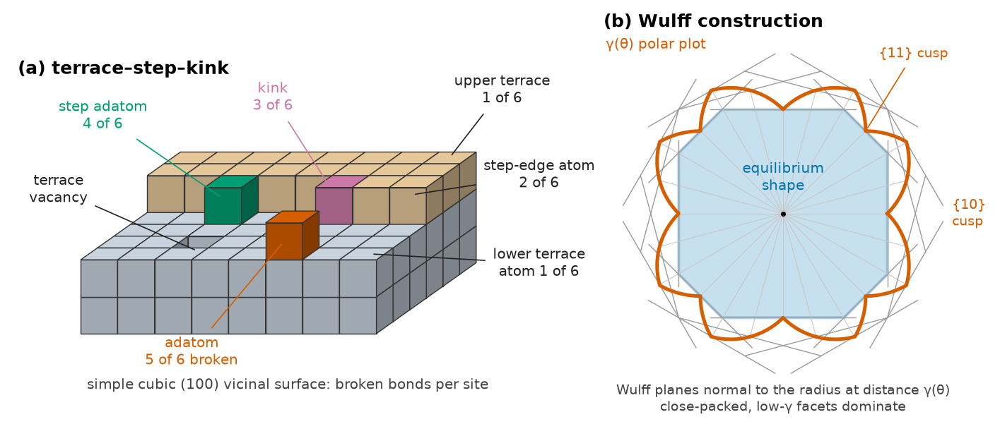
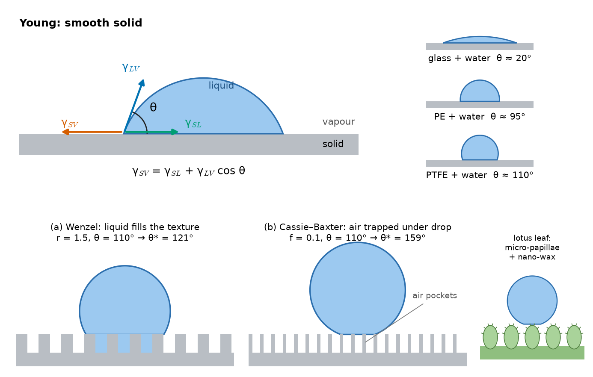
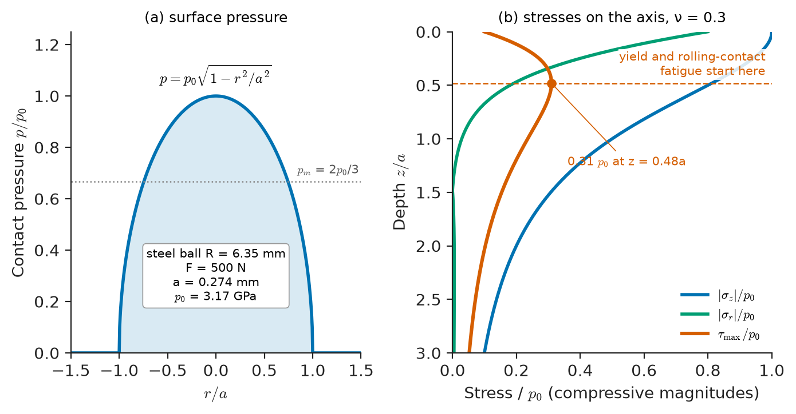
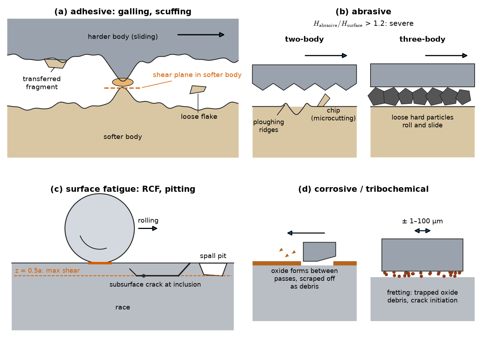
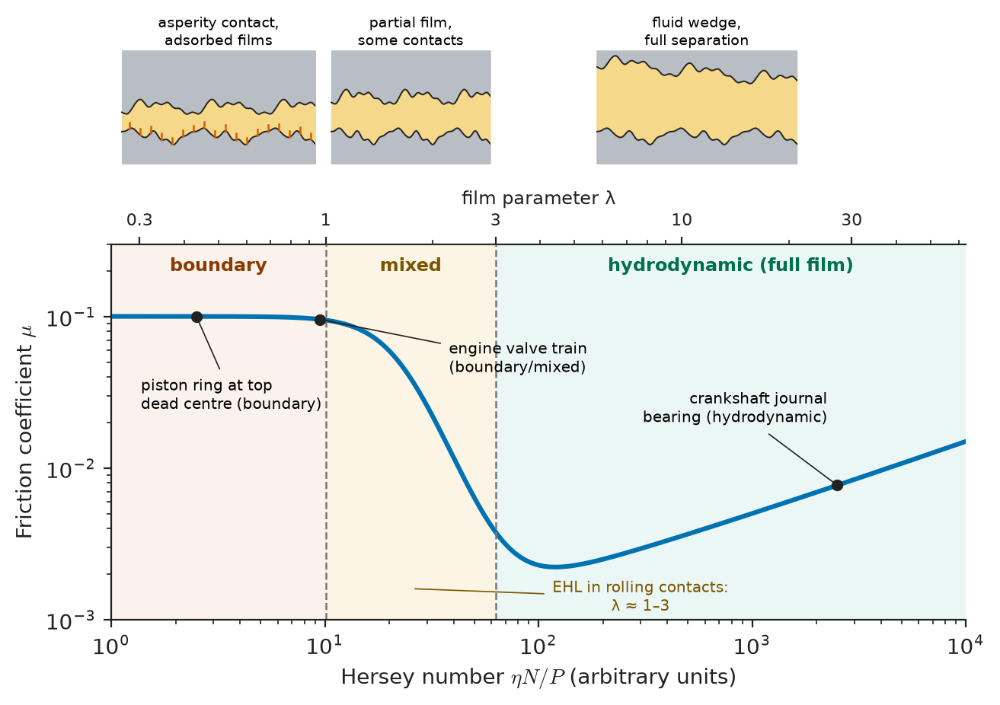
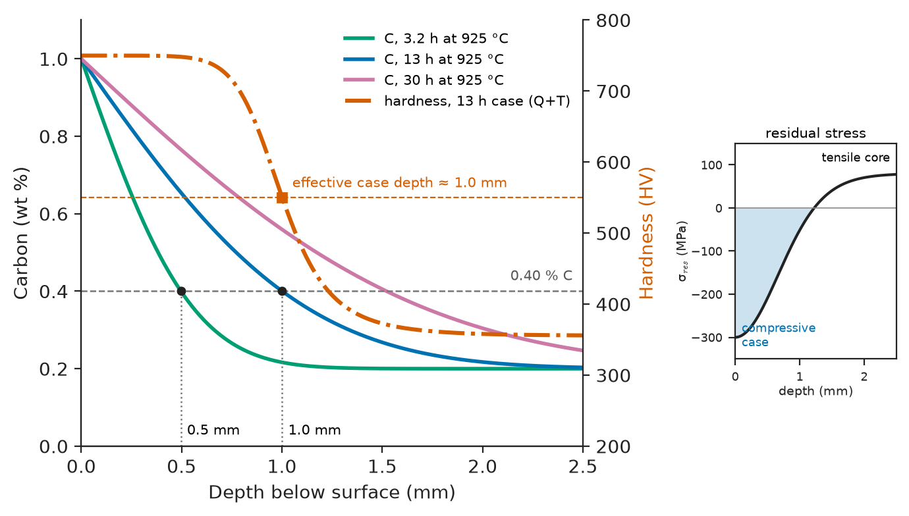

# Chapter 45 — Surfaces, Interfaces and Tribology

*Part IX · Corrosion, Degradation and Surfaces*

A conventional polyethylene hip cup that wears by a tenth of a millimetre a year sounds like a success: the cup is several millimetres thick, so it will not wear through for decades. Yet in the 1980s and 1990s many such hips had to be revised after ten or fifteen years, not because the cup wore out but because the bone around it dissolved. Each year the joint shed tens of cubic millimetres of submicrometre polyethylene particles, hundreds of billions of them, which macrophages tried to digest and could not, releasing signals that switched on bone resorption. The fix was a materials one: polyethylene cross-linked by irradiation, then thermally treated to quench free radicals, which wears several times more slowly. The problem began at the surface, at the contact between a hard ball and a soft cup, where friction, wear and surface chemistry decide the fate of the whole component. The same is true of a car engine losing a few percent of its fuel to friction, a wind-turbine gearbox failing from micropitting, a paint that will not stick to a polypropylene bumper, and a turbine blade protected by a ceramic coating a quarter of a millimetre thick. This chapter treats the surface as a material in its own right: its energy and chemistry, how it wets and adheres, how two surfaces touch, slide and wear, how lubricants separate them, and how surfaces are engineered.

> **Why do surfaces have energy, and how does that energy control adsorption, wetting and adhesion?**
> **Why is friction proportional to load and independent of apparent area, and what sets the coefficient?**
> **How do surfaces wear, how do lubricants and coatings prevent it, and how is wear rate predicted?**

| Concept | Engineering destination |
|---|---|
| Surface energy, broken-bond model, Wulff shape | Sintering, catalyst particle shape, crack-growth energy, grain-boundary energies |
| Adsorption isotherms, BET surface area | Catalysts, sorbents, battery electrodes, powder characterization, corrosion inhibitors |
| Contact angle, Young's equation, work of adhesion | Paint and adhesive bonding, printing on polymers, self-cleaning and anti-icing surfaces, implants |
| Hertz contact | Rolling bearings, gears, wheel–rail contact, cam followers, indentation testing |
| Real contact area $A_r=F/H$ | Friction, electrical and thermal contact resistance, sealing |
| Amontons–Coulomb friction; Bowden–Tabor adhesion model | Brakes, clutches, bolted joints, tyres, machining, design of low-friction pairs |
| Archard wear law and wear coefficients | Life of bushings, seals, implants, tools, dies, mining equipment |
| Stribeck curve, film parameter $\lambda$ | Journal and rolling bearings, engine piston rings, lubricant selection |
| Case hardening, nitriding, PVD and DLC coatings, shot peening, texturing | Gears, cutting tools, moulds, crankshafts, aerospace landing gear, medical devices |

**Roadmap.** What a surface is and why it has energy (45.1) → what sticks to it: adsorption and surface chemistry (45.2) → liquids and solids on it: wetting and adhesion (45.3) → two solids in contact: Hertz and real contact area (45.4) → sliding: friction (45.5) → damage: wear mechanisms (45.6) → separation by a film: lubrication regimes and the Stribeck curve (45.7) → engineering the surface: hardening, coatings, texturing (45.8).

---

## 45.1 Surface structure and surface energy

### Why surfaces have energy

An atom in the bulk of a crystal is bonded to all its neighbours; an atom at the surface has lost some of them. Creating a surface therefore costs energy, the **surface energy** $\gamma$, defined as the reversible work per unit area to create new surface (J/m$^2$). For liquids it equals the surface tension (N/m). For solids, surface energy and surface stress differ, because stretching a solid surface changes the atomic spacing instead of bringing new atoms to the surface, but for most materials science purposes $\gamma$ is the relevant quantity.

The **broken-bond model** gives a first estimate. If the cohesive energy per atom is the sublimation enthalpy $\Delta H_s/N_A$, shared among $z$ nearest-neighbour bonds, then each broken bond costs $\Delta H_s/(zN_A)$, and a surface with $n_s$ atoms per unit area, each missing $z_s$ bonds, has

$$
\gamma\approx\frac{z_s}{z}\,\frac{\Delta H_s}{N_A}\,n_s
$$

> **Status of the principle: Broken-bond estimate of surface energy**
> *Approximate.* Assumes pairwise nearest-neighbour bonds of equal energy and no relaxation of the surface atoms; it captures the trends with bonding strength and crystal orientation but typically overestimates measured values by 20–50 %, because real bond energy is not linear in coordination and surface atoms relax.

**Worked example — surface energy of copper.** Copper is FCC with $z=12$, lattice parameter $a=0.3615$ nm and $\Delta H_s=337$ kJ/mol. On the close-packed (111) plane each surface atom has lost 3 of its 12 neighbours, and the atomic density is $n_s=4/(\sqrt3\,a^2)=1.77\times10^{19}$ m$^{-2}$. Then

$$
\gamma_{111}\approx\frac{3}{12}\times\frac{337\times10^{3}}{6.022\times10^{23}}\times1.77\times10^{19}=0.25\times5.60\times10^{-19}\times1.77\times10^{19}=2.47\ \mathrm{J\,m^{-2}}
$$

On the (100) plane each atom loses 4 bonds and $n_s=2/a^2=1.53\times10^{19}$ m$^{-2}$, giving 2.85 J/m$^2$. The measured average surface energy of solid copper is about 1.8 J/m$^2$, so the model overestimates by about a third, as expected, but correctly predicts that close-packed planes have the lowest energy, which is why crystals are bounded by them.

| Material | Surface energy (typical) |
|---|---|
| Tungsten | about 3.0–3.3 J/m$^2$ |
| Iron | about 2.4 J/m$^2$ |
| Copper | about 1.8 J/m$^2$ |
| Aluminium | about 1.1 J/m$^2$ |
| Alumina | about 1.0–1.5 J/m$^2$ (orientation-dependent) |
| Silica glass | about 0.3 J/m$^2$ (hydroxylated surface lower) |
| Water (20 °C) | 72.8 mJ/m$^2$ |
| Epoxy, polyamide | 40–45 mJ/m$^2$ |
| Polyethylene, polypropylene | 29–33 mJ/m$^2$ |
| PTFE | 18–20 mJ/m$^2$ |

Grain-boundary energies are typically a third of the surface energy (Chapter 5), which is why grain boundaries groove at free surfaces with a dihedral angle set by the balance $\gamma_{gb}=2\gamma_s\cos(\psi/2)$.

### Surface structure

A real crystal surface is not a perfect plane. At atomic scale it consists of flat **terraces** separated by monatomic **steps**, which contain **kinks**; on the terraces sit **adatoms** and **vacancies** (the terrace–step–kink model, Figure 45.1). Kinks are the sites where atoms attach during crystal growth and detach during evaporation and dissolution; steps are preferred sites for adsorption and catalysis. Surface atoms also **relax** (the top interlayer spacing of metals typically contracts by a few percent) and some surfaces **reconstruct** into periodicities different from the bulk: the Si(111) 7×7 and Au(100) hexagonal reconstructions are classic examples revealed by scanning tunnelling microscopy and low-energy electron diffraction (Chapter 53).

<!-- FIGURE 45.1 | figures/ch45/fig-45-1-terrace-step-kink.png | schematic | Atomic structure of a crystal surface (terrace–step–kink model) and the Wulff construction for an equilibrium crystal shape. | Content: left panel: 3D cube-atom rendering of a vicinal (100) surface with labelled terrace, monatomic step, kink, adatom, terrace vacancy and step adatom; number of broken bonds per site annotated (e.g., terrace atom 1 of 6 for simple cubic illustration, kink site 3 of 6). Right panel: 2D polar plot of γ(θ) with cusps at {10} and {11} orientations; Wulff planes drawn perpendicular to radius vectors; inner envelope shaded as the equilibrium shape (truncated square/octagon). Caption note 'close-packed, low-γ facets dominate'. -->

*Figure 45.1 — Atomic structure of a crystal surface (terrace–step–kink model) and the Wulff construction for an equilibrium crystal shape.*

### Anisotropy and the equilibrium shape

Because surface energy depends on orientation, a small crystal minimizes its total surface energy $\sum\gamma_iA_i$ at fixed volume by exposing mainly low-energy facets. The **Wulff construction** gives the equilibrium shape: draw from a centre, in every direction, a plane perpendicular to that direction at a distance proportional to $\gamma$; the inner envelope of all such planes is the shape. Metal nanoparticles in catalysts adopt truncated octahedra of {111} and {100} facets, and the facet fraction controls their activity (Chapter 38). Surface energy also drives sintering, Ostwald ripening and grain growth (Chapters 9 and 46), and it appears in Griffith's fracture criterion as the minimum energy to make crack faces (Chapter 14).

---

## 45.2 Adsorption and surface chemistry

### Physisorption and chemisorption

Atoms and molecules from a gas or liquid stick to surfaces because doing so lowers the surface energy. Two kinds of bonding are distinguished:

| | Physisorption | Chemisorption |
|---|---|---|
| Bonding | van der Waals | Chemical (covalent, ionic, metallic) |
| Enthalpy of adsorption | 5–40 kJ/mol | 40–800 kJ/mol |
| Specificity | Any gas on any surface | Specific to adsorbate–surface pair |
| Layers | Multilayers possible | Monolayer at most |
| Reversibility | Readily reversible | Often irreversible, may dissociate (H$_2\to$2H, O$_2\to$2O) |
| Example | N$_2$ on any solid at 77 K | O on Fe, CO on Pt, H on Ni, thiols on Au |

Chemisorption is the first step of oxidation (Chapter 42), of heterogeneous catalysis, and of hydrogen entry into metals (Chapter 43); physisorption is how surface area and porosity are measured.

### The Langmuir isotherm

Langmuir's model assumes a fixed number of equivalent sites, one molecule per site, no interaction between adsorbed molecules, and dynamic equilibrium between adsorption (proportional to pressure and to the fraction of empty sites) and desorption (proportional to the fraction occupied). The fractional coverage is

$$
\theta=\frac{KP}{1+KP}
$$

where $K$ is an equilibrium constant that falls with temperature as $\exp(-\Delta H_{\rm ads}/RT)$, $\Delta H_{\rm ads}$ being negative. At low pressure $\theta\approx KP$ (Henry's law); at high pressure $\theta\to1$ (saturation). Langmuir kinetics underlies the rate laws of catalytic reactions and the adsorption of corrosion inhibitors (Chapter 43), whose efficiency is often taken as equal to the coverage.

> **Status of the principle: Langmuir isotherm**
> *Approximate.* Derived exactly for its assumptions (identical independent sites, monolayer, no lateral interactions); real surfaces have a distribution of site energies and interacting adsorbates, which the Temkin and Freundlich isotherms describe empirically.

### BET surface area

Brunauer, Emmett and Teller extended Langmuir's model to multilayer physisorption, assuming that layers beyond the first adsorb with the enthalpy of condensation. Fitting nitrogen adsorption at 77 K over relative pressures of about 0.05–0.3 gives the **monolayer capacity** $v_m$, and the specific surface area follows from the area occupied per molecule (0.162 nm$^2$ for N$_2$):

$$
S=\frac{v_m}{V_{\rm mol}}\,N_A\,\sigma_{\rm N_2}
$$

For a catalyst support with $v_m=50$ cm$^3$(STP)/g, $S=(50/22\,414)\times6.022\times10^{23}\times0.162\times10^{-18}=218$ m$^2$/g. BET areas range from below 1 m$^2$/g for dense powders, through 100–300 m$^2$/g for γ-alumina catalyst supports, to 1000–3000 m$^2$/g for activated carbons and metal–organic frameworks. Battery electrode powders, cement, pigments and pharmaceutical excipients are specified by BET area.

### Segregation and surface chemistry of real materials

At equilibrium, components that lower the surface or grain-boundary energy concentrate there; the **Gibbs adsorption equation**, $\Gamma=-\frac{1}{RT}\frac{d\gamma}{d\ln c}$ for a dilute solute, links the surface excess $\Gamma$ to the drop in surface tension. Surfactants in water, sulfur on iron surfaces, and phosphorus or tin at grain boundaries of steel (temper embrittlement, Chapter 44) are examples. Engineering surfaces are therefore almost never clean:

- **Metals** carry native oxides (2–5 nm on aluminium and stainless steel), hydroxyl groups, adsorbed water and a hydrocarbon contamination layer of about a nanometre within minutes of exposure to air.
- **Oxides** in water acquire charge by protonation or deprotonation of surface hydroxyls; the pH at which the net charge is zero, the **isoelectric point**, is about 2 for silica, 6–7 for titania and 8–9 for alumina. It governs colloidal processing of ceramic slurries (Chapter 17), protein adsorption on implants and the adsorption of flotation reagents in mineral processing.
- **Polymers** have low-energy, chemically inert surfaces that must be oxidized for bonding (Section 45.3).
- **Self-assembled monolayers** (alkanethiols on gold, silanes on oxides) give molecularly defined surfaces for sensors, anti-stiction coatings in MEMS and adhesion promoters.

Surface composition and chemistry are measured by XPS, AES and SIMS (Chapter 52).

---

## 45.3 Adhesion and wetting

### Young's equation

A liquid drop on a flat solid surface meets it at a **contact angle** $\theta$ set by the balance of the three interfacial tensions at the contact line (Figure 45.2):

$$
\gamma_{SV}=\gamma_{SL}+\gamma_{LV}\cos\theta
$$

A liquid **wets** the solid ($\theta<90°$) when the solid–vapour energy exceeds the solid–liquid energy; it spreads completely ($\theta=0$) when $\gamma_{SV}\ge\gamma_{SL}+\gamma_{LV}$. Water ($\gamma_{LV}=72.8$ mJ/m$^2$) spreads on clean glass and metal oxides but beads on PTFE and wax.

> **Status of the principle: Young's equation**
> *Derived.* Follows from minimizing the total interfacial free energy of a drop on an ideal, smooth, chemically homogeneous, rigid and insoluble surface; real surfaces show a range of contact angles between advancing and receding values (contact-angle hysteresis) because of roughness and chemical heterogeneity.

### Work of adhesion

The **work of adhesion** is the reversible work to separate unit area of an interface into two free surfaces, $W_a=\gamma_{SV}+\gamma_{LV}-\gamma_{SL}$. Combined with Young's equation it gives the Young–Dupré equation, which turns a contact-angle measurement into an adhesion energy:

$$
W_a=\gamma_{LV}\,(1+\cos\theta)
$$

For water on PTFE ($\theta\approx110°$), $W_a=72.8\times(1-0.342)=47.9$ mJ/m$^2$; on clean glass ($\theta\approx20°$), $W_a=72.8\times1.940=141$ mJ/m$^2$. The work of cohesion of water is $2\gamma_{LV}=146$ mJ/m$^2$: water adheres to glass almost as strongly as to itself, and to PTFE only a third as strongly.

<!-- FIGURE 45.2 | figures/ch45/fig-45-2-wetting-regimes.png | schematic | Contact angle and the three wetting regimes: Young (smooth), Wenzel (roughness filled) and Cassie–Baxter (air trapped under the drop). | Content: top panel: sessile drop on a smooth surface with the three tension vectors γ_LV (tangent to drop), γ_SL and γ_SV along the surface, contact angle θ marked; examples beneath: 'glass + water θ ≈ 20°', 'PE + water θ ≈ 95°', 'PTFE + water θ ≈ 110°'. Bottom panels: (a) Wenzel: drop penetrating square pillars, roughness ratio r = 1.5, θ* = 121° from θ = 110°; (b) Cassie–Baxter: drop resting on pillar tops with air pockets, solid fraction f = 0.1, θ* = 159°. Inset: lotus-leaf style hierarchical texture sketch. -->

*Figure 45.2 — Contact angle and the three wetting regimes: Young (smooth), Wenzel (roughness filled) and Cassie–Baxter (air trapped under the drop).*

### Roughness and superhydrophobicity

Roughness amplifies the intrinsic wettability. If the liquid fills the texture (**Wenzel** state), with roughness ratio $r$ (true area over projected area),

$$
\cos\theta^*=r\cos\theta
$$

so hydrophobic surfaces become more hydrophobic and hydrophilic ones more hydrophilic. If air stays trapped under the drop (**Cassie–Baxter** state) with solid fraction $f$ in contact with the liquid,

$$
\cos\theta^*=f(\cos\theta+1)-1
$$

For PTFE ($\theta=110°$), a texture with $r=1.5$ in the Wenzel state gives $\cos\theta^*=1.5\times(-0.342)=-0.513$, $\theta^*=121°$; a pillar texture with $f=0.1$ in the Cassie state gives $\cos\theta^*=0.1\times0.658-1=-0.934$, $\theta^*=159°$. Contact angles above 150° with low hysteresis define **superhydrophobic** surfaces (the lotus leaf), on which drops roll off and carry dirt away. They are used for self-cleaning glass and textiles and studied for anti-icing on aircraft and power lines, but their fragile textures wear and contaminate, and the Cassie state can collapse into the Wenzel state under pressure or condensation, a durability problem that still limits applications. The same equations explain why a slightly hydrophilic material ($\theta=70°$) becomes clearly hydrophilic ($\theta^*=59°$) when roughened with $r=1.5$: the basis of grit blasting before painting and of rough titanium implant surfaces for bone contact.

> **Status of the principle: Wenzel and Cassie–Baxter equations**
> *Approximate.* Area-weighted averages of Young's equation that assume the texture is much smaller than the drop and that the contact line samples it uniformly; they predict apparent equilibrium angles but not the hysteresis that decides whether drops actually roll off.

### Adhesion in practice

Practical adhesion of paints, adhesives and coatings depends on the thermodynamic work of adhesion only as a starting condition. The measured fracture energy of a bonded joint, typically 100–5000 J/m$^2$ for structural adhesives, is thousands of times $W_a$ because the polymer dissipates energy plastically and viscoelastically near the crack tip (Chapter 14). But dissipation can only operate if the interface does not fail first, so intimate wetting remains the necessary condition. Four mechanisms contribute:

- **Adsorption** (van der Waals and acid–base interactions across the interface), present wherever the adhesive wets the substrate. A useful rule is that the adhesive's surface tension should be below the substrate's surface energy, which is why polyolefins and PTFE are hard to bond.
- **Chemical bonding**, deliberately introduced by silane coupling agents (glass fibres in composites, glass to sealants) and by primers.
- **Mechanical interlocking** into roughness and porosity: grit blasting, phosphoric-acid anodizing of aluminium for aerospace bonding, porous coatings on implants.
- **Interdiffusion**, in polymer–polymer welding and solvent bonding.

Surface treatments raise the surface energy of polymers: corona discharge, flame and plasma treatment oxidize the surface of polyethylene and polypropylene, raising its surface energy from about 30 to 40–50 mJ/m$^2$ (checked on the shop floor with dyne inks), which is why plastic films can be printed and car bumpers painted. Weak boundary layers (mould-release agents, oils, loosely bound oxides) are the commonest cause of adhesive failure. The design of bonded joints is covered in Chapter 47.

---

## 45.4 Contact mechanics

### Hertz contact

When two curved elastic bodies are pressed together, they touch over a small area whose size and pressure distribution were found by Hertz in 1882. For a sphere of radius $R$ on a flat (or two spheres with $1/R=1/R_1+1/R_2$) under normal force $F$, with effective modulus

$$
\frac{1}{E^*}=\frac{1-\nu_1^2}{E_1}+\frac{1-\nu_2^2}{E_2}
$$

the contact radius, maximum (central) pressure and approach are

$$
a=\left(\frac{3FR}{4E^*}\right)^{1/3},\qquad p_0=\frac{3F}{2\pi a^2},\qquad \delta=\frac{a^2}{R}
$$

The pressure is distributed elliptically, $p(r)=p_0\sqrt{1-r^2/a^2}$, with mean pressure $p_m=2p_0/3$. The important feature for materials is below the surface: the maximum shear stress, about $0.31p_0$, occurs at a depth of about $0.48a$ (for $\nu=0.3$) (Figure 45.3). Yield therefore starts beneath the surface, when $p_0\approx1.6Y$ by the von Mises criterion, and rolling-contact fatigue cracks also nucleate there, which is why bearing steels must be clean of inclusions at that depth and why case-hardened layers must be deep enough to contain it.

> **Status of the principle: Hertz contact theory**
> *Derived.* Exact within linear elasticity for smooth, frictionless, non-conforming surfaces whose contact radius is small compared with the radii of curvature; it fails for rough surfaces (Section 45.5), for conforming contacts such as a hip ball in its cup, for adhesive contacts of soft materials (JKR theory) and after yield.

<!-- FIGURE 45.3 | figures/ch45/fig-45-3-hertz-subsurface-stress.png | plot | Hertzian sphere-on-flat contact: surface pressure distribution and subsurface stresses along the axis of symmetry. | Content: left panel: pressure p/p0 versus r/a from -1.5 to 1.5, elliptical profile with peak 1 at r = 0. Right panel: x-axis stress/p0 from 0 to 1.0; y-axis depth z/a from 0 to 3 (downward); curves for σ_z/p0 (1 at surface, decaying), σ_r/p0 (0.8 at surface for ν = 0.3, falling quickly) and maximum shear τ_max/p0 peaking at 0.31 at z = 0.48a; horizontal dashed line at z = 0.48a labelled 'yield and rolling-contact fatigue start here'. Annotation for the worked example: steel ball R = 6.35 mm, F = 500 N, a = 0.274 mm, p0 = 3.17 GPa. -->

*Figure 45.3 — Hertzian sphere-on-flat contact: surface pressure distribution and subsurface stresses along the axis of symmetry.*

**Worked example — a ball pressed on a bearing race.** A hardened steel ball of radius $R=6.35$ mm (12.7 mm diameter) is pressed onto a flat race of the same steel ($E=210$ GPa, $\nu=0.3$) with $F=500$ N.

$$
E^*=\frac{E}{2(1-\nu^2)}=\frac{210}{2\times0.91}=115.4\ \mathrm{GPa}
$$

$$
a=\left(\frac{3\times500\times6.35\times10^{-3}}{4\times115.4\times10^{9}}\right)^{1/3}=2.74\times10^{-4}\ \mathrm m=0.274\ \mathrm{mm}
$$

$$
p_0=\frac{3\times500}{2\pi\times(2.74\times10^{-4})^2}=3.17\times10^{9}\ \mathrm{Pa}=3.17\ \mathrm{GPa}
$$

The maximum shear stress is $0.31\times3.17=0.98$ GPa at a depth of $0.48\times0.274=0.13$ mm, and the approach is only $\delta=a^2/R=12$ µm. A modest load produces a contact pressure of more than 3 GPa because the contact area is less than 0.25 mm$^2$. For a through-hardened bearing steel (about 62 HRC, yield strength about 2 GPa), first yield is predicted at $p_0\approx1.6\times2.0=3.2$ GPa: this load is just at the elastic limit. Since $p_0\propto F^{1/3}$, the load would have to rise to about 1160 N to reach 4.2 GPa, the conventional static-capacity limit for ball bearings, at which a small permanent dent forms. Only hardened steels and ceramics such as silicon nitride (used for hybrid bearing balls) can carry such pressures; a mild steel with $Y\approx250$ MPa would yield at a central pressure of about 0.4 GPa.

### Real contact area

Engineering surfaces are rough. Even a polished surface has asperities with heights of tens of nanometres; a ground surface has a root-mean-square roughness $R_q$ of 0.1–1 µm; a turned surface several micrometres. When two such surfaces touch, they meet only at the tips of the highest asperities. Each asperity contact is a tiny Hertzian contact that quickly yields, so the asperities support the load at a pressure close to the indentation hardness $H$ of the softer material (Chapter 11). The **real contact area** is then

$$
A_r\approx\frac{F}{H}
$$

independent of the apparent area. A 10 kg steel block ($F=98$ N) resting on a 100 cm$^2$ face of mild steel ($H\approx1.5$ GPa) touches over only $98/(1.5\times10^9)=6.5\times10^{-8}$ m$^2$, about 0.07 mm$^2$, or 7 parts per million of the apparent area. Greenwood and Williamson showed that even for purely elastic asperities with a Gaussian height distribution, $A_r$ remains nearly proportional to load, because increasing load brings new asperities into contact rather than enlarging existing ones. Whether asperity contacts are elastic or plastic is decided by the **plasticity index** $\psi=(E^*/H)\sqrt{\sigma_s/\beta_s}$, where $\sigma_s$ is the standard deviation of asperity heights and $\beta_s$ their tip radius: $\psi<0.6$ means mostly elastic contact (smooth, hard surfaces), $\psi>1$ mostly plastic (most machined metals).

> **Status of the principle: Real contact area proportional to load**
> *Approximate.* Follows from plastic asperity contacts at the hardness, or from statistical elastic asperity models with many contacts; it fails at very high loads where $A_r$ approaches the apparent area, for soft elastomers, and when adhesion or work hardening changes the asperity pressure.

The tiny real contact area explains far more than friction. Electrical contact resistance, thermal contact resistance across bolted joints and heat sinks (where interface materials fill the gaps), leakage through metal-to-metal seals and the cold-welding of clean metals in vacuum are all governed by $A_r$.

---

## 45.5 Friction

### Amontons' laws

The empirical laws of dry friction, found by Leonardo da Vinci, restated by Amontons in 1699 and extended by Coulomb, are:

1. The friction force is proportional to the normal load: $F_f=\mu F_N$.
2. The friction force is independent of the apparent area of contact.
3. Kinetic friction is nearly independent of sliding velocity (Coulomb), and is usually lower than static friction.

| Sliding pair (dry, in air, typical) | Coefficient of friction $\mu$ |
|---|---|
| Clean metals in vacuum | above 1, may seize |
| Steel on steel, unlubricated | 0.5–0.8 |
| Steel on steel, boundary lubricated | 0.05–0.15 |
| Steel on bronze, lubricated | 0.05–0.1 |
| Steel on brass or babbitt, dry | 0.3–0.5 |
| Brake pad on cast-iron disc | 0.35–0.45 |
| Tyre rubber on dry asphalt | 0.7–1.0 |
| Tyre rubber on wet asphalt | 0.4–0.7 |
| Steel on ice | about 0.02 |
| PTFE on steel | 0.04–0.1 |
| UHMWPE on Co–Cr in serum | 0.05–0.1 |
| DLC coating on steel | 0.05–0.2 |
| Hydrodynamic journal bearing | 0.001–0.01 |

> **Status of the principle: Amontons–Coulomb friction laws**
> *Empirical.* Accurate to roughly ±10–20 % for most dry and boundary-lubricated pairs of metals and ceramics over moderate loads; they fail for elastomers (friction depends on area, velocity and temperature), at very low loads where adhesion dominates, at high speeds where flash heating softens or melts the surface, and wherever a fluid film separates the surfaces.

### The adhesion origin: Bowden and Tabor

Bowden and Tabor explained the laws by combining real contact area with adhesion. If the asperity junctions cold-weld and must be sheared to slide, with shear strength $s$, then $F_f=sA_r=sF_N/H$, so

$$
\mu_{\rm adh}=\frac{s}{H}
$$

independent of load and of apparent area, which is Amontons' first and second laws. For a clean metal the junction shears at roughly its bulk shear strength, about $H/6$ (since $H\approx3Y$ and $s\approx Y/2$), giving $\mu\approx0.17$; a surface oxide or adsorbed film with lower shear strength lowers $\mu$. The model also predicts the right direction of most observations:

- **Soft films on hard substrates** give low friction: $A_r$ is set by the hard substrate's $H$, the shear strength by the soft film's $s$. This is the principle of babbitt bearing metals, lead and silver films on aerospace bearings, solid lubricants such as MoS$_2$ (whose weak interlayer van der Waals bonding gives $\mu\approx0.02$–0.1 in dry air or vacuum) and graphite (which needs adsorbed water to be slippery and fails in space).
- **Clean metals in vacuum** show $\mu$ well above 1. Tangential force makes the junctions grow (**junction growth**) because the combined normal and shear stress keeps them yielding, so $A_r$ increases during sliding until gross seizure. Satellite mechanisms that seized in orbit and galling of stainless-steel threads are this effect.

A second contribution comes from **ploughing**: a hard asperity or particle digs a groove in the softer surface and must displace material. For a conical asperity of semi-angle $\alpha$, $\mu_{\rm pl}\approx(2/\pi)\cot\alpha$, small for blunt asperities (about 0.06 for a slope of 5°) but large for sharp abrasive grits. Total friction is approximately $\mu\approx\mu_{\rm adh}+\mu_{\rm pl}$, with additional hysteretic losses in viscoelastic materials.

**Friction in polymers and elastomers** departs from Amontons. The real contact area of elastomers is large and depends on load sublinearly, and friction has an adhesive part and a hysteretic part that both depend on sliding speed and temperature through the material's viscoelastic loss (Chapter 21). Tyre grip on wet roads comes mainly from hysteresis as the tread deforms over road texture at frequencies of $10^3$–$10^6$ Hz; tread compounds with high loss near those frequencies at road temperature grip best, which is a time–temperature superposition argument applied to the road.

**Stick–slip** occurs when static friction exceeds kinetic friction and the system is compliant: the surfaces stick until the spring force exceeds static friction, then slip and decelerate. Squealing brakes, chattering machine-tool slideways, creaking joints and the violin bow are examples; the cure is a pair with friction rising slightly with speed, higher stiffness, or damping.

---

## 45.6 Wear mechanisms

### The Archard wear law

Wear is the progressive loss of material from a surface by mechanical action, often combined with chemical action. The simplest and most widely used model is Archard's: the wear volume $V$ is proportional to the sliding distance $s$ and the normal load $F$, and inversely proportional to the hardness $H$ of the softer surface,

$$
V=K\,\frac{F\,s}{H}
$$

where the dimensionless **wear coefficient** $K$ is the probability that an asperity encounter produces a wear particle. Engineers often use the **specific wear rate** $k=K/H=V/(Fs)$, in mm$^3$/(N m).

| Situation | Typical wear coefficient $K$ |
|---|---|
| Unlubricated mild steel on mild steel (severe adhesive wear) | $10^{-3}$–$10^{-2}$ |
| Unlubricated hardened steel on steel (mild oxidative wear) | $10^{-5}$–$10^{-4}$ |
| Two-body abrasion by sharp grit | $10^{-2}$–$10^{-1}$ |
| Three-body abrasion by loose particles | $10^{-3}$–$10^{-2}$ |
| Polymer on smooth steel | $10^{-6}$–$10^{-4}$ |
| Boundary-lubricated metals | $10^{-7}$–$10^{-6}$ |
| Hydrodynamically lubricated (no contact) | below $10^{-9}$ |

The range of seven orders of magnitude is the central fact of tribology: changing the mechanism matters far more than changing the hardness.

> **Status of the principle: Archard wear law**
> *Empirical.* Derived from a simple probability argument for asperity encounters, but $K$ is a fitted parameter that changes by orders of magnitude with mechanism, lubrication, environment and transitions between mild and severe wear; the law applies only within one wear regime and does not predict when a transition occurs.

Figure 45.4 illustrates the four principal mechanisms.

<!-- FIGURE 45.4 | figures/ch45/fig-45-4-wear-mechanisms.png | schematic | The four principal wear mechanisms: adhesive, abrasive, surface fatigue and corrosive (tribochemical). | Content: four cross-section panels. (a) Adhesive: two asperities forming a junction, shearing inside the softer body, a transferred fragment stuck to the harder surface, a loose flake; label 'galling, scuffing'. (b) Abrasive: two-body (hard rough surface ploughing grooves) and three-body (loose hard particles rolling and sliding between surfaces) sub-panels; microcutting chip and ploughing ridges; label 'H_abrasive/H_surface > 1.2'. (c) Surface fatigue: rolling ball over a race, subsurface crack at depth ~0.5a growing parallel to the surface and branching up to form a spall pit; label 'rolling-contact fatigue, pitting'. (d) Corrosive/tribochemical: thin oxide film forming between passes, being scraped off as debris, fretting debris accumulating in a small-amplitude oscillating contact. -->

*Figure 45.4 — The four principal wear mechanisms: adhesive, abrasive, surface fatigue and corrosive (tribochemical).*

### Adhesive wear

When asperity junctions are stronger than one of the parent materials, shearing tears a fragment from the weaker side and transfers it to the other; fragments later detach as wear debris. In mild form it is the slow wear of well-matched pairs; in severe form it becomes **scuffing** (sudden failure of a lubricated contact, as in gears and piston rings at high load and speed) and **galling** (gross transfer and seizure, typical of stainless steels, titanium and aluminium sliding on themselves). Defences follow from the Bowden–Tabor picture: avoid like-on-like metal pairs with high mutual solubility (steel on bronze or cast iron rather than steel on steel), use oxide-forming or lubricated surfaces, raise hardness, and apply coatings with low adhesion such as nitrides and DLC.

### Abrasive wear

Hard particles or protrusions plough and cut the softer surface. In **two-body** abrasion a hard rough surface or fixed grit slides on the softer one (grinding, a rock sliding on a chute liner, sand embedded in a seal); in **three-body** abrasion loose particles roll and slide between surfaces (contaminated lubricant, dust in a bearing, slurry pumps), and wear rates are typically an order of magnitude lower. Abrasion is severe when the abrasive is harder than the surface by a factor of about 1.2 or more, and mild when the surface is harder. Since quartz, the commonest natural abrasive, has a hardness of about 11 GPa (roughly 1100 HV), materials for mining, agriculture and earthmoving aim to exceed it: white cast irons with M$_7$C$_3$ carbides (about 1500 HV), WC–Co hardmetals (1200–1800 HV), and hardfaced overlays. Filtration of lubricants and seals that exclude dust are the abrasion defences in machinery.

### Surface fatigue

In rolling and rolling–sliding contacts (bearings, gears, cams, rails) there is little sliding, but every pass cycles the subsurface shear stress of Section 45.4. After millions of cycles, cracks nucleate near the depth of maximum shear, usually at non-metallic inclusions, grow parallel to the surface and turn up to release a flake, leaving a **spall** or pit. On gears, **micropitting** (pits of 10–20 µm depth) arises when the lubricant film is thin compared with the roughness. Rail head checking and squats are the railway equivalents. Rolling-bearing life is predicted with the Lundberg–Palmgren model, whose catalogue form is $L_{10}=(C/P)^3$ million revolutions for ball bearings ($C$ = dynamic load rating, $P$ = equivalent load); a 25 % overload cuts life by a factor of $1.25^3\approx2$. Steel cleanliness made the largest single improvement in bearing life over the twentieth century: vacuum-degassed and remelted steels with few large oxide inclusions last many times longer than older air-melted steels.

### Corrosive and tribochemical wear

Sliding removes protective films and heats asperity tips briefly to hundreds of degrees (**flash temperatures**), accelerating reactions. **Oxidative wear** of steels at moderate loads, where a thin oxide continually forms and is removed, is a benign mild-wear regime; in aggressive media the same mechanism becomes **tribocorrosion**, important in the taper junctions of modular hip implants, marine pumps and chemical mixers. **Fretting** is wear under small-amplitude oscillation (1–100 µm) between nominally fixed surfaces: bolted and riveted joints, spline couplings, turbine blade roots, wire ropes and electrical connectors. The debris, usually oxide, is trapped and abrasive, and fretting can nucleate fatigue cracks that reduce fatigue strength by half or more (**fretting fatigue**). Erosion by particles and liquid drops, and cavitation erosion (Chapter 43), complete the family.

**Worked example — wear of a polyethylene hip cup.** A conventional UHMWPE acetabular cup articulates against a 28 mm diameter Co–Cr femoral head. Laboratory tests give a specific wear rate $k=1.0\times10^{-6}$ mm$^3$/(N m). Take an effective joint load of 2000 N during walking, a sliding distance of 25 mm per gait cycle, and $10^6$ cycles per year for a moderately active patient.

Sliding distance per year: $s=0.025\times10^6=2.5\times10^4$ m.

$$
V=k\,F\,s=1.0\times10^{-6}\times2000\times2.5\times10^{4}=50\ \mathrm{mm^3/year}
$$

Dividing by the projected area of the head, $\pi\times14^2=616$ mm$^2$, gives a linear penetration of about $0.08$ mm/year. This agrees with clinical measurements for conventional polyethylene of roughly 0.1 mm/year and 40–80 mm$^3$/year. The thickness of the cup is not the problem; the volume is. If the average particle is a 0.5 µm sphere of volume $6.5\times10^{-11}$ mm$^3$, 50 mm$^3$ is about $8\times10^{11}$ particles a year, and osteolysis becomes common above roughly 0.1 mm/year. Highly cross-linked UHMWPE, with $k$ lower by a factor of about four to ten in simulator tests, brings the particle load below that threshold, which is why it replaced conventional polyethylene clinically. The Archard calculation also exposes its own limits: $k$ for polyethylene depends strongly on the crossing of sliding directions (multidirectional motion raises it several times compared with unidirectional sliding, because the molecules orient and then are sheared across their orientation), so the right test reproduces the kinematics of gait.

---

## 45.7 Lubrication regimes and the Stribeck curve

### Regimes

A lubricant reduces friction and wear by separating the surfaces with a film that shears easily. How completely it separates them depends on the speed, the viscosity and the load. Stribeck's measurements on journal bearings (1902) showed that the coefficient of friction depends on these through a single group, the **Hersey number** $\eta N/P$ (viscosity × rotational speed / load per unit projected area). The resulting **Stribeck curve** (Figure 45.5) has three regions:

- **Boundary lubrication** (low $\eta N/P$): the film is too thin to separate the asperities; load is carried by asperity contacts covered by adsorbed molecular films and reaction layers. Friction is 0.05–0.15, nearly independent of speed, and set by the chemistry of the boundary film. Wear is controlled by additives.
- **Mixed lubrication**: load is shared between fluid pressure and asperity contacts; friction falls steeply as speed rises and the film thickens.
- **Hydrodynamic (full-film) lubrication** (high $\eta N/P$): a converging wedge of fluid generates enough pressure to carry the whole load, and the surfaces do not touch. Friction is low (0.001–0.01) and rises slowly with $\eta N/P$ because of viscous shearing. Wear is essentially zero, except at start and stop.

The minimum of the curve, at the transition from mixed to full-film lubrication, is where well-designed bearings run.

<!-- FIGURE 45.5 | figures/ch45/fig-45-5-stribeck-curve.png | plot | The Stribeck curve: coefficient of friction against the Hersey number, with boundary, mixed and hydrodynamic regimes and the film parameter λ. | Content: x-axis Hersey number ηN/P (log scale, arbitrary units spanning 4 decades); y-axis friction coefficient μ from 0.001 to 0.3 (log). Curve: flat at ~0.1 in boundary region, steep fall through mixed region to minimum ~0.002, gentle rise in hydrodynamic region. Vertical dashed lines at λ = 1 and λ = 3 on a secondary top axis 'film parameter λ'. Small inset sketches above each region: asperities in contact with adsorbed molecules (boundary), partial film with some contacts (mixed), surfaces fully separated by fluid wedge (hydrodynamic); annotation 'elastohydrodynamic (EHL) in rolling contacts: λ ≈ 1–3'. Example markers: 'engine valve train (boundary/mixed)', 'piston ring at top dead centre (boundary)', 'crankshaft journal bearing (hydrodynamic)'. -->

*Figure 45.5 — The Stribeck curve: coefficient of friction against the Hersey number, with boundary, mixed and hydrodynamic regimes and the film parameter λ.*

> **Status of the principle: Stribeck curve**
> *Empirical.* A measured correlation of friction with the Hersey number for a given bearing geometry and surface finish; the regime boundaries shift with roughness, temperature-dependent viscosity and additive chemistry, and the hydrodynamic branch is derived quantitatively from Reynolds' lubrication equation.

### The film parameter

The regime is set more directly by comparing the minimum film thickness $h_{\min}$ with the composite roughness of the two surfaces,

$$
\lambda=\frac{h_{\min}}{\sqrt{R_{q1}^2+R_{q2}^2}}
$$

Roughly, $\lambda<1$ means boundary lubrication, $1<\lambda<3$ mixed, and $\lambda>3$ full-film. For example, a gear contact with $h_{\min}=0.3$ µm between flanks of $R_q=0.1$ and 0.15 µm has $\lambda=0.3/0.180=1.66$: mixed lubrication, in which micropitting and boundary additives matter. Superfinishing both flanks to 0.05 µm would give $\lambda=4.2$ and full separation. This is why surface finish specifications are as much a part of gear and bearing design as material and heat treatment.

### Hydrodynamic and elastohydrodynamic films

In a journal bearing the shaft drags oil into a converging gap, and Reynolds' equation (from the Navier–Stokes equations for thin films) gives the pressure that supports the load. For a lightly loaded, concentric journal, **Petroff's equation** estimates the friction coefficient:

$$
\mu=2\pi^2\,\frac{\eta N}{P}\,\frac{r}{c}
$$

with $r$ the journal radius and $c$ the radial clearance. For an engine main bearing with $\eta=0.03$ Pa s, $N=30$ rev/s, $P=1$ MPa and $r/c=1000$, $\mu=2\pi^2\times(0.03\times30/10^6)\times1000=0.018$, an order of magnitude below boundary friction.

In rolling contacts (gears, rolling bearings, cams), the pressures of 1–3 GPa that Section 45.4 calculated do two things to the oil film: they deform the surfaces elastically, flattening the contact, and they raise the viscosity of the oil enormously (exponentially with pressure, by factors of $10^3$ or more), so that the lubricant in the contact behaves almost like a solid. This is **elastohydrodynamic lubrication** (EHL). Film thicknesses are only 0.1–1 µm, given by the Hamrock–Dowson and similar formulas, and depend strongly on speed and viscosity (roughly $h\propto(\eta U)^{0.7}$) but weakly on load (about $F^{-0.07}$). EHL is why a ball bearing survives billions of revolutions with a film thinner than the wavelength of light.

### Lubricants and additives

Mineral and synthetic oils (polyalphaolefins, esters, polyalkylene glycols) provide viscosity, whose temperature dependence is specified by the viscosity index. Additives provide the boundary protection: **anti-wear** additives such as zinc dialkyldithiophosphate (ZDDP) react at asperity flash temperatures to form glassy phosphate tribofilms about 100 nm thick; **extreme-pressure** additives (sulfur–phosphorus compounds) form iron sulfides that prevent scuffing in hypoid gears; **friction modifiers** (organic amides, molybdenum dithiocarbamate that forms MoS$_2$ in the contact) lower boundary friction to save fuel. Greases thicken oil with soaps or polymers to keep it in place. **Solid lubricants** (MoS$_2$, graphite, PTFE, soft metals) serve where oils cannot: vacuum, extreme temperature, food contact and dry-running bearings. Water-lubricated ceramic and polymer bearings and the hydration lubrication of articular cartilage, whose friction coefficient of about 0.001–0.01 no engineered bearing matches, are reminders that the lubricant need not be oil.

---

## 45.8 Surface engineering

Most tribological, fatigue and corrosion properties are surface properties, while strength and toughness are bulk properties. **Surface engineering** gives a component a surface different from its core, so that each can be optimized: a tough core with a hard, wear- and fatigue-resistant case.

### Transformation hardening

**Induction**, **flame** and **laser** hardening heat a thin surface layer of a medium-carbon or alloy steel (or cast iron) into the austenite range in seconds and quench it, forming martensite to a depth of 0.5–5 mm while the core stays soft and tough (Chapter 15). Crankshaft journals, gear teeth, rail heads and machine-tool ways are induction-hardened. The martensitic transformation's volume expansion leaves the case in compression, which raises fatigue strength.

### Thermochemical treatments

**Carburizing** diffuses carbon into a low-carbon steel (0.1–0.25 % C) at 900–950 °C, raising the surface to 0.7–1.0 % C, followed by quenching and tempering: the case becomes about 58–62 HRC martensite and the core a tough low-carbon martensite or bainite. It is the standard treatment for highly loaded gears, camshafts and bearing races of large size. **Nitriding** diffuses nitrogen into steels containing nitride formers (Cr, Mo, Al, V) at 500–570 °C, below the transformation range, forming hard alloy nitrides and an iron-nitride compound layer without quenching, so distortion is minimal; cases are shallower (0.1–0.6 mm) but very hard (up to about 1000–1200 HV) and fatigue-resistant. **Nitrocarburizing** adds carbon to a thin compound layer for wear and corrosion resistance; **boriding** forms Fe$_2$B layers of 1500–2000 HV for severe abrasion. Low-temperature carburizing or nitriding of austenitic stainless steel (expanded austenite, "S-phase") hardens it without sacrificing corrosion resistance.

Case depth is controlled by diffusion (Chapter 8), and the time scales come directly from the error-function solution of Fick's second law.

**Worked example — carburizing time for a gear.** A 0.20 % C gear steel is gas-carburized at 925 °C with the surface held at 1.00 % C. How long does it take for the carbon content at a depth of 1.0 mm to reach 0.40 %? Take the diffusivity of carbon in austenite as $D=D_0\exp(-Q/RT)$ with $D_0=2.3\times10^{-5}$ m$^2$/s and $Q=148$ kJ/mol.

$$
D=2.3\times10^{-5}\exp\!\left(\frac{-148\,000}{8.314\times1198.15}\right)=8.1\times10^{-12}\ \mathrm{m^2\,s^{-1}}
$$

$$
\frac{C_s-C_x}{C_s-C_0}=\frac{1.00-0.40}{1.00-0.20}=0.75=\mathrm{erf}\!\left(\frac{x}{2\sqrt{Dt}}\right)\quad\Longrightarrow\quad\frac{x}{2\sqrt{Dt}}=0.813
$$

$$
t=\frac{1}{D}\left(\frac{x}{2\times0.813}\right)^{2}=\frac{(1.0\times10^{-3}/1.627)^2}{8.1\times10^{-12}}=4.7\times10^{4}\ \mathrm s\approx13\ \mathrm h
$$

Halving the case depth to 0.5 mm needs only a quarter of the time, 3.2 h, because time scales with the square of depth (Figure 45.6). Industrial practice for 1 mm cases at 925 °C is somewhat shorter than this estimate, because carbon diffusivity in austenite rises with carbon content (to roughly twice the dilute value at 1 % C), and because many plants carburize at higher temperatures or with boost–diffuse cycles. The square-root scaling, however, is exactly why deep cases (2–3 mm on large wind-turbine and mining gears) take days in the furnace, and why vacuum carburizing at 1000–1050 °C is attractive.

<!-- FIGURE 45.6 | figures/ch45/fig-45-6-carburized-case-profile.png | plot | Carbon concentration and hardness profiles through a carburized case. | Content: x-axis depth below surface 0–2.5 mm; left y-axis carbon wt % 0–1.1; right y-axis hardness HV 200–800. Carbon profiles from the erfc solution with C_s = 1.0 %, C_0 = 0.20 %, D = 8.1e-12 m²/s for t = 3.2 h, 13 h and 30 h; horizontal dashed line at 0.40 % C marking 0.5 mm and 1.0 mm depths for the first two curves. Hardness profile after quench and temper for the 13 h case: ~750 HV at surface, falling to ~400 HV near 1.3 mm and core ~350 HV; dashed line at 550 HV labelled 'effective case depth'. Inset: residual stress versus depth, compressive ~ -300 MPa at surface turning tensile in the core. -->

*Figure 45.6 — Carbon concentration and hardness profiles through a carburized case.*

### Coatings

Where a different material is needed at the surface, it is added:

| Coating | Process | Typical thickness | Hardness | Typical use |
|---|---|---|---|---|
| TiN, TiAlN, CrN | PVD (arc, sputtering) | 1–5 µm | 2000–3500 HV | Cutting tools, forming dies, piston rings |
| Diamond-like carbon (DLC) | PVD, PECVD | 1–3 µm | 1500–5000 HV | Fuel-injector and valve-train parts, low friction, biomedical |
| TiC/TiN/Al$_2$O$_3$ multilayers | CVD | 5–20 µm | 2500–3000 HV | Turning inserts for steel |
| WC–Co, Cr$_3$C$_2$–NiCr | High-velocity oxy-fuel spray | 100–500 µm | 1000–1400 HV | Landing gear (hard-chrome replacement), pump sleeves, rolls |
| Hard chromium | Electroplating | 20–500 µm | 800–1000 HV | Hydraulic rods; restricted by hexavalent chromium regulations |
| Electroless Ni–P | Autocatalytic deposition | 10–50 µm | 500–1000 HV (heat-treated) | Moulds, valves, uniform coverage of complex shapes |
| Stellite, NiCrBSi | Weld overlay, laser cladding | 1–3 mm | 400–700 HV | Valve seats, cavitation and erosion resistance |
| Yttria-stabilized zirconia (on MCrAlY bond coat) | Plasma spray, EB-PVD | 100–500 µm | Low conductivity, not wear | Thermal barrier coatings on turbine blades (Chapter 41) |

A coating is only as good as its adhesion and its stress state. A hard thin coating on a soft substrate fails by "eggshell" collapse when the substrate yields beneath it under a Hertzian load; the rule of thumb is that the substrate must be hard enough to support the subsurface shear stress at depth $0.48a$, which is why PVD coatings go on hardened tool steels and hardmetals, and why **duplex treatments** (nitriding followed by PVD) are used on softer steels. Thermal-expansion mismatch and growth stresses can crack or spall coatings (Chapter 49).

### Mechanical surface treatments and texturing

**Shot peening** bombards the surface with hard steel or ceramic shot, plastically stretching the surface layer; the elastic core pushes back and leaves a compressive residual stress of several hundred megapascals to a depth of 0.1–0.5 mm. Because fatigue cracks need tensile stress to open, peening raises the fatigue strength of springs, gears, crankshafts, aircraft landing gear and turbine-disc fir-tree slots by 20–50 %, and protects against SCC. **Laser shock peening** and **deep rolling** produce deeper compressive layers; burnishing also smooths the surface.

**Surface texturing** deliberately adds features to change tribology: laser-machined microdimples tens of micrometres across act as lubricant reservoirs and micro-hydrodynamic bearings in mechanical seals and piston rings, lowering friction in mixed lubrication; honed cross-hatch patterns retain oil on cylinder bores; textured implant surfaces promote bone ingrowth; and bio-inspired textures (shark-skin riblets) reduce drag in turbulent flow. **Surface nanocrystallization** by severe plastic deformation (surface mechanical attrition) creates a hard nanograined layer that improves wear and fatigue resistance.

> **Status of the principle: Compressive residual stress improves fatigue life**
> *Derived.* Follows from superposing a static compressive mean stress on the applied cycle, which lowers the effective mean stress (Goodman-type relations, Chapter 14) and closes small cracks; it holds only while the residual stress is not relaxed by overloads, cyclic plasticity or high temperature, and it can be lost by subsequent machining or grinding.

### Choosing a surface treatment

The selection logic connects the chapter: identify the dominant surface damage (adhesive, abrasive, fatigue, corrosive, or a combination), the contact pressure and its subsurface depth from Hertz, the lubrication regime from $\lambda$, and the environment; then choose a treatment that puts a hard, low-adhesion or compressively stressed layer to the right depth without compromising the core. A gear needs carburizing deep enough for the Hertzian shear depth and a finish good enough for EHL; a cutting tool needs a hard, chemically inert PVD layer on a hardmetal that will not yield beneath it; an implant needs wear resistance and biocompatibility without particles; a hydraulic rod needs corrosion and wear resistance without hexavalent chromium. Thin-film deposition processes are developed in Chapter 49, and the materials-selection framework that weighs these options against cost in Chapter 58.

> **Boundary.** The thermodynamics of adsorption and the electrochemistry of tribocorrosion belong to the Advanced Chemistry book; the continuum mechanics of contact and the fluid mechanics of Reynolds' equation draw on The Mathematics Universe and engineering mechanics courses. Contact resistance of electrical connectors and its degradation are treated in Chapter 25.

---

## What remains open

| Open question | Where it is answered |
|---|---|
| Grain-boundary energy and structure, and their role in microstructure | Chapter 5 |
| Diffusion solutions used for case depth and segregation | Chapter 8 |
| Surface energy as the driving force for nucleation, sintering and coarsening | Chapters 9 and 46 |
| Hardness testing, yield criteria and fracture energy used in contact and wear models | Chapters 11, 13 and 14 |
| Heat treatment of steels behind induction hardening and carburizing | Chapter 15 |
| Viscoelastic behaviour behind elastomer friction and polymer wear | Chapter 21 |
| Nanoparticle shapes and catalysis by facets | Chapter 38 |
| Implant articulation, wear debris and tissue response | Chapter 39 |
| Thermal barrier coatings and high-temperature surface protection | Chapter 41 |
| Corrosion and tribocorrosion; fretting and cavitation as degradation | Chapters 43 and 44 |
| Adhesive bonding of structural joints | Chapter 47 |
| PVD, CVD, thermal spray and electroplating processes and film stress | Chapter 49 |
| Surface analysis (XPS, AES, SIMS), profilometry and AFM | Chapters 52 and 53 |
| Selecting a surface treatment against cost and performance | Chapter 58 |

**Next:** Chapter 46 opens Part X by turning from how materials degrade to how they are made, beginning with casting, deformation processing and powder metallurgy.
