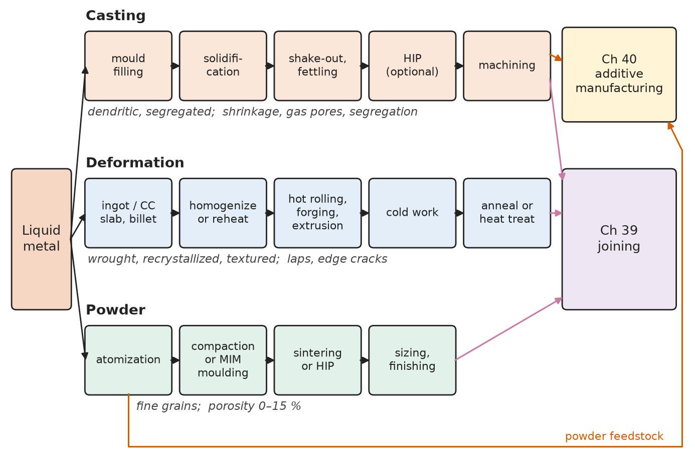
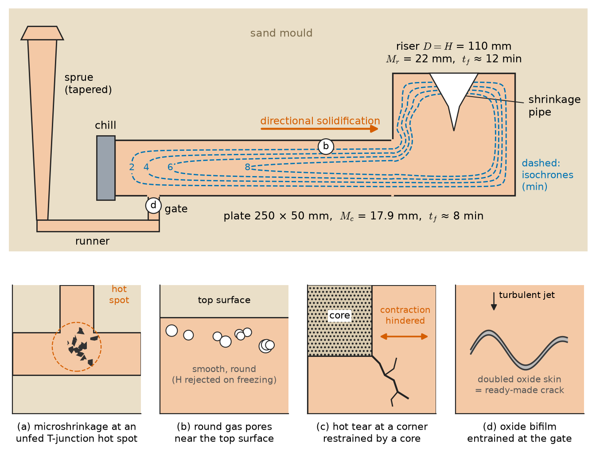
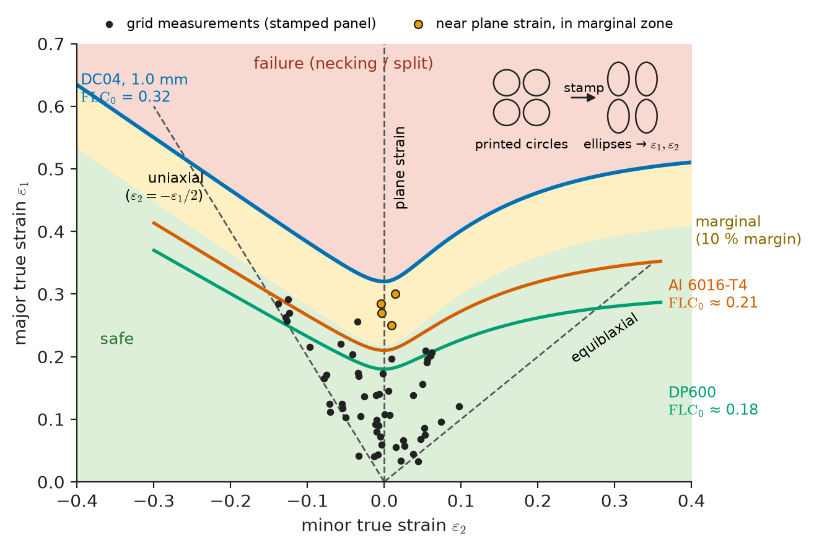
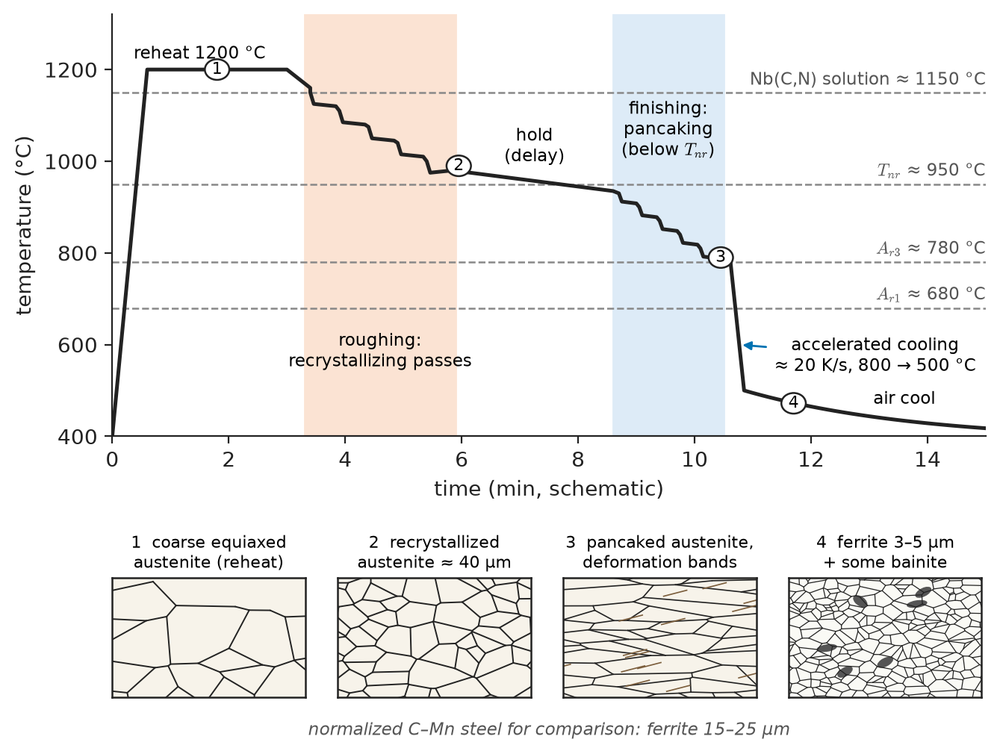
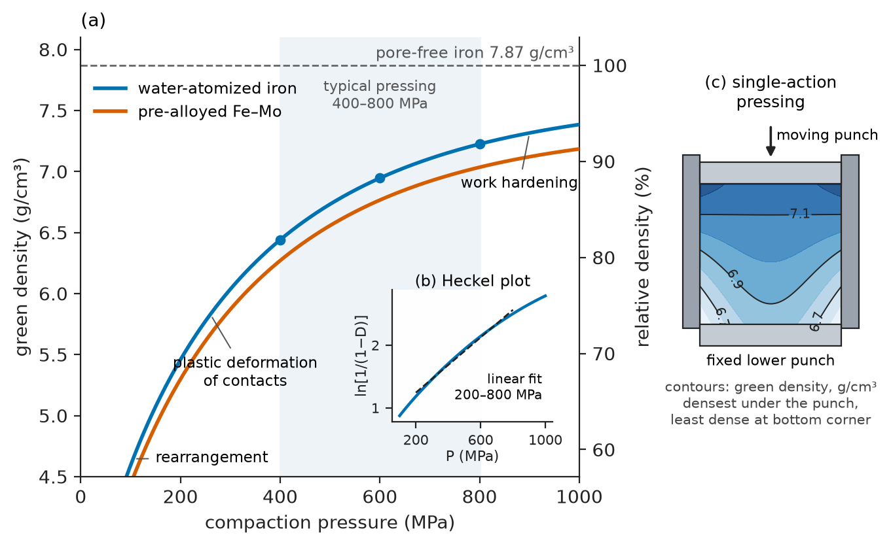
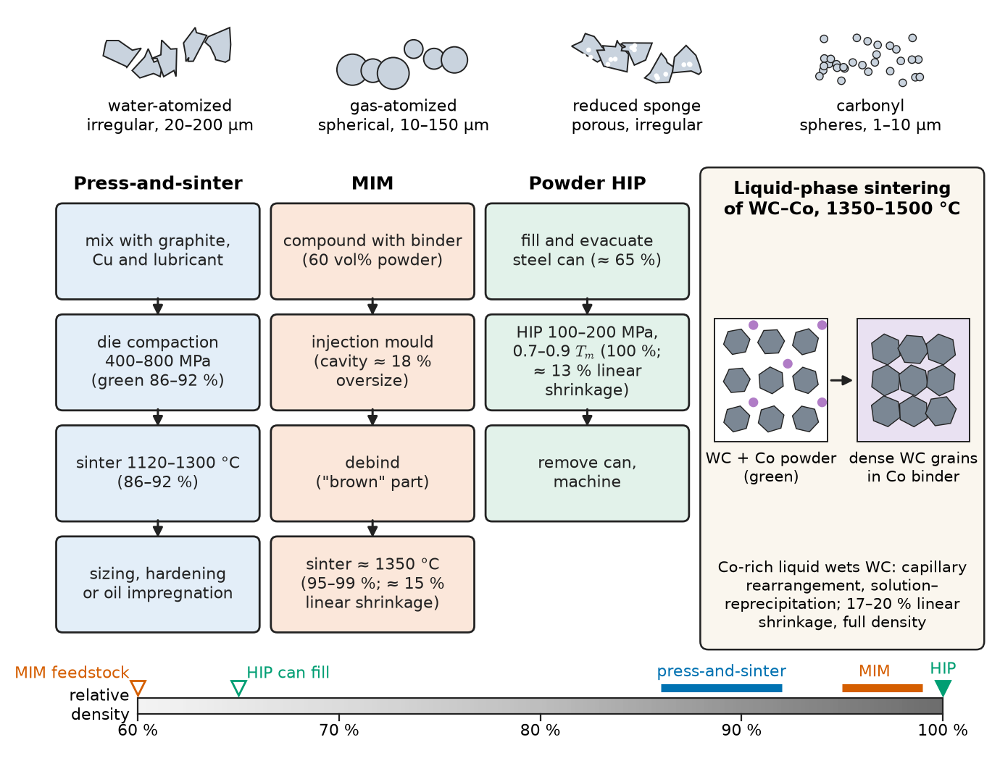

# Chapter 46 — Casting, Forming and Powder Processing

*Part X · Processing and Manufacturing*

A car maker is choosing how to make the lower control arm of a front suspension. Three suppliers quote in nearly the same aluminium alloy family. The first offers a low-pressure die casting in A356-T6: cheap, near net shape, with a hollow section that saves mass. The second offers a closed-die forging in 6082-T6: more machining and more expensive, but with grain flow that follows the arm's contour. The third offers a press-and-sinter part in an aluminium powder alloy. On a static strength test all three pass. In a fatigue test at the same stress amplitude the cast arms fail first, from shrinkage pores a few hundred micrometres across near the ball joint; the forged arms last several times longer; the sintered arms fail from residual porosity at the surface. The chemistry is almost the same; the *route* has put different defects in different places. The same choice faces a turbine maker between investment-cast and forged blades, a civil contractor between rolled and cast steel nodes, an implant maker between forged and injection-moulded titanium, and a gear maker between machined bar and sintered powder.

> **How does each bulk shaping route — casting, plastic deformation, powder consolidation — create the microstructure and the defects of the finished part?**
> **Which simple physical rules predict how big a riser must be, how hard a mill must push, how far a sheet can be stretched and how much a sintered part will shrink?**

| Concept | Engineering destination |
|---|---|
| Casting processes, feeding, Chvorinov's rule | Engine blocks, pump housings, turbine blades, riser design |
| Casting defects | Fatigue of cast suspension parts, pressure tightness of valve bodies |
| Rolling, forging, extrusion, drawing mechanics | Plate and strip mills, crankshafts, window profiles, wire |
| Sheet forming, springback, deep drawing | Car body panels, beverage cans, aircraft skins |
| Hot, warm and cold working; Zener–Hollomon parameter | Choice of forming temperature for steel, aluminium, titanium, magnesium |
| Forming limit diagrams, $n$ and $r$ values | Stamping try-out, sheet-grade selection |
| Thermomechanical processing, texture | HSLA pipeline and ship plate, can-body sheet, electrical steel |
| Powder production, compaction, sintering | Press-and-sinter gears, self-lubricating bearings, hardmetal tools |
| HIP and metal injection moulding | Superalloy discs, porosity-free castings, small complex medical parts |

**Roadmap.** Three routes and how they differ (46.1) → casting processes, design and defects (46.2–46.3) → mechanics of deformation processes (46.4) → hot, warm and cold working and formability (46.5) → thermomechanical processing and texture (46.6) → powder metallurgy, HIP and MIM (46.7) → ceramics and glasses in brief (46.8) → how the route reaches the property sheet (46.9).

> **Boundary.** The physics of solidification (nucleation, dendrites, constitutional supercooling, Scheil segregation) is in Chapter 9; recovery, recrystallization and grain growth in Chapter 10; flow stress and yield criteria in Chapter 13. This chapter uses those results to explain processes. Full forming mechanics (slip-line fields, finite-element process simulation) belongs to manufacturing engineering; only the estimates a materials engineer needs are given.

---

## 46.1 Three routes to a shape

Every metal part begins as liquid metal, and it can be given its shape in three ways.

1. **Casting**: pour the liquid into a mould shaped like the part. Complex shapes are made in one step; the microstructure is a solidification structure, and the defects are those of freezing — shrinkage, gas porosity, segregation, inclusions.
2. **Deformation processing**: cast a simple ingot, slab or billet, then shape it plastically by rolling, forging, extrusion, drawing or sheet forming. Deformation breaks up the cast structure and welds pores shut, and recrystallization produces a fine, uniform *wrought* structure. Shape complexity is limited and the equipment is heavy.
3. **Powder processing**: atomize the liquid into powder, press it into shape and bond the particles by sintering or hot isostatic pressing. This reaches shapes and compositions the other routes cannot — immiscible mixtures, refractory metals, segregation-free alloys, net-shape parts without machining waste. Its characteristic defect is residual porosity.

Most parts combine routes: a forging starts as a cast ingot; a cast turbine blade is hot isostatically pressed; a sintered gear is cold sized. Joining (Chapter 47) and additive manufacturing (Chapter 48), which combines local melting with powder feedstock, complete the set (Figure 46.1).

| Route | Shape complexity | Typical tolerance | Microstructure | Characteristic defects | Examples |
|---|---|---|---|---|---|
| Sand casting | Very high, any size | ±0.5–2 mm | Coarse dendritic, segregated | Shrinkage, gas pores, sand inclusions | Engine blocks, pump casings |
| Investment casting | Very high, small–medium | ±0.1–0.3 mm | Dendritic; directional or single crystal possible | Shrinkage, inclusions, freckles | Turbine blades, implants |
| High-pressure die casting | High, thin walls | ±0.05–0.2 mm | Fine skin, porous core | Gas porosity, cold shuts | Gearbox housings, car nodes |
| Forging | Moderate | ±0.2–1 mm | Wrought, grain flow along contour | Laps, folds | Crankshafts, landing gear, discs |
| Rolling, extrusion, drawing | Constant section | ±0.01–0.5 mm | Wrought, textured | Edge cracks, tearing, central bursts | Plate, profiles, wire, tube |
| Sheet forming | Thin shells | ±0.1–0.5 mm | Inherited from sheet | Splits, wrinkles, springback | Car panels, cans |
| Press-and-sinter PM | Moderate, small | ±0.02–0.1 mm | Fine, 8–14 % porous | Porosity, density gradients | Gears, bushes |
| MIM, powder HIP | High (MIM) / moderate (HIP) | ±0.3–0.5 % / machined | Fine, near full density | Distortion, prior-particle boundaries | Surgical tools, superalloy discs |

*Typical ranges; tolerances depend strongly on part size and alloy.*

<!-- FIGURE 46.1 | figures/ch46/fig-46-1-process-routes.png | flowchart | The three bulk shaping routes from liquid metal to finished part, with the characteristic microstructure and defects of each. | Content: left box 'Liquid metal'; three horizontal lanes. Casting: mould filling → solidification → shake-out → HIP (optional) → machining; side note 'dendritic; shrinkage, gas pores, segregation'. Deformation: ingot/continuous-cast slab → homogenize → hot rolling/forging/extrusion → cold work → anneal or heat treat; side note 'wrought, recrystallized, textured; laps, edge cracks'. Powder: atomization → compaction or MIM moulding → sintering or HIP → sizing; side note 'fine grains, porosity 0–15 %'. Arrows from casting and powder lanes to 'Ch 48 additive manufacturing'; from all lanes to 'Ch 47 joining'. -->

*Figure 46.1 — The three bulk shaping routes from liquid metal to finished part, with the characteristic microstructure and defects of each.*

---

## 46.2 Casting processes and casting design

### Mould types

Casting processes differ mainly in the mould and in how the metal is driven into it.

- **Sand casting** uses silica (or zircon, chromite) sand bonded by clay and water ("green sand") or a chemical binder, formed around a pattern; internal cavities are made with sand **cores**. Any alloy, any size from 1 kg to 200 t, lowest tooling cost; the insulating sand makes cooling slow and the structure coarse.
- **Investment (lost-wax) casting** builds a ceramic shell around a wax pattern, melts out the wax and fires the shell. Accuracy and finish are excellent; it makes nickel-base turbine blades and Co–Cr and titanium implants.
- **Permanent-mould** and **low-pressure die casting** use reusable metal dies; low pressure (0.03–0.1 MPa) pushes metal quietly up a riser tube, giving sound aluminium wheels and suspension parts.
- **High-pressure die casting (HPDC)** injects Al, Mg or Zn alloys at 20–100 m/s gate velocity and holds them at 50–100 MPa while they freeze. Cycles take seconds and walls can be 1–3 mm thick, but the jet entrains air, so conventional HPDC parts cannot be solution treated (pores blister) or welded. Vacuum HPDC removes most of the air and now produces single structural "giga-castings" that replace dozens of stamped car-body parts.
- **Continuous casting** withdraws a solidifying shell from a water-cooled oscillating copper mould; about 96 % of the world's steel is continuously cast into slabs, blooms or billets before rolling.
- **Centrifugal casting** makes pipe, cylinder liners and bimetallic rolls; **directional solidification** withdraws an investment mould slowly from a hot zone so grains grow as ⟨001⟩ columns, and a helical grain selector produces single-crystal turbine blades (Chapter 16).

### Fluidity and mould filling

**Fluidity**, the length a metal flows in a standard spiral channel before freezing, increases with superheat and is highest for pure metals and eutectics, which freeze with a smooth front. Alloys with a wide freezing range form a mushy dendrite network at the flow tip that chokes the channel. This is one reason casting alloys sit near eutectics: Al–Si alloys (A356 at 7 % Si, A380 at 8.5 % Si, eutectic 12.6 % Si), grey iron near the Fe–C eutectic, and solders.

The gating system must fill the mould without turbulence. When the surface of liquid aluminium folds over, its oxide skin is entrained as a doubled film, a **bifilm**, which is a ready-made crack. Gate velocities below about 0.5 m/s, tapered sprues and ceramic foam filters keep films out.

### Solidification time: Chvorinov's rule

In a sand mould, freezing is limited by how fast the mould absorbs heat. Treat the mould as a semi-infinite solid at $T_0$ whose surface is raised suddenly to the freezing temperature $T_m$; the heat it absorbs per unit area by time $t$ is

$$
Q_A(t)=\frac{2}{\sqrt{\pi}}\,(T_m-T_0)\sqrt{k_m\rho_m c_m\,t}
$$

Equating $Q_A A$ to the latent heat and superheat of the casting, $\rho_s V(L+c_s\Delta T_s)$, gives **Chvorinov's rule**:

$$
t_f=B\left(\frac{V}{A}\right)^{2},\qquad B=\frac{\pi}{4}\left[\frac{\rho_s\,(L+c_s\Delta T_s)}{T_m-T_0}\right]^{2}\frac{1}{k_m\rho_m c_m}
$$

The **casting modulus** $M=V/A$ is volume per unit cooling surface: compact, heavy sections freeze last. The constant $B$ is measured; for steel in silica sand it is of order 1–2 s/mm$^2$.

> **Status of the principle: Chvorinov's rule**
> *Approximate.* Derived for an insulating semi-infinite mould controlling heat flow. It works for compact sand and investment castings; it fails in metal moulds (interface resistance dominates and $t_f$ grows nearly linearly with $M$), in thin sections where superheat matters, and at corners. The exponent is often fitted as 1.5–2.

### Feeding and riser design

Most metals shrink on freezing: about 3–4 % for steel, 6–7 % for aluminium alloys, 4–5 % for copper alloys. Castings are therefore fed from **risers** that must freeze after the section they feed, and are designed for **directional solidification** toward the riser, helped by tapers and **chills** (metal inserts that locally speed cooling). Grey and ductile irons are the exception: graphite precipitates with a volume expansion that offsets much of the shrinkage, which is one reason cast iron casts so readily.

Two rules size a riser. The **modulus rule** asks for a riser modulus about 1.2 times that of the section it feeds. The **volume rule** asks for enough liquid: an open cylindrical riser delivers only about 14 % of its volume before its pipe reaches the casting; insulating or exothermic sleeves raise this to 30–60 %.

**Worked example — Sizing the riser of a steel plate casting.** A plate 250 mm × 250 mm × 50 mm is sand cast with a cylindrical side riser of height equal to its diameter. Take $B=1.5$ s/mm$^2$ and 3 % volumetric shrinkage.

$$
V=3.125\times10^{6}\ \mathrm{mm^3},\qquad A=2(250\times250)+4(250\times50)=1.75\times10^{5}\ \mathrm{mm^2}
$$

so $M_c=17.9$ mm and the plate freezes in $1.5\times17.9^2=478$ s, about 8 min. The riser face joined to the plate does not cool, so for $H=D$ the riser has volume $\pi D^3/4$ and cooling area $\pi D^2+\pi D^2/4$, giving $M_r=D/5$. The modulus rule $M_r=1.2\times17.9=21.4$ mm gives $D=107$ mm; choose $D=H=110$ mm, so $M_r=22$ mm and the riser freezes in $1.5\times22^2=726$ s, about 12 min — after the plate.

Volume check: the plate needs $0.03\times3.125\times10^6=9.4\times10^4$ mm$^3$ of feed metal; the riser holds $\pi(110)^3/4=1.05\times10^6$ mm$^3$, of which about 14 %, $1.46\times10^5$ mm$^3$, is usable — a 55 % margin. A last check is **feeding distance**: for steel plates a rule of thumb is about 4.5 plate thicknesses (a riser zone of 2 plus an end zone of 2.5), 225 mm here, slightly short of the 250 mm from one edge to the other. The foundry would add a chill at the far edge or a second riser. After cutting off the riser, the yield of a steel casting is typically only 50–70 %.

### Designing for casting

The designer's rules follow from this physics: keep **sections uniform** and fillets generous, because junctions create hot spots (an inscribed-circle check finds them); provide 1–3° **draft**; add **pattern allowances** for solid contraction (about 2 % for steel, 1.3 % for aluminium, 1 % for grey iron) and machining stock; avoid **hindered contraction** that tears the casting; and place gates so that sealing and bearing faces are free of inclusions. Mould-filling and solidification simulation is now routine, and the **Niyama criterion** $G/\sqrt{\dot T}$ (thermal gradient over the square root of cooling rate; low values flag regions where feed metal cannot flow through the mush) predicts shrinkage porosity before a pattern is made.

---

## 46.3 Casting defects

Each casting defect has a mechanism, and each mechanism a remedy.

**Shrinkage porosity.** *Macroshrinkage* is a cavity or **pipe** at the last place to freeze. *Microshrinkage* is a sponge of jagged interdendritic cavities formed when liquid cannot flow through a wide mushy zone: the pressure drop for Darcy flow through the shrinking dendrite network rises steeply, so long-freezing-range alloys (bronzes, Al–Cu, Al–Zn–Mg) are prone to it.

**Gas porosity.** Gases dissolve far more in liquid than solid metal. For a diatomic gas, **Sieverts' law** gives

$$
C_{\mathrm{H}}=K_S(T)\sqrt{p_{\mathrm{H_2}}}
$$

In aluminium the hydrogen solubility drops about twentyfold on freezing (from about 0.69 to 0.036 mL per 100 g at 1 atm), so hydrogen is rejected into interdendritic liquid and forms round pores, often on bifilms. Melts are degassed with argon bubbled through a rotary impeller; dissolved hydrogen diffuses into the hydrogen-free bubbles and leaves. Steels are deoxidized with Al or Si to stop dissolved oxygen reacting with carbon to form CO. Gas pores are smooth and round, shrinkage pores jagged; telling them apart is the first step of any casting investigation (Chapter 44), because the remedies are opposite.

**Hot tears.** At solid fractions of roughly 0.9–0.99 the dendrites form a coherent network separated by thin liquid films with almost no strength. If contraction is hindered by a core, flange or thick neighbour, strain concentrates in these films and they separate into oxidized, branched, intergranular cracks. Susceptibility rises with freezing range — 2xxx and 7xxx aluminium alloys are hard to cast, weld (Chapter 47) and print (Chapter 48) — and falls with grain refinement.

**Other defects** include non-metallic inclusions and entrained films (fatigue initiators, controlled by filtration and clean melting), cold shuts and misruns (metal too cold or slow), macrosegregation such as centreline segregation in continuously cast slabs and "freckle" chains in directionally solidified superalloys, and mould–metal reactions.

| Defect | Appearance | Mechanism | Main remedies |
|---|---|---|---|
| Macroshrinkage / pipe | Cavity at hot spot | Insufficient feed metal | Risers, directional solidification, chills |
| Microshrinkage | Jagged interdendritic pores | Feed flow blocked in mush | Steeper gradient, narrower freezing range, squeeze casting |
| Gas porosity | Smooth round pores | Rejected H (Al, Cu, Mg), N or CO (steel) | Degassing, deoxidation, vacuum die casting |
| Hot tear | Branched oxidized crack | Hindered contraction across liquid films | Grain refinement, compliant cores, fillets |
| Inclusions, bifilms | Oxide films, sand, slag | Turbulent filling, dirty melt | Filters, quiescent gating |
| Cold shut, misrun | Unfused seam, unfilled section | Metal too cold or slow | Superheat, gating, section thickness |
| Macrosegregation, freckles | Composition bands | Convection of solute-rich liquid | Faster cooling, stirring, alloy balance |

Castings are inspected by radiography or computed tomography, ultrasound and dye penetrant, and graded against reference radiographs. Internal pores can be closed by **hot isostatic pressing** (Section 46.7), which is why cast turbine blades and aerospace titanium castings are routinely HIPed; surface-connected pores cannot, because the gas enters them.

<!-- FIGURE 46.2 | figures/ch46/fig-46-2-feeding-and-defects.png | schematic | Section through a sand-cast steel plate with side riser, showing directional solidification toward the riser and where casting defects form. | Content: cross-section of the 250 × 50 mm plate with a 110 mm cylindrical riser at the right and tapered sprue, runner and gate at the left. Dashed isochrones at 2, 4, 6 and 8 min advancing from the walls toward the riser; shrinkage pipe in the riser top; chill block at the far left end. Insets: (a) jagged microshrinkage at an unfed T-junction hot spot; (b) round gas pores near the top surface; (c) branched hot tear at a corner restrained by a core; (d) oxide bifilm entrained at the gate. Labels M_c = 17.9 mm, M_r = 22 mm. -->

*Figure 46.2 — Section through a sand-cast steel plate with side riser, showing directional solidification toward the riser and where casting defects form.*

Figure 46.2 places these defects in the plate of the worked example.

---

## 46.4 Deformation processing

Deformation processes change shape by plastic flow at constant volume. Three ideas underlie the estimates below.

1. **Mean flow stress.** Below about $0.3T_m$ the Hollomon law $\sigma=K\varepsilon^n$ (Chapter 11) describes hardening. The work per unit volume to strain $\varepsilon_1$ is $\bar\sigma\varepsilon_1$, with
$$
\bar\sigma=\frac{K\varepsilon_1^{\,n}}{1+n}
$$
2. **Ideal work and efficiency.** Frictionless homogeneous deformation needs $\bar\sigma\varepsilon$ per unit volume. Friction and **redundant work** (internal shearing that does not change the shape) add to it; the ratio of ideal to actual work, the efficiency $\eta$, is typically 0.5–0.8.
3. **Plane strain.** Where flow is prevented in one direction, as in rolling, the von Mises criterion (Chapter 13) raises the yield stress by $2/\sqrt3=1.155$.

> **Status of the principle: ideal-work and slab estimates of forming loads**
> *Approximate.* Energy balance and force equilibrium on thin slices with uniform flow stress and a simple friction law. Loads come within about 10–30 % for simple geometries; complex shapes and temperature fields need finite-element simulation.

### Rolling

Rolls of radius $R$ reduce a strip from $h_0$ to $h_1$ over a contact arc of projected length $L\approx\sqrt{R\,\Delta h}$. Friction drags the strip into the gap; it enters slower than the roll surface and leaves faster, with a **neutral point** between. Gripping requires $\tan\alpha\le\mu$ at entry, which gives the **maximum draft**

$$
\Delta h_{\max}=\mu^{2}R
$$

Friction also builds a pressure peak at the neutral point, the **friction hill**, because metal on both sides is pushed against friction toward it. The mean roll pressure is the plane-strain flow stress times a factor that grows with $\mu L/\bar h$, so thin strip needs disproportionate pressure — hence small work rolls supported by back-up rolls, and lubrication, for foil.

**Worked example — Cold-rolling force for aluminium strip.** Annealed aluminium-alloy strip 1000 mm wide is rolled from 4.0 to 3.0 mm with $R=250$ mm and $\mu=0.08$; its flow curve is $\sigma=200\varepsilon^{0.2}$ MPa. Grip: $\Delta h_{\max}=0.08^2\times250=1.6$ mm exceeds the 1.0 mm draft. The contact length is $L=\sqrt{250\times1.0}=15.8$ mm, the strain $\varepsilon_1=\ln(4/3)=0.288$, and

$$
\bar\sigma=\frac{200\times0.288^{0.2}}{1.2}=130\ \mathrm{MPa}
$$

With $\bar h=3.5$ mm and the approximate friction factor $1+\mu L/(2\bar h)=1.18$,

$$
F\approx1.155\,\bar\sigma\,w\,L\left(1+\frac{\mu L}{2\bar h}\right)=1.155\times130\times1000\times15.8\times1.18=2.8\times10^{6}\ \mathrm{N}
$$

about 2.8 MN (285 tonnes-force) per metre of width. Each pass hardens the strip and raises the next pass's force, so cold-rolling schedules include intermediate anneals. Rolling defects come from inhomogeneous flow: edge cracks at free edges in tension, alligatoring (splitting of the slab end), wavy edges or centre buckles from roll bending.

### Forging

**Open-die forging** upsets and draws out metal between flat dies (large shafts, rings, generator rotors); **closed-die forging** fills a shaped cavity, with excess metal squeezed into a thin **flash** whose friction and chilling build up pressure to fill the corners (crankshafts, connecting rods, turbine discs, landing-gear beams). For upsetting a cylinder of diameter $d$ and height $h$, slab analysis gives an average pressure $\bar p\approx\sigma_f(1+2\mu d/3h)$, so squat workpieces need high pressures; closed-die loads with flash reach 3–10 times $\sigma_f$ times the projected area.

Forging's materials advantage is **grain flow**: inclusions and segregation bands are elongated along the metal flow and, in a good design, follow the contour so that the weak direction never crosses a fillet. A crankshaft machined from bar cuts across these fibres at every web; a forged one does not, and its fatigue strength is higher. Forging defects are **laps** and **folds** (oxidized surface folded inward) and internal bursts where the core is in tension.

### Extrusion

**Extrusion** pushes a billet through a die to make constant-section products: aluminium window frames, heat sinks and rail-car profiles, copper tube and bus-bar. Direct extrusion suffers container friction; indirect extrusion avoids it. Hollow aluminium profiles are made in **porthole dies**, where the metal splits around a mandrel support and re-welds in the solid state inside the die. For extrusion ratio $R=A_0/A_f$, $p_{\mathrm{ideal}}=\bar\sigma\ln R$; empirically $p\approx\bar\sigma(0.8+1.2\ln R)$ plus container friction. Aluminium 6xxx alloys are extruded at 450–520 °C at ratios of 10–100. The speed limit is **surface tearing**: deformation heating in the die land can raise the surface to the incipient-melting temperature, so hard 7075 extrudes at a few metres per minute and dilute 6063 at 50–100 m/min. **Central bursts** (chevron cracks) form on the axis of extrusions and drawn bars at small reductions with large die angles, where the centre is in hydrostatic tension.

### Drawing

**Drawing** pulls rod, wire or tube through a converging die. Because the product is pulled, the drawing stress must stay below the flow stress of the exiting wire. The ideal drawing stress is $\sigma_d=\bar\sigma\varepsilon$ with $\varepsilon=\ln(A_0/A_f)$. For a non-hardening metal, $\sigma_d=\sigma_f$ gives $\varepsilon_{\max}=1$, a 63 % area reduction. For a Hollomon material, $K\varepsilon^{n+1}/(1+n)=K\varepsilon^n$ gives

$$
\varepsilon_{\max}=1+n
$$

Friction and redundant work limit real passes to 20–45 %, and fine wire passes through 10–30 dies with intermediate anneals.

**Worked example — Drawing copper rod.** Annealed copper rod is drawn from 5.0 to 4.0 mm, with $\sigma=315\varepsilon^{0.54}$ MPa and efficiency $\eta=0.65$. The reduction is $r=1-(4/5)^2=36$ % and $\varepsilon=\ln(25/16)=0.446$.

$$
\bar\sigma=\frac{315\times0.446^{0.54}}{1.54}=132\ \mathrm{MPa},\qquad\sigma_f=315\times0.446^{0.54}=204\ \mathrm{MPa}
$$

The ideal drawing stress is $132\times0.446=59$ MPa and the actual $59/0.65=91$ MPa, 45 % of the exit flow stress — a safety factor of about 2.2 against breaking. The force is $91\times\pi(4.0)^2/4=1.14$ kN. The ideal limit $\varepsilon_{\max}=1.54$ would allow a 79 % reduction; efficiency and the need for a margin are what restrict practical passes.

### Sheet-metal forming

Sheet is **bent**, **stretched** over punches, **deep drawn** (flowing inward from a flange into a die) or combinations of these in stamping dies, and in hydroforming and incremental forming.

**Springback.** On unloading a bend, elastic strain near the neutral axis recovers and the bend opens. For loaded radius $R_i$ and thickness $t$, an elastic–perfectly-plastic analysis gives

$$
\frac{R_i}{R_f}=4\left(\frac{\sigma_y R_i}{E t}\right)^{3}-3\,\frac{\sigma_y R_i}{E t}+1
$$

For 1 mm mild steel ($\sigma_y=200$ MPa) bent to $R_i=10$ mm, $\sigma_yR_i/Et=0.0095$ and the radius opens by about 3 %; for a 700 MPa dual-phase steel it opens by about 11 %. Higher strength or lower modulus (aluminium) means more springback, compensated by overbending, coining or stretching.

**Deep drawing.** The flange is compressed circumferentially as it flows inward (and wrinkles unless held down), while the cup wall carries the punch force; failure is by necking in the wall near the punch radius. The **limiting drawing ratio** LDR $=D_{\text{blank,max}}/d_{\text{punch}}$ is about 2.0–2.3 and rises with the **plastic strain ratio**

$$
r=\frac{\varepsilon_w}{\varepsilon_t}
$$

the ratio of width to thickness strain in a tensile test. Sheet with $r>1$ resists thinning and draws in from the flange instead. The average $\bar r=(r_0+2r_{45}+r_{90})/4$ sets drawability; the **planar anisotropy** $\Delta r=(r_0-2r_{45}+r_{90})/2$ sets the height of **ears** on the cup rim. Both come from texture (Section 46.6). An 80 mm diameter cup 60 mm deep needs a blank of about $\sqrt{d^2+4dh}=160$ mm, a drawing ratio of 2.0: interstitial-free steel with $\bar r\approx1.9$ draws it in one stroke, while 5xxx aluminium with $\bar r\approx0.7$ is at its limit and would be drawn and redrawn.

| Sheet material | Yield strength (MPa) | $n$ | $\bar r$ | $E$ (GPa) | Typical use |
|---|---|---|---|---|---|
| Interstitial-free steel DC06 | 120–180 | 0.22–0.25 | 1.8–2.2 | 210 | Deep-drawn inner panels, fuel tanks |
| Mild drawing steel DC04 | 140–210 | 0.20–0.22 | 1.6–1.9 | 210 | Body panels, appliances |
| Dual-phase steel DP600 | 340–420 | 0.14–0.17 | 0.9–1.0 | 210 | Crash structure |
| Stainless 304, annealed | 230–300 | 0.40–0.50 | 0.9–1.1 | 193 | Sinks, food equipment |
| Al 6016-T4 | 110–140 | 0.23–0.27 | 0.6–0.7 | 70 | Car outer panels |
| Al 5182-O | 125–140 | 0.28–0.33 | 0.7–0.8 | 70 | Car inner panels, can ends |
| CP titanium grade 2 | 275–350 | 0.12–0.16 | 2–4 | 105 | Heat-exchanger plates |

*Typical values; $n$ and $r$ depend on gauge, supplier and test direction.*

---

## 46.5 Hot, warm and cold working; formability

### Homologous-temperature boundaries

"Hot" and "cold" refer to the **homologous temperature** $T/T_m$ in kelvin.

- **Cold working**, below about $0.3T_m$: dislocations accumulate and the metal hardens; accuracy and finish are excellent and the strength gained can be kept (hard-drawn wire, cold-rolled sheet), at the cost of high forces and intermediate anneals.
- **Warm working**, about $0.3$–$0.5T_m$: dynamic recovery lowers the flow stress while scaling stays modest. Steel is warm forged at 650–900 °C for precision automotive parts; magnesium sheet, short of slip systems at room temperature, is formed at 200–300 °C.
- **Hot working**, above about $0.5$–$0.6T_m$: recovery and recrystallization during or between passes prevent cumulative hardening, so huge strains are possible at low force; cast structures are broken up and pores welded shut. The penalties are scale, poorer tolerances and grain growth if finishing is too hot.

| Metal | $T_m$ (K) | $T/T_m$ at 25 °C | Typical hot-working range (°C) | $T/T_m$ in that range |
|---|---|---|---|---|
| Lead | 601 | 0.50 | room temperature | 0.50 |
| Tin | 505 | 0.59 | room temperature | 0.59 |
| Aluminium (6xxx) | 933 | 0.32 | 450–520 | 0.77–0.85 |
| Copper | 1358 | 0.22 | 750–950 | 0.75–0.90 |
| Carbon steel | ≈ 1800 | 0.16 | 950–1250 | 0.68–0.85 |
| Ti–6Al–4V | ≈ 1880 | 0.16 | 900–980 | 0.62–0.67 |
| Tungsten | 3695 | 0.08 | 1200–1700 (warm) | 0.40–0.53 |

*Lead and tin are effectively hot worked at room temperature, which is why lead flashing and solder can be bent repeatedly without hardening.*

### Flow stress at high temperature

In hot working, flow stress depends weakly on strain and strongly on rate and temperature. Over limited ranges $\sigma=C\dot\varepsilon^{\,m}$, with **strain-rate sensitivity** $m\approx0.1$–$0.2$ in hot working, below 0.02 at room temperature and 0.3–0.8 in superplastic alloys (Chapter 13). Rate and temperature combine in the **Zener–Hollomon parameter**

$$
Z=\dot\varepsilon\exp\!\left(\frac{Q}{RT}\right)
$$

with $Q$ close to the self-diffusion activation energy (about 150–160 kJ/mol for aluminium alloys, 270–420 kJ/mol for austenite). Flow stress is a single function of $Z$, usually fitted as $Z=A[\sinh(\alpha\sigma)]^{n'}$; high $Z$ (fast, cool) behaves like cold work, low $Z$ gives low stress, and the recrystallized grain size falls as $Z$ rises.

> **Status of the principle: Zener–Hollomon scaling of hot flow stress**
> *Empirical*, with a physical basis in thermally activated glide and climb. It collapses data for one alloy over wide ranges of rate and temperature; the constants are fitted and change with microstructure (for example across the α–γ transformation of steel).

High-**stacking-fault-energy** metals — aluminium, ferritic steel — cross-slip and climb easily, reach a steady flow stress by **dynamic recovery**, and keep elongated grains filled with subgrains. Low- and medium-SFE metals — austenitic steels, copper, nickel alloys (Chapter 12) — store more dislocations and undergo **dynamic recrystallization**, with a peak in the flow curve followed by softening; between passes they also recrystallize statically. Which of these happens, and when, is the lever of thermomechanical processing.

### Formability of sheet: the forming limit diagram

Sheet fails by **localized necking**, a narrow groove where thinning concentrates. In uniaxial tension diffuse necking starts at a true strain equal to $n$ (Considère, Chapter 11), but sheet is stretched biaxially and the limit depends on strain path. The **forming limit diagram (FLD)** plots the major in-plane strain $\varepsilon_1$ at the onset of localized necking against the minor strain $\varepsilon_2$, for paths from uniaxial tension ($\varepsilon_2=-\varepsilon_1/2$) through plane strain ($\varepsilon_2=0$) to equibiaxial stretching. The **forming limit curve** is V-shaped with its minimum $\mathrm{FLC}_0$ at plane strain — which is why splits appear where sheet is stretched over long straight punch radii.

FLCs are measured by stretching gridded sheets over punches (Nakajima, Marciniak tests), with circles deforming into ellipses or with digital image correlation; the same grid analysis on try-out stampings shows which regions lie near the limit, and a margin of about 10 % strain defines the safe zone. On the left side, Hill's analysis gives a neck along a direction of zero extension, so $\varepsilon_1+\varepsilon_2=n$; on the right, the Marciniak–Kuczyński model follows the growth of a slightly thinner band, slowed by strain hardening and rate sensitivity. Both make $\mathrm{FLC}_0$ rise with $n$, $m$ and thickness. For low-carbon steels the empirical Keeler–Brazier estimate, in engineering strain per cent, is

$$
\mathrm{FLC}_0\,(\%)\approx(23.3+14.1\,t)\,\frac{n}{0.21}
$$

for $t$ in millimetres and $n\le0.21$ (larger $n$ is capped at 0.21). A 1.0 mm DC04 sheet gives about 37 %, a true strain of 0.32. A 6xxx-T4 aluminium sheet has $\mathrm{FLC}_0$ near 0.21 true strain and DP600 near 0.18, and advanced high-strength steels can also fracture at sheared edges before any neck forms.

> **Status of the principle: the forming limit curve**
> *Empirical* as a measured characteristic, with *approximate* theoretical support from Hill and Marciniak–Kuczyński necking analyses. Valid only for proportional strain paths; multi-stage stamping changes the path and shifts the curve, so stress-based or path-independent criteria are then used.

<!-- FIGURE 46.3 | figures/ch46/fig-46-3-forming-limit-diagram.png | plot | Forming limit diagram for a mild drawing steel, a 6xxx aluminium sheet and a dual-phase steel, with strain paths and a safety margin. | Content: x-axis minor true strain ε2 −0.4 to +0.4; y-axis major true strain ε1 0 to 0.7. V-shaped FLCs: DC04 1.0 mm with minimum 0.32 at ε2 = 0, rising to ~0.55 at ε2 = −0.3 and ~0.50 at +0.3; Al 6016-T4 minimum ≈ 0.21; DP600 minimum ≈ 0.18. Dashed strain paths from the origin labelled 'uniaxial (ε2 = −ε1/2)', 'plane strain', 'equibiaxial'. Shaded safe zone 0.10 below the DC04 curve, marginal band, failure region above. Scatter of grid measurements from a stamped panel with a few near plane strain in the marginal zone. Inset: circle grid deformed into ellipses. -->

*Figure 46.3 — Forming limit diagram for a mild drawing steel, a 6xxx aluminium sheet and a dual-phase steel, with strain paths and a safety margin.*

Figure 46.3 makes the cost of lightweighting visible: changing from mild steel to aluminium or a stronger steel lowers the forming limit, so the part geometry or process (hot stamping of boron steel, warm forming, hydroforming) must change with it.

For forging and rolling, **workability** is limited by ductile fracture — void growth at inclusions under tensile hydrostatic stress (Chapter 14). Processes that keep the stress compressive (extrusion, closed-die forging) allow larger strains than those with free surfaces in tension, and **processing maps** from hot-torsion and upset tests identify windows free of flow localization and cracking, especially for titanium and nickel alloys.

---

## 46.6 Thermomechanical processing and texture control

**Thermomechanical processing (TMP)** combines deformation and thermal treatment in one controlled sequence, so that deformation alters how transformation, recrystallization or precipitation proceeds.

### Controlled rolling of HSLA steel

The classic case is **high-strength low-alloy (HSLA)** steel for pipelines, ships, offshore structures and bridges (Chapter 15), microalloyed with 0.02–0.10 wt% Nb, Ti or V (Figure 46.4):

1. **Reheat** the slab to 1150–1250 °C to dissolve Nb carbonitrides; undissolved TiN pins austenite boundaries.
2. **Rough roll** at 1000–1150 °C, where austenite recrystallizes between passes and refines to about 30–50 µm.
3. **Finish roll** below the **non-recrystallization temperature** $T_{nr}$, about 900–1000 °C for Nb steels. Strain-induced Nb(C,N) on dislocations stops recrystallization, so grains are **pancaked** to a few micrometres thick and filled with deformation bands — a large density of ferrite nucleation sites.
4. **Accelerated cooling** with water at 10–30 K/s raises the undercooling further, giving ferrite grains of 3–5 µm instead of the 15–25 µm of a normalized C–Mn steel.

By Hall–Petch (Chapter 13) the finer grain adds roughly 150–200 MPa of yield strength while *lowering* the ductile–brittle transition temperature. Pipeline grades API 5L X70 (yield ≥ 485 MPa) and X80 (≥ 555 MPa) reach their strength with only 0.04–0.08 % carbon, which keeps their welds free of cold cracks (Chapter 47).

<!-- FIGURE 46.4 | figures/ch46/fig-46-4-tmcp-schedule.png | plot | Temperature–time schedule for thermomechanically controlled rolling and accelerated cooling of a Nb-microalloyed HSLA plate, with the corresponding microstructures. | Content: x-axis time 0–15 min (schematic), y-axis temperature 400–1300 °C. Dashed horizontal lines: Nb(C,N) solution ~1150 °C, T_nr ~950 °C, Ar3 ~780 °C, Ar1 ~680 °C. Trace: reheat plateau 1200 °C; roughing passes as steps 1150–1000 °C ('recrystallizing passes'); hold to below T_nr; finishing passes 930–800 °C ('pancaking'); accelerated cooling 800 → 500 °C at ~20 K/s; air cool. Insets: coarse equiaxed austenite; recrystallized austenite ~40 µm; pancaked austenite with deformation bands; ferrite 3–5 µm with some bainite. Comparison note: 'normalized C–Mn steel ferrite 15–25 µm'. -->

*Figure 46.4 — Temperature–time schedule for thermomechanically controlled rolling and accelerated cooling of a Nb-microalloyed HSLA plate, with the corresponding microstructures.*

### Aluminium sheet and plate

Aluminium ingots are homogenized to dissolve eutectic phases and precipitate **dispersoids** (Mn-, Cr- or Zr-bearing, 0.05–0.5 µm), then hot rolled at 450–550 °C. Coarse constituent particles above about 1 µm nucleate recrystallization (**particle-stimulated nucleation**) with random orientations, while fine dispersoids pin boundaries (Zener pinning, Chapter 10); the balance sets grain size and texture. In 7xxx aerospace plate, Zr dispersoids keep the structure unrecrystallized, improving short-transverse toughness and stress-corrosion resistance.

### Texture by design

Deformation rotates crystals toward stable orientations and recrystallization selects new ones, so rolled and annealed sheet has a **texture**, described by pole figures (Chapter 3). Because single-crystal properties are anisotropic (Chapter 4), texture makes sheet anisotropic, and TMP is used to engineer it.

- **Deep-drawing steel**: a strong **{111} "γ-fibre"** texture, with {111} planes parallel to the surface, gives $\bar r\ge2$. It is produced by 70–85 % cold reduction and recrystallization of interstitial-free steel whose C and N are tied up by Ti and Nb.
- **Beverage cans**: can-body stock (3104-H19) is drawn and ironed to a 0.1 mm wall. Recrystallized **cube texture** {001}⟨100⟩ makes ears at 0° and 90° to the rolling direction; cold-rolling textures make ears at ±45°. Mills balance the two so the ears nearly cancel, because earing wastes metal and causes tears and jams on lines making thousands of cans per minute.
- **Electrical steel**: grain-oriented Fe–3 % Si develops the **Goss texture** {110}⟨001⟩, with the easy ⟨001⟩ axis along the rolling direction, by inhibitor-controlled abnormal grain growth (Chapters 10 and 28); core losses fall to about 1 W/kg at 1.7 T and 50 Hz.
- **Titanium and magnesium**: HCP rolling produces basal textures and strong anisotropy; α+β forging schedules of Ti–6Al–4V balance primary α, transformed β and texture to tune fatigue in fan discs.

> **Status of the principle: texture–anisotropy relation**
> *Derived.* Given single-crystal properties and an orientation distribution, polycrystal averaging (Voigt, Reuss, Taylor or self-consistent models) predicts anisotropy — quantitatively for elastic and magnetic properties, semi-quantitatively for $r$-values.

---

## 46.7 Powder metallurgy

**Powder metallurgy (PM)** is chosen for *economics* (net-shape mass production with over 95 % material use), *microstructure* (porous filters and bearings, WC–Co hardmetals, segregation-free tool steels, dispersion-strengthened alloys) or *unmeltable materials* (W, Mo, Ta, melting at 2600–3400 °C).

### Powder production

- **Gas atomization**: argon or nitrogen jets break a melt stream into spherical droplets of 10–150 µm that freeze at 10$^3$–10$^5$ K/s; they flow and pack well and feed HIP, MIM and additive manufacturing (Chapter 48). Titanium is atomized crucible-free from induction- or plasma-melted electrodes.
- **Water atomization**: cheaper, irregular, slightly oxidized particles whose interlocking gives green strength; most press-and-sinter iron powder.
- **Chemical reduction** of oxides (sponge iron; W and Mo from oxides by hydrogen), **electrolysis** (dendritic copper), the **carbonyl process** (1–10 µm Fe and Ni spheres for MIM and magnetic cores), and **mechanical alloying** in ball mills (oxide-dispersion-strengthened alloys).

Powders are specified by size distribution, shape, apparent and tap density, flow rate and oxygen content, which forms oxide films on particle boundaries in the final part.

### Compaction

Powder mixed with 0.5–1 % lubricant is pressed in a hardened die at 400–800 MPa. Densification proceeds by particle rearrangement, then plastic deformation of contacts, and slows as the contacts work harden. The **Heckel equation** fits the relation between relative density $D$ and pressure $P$:

$$
\ln\frac{1}{1-D}=KP+A
$$

with $K$ inversely proportional to the powder's yield strength. Soft iron powder reaches 6.8–7.2 g/cm$^3$ (86–92 % of 7.87 g/cm$^3$) at 600–800 MPa (Figure 46.5).

> **Status of the principle: Heckel compaction equation**
> *Empirical.* It treats pore removal as first order in pressure; it fits the plastic-deformation stage of ductile powders, not low-pressure rearrangement or the approach to full density.

The defining limitation is **die-wall friction**: pressure falls with distance from the moving punch, so density gradients limit height-to-diameter ratios to about 2–3 and cause non-uniform shrinkage on sintering. Double-action pressing, multi-level punches, **warm compaction** at 120–150 °C (up to 7.3–7.4 g/cm$^3$) and **cold isostatic pressing** in flexible moulds at 100–400 MPa (uniform density, no wall friction) address it.

<!-- FIGURE 46.5 | figures/ch46/fig-46-5-compaction-curve.png | plot | Green density versus compaction pressure for iron and pre-alloyed steel powders, with the stages of compaction and the Heckel linearization. | Content: (a) x-axis pressure 0–1000 MPa; y-axis green density 4.5–7.8 g/cm³ (right axis relative density 57–99 %). Water-atomized iron: ≈ 6.4 g/cm³ at 400 MPa, 7.0 at 600, 7.2 at 800 MPa; pre-alloyed Fe–Mo 0.15–0.2 g/cm³ lower. Stage labels 'rearrangement', 'plastic deformation of contacts', 'work hardening'. Dashed line 7.87 g/cm³ 'pore-free iron'. (b) inset Heckel plot ln[1/(1−D)] vs pressure, approximately linear 200–800 MPa. (c) small sketch of density contours in a single-action pressed cylinder, densest near the upper punch, least dense at the bottom corner. -->

*Figure 46.5 — Green density versus compaction pressure for iron and pre-alloyed steel powders, with the stages of compaction and the Heckel linearization.*

### Sintering

Green compacts are sintered in protective atmosphere at about 0.7–0.9$T_m$: 1120–1150 °C for iron and steel, 1250–1300 °C for high-temperature and stainless grades. The physics — surface-energy reduction, curvature-driven vacancy flow, densifying versus non-densifying paths, three geometric stages — is common to metals and ceramics and is developed in Chapter 17. For press-and-sinter steels:

- **Little densification**: necks grow and strength develops, but most of the 8–14 % porosity remains, so dimensional change is small and tolerances tight.
- **Alloying in the furnace**: graphite dissolves into iron within minutes; copper (1–3 %) melts at 1083 °C, spreads through the pores and swells the part, offsetting the shrinkage from carbon.
- **Liquid-phase sintering** gives full density. In **cemented carbides**, WC with 6–12 % Co sinters at 1350–1500 °C: a Co-rich liquid dissolves some WC, pulls grains together by capillarity and densifies the compact in under an hour with 17–20 % linear shrinkage, combining the hardness of WC with a tough binder for cutting inserts, drills and mining tools.
- **Infiltration** fills a porous skeleton with a lower-melting metal: copper into steel, copper or silver into tungsten for arcing contacts.

Porosity lowers properties more than in proportion to its volume. Empirically, for PM steels

$$
\frac{E}{E_0}\approx\left(\frac{\rho}{\rho_0}\right)^{3.4}
$$

so steel at 7.0 g/cm$^3$ (89 % dense) has $E\approx210\times0.89^{3.4}=141$ GPa. Fatigue strength and toughness fall faster still because pores and sharp necks initiate cracks, which is why gear makers use double pressing, sinter hardening and rolling densification of tooth surfaces. Porosity can also be the point: oil-impregnated bronze bearings are 20–30 % porous, filters and implant coatings 30–50 %.

| PM material | Density (g/cm³) | Relative density | Tensile strength (MPa) | Elongation (%) | Application |
|---|---|---|---|---|---|
| Fe–2Cu–0.8C, sintered | 6.8 | 0.86 | 450–550 | ≈ 1 | Gears, sprockets |
| Fe–2Ni–0.5Mo–0.5C, sintered and hardened | 7.1 | 0.90 | 900–1200 | < 1 | Transmission gears |
| Bronze Cu–10Sn, oil impregnated | 6.4 | 0.73 | 100–150 | 2–5 | Self-lubricating bushes |
| WC–10Co hardmetal | 14.5 | ≈ 1.00 | TRS 3000–4000 | — | Cutting inserts |
| Ti–6Al–4V, MIM + HIP | 4.43 | ≈ 1.00 | 900–950 | 12–16 | Medical, aerospace small parts |
| IN718 powder, HIPed and aged | 8.2 | ≈ 1.00 | 1250–1400 | 15–20 | Turbine discs, rings |

*Typical values; TRS = transverse rupture strength in bending.*

### Hot isostatic pressing

**Hot isostatic pressing (HIP)** applies 100–200 MPa of argon at about 0.7–0.9$T_m$ (900–950 °C for titanium alloys, 1150–1250 °C for superalloys and tool steels) for one to several hours. Closed pores collapse by yielding, then creep and diffusion, and their surfaces bond. HIP is used to **densify castings and printed parts** (Chapter 48) — though not surface-connected pores or pores filled with insoluble argon, which can re-expand during later heat treatment — and to **consolidate powder** sealed in an evacuated steel can. Powder HIP gives segregation-free material with fine, uniform carbides or γ′: PM superalloy turbine discs, high-speed and tool steels with 10–20 % carbides, and large near-net valve bodies for oil, gas and nuclear plant. Powder at a tap density of about 65 % shrinks linearly by $1-0.65^{1/3}=13$ % on reaching full density, and the can must be designed for that, often non-uniform, shrinkage. The defect peculiar to powder HIP is the **prior-particle boundary** network of oxides and carbides on the original powder surfaces, controlled by low powder oxygen.

### Metal injection moulding

**Metal injection moulding (MIM)** mixes fine powder (2–20 µm) with a thermoplastic binder to a **feedstock** of about 55–65 vol% powder, injection moulds it into an oversized cavity, removes the binder by solvent, catalytic or thermal debinding, and sinters the fragile "brown" part at 0.85–0.95$T_m$ (about 1350 °C for 17-4PH and 316L stainless steels) to 95–99 % density.

**Worked example — Mould oversize for a MIM part.** A feedstock with 60 vol% stainless-steel powder sinters to 98 % density. For isotropic shrinkage,

$$
\frac{L_f}{L_0}=\left(\frac{0.60}{0.98}\right)^{1/3}=0.849
$$

so the part shrinks 15.1 % in every dimension and the cavity is oversized by $1/0.849=1.178$: a 40.0 mm watch case is moulded at 47.1 mm. A ±0.5 vol% variation in powder loading changes the final size by about ±0.3 %, ±0.11 mm on 40 mm — which is why feedstocks are compounded tightly and MIM tolerances are typically ±0.3–0.5 %. Gravity and friction on the setter plate distort thin or overhanging features, so MIM parts have uniform 1–6 mm walls.

MIM is economic for small (0.1–100 g), complex parts made in large numbers: orthodontic brackets, surgical-instrument jaws, watch and phone parts, firearm components and turbocharger vanes.

<!-- FIGURE 46.6 | figures/ch46/fig-46-6-pm-routes.png | flowchart | Powder-metallurgy routes from powder to part: press-and-sinter, metal injection moulding and HIP consolidation, with typical densities. | Content: top row of powder types with sketches and sizes (water-atomized irregular 20–200 µm, gas-atomized spherical 10–150 µm, reduced sponge, carbonyl 1–10 µm). Three columns. Press-and-sinter: mix with graphite/Cu/lubricant → die compaction 400–800 MPa (green 86–92 %) → sinter 1120–1300 °C (86–92 %) → sizing, hardening or oil impregnation. MIM: compound with binder (60 vol% powder) → mould (oversized ~18 %) → debind (brown) → sinter ~1350 °C (95–99 %, 15 % linear shrinkage). HIP: fill and evacuate can (≈ 65 %) → HIP 100–200 MPa, 0.7–0.9 Tm (100 %, 13 % linear shrinkage) → remove can, machine. Side panel: liquid-phase sintering of WC–Co. Density scale bar 60–100 % along the bottom. -->

*Figure 46.6 — Powder-metallurgy routes from powder to part: press-and-sinter, metal injection moulding and HIP consolidation, with typical densities.*

Figure 46.6 sets the three powder routes side by side; part size, complexity, volume and tolerance of porosity decide between them.

---

## 46.8 Processing of ceramics and glasses

Ceramics and glasses use the same routes with different emphasis. Most technical ceramics — alumina, zirconia, SiC, Si$_3$N$_4$ — cannot practically be melt-cast, so they are made by **powder processing**: fine-powder synthesis, shaping by die pressing, CIP, slip casting, tape casting, extrusion or ceramic injection moulding, then sintering (often liquid-phase), hot pressing or HIP. The agglomerates, large pores and inclusions left by these steps set the statistical strength of ceramics (Weibull, Chapter 14). Glasses, by contrast, are formed almost entirely from the melt, exploiting the steady rise of viscosity on cooling: float glass on molten tin, bottles by press-and-blow, fibres drawn through bushings. Ceramic shaping and sintering, glass forming, annealing, tempering and glass-ceramics are treated in **Chapter 17**; polymer processing in **Chapter 21**.

---

## 46.9 How the route reaches the property sheet

| Route | Structural variables set | Property consequences |
|---|---|---|
| Sand or gravity casting | Coarse dendrites, pores, segregation | Lower, scattered fatigue and ductility; section-size dependence |
| Die casting | Fine skin, porous core | Good static strength; limited heat treatment and welding unless vacuum cast |
| Investment casting + HIP | Controlled grains, pores closed | Creep strength (DS/SX); fatigue raised by HIP |
| Hot working | Recrystallized grains, closed pores, elongated inclusions | Toughness and fatigue anisotropic, grain flow along contour |
| Cold working | Dislocations, deformation texture | Strength up, ductility down |
| Thermomechanical processing | Fine ferrite, controlled texture | Strength with toughness; high $\bar r$; low earing |
| Press-and-sinter PM | 8–14 % porosity, fine grains | Lower modulus and fatigue; excellent dimensional control |
| MIM, powder HIP | Near full density, homogeneous | Wrought-like properties in complex or segregation-prone alloys |

Three lessons stand out. **Defects control the dangerous properties**: static strength follows the average microstructure, but fatigue, toughness and pressure tightness follow the largest defect, so a route is chosen as much for the defects it avoids as for the shape it makes. **Deformation is a microstructural tool**: hot working welds pores and replaces dendrites, controlled rolling refines grains beyond what heat treatment can, and rolling plus annealing writes texture. **Shape, quantity and material are chosen together**: the same alloy made as a die casting, a forging or a sintered part has different design allowables, which is why process selection and cost enter materials selection (Chapter 58).

---

## What remains open

| Open question | Where it is answered |
|---|---|
| What sets nucleation, dendrite spacing and Scheil segregation during casting? | Chapter 9 |
| How do recovery, recrystallization, grain growth and Zener pinning proceed during and after working? | Chapter 10 |
| What slip systems, Taylor factors and Hall–Petch constants lie behind texture and grain refinement? | Chapter 13 |
| How do porosity and inclusions control fatigue and fracture? | Chapter 14 |
| How are hot-rolled steels heat treated, and how do HSLA and AHSS grades differ? | Chapter 15 |
| How are aluminium, titanium and superalloy products processed and tempered? | Chapter 16 |
| How are ceramic powders shaped and sintered, and glasses formed and tempered? | Chapter 17 |
| How are polymers moulded and composites laid up and cured? | Chapters 21 and 23 |
| What does welding do to cast, wrought and PM parts? | Chapter 47 |
| When is building a part from tiny melt pools better than casting or forging? | Chapter 48 |
| How are porosity, texture and residual stress measured (CT, EBSD, diffraction)? | Chapters 52–53 |
| How are casting, forging and HIP simulated and linked to properties? | Chapter 56 |
| How is a manufacturing route selected and costed? | Chapter 58 |

**Next:** Chapter 47 takes shaped parts and asks how to join them — by melting, solid-state bonding, brazing, adhesives or fasteners — without making the joint the weakest link.
