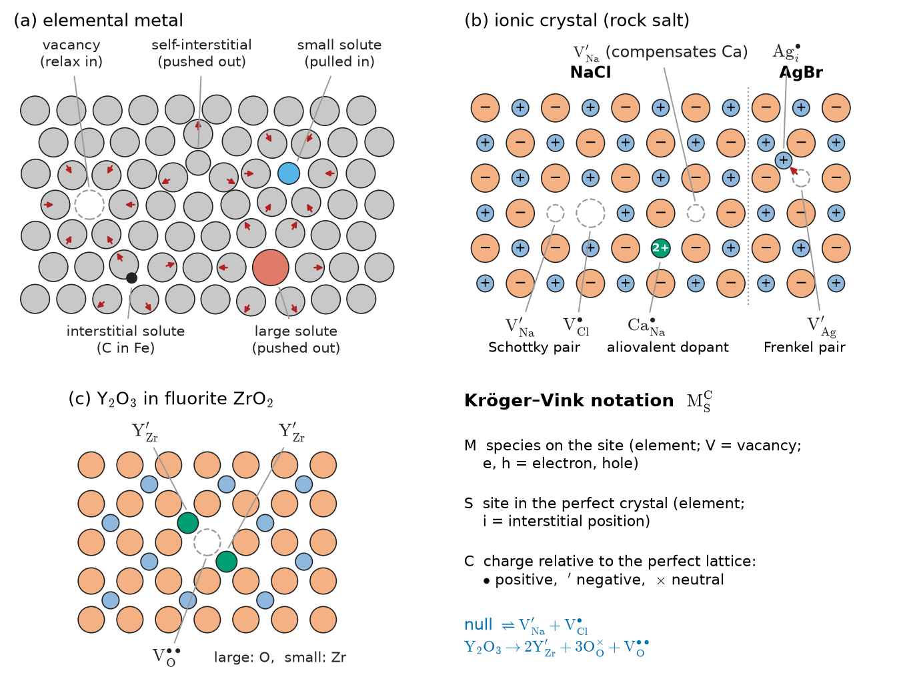
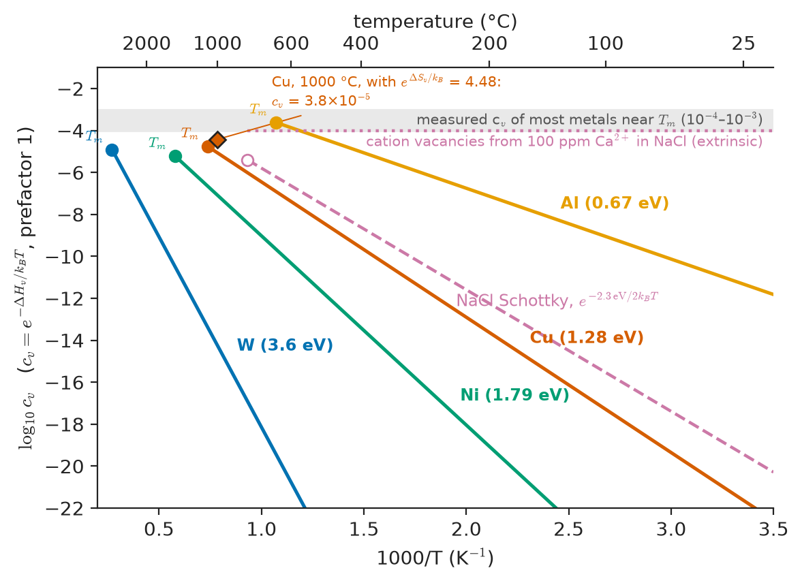
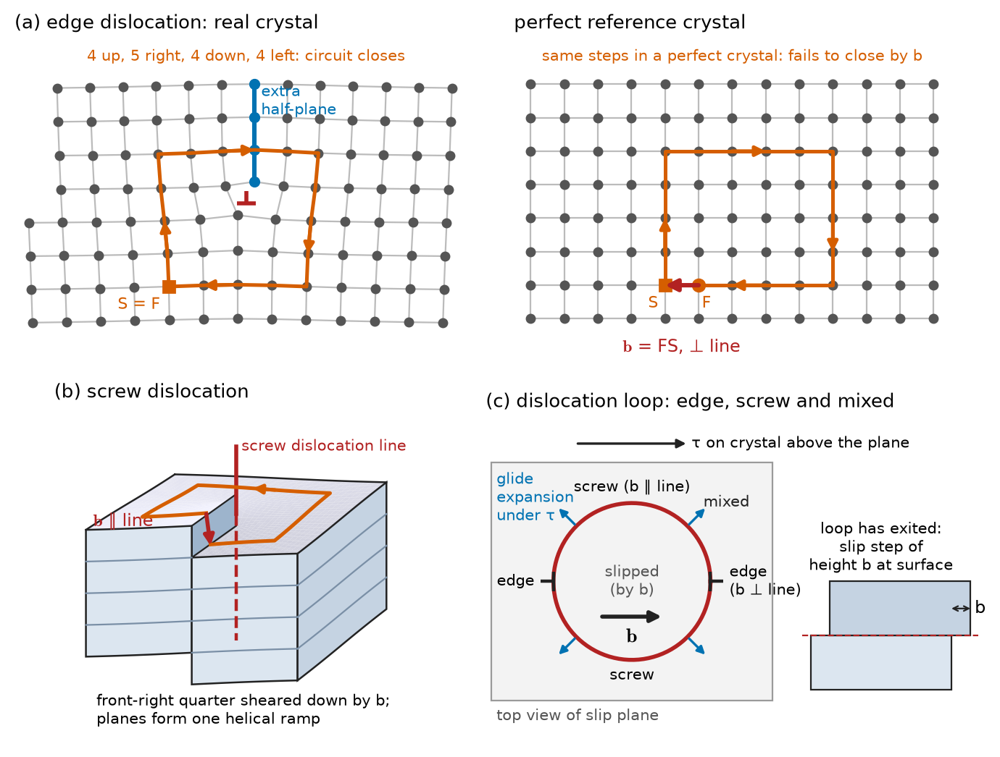
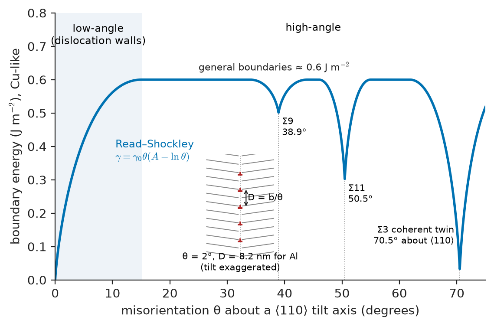
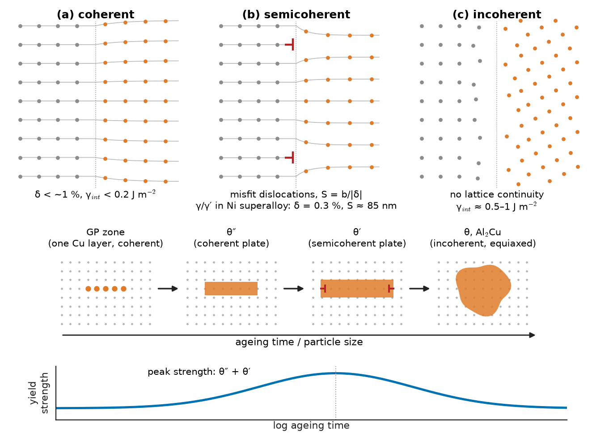
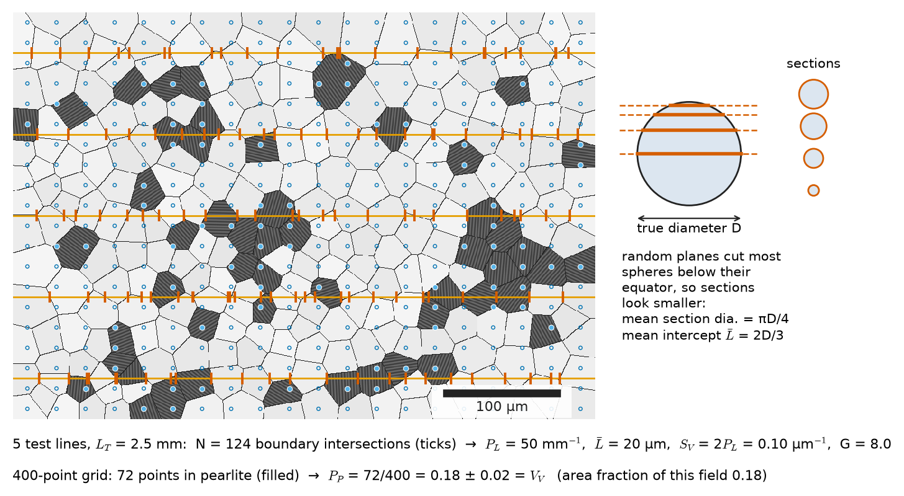

# Chapter 5 — Defects and Microstructure

*Part I · Structure of Materials*

On 19 July 1989 the fan disc of the tail engine of a DC-10 burst in cruise over Iowa. Fragments cut all three hydraulic systems, and the aircraft crash-landed at Sioux City. The investigators traced the fracture to a fatigue crack that had grown for years from a single small region in the titanium-alloy disc: a **hard-alpha inclusion**, a pocket of titanium enriched in nitrogen during melting of the ingot, which had stabilised the brittle α phase over a volume a few millimetres across. The rest of the forging met every specification. One volume defect, a few cubic millimetres in a component weighing more than 100 kg, decided its life. Titanium melting practice changed as a result: cold-hearth melting and ultrasonic inspection of billets were introduced to remove and detect exactly this class of defect.

The same disc also illustrates the opposite truth. Its strength came from defects too: from aluminium and vanadium atoms dissolved on titanium sites, from the boundaries between millions of fine grains, and from the interfaces between two phases deliberately produced by forging and heat treatment. A perfect crystal of titanium would yield at a small fraction of the alloy's strength. Defects are not the exception in engineering materials; they are the means by which structure is controlled, and the most common reason structure fails.

> **What kinds of imperfections do real crystalline materials contain, and how many of each?**
> **How are defects described, counted and measured, and which properties does each kind control?**

| Concept | Engineering destination |
|---|---|
| Vacancies and interstitials, equilibrium concentration | Diffusion and heat treatment (Ch 8), creep (Ch 14), radiation damage (Ch 41) |
| Defects in ionic crystals, Kröger–Vink notation | Solid electrolytes and fuel cells (Ch 25, 40), oxide nuclear fuel, catalysts, gas sensors, corrosion films (Ch 42) |
| Non-stoichiometry | UO$_{2+x}$ fuel, CeO$_{2-x}$ catalyst supports, FeO scales, n-type oxides |
| Dislocations, Burgers vector | Plasticity and strengthening (Ch 12–13), threading dislocations in semiconductors (Ch 34) |
| Grain boundaries, CSL, twins | Hall–Petch strengthening, intergranular corrosion and grain-boundary engineering (Ch 43), creep (Ch 14) |
| Stacking faults | Work hardening of austenitic steels, TWIP and TRIP steels (Ch 15) |
| Phase boundaries | Precipitation hardening (Ch 10), superalloys (Ch 16), thin-film epitaxy (Ch 49) |
| Pores, inclusions, precipitates | Fatigue of castings and AM parts (Ch 14, 48), clean steel, ceramic strength (Ch 17), concrete durability (Ch 18) |
| Stereology | Grain-size specifications, phase fractions, porosity limits, quality control (Ch 52) |

**Roadmap.** Point defects in metals and their equilibrium number (5.1) → point defects in ionic crystals and defect chemistry (5.2) → line defects (5.3) → planar defects: grain boundaries, twins, stacking faults, phase boundaries (5.4) → volume defects (5.5) → measuring microstructure: stereology (5.6) → how defects control properties (5.7).

---

## 5.1 Point defects

### Classification by dimension

Defects are classified by their dimensionality, and the classification is the skeleton of this chapter.

| Dimension | Defect | Typical size | Equilibrium? | Example |
|---|---|---|---|---|
| 0 | Vacancy, interstitial, substitutional solute, antisite | One atomic site | Yes (vacancies, solutes) | Vacancies in hot copper; carbon in steel; Y in ZrO$_2$ |
| 1 | Dislocation | Core ~1 nm wide, lines µm to m long | No | Dislocations in cold-worked aluminium |
| 2 | Grain boundary, twin, stacking fault, phase boundary, surface | ~0.5–1 nm thick, µm to mm across | No (except some interfaces in multiphase equilibrium) | Grain boundaries in a steel; γ/γ′ interfaces in a superalloy |
| 3 | Pore, crack, inclusion, precipitate | nm to mm | Precipitates can be; pores and inclusions are not | Gas pores in a casting; MnS in steel; θ′ in Al–Cu |

The column "equilibrium?" is the key physical distinction. A defect is an equilibrium defect if introducing a few of them *lowers* the Gibbs energy of the crystal. Only point defects satisfy this, because only they gain enough configurational entropy to pay for their energy (Section 5.1, below). Dislocations, grain boundaries and pores raise the Gibbs energy and survive only because the atomic motion needed to remove them is too slow. That is why their numbers depend on processing history while vacancy numbers depend only on temperature.

### Vacancies and self-interstitials

A **vacancy** is an empty lattice site. A **self-interstitial** is a host atom squeezed into a site between normal positions. In close-packed metals the interstitial costs three to four times as much energy as a vacancy (about 3 eV against 1.3 eV in copper) because it must push its neighbours far apart; in thermal equilibrium vacancies outnumber self-interstitials by many orders of magnitude. Interstitials matter mainly when they are produced athermally, by irradiation. A fast neutron striking an atom in a reactor pressure vessel or a fusion first wall knocks it out of its site with tens of keV of energy and starts a **displacement cascade**, leaving behind equal numbers of vacancies and interstitials (Frenkel pairs). Their accumulation and clustering cause the swelling, hardening and embrittlement of nuclear materials (Chapter 41).

### Solutes: substitutional and interstitial

A foreign atom can replace a host atom (**substitutional solute**) or occupy a gap between host atoms (**interstitial solute**). Substitution is favoured when the atoms are similar in size, crystal structure, electronegativity and valence — the Hume-Rothery rules (Chapter 7). Copper and nickel mix in all proportions; zinc dissolves in copper up to about 38 wt % to make α-brass; chromium, nickel and molybdenum substitute for iron in stainless steels.

Interstitial solutes are small atoms — H, B, C, N, O — that fit, with distortion, into the octahedral and tetrahedral holes of the host lattice. In FCC metals the largest hole (octahedral) admits a sphere of radius $0.414R$ without distortion, where $R$ is the host atom radius; in BCC the largest hole (tetrahedral) admits only $0.291R$, and the octahedral one only $0.155R$. Carbon in iron, with a radius ratio near 0.57, fits better in FCC austenite than in BCC ferrite, so austenite dissolves up to 2.1 wt % carbon and ferrite only 0.022 wt %. The resulting supersaturation when austenite is quenched is the origin of martensite and of the whole heat-treatment practice of steels (Chapters 10 and 15). Hydrogen, the smallest interstitial, diffuses through steel even at room temperature and gathers at defects, which makes it the agent of hydrogen embrittlement in high-strength fasteners, pipelines and pressure vessels (Chapters 40 and 43).

Every solute distorts the lattice around it: a large substitutional atom pushes neighbours out, a small one pulls them in, and an interstitial in a BCC octahedral site produces a tetragonal (non-spherical) distortion. These strain fields interact with dislocations, which is the basis of solid-solution strengthening (Chapter 13), and scatter electrons and phonons, which lowers electrical and thermal conductivity (Section 5.7).

<!-- FIGURE 5.1 | figures/ch05/fig-5-1-point-defects.png | schematic | Point defects in an elemental metal and in an ionic crystal, with Kröger–Vink labels. | Content: panel (a) 2D close-packed-like array of grey host atoms showing a vacancy (empty site, neighbours relaxed inward), a self-interstitial (neighbours pushed out), a small substitutional solute (blue, neighbours pulled in), a large substitutional solute (red, neighbours pushed out) and an interstitial solute (small black atom, labelled "C in Fe"); displacement arrows show relaxations. Panel (b) 2D rock-salt-like array of small cations (+) and large anions (−): Schottky pair labelled V'_Na and V•_Cl; Frenkel pair in a silver-halide-like lattice labelled Ag•_i and V'_Ag; aliovalent Ca on Na site labelled Ca•_Na with a nearby compensating V'_Na. Panel (c) fluorite-type ZrO2 fragment with two Y'_Zr and one V••_O. Legend: main symbol = species (V = vacancy), subscript = site (i = interstitial), superscript = charge relative to perfect lattice (• positive, ' negative, × neutral). -->

*Figure 5.1 — Point defects in an elemental metal and in an ionic crystal, with Kröger–Vink labels.*

### The equilibrium concentration of vacancies

Why should a crystal at equilibrium contain any vacancies at all? Creating $n$ vacancies among $N$ sites costs an enthalpy $n\,\Delta H_v$, but the vacancies can be arranged in $N!/[n!(N-n)!]$ ways, and that configurational entropy, together with a small vibrational entropy $\Delta S_v$ per vacancy, lowers the Gibbs energy. Minimising $G$ with respect to $n$ gives the equilibrium vacancy fraction

$$
c_v=\frac{n}{N}=\exp\!\left(\frac{\Delta S_v}{k_B}\right)\exp\!\left(-\frac{\Delta H_v}{k_BT}\right)
$$

with $k_B=8.617\times10^{-5}$ eV K$^{-1}$. Chapter 6 derives this result from the chemical potential of the vacancy; here we use it. $\Delta S_v$ is typically 1–2 $k_B$, so the pre-exponential factor is 3–7.

> **Status of the principle: equilibrium vacancy concentration**
> *Derived.* It follows from minimising the Gibbs energy of a crystal containing dilute, non-interacting vacancies; it is reached in practice only where atoms are mobile, roughly above $0.4$–$0.5\,T_m$, and fails at very high concentrations where vacancies cluster into divacancies and voids.

| Metal | Structure | $\Delta H_v$ (eV) | $c_v$ at $T_m$ (with $\Delta S_v=0$) | Measured $c_v$ near $T_m$ |
|---|---|---|---|---|
| Aluminium | FCC | 0.67 | $2.4\times10^{-4}$ | about $9\times10^{-4}$ |
| Copper | FCC | 1.28 | $1.7\times10^{-5}$ | about $2\times10^{-4}$ |
| Nickel | FCC | 1.79 | $6.0\times10^{-6}$ | about $10^{-4}$ (estimated) |
| Tungsten | BCC | 3.6 | $1.2\times10^{-5}$ | about $10^{-4}$ (estimated) |

Values of $\Delta H_v$ are typical experimental figures (±10 %). The striking regularity is that every metal at its melting point contains roughly one vacancy per $10^3$–$10^4$ sites, because $\Delta H_v$ scales with the cohesive energy and hence with $T_m$: $\Delta H_v$ is about 8–12 $k_BT_m$ for these metals. The difference between the "$\Delta S_v=0$" and measured columns is the vibrational-entropy factor, plus the contribution of divacancies near melting.

**Worked example — Vacancies in copper during annealing.** Copper has $a=0.3615$ nm, so its atomic density is $4/a^3=8.47\times10^{28}$ m$^{-3}$. Take $\Delta H_v=1.28$ eV and $\Delta S_v=1.5\,k_B$, so $e^{\Delta S_v/k_B}=4.48$.

At an annealing temperature of 1000 °C ($T=1273$ K), $k_BT=0.1097$ eV and $\Delta H_v/k_BT=11.67$:

$$
c_v=4.48\times e^{-11.67}=4.48\times8.56\times10^{-6}=3.8\times10^{-5}
$$

or $3.8\times10^{-5}\times8.47\times10^{28}=3.2\times10^{24}$ vacancies per cubic metre. At room temperature ($T=300$ K), $\Delta H_v/k_BT=49.5$ and $c_v=1.4\times10^{-21}$: a cubic micrometre of copper, $8.5\times10^{10}$ sites, would contain on average $10^{-10}$ vacancies — in effect none. Between 300 K and 1273 K the equilibrium fraction rises by a factor of about $3\times10^{16}$.

Two practical consequences follow. First, because diffusion in copper proceeds by atoms jumping into neighbouring vacancies, the diffusion rate inherits this enormous temperature dependence (Chapter 8): annealing, sintering, creep and homogenisation all happen at high temperature and essentially stop at low temperature. Second, a copper or aluminium alloy quenched from a high temperature keeps a large non-equilibrium vacancy population for minutes to hours, which accelerates room-temperature diffusion and makes natural ageing of aluminium alloys possible (Chapter 10).

<!-- FIGURE 5.2 | figures/ch05/fig-5-2-vacancy-arrhenius.png | plot | Equilibrium vacancy fraction versus inverse temperature for several metals, and Schottky-pair fraction in NaCl, compared with an extrinsic (doping-controlled) level. | Content: x-axis 1000/T (K⁻¹) from 0.2 to 3.5, with a secondary top axis in °C; y-axis log10 c_v from −22 to −2. Straight lines c_v = exp(−ΔH/kT) (prefactor 1): Al (ΔH 0.67 eV) ending at its Tm 933 K, Cu (1.28 eV) ending at 1356 K, Ni (1.79 eV) ending at 1728 K, W (3.6 eV) ending at 3695 K; each line terminated with a dot labelled "Tm". NaCl Schottky fraction exp(−2.3 eV/2kT) dashed line ending at 1074 K. Horizontal dotted line at 10⁻⁴ labelled "cation vacancies from 100 ppm Ca²⁺ in NaCl (extrinsic)". Annotate the Cu point at 1273 K, c_v ≈ 3.8×10⁻⁵ with entropy factor. Shaded band 10⁻⁴–10⁻³ at the melting points labelled "most metals near Tm". -->

*Figure 5.2 — Equilibrium vacancy fraction versus inverse temperature for several metals, and Schottky-pair fraction in NaCl, compared with an extrinsic (doping-controlled) level.*

---

## 5.2 Defects in ionic crystals

### Charge neutrality and the two classic disorders

In an ionic crystal every defect carries an effective charge, and the crystal as a whole must remain neutral. Point defects therefore appear in charge-compensating combinations.

- A **Schottky defect** is a set of cation and anion vacancies in the stoichiometric ratio: one Na$^+$ and one Cl$^-$ vacancy in NaCl, one Mg$^{2+}$ and one O$^{2-}$ vacancy in MgO, one Zr$^{4+}$ and two O$^{2-}$ vacancies in ZrO$_2$. Schottky disorder dominates when the ions are of similar size and the structure is close-packed (alkali halides with the rock-salt structure, MgO, NiO).
- A **Frenkel defect** is an ion moved from its site to an interstitial position, leaving a vacancy. It dominates when one ion is small and the structure has open interstitial space: cation Frenkel defects in AgBr and AgCl, anion Frenkel defects in fluorite-structure oxides (CaF$_2$, UO$_2$, CeO$_2$), where large empty cubes in the anion array accommodate interstitial anions.

For Schottky pairs in a 1:1 compound, the same entropy argument as for vacancies gives a pair fraction $\exp(-\Delta H_S/2k_BT)$, where $\Delta H_S$ is the enthalpy to form one *pair*; the factor 2 appears because each pair produces two independently distributed defects.

### Kröger–Vink notation

Defect chemistry needs a bookkeeping system that keeps track of sites, species and charges. **Kröger–Vink notation** writes each defect as $\mathrm{M}_\mathrm{S}^\mathrm{C}$:

- M is the species on the site: an element symbol, $\mathrm V$ for a vacancy, $e$ or $h$ for an electron or hole;
- S is the site normally occupied in the perfect crystal: an element symbol, or $i$ for an interstitial position;
- C is the charge *relative to the perfect crystal*: $\bullet$ for each unit of positive charge, $'$ for each negative unit, $\times$ for zero.

So $\mathrm{V_{Na}'}$ is a sodium vacancy (a missing Na$^+$ leaves an effective $-1$), $\mathrm{V_O^{\bullet\bullet}}$ an oxygen vacancy in an oxide, $\mathrm{Ca_{Na}^\bullet}$ a calcium ion on a sodium site, $\mathrm{Y_{Zr}'}$ an yttrium ion on a zirconium site, $\mathrm{O_i''}$ an interstitial oxide ion, and $\mathrm{O_O^\times}$ a normal oxygen ion on its own site.

Defect reactions are written like chemical equations and must balance in three ways: **mass** (atoms on each side), **site ratio** (the ratio of cation to anion sites of the host must be preserved; sites can be created or destroyed only in that ratio), and **charge** (effective charges sum to the same value). The Schottky and Frenkel reactions in NaCl and AgBr are

$$
\mathrm{null}\;\rightleftharpoons\;\mathrm{V_{Na}'}+\mathrm{V_{Cl}^{\bullet}},\qquad
\mathrm{Ag_{Ag}^\times}\;\rightleftharpoons\;\mathrm{Ag_i^\bullet}+\mathrm{V_{Ag}'}
$$

### Aliovalent doping

Adding ions of a different valence forces compensating defects. Dissolving CaCl$_2$ in NaCl places each Ca$^{2+}$ on a sodium site and requires one sodium vacancy for neutrality:

$$
\mathrm{CaCl_2}\;\xrightarrow{\ \mathrm{NaCl}\ }\;\mathrm{Ca_{Na}^\bullet}+\mathrm{V_{Na}'}+2\,\mathrm{Cl_{Cl}^\times}
$$

The same logic, applied to yttria in zirconia, produces oxygen vacancies:

$$
\mathrm{Y_2O_3}\;\xrightarrow{\ \mathrm{ZrO_2}\ }\;2\,\mathrm{Y_{Zr}'}+3\,\mathrm{O_O^\times}+\mathrm{V_O^{\bullet\bullet}}
$$

One oxygen vacancy per two yttrium ions. In 3 mol % yttria-stabilised zirconia (3Y-TZP), a formula unit with 0.97 ZrO$_2$ and 0.03 Y$_2$O$_3$ contains 1.03 cations and 2.06 oxygen sites, of which 0.03 are vacant: 1.5 % of the oxygen sites are empty. In 8YSZ the figure is $0.08/2.16=3.7$ %. The vacancies stabilise the tetragonal and cubic forms of zirconia at room temperature, which is what makes 3Y-TZP a tough ceramic for hip-joint heads, dental crowns and cutting blades (Chapters 17 and 39); and they let oxide ions hop from vacancy to vacancy, which makes 8YSZ the electrolyte of solid-oxide fuel cells and of the oxygen sensors in every petrol-engine exhaust (Chapters 25 and 40).

> **Status of the principle: electroneutrality and site balance in defect reactions**
> *Fundamental.* They express conservation of charge and of the crystal structure's site ratio; they hold for every defect reaction, and they — not the details of energetics — fix which compensating defects must form.

**Worked example — Intrinsic or extrinsic? Vacancies in salt.** For Schottky pairs in NaCl take $\Delta H_S=2.3$ eV (measured values 2.2–2.5 eV). The intrinsic vacancy fraction on each sublattice is $\exp(-\Delta H_S/2k_BT)$. At 800 K, $2k_BT=0.1379$ eV and

$$
c_{\mathrm{intrinsic}}=e^{-2.3/0.1379}=e^{-16.68}=5.7\times10^{-8}
$$

Even at the melting point (1074 K) it is only $4.0\times10^{-6}$. Now suppose the salt contains 100 ppm of Ca$^{2+}$ on Na sites, a typical impurity level. Each Ca creates one sodium vacancy, so $c_{\mathrm{extrinsic}}=10^{-4}$, independent of temperature. The intrinsic value would equal this only at

$$
T=\frac{\Delta H_S}{2k_B\ln(10^4)}=\frac{2.3}{2\times8.617\times10^{-5}\times9.21}=1449\ \mathrm{K}
$$

which is above the melting point. In practice, therefore, the cation-vacancy concentration — and with it the ionic conductivity — of nominally pure NaCl is set by impurities over its whole solid range. The same is true for most oxides: in alumina, MgO and zirconia the intrinsic Schottky energies are 5–7 eV per defect set, and impurity or dopant levels of tens of ppm dominate. Defect chemistry in ceramics is essentially the chemistry of aliovalent impurities, deliberate or not.

### Non-stoichiometry and the atmosphere

Ionic crystals can also exchange atoms with their surroundings, which changes their composition. An oxide in a reducing atmosphere can lose oxygen:

$$
\mathrm{O_O^\times}\;\rightleftharpoons\;\mathrm{V_O^{\bullet\bullet}}+2e'+\tfrac12\mathrm{O_2(g)}
$$

The oxygen vacancy is compensated by two electrons, released into the conduction band or onto reducible cations (Ti$^{4+}\to$Ti$^{3+}$, Ce$^{4+}\to$Ce$^{3+}$). The oxide becomes oxygen-deficient, MO$_{2-x}$, and an n-type electronic conductor. Applying the law of mass action to this reaction (Chapter 6) gives $[\mathrm{V_O^{\bullet\bullet}}]\propto p_{\mathrm{O_2}}^{-1/6}$ when the vacancies and electrons compensate each other, so the deviation from stoichiometry and the conductivity both rise as the oxygen pressure falls.

Other oxides take up extra oxygen. Wüstite is never stoichiometric FeO; it exists as Fe$_{1-x}$O with $x$ from about 0.05 to 0.15, its cation vacancies compensated by Fe$^{3+}$ ions (holes, in effect):

$$
2\,\mathrm{Fe_{Fe}^\times}+\tfrac12\mathrm{O_2(g)}\;\rightleftharpoons\;2\,\mathrm{Fe_{Fe}^\bullet}+\mathrm{V_{Fe}''}+\mathrm{O_O^\times}
$$

In Fe$_{0.95}$O, 5 % of the iron sites are vacant and 10 % of the remaining iron is Fe$^{3+}$. Those vacancies are why iron ions diffuse quickly outward through the FeO layer of a steel oxide scale, and why FeO-rich scales grow fast above 570 °C (Chapter 42).

Non-stoichiometry is engineered across the discipline:

| Oxide | Defect | Engineering role |
|---|---|---|
| UO$_{2+x}$ | Oxygen interstitials $\mathrm{O_i''}$ | Nuclear fuel: $x$ changes thermal conductivity, creep and fission-gas release (Ch 41) |
| CeO$_{2-x}$ | $\mathrm{V_O^{\bullet\bullet}}$ + Ce$^{3+}$ | Three-way catalysts store and release oxygen as engine exhaust swings rich and lean |
| SnO$_{2-x}$, ZnO$_{1-x}$, In$_2$O$_3$:Sn | $\mathrm{V_O^{\bullet\bullet}}$, donors | Gas sensors, transparent conducting electrodes for solar cells and displays |
| Fe$_{1-x}$O, Ni$_{1-x}$O | Cation vacancies + holes | Growth of oxide scales on steels and nickel alloys (Ch 42) |
| La$_{1-x}$Sr$_x$CoO$_{3-\delta}$ | $\mathrm{V_O^{\bullet\bullet}}$ | Mixed-conducting cathodes and oxygen-separation membranes (Ch 40) |
| BaTiO$_{3-\delta}$ | $\mathrm{V_O^{\bullet\bullet}}$ | Degradation of capacitor dielectrics fired in reducing atmosphere |

> **Boundary.** The thermodynamics of defect equilibria — the law of mass action, defect formation energies and Brouwer diagrams — is developed in Chapter 6, and the electrical consequences in Chapter 25. The underlying chemical equilibrium theory belongs to the Advanced Chemistry book.

---

## 5.3 Line defects: dislocations

### Why they must exist

A perfect crystal sheared by sliding one plane rigidly over the next would need a shear stress of roughly $G/2\pi$ to $G/30$ — several gigapascals for a metal. Annealed metal single crystals yield at a thousandth of that or less. The explanation, given independently by Orowan, Polanyi and Taylor in 1934, is that slip proceeds by the motion of a line defect, the **dislocation**, which breaks and remakes bonds one row at a time. Chapter 12 develops dislocation theory in depth; this section introduces the geometry needed for the rest of the book.

### Edge, screw and mixed dislocations

- An **edge dislocation** is the boundary of an extra half-plane of atoms inserted into the crystal. The lattice above the line is compressed and below it stretched. Under shear, the half-plane shifts by one atomic spacing at a time, and when the dislocation leaves the crystal it leaves a step on the surface.
- A **screw dislocation** turns the stack of atomic planes around the line into a single helical ramp, like a spiral car park: walking once around the line takes you up one atomic plane.
- A **mixed dislocation** has both characters. A general dislocation line is curved; a loop in a slip plane is pure edge at two points, pure screw at two others, and mixed in between.

### The Burgers vector

A dislocation is characterised by its **Burgers vector** $\mathbf b$. Draw a closed circuit of atom-to-atom steps around the line in the real crystal; repeat the same sequence of steps in a perfect reference crystal; the circuit fails to close, and the closure vector is $\mathbf b$ (Figure 5.3). For an edge dislocation $\mathbf b$ is perpendicular to the line; for a screw dislocation, parallel. The Burgers vector is constant along the whole dislocation however its line wanders, so a dislocation cannot end inside a perfect crystal: it ends at a surface or grain boundary, meets other dislocations at a node, or closes on itself as a loop.

Dislocations choose the shortest available Burgers vector, because their line energy is approximately $\tfrac12Gb^2$ per unit length:

| Structure | Burgers vector | Magnitude | Examples ($b$ in nm) |
|---|---|---|---|
| FCC | $\tfrac a2\langle110\rangle$ | $a/\sqrt2$ | Cu 0.256, Al 0.286, Ni 0.249 |
| BCC | $\tfrac a2\langle111\rangle$ | $a\sqrt3/2$ | α-Fe 0.248, W 0.274 |
| HCP | $\tfrac a3\langle11\bar20\rangle$ | $a$ | Ti 0.295, Mg 0.321 |
| Diamond cubic | $\tfrac a2\langle110\rangle$ | $a/\sqrt2$ | Si 0.384 |
| Rock salt | $\tfrac a2\langle110\rangle$ | $a/\sqrt2$ | MgO 0.298 |

A dislocation moves by **glide** in the plane containing its line and $\mathbf b$, which needs only shear stress, and an edge dislocation can also **climb** out of that plane by absorbing or emitting vacancies, which needs diffusion and becomes important above about $0.4\,T_m$ (creep, Chapter 14). Glide on the densest planes along the densest directions defines the **slip systems** — 12 $\{111\}\langle1\bar10\rangle$ systems in FCC metals, for example — whose number and ease of operation largely decide whether a material is ductile (Chapter 13).

<!-- FIGURE 5.3 | figures/ch05/fig-5-3-dislocations-burgers.png | crystal | Edge, screw and mixed dislocations with Burgers circuits. | Content: panel (a) simple-cubic block with an extra half-plane inserted from the top; dislocation line ⊥ at its lower edge; a clockwise Burgers circuit of 4 steps up, 5 right, 4 down, 4 left around the line, and the same circuit in a perfect crystal failing to close by b (arrow perpendicular to line). Panel (b) block with a screw dislocation: front-right quarter sheared down one spacing; helical ramp of planes; circuit closure b parallel to line. Panel (c) a dislocation loop in a slip plane (top view), b constant (arrow), segments marked edge (b ⊥ line), screw (b ∥ line) and mixed; direction of glide expansion under shear stress τ; step of height b left on the crystal surface where the loop has exited. -->

*Figure 5.3 — Edge, screw and mixed dislocations with Burgers circuits.*

### How many dislocations?

The **dislocation density** $\rho$ is the total line length per unit volume (m m$^{-3}$ = m$^{-2}$). Typical values span ten orders of magnitude:

| Material and condition | Dislocation density |
|---|---|
| Dislocation-free silicon wafer | ~0 |
| Well-annealed metal | $10^{10}$–$10^{12}$ m$^{-2}$ |
| As-cast or hot-rolled metal | $10^{12}$–$10^{13}$ m$^{-2}$ |
| Heavily cold-worked metal, martensite | $10^{15}$–$10^{16}$ m$^{-2}$ |
| Additively manufactured stainless steel (as built) | $10^{14}$–$10^{15}$ m$^{-2}$ |
| GaN epitaxial layer on sapphire | $10^{12}$–$10^{13}$ m$^{-2}$ ($10^{8}$–$10^{9}$ cm$^{-2}$) |

Dislocation densities enter the flow stress through the Taylor relation $\tau\propto Gb\sqrt\rho$ (Chapter 13); they are measured by TEM, by etch pits and, as Chapter 4 showed, by X-ray peak broadening.

> **Status of the principle: dislocation line energy $\approx\tfrac12Gb^2$**
> *Approximate.* It follows from the elastic field around the line with the logarithmic factor absorbed into the constant; good to within about a factor of two, and enough to show that dislocations are never equilibrium defects (several eV per atomic length of line, with negligible entropy gain).

---

## 5.4 Planar defects

### Grain boundaries

Most engineering solids are **polycrystals**: aggregates of grains, each a single crystal, joined at **grain boundaries** where the lattice orientation changes abruptly. A boundary is specified by five macroscopic degrees of freedom — three for the misorientation (an axis and an angle) and two for the orientation of the boundary plane — and its structure and energy depend on all five.

**Low-angle boundaries.** If two grains differ by a small rotation $\theta$, the boundary can be built from an array of dislocations. A symmetric tilt boundary is a wall of edge dislocations of spacing

$$
D=\frac{b}{\theta}
$$

For aluminium ($b=0.286$ nm) and $\theta=2^\circ=0.0349$ rad, $D=8.2$ nm; at $0.5^\circ$ it is 33 nm. Low-angle boundaries form when dislocations rearrange into walls during recovery (subgrains, Chapter 10) and in hot-worked metals and directionally solidified castings. Their energy, from the elastic energy of the dislocation array, follows the **Read–Shockley** relation

$$
\gamma=\gamma_0\,\theta\,(A-\ln\theta)
$$

which rises steeply from zero, flattens out and, beyond about 15°, merges into the high-angle value as the dislocation cores overlap.

> **Status of the principle: Read–Shockley energy of low-angle boundaries**
> *Derived.* It follows from linear elasticity of a dislocation wall; valid below about $10$–$15^\circ$, where the dislocation cores are separate, and not applicable to high-angle boundaries.

**High-angle boundaries.** Above about 15° the boundary is a disordered slab about 0.5–1 nm thick, with extra free volume and distorted bonds. Its energy is roughly constant, about a third of the surface energy: typically 0.3 J m$^{-2}$ in aluminium, 0.6 in copper, 0.8 in iron and about 1 J m$^{-2}$ in nickel. High-angle boundaries are fast diffusion paths (Chapter 8), sites for segregation, precipitation and corrosion (intergranular attack in sensitized stainless steel, Chapter 43), sources and sinks of vacancies, and obstacles to dislocations (Hall–Petch strengthening, Chapter 13).

**Special boundaries and the coincidence site lattice.** At certain misorientations a fraction of the lattice sites of the two grains coincide. If the two lattices are imagined to interpenetrate, the coinciding points form a **coincidence site lattice** (CSL), and the boundary is labelled $\Sigma n$, where $1/n$ is the fraction of sites in coincidence. Low-$\Sigma$ boundaries pack well and often have low energy, low diffusivity and high resistance to segregation and corrosion. Real boundaries deviate slightly from exact coincidence; a boundary is usually counted as $\Sigma n$ if its deviation is below the **Brandon criterion** $\Delta\theta=15^\circ/\sqrt{n}$, which accommodates the deviation by a network of secondary dislocations.

| Boundary | Misorientation (cubic) | Brandon tolerance |
|---|---|---|
| $\Sigma1$ (low-angle) | $<15^\circ$ about any axis | — |
| $\Sigma3$ (twin) | $60^\circ$ about $\langle111\rangle$ | $8.7^\circ$ |
| $\Sigma5$ | $36.87^\circ$ about $\langle100\rangle$ | $6.7^\circ$ |
| $\Sigma7$ | $38.21^\circ$ about $\langle111\rangle$ | $5.7^\circ$ |
| $\Sigma9$ | $38.94^\circ$ about $\langle110\rangle$ | $5.0^\circ$ |
| $\Sigma11$ | $50.48^\circ$ about $\langle110\rangle$ | $4.5^\circ$ |

> **Status of the principle: Brandon criterion**
> *Empirical.* A convention based on the spacing of secondary dislocations; it is widely used to classify boundaries measured by EBSD, but low $\Sigma$ alone does not guarantee low energy, because the boundary-plane orientation also matters.

**Grain-boundary engineering** exploits these differences. Repeated cycles of light deformation and annealing in low-stacking-fault-energy alloys (nickel alloys, austenitic stainless steels, lead alloys) raise the fraction of $\Sigma3^n$ boundaries ($\Sigma3$, $\Sigma9$, $\Sigma27$) above 50–70 % and break up the connectivity of the remaining random boundaries. Intergranular corrosion, stress-corrosion cracking and creep cavitation, which need a continuous path of susceptible boundaries, are then strongly reduced. Lead–acid battery grids, nuclear steam-generator tubing and superalloy components have been produced this way.

<!-- FIGURE 5.4 | figures/ch05/fig-5-4-gb-energy-misorientation.png | plot | Grain-boundary energy versus misorientation: Read–Shockley rise for low-angle boundaries, a plateau for general high-angle boundaries, and cusps at special CSL boundaries. | Content: x-axis misorientation θ (degrees) 0–65 about a ⟨110⟩ tilt axis; y-axis boundary energy (J m⁻²) 0–0.8 for copper-like values. Curve: Read–Shockley γ = γ0 θ (A − ln θ) from 0 to ~15° rising to ~0.6; plateau ~0.6 J m⁻² beyond; cusps at Σ11 (50.5°, ~0.3), Σ9 (38.9°, ~0.5), and a deep cusp near Σ3 coherent twin (70.5° about ⟨110⟩, ~0.02–0.04; draw the axis to 75° to include it). Inset: low-angle tilt boundary as a wall of ⊥ symbols with spacing D = b/θ, labelled "θ = 2°, D = 8.2 nm for Al". Shade 0–15° "low-angle", rest "high-angle". -->

*Figure 5.4 — Grain-boundary energy versus misorientation: Read–Shockley rise for low-angle boundaries, a plateau for general high-angle boundaries, and cusps at special CSL boundaries.*

### Twin boundaries

A **twin boundary** is a mirror plane across which the lattice is reflected. In FCC metals the coherent $\Sigma3$ twin lies on $\{111\}$ and simply reverses the stacking sequence, ...ABCABCBACBA..., with no broken nearest-neighbour bonds; its energy is tiny (about 0.02–0.04 J m$^{-2}$ in copper, around 5 % of a general boundary). **Annealing twins** form during recrystallization and grain growth of low-stacking-fault-energy FCC metals (copper, brass, austenitic stainless steel, nickel alloys); they appear in micrographs as straight parallel bands crossing grains. **Deformation twins** form under stress where slip is difficult: in HCP metals (magnesium, titanium, zinc), in BCC iron at low temperature or high strain rate, and in TWIP steels, where a fine mesh of deformation twins subdivides grains during straining and gives exceptional work hardening (Chapter 15). Nanotwinned copper, electrodeposited with twin spacings of tens of nanometres, reaches strengths near 1 GPa while keeping nearly the conductivity of pure copper, because twins block dislocations but barely scatter electrons.

### Stacking faults

In close-packed structures a local error in the stacking sequence of close-packed planes is a **stacking fault**: an intrinsic fault in FCC changes ...ABCABC... to ...ABCBCA..., inserting a thin slab of HCP-like stacking. It costs an energy per unit area, the **stacking-fault energy** $\gamma_{\mathrm{SF}}$. Stacking faults are bounded by **partial dislocations**: a perfect FCC dislocation $\tfrac a2[\bar110]$ can dissociate into two Shockley partials $\tfrac a6[\bar211]+\tfrac a6[\bar12\bar1]$, lowering its energy from $a^2/2$ to $2\times a^2/6=a^2/3$ (in units of $G/2$), at the price of a ribbon of fault between them. The equilibrium ribbon width balances the elastic repulsion of the partials against the fault energy; in isotropic elasticity it is roughly

$$
d\approx\frac{G\,b_p^2}{2\pi\,\gamma_{\mathrm{SF}}}
$$

where $b_p=a/\sqrt6$ is the partial Burgers vector (with a correction factor of order one that depends on the dislocation's character).

> **Status of the principle: partial-dislocation separation $d\approx Gb_p^2/2\pi\gamma_{\mathrm{SF}}$**
> *Approximate.* It balances isotropic elastic repulsion against fault energy; good for comparing metals, but character-dependent factors and elastic anisotropy change $d$ by tens of percent.

**Worked example — How wide are the stacking faults?** Using typical values:

| Metal | $G$ (GPa) | $a$ (nm) | $b_p$ (nm) | $\gamma_{\mathrm{SF}}$ (mJ m$^{-2}$) | $d$ (nm) |
|---|---|---|---|---|---|
| Aluminium | 26 | 0.4050 | 0.165 | 166 | 0.7 |
| Nickel | 76 | 0.3524 | 0.144 | 125 | 2.0 |
| Copper | 48 | 0.3615 | 0.148 | 45 | 3.7 |
| Silver | 30 | 0.4086 | 0.167 | 16 | 8.3 |
| Austenitic stainless steel (316) | 77 | 0.359 | 0.147 | about 20 | 13 |

For copper, $d=48\times10^9\times(0.1476\times10^{-9})^2/(2\pi\times0.045)=3.7\times10^{-9}$ m, about 14 nearest-neighbour distances. In aluminium the partials are about 2.5 nearest-neighbour distances apart: effectively undissociated. The consequence is large. A widely dissociated dislocation must be constricted back to a perfect one before its screw segments can cross-slip onto another plane, which is hard when $d$ is large. Low-SFE metals therefore cannot easily bypass obstacles by cross-slip; they store dislocations in planar arrays, work-harden strongly, twin readily and keep high strength after cold work. This is why austenitic stainless steel and TWIP steel work-harden so much more than aluminium, why aluminium recovers rapidly during hot working while copper and stainless steel recrystallise, and why stacking-fault energy is a design variable in steels (Chapters 12, 13 and 15).

### Phase boundaries

When the two sides of an interface are different phases, the interface is a **phase boundary** (interphase boundary). Its structure is classified by how well the lattices match. If the two phases have lattice parameters $a_\alpha$ and $a_\beta$ along the interface, the **misfit** is

$$
\delta=\frac{a_\beta-a_\alpha}{a_\alpha}
$$

- **Coherent**: lattice planes continue across the interface, and any small misfit is taken up by elastic strain. Interface energy is low, typically below 0.2 J m$^{-2}$, but coherency strain energy grows with particle volume. Examples: GP zones and θ″ plates in Al–Cu alloys, γ′ precipitates in nickel superalloys (misfit typically $-0.1$ to $-0.5$ %), Al$_3$Sc in aluminium.
- **Semicoherent**: misfit too large to be accommodated elastically is relieved by **misfit dislocations** at a spacing $S\approx b/\lvert\delta\rvert$. Interface energy is 0.2–0.5 J m$^{-2}$. For a γ/γ′ interface with $b=0.254$ nm and $\lvert\delta\rvert=0.3$ %, $S\approx85$ nm; when γ′ particles grow beyond a few hundred nanometres, or after long creep exposure, such networks appear around them. The θ′ phase in Al–Cu, semicoherent on its broad faces, is another example.
- **Incoherent**: no lattice continuity; the interface resembles a high-angle grain boundary, with energy 0.5–1 J m$^{-2}$ or more. Examples: equilibrium θ (Al$_2$Cu) particles, carbides on steel grain boundaries, oxide inclusions, fibre–matrix interfaces in metal-matrix composites.

The sequence coherent → semicoherent → incoherent is the natural life history of a precipitate as it grows: small particles minimise interface energy by staying coherent, large ones minimise strain energy by losing coherency. It explains the precipitation sequence of age-hardening alloys and why their strength peaks and then falls (Chapter 10). The same classification applies to epitaxial thin films on substrates (Chapter 49), where the misfit-dislocation spacing and the threading dislocations that accompany them set the quality of LED, power-device and solar-cell layers (Chapter 34).

<!-- FIGURE 5.5 | figures/ch05/fig-5-5-phase-boundaries.png | schematic | Coherent, semicoherent and incoherent phase boundaries, and the Al–Cu precipitate sequence that passes through all three. | Content: top row, three 2D lattice schematics. (a) Coherent: matrix (grey) and precipitate (orange) lattices continuous across a flat interface; precipitate lattice spacing slightly larger, strain shown by bowed planes near interface; label "δ < ~1 %, γ_int < 0.2 J m⁻²". (b) Semicoherent: coherent patches separated by misfit edge dislocations (⊥) at spacing S = b/|δ|; label "γ/γ′ in Ni superalloy: δ = 0.3 %, S ≈ 85 nm". (c) Incoherent: unrelated lattices with disordered interface; label "γ_int 0.5–1 J m⁻²". Bottom row: schematic sequence in Al–4Cu: GP zone (single Cu layer, coherent) → θ″ (coherent plate) → θ′ (semicoherent plate, misfit dislocations on edges) → θ Al2Cu (incoherent, equiaxed), with arrow "ageing time / particle size" and small curve of yield strength vs ageing time peaking at θ″/θ′. -->

*Figure 5.5 — Coherent, semicoherent and incoherent phase boundaries, and the Al–Cu precipitate sequence that passes through all three.*

---

## 5.5 Volume defects: pores, inclusions and precipitates

### Pores and voids

**Pores** are the most common volume defect in cast, sintered, welded and additively manufactured parts, and in concrete.

- **Castings** contain gas porosity (hydrogen rejected from solidifying aluminium, round pores 10–500 µm) and shrinkage porosity (irregular interdendritic cavities where liquid feeding failed). In cast aluminium suspension and engine components, fatigue cracks start at the largest pore near the surface; fatigue strength falls roughly with the square root of the pore's projected area (Chapters 14 and 46).
- **Sintered ceramics and powder metals** retain residual porosity between particles. Strength and stiffness fall steeply with porosity $P$; useful empirical fits are $\sigma\approx\sigma_0\,e^{-bP}$ with $b\approx4$–$7$ for strength, and $E\approx E_0(1-1.9P+0.9P^2)$ for modulus. For $b=7$, 5 % porosity costs 30 % of the strength but only about 9 % of the stiffness, because strength is controlled by the largest flaw and stiffness by the average section.
- **Additive manufacturing** produces lack-of-fusion pores (irregular, between unmelted powder layers) and keyhole pores (spherical, trapped vapour), which dominate the fatigue scatter of printed titanium and nickel parts and are closed by hot isostatic pressing (Chapter 48).
- **Concrete** contains capillary pores from excess mixing water, which control strength and permeability, and deliberately **entrained air** — 4–7 % by volume of 10–100 µm bubbles — which gives freezing water room to expand and is essential for freeze–thaw resistance of bridge decks and pavements (Chapter 18).
- **Irradiation and creep voids.** Vacancies produced by neutron irradiation condense into voids that swell austenitic steels by several percent (Chapter 41); vacancies flowing to grain boundaries under creep nucleate cavities that link into creep cracks (Chapter 14).

> **Status of the principle: exponential porosity–strength relation**
> *Empirical.* A fit to data for ceramics and powder metals over porosities of roughly 0–30 %; the constant depends on pore shape and connectivity, and the relation has no meaning for isolated large flaws, which must be treated by fracture mechanics (Chapter 14).

### Inclusions

**Inclusions** are particles of a foreign phase, mostly non-metallic, introduced during processing and usually unwanted. In steel they are oxides (alumina from deoxidation, silicates), sulfides (MnS) and nitrides (TiN). Their effects depend on size, shape and hardness:

- Hard, brittle oxides tens of micrometres across initiate fatigue cracks in rolling bearings, springs and gears; the revolution in bearing life since the 1970s came largely from vacuum degassing and ladle metallurgy that reduced oxygen content below 10 ppm.
- Soft MnS inclusions are elongated into stringers by rolling. They improve machinability (free-cutting steels add sulfur deliberately), but they make toughness and ductility through the plate thickness poor; welded structural plates loaded through the thickness can fail by **lamellar tearing** along the stringers, which is why offshore and bridge steels specify low sulfur and calcium treatment to keep sulfides globular.
- Hard-alpha inclusions in titanium (the opening example) and ceramic particles from crucibles in nickel superalloy powder are the classic rogue flaws of rotating aerospace parts; probabilistic damage-tolerance design now explicitly accounts for their rare presence.

### Precipitates and dispersoids

**Precipitates** form within the material from a supersaturated solid solution, during heat treatment or service. They range from clusters of a few atoms to micrometre particles and can be coherent, semicoherent or incoherent (Section 5.4). Deliberately produced fine precipitates — θ″/θ′ in Al–Cu aerospace alloys, γ′ in turbine discs and blades, carbides in tempered martensite, NbC and VC in microalloyed steels — are the most powerful strengthening tool in metallurgy because they block dislocations (Chapter 13) while consuming little alloying. **Dispersoids** are fine particles that do not dissolve at all: Y–Ti–O nanoclusters in oxide-dispersion-strengthened steels for reactors, Al$_2$O$_3$ in dispersion-strengthened copper for welding electrodes, and Al–Mn–Fe dispersoids that control grain structure in aluminium alloys. Unwanted precipitates are equally important: chromium carbides on grain boundaries of sensitized stainless steel cause intergranular corrosion (Chapter 43), and σ phase in duplex steels and superalloys embrittles them.

---

## 5.6 Quantitative microstructure: stereology

### The problem

Microstructures are three-dimensional, but they are almost always observed on two-dimensional sections (polished metallographic or ceramographic sections, SEM images, EBSD maps) or one-dimensional traverses. **Stereology** is the set of exact geometric-probability relations that recover three-dimensional quantities — volume fractions, interface areas, line lengths — from measurements on sections, without assuming particle shapes. Specifications for grain size, inclusion content, porosity and phase fraction in steels, aluminium alloys, ceramics, welds and AM parts are all written in stereological terms.

### Notation and the fundamental relations

Stereology uses a compact notation: $V_V$ is a volume per unit volume (volume fraction), $S_V$ a surface area per unit volume, $L_V$ a line length per unit volume; $A_A$ an area fraction on a section, $L_A$ a line length per unit area, $P_A$ a number of points per unit area; $L_L$ a line fraction on a test line, $P_L$ a number of intersections per unit test-line length; and $P_P$ the fraction of test points falling in a phase. The basic relations, valid for isotropic, uniform random sections, are:

$$
V_V=A_A=L_L=P_P
$$

$$
S_V=2P_L,\qquad L_V=2P_A
$$

The first set (the Delesse–Rosiwal–Glagolev principle) says that the volume fraction of a phase equals its area fraction on a random section, its length fraction along a random line, and the fraction of random points that fall in it. The second set says that the area of interface per unit volume is twice the number of intersections per unit length of test line, and that the length of lines (dislocations, triple junctions) per unit volume is twice the number of their intersection points per unit area of section.

> **Status of the principle: fundamental stereological relations**
> *Derived.* They follow from geometric probability and are exact, without any assumption about particle shape, provided the sections are random (or the structure isotropic and uniform); for textured or elongated structures, measurements on several oriented sections are required.

The quantities that are *not* obtainable from sections without shape assumptions are numbers and sizes of particles: a random section cuts large particles more often than small ones and cuts each at less than its full diameter. Converting section-size distributions into particle-size distributions (the Saltykov or Schwartz–Saltykov methods) requires assuming a shape, usually spheres. For monosized spheres of diameter $D_s$, the mean intercept length is $\bar L=2D_s/3$ and the mean section diameter is $\pi D_s/4$.

### Grain size

For a single-phase polycrystal, the most robust grain-size measure is the **mean linear intercept** $\bar L$: lay test lines of total length $L_T$ (corrected for magnification) on the section, count the number $N$ of grain-boundary intersections, and

$$
\bar L=\frac{L_T}{N}=\frac{1}{P_L},\qquad S_V=\frac{2}{\bar L}
$$

The ASTM grain-size number $G$, still the most common specification in industry, is related to the mean intercept in millimetres by

$$
G=-6.6439\log_{10}\bar L-3.288
$$

and to the number of grains per square millimetre of section, $N_A$, by $G=3.3219\log_{10}N_A-2.954$. Larger $G$ means finer grains: $G=5$ corresponds to $\bar L\approx56$ µm, $G=8$ to 20 µm, $G=10$ to 10 µm. Electron backscatter diffraction (EBSD) measures grain size directly from orientation maps, and also counts twins, low-angle boundaries and CSL boundaries separately — distinctions that matter, because whether twins are counted as grain boundaries changes the measured size by a factor of up to two in annealed copper and austenitic steel.

| Material and condition | Typical mean intercept | ASTM $G$ (approx.) |
|---|---|---|
| Cast aluminium, unrefined | 0.5–2 mm | below 0 |
| Hot-rolled structural steel (ferrite) | 10–30 µm | 7–10 |
| Annealed austenitic stainless steel | 30–100 µm | 3.5–7 |
| Microalloyed (HSLA) steel, controlled rolling | 3–8 µm | 10.5–13.5 |
| Superalloy turbine disc (fine grain) | 10–20 µm | 8–10 |
| Sintered alumina, dense | 1–5 µm | 12–16.5 |
| Nanocrystalline electrodeposit | 10–50 nm | — |

<!-- FIGURE 5.6 | figures/ch05/fig-5-6-stereology-grid.png | micrograph-style | Stereological measurement on a section: line intercepts for grain size and interface area, point counting for volume fraction. | Content: synthetic 2D micrograph (Voronoi-like grains, mean intercept ~20 µm at a 100 µm scale bar) of a two-phase ferrite (light) + pearlite (dark, ~18 % area) steel. Overlay: five horizontal test lines with grain-boundary intersections marked as small ticks (count shown, e.g. "N = 125 on L_T = 2.5 mm → P_L = 50 mm⁻¹, L̄ = 20 µm, S_V = 0.1 µm⁻¹, G = 8.0"); a superimposed square grid of points with those falling in pearlite marked as filled dots ("P_P = 72/400 = 0.18 ± 0.02"). Side panel: small schematic of a sphere cut by random planes showing why section diameters are smaller than the true diameter, with mean intercept L̄ = 2D/3. -->

*Figure 5.6 — Stereological measurement on a section: line intercepts for grain size and interface area, point counting for volume fraction.*

**Worked example — Grain size, interface area and phase fraction of a structural steel.** A polished and etched section of a ferrite–pearlite steel is photographed at 200× magnification. Five test lines, each 100 mm long on the print, are laid across it: $L_T=500\ \mathrm{mm}/200=2.5$ mm on the specimen. They cross 125 grain boundaries.

$$
P_L=\frac{125}{2.5\ \mathrm{mm}}=50\ \mathrm{mm^{-1}},\qquad \bar L=\frac{1}{50}\ \mathrm{mm}=20\ \mu\mathrm m
$$

The grain-boundary area per unit volume is $S_V=2P_L=100\ \mathrm{mm^{-1}}=1.0\times10^5\ \mathrm{m^2\,m^{-3}}$, and the ASTM number is

$$
G=-6.6439\log_{10}(0.020)-3.288=-6.6439\times(-1.699)-3.288=8.0
$$

A grid of 400 points is then laid on the same section; 72 fall on pearlite colonies. The pearlite volume fraction is $V_V=P_P=72/400=0.18$. If the points are independent, the standard error is $\sqrt{P_P(1-P_P)/P_T}=\sqrt{0.18\times0.82/400}=0.019$, so $V_V=0.18\pm0.02$; systematic grids spaced wider than the pearlite colonies do somewhat better, and several fields must be counted to cover variation across the plate. A pearlite fraction of 0.18 corresponds, by the lever rule (Chapter 7), to roughly 0.15 wt % carbon, consistent with a structural grade such as S275 or A36.

The interface area has a direct physical meaning. With a high-angle boundary energy of about 0.5 J m$^{-2}$, the stored boundary energy is $1.0\times10^5\times0.5=5\times10^4$ J m$^{-3}$, or about 0.35 J mol$^{-1}$ of iron — tiny compared with transformation energies, but enough to drive grain growth if the steel is overheated during welding or forging (Chapter 10).

> **Status of the principle: ASTM grain-size relations**
> *Empirical* as a convention (the number $G$ is defined by a historical rule of grains per square inch at 100×), but its relation to $\bar L$ and $N_A$ is exact geometry for equiaxed grains; it is meaningless for strongly elongated or bimodal grain structures, which must be characterised by size distributions.

---

## 5.7 How defects control properties: an overview

Almost every chapter that follows is, at bottom, about one or more of the defects introduced here. The table collects the main connections; each is developed in the chapter cited.

| Property | Controlling defects | Mechanism | Engineering example | Chapter |
|---|---|---|---|---|
| Yield strength of metals | Dislocations, solutes, grain boundaries, precipitates | Obstacles to dislocation glide (Taylor, solid-solution, Hall–Petch, Orowan) | Cold-drawn wire, HSLA steel, 7075-T6 aluminium, superalloy discs | 12, 13 |
| Ductility and toughness | Inclusions, pores, grain-boundary films | Void nucleation, crack initiation, intergranular fracture | Lamellar tearing of plate; temper embrittlement of steel | 14, 15 |
| Fatigue life | Pores, inclusions, surface defects | Crack initiation at the largest flaw | Cast Al wheels, AM brackets, bearings | 14, 40 |
| Creep resistance | Vacancies, dislocations, grain boundaries, precipitates | Diffusion, climb, boundary sliding, particle pinning | Single-crystal blades (no boundaries), ODS steels | 14, 16 |
| Fracture strength of ceramics | Pores, surface flaws, large grains | Griffith flaws | Alumina substrates, zirconia hip heads, glass | 14, 17 |
| Diffusion and sintering | Vacancies, grain boundaries, dislocations | Lattice and short-circuit transport | Carburizing, powder metallurgy, solder-joint ageing | 8, 38 |
| Electrical conductivity of metals | Solutes, vacancies, dislocations, boundaries | Electron scattering (Matthiessen's rule) | Conductor alloys, interconnects | 25 |
| Ionic conductivity | Aliovalent dopants, oxygen vacancies | Vacancy hopping | YSZ fuel-cell electrolytes, lambda sensors | 25, 32 |
| Semiconductor behaviour | Dopants, deep-level impurities, dislocations | Carrier generation and recombination | Solar-cell lifetime, LED efficiency | 26 |
| Thermal conductivity | Point defects, boundaries, pores | Phonon scattering | Thermal-barrier coatings, thermoelectrics | 24 |
| Magnetic softness | Inclusions, precipitates, boundaries, stress | Domain-wall pinning | Electrical steel, amorphous cores | 27 |
| Corrosion resistance | Grain-boundary carbides, inclusions, segregation | Local anodes; breakdown of passive film | Sensitized stainless steel; MnS pits | 34, 35 |
| Radiation tolerance | Sinks: boundaries, interfaces, dispersoids | Recombination of Frenkel pairs | ODS and nanostructured reactor steels | 33 |
| Optical transparency | Pores, second phases, birefringent grains | Light scattering | Transparent alumina and spinel armour | 28 |

Three general lessons emerge from the table.

First, **the same defect can help or harm**. Grain boundaries strengthen at low temperature and weaken at high temperature, where they slide and cavitate; dopant oxygen vacancies make YSZ a useful electrolyte and make BaTiO$_3$ capacitors degrade; precipitates harden aluminium alloys and, on grain boundaries, ruin stainless steel's corrosion resistance. The designer's question is never whether to have defects but which ones, how many, and where.

Second, **properties differ in their sensitivity to defect populations**. Elastic modulus, density and heat capacity are *structure-insensitive*: they change by at most a few percent with defect content. Yield strength, toughness, fatigue life, conductivity of semiconductors, creep rate, coercivity and corrosion rate are *structure-sensitive*: they can change by factors of ten to a million. Structure-sensitive properties are the ones processing can control, and the ones that show scatter.

Third, **the weakest-link defects are rare**. Strength-limiting flaws in ceramics, rogue inclusions in turbine discs and the largest pore in a casting are, by definition, the extremes of a distribution. Average microstructural measures from stereology cannot see them; extreme-value statistics, Weibull analysis and non-destructive inspection are needed (Chapters 11, 14 and 52).

---

## What remains open

| Open question | Where it is answered |
|---|---|
| How are the equilibrium concentrations of vacancies and ionic defects derived, and how do they depend on oxygen pressure? | Chapter 6 |
| How do point defects carry atoms through a crystal, and how fast? | Chapter 8 |
| How do precipitates nucleate, grow, change coherency and coarsen? | Chapters 9 and 10 |
| How do recovery, recrystallization and grain growth change defect populations? | Chapter 10 |
| What are the stress fields, forces, interactions and sources of dislocations? | Chapter 12 |
| How do dislocations, solutes, boundaries and precipitates combine to set strength? | Chapter 13 |
| How do pores and inclusions control fatigue and fracture? | Chapter 14 |
| How do defects set electrical, thermal, magnetic and optical behaviour? | Chapters 24–36 |
| How are defects created by irradiation, and how are they managed in reactors? | Chapter 41 |
| How are defects imaged and measured: TEM, EBSD, atom probe, positron annihilation, tomography? | Chapters 52–54 |

**Next:** Part II begins with Chapter 6, which supplies the thermodynamics behind the phases, solutions, interfaces and point defects met so far.
