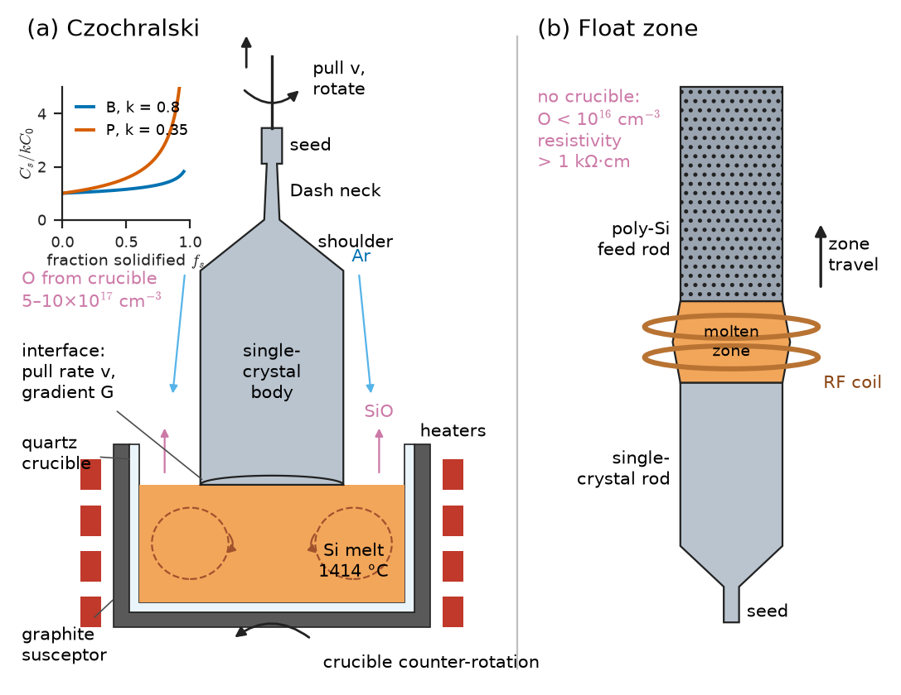
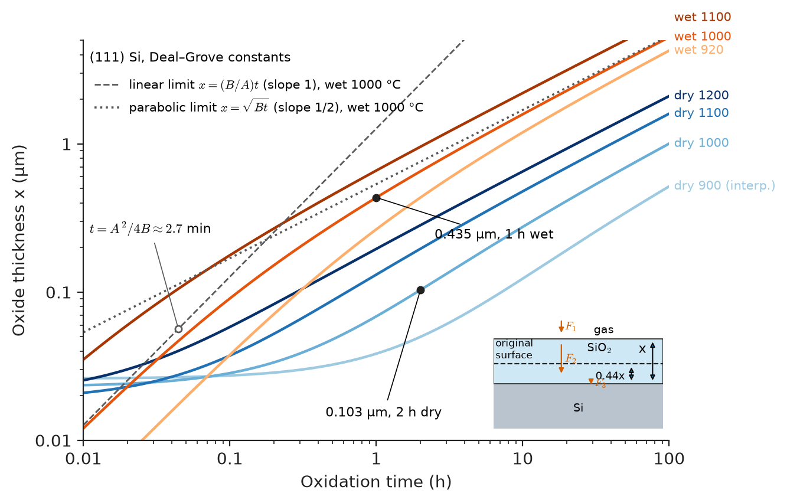
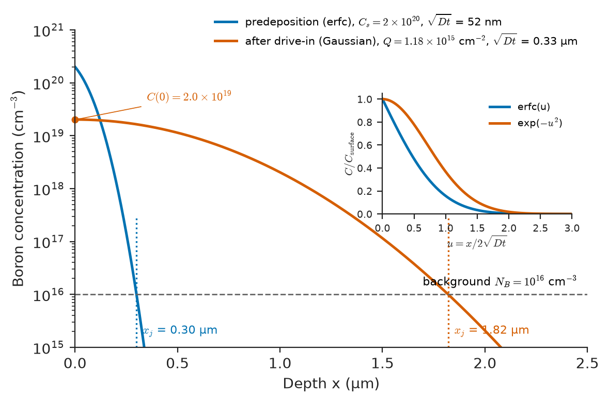
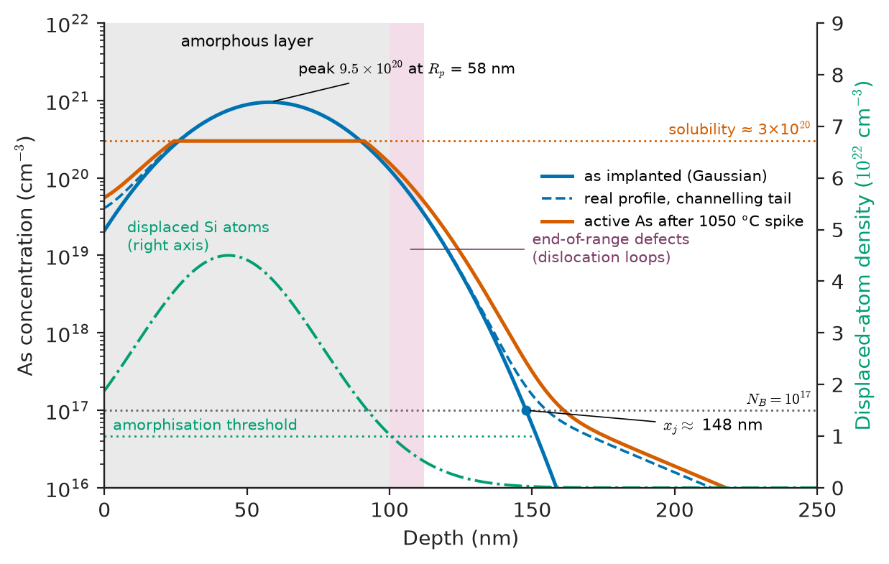
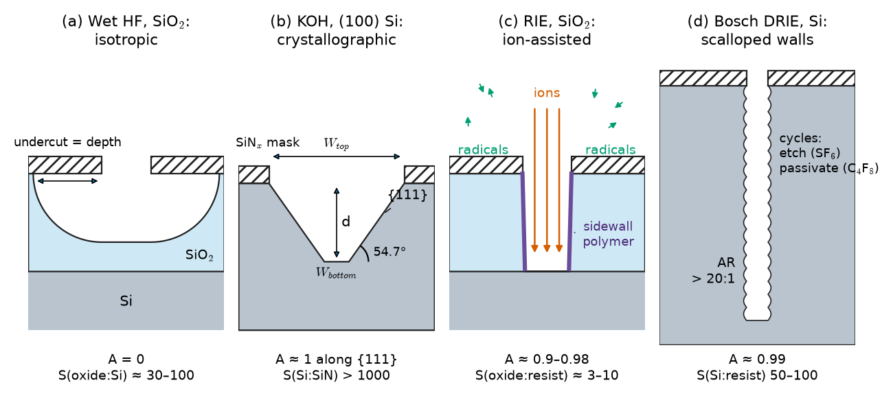
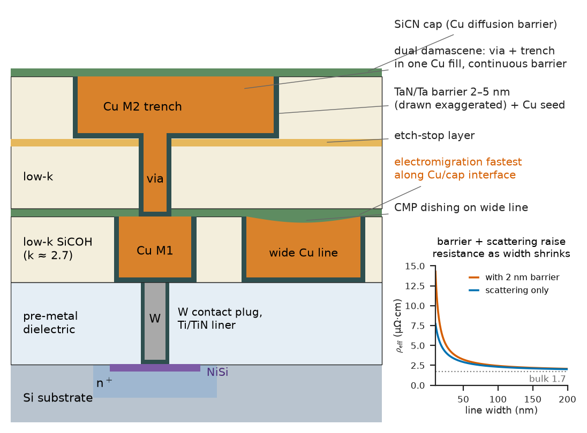

# Chapter 50 — Electronic Materials Manufacturing

*Part X · Processing and Manufacturing*

A batch of power MOSFETs fails its gate-leakage test. Every die came from the same wafer lot and the same mask set, and the device design has not changed for years. The failure analysis report traces the problem to three causes on three different wafers: one wafer had iron contamination at $10^{11}$ atoms/cm$^3$ from a furnace tube, which cut the minority-carrier lifetime by orders of magnitude; one had slip dislocations at its edge from a too-fast ramp in a rapid-thermal anneal; and one had gate oxides on transistors connected to long metal lines that had been damaged by charge collected during plasma etching. None of these is a design fault. Each is a change to the *material* — its purity, its crystal perfection, the integrity of an oxide a few nanometres thick — made by a manufacturing step. The wafer arrives as the most perfect crystal humans make; every subsequent step can only degrade it, and the job of process engineering is to make the degradation small and controlled.

> **How does each manufacturing step — growth, oxidation, diffusion, implantation, patterning, etching, metallization — change the structure and properties of semiconductor materials?**
> **Which defects does each step introduce, and what physical rules predict their size?**

| Concept | Engineering destination |
|---|---|
| Czochralski and float-zone growth, segregation | Wafer resistivity, oxygen content, choice of substrate for CMOS versus power devices |
| SiC PVT growth, GaN substrates | Defect density and cost of wide-bandgap power and RF devices (Chapter 33) |
| Wafer slicing, polishing, gettering | Flatness for lithography, surface quality, contamination tolerance |
| Epitaxy, CVD, PVD, ALD | Device layers, gate dielectrics, barriers, interconnect films |
| Deal–Grove oxidation | Field and gate oxide thickness, silicon consumption |
| Constant- and limited-source diffusion | Junction depth, sheet resistance, emitter and well profiles |
| Ion implantation: range, straggle, damage, anneal | Shallow junctions, threshold-voltage adjust, isolation |
| Rayleigh resolution | Minimum feature size, cost of patterning |
| Wet and dry etching, anisotropy | Trench and via profiles, MEMS structures |
| Al and Cu metallization, barriers, silicides | Interconnect resistance, electromigration life, contact resistance |
| Dielectric deposition, low-$k$ | RC delay, crosstalk, mechanical reliability of the interconnect stack |
| Process-induced defects | Leakage, lifetime, gate-oxide integrity, yield |

**Roadmap.** Making the crystal (50.1) → making the wafer (50.2) → adding films (50.3) → oxidation (50.4) → doping by diffusion (50.5) and by implantation (50.6) → patterning: lithography (50.7) and etching (50.8) → wiring: metallization (50.9) and dielectric deposition (50.10) → packaging materials (50.11) → what goes wrong (50.12).

> **Boundary.** This chapter treats each manufacturing step as a materials process: what it does to crystal structure, composition, defects and properties. The sequencing of steps into a CMOS, bipolar or power-device flow, and the device physics that motivates each layer, belong to the Electronics & Computing core.

---

## 50.1 Single-crystal growth

Device-grade semiconductors must be single crystals: grain boundaries carry trapped charge and act as recombination and leakage paths (Chapter 32), and dopant diffusion along them would make junctions uncontrollable. Silicon is grown from the melt; silicon carbide and gallium nitride, which cannot be melted at practical pressures, need entirely different routes. The growth method fixes the substrate's purity, dopant uniformity, oxygen and carbon content, and dislocation density.

### Czochralski growth

More than 90 % of silicon wafers come from **Czochralski (CZ)** crystals (Figure 50.1a). Polycrystalline silicon of 9N–11N purity is melted in a fused-silica (quartz) crucible at just above 1414 °C, under argon. Dopant (B, P, As or Sb) is added to the melt. A seed crystal of the desired orientation, usually ⟨100⟩, is dipped into the melt and slowly withdrawn while seed and crucible counter-rotate. Silicon freezes on the seed and the crystal grows downward from it.

Three steps of the process are aimed at specific defects:

- **Dash necking.** The seed is first pulled fast to make a thin neck, 3–4 mm across. The thermal shock of dipping introduces dislocations into the seed; in the thin neck they glide out of the crystal surface. Thereafter the crystal is grown dislocation-free — and remains so, because there is no source to create new dislocations in a crystal under low stress. A 300 mm silicon crystal with no dislocations at all, weighing several hundred kilograms, hangs from a neck a few millimetres in diameter.
- **Diameter control** by pull rate and melt temperature, monitored optically at the meniscus.
- **Pull rate and thermal gradient**, which control point-defect populations (below).

**Maximum pull rate.** The latent heat released at the interface must be conducted away through the solid. A heat balance at the interface, neglecting heat flow from the melt, gives

$$
v_{\max}=\frac{k_s G_s}{\rho_s L}
$$

with $k_s$ the thermal conductivity of solid silicon near the melting point (about 22 W/m K), $G_s$ the axial temperature gradient in the solid, $\rho_s=2330$ kg/m$^3$ and latent heat $L=1.79\times10^6$ J/kg. For $G_s=30$ K/cm $=3000$ K/m, $v_{\max}\approx22\times3000/(2330\times1.79\times10^6)=1.6\times10^{-5}$ m/s, or about 1 mm/min — the right order for large-diameter crystals. A steeper gradient allows faster growth but raises thermal stress.

> **Status of the principle: interface heat balance for maximum pull rate**
> *Approximate.* It is a one-dimensional energy balance with heat from the melt neglected; it gives the correct order of magnitude and the scaling with gradient. Real crystal pullers are designed with numerical heat-transfer models.

**Point defects and the Voronkov criterion.** Silicon freezes with equilibrium concentrations of both vacancies and self-interstitials, which recombine and are swept by diffusion as the crystal cools. Voronkov showed that which species survives in excess depends on the ratio $v/G$ of pull rate to gradient at the interface: above a critical value (about $1.3\times10^{-3}$ cm$^2$/(K min)) vacancies dominate and cluster into octahedral voids of 50–200 nm (**crystal-originated particles, COPs**), which degrade thin gate oxides; below it, interstitials dominate and form dislocation loops. "Perfect silicon" for advanced logic is grown at precisely controlled $v/G$ close to the critical value.

**Segregation along the crystal.** Dopant is partitioned at the interface with an equilibrium coefficient $k_0=C_s/C_L$ (Table below). With the melt well mixed and no diffusion in the solid, the Scheil equation of Chapter 9 applies directly, with fraction solidified $f_s$ now measured along the crystal:

$$
C_s(f_s)=k_{\mathrm{eff}}\,C_0\,(1-f_s)^{k_{\mathrm{eff}}-1}
$$

The effective coefficient $k_{\mathrm{eff}}$ lies between $k_0$ and 1, because a diffusion boundary layer of rejected solute sits at the interface; it rises toward 1 at higher pull rate and lower crystal rotation.

| Impurity in Si | $k_0$ | Consequence |
|---|---|---|
| B | 0.8 | Nearly uniform along the crystal |
| P | 0.35 | Concentration rises strongly toward the tail |
| As | 0.3 | Similar to P; volatile from melt |
| Sb | 0.023 | Hard to dope heavily; evaporates |
| O | ≈ 0.25–1 (uncertain) | Set mostly by crucible dissolution and evaporation |
| C | 0.07 | Accumulates in melt; tail enriched |
| Al | 0.002 | Strongly rejected |
| Cu | $4\times10^{-4}$ | Purified by freezing |
| Fe | $8\times10^{-6}$ | Purified by freezing |
| Au | $2.5\times10^{-5}$ | Purified by freezing |

*Typical literature values.*

The very small $k_0$ of transition metals is why directional solidification (and zone refining) purifies: metals stay in the melt and end up in the tail, which is cut off.

**Worked example — Resistivity variation along a CZ crystal.** A boron-doped and a phosphorus-doped crystal are each grown with the same initial melt concentration. How much does the dopant concentration change between the seed end ($f_s=0$) and the point where 90 % of the melt has frozen? Using $k_{\mathrm{eff}}\approx k_0$,

$$
\frac{C_s(0.9)}{C_s(0)}=(1-0.9)^{k-1}:\qquad \text{B: }0.1^{-0.2}=1.58,\qquad \text{P: }0.1^{-0.65}=4.47
$$

At the half-way point the ratios are 1.15 (B) and 1.57 (P). Since resistivity scales roughly as $1/N$ in the extrinsic range (Chapter 32), a phosphorus crystal specified to ±15 % resistivity yields far fewer usable wafers than a boron one. This is one reason p-type (boron) substrates dominate CMOS, and why n-type power-device substrates use neutron transmutation doping (below).

**Oxygen.** The quartz crucible dissolves slowly ($\mathrm{SiO_2+Si\rightarrow2SiO}$); most SiO evaporates from the melt surface but some oxygen is incorporated, typically $5$–$10\times10^{17}$ cm$^{-3}$ interstitial oxygen. Oxygen is not simply an impurity. In solution it pins dislocations and strengthens the wafer against slip during thermal processing; precipitated as SiO$_2$ clusters in the wafer bulk during later anneals, it creates strain fields that capture metallic contaminants (**intrinsic gettering**, Section 50.2). But at 350–500 °C, oxygen forms **thermal donors** that shift resistivity, and in solar cells boron–oxygen complexes cause light-induced degradation. **Magnetic CZ (MCZ)** applies a magnetic field to damp melt convection, reducing oxygen transport from the crucible wall and improving radial uniformity.

### Float-zone growth

In **float-zone (FZ)** growth (Figure 50.1b), a polycrystalline rod is held vertically and a narrow molten zone, sustained by an RF induction coil, is passed along it; the zone is held in place by surface tension and electromagnetic levitation. A seed at one end sets the orientation. There is no crucible, so oxygen is below $10^{16}$ cm$^{-3}$ and carbon very low; repeated passes also purify by segregation. FZ silicon reaches resistivities above 10 kΩ cm and lifetimes of milliseconds. It is used for high-voltage power devices (thyristors, IGBTs, power diodes), radiation detectors and RF substrates. Disadvantages: diameter is limited (up to 200 mm), cost is higher, and the low oxygen makes wafers more prone to slip.

**Neutron transmutation doping (NTD)** gives FZ silicon an exceptionally uniform n-type doping. Irradiating with thermal neutrons in a reactor converts a small fraction of the 3.1 % natural $^{30}$Si:

$$
{}^{30}\mathrm{Si}(n,\gamma)\,{}^{31}\mathrm{Si}\ \xrightarrow{\ \beta^-,\ t_{1/2}=2.6\ \mathrm{h}\ }\ {}^{31}\mathrm{P}
$$

Because neutrons penetrate the whole crystal almost uniformly, the phosphorus is distributed with a few per cent uniformity, impossible by melt doping with $k_0=0.35$. An anneal removes the radiation damage. High-voltage devices need this uniformity because breakdown voltage depends on the lowest local resistivity.

<!-- FIGURE 50.1 | figures/ch50/fig-50-1-czochralski-float-zone.png | schematic | Czochralski and float-zone crystal growth of silicon, with the main material consequences of each method. | Content: two side-by-side cross-sections. (a) Czochralski: quartz crucible in graphite susceptor with heaters, Si melt at 1414 °C, crystal pulled upward with seed, Dash neck, shoulder and cylindrical body; arrows for seed rotation and opposite crucible rotation; melt convection loops; SiO evaporation arrows; argon flow; labels 'oxygen from crucible 5–10e17 cm^-3', 'interface: pull rate v, gradient G'. Inset plot: dopant concentration C_s/C_0 versus fraction solidified 0–1 for k = 0.8 (B) and 0.35 (P). (b) Float zone: vertical polycrystalline feed rod above, single-crystal rod below, narrow molten zone held by RF coil, seed at bottom, arrow showing zone travel; labels 'no crucible: O < 1e16 cm^-3', 'resistivity > 1 kΩ·cm'. -->

*Figure 50.1 — Czochralski and float-zone crystal growth of silicon, with the main material consequences of each method.*

### Silicon carbide by physical vapour transport

SiC does not melt at atmospheric pressure; it sublimes and decomposes above about 2500 °C. Bulk crystals are grown by **physical vapour transport (PVT)**, also called the seeded sublimation or modified Lely method. SiC powder in a graphite crucible is heated to 2200–2500 °C; Si, Si$_2$C and SiC$_2$ vapour species diffuse across a temperature gradient to a SiC seed held at a slightly lower temperature, where they condense. Growth rates are 0.1–0.5 mm/h, so a 25–50 mm long boule takes days.

The difficulties are of a kind that melt growth never meets:

- **Polytype control.** SiC exists in over 200 stacking sequences (polytypes); 4H-SiC is the one wanted for power devices because of its high, nearly isotropic electron mobility and 3.26 eV band gap (Chapter 33). Temperature, seed polarity, supersaturation and impurities decide which polytype grows; an inclusion of another polytype ruins the wafer.
- **Dislocations.** Growth at high temperature under thermal gradients produces threading screw dislocations (TSD), threading edge dislocations (TED) and basal-plane dislocations (BPD), with total densities of $10^3$–$10^4$ cm$^{-2}$ in good material. **Micropipes** — hollow-core screw dislocations with very large Burgers vectors — were once the main killer defect and are now below 0.1 cm$^{-2}$ in commercial wafers.
- **Hardness.** SiC is nearly as hard as diamond (Mohs 9.5), so slicing and polishing are slow and expensive (Section 50.2).

Basal-plane dislocations matter in service: under forward current, electron–hole recombination at a BPD in the drift layer drives the glide of partial dislocations, expanding a Shockley stacking fault across the device and raising its on-resistance (**bipolar degradation**, Chapter 44). Epitaxial growth on substrates cut 4° off the basal plane converts most BPDs into harmless threading edge dislocations at the substrate–epi interface; 4H-SiC wafers of 150 mm are standard and 200 mm is entering production.

### Gallium nitride substrates

Gallium nitride decomposes long before it melts (melting would need nitrogen pressures of several GPa at about 2500 °C), so it cannot be grown from a stoichiometric melt. Most GaN devices are therefore **heteroepitaxial** layers on foreign substrates:

| Substrate | Lattice mismatch to GaN (a) | CTE (ppm/K) | Typical threading dislocations in GaN (cm$^{-2}$) | Use |
|---|---|---|---|---|
| Sapphire (Al$_2$O$_3$) | ≈ 16 % | ≈ 7.5 | $10^8$–$10^9$ | LEDs (cheap, insulating, transparent) |
| 4H/6H-SiC | ≈ 3.5 % | ≈ 4.2–4.5 | $10^8$–$10^9$ | RF HEMTs (high thermal conductivity) |
| Si (111) | ≈ 17 % | 2.6 | $10^8$–$10^{10}$ | Power HEMTs on large, cheap wafers |
| Free-standing GaN (HVPE) | 0 | 5.6 | $10^5$–$10^6$ | Laser diodes, vertical power devices |
| Ammonothermal GaN | 0 | 5.6 | $10^3$–$10^4$ | Emerging: vertical power, high-power lasers |

*Typical values; GaN in-plane CTE ≈ 5.6 ppm/K.*

GaN on silicon is the most demanding: the large thermal-expansion mismatch puts the GaN film in tension on cooling from about 1050 °C growth temperature, and films crack unless graded AlGaN or AlN/GaN superlattice buffers introduce compensating compressive stress. Free-standing GaN wafers are made by growing very thick layers (millimetres) by **hydride vapour phase epitaxy (HVPE)**, in which GaCl formed from HCl over liquid Ga reacts with NH$_3$ at 1000–1100 °C at up to hundreds of µm/h, on sapphire or GaAs, and then separating the layer; dislocations annihilate as the layer thickens. **Ammonothermal** growth dissolves GaN in supercritical ammonia at 400–600 °C and 100–600 MPa and recrystallises it on a seed, analogous to hydrothermal quartz growth; it gives the lowest dislocation densities but grows slowly.

Even $10^8$ cm$^{-2}$ dislocations would destroy a silicon device, yet GaN LEDs and HEMTs work with them. This tolerance reflects the short carrier diffusion lengths and the electrically less active dislocation cores in GaN, and, for HEMTs, the fact that conduction is in a two-dimensional channel (Chapter 34). Vertical GaN power devices, which block voltage across the full thickness, do need native substrates.

---

## 50.2 Wafer preparation

A grown crystal is a cylinder with a conical top, a tail and a rough surface. Turning it into wafers flat to tens of nanometres over 300 mm, with a surface roughness of a few ångströms and essentially no subsurface damage, is a materials-removal process in which every mechanical step creates damage that the next step must remove.

### Shaping and slicing

1. **Crop and grind.** Seed and tail ends are cut off; the crystal is ground to precise diameter. Orientation is measured by X-ray diffraction (Chapter 52) and marked by a **notch** (300 mm) or **flat** (≤ 200 mm).
2. **Slicing.** A multi-wire saw — a single steel wire, 50–150 µm thick, wound hundreds of times around grooved guides — cuts the whole crystal at once, using diamond particles fixed to the wire or carried in a slurry. Sawing leaves a damaged surface layer of 10–30 µm containing microcracks and dislocations, and removes a **kerf** about as wide as the wire plus abrasive.
3. **Edge profiling.** The sharp edges are ground to a rounded profile, because a sharp edge chips during handling and the chips become particles, and because stress concentrations at the edge nucleate slip in later thermal steps.
4. **Lapping or double-side grinding**, then **chemical etching** (alkaline or HF/HNO$_3$ mixtures) to remove the damaged layer without introducing new damage.
5. **Polishing.** Double-side polishing followed by a final **chemical–mechanical polish (CMP)** with colloidal silica in alkaline slurry. The chemistry softens the surface into a hydrated layer and the mechanical action removes it, leaving a damage-free, atomically smooth surface. Removal rate is described by the Preston relation, rate $=K_P\,P\,v$, proportional to pressure and relative velocity.

> **Status of the principle: Preston equation for polishing**
> *Empirical.* Removal rate is proportional to pressure and velocity over the normal process window; the constant $K_P$ depends on slurry, pad and material, and the relation fails at very low pressures (chemistry-limited) and high pressures (pad saturation).

**Worked example — How much silicon becomes a wafer?** A 300 mm wafer's final thickness is 775 µm. Suppose the wire kerf is 150 µm and grinding, etching and polishing together remove 125 µm from an as-cut slice. The slice pitch along the crystal is then $775+125+150=1050$ µm, so a 1 m crystal body yields about 950 wafers, and only $775/1050=74$ % of the silicon ends up in wafers; 26 % is lost as sawdust and polishing waste. For SiC, where crystals grow at a fraction of a millimetre per hour and slicing is slow and wire wear high, kerf loss is a serious cost driver; laser-based splitting methods that separate wafers along a laser-modified plane with almost no kerf were developed for this reason.

### Specifications that matter

| Parameter | Typical 300 mm prime wafer | Why |
|---|---|---|
| Thickness | 775 ± 20 µm | Mechanical handling, thermal mass |
| Total thickness variation (TTV) | < 1 µm | Lithography focus |
| Site flatness (SFQR, 26 × 8 mm site) | < 20–30 nm (advanced nodes) | Depth of focus of exposure tools (Section 50.7) |
| Surface roughness | ≈ 0.1–0.2 nm RMS | Gate-oxide integrity, bonding |
| Surface metals (each element) | < $10^{10}$ atoms/cm$^2$ | Lifetime, oxide integrity |
| Particles | < tens per wafer above ≈ 30 nm | Yield |
| Interstitial oxygen | $5$–$8\times10^{17}$ cm$^{-3}$ (CZ) | Slip resistance, gettering |

*Typical values; exact limits depend on node and customer specification.*

### Cleaning and gettering

Between steps, wafers are cleaned in sequences descended from the **RCA clean**: an alkaline peroxide solution (SC-1, NH$_4$OH/H$_2$O$_2$/H$_2$O) that lifts particles and removes organics by gently etching the surface, an acidic peroxide (SC-2, HCl/H$_2$O$_2$/H$_2$O) that dissolves metallic contaminants, and dilute HF to strip the chemical oxide and leave a hydrogen-terminated surface.

No cleaning removes all metals, and fast-diffusing metals (Fe, Cu, Ni) introduced at any later step migrate through the wafer at process temperatures (Section 50.12). **Gettering** gives them somewhere harmless to go. In **intrinsic gettering**, a high-temperature anneal (above about 1100 °C) out-diffuses oxygen from a surface layer 10–50 µm deep — the **denuded zone** where devices will be built — followed by lower-temperature anneals that nucleate and grow oxygen precipitates in the bulk. Their strain fields and associated dislocation loops trap metals far from the devices. **Extrinsic gettering** uses backside damage, a polysilicon backside layer or heavy phosphorus diffusion. Gettering is a direct use of Chapter 9's diffusion and nucleation rules: metal atoms must diffuse to the getter sites ($\sqrt{Dt}$ must exceed the wafer half-thickness) and precipitate there.

### Engineered substrates

Two substrate variants are made from prime wafers. **Epitaxial wafers** carry a lightly doped epitaxial layer, a few to tens of micrometres thick, on a heavily doped substrate; the epitaxial layer is free of COPs and oxygen precipitates, while the substrate provides gettering and a low-resistance path. **Silicon-on-insulator (SOI)** wafers place a thin device layer on a buried oxide. The dominant method, Smart Cut, implants hydrogen ($\sim5\times10^{16}$ cm$^{-2}$) into an oxidised donor wafer to a controlled depth, bonds it to a handle wafer, and heats it to 400–600 °C; hydrogen platelets coalesce into a crack plane and the donor splits, leaving a thin silicon layer on the oxide. The process is an example of using implantation damage (Section 50.6) constructively.

---

## 50.3 Thin-film deposition

Chapter 49 introduced the principles of PVD, CVD and ALD, the structure-zone model and film stress. Here we look at what each method does to semiconductor materials, with emphasis on epitaxy and the rate laws of CVD.

### Epitaxy

**Epitaxial growth** continues the substrate crystal into a deposited layer whose doping and composition can be chosen independently. Silicon epitaxy is done by CVD from SiH$_4$, SiH$_2$Cl$_2$ or SiHCl$_3$ in hydrogen at 600–1150 °C (lower temperatures for SiGe and abrupt profiles), after an in-situ hydrogen bake removes native oxide. The growing layer copies defects at the interface: particles, residual oxide and carbon nucleate stacking faults and dislocations, so pre-epitaxial cleaning is critical. Dopant from a heavily doped substrate **autodopes** the layer by evaporation and re-deposition and diffuses up into it, so profiles at the interface are not abrupt.

Compound semiconductors are grown by:

- **Metal–organic CVD (MOCVD)**: trimethylgallium, trimethylaluminium, trimethylindium and NH$_3$ (for nitrides) or AsH$_3$/PH$_3$ (for arsenides and phosphides), at 500–1100 °C. GaN is grown at about 1000–1100 °C with a low-temperature nucleation layer. MOCVD is the production method for LEDs, lasers and GaN HEMTs.
- **Molecular-beam epitaxy (MBE)**: elemental beams in ultra-high vacuum at about 1 µm/h, with atomic-layer control monitored by electron diffraction. Used for research, high-mobility heterostructures and some RF and laser production.
- **SiC epitaxy** by CVD from silane and propane at 1500–1650 °C on 4°-off-axis substrates, where growth proceeds by **step flow**: adatoms attach at the steps exposed by the miscut and therefore copy the stacking of the substrate, preserving the 4H polytype.

Heteroepitaxial layers with lattice mismatch $f=(a_s-a_f)/a_f$ grow pseudomorphically — strained to the substrate lattice — up to a **critical thickness**, beyond which introducing misfit dislocations lowers the total energy (the Matthews–Blakeslee analysis, Chapter 34). Strained Si$_{1-x}$Ge$_x$ layers and AlGaN barriers in GaN HEMTs are deliberately kept below it, because the strain itself is part of the function (mobility enhancement, piezoelectric polarisation).

### CVD rate laws: the Grove model

A CVD film grows by two steps in series: transport of precursor from the gas through a stagnant boundary layer to the surface, with flux $F_1=h_g(C_g-C_s)$, where $h_g$ is a mass-transfer coefficient; and the surface reaction, with flux $F_2=k_sC_s$ for a first-order reaction with rate constant $k_s$. At steady state $F_1=F_2$; eliminating the unknown surface concentration $C_s$,

$$
F=\frac{h_gk_s}{h_g+k_s}\,C_g,\qquad \text{growth rate}=\frac{F}{N}
$$

where $N$ is the number of film atoms per unit volume. Two limits follow:

- $k_s\ll h_g$ (low temperature): **reaction-limited**, rate $\approx k_sC_g/N$, Arrhenius in temperature, insensitive to gas flow. Requires tight temperature uniformity; gives excellent conformality because all surfaces see the same $C_s\approx C_g$. LPCVD furnaces run here and can stack 100–150 wafers a few millimetres apart.
- $k_s\gg h_g$ (high temperature): **transport-limited**, rate $\approx h_gC_g/N$, weakly temperature dependent, sensitive to reactor geometry and flow. Single-wafer epitaxial reactors often operate here.

> **Status of the principle: Grove model of CVD**
> *Approximate.* It treats transport and reaction as two first-order steps in series with a uniform boundary layer. It explains the two regimes and the Arrhenius kink; real chemistries involve multiple gas-phase and surface reactions.

The same series-resistance structure reappears in thermal oxidation (Section 50.4), where a diffusion step through the growing oxide is added.

### PVD and ALD in device manufacturing

Sputtering (Chapter 49) deposits metal films for contacts and interconnects (Ti, TiN, Ta, TaN, Al, Cu seed layers, Co, W) and, reactively, nitrides and oxides. Because sputtered atoms arrive over a broad range of angles, coverage of high-aspect-ratio features is poor; **ionised PVD**, in which a large fraction of the sputtered metal is ionised and accelerated to the wafer by substrate bias, directs flux into the bottoms of vias for barrier and seed deposition.

ALD deposits gate dielectrics (HfO$_2$, HfSiON, Al$_2$O$_3$), work-function metals (TiN, TiAl), and barriers in narrow features. Its self-limiting chemistry gives thickness control to about one atomic layer over a 300 mm wafer and conformal coating of three-dimensional transistor fins. The trade-off is that precursor ligands leave carbon, chlorine or hydrogen residues, and films deposited at 250–350 °C are often amorphous and must be annealed — which can crystallise them and create grain boundaries that act as leakage paths (Chapter 34).

---

## 50.4 Oxidation

Silicon's dominance owes much to one material fact: heating it in oxygen or steam grows an amorphous SiO$_2$ film with an interface to silicon of extraordinary quality — interface-trap densities of order $10^{10}$ cm$^{-2}$ eV$^{-1}$ after hydrogen annealing. Neither germanium nor the III–V compounds have a comparable native oxide; SiC has one, but its interface is much worse (Chapter 34).

### Why oxide grows the way it does

Oxide grows at the Si/SiO$_2$ interface, not at the surface: oxidant molecules (O$_2$ or H$_2$O) must diffuse through the oxide already formed. Each micrometre of oxide consumes 0.44 µm of silicon, because the molar volume of SiO$_2$ is about 2.2 times that of Si; the oxide surface rises above the original silicon surface and the interface moves into the wafer.

### The Deal–Grove model

Deal and Grove (1965) wrote the oxidation rate as three fluxes in series (compare the Grove CVD model above):

1. Transport from the gas to the oxide surface: $F_1=h\,(C^*-C_o)$, where $C^*$ is the equilibrium concentration of oxidant in the oxide (proportional to its partial pressure, by Henry's law) and $C_o$ the actual concentration at the outer surface.
2. Diffusion through the oxide of thickness $x$, with a linear concentration profile: $F_2=D\,(C_o-C_i)/x$.
3. Reaction at the interface: $F_3=k_s\,C_i$.

At steady state $F_1=F_2=F_3=F$. Eliminating $C_o$ and $C_i$,

$$
F=\frac{k_sC^*}{1+\dfrac{k_s}{h}+\dfrac{k_s x}{D}}
$$

The oxide grows at $dx/dt=F/N_1$, where $N_1$ is the number of oxidant molecules incorporated per unit volume of oxide ($2.2\times10^{22}$ cm$^{-3}$ for O$_2$, $4.4\times10^{22}$ cm$^{-3}$ for H$_2$O). Separating variables and integrating from an initial thickness $x_i$ at $t=0$:

$$
x^2+Ax=B\,(t+\tau),\qquad A=2D\left(\frac1{k_s}+\frac1h\right),\quad B=\frac{2DC^*}{N_1},\quad \tau=\frac{x_i^2+Ax_i}{B}
$$

with solution

$$
x=\frac A2\left[\sqrt{1+\frac{t+\tau}{A^2/4B}}-1\right]
$$

Two limits:

- **Thin oxides, short times** ($t+\tau\ll A^2/4B$): $x\approx\dfrac BA\,(t+\tau)$. Growth is **linear**, limited by the interface reaction; $B/A$ is the linear rate constant.
- **Thick oxides, long times** ($t\gg A^2/4B$): $x^2\approx Bt$. Growth is **parabolic**, limited by diffusion through the oxide; $B$ is the parabolic rate constant. This is the $\sqrt{Dt}$ behaviour of Chapter 8 again.

Figure 50.2 shows both regimes on logarithmic axes, where they appear as slopes of 1 and 1/2.

> **Status of the principle: Deal–Grove oxidation model**
> *Approximate.* It is derived from steady-state series fluxes with Fickian diffusion and first-order interface reaction, with $A$ and $B$ fitted. It describes wet and dry oxidation from about 30 nm to several micrometres; it underestimates the rapid initial growth of dry oxides below about 20–30 nm (absorbed into the fitted $\tau$), and does not describe oxidation of heavily doped, strained or non-planar silicon without modification.

**Rate constants.** $B$ is proportional to $D$, so it is Arrhenius with the activation energy of oxidant diffusion in SiO$_2$ (about 1.23 eV for O$_2$, 0.71 eV for H$_2$O). $B/A\approx k_sC^*/N_1$ follows the interface reaction, with activation energy about 2.0 eV, and depends on crystal orientation: (111) silicon oxidises about 1.7 times faster than (100) in the linear regime because it has more Si–Si bonds available per unit area. Wet oxidation is much faster than dry because H$_2$O is far more soluble in SiO$_2$ than O$_2$ ($C^*$ is about 600 times larger at 1000 °C).

| Ambient | T (°C) | $A$ (µm) | $B$ (µm$^2$/h) | $B/A$ (µm/h) | $\tau$ (h) |
|---|---|---|---|---|---|
| Dry O$_2$ | 800 | 0.370 | 0.0011 | 0.0030 | 9 |
| Dry O$_2$ | 920 | 0.235 | 0.0049 | 0.0208 | 1.4 |
| Dry O$_2$ | 1000 | 0.165 | 0.0117 | 0.0709 | 0.37 |
| Dry O$_2$ | 1100 | 0.090 | 0.027 | 0.30 | 0.076 |
| Dry O$_2$ | 1200 | 0.040 | 0.045 | 1.12 | 0.027 |
| Wet (H$_2$O, 640 torr) | 920 | 0.50 | 0.203 | 0.406 | 0 |
| Wet (H$_2$O, 640 torr) | 1000 | 0.226 | 0.287 | 1.27 | 0 |
| Wet (H$_2$O, 640 torr) | 1100 | 0.11 | 0.510 | 4.64 | 0 |
| Wet (H$_2$O, 640 torr) | 1200 | 0.05 | 0.720 | 14.4 | 0 |

*Original Deal–Grove constants for (111) silicon. For (100) silicon divide $B/A$ by about 1.7; $B$ is nearly orientation independent.*

**Worked example — Field oxide and gate-quality oxide.** (a) A 1 h wet oxidation at 1000 °C. With $A=0.226$ µm, $B=0.287$ µm$^2$/h, $\tau=0$:

$$
x^2+0.226x-0.287=0\ \Rightarrow\ x=\frac{-0.226+\sqrt{0.0511+1.148}}{2}=\frac{-0.226+1.095}{2}=0.435\ \mathrm{\mu m}
$$

The characteristic time $A^2/4B=0.0445$ h (2.7 min) is much shorter than 1 h, so growth is nearly parabolic; pure parabolic growth would give $\sqrt{0.287}=0.536$ µm, an overestimate of 23 %. The oxidation consumes $0.44\times0.435=0.19$ µm of silicon.

(b) A 2 h dry oxidation at 1000 °C, with $\tau=0.37$ h:

$$
x^2+0.165x-0.0117\times2.37=0\ \Rightarrow\ x=\frac{-0.165+\sqrt{0.0272+0.1109}}{2}=\frac{-0.165+0.372}{2}=0.103\ \mathrm{\mu m}
$$

Dry oxidation is about four times slower, but gives a denser oxide with fewer defects and a better interface, so it is used for gate and pad oxides; wet oxidation is used for thick isolation and masking oxides. Gate oxides of a few nanometres are grown at lower temperature or in diluted oxygen, or by rapid thermal oxidation, so that thickness can be controlled to a fraction of a nanometre.

<!-- FIGURE 50.2 | figures/ch50/fig-50-2-deal-grove-oxide-growth.png | plot | Oxide thickness versus time for dry and wet oxidation of silicon from the Deal–Grove model, with the linear and parabolic limits. | Content: log–log axes; x-axis oxidation time 0.01–100 h; y-axis oxide thickness 0.01–5 µm. Solid curves for dry O2 at 900 (interpolated), 1000, 1100, 1200 °C and wet H2O at 920, 1000, 1100 °C using the constants of the chapter table ((111) Si). On the 1000 °C wet curve, dashed asymptotes x = (B/A)t (slope 1) and x = √(Bt) (slope 1/2) crossing at t = A²/B ≈ 10.7 min (characteristic time A²/4B ≈ 2.7 min marked). Points marking the worked example: 0.435 µm at 1 h (wet 1000 °C) and 0.103 µm at 2 h (dry 1000 °C). Small inset cross-section: original Si surface, oxide thickness x, 0.44x of silicon consumed below the original surface, oxidant flux arrows F1, F2, F3. -->

*Figure 50.2 — Oxide thickness versus time for dry and wet oxidation of silicon from the Deal–Grove model, with the linear and parabolic limits.*

### Oxidation as a materials process

Oxidation changes more than the oxide:

- **Dopant redistribution.** Dopants segregate between Si and SiO$_2$: boron prefers the oxide (silicon surface depleted), phosphorus and arsenic prefer the silicon (pile-up at the interface). Surface concentrations, and so threshold voltages and contact resistances, change.
- **Point-defect injection.** Oxidation injects silicon self-interstitials into the substrate, which enhances diffusion of B and P (**oxidation-enhanced diffusion**) and can grow **oxidation-induced stacking faults** (Section 50.12).
- **Stress.** The volume expansion is accommodated by viscous flow of the oxide only above about 950 °C; oxides grown at lower temperature are highly compressive, and oxidation at corners is retarded, which is why rounded trench corners need high-temperature oxidation.
- **Interface charge.** As-grown interfaces have fixed charge and traps from incompletely oxidised silicon; a forming-gas anneal (H$_2$/N$_2$ at about 400–450 °C) passivates dangling bonds with hydrogen, an effect that later hot-carrier or radiation stress can reverse (Chapter 34).

---

## 50.5 Dopant diffusion

Before ion implantation became universal, all junctions were made by thermal diffusion from a gas, liquid or solid source; diffusion still controls how implanted profiles spread during every subsequent high-temperature step. The physics is Fick's second law (Chapter 8); the engineering content lies in the boundary conditions and in the material parameters.

### Dopant diffusivities in silicon

Substitutional dopants diffuse in silicon via vacancies and self-interstitials, with activation energies of 3.5–4.2 eV. Representative intrinsic values:

| Dopant | $D_0$ (cm$^2$/s) | $E_a$ (eV) | $D$ at 1000 °C (cm$^2$/s) | $D$ at 1100 °C (cm$^2$/s) |
|---|---|---|---|---|
| B | 0.76 | 3.46 | $1.5\times10^{-14}$ | $1.5\times10^{-13}$ |
| P | 3.85 | 3.66 | $1.2\times10^{-14}$ | $1.4\times10^{-13}$ |
| As | — | ≈ 4.1 | ≈ $1.5\times10^{-15}$ | ≈ $2\times10^{-14}$ |
| Sb | — | ≈ 3.9 | ≈ $1\times10^{-15}$ | ≈ $1\times10^{-14}$ |

*Intrinsic (low-concentration) values, typical of literature compilations; at high doping, diffusivity rises with concentration and depends on the Fermi level.*

Arsenic and antimony diffuse an order of magnitude more slowly than B and P, which is why they are used for shallow n$^+$ regions and for buried layers that must not move during later steps. Metallic impurities, by contrast, diffuse interstitially with activation energies below 1 eV and diffusivities $10^6$–$10^{10}$ times larger (Section 50.12).

### Constant-source diffusion: the erfc profile

In a **predeposition**, the surface is held at a fixed concentration $C_s$, usually the solid solubility of the dopant at the process temperature (a few $10^{20}$ cm$^{-3}$ for B, P and As near 1000–1100 °C), by a dopant-saturated gas or glass source. With $C(x,0)=0$ in the wafer and $C(0,t)=C_s$, the solution of Fick's second law is

$$
C(x,t)=C_s\,\mathrm{erfc}\!\left(\frac{x}{2\sqrt{Dt}}\right)
$$

The total dose introduced per unit area grows as $\sqrt t$:

$$
Q(t)=\int_0^\infty C\,dx=\frac{2}{\sqrt\pi}\,C_s\sqrt{Dt}
$$

### Limited-source diffusion: the Gaussian profile

In a **drive-in**, the source is removed (the surface is usually oxidised) and a fixed dose $Q$ redistributes deeper. If the predeposited layer is thin compared with the final profile, the initial condition is effectively a delta function of strength $Q$ at the surface, and with no flux through the surface (a reflecting boundary) the solution is

$$
C(x,t)=\frac{Q}{\sqrt{\pi Dt}}\exp\!\left(-\frac{x^2}{4Dt}\right)
$$

The surface concentration $C(0,t)=Q/\sqrt{\pi Dt}$ falls as the profile spreads, while the area under the curve stays $Q$. Figure 50.3 compares the two shapes on a logarithmic scale: the erfc profile falls off more steeply near the surface for the same $\sqrt{Dt}$.

> **Status of the principle: erfc and Gaussian dopant profiles**
> *Derived* from Fick's second law with constant $D$ and idealised boundary conditions. They are good approximations at low concentration. At high concentrations $D$ depends on $C$ (charged point defects, electric-field enhancement), profiles become box-like (B, As) or develop kinks and tails (P), and point-defect injection by oxidation or implantation damage enhances diffusion; process simulators then solve coupled dopant–defect equations.

**Junction depth.** In a substrate of opposite type with background concentration $N_B$, the metallurgical junction $x_j$ is where $C(x_j)=N_B$:

$$
\text{erfc: }x_j=2\sqrt{Dt}\;\mathrm{erfc}^{-1}\!\left(\frac{N_B}{C_s}\right),\qquad \text{Gaussian: }x_j=2\sqrt{Dt}\,\sqrt{\ln\frac{Q}{N_B\sqrt{\pi Dt}}}
$$

**Worked example — Two-step boron diffusion.** An n-type wafer with $N_B=10^{16}$ cm$^{-3}$ receives a boron predeposition at 1000 °C for 30 min with $C_s=2\times10^{20}$ cm$^{-3}$, then a drive-in at 1100 °C for 2 h.

*Predeposition.* $D=0.76\exp(-3.46/(8.617\times10^{-5}\times1273))=1.52\times10^{-14}$ cm$^2$/s; $t=1800$ s, so $\sqrt{Dt}=5.23\times10^{-6}$ cm (52 nm). The dose is

$$
Q=\frac{2}{\sqrt\pi}\times2\times10^{20}\times5.23\times10^{-6}=1.18\times10^{15}\ \mathrm{cm^{-2}}
$$

The junction depth after predeposition alone: $\mathrm{erfc}(u)=10^{16}/(2\times10^{20})=5\times10^{-5}$ gives $u=2.87$, so $x_j=2\times2.87\times5.23\times10^{-6}=3.0\times10^{-5}$ cm $=0.30$ µm.

*Drive-in.* At 1373 K, $D=1.51\times10^{-13}$ cm$^2$/s; $t=7200$ s, so $Dt=1.09\times10^{-9}$ cm$^2$ and $\sqrt{Dt}=3.30\times10^{-5}$ cm. This $Dt$ is 40 times that of the predeposition ($2.74\times10^{-11}$ cm$^2$), so the delta-function approximation is reasonable. The surface concentration falls to

$$
C(0)=\frac{1.18\times10^{15}}{\sqrt\pi\times3.30\times10^{-5}}=2.0\times10^{19}\ \mathrm{cm^{-3}}
$$

and the junction depth is

$$
x_j=2\times3.30\times10^{-5}\sqrt{\ln\frac{2.0\times10^{19}}{10^{16}}}=6.60\times10^{-5}\times\sqrt{7.61}=1.82\times10^{-4}\ \mathrm{cm}=1.8\ \mathrm{\mu m}
$$

The drive-in multiplied the junction depth sixfold and cut the surface concentration tenfold without changing the dose. In a modern process this kind of thermal budget would destroy shallow junctions elsewhere on the wafer — which is why the total $\sum Dt$ of a process flow is a budget that must be planned. (Neglected here: boron segregation into the oxide grown during drive-in, which reduces $Q$ by a few tens of per cent.)

<!-- FIGURE 50.3 | figures/ch50/fig-50-3-erfc-gaussian-profiles.png | plot | Constant-source (erfc) and limited-source (Gaussian) dopant profiles for the two-step boron diffusion worked example, showing how drive-in deepens the junction and lowers the surface concentration. | Content: x-axis depth 0–2.5 µm; y-axis log concentration 1e15–1e21 cm^-3. Curve 1: erfc profile after predeposition (C_s = 2e20 cm^-3, √(Dt) = 52 nm), junction at 0.30 µm. Curve 2: Gaussian after drive-in (Q = 1.18e15 cm^-2, √(Dt) = 0.33 µm, C(0) = 2.0e19 cm^-3), junction at 1.82 µm. Horizontal dashed line at background N_B = 1e16 cm^-3 with junctions marked by vertical dotted lines. Inset on linear scale: normalised C/C_s for erfc and Gaussian versus x/(2√(Dt)) from 0 to 3, showing the steeper erfc fall-off. -->

*Figure 50.3 — Constant-source (erfc) and limited-source (Gaussian) dopant profiles for the two-step boron diffusion worked example, showing how drive-in deepens the junction and lowers the surface concentration.*

---

## 50.6 Ion implantation

Diffusion from a surface source cannot give shallow junctions with independently controlled dose and depth, and its dose control is limited by the solubility. **Ion implantation** accelerates ionised dopant atoms to energies of 0.2 keV–several MeV and fires them into the wafer. The dose is measured directly by integrating the beam current (charge per ion is known), so it is accurate to about 1 %, and the depth is set by the energy. Almost every doping step in modern silicon processing is an implant followed by an anneal.

### Stopping and range

An ion entering a solid loses energy by two mechanisms:

- **Nuclear stopping**: elastic collisions with target nuclei, transferring large amounts of energy in single events and displacing target atoms. Dominant for heavy ions and low energies.
- **Electronic stopping**: inelastic interaction with the electron gas, a continuous drag roughly proportional to ion velocity. Dominant for light ions and high energies.

The total path is a random sequence of collisions, so ions of identical energy come to rest at a distribution of depths. To a first approximation the distribution is Gaussian, characterised by the **projected range** $R_p$ (mean depth) and **straggle** $\Delta R_p$ (standard deviation):

$$
N(x)=\frac{\Phi}{\sqrt{2\pi}\,\Delta R_p}\exp\!\left[-\frac{(x-R_p)^2}{2\Delta R_p^2}\right],\qquad N_p=\frac{\Phi}{\sqrt{2\pi}\,\Delta R_p}\approx\frac{0.4\,\Phi}{\Delta R_p}
$$

where $\Phi$ is the dose (ions/cm$^2$) and $N_p$ the peak concentration.

> **Status of the principle: Gaussian implant profile**
> *Approximate.* LSS stopping theory and Monte Carlo codes (SRIM, TRIM) give $R_p$ and $\Delta R_p$; the Gaussian ignores skewness (light ions such as B have profiles skewed toward the surface; heavy ions toward depth) and **channelling** tails. Pearson IV distributions or Monte Carlo profiles are used for accurate work.

| Ion in Si | Energy (keV) | $R_p$ (nm) | $\Delta R_p$ (nm) |
|---|---|---|---|
| B | 30 | ≈ 100 | ≈ 37 |
| B | 100 | ≈ 300 | ≈ 70 |
| P | 30 | ≈ 40 | ≈ 17 |
| P | 100 | ≈ 125 | ≈ 45 |
| As | 30 | ≈ 23 | ≈ 9 |
| As | 100 | ≈ 58 | ≈ 21 |

*Approximate values from LSS/Monte Carlo tables for amorphous Si.*

Heavy ions stop much closer to the surface at the same energy: 100 keV arsenic goes about one-fifth as deep as 100 keV boron. Ultra-shallow junctions therefore use heavy species (As, or B delivered as BF$_2^+$ molecular ions, which share the energy among the atoms) at sub-keV to few-keV energies.

**Channelling.** A crystal looks very different along a low-index direction: open channels between atomic rows let ions travel far deeper with little nuclear stopping. Wafers are therefore tilted about 7° from the beam and often implanted through a thin screen oxide, or pre-amorphised, so the crystal looks random to the ions.

### Damage

Each implanted ion with energy deposited in nuclear collisions $E_n$ displaces a cascade of lattice atoms. The Kinchin–Pease estimate of the number of displaced atoms per ion is

$$
N_d\approx\frac{0.8\,E_n}{2E_d}
$$

with displacement threshold $E_d\approx15$ eV in silicon. A 100 keV arsenic ion, which loses most of its energy to nuclear stopping, displaces of order a thousand to two thousand silicon atoms, concentrated near the end of its track. When the damage density exceeds a threshold, the lattice becomes **amorphous**. Heavy ions amorphise silicon at room temperature at doses of order $10^{14}$ cm$^{-2}$ (As, Sb, Ge); boron, being light, produces dilute damage and rarely amorphises it.

> **Status of the principle: Kinchin–Pease displacement estimate**
> *Approximate.* It assumes a hard-sphere cascade with a sharp displacement threshold; it overestimates surviving damage because many Frenkel pairs recombine within picoseconds, especially at elevated implant temperature.

### Annealing and activation

As implanted, most dopant atoms sit in interstitial or damaged positions and are electrically inactive, and the damage itself traps carriers. Annealing must restore the crystal and move dopants onto substitutional sites — **activation** — while diffusing them as little as possible.

- **Solid-phase epitaxial regrowth (SPE).** An amorphous layer recrystallises layer by layer from the underlying crystal at 500–650 °C, at a rate with activation energy about 2.7 eV: about 1 nm/s at 600 °C, so a 100 nm amorphous layer regrows in under two minutes. Dopants are incorporated substitutionally during regrowth, often above their equilibrium solubility. This is one reason pre-amorphisation with Ge or Si is used before boron implants.
- **End-of-range (EOR) defects.** Just below the amorphous–crystalline interface, excess interstitials survive and condense into {311} rod-like defects and dislocation loops. If they lie within a junction depletion region they cause leakage.
- **Transient-enhanced diffusion (TED).** The excess interstitials released from damage during the first seconds to minutes of an anneal enhance boron diffusion by orders of magnitude until they are consumed. A low-temperature anneal can therefore move boron *further* than a short high-temperature one.
- **Rapid thermal, spike, flash and laser anneals** reach 1000–1350 °C for milliseconds to seconds, activating dopants while keeping $\sqrt{Dt}$ to a few nanometres.

**Worked example — An arsenic source/drain implant.** Arsenic at 100 keV and dose $\Phi=5\times10^{15}$ cm$^{-2}$ is implanted into p-type silicon with $N_B=10^{17}$ cm$^{-3}$. With $R_p=58$ nm and $\Delta R_p=21$ nm,

$$
N_p=\frac{5\times10^{15}}{\sqrt{2\pi}\times2.1\times10^{-6}}=9.5\times10^{20}\ \mathrm{cm^{-3}}
$$

This exceeds the solid solubility of arsenic in silicon at typical anneal temperatures (a few $10^{20}$ cm$^{-3}$ electrically active), so not all of it can be activated; inactive arsenic forms clusters. The as-implanted junction is where $N(x_j)=N_B$ on the deep side:

$$
x_j=R_p+\Delta R_p\sqrt{2\ln\frac{N_p}{N_B}}=58+21\sqrt{2\ln9500}=58+21\times4.28=148\ \mathrm{nm}
$$

before any anneal diffusion. The dose is far above the amorphisation threshold, so the top ~100 nm is amorphous and will regrow by SPE. If after annealing the layer is fully active with an average mobility of about 80 cm$^2$/V s, its sheet resistance is

$$
R_s=\frac{1}{q\mu\Phi}=\frac{1}{1.602\times10^{-19}\times80\times5\times10^{15}}\approx16\ \Omega/\square
$$

The real value is higher because of incomplete activation; measuring $R_s$ by four-point probe (Chapter 52) is the standard check of activation. Figure 50.4 shows this profile together with its damage distribution, the amorphous layer and the end-of-range defect band.

<!-- FIGURE 50.4 | figures/ch50/fig-50-4-implant-profile-damage.png | plot | Implanted arsenic concentration profile and damage distribution in silicon, before and after annealing. | Content: x-axis depth 0–250 nm; left y-axis log concentration 1e16–1e22 cm^-3. Solid curve: as-implanted Gaussian for As 100 keV, 5e15 cm^-2 (R_p = 58 nm, ΔR_p = 21 nm, peak 9.5e20 cm^-3); dashed curve: real profile with channelling tail. Horizontal dotted line at solid solubility (~3e20 cm^-3) and at background 1e17 cm^-3 with x_j ≈ 148 nm marked. Right y-axis (separate scale): displaced-atom density, a broader distribution peaking at ~0.7–0.8 R_p, exceeding an 'amorphisation threshold' line down to ~100 nm. Shaded amorphous layer 0–100 nm; just below it a band labelled 'end-of-range defects (dislocation loops)'. Third curve: profile after a 1050 °C spike anneal, slightly broadened and flattened at the solubility limit. -->

*Figure 50.4 — Implanted arsenic concentration profile and damage distribution in silicon, before and after annealing.*

---

## 50.7 Photolithography overview

Lithography transfers a pattern from a mask to a light-sensitive polymer film on the wafer, which then protects selected areas during etching or implantation. For this book the questions are which physical laws limit feature size and what the resist does as a material; the optical engineering of exposure tools and multi-patterning schemes belong elsewhere.

### The sequence

A wafer is primed (hexamethyldisilazane, HMDS, makes the oxide surface hydrophobic so resist adheres), coated with photoresist by spinning (thickness from tens of nanometres to micrometres, set by viscosity and spin speed), soft-baked to remove solvent, exposed through a mask (usually reduced 4× by projection optics), post-exposure-baked, developed, and hard-baked. After etching or implantation the resist is stripped in oxygen plasma or solvents.

### Resists as materials

- **Positive resists** become soluble in developer where exposed. Classical g-line and i-line resists are novolac resins with a diazonaphthoquinone (DNQ) inhibitor; light converts DNQ to a carboxylic acid that makes the exposed resin soluble in aqueous base.
- **Negative resists** become insoluble where exposed, usually by crosslinking (SU-8 epoxy, used for thick MEMS structures).
- **Chemically amplified resists (CAR)**, used at 248 nm, 193 nm and EUV, contain a photo-acid generator: each absorbed photon releases one acid molecule, which during the post-exposure bake catalyses the removal of many protecting groups from the polymer. The amplification gives high sensitivity — essential when the light source is weak — at the cost of acid diffusion during baking (a $\sqrt{Dt}$ blur of a few nanometres) and sensitivity to airborne base contamination.

Resist must also survive the subsequent process: its **etch resistance** in plasma, which favours aromatic structures, and its thermal stability during ion implantation, during which it can carbonise and become hard to strip.

### Resolution: the Rayleigh criterion

Projecting a pattern of lines and spaces through a lens of numerical aperture $\mathrm{NA}=n\sin\theta$ requires that at least two diffraction orders pass through the lens. The smallest resolvable half-pitch is

$$
R=k_1\frac{\lambda}{\mathrm{NA}}
$$

and the depth of focus is

$$
\mathrm{DOF}=k_2\frac{\lambda}{\mathrm{NA}^2}
$$

The process factor $k_1$ is 0.5–0.8 for simple processes and can be pushed toward its physical limit of 0.25 for a single exposure by resolution-enhancement techniques (off-axis illumination, phase-shift masks, optical proximity correction). Resolution improves by shortening $\lambda$ or raising NA, and in both cases depth of focus shrinks faster than resolution — which is why wafer flatness specifications (Section 50.2) tighten with each generation.

> **Status of the principle: Rayleigh resolution and depth of focus**
> *Derived* from diffraction theory for a coherent or partially coherent imaging system. The constants $k_1$ and $k_2$ absorb illumination, mask and resist effects and are determined empirically for each process.

| Source | $\lambda$ (nm) | NA | Typical $k_1$ | Half-pitch (nm) |
|---|---|---|---|---|
| Hg i-line | 365 | 0.6 | 0.6 | ≈ 365 |
| KrF excimer | 248 | 0.8 | 0.4 | ≈ 125 |
| ArF excimer (dry) | 193 | 0.93 | 0.3 | ≈ 62 |
| ArF immersion | 193 | 1.35 | 0.28 | ≈ 40 |
| EUV | 13.5 | 0.33 | 0.4 | ≈ 16 |
| High-NA EUV | 13.5 | 0.55 | 0.4 | ≈ 10 |

*Representative single-exposure values.*

**Worked example — Immersion and EUV lithography.** With water between lens and wafer ($n=1.44$ at 193 nm), lens NA can exceed 1; at NA = 1.35 and $k_1=0.28$,

$$
R=0.28\times\frac{193}{1.35}=40\ \mathrm{nm},\qquad \mathrm{DOF}=0.5\times\frac{193}{1.35^2}=53\ \mathrm{nm}\ \ (k_2=0.5)
$$

A wafer region that departs from flatness by more than a few tens of nanometres across an exposure field — including topography left by underlying layers — is out of focus. Smaller pitches with 193 nm light need double or quadruple patterning. EUV at 13.5 nm with NA = 0.33 and $k_1=0.4$ gives $R=16$ nm in one exposure. Because no material is transparent at 13.5 nm, EUV optics are reflective Mo/Si multilayer mirrors and the masks are reflective too — the multilayers themselves being a thin-film deposition achievement with layer thicknesses controlled to about 0.01 nm.

Electron-beam lithography (no diffraction limit at practical scales, but serial and slow) writes the masks themselves; nanoimprint lithography presses a mould into a resist and is used for some photonic and storage applications.

---

## 50.8 Etching

Etching transfers the resist pattern into the underlying material. Three figures of merit define an etch:

- **Etch rate** $r$ of the target film.
- **Selectivity** $S=r_{\mathrm{film}}/r_{\mathrm{mask}}$ (or to the underlying layer), which determines how thick the mask must be and how much overetch the layer below can tolerate.
- **Anisotropy**, defined from the lateral and vertical rates:

$$
A=1-\frac{r_{\mathrm{lat}}}{r_{\mathrm{vert}}}
$$

$A=0$ is isotropic (equal undercut and depth), $A=1$ perfectly vertical.

### Wet etching

Wet etching dissolves the material in a liquid reagent. It is chemically selective, cheap, damage-free and usually isotropic in amorphous and polycrystalline films:

- SiO$_2$ in buffered HF (NH$_4$F + HF, e.g. 6:1): about 100 nm/min for thermal oxide at 25 °C, with negligible attack on Si. Deposited oxides etch faster (the etch rate ratio to thermal oxide is a quick test of film density and hydrogen content).
- Si$_3$N$_4$ in hot phosphoric acid (≈ 160 °C): a few nm/min, with selectivity 20–40:1 to SiO$_2$.
- Aluminium in phosphoric–acetic–nitric mixtures.
- Copper in persulphate or ferric/cupric chloride (PCB etching).

Because an isotropic etch undercuts the mask by about as much as it etches down, wet etching cannot define features much smaller than the film thickness. It remains the method for cleaning, oxide stripping and for removing layers where profile does not matter.

**Anisotropic wet etching of crystals.** Alkaline etchants (KOH, TMAH) attack silicon at rates that depend strongly on crystal plane: {111} planes, which expose atoms with three back-bonds, etch 100–400 times more slowly than {100}. On a (100) wafer, a rectangular mask opening aligned to ⟨110⟩ etches into a pit bounded by {111} sidewalls at 54.74° to the surface. This crystallographic etch is the basis of bulk silicon MEMS: pressure-sensor diaphragms, V-grooves for optical fibres, and inkjet nozzles.

**Worked example — KOH-etched pressure-sensor diaphragm.** A 1000 µm × 1000 µm diaphragm is to be etched through a 525 µm (100) wafer from the back. Since each {111} sidewall moves inward by $d\cot54.74^\circ=d/\sqrt2$ as the etch deepens by $d$, the backside mask opening must be

$$
W_{\mathrm{top}}=W_{\mathrm{bottom}}+2\times\frac{d}{\sqrt2}=1000+\sqrt2\times525=1742\ \mathrm{\mu m}
$$

(minus a small allowance for the thickness of the diaphragm itself, if it is defined by a boron etch-stop layer rather than etched through). The backside opening is three times the diaphragm area, so the sloping walls consume twice as much die area as the diaphragm itself — one reason pressure sensors moved toward deep reactive-ion etching with vertical walls.

### Dry (plasma) etching

Dry etching uses a low-pressure plasma (0.1–100 Pa) that supplies two things: chemically reactive radicals (F, Cl, Br, O) that form volatile products with the film, and ions accelerated across the plasma sheath into the wafer at nearly normal incidence.

- **Plasma (chemical) etching**: radicals only, isotropic, selective, low damage.
- **Physical sputtering / ion milling**: ions only, anisotropic but non-selective and slow; used for materials with no volatile compounds (Pt, magnetic multilayers).
- **Reactive-ion etching (RIE)**: the synergy of the two. Ion bombardment breaks surface bonds and removes inhibiting layers so that radicals react much faster on horizontal surfaces than on vertical sidewalls, which see few ions. Anisotropy is enhanced by **sidewall passivation**: polymer from fluorocarbon gases (CHF$_3$, C$_4$F$_8$) or oxide from O$_2$ additions coats sidewalls and is removed by ions only on the bottom.
- **Deep reactive-ion etching (DRIE, Bosch process)**: alternating SF$_6$ etch steps and C$_4$F$_8$ passivation steps of a few seconds each etch silicon at 2–20 µm/min with near-vertical walls and aspect ratios above 20:1, leaving characteristic sidewall "scallops". This is how through-silicon vias and most modern MEMS are made.

| Material | Typical dry chemistry | Volatile product | Notes |
|---|---|---|---|
| Si, poly-Si | SF$_6$, Cl$_2$, HBr | SiF$_4$, SiCl$_4$, SiBr$_4$ | HBr/Cl$_2$ for gates: high selectivity to thin gate oxide |
| SiO$_2$ | CF$_4$, CHF$_3$, C$_4$F$_8$ + Ar | SiF$_4$, CO | Fluorocarbon polymer gives selectivity to Si and resist |
| Si$_3$N$_4$ | CF$_4$/O$_2$, CH$_2$F$_2$ | SiF$_4$, N$_2$ | |
| Al | Cl$_2$, BCl$_3$ | AlCl$_3$ | BCl$_3$ removes native Al$_2$O$_3$; Cl residues cause corrosion |
| Cu | — (no volatile halide near room T) | — | Hence damascene patterning (Section 50.9) |
| GaN, SiC | Cl$_2$/BCl$_3$; SF$_6$/O$_2$ | GaCl$_3$; SiF$_4$, CO | Strong bonds: high ion energy needed, damage risk |
| Organic resist, low-$k$ | O$_2$, N$_2$/H$_2$ | CO$_2$, H$_2$O | O$_2$ plasma damages carbon-doped low-$k$ |

Figure 50.5 compares the profiles produced by the main wet and dry methods. The absence of a volatile copper compound at practical temperatures is a materials fact that reshaped interconnect manufacturing, as the next section shows.

<!-- FIGURE 50.5 | figures/ch50/fig-50-5-etch-profiles.png | schematic | Etch profiles produced by isotropic wet etching, crystallographic KOH etching, reactive-ion etching with sidewall passivation and the Bosch DRIE process. | Content: four cross-sections under a patterned mask (resist or nitride shown hatched). (a) Isotropic wet etch of SiO2: rounded undercut equal to depth, A = 0. (b) KOH on (100) Si: trapezoidal pit with {111} sidewalls at 54.74°, labels W_top, W_bottom, d. (c) RIE of SiO2: near-vertical walls, thin sidewall polymer layer, ion arrows vertical, radical arrows random. (d) Bosch DRIE in Si: deep vertical trench with scalloped sidewalls and alternating 'etch (SF6)' / 'passivate (C4F8)' annotations, aspect ratio > 20:1. Each panel labelled with anisotropy A and typical selectivity. -->

*Figure 50.5 — Etch profiles produced by isotropic wet etching, crystallographic KOH etching, reactive-ion etching with sidewall passivation and the Bosch DRIE process.*

---

## 50.9 Metallization

Transistors are connected by a multilevel interconnect stack of metal lines separated by dielectrics, joined to the silicon by contacts. The materials problem is to get low resistance, low contact resistance, long electromigration life and thermal and chemical compatibility with silicon and dielectrics, all at line widths now below 30 nm.

### Aluminium interconnects

Aluminium was the interconnect metal from the 1960s to the late 1990s and remains so in power devices, analog ICs, MEMS and the top layers and bond pads of many chips. Its virtues are good conductivity (bulk 2.65 µΩ cm), easy sputtering and dry etching in chlorine, excellent adhesion to SiO$_2$ (it reduces a thin layer of the oxide), and ohmic contact to heavily doped silicon. Two material problems shaped its use:

- **Junction spiking.** Silicon dissolves in aluminium (about 0.5 wt% at 450 °C, rising to 1.5 wt% at the Al–Si eutectic at 577 °C). During the contact sinter, silicon diffuses into the aluminium and aluminium fills the resulting pits in the silicon, spiking through shallow junctions and shorting them. The fix was to presaturate the aluminium with 1 % Si and then, more robustly, to insert a barrier layer (TiN, TiW) between metal and silicon.
- **Electromigration.** The electron wind at current densities of $10^5$–$10^6$ A/cm$^2$ drives aluminium atoms along grain boundaries, causing voids and hillocks (Chapter 44). Adding 0.5–4 % Cu, which segregates to grain boundaries and precipitates as Al$_2$Cu, slows boundary diffusion and extends life by one to two orders of magnitude; **bamboo** grain structures, in which grains span the line width so there is no continuous boundary path, help further.

### Silicides and contacts

The contact between metal and source/drain silicon must be low-resistance; a metal–semiconductor contact is a Schottky barrier, made ohmic by heavy doping so that carriers tunnel (Chapter 34). To reduce both contact and series resistance, the exposed silicon is converted into a **metal silicide** by depositing a metal and reacting it in a self-aligned process (**salicide**): the metal reacts only where it touches silicon, and the unreacted metal on oxide spacers is etched away selectively.

| Silicide | Resistivity (µΩ cm) | Formation T (°C) | Si consumed per nm metal (nm) | Silicide per nm metal (nm) | Notes |
|---|---|---|---|---|---|
| TiSi$_2$ (C54) | 13–20 | 700–900 | 2.27 | 2.51 | High-$\rho$ C49 phase forms first; transformation fails in narrow lines |
| CoSi$_2$ | 15–20 | 600–800 | 3.64 | 3.52 | Consumes most Si; scaled to ~65 nm nodes |
| NiSi | 14–20 | 400–600 | 1.83 | 2.22 | Low Si consumption, low thermal budget; degrades to high-$\rho$ NiSi$_2$ above ~700 °C |

*Typical values.*

The progression from TiSi$_2$ to CoSi$_2$ to NiSi is a story of nucleation and phase transformation (Chapter 9): in narrow lines, the low-resistivity C54 phase of TiSi$_2$ could not nucleate because too few nucleation sites existed per line; CoSi$_2$ formed by a diffusion-controlled reaction independent of line width but consumed too much silicon for shallow junctions; NiSi forms at low temperature with low silicon consumption but is only metastable relative to NiSi$_2$, and agglomerates if overheated.

Contacts and vias to the first metal level are filled with **tungsten** by CVD from WF$_6$ (reduced by H$_2$ or SiH$_4$), which fills high-aspect holes conformally; a Ti/TiN liner provides adhesion, gettering of native oxide and a barrier against fluorine attack. Tungsten's higher resistivity (about 8–12 µΩ cm in CVD films) is acceptable in short plugs.

### Copper damascene interconnects

Copper offers 35 % lower resistivity than aluminium alloys (1.7 against about 3 µΩ cm) and about ten times better electromigration resistance, because diffusion in copper has a higher activation energy. But copper cannot be dry-etched (Section 50.8), diffuses rapidly into silicon and SiO$_2$ where it creates deep-level traps and leakage, and does not adhere to oxide. The **damascene** process (named after the inlaid metalwork of Damascus) solves all three:

1. Deposit the interlayer dielectric and etch trenches (and, in **dual damascene**, vias beneath them) into it.
2. Line the openings with a barrier, typically TaN (amorphous or nanocrystalline, blocks Cu diffusion) plus Ta (adhesion, promotes ⟨111⟩-textured Cu), a few nanometres in total, by ionised PVD or ALD.
3. Deposit a thin copper **seed** by PVD.
4. **Electroplate** copper to overfill the openings. Organic additives — a suppressor that adsorbs on the top surface and upper sidewalls, an accelerator that concentrates on the bottom as the feature fills, and a leveller — give **bottom-up superfilling** without voids.
5. Remove the overburden by **CMP**, stopping on the dielectric, leaving inlaid lines.
6. Cap the top surface with a dielectric diffusion barrier (SiN or SiCN) or a selective metal cap (Co), because the top interface is the fastest electromigration path.

The resulting structure, from silicided contact to second metal level, is shown in Figure 50.6.

Electroplated copper is fine-grained as deposited and **self-anneals** at room temperature over hours to days, with grain growth driven by the stored energy of the additive-pinned structure (Chapter 10); a deliberate anneal at 100–400 °C stabilises it before CMP so that resistivity and stress do not drift afterwards.

<!-- FIGURE 50.6 | figures/ch50/fig-50-6-dual-damascene-cross-section.png | schematic | Cross-section of a copper dual-damascene interconnect level, showing the barrier, seed, via, cap and low-k dielectric, above a tungsten contact on a silicided source/drain. | Content: bottom: silicon substrate with n+ region topped by NiSi layer; W contact plug with Ti/TiN liner through pre-metal dielectric. Middle: Metal 1 line in low-k (SiCOH, k ≈ 2.7) with TaN/Ta barrier (2–5 nm, drawn exaggerated) on bottom and sides, Cu fill, SiCN cap on top. Upper: dual-damascene via + Metal 2 trench in a single Cu fill with continuous barrier; etch-stop layers between levels. Annotations: 'electromigration fastest along Cu/cap interface', 'barrier occupies a growing fraction of line cross-section as width shrinks', 'CMP dishing' shown as slight concavity on wide line. Inset: graph of effective Cu resistivity versus line width 10–200 nm rising from 1.7 µΩ·cm to ~4.7 µΩ·cm at 20 nm and ~8–14 µΩ·cm at 10 nm (without/with a 2 nm barrier) due to surface and grain-boundary scattering plus barrier area. -->

*Figure 50.6 — Cross-section of a copper dual-damascene interconnect level, showing the barrier, seed, via, cap and low-k dielectric, above a tungsten contact on a silicided source/drain.*

**Worked example — Why barriers matter in narrow lines.** Compare a 1 mm long line 100 nm wide and 200 nm tall in Al–Cu ($\rho\approx3.3$ µΩ cm, no liner needed inside the line) and in Cu with a 5 nm barrier on the bottom and both sides. At this width, surface and grain-boundary scattering raise copper's effective resistivity to about 2.2 µΩ cm (Chapter 25). The copper core is $90\times195$ nm:

$$
R_{\mathrm{Al}}=\frac{3.3\times10^{-8}\times10^{-3}}{100\times10^{-9}\times200\times10^{-9}}=1650\ \Omega,\qquad
R_{\mathrm{Cu}}=\frac{2.2\times10^{-8}\times10^{-3}}{90\times10^{-9}\times195\times10^{-9}}=1250\ \Omega
$$

Copper still wins by 24 %, much less than the 48 % bulk resistivity ratio suggests. At 20 nm width a 2 nm barrier occupies a fifth of the width, and copper resistivity rises toward 5–6 µΩ cm; this is why barrier-thin or barrier-free metals with short electron mean free paths (Co, Ru, Mo) are being introduced in the tightest-pitch levels.

---

## 50.10 Dielectric deposition

Dielectric films isolate devices and interconnect levels, act as diffusion barriers, etch stops and passivation, and form gate and capacitor dielectrics. Thermal oxide (Section 50.4) is the best SiO$_2$ but requires silicon to consume and temperatures above 800 °C; once metal is present, all dielectrics must be deposited at 400 °C or below.

### Deposited oxides and nitrides

- **LPCVD** oxide from TEOS (tetraethyl orthosilicate) at 650–750 °C, and stoichiometric Si$_3$N$_4$ from dichlorosilane and ammonia at 750–800 °C, give dense, conformal films used before metallization. LPCVD nitride is a superb barrier to oxygen, water and sodium, with high tensile stress (about 1 GPa) that limits thickness to a few hundred nanometres.
- **PECVD** oxide (from SiH$_4$ + N$_2$O or TEOS + O$_2$) and silicon nitride (SiH$_4$ + NH$_3$) at 250–400 °C. PECVD nitride, SiN$_x$:H with 10–30 at.% hydrogen, is the standard **final passivation** layer of chips, protecting against moisture and mobile ions; its stress can be tuned from tensile to compressive by plasma frequency and power, and the hydrogen it releases during later anneals helps passivate interface traps — and, in some cases, causes hydrogen-related instabilities. PECVD nitride is also the antireflection and surface-passivation coating of crystalline silicon solar cells (Chapter 40).
- **High-density plasma CVD (HDP-CVD)** simultaneously deposits and sputters, filling gaps between closely spaced lines without voids.
- **Spin-on glasses and polymers** (siloxanes, polyimides, benzocyclobutene) planarise topography and serve as stress buffers and redistribution-layer dielectrics in packaging (Chapter 51).

### Low-$k$ interconnect dielectrics

Interconnect delay scales as $RC$, and the capacitance between neighbouring lines is proportional to the dielectric's relative permittivity. Replacing SiO$_2$ ($k=3.9$–4.2) by a lower-$k$ material reduces delay, power ($CV^2f$) and crosstalk at once. Permittivity is reduced by lowering polarisability (Chapter 26) — replacing Si–O bonds with less polarisable Si–F or Si–CH$_3$ — and by lowering density, introducing porosity.

| Dielectric | $k$ | Young's modulus (GPa) | Deposition | Notes |
|---|---|---|---|---|
| Thermal SiO$_2$ | 3.9 | ≈ 70 | Oxidation | Reference |
| PECVD TEOS oxide | 4.0–4.2 | 60–70 | PECVD | Absorbs some moisture |
| Fluorinated silicate glass (FSG) | 3.5–3.7 | ≈ 60 | HDP/PECVD | F is mobile and hygroscopic at high content |
| Dense SiCOH (carbon-doped oxide) | 2.7–3.0 | 8–15 | PECVD | Methyl groups lower polarisability and density |
| Porous SiCOH (ultra-low-$k$) | 2.2–2.5 | 3–8 | PECVD + porogen, UV cure | 20–30 % porosity, pores 1–3 nm |
| Air gap | ≈ 1 (effective 1.5–2.2) | — | Sacrificial or non-conformal deposition | Mechanical weakness |
| SiCN etch stop / cap | 4.5–5.5 | ≈ 100 | PECVD | Cu diffusion barrier |
| Si$_3$N$_4$ | 7–7.5 | 150–300 | LPCVD/PECVD | Passivation, etch stop |
| HfO$_2$ (high-$k$) | 20–25 | ≈ 250 | ALD | Gate dielectric (Chapter 34) |

*Typical values.*

Porous SiCOH is made by codepositing a matrix precursor with an organic **porogen** that is later burned out by UV-assisted curing, leaving 1–3 nm pores. The price of low $k$ is visible in the modulus column: porous low-$k$ films are an order of magnitude more compliant than SiO$_2$, have low fracture toughness and poor adhesion. They crack and delaminate under CMP pressure and, critically, during packaging, when the CTE mismatch between die and substrate pulls on the interconnect stack through solder bumps (Chapter 51, "white bumps" or chip–package interaction failures). Plasma steps also **damage** low-$k$ films: oxygen and other radicals strip methyl groups from pore walls, converting the surface to hydrophilic Si–OH that absorbs water ($k\approx80$), raising effective $k$ and leakage. Sealing the pores and using reducing ash chemistries are process responses.

At the other extreme, **high-$k$** dielectrics (HfO$_2$, ZrO$_2$, Al$_2$O$_3$) replace SiO$_2$ in transistor gates and DRAM capacitors because they give the same capacitance at greater physical thickness and therefore less tunnelling leakage; their deposition by ALD and their interface properties are covered in Chapter 34.

---

## 50.11 Packaging and encapsulation materials

After wafer processing, dies must be separated, attached, connected, protected and cooled. These steps define a second set of materials with properties quite different from the wafer's, and their selection and failure modes are the subject of Chapter 51. Here we note only how the transition from wafer to package changes the material environment.

- **Wafer-level steps**: final passivation (PECVD SiN, often with a polyimide or PBO stress buffer 5–10 µm thick); opening of bond pads; under-bump metallization (Ti/Cu, Ni) and bumps or copper pillars for flip-chip; redistribution layers in polymer dielectrics for fan-out packages; backgrinding to 50–200 µm thickness, which removes the backside gettering layer and leaves grinding damage that reduces die strength unless stress-relieved by polishing or etching.
- **Dicing** by diamond saw (chipping and microcracks at die edges) or by laser (stealth dicing, which modifies a buried plane and splits the wafer with little debris).
- **Die attach** by epoxy filled with silver, solder, or sintered silver; **wire bonds** of Au, Cu, Ag or Al; **lead frames** of copper alloys (C194, C7025 with ≈ 17 ppm/K CTE) or Fe–42Ni alloy (CTE ≈ 4–5 ppm/K, close to silicon); **organic substrates** (BT resin, ABF build-up films) or **ceramic** (alumina, AlN, LTCC).
- **Encapsulation** by epoxy moulding compound, silicone gel, or hermetic ceramic and metal packages.

The material change is abrupt: a die made of materials with CTEs of 0.5–4 ppm/K (Si 2.6, SiO$_2$ 0.5, W 4.5) and processed at up to 1100 °C is bonded into an environment of copper (17 ppm/K), solder (≈ 22 ppm/K), organic substrates (13–17 ppm/K in-plane) and polymers (up to 60 ppm/K below $T_g$), processed at 150–260 °C and exposed to humidity. Most package failure mechanisms follow from that mismatch and from moisture, as Chapter 51 shows.

> **Boundary.** Package design, thermal management and assembly-line process control are engineering topics outside this book. Chapter 51 treats the *materials*: their structures, properties and failure mechanisms.

---

## 50.12 Process-induced defects

Each process step can introduce defects that the device must tolerate. Their effects on carriers were treated in Chapter 32 (defects and impurities) and Chapter 34 (interface traps); here we trace them to their source.

### Dislocations and slip

A defect-free silicon wafer contains no dislocations, and dislocation-free silicon is hard to deform at room temperature. But at 1000–1200 °C, the critical resolved shear stress of silicon falls to a few MPa, and a radial temperature difference of only a few kelvin across a wafer in a rapid-thermal process or at the edge of a furnace boat produces thermal stresses of that order. Dislocations nucleate at edge chips or scratches and glide on {111} planes, appearing as **slip lines** — a classic process-induced defect that causes leakage, warp and lithography overlay errors. Remedies are slower ramps, better edge profiling, wafer supports that minimise gravitational stress (a 300 mm wafer is heavy enough to slip under its own weight at high temperature if poorly supported), and interstitial oxygen, which pins dislocations. **Misfit dislocations** form at heteroepitaxial and heavily doped interfaces where the critical thickness is exceeded, and **implant EOR loops** form below amorphised layers (Section 50.6).

### Stacking faults

**Oxidation-induced stacking faults (OISF)** are extrinsic stacking faults on {111} planes — extra half-planes of silicon atoms bounded by Frank partial dislocations — that grow by absorbing the self-interstitials injected during oxidation (Section 50.4). They nucleate on surface damage, metallic precipitates or oxygen precipitates and grow to micrometres. Their density is a classic test of a wafer's surface quality; a ring of OISF on a CZ wafer marks the boundary between vacancy- and interstitial-rich growth regions (Section 50.1). In epitaxial layers, stacking faults nucleate on particles or residual oxide at the interface and appear as characteristic triangles or squares on the surface. In SiC, stacking faults expanding from BPDs under forward bias are a service failure mode.

### Contamination

**Metallic contamination** is the most insidious defect, because fast-diffusing transition metals travel through the whole wafer at process temperatures and even at room temperature. Interstitial copper in silicon has $D\approx3\times10^{-4}\exp(-0.18\ \mathrm{eV}/k_BT)$ cm$^2$/s, about $3\times10^{-7}$ cm$^2$/s at room temperature, giving $\sqrt{Dt}\approx0.3$ mm in one hour: copper on the back of a wafer reaches the front surface within hours at room temperature. Iron, nickel and chromium behave similarly at process temperatures. Once in the wafer, metals:

- form deep levels that act as Shockley–Read–Hall recombination centres, shortening the minority-carrier lifetime $\tau=1/(\sigma v_{\mathrm{th}}N_t)$ (Chapter 32) and raising junction leakage;
- precipitate as silicides at the Si/SiO$_2$ interface, causing gate-oxide breakdown;
- in the case of copper, precipitate and form leakage paths unless barrier layers isolate the metallization.

**Worked example — Iron and lifetime; sodium and threshold shift.** (a) Interstitial iron at $N_t=10^{11}$ cm$^{-3}$ — one atom in $5\times10^{11}$ — with an electron capture cross-section of about $5\times10^{-14}$ cm$^2$ and $v_{\mathrm{th}}=10^7$ cm/s gives

$$
\tau_n=\frac{1}{5\times10^{-14}\times10^{7}\times10^{11}}=2\times10^{-5}\ \mathrm{s}=20\ \mathrm{\mu s}
$$

Good silicon for power devices and solar cells needs lifetimes of hundreds of microseconds to milliseconds, so even this parts-per-trillion contamination is unacceptable. This is why furnace tubes, wet benches and chemicals are specified in parts per trillion and why surface metals must stay below $10^{10}$ atoms/cm$^2$.

(b) Mobile **sodium** ions in a gate oxide — from human contact, chemicals or furnace materials — drift under gate bias at modest temperatures. A sheet of $N=10^{11}$ cm$^{-2}$ Na$^+$ ions arriving at the Si/SiO$_2$ interface of a 10 nm oxide, with $C_{\mathrm{ox}}=\varepsilon_{\mathrm{ox}}/t_{\mathrm{ox}}=3.9\times8.854\times10^{-12}/10^{-8}=3.45\times10^{-3}$ F/m$^2$, shifts the threshold voltage by

$$
\Delta V=\frac{qN}{C_{\mathrm{ox}}}=\frac{1.602\times10^{-19}\times10^{15}}{3.45\times10^{-3}}=0.046\ \mathrm{V}
$$

and by ten times as much in a 100 nm oxide. Early MOS devices were unusable until sodium was identified; the cures were clean processing, phosphosilicate glass and nitride layers that getter or block sodium, and the PECVD nitride final passivation of Section 50.10.

**Particles** cause shorts, opens and pattern defects; **organic** films degrade adhesion and oxide quality.

### Plasma-induced damage

Plasma processes damage materials in three ways:

- **Charging (antenna effect).** During plasma etching or deposition, nonuniform plasma currents charge metal lines connected to transistor gates. The charge flows to the substrate through the thin gate oxide by Fowler–Nordheim tunnelling, creating oxide traps and interface states and, in extreme cases, breaking the oxide. The damage scales with the **antenna ratio** — the area of conductor exposed to plasma divided by the gate area. Design rules limit the antenna ratio, and protection diodes give the charge a harmless path.
- **Radiation damage.** Vacuum-ultraviolet photons from the plasma (10–20 eV) create electron–hole pairs and traps in dielectrics.
- **Ion-bombardment damage** to exposed semiconductor surfaces: lattice disorder, implanted etch species, and, in compound semiconductors, preferential loss of one element (nitrogen vacancies in GaN act as donors and make etched surfaces conductive). Low-$k$ dielectrics lose carbon (Section 50.10).

Post-etch anneals, damage-removal wet etches, and low-ion-energy or neutral-beam processes reduce these effects.

### CMP and mechanical damage

CMP introduces **dishing** (wide copper lines polished below the dielectric surface), **erosion** (thinning of dense line arrays), scratches and residual slurry particles. Each changes line resistance and planarity for the next lithography step. Backgrinding and dicing introduce subsurface cracks that reduce die fracture strength, a packaging reliability issue (Chapter 51).

| Defect | Introduced by | Material consequence | Device consequence | Mitigation |
|---|---|---|---|---|
| Slip dislocations | Thermal gradients in RTP/furnace | Dislocations on {111} | Leakage, warp, overlay error | Slow ramps, edge profiling, interstitial O |
| COPs / voids | CZ growth at high $v/G$ | Vacancy clusters | Gate-oxide defects | Controlled $v/G$, epi wafers |
| OISF | Oxidation | Interstitial-type stacking faults | Junction leakage | Gettering, clean surfaces, lower T |
| EOR loops, TED | Implant + anneal | Interstitial clusters | Leakage, anomalous diffusion | Pre-amorphisation, spike/laser anneal |
| Metal contamination | Tools, chemicals, handling | Deep levels, silicide precipitates | Lifetime loss, leakage, oxide breakdown | Cleanroom control, gettering |
| Mobile ions (Na$^+$, K$^+$) | Handling, chemicals | Oxide charge | Threshold drift | Nitride barriers, PSG, clean processing |
| Plasma charging | Etch, deposition, ash | Oxide traps, interface states | $V_t$ shift, oxide breakdown | Antenna rules, diodes |
| Low-$k$ damage | O$_2$ plasma, CMP | Carbon loss, moisture uptake | Higher $k$, leakage, TDDB | Pore sealing, reducing chemistries |
| CMP dishing, scratches | Polishing | Thickness variation | Resistance variation, shorts | Dummy fill, slurry control |

---

## What remains open

| Open question | Where it is answered |
|---|---|
| How do solders, wires, bumps, adhesives, substrates and encapsulants join and protect the die, and how do they fail? | Chapter 51 |
| How are defect densities, dopant profiles, film thicknesses and contamination measured (SIMS, four-point probe, XRD, TEM, Hall effect)? | Chapter 52 |
| How do electromigration, dielectric breakdown and defect generation degrade interconnects and devices in service? | Chapter 44 |
| How do interface traps, film stress and gate-dielectric properties arise and affect reliability? | Chapter 34 |
| How do these processing choices enter the selection of substrates and materials under cost and reliability constraints? | Chapter 58 |
| How are process steps sequenced into complete CMOS, bipolar and power-device flows, and how do the devices operate? | Electronics & Computing core |

**Next:** Chapter 51 follows the die out of the wafer fab and into its package, where solders, intermetallics, laminates, encapsulants and thermal-expansion mismatch take over as the central materials problems.
