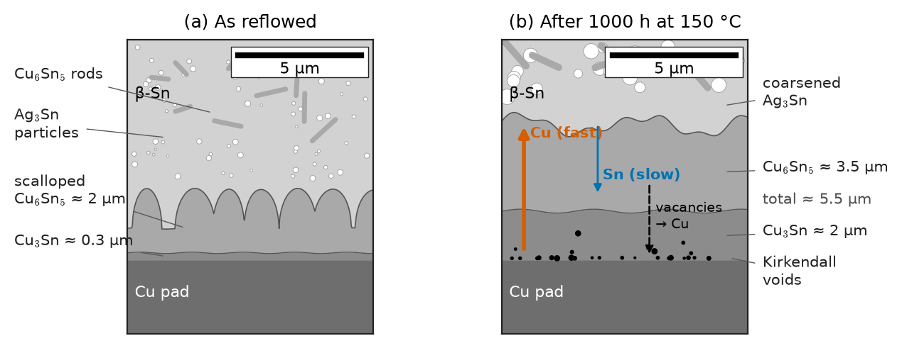
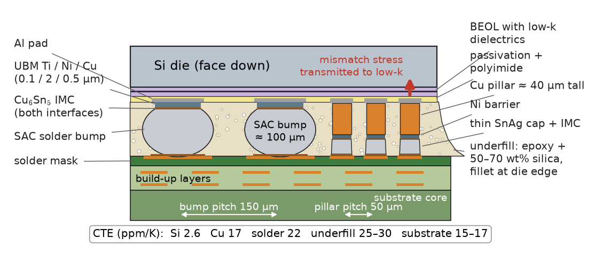
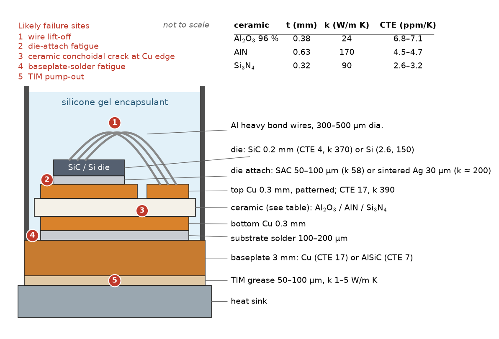
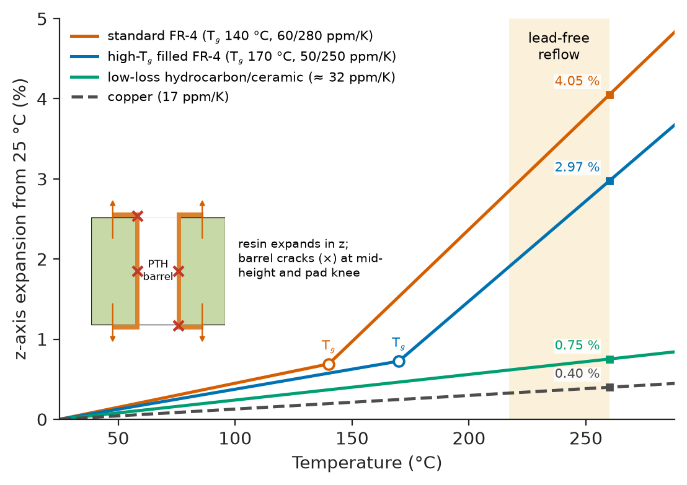
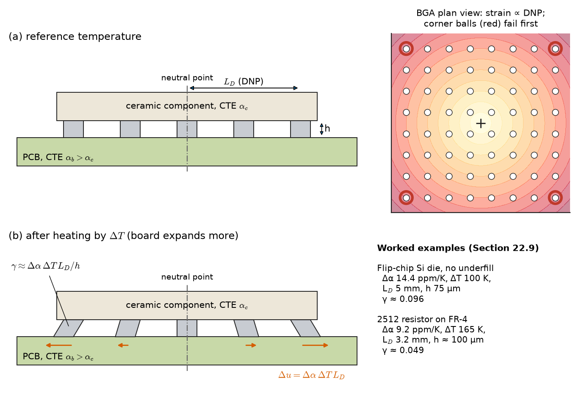
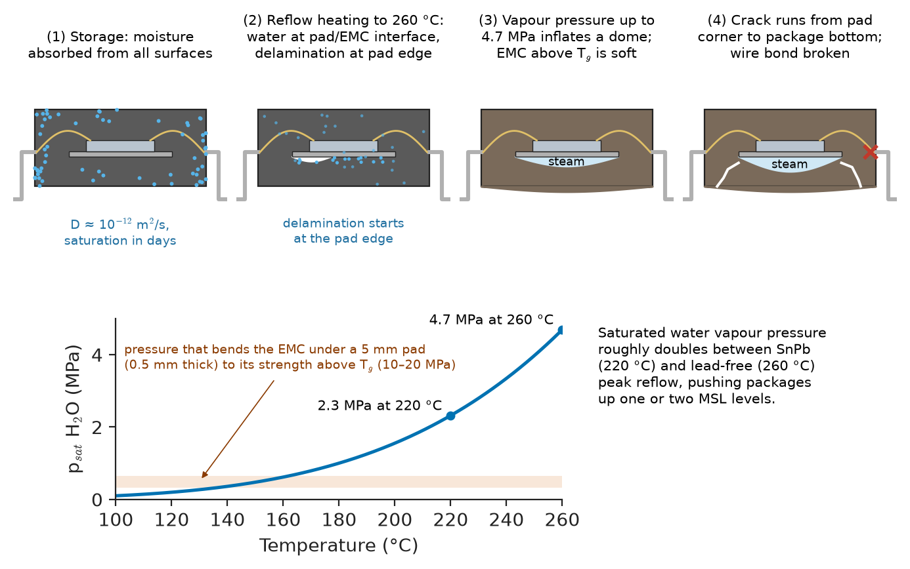

# Chapter 51 — Joining, Packaging, and Interconnect Materials

*Part X · Processing and Manufacturing*

An automotive engine-control unit returns from the field after three winters. Its silicon is perfect: every transistor still meets its datasheet. The fault is a cracked solder joint under a large ceramic resistor near the corner of the board. Sectioning shows a crack that started at the component side, ran through the tin just above a layer of copper–tin intermetallic, and grew a little with every cold start, when the board, the ceramic body and the solder all tried to shrink by different amounts. Nearby, a ball-grid-array package has a delamination under its die pad, the trace of a reflow at which moisture absorbed during storage turned to steam. Neither failure involves any semiconductor physics. Both involve the materials that sit between the die and the world — solders, intermetallics, laminates, ceramics, polymers — and the single property in which they differ most: thermal expansion.

> **What materials join a die to its package and the package to a board, and what does each contribute electrically, thermally and mechanically?**
> **Why do packages fail, and which material properties control how fast?**

| Concept | Engineering destination |
|---|---|
| Solder alloys, SnPb versus SAC | Reflow profiles, joint reliability, RoHS compliance |
| Intermetallics, Kirkendall voids | Joint embrittlement after aging, drop-shock failure |
| Tin whiskers | Shorts in lead-free assemblies, plating specification |
| Bonding wires | Wire choice for cost, current capacity, power cycling |
| Flip-chip bumps, Cu pillars, underfill | Fine-pitch, high-I/O and high-current die connection |
| ICA and ACF | Display drivers, flex attachment, low-temperature assembly |
| Alumina, AlN, Si$_3$N$_4$, DBC/AMB, LTCC | Power-module and RF substrates, thermal resistance |
| FR-4 $T_g$, $T_d$, z-axis CTE, $D_k$/$D_f$ | Via reliability, lead-free compatibility, signal loss at GHz |
| Moulding compounds, silicones | Package protection, moisture sensitivity |
| Thermal interface materials | Junction temperature, power density |
| CTE mismatch, DNP shear strain | Solder-fatigue life estimates, component placement |
| Warpage, popcorn cracking, failure mechanisms | Assembly yield, moisture sensitivity levels, qualification |

**Roadmap.** Joining materials: solders and their reactions (51.1), wires (51.2), bumps and underfill (51.3), adhesives (51.4) → what the package is built on: substrates (51.5) and laminates (51.6) → protection and heat removal: encapsulants (51.7) and TIMs (51.8) → the central mechanical problem, CTE mismatch (51.9) → how it all fails (51.10).

> **Boundary.** This chapter treats the materials of packaging and assembly. Package electrical and thermal design, assembly process control and system-level thermal management are engineering subjects beyond this book; fatigue, creep, corrosion and electromigration as failure physics are developed in Chapter 44.

---

## 51.1 Solder materials

Solder is the most widely used joining material in electronics — a typical smartphone has thousands of joints, a server board tens of thousands. A solder joint must wet both surfaces, carry current, conduct heat, and hold the component mechanically through thousands of thermal cycles, all with a material that is close to its melting point at room temperature.

### Why low-melting tin alloys?

The process requirement is a filler that melts well below the damage temperature of components and laminates (roughly 260 °C for short times) and wets copper, nickel and gold surfaces. Tin is the base of almost every solder because it reacts with these metals to form intermetallic compounds — the reaction *is* the bond — and melts at 232 °C. Alloying lowers the melting point (eutectics, Chapter 9) and adjusts mechanical behaviour.

The price is a high **homologous temperature** in service. At 25 °C, eutectic SnPb is at $298/456=0.65\,T_m$ and SAC305 at $298/490=0.61\,T_m$. At these temperatures diffusion is fast, the microstructure coarsens, and the solder deforms by **creep** at stresses far below its yield strength (Chapter 14). A solder joint is never really "cold".

### Tin–lead and the lead-free transition

Eutectic 63Sn–37Pb (183 °C) dominated electronics for decades: it wets well, has a low melting point, forms a fine two-phase microstructure, and is ductile and forgiving. The EU RoHS directive (2006) and similar laws restricted lead in most electronic products; high-reliability sectors (aerospace, defence, some medical and automotive) retain exemptions, and high-lead solders (≥ 85 % Pb) remain exempt for high-temperature die attach where no adequate alternative exists.

The mainstream replacement is **SAC** (Sn–Ag–Cu), most commonly **SAC305** (Sn–3.0Ag–0.5Cu, melting range 217–220 °C). Its consequences for assembly are direct: peak reflow temperatures rise from about 215–225 °C to 240–260 °C, which pushed PCB laminates to higher $T_g$ and $T_d$ (Section 51.6) and components to higher moisture sensitivity (Section 51.10). Low-silver alloys (SAC105, SAC0307) reduce cost and are more compliant under drop impact; Sn–0.7Cu with a nickel addition (SN100C-type) is used for wave soldering; Sn–Bi alloys (138 °C eutectic) allow low-temperature assembly on heat-sensitive substrates but are brittle at high strain rates.

| Alloy | Melting (°C) | Density (g/cm$^3$) | CTE (ppm/K) | Young's modulus (GPa) | Resistivity (µΩ cm) | Thermal conductivity (W/m K) |
|---|---|---|---|---|---|---|
| 63Sn–37Pb | 183 | 8.4 | 24–25 | 30–35 | 14.5–15 | ≈ 50 |
| SAC305 | 217–220 | 7.4 | 21–23 | 45–51 | 12–13 | ≈ 58 |
| Sn–0.7Cu (+Ni) | 227 | 7.3 | 20–22 | ≈ 45 | ≈ 12 | ≈ 60 |
| Sn–58Bi | 138 | 8.6 | ≈ 15 | ≈ 40 | ≈ 34 | ≈ 19 |
| 95Pb–5Sn | 308–312 | 11.0 | ≈ 29 | ≈ 24 | ≈ 19 | ≈ 35 |
| 80Au–20Sn | 280 | 14.5 | ≈ 16 | ≈ 60 | ≈ 16 | ≈ 57 |
| Indium | 157 | 7.3 | ≈ 32 | ≈ 11 | ≈ 8.4 | ≈ 82 |

*Typical bulk values; joint properties depend on microstructure and strain rate.*

### Microstructure of a SAC joint

A SAC joint is mostly β-Sn, with fine Ag$_3$Sn particles and Cu$_6$Sn$_5$ rods in the eutectic regions between Sn dendrites (Chapter 9). The Ag$_3$Sn network pins dislocations and reduces creep rate, which is why SAC joints outlast SnPb in mild cycling. But β-Sn is body-centred tetragonal and strongly anisotropic: its CTE is about 15–16 ppm/K along the a-axis and about 30 ppm/K along the c-axis, and its elastic modulus also varies with direction. Because β-Sn nucleates with difficulty, a SAC ball-grid-array joint often solidifies as one to three large grains (or a "beach-ball" cyclic twin structure). Each joint therefore has its own orientation and its own response to the same thermal cycle, and failures concentrate in joints whose c-axis orientation maximises the mismatch strain. Over time in cycling, Ag$_3$Sn particles coarsen (Chapter 10, Ostwald ripening), the strengthening fades, and recrystallisation in the most strained region creates a network of new grain boundaries along which fatigue cracks run.

### Intermetallic compounds

Wetting happens because molten tin dissolves a little of the pad metal and the solution then precipitates intermetallic compounds (IMCs) at the interface. On copper two compounds form:

- **Cu$_6$Sn$_5$** (η phase): forms during reflow as scalloped grains adjacent to the solder, typically 1–3 µm thick after assembly.
- **Cu$_3$Sn** (ε phase): forms between Cu and Cu$_6$Sn$_5$, thin after reflow, and grows during solid-state aging by the reaction of Cu with Cu$_6$Sn$_5$.

On nickel (ENIG or Ni underbump metallization), Ni$_3$Sn$_4$ forms, or (Cu,Ni)$_6$Sn$_5$ when the solder contains copper; these grow several times more slowly than the Cu–Sn compounds, which is why nickel is used as a barrier (Chapter 8). Gold from a finish dissolves completely and reprecipitates as AuSn$_4$; above about 3 wt% Au in the joint this embrittles it.

| Phase | Where it forms | Young's modulus (GPa) | Character |
|---|---|---|---|
| Cu$_6$Sn$_5$ | Sn-based solder on Cu, reflow and aging | 85–125 | Hard, brittle, scalloped |
| Cu$_3$Sn | Between Cu and Cu$_6$Sn$_5$, mainly in aging | 110–135 | Planar layer; Kirkendall voids at Cu side |
| Ni$_3$Sn$_4$ | Solder on Ni | 130–140 | Slow-growing; P-rich Ni layer beneath on ENIG |
| (Cu,Ni)$_6$Sn$_5$ | Cu-containing solder on Ni | ≈ 120 | Stabilised η; slows Ni consumption |
| AuSn$_4$ | Au dissolved in Sn solder | ≈ 50 | Brittle platelets; limit Au content |

*Typical values; IMC elastic constants vary with orientation and measurement method.*

A thin, continuous IMC layer is essential — no IMC means no bond — but IMCs are brittle (fracture toughness about 1–2 MPa√m, versus tens for the solder), and they keep growing in service. Thick IMC shifts the failure mode under shock loading from ductile fracture in the solder to brittle fracture through the IMC.

**IMC growth.** Solid-state growth is controlled by interdiffusion through the IMC layer, so thickness follows the parabolic law of Chapter 8:

$$
x=x_0+\sqrt{k\,t},\qquad k=k_0\exp\!\left(-\frac{Q}{RT}\right)
$$

with activation energies typically 60–110 kJ/mol for total Cu–Sn IMC growth.

> **Status of the principle: parabolic IMC growth**
> *Approximate.* It follows from diffusion-controlled growth through a planar layer with constant interfacial concentrations. Measured time exponents range from about 0.3 to 0.5 because grain-boundary diffusion through coarsening IMC grains contributes; $k_0$ and $Q$ are fitted for each solder–pad combination.

**Worked example — IMC growth in service versus in an aging test.** A SAC305 joint on copper leaves reflow with $x_0=2$ µm of IMC. A qualification test at 150 °C finds 3.5 µm of additional growth after 1000 h ($3.6\times10^6$ s), so $k(150\ ^\circ\mathrm{C})=(3.5\times10^{-6})^2/3.6\times10^6=3.4\times10^{-18}$ m$^2$/s. With $Q=90$ kJ/mol, what does 10 years at 85 °C produce?

$$
\frac{k(358\ \mathrm{K})}{k(423\ \mathrm{K})}=\exp\!\left[-\frac{90\,000}{8.314}\left(\frac1{358}-\frac1{423}\right)\right]=\exp(-4.65)=0.0096
$$

so $k(85\ ^\circ\mathrm{C})=3.3\times10^{-20}$ m$^2$/s. Ten years is $3.16\times10^8$ s:

$$
\sqrt{kt}=\sqrt{3.3\times10^{-20}\times3.16\times10^8}=3.2\ \mathrm{\mu m},\qquad x\approx2+3.2=5.2\ \mathrm{\mu m}
$$

The aging test at 150 °C accelerates growth by a factor of $1/0.0096\approx104$ in $k$, so 1000 h at 150 °C is equivalent to about $1.04\times10^5$ h, or 12 years, at 85 °C. The result depends strongly on $Q$: with $Q=60$ kJ/mol the acceleration factor would be only 22. This is the general weakness of Arrhenius acceleration (Chapter 44): the extrapolation is only as good as the activation energy, which must be measured for the actual mechanism.

### Kirkendall voids

In the Cu/Cu$_3$Sn couple, copper diffuses faster than tin. The unequal atomic fluxes are balanced by a net flux of vacancies toward the copper side; where vacancies supersaturate they condense as **Kirkendall voids**, usually at the Cu/Cu$_3$Sn interface or inside Cu$_3$Sn (Figure 51.1). After long aging the voids can link into a near-continuous plane, and the joint then fails at low force in a drop or bend test. Voiding is strongly promoted by impurities codeposited in electroplated copper (organic additives, sulphur), which segregate to the interface and nucleate voids. Remedies are high-purity plating chemistries, nickel barriers, and small Ni or Zn additions to the solder, which form (Cu,Ni)$_6$Sn$_5$ and suppress Cu$_3$Sn growth.

<!-- FIGURE 51.1 | figures/ch51/fig-51-1-solder-joint-imc-kirkendall.png | micrograph-style | Cross-section of a SAC305 joint on a copper pad after reflow and after prolonged aging, showing the intermetallic layers and Kirkendall voids. | Content: two side-by-side SEM-style cross-sections at the same scale (scale bar 5 µm). (a) As-reflowed: Cu pad at bottom, thin Cu3Sn (≈0.3 µm), scalloped Cu6Sn5 (≈2 µm) with scallops protruding into the solder, β-Sn matrix above with fine Ag3Sn particles and Cu6Sn5 rods in eutectic regions. (b) After 1000 h at 150 °C: planar thicker Cu3Sn (≈2 µm), flatter Cu6Sn5 (≈3.5 µm), total ≈5.5 µm; row of small dark Kirkendall voids at the Cu/Cu3Sn interface and within Cu3Sn; coarsened Ag3Sn. Arrows indicating Cu diffusion upward (fast) and Sn downward (slow), net vacancy flux toward Cu. Labels for each layer. -->

*Figure 51.1 — Cross-section of a SAC305 joint on a copper pad after reflow and after prolonged aging, showing the intermetallic layers and Kirkendall voids.*

### Tin whiskers

Pure tin and high-tin finishes on component leads and connectors can grow **whiskers**: single-crystal filaments 1–5 µm in diameter and up to several millimetres long, extruded from the surface over months to years. A whisker can bridge adjacent leads and carry tens of milliamperes before fusing; in vacuum, a whisker short can vaporise into a metal plasma that sustains a high-current arc. Whisker-induced shorts have caused documented failures in satellites, pacemakers, missiles and nuclear-plant instrumentation.

The driving force is **compressive stress** in the tin film. On copper, Cu diffuses into Sn grain boundaries at room temperature and forms Cu$_6$Sn$_5$ wedges, which occupy more volume than the tin they replace and push the surrounding tin grains into compression. Stress is relieved by tin atoms diffusing along grain boundaries to a grain whose boundaries are pinned (often by a surface oxide crack), which then grows outward from its root. CTE mismatch in thermal cycling, external mechanical loads (connector springs, press-fit pins) and surface corrosion add stress.

Mitigations follow from the mechanism:

- **Nickel underlayer** (1–2 µm) between copper and tin, which stops room-temperature Cu$_6$Sn$_5$ growth.
- **Annealing** the tin plating (e.g. 150 °C for 1 h) soon after plating, which forms a uniform planar Cu$_6$Sn$_5$ layer that relaxes stress and slows further grain-boundary IMC growth.
- **Matte tin** (larger grains, fewer codeposited organics, lower residual stress) instead of bright tin, and thicker plating (≥ 8–10 µm).
- **Alloying**: a few per cent Pb practically eliminates whiskers (one reason for lead exemptions); Bi additions help somewhat.
- **Reflowing** the finish (fusing), or **conformal coating** that a whisker must puncture.

> **Status of the principle: compressive-stress model of whisker growth**
> *Approximate* and partly *empirical*. Compressive stress and grain-boundary diffusion are established as necessary; why a particular grain becomes a whisker, and how to predict incubation time and length, remain incompletely understood, so mitigation relies on tested practice (JEDEC JESD201) rather than calculation.

---

## 51.2 Bonding wires

In most packages the die's bond pads are connected to the leadframe or substrate by fine wires, typically 15–50 µm in diameter for signal and logic, and 100–500 µm aluminium or copper wire or ribbon for power devices.

### Bonding methods

- **Thermosonic ball bonding**: the wire end is melted by an electric spark into a ball, which is pressed onto the pad with ultrasonic energy at 120–220 °C; the wire is then looped to the second bond (a wedge-shaped "stitch"). Used with Au, Cu and Ag wire.
- **Ultrasonic wedge bonding**: the wire is pressed and ultrasonically scrubbed onto the pad at room temperature with a wedge tool. Used with Al wire (including heavy power wire) and Cu ribbon.

In both, the bond forms in the solid state: ultrasonic scrubbing breaks surface oxides and contaminants and brings clean metal surfaces into atomic contact, with local plastic deformation and heating. Interdiffusion then forms intermetallics where the metals differ.

| Wire | Resistivity (µΩ cm) | Thermal conductivity (W/m K) | Typical diameter | Bond method | Key issues |
|---|---|---|---|---|---|
| Au (99.99 %) | 2.2–2.3 | ≈ 315 | 15–50 µm | Thermosonic ball | Cost; Au–Al IMC and Kirkendall voids |
| Cu, Pd-coated (PCC) | 1.7–1.9 | ≈ 400 | 15–50 µm | Thermosonic ball, forming gas | Hard ball: pad cratering; oxidation; Cl corrosion of Cu–Al IMC |
| Ag alloy | 2–5 | 150–400 | 15–50 µm | Thermosonic ball | Ag migration, sulphidation; used in LEDs for reflectivity |
| Al–1 % Si | ≈ 3.0 | ≈ 200 | 25–50 µm | Ultrasonic wedge | Low cost, monometallic bond on Al pads |
| Al (99.99 %) heavy wire | ≈ 2.7 | ≈ 235 | 100–500 µm | Ultrasonic wedge | Lift-off and heel cracks in power cycling |
| Cu heavy wire / ribbon | ≈ 1.7 | ≈ 400 | 100–500 µm, ribbons | Ultrasonic wedge | Needs Cu-metallised die; high bond force |

*Typical values.*

### Gold, copper and silver

Gold was the standard for decades because it does not oxidise, forms a ball easily in air, and bonds readily to aluminium pads. Its weakness is the Au–Al reaction: five intermetallic phases form (Au$_5$Al$_2$, Au$_4$Al, Au$_2$Al, AuAl, AuAl$_2$, the last purple — hence "purple plague"), and gold's faster diffusion produces Kirkendall voiding around the ball at high temperature (above roughly 150 °C for long times), increasing resistance until the bond opens. Halogen contamination (Br from flame retardants in moulding compound) accelerates the corrosion of these intermetallics.

Since about 2010, cost has driven most high-volume production to **copper wire**, usually palladium-coated to resist oxidation. Copper is cheaper, conducts electricity about 25 % better and heat better, and its Cu–Al intermetallics grow much more slowly than Au–Al. But a copper ball is harder, so it needs higher bonding force that can crack the dielectric under the pad (**pad cratering**, a growing risk with mechanically weak low-$k$ stacks, Chapter 50), and Cu–Al intermetallics corrode in the presence of chloride and moisture. Copper wire also oxidises during ball formation unless shielded by forming gas.

Silver-alloy wire is used in LEDs, where silver's reflectivity helps, and in some low-cost packages; its drawbacks are electrochemical migration (Chapter 44) and tarnishing by sulphur.

### Heavy wire in power modules

IGBT and SiC power modules connect the die tops with heavy aluminium wires, each carrying 10–30 A.

**Worked example — Resistance and heating of bond wires.** A 25 µm gold wire 2 mm long has

$$
R=\frac{\rho L}{\pi r^2}=\frac{2.2\times10^{-8}\times2\times10^{-3}}{\pi(12.5\times10^{-6})^2}=0.090\ \Omega
$$

(0.069 Ω in copper). At 100 mA it dissipates under 1 mW: negligible for signals. A 400 µm aluminium power wire 10 mm long has $R=2.7\times10^{-8}\times10^{-2}/(\pi\times(2\times10^{-4})^2)=2.15$ mΩ and dissipates $30^2\times2.15\times10^{-3}=1.9$ W at 30 A. That heat, deposited in a wire cooled mainly through its two bonds, is part of why multiple parallel wires are used — and the temperature swing of every power cycle, combined with the CTE mismatch between aluminium (23 ppm/K) and silicon (2.6 ppm/K), drives fatigue cracks along the bond interface until the wire **lifts off**, the dominant wear-out mechanism of conventional power modules. Copper wire on copper-metallised dies, sintered-silver die attach (Section 51.8) and wire-free planar interconnects extend power-cycling life by factors of several to ten.

---

## 51.3 Flip-chip interconnects

In **flip-chip** assembly, the die is turned face down and connected to the substrate by an area array of bumps. Compared with wire bonding, it allows thousands of I/O across the whole die area rather than only at the periphery, shorter (lower-inductance) connections, and heat extraction through the back of the die.

### Bump structure

A bump is a small stack of materials, each with a specific job (Figure 51.2):

- **Under-bump metallization (UBM)** on the die's aluminium or copper pad: an adhesion layer (Ti, Cr, TiW), a barrier and wettable layer (Ni, Ni(V), or Cu thick enough to survive consumption by Sn), and sometimes a protective Au flash. The UBM must not be consumed by the solder through repeated reflow and service; thin copper UBMs can be converted entirely into Cu–Sn IMC, after which the bump detaches.
- **Solder bump** or **copper pillar with solder cap**.

| Interconnect | Typical pitch | Material | Notes |
|---|---|---|---|
| C4 solder bump (legacy) | 150–250 µm | 95Pb–5Sn or 97Pb–3Sn | Controlled-collapse; high melting, ductile; still used in high-reliability |
| Lead-free solder bump | 130–200 µm | SnAg, SAC | Mainstream for coarse-pitch flip-chip |
| Cu pillar + solder cap | 40–150 µm | Cu 20–80 µm tall + SnAg cap | Fine pitch, better electromigration and thermal path |
| Microbump | 10–55 µm | Cu/Ni + SnAg, often fully converted to IMC | 2.5D/3D stacking, HBM memory |
| Hybrid (Cu–Cu) bonding | < 10 µm | Cu pads in SiO$_2$, direct bond | No solder; dielectric bonded first, Cu interdiffused at 200–400 °C |

*Typical ranges.*

### Copper pillars

A copper pillar keeps a fixed standoff regardless of solder volume, so pitch can shrink without bumps bridging. Because copper carries most of the height, current crowding at the pad entrance is reduced and the electromigration life is longer than for a solder bump of the same diameter (Chapter 44); copper's conductivity also improves heat removal. But copper pillars are stiff: with no compliant solder to deform, more of the thermal-mismatch stress is transmitted to the die's interconnect stack, a serious problem over weak low-$k$ dielectrics (Chapter 50). In microbumps, the thin solder cap is often fully converted to IMC (Cu$_6$Sn$_5$ or Ni$_3$Sn$_4$) during assembly, so the joint's mechanical and electromigration behaviour are those of the intermetallic, not of solder.

### Underfill

A die soldered face-down onto an organic substrate experiences the full CTE mismatch between silicon (2.6 ppm/K) and the laminate (≈ 15–17 ppm/K) across tiny joints. Section 51.9 shows that without help the resulting shear strain fails corner bumps within tens or hundreds of cycles. **Underfill** — an epoxy filled with 50–70 wt% spherical silica — is dispensed along the die edge after reflow, drawn into the gap (25–100 µm) by capillarity, and cured. It mechanically couples die and substrate so that they bend together as a laminate instead of shearing the bumps; strain in the joints falls by roughly an order of magnitude and fatigue life rises by a factor of 10 or more.

The underfill's properties are a compromise: CTE (20–35 ppm/K below $T_g$) near that of the solder, modulus high enough (6–12 GPa) to couple the structure, $T_g$ above the operating range (typically 120–160 °C), low viscosity and fast flow (which limits filler content and particle size, since particles must pass the gap), and strong adhesion to passivation, solder mask and solder. Variants include **no-flow underfill** dispensed before placement and cured during reflow, **moulded underfill** in which the encapsulant fills the gap, and **wafer-level underfill** films. Adhesion loss at the underfill–die interface (from moisture, contamination or poor plasma cleaning) defeats the coupling and is a common root cause of bump fatigue.

<!-- FIGURE 51.2 | figures/ch51/fig-51-2-flip-chip-cu-pillar-underfill.png | schematic | Cross-section of a flip-chip joint on an organic substrate, comparing a solder bump with a copper pillar, both with underfill. | Content: inverted silicon die at top (with interconnect stack and low-k layers indicated, passivation and polyimide), substrate at bottom (core, build-up layers, Cu pads, solder mask). Left joint: Al pad, UBM stack Ti/Ni/Cu (labels and thickness), solder bump ~100 µm diameter, Cu6Sn5 at both interfaces. Right joint: Cu pillar ~40 µm tall, ~30 µm diameter, Ni barrier, thin SnAg cap, IMC layers. Underfill (silica-filled epoxy, filler spheres drawn) filling the gap with fillet at die edge. Annotations of CTE: Si 2.6, Cu 17, solder 22, underfill 25–30, substrate 15–17 ppm/K. Arrow showing 'mismatch stress transmitted to low-k layers' above the pillar. Pitch arrows: 150 µm (bump) vs 50 µm (pillar). -->

*Figure 51.2 — Cross-section of a flip-chip joint on an organic substrate, comparing a solder bump with a copper pillar, both with underfill.*

---

## 51.4 Conductive adhesives

**Electrically conductive adhesives** are polymers (usually epoxies) filled with conductive particles. They join at 120–180 °C instead of 220–260 °C, need no flux, contain no lead, and bond to glass, ceramics, flexible films and plastics that solder cannot wet. Their limitations are higher resistivity, sensitivity to moisture and weaker impact strength.

### Isotropic conductive adhesives (ICA)

ICAs conduct in all directions. They contain about 25–35 vol% (70–85 wt%) silver flakes. Conduction requires a continuous network of touching particles, and the conductivity follows **percolation** behaviour (Chapter 25):

$$
\sigma\propto(\phi-\phi_c)^t,\qquad \phi>\phi_c
$$

with $\phi$ the filler volume fraction, $\phi_c$ the percolation threshold (about 0.16 for randomly placed spheres in three dimensions, lower for flakes) and exponent $t\approx1.6$–2.

> **Status of the principle: percolation scaling**
> *Approximate.* It follows from statistical models of random networks near threshold; the exponent is nearly universal but $\phi_c$ depends on particle shape, size distribution and processing. Far above threshold, resistance is dominated by particle–particle contact resistance, which depends on cure shrinkage pressing flakes together and on lubricant layers left on the flakes from milling.

Typical ICA volume resistivity is $10^{-4}$–$10^{-3}$ Ω cm — ten to a hundred times that of solder ($1.2\times10^{-5}$ Ω cm for SAC). Cure shrinkage of the epoxy is essential: it compresses the flake network and lowers resistance by orders of magnitude. ICAs are used for die attach (where thermal conductivity of 2–25 W/m K is also specified), for attaching components to flexible circuits and to temperature-sensitive substrates, and for the interconnection of solar-cell strings. Two reliability concerns are specific: **galvanic corrosion** at contacts with tin or tin-plated terminations in humidity, where the Sn–Ag couple forms an insulating tin oxide at the interface and resistance rises sharply; and **silver migration** under bias in humid conditions (Chapter 44). Noble finishes (Au, Ag, Pd) on mating surfaces avoid the first.

### Anisotropic conductive films and pastes (ACF, ACP)

An **anisotropic conductive film** contains conductive particles at a concentration well *below* the percolation threshold, typically 3–10 µm in diameter: nickel spheres, or polymer spheres plated with Ni and Au (which deform elastically and keep a spring-loaded contact as the adhesive relaxes). The film is laminated between two sets of bumps or pads and bonded with heat (150–200 °C) and pressure for 5–20 s. Particles trapped between facing pads are squeezed into contact and conduct through the thickness; particles in the gaps between pads remain isolated from each other, so there is no lateral conduction. ACF is the standard for attaching driver chips to glass in displays (chip-on-glass), flex cables to glass and boards, and camera modules.

**Worked example — How many particles connect a pad?** An ACF has 40 000 particles/mm$^2$ in its plane. A driver-IC bump is 20 µm × 100 µm $=0.002$ mm$^2$, so on average $40\,000\times0.002=80$ particles lie over it; resin flow during bonding sweeps some away, and suppose half are captured, $\bar n=40$. Particle capture is close to a Poisson process, so the probability that a pad captures *no* particle is $e^{-40}\approx4\times10^{-18}$: opens are effectively impossible. The opposite risk is a short: in the 10–20 µm gaps between bumps, particles pushed out by the flowing resin can chain together. That risk rises with particle density, so density is a compromise between opens on small pads and shorts across fine gaps. Fine-pitch ACFs control it by fixing particles in a single layer of the film or by insulating each particle with a thin polymer shell that ruptures only under the bonding pressure on the pads. If each captured particle contributes of order 1–10 Ω, forty in parallel give 0.03–0.3 Ω per connection — acceptable for display drivers, unacceptable for power.

---

## 51.5 Substrate materials

The substrate carries the die (or several dies), routes their connections, insulates them electrically and conducts their heat to a heat sink. For logic and memory, organic laminates dominate (Section 51.6). For power electronics, RF and harsh environments, ceramics do, because they combine electrical insulation with high thermal conductivity, low CTE, hermeticity and temperature stability.

| Substrate | Thermal conductivity (W/m K) | CTE (ppm/K) | $\varepsilon_r$ (1 MHz) | Flexural strength (MPa) | $K_{IC}$ (MPa√m) | Notes |
|---|---|---|---|---|---|---|
| 96 % Al$_2$O$_3$ | ≈ 24 | 6.8–7.1 | 9.4–9.8 | 350–400 | 3.5–4 | Cheapest; glassy grain boundary (Chapter 17) |
| 99.6 % Al$_2$O$_3$ | 30–35 | ≈ 7.0 | ≈ 9.9 | 500–600 | ≈ 4 | Thin-film circuits, smooth surface |
| AlN | 170–200 | 4.5–4.7 | 8.6–8.9 | 300–400 | 2.7–3.5 | CTE close to Si; brittle; hydrolyses in water |
| Si$_3$N$_4$ | 60–90 | 2.6–3.2 | 7.8–8.1 | 650–850 | 6–7.5 | Tough: thinner substrates, long cycling life |
| BeO | 250–280 | 7.5–8.5 | ≈ 6.7 | 200–250 | — | Toxic dust; RF and military legacy |
| LTCC (glass-ceramic) | 2–4 | 5.5–7 | 5–8 | 200–300 | — | Multilayer, co-fired Ag; RF modules |
| HTCC (Al$_2$O$_3$ + W) | 15–25 | ≈ 7 | ≈ 9.5 | 300–400 | — | Hermetic packages, high-temperature |
| FR-4 (for comparison) | ≈ 0.3 | 14–17 (x–y) | 4.3–4.7 | ≈ 400 (x–y) | — | Organic laminate |

*Typical values.*

AlN has seven times the thermal conductivity of 96 % alumina and a CTE close to silicon and SiC, so it reduces both thermal resistance and die-attach stress. It achieves that conductivity only if oxygen is kept out of the lattice during sintering (Chapter 17); oxygen dissolved in AlN creates aluminium vacancies that scatter phonons. Si$_3$N$_4$ has lower thermal conductivity than AlN but more than twice the strength and fracture toughness, because its sintering produces interlocking elongated β-Si$_3$N$_4$ grains that deflect and bridge cracks. A Si$_3$N$_4$ substrate can therefore be made thinner, which recovers most of the thermal advantage.

### Metallised ceramics for power modules

A power-module substrate is a ceramic plate with thick copper on both faces: the top patterned into circuit traces carrying hundreds of amperes, the bottom soldered or sintered to a baseplate or heat sink (Figure 51.3).

- **Direct bonded copper (DBC)**: oxidised copper foil (0.2–0.6 mm) is placed on alumina or AlN and heated to about 1065–1080 °C, between the Cu–Cu$_2$O eutectic (1065 °C) and the melting point of copper (1085 °C). A thin eutectic liquid forms at the interface, wets the ceramic, and on cooling bonds the copper to it. (On AlN the surface is first oxidised to give an alumina layer for the reaction.)
- **Active metal brazing (AMB)**: copper is brazed to the ceramic with an Ag–Cu eutectic filler containing a few per cent titanium at 800–900 °C. The titanium reacts with the ceramic to form a wettable reaction layer (TiN on nitrides). AMB is the standard for Si$_3$N$_4$, which does not bond by the DBC route.

The bonding temperature sets a built-in problem. Copper (17 ppm/K) and ceramic (3–7 ppm/K) are stress-free only at the bonding temperature; on cooling, the copper yields and the ceramic is left with residual stress concentrated at the edges of the copper. Each subsequent thermal cycle repeats a smaller version, and failure occurs by **conchoidal cracking** of the ceramic under the copper edge or by delamination. As a rough guide, DBC on alumina and AlN survives hundreds of cycles of −55/150 °C before cracking, whereas AMB on Si$_3$N$_4$ survives thousands. Dimpling and stepping the copper edges reduces the stress concentration, and thinner copper reduces the stress at the cost of current capacity and heat spreading.

**Worked example — Thermal resistance through the ceramic.** A 10 mm × 10 mm power die dissipates 100 W. Compare the one-dimensional conduction resistance $R=t/(kA)$ of three substrates, with $A=10^{-4}$ m$^2$ (ignoring heat spreading, which helps all three):

$$
\text{96\% Al}_2\text{O}_3\ (0.38\ \mathrm{mm}):\ \frac{0.38\times10^{-3}}{24\times10^{-4}}=0.158\ \mathrm{K/W}
$$

$$
\text{AlN}\ (0.63\ \mathrm{mm}):\ \frac{0.63\times10^{-3}}{170\times10^{-4}}=0.037\ \mathrm{K/W},\qquad \text{Si}_3\text{N}_4\ (0.32\ \mathrm{mm}):\ \frac{0.32\times10^{-3}}{90\times10^{-4}}=0.036\ \mathrm{K/W}
$$

At 100 W, the temperature drop across alumina is 15.8 K; across AlN or Si$_3$N$_4$, about 3.7 K. AlN gets there by conductivity; Si$_3$N$_4$ by being strong enough to be thin. The extra 12 K matters: semiconductor lifetime and power-cycling life both fall steeply with junction temperature (Chapter 44).

<!-- FIGURE 51.3 | figures/ch51/fig-51-3-power-module-stack.png | schematic | Cross-section of a power-module stack from die to heat sink, with material, thickness, CTE and thermal conductivity of each layer. | Content: layered cross-section (not to scale, but thicknesses annotated): Al heavy bond wires on top; SiC or Si die (0.2 mm; CTE 2.6–4; k 150–370); die attach (SAC solder 50–100 µm or sintered Ag 30 µm; k 58 vs ~200); top Cu (0.3 mm; CTE 17; k 390) patterned; ceramic (Al2O3 0.38 mm / AlN 0.63 mm / Si3N4 0.32 mm with k and CTE listed in a side table); bottom Cu (0.3 mm); substrate solder (100–200 µm); Cu or AlSiC baseplate (3 mm; CTE 17 vs 7); TIM (grease 50–100 µm, k 1–5); heat sink. Silicone gel encapsulant filling the housing above. Red markers at likely failure sites: wire lift-off, die-attach fatigue, ceramic conchoidal crack at Cu edge, baseplate solder fatigue, TIM pump-out. -->

*Figure 51.3 — Cross-section of a power-module stack from die to heat sink, with material, thickness, CTE and thermal conductivity of each layer.*

### LTCC and HTCC

**Co-fired ceramics** build multilayer circuits by screen-printing conductors on unfired ceramic tapes, punching and filling vias, laminating the stack and firing it once (Chapter 17). **HTCC** (alumina fired at 1500–1600 °C with W or Mo conductors) gives strong, hermetic packages for high-reliability and high-temperature use, at the cost of the high resistivity of W and Mo (5–6 µΩ cm bulk, higher as co-fired). **LTCC** (glass-ceramic fired at 850–900 °C with Ag or Au) gives low-loss conductors and a low, stable permittivity ($\varepsilon_r$ 5–8, $\tan\delta$ about 0.001–0.002 at GHz), and allows embedded passives and cavities. It is used for RF front-end modules, radar and automotive sensors; its low thermal conductivity (2–4 W/m K) requires thermal vias under hot components.

---

## 51.6 Printed circuit board laminates

The printed circuit board is the largest material in most electronic assemblies, and the one whose properties are most often misunderstood. A laminate is a composite (Chapter 22): woven glass fabric impregnated with a thermosetting resin, pressed with copper foil and cured. Its properties come from the resin, the glass, and their arrangement.

### FR-4

**FR-4** ("flame retardant, grade 4") is woven E-glass in an epoxy resin, traditionally brominated for flame retardance; halogen-free grades use phosphorus compounds and inorganic fillers. Four properties dominate laminate selection.

**Glass-transition temperature $T_g$.** Below $T_g$ the cured epoxy network is glassy and stiff; above it, segmental motion of the polymer chains turns the resin rubbery: modulus drops by an order of magnitude and CTE increases several-fold (Chapter 20). $T_g$ is measured by DSC (heat-capacity step), TMA (CTE change) or DMA (loss peak), and the methods give values differing by 5–15 K, so the method must be stated. Standard FR-4 has $T_g$ of 130–140 °C, mid-$T_g$ about 150 °C and high-$T_g$ 170–180 °C.

**Decomposition temperature $T_d$.** The temperature at which the resin has lost 5 % of its mass by thermogravimetric analysis. Dicyandiamide-cured standard FR-4 has $T_d\approx300$–320 °C; phenolic-cured grades designed for lead-free reflow reach 340–350 °C. Because lead-free peak reflow (≈ 260 °C) approaches the onset of decomposition for older resins, $T_d$ and the related **time to delamination** at 260 °C and 288 °C (T260, T288) became key specifications with the lead-free transition. Multiple reflows and rework make the margin matter.

**CTE.** In the plane (x–y), the glass fabric (E-glass CTE ≈ 5.5 ppm/K, modulus ≈ 72 GPa) constrains the resin, giving 13–17 ppm/K — conveniently close to copper (17 ppm/K). Through the thickness (z), there is no glass to restrain the resin, and the CTE is 45–70 ppm/K below $T_g$ and 200–300 ppm/K above it.

**Dielectric constant $D_k$ and dissipation factor $D_f$** (the PCB industry's names for $\varepsilon_r$ and $\tan\delta$, Chapter 26). Standard FR-4 has $D_k\approx4.2$–4.7 and $D_f\approx0.015$–0.022 at 1–10 GHz. Both depend on frequency, temperature, moisture and resin content (the glass has $D_k\approx6$, the epoxy about 3–3.5, so resin-rich thin laminates have lower $D_k$).

### Z-axis expansion and plated through-holes

A plated through-hole is a copper tube (barrel) 20–30 µm thick through the board thickness. The board expands in z by much more than the copper, and the copper must follow.

**Worked example — Z-axis expansion during lead-free reflow.** A 1.6 mm FR-4 board with $T_g=140$ °C, $\alpha_z=60$ ppm/K below $T_g$ and 280 ppm/K above it, is heated from 25 °C to 260 °C. The resin expands

$$
\frac{\Delta L}{L}=60\times10^{-6}\times(140-25)+280\times10^{-6}\times(260-140)=0.0069+0.0336=0.0405
$$

i.e. 4.05 %, or 65 µm over 1.6 mm. Copper ($\alpha=17$ ppm/K) would expand only $17\times10^{-6}\times235=0.40$ % (6.4 µm) on its own. The barrel must therefore be stretched by about 3.6 % — more than ten times the yield strain of electroplated copper (about 0.1–0.3 %) — and it deforms plastically. Each reflow, and each later thermal cycle, repeats a smaller plastic strain, and the barrel eventually cracks by low-cycle fatigue (Chapter 44), usually at its mid-plane or at the knee where it meets the pad. Most of the strain comes from the portion above $T_g$: raising $T_g$ to 170 °C with $\alpha_z=50/250$ ppm/K reduces the total expansion to about $50\times10^{-6}\times145+250\times10^{-6}\times90=2.98$ %. This calculation is why lead-free assembly drove the industry to high-$T_g$, low-z-CTE laminates and to filler-loaded resins (Figure 51.4).

<!-- FIGURE 51.4 | figures/ch51/fig-51-4-fr4-z-axis-expansion.png | plot | Through-thickness expansion of FR-4 laminates versus temperature compared with copper, showing the change of slope at the glass transition and the strain imposed on a plated through-hole during reflow. | Content: x-axis temperature 25–288 °C; y-axis percentage z-axis expansion 0–5 %. Curves: standard FR-4 (Tg 140 °C, 60/280 ppm/K) reaching 4.05 % at 260 °C; high-Tg filled FR-4 (Tg 170 °C, 50/250 ppm/K) reaching ~3.0 %; low-loss hydrocarbon/ceramic laminate (≈32 ppm/K, no Tg below 280 °C) reaching ~0.75 %; copper straight line (17 ppm/K) reaching 0.40 %. Shaded vertical band at 217–260 °C labelled 'lead-free reflow'; Tg points marked with circles. Inset: cross-section of a plated through-hole barrel with arrows showing resin expansion pulling on the barrel and crack locations at barrel mid-height and at the pad knee. -->

*Figure 51.4 — Through-thickness expansion of FR-4 laminates versus temperature compared with copper, showing the change of slope at the glass transition and the strain imposed on a plated through-hole during reflow.*

### Moisture, CAF and other laminate failure modes

Epoxy laminates absorb 0.1–0.5 wt% water. Moisture raises $D_k$ and $D_f$ (water has $\varepsilon_r\approx80$), lowers $T_g$, and at reflow can vaporise and delaminate the board (measling, blistering). Under bias and humidity, copper can migrate along the glass-fibre–resin interface between adjacent vias or traces, forming **conductive anodic filaments (CAF)** that eventually short the circuit; CAF resistance depends on resin–glass adhesion (silane coupling agents), hole-drilling damage and via spacing.

### High-frequency laminates

At gigahertz frequencies, dielectric loss in the laminate becomes a significant fraction of the signal budget. For a transmission line in a homogeneous dielectric, the dielectric attenuation is

$$
\alpha_d\approx\frac{\pi f\sqrt{\varepsilon_r}\,\tan\delta}{c}\ \ \mathrm{(Np/m)},\qquad \alpha_d\,[\mathrm{dB/m}]=8.686\,\alpha_d\,[\mathrm{Np/m}]
$$

> **Status of the principle: low-loss dielectric attenuation formula**
> *Derived* from transmission-line theory for small $\tan\delta$ and a TEM wave in a uniform dielectric. Microstrip lines with partly air-filled fields need an effective permittivity, and conductor loss (skin effect and copper roughness) adds separately and often dominates below a few GHz.

At 10 GHz the formula gives:

| Laminate | Construction | $D_k$ | $D_f$ | $\alpha_d$ at 10 GHz (dB/m) | z-CTE (ppm/K) |
|---|---|---|---|---|---|
| Standard FR-4 | E-glass / epoxy | 4.3 | 0.020 | ≈ 38 | 50–70 / 250–300 |
| Low-loss epoxy/PPE (e.g. Megtron 6 class) | Low-$D_k$ glass / modified PPE | 3.4–3.7 | 0.002–0.004 | ≈ 3–7 | ≈ 45 / ≈ 260 |
| Hydrocarbon–ceramic (e.g. RO4350B) | Woven glass / ceramic-filled hydrocarbon | 3.48 | 0.0037 | ≈ 6.3 | ≈ 32 |
| PTFE–ceramic (e.g. RO3003) | Ceramic-filled PTFE | 3.00 | 0.001 | ≈ 1.6 | ≈ 24 |
| PTFE–glass microfibre (e.g. RT/duroid 5880) | Random glass microfibre / PTFE | 2.20 | 0.0009 | ≈ 1.2 | ≈ 240 |
| Polyimide (flex) | Polyimide film | 3.2–3.5 | 0.002–0.008 | — | — |

*Typical datasheet values at about 10 GHz; attenuation is the dielectric contribution only.*

For FR-4: $\alpha_d=\pi\times10^{10}\times\sqrt{4.3}\times0.020/(3.0\times10^8)=4.35$ Np/m $=38$ dB/m, or 0.38 dB/cm; for RT/duroid 5880, $\pi\times10^{10}\times1.483\times0.0009/(3.0\times10^8)=0.14$ Np/m $=1.2$ dB/m. Over a 10 cm 10 GHz trace FR-4 loses 3.8 dB in its dielectric — half the power — while PTFE loses 0.12 dB. That is why RF and millimetre-wave circuits (radar, 5G front ends, satellite links) use PTFE or hydrocarbon–ceramic laminates, and why high-speed digital boards (25–112 Gb/s serial links) moved to low-loss epoxy/PPE resins.

PTFE's low loss comes from its non-polar C–F backbone, which has almost no orientational polarisation (Chapter 26). The price is mechanical and processing: PTFE is soft and creeps, has a high z-axis CTE unless ceramic-filled, a crystalline phase transition near 19 °C that causes a CTE step and a small $D_k$ shift, needs special plasma or sodium etching to make plated holes adhere, and costs five to ten times as much as FR-4. Ceramic filling reduces CTE and stabilises $D_k$ with temperature, and hybrid boards use a PTFE layer only for the RF signal layer, bonded to FR-4 for the rest of the stack. For precise RF design, the anisotropy of woven laminates also matters: $D_k$ differs between in-plane and through-thickness directions, and the glass weave causes skew between the two lines of a differential pair (Chapter 1, anisotropy).

---

## 51.7 Encapsulation materials

Encapsulation protects a die and its wires from mechanical damage, moisture, ionic contamination and light, and in power modules provides dielectric insulation between conductors at hundreds or thousands of volts.

### Epoxy moulding compounds

Most packaged ICs are encapsulated by **transfer moulding**: a pellet of epoxy moulding compound (EMC) is preheated, forced at about 175 °C into a mould cavity around the leadframe or substrate, and cured in 1–3 minutes, followed by a post-mould cure of several hours. An EMC is a highly engineered composite:

- **Resin**: epoxy (cresol-novolac, biphenyl or multi-aromatic) with a phenolic hardener and a catalyst.
- **Filler**: 70–90 wt% fused silica, as spheres with a broad size distribution to maximise packing while keeping viscosity low. Filler lowers CTE, raises modulus and thermal conductivity, and reduces moisture absorption. Alumina filler raises thermal conductivity to 2–3 W/m K for power packages.
- **Additives**: silane coupling agents (filler–resin and resin–leadframe adhesion), flame retardants (now halogen-free metal hydroxides or phosphorus compounds), carbon black for colour and laser marking, stress-relief modifiers (silicone rubber particles), mould-release waxes and ion getters.
- **Purity**: extractable chloride and sodium below about 20 ppm, because ionic contaminants mobilised by moisture corrode aluminium bond pads.

| Property | Typical EMC | Why it matters |
|---|---|---|
| Filler content | 70–90 wt% | Sets CTE, modulus, moisture uptake |
| CTE below $T_g$ ($\alpha_1$) | 7–15 ppm/K | Match to Si (2.6) and Cu (17); warpage |
| CTE above $T_g$ ($\alpha_2$) | 30–60 ppm/K | Stress during reflow |
| $T_g$ | 120–200 °C | Stability at operating and reflow temperatures |
| Young's modulus at 25 °C | 15–30 GPa | Stress transmitted to die |
| Moisture uptake (85 °C/85 % RH, saturated) | 0.2–0.5 wt% | Popcorn cracking, corrosion |
| Thermal conductivity | 0.7–1 W/m K (silica); 2–3 W/m K (alumina) | Heat removal through package |
| Ionic impurities (Cl$^-$, Na$^+$) | < 20 ppm | Pad and wire corrosion |

*Typical values.*

The CTE of the composite can be bracketed from its constituents, as in Chapter 22. For epoxy with $\alpha=60$ ppm/K and $E=3$ GPa and silica with $\alpha=0.5$ ppm/K and $E=72$ GPa, at 70 vol% silica, the simple volume-weighted rule of mixtures gives $0.3\times60+0.7\times0.5=18.4$ ppm/K, while the Turner model (which assumes all phases share the same strain, so that each is weighted by its stiffness) gives

$$
\alpha_c=\frac{\sum\alpha_iE_i\phi_i}{\sum E_i\phi_i}=\frac{60\times3\times0.3+0.5\times72\times0.7}{3\times0.3+72\times0.7}=\frac{79.2}{51.3}=1.5\ \mathrm{ppm/K}
$$

Measured values of about 8–12 ppm/K lie between these two estimates, and more refined models (Kerner, Schapery) reproduce them. The point is qualitative: the stiff, low-expansion filler dominates once it forms a connected skeleton, which is why EMC CTE falls steeply with filler loading above about 60 vol%.

### Silicones and other encapsulants

**Silicone gels** fill power modules (Figure 51.3). They are crosslinked polydimethylsiloxane networks so lightly crosslinked that the modulus is in the kPa range: they apply almost no stress to wires and dies, self-heal after a puncture, and remain stable from about −50 °C to 200 °C (special grades to 250 °C). They provide dielectric insulation (breakdown strength about 15–20 kV/mm) that suppresses partial discharge along the ceramic substrate edges, where the field is concentrated (Chapter 26). But their CTE is very high (250–300 ppm/K), they are permeable to moisture and gases, and they offer no mechanical protection, so modules carry a rigid housing. **Silicone elastomers** and **glob-top** epoxies cover chip-on-board dies; **potting** compounds (epoxy, polyurethane, silicone) encapsulate whole assemblies such as power supplies and ignition coils.

**Hermetic** packages — ceramic or metal bodies sealed with glass, brazes or welded lids (Au–Sn solder, Kovar lids with CTE ≈ 5–6 ppm/K matched to alumina and glass) — exclude moisture completely and are used where polymers cannot be trusted: aerospace, implantable medical devices, some optoelectronics and MEMS. Every polymer, however good, is permeable: the question for a non-hermetic package is not *whether* water reaches the die, but how fast and with what consequence.

---

## 51.8 Thermal interface materials

Two solid surfaces pressed together touch at only a few per cent of their nominal area, because both are rough and not perfectly flat; the gaps are filled with air ($k\approx0.026$ W/m K), so contact resistance is large. A **thermal interface material (TIM)** fills these gaps with something more conductive. Chapter 24 introduced TIMs as a thermal topic; here they are treated as package materials, whose microstructure and failure modes decide their real performance.

The thermal resistance of a TIM layer of bond-line thickness BLT and conductivity $k$, over area $A$, is

$$
R_{\mathrm{TIM}}=\frac{\mathrm{BLT}}{k\,A}+\frac{R''_{c1}+R''_{c2}}{A}
$$

where $R''_{c1}$ and $R''_{c2}$ are the specific contact resistances at the two interfaces (K m$^2$/W). For thin TIMs, the contact terms are often as large as the bulk term, so a high-$k$ TIM with poor wetting can be worse than a moderate-$k$ one applied thinly.

| TIM | $k$ (W/m K) | Typical BLT | Specific resistance (K mm$^2$/W) | Strengths | Failure modes |
|---|---|---|---|---|---|
| Thermal grease | 1–5 | 20–75 µm | 5–30 | Thin BLT, conforms, reworkable | Pump-out in cycling, dry-out |
| Phase-change material (PCM) | 1–5 | 25–75 µm | 5–30 | Solid when handled, flows above 45–60 °C | Similar to grease |
| Gap-filler pad | 1–15 (typ. 3–6) | 0.25–5 mm | 50–1000 | Fills large gaps and tolerances, insulating | High resistance, compression set |
| Dispensable gel | 2–8 | 0.1–2 mm | 30–500 | Low stress, automated dispensing | Slump, oil bleed |
| Graphite sheet | 400–1500 in-plane; 5–20 through | 25–200 µm | 5–20 | Spreads heat laterally, stable | Poor through-thickness $k$, conducts electrically |
| Indium solder TIM | ≈ 86 | 50–300 µm | 1–3 | Metallic conduction, CPU lid attach | Needs metallised surfaces, voiding |
| Sintered silver | 150–250 | 20–80 µm | < 1 | Die attach above 200 °C, high-cycle life | Process cost, needs Ag/Au finishes |

*Typical values; datasheet $k$ values are often measured under ideal conditions and overstate in-application performance.*

### Greases, PCMs, pads and gels

**Greases** are silicone or hydrocarbon oils loaded with 60–90 wt% of conductive ceramic or metal particles (Al$_2$O$_3$, ZnO, BN, AlN, Al, Ag). Their conductivity rises with filler fraction, but so does viscosity, which limits how thin the bond line can be pressed. During thermal cycling, warping surfaces pump the grease out of the gap (**pump-out**) and oil separation and evaporation **dry it out**, so thermal resistance rises over life. **Phase-change materials** are paraffin or polymer-based pads that are solid at room temperature (clean to handle) but melt at 45–60 °C, flow into the gaps, and behave like grease in operation. **Gap-filler pads** and **gels** are soft silicone elastomers loaded with ceramic filler; they absorb mechanical tolerances of millimetres between components and chassis and electrically insulate, at the cost of much larger thermal resistance.

### Solder TIMs and sintered silver

When the heat flux is high and the interface must last, metallic TIMs replace polymers. Indium (soft, $k\approx86$ W/m K) soldered between die and lid is used as **TIM1** in high-power processors; its ductility accommodates CTE mismatch without fatigue cracking. In power electronics, **silver sintering** has become the die-attach and substrate-attach method for SiC modules operating at junction temperatures above 175 °C. A paste of micro- or nano-scale silver particles with organic binder is printed, dried and sintered at 200–300 °C, with or without applied pressure (5–30 MPa for pressure sintering). The process is solid-state sintering (Chapter 46), driven by the high surface energy of the fine particles, at a homologous temperature of only about 0.4 for silver; the resulting joint is porous silver (10–30 % porosity) whose melting point is that of silver, 962 °C. It therefore operates at a low homologous temperature (0.36 at 200 °C) where creep is slow, unlike a solder at 0.8–0.9 $T_m$. Its thermal conductivity, 150–250 W/m K depending on porosity, is three to four times that of solder, and power-cycling life is improved by factors of five to ten.

**Worked example — Comparing TIM layers.** A 20 mm × 20 mm interface ($A=4\times10^{-4}$ m$^2$) carries 150 W. Compare:

- Grease, $k=3$ W/m K, BLT 50 µm, plus total contact resistance $5\times10^{-6}$ K m$^2$/W: $R=\frac{50\times10^{-6}}{3\times4\times10^{-4}}+\frac{5\times10^{-6}}{4\times10^{-4}}=0.042+0.0125=0.054$ K/W, a drop of 8.1 K.
- Gap pad, $k=6$ W/m K, 0.5 mm: $R=\frac{0.5\times10^{-3}}{6\times4\times10^{-4}}=0.21$ K/W (before contact resistance), a drop of 31 K.
- Indium, $k=86$ W/m K, 100 µm: $R=0.0029$ K/W, 0.4 K.
- Sintered silver, $k=200$ W/m K, 30 µm: $R=3.8\times10^{-4}$ K/W, 0.06 K.

The pad's higher datasheet conductivity does not compensate for its tenfold thickness; for fixed geometry, thickness is the dominant variable. Metallic interfaces are almost free thermally, which is why they are worth their process cost at the die, where heat flux is highest.

---

## 51.9 Coefficient-of-thermal-expansion mismatch

The materials of a package span almost two orders of magnitude in thermal expansion:

| Material | CTE (ppm/K, near 25 °C) |
|---|---|
| Fused silica | 0.5 |
| Si | 2.6 |
| Si$_3$N$_4$ | 2.6–3.2 |
| SiC | ≈ 4.0 |
| AlN | 4.5 |
| Alloy 42 (Fe–42Ni) | 4.5 |
| Mo | 4.8–5.1 |
| Kovar (Fe–Ni–Co) | 5.1–5.9 |
| GaAs | 5.7 |
| Al$_2$O$_3$ (96 %) | 6.8–7.1 |
| AlSiC (baseplate) | 7–8 |
| EMC (below $T_g$) | 7–15 |
| FR-4 in-plane | 13–17 |
| Cu | 17 |
| SAC solder | 21–23 |
| Al | 23 |
| Underfill (below $T_g$) | 20–35 |
| FR-4 z-axis (below $T_g$) | 45–70 |
| Silicone gel | 250–300 |

*Typical values (Chapter 24).*

Whenever two bonded materials with different CTEs change temperature, either they bend, or the joint between them deforms, or both. Every package is a set of such pairs, and every power-on, power-off, day–night or engine cycle is a thermal cycle. CTE mismatch is called **global** when it is between component and board, and **local** when it is between the solder and the materials it joins (solder vs Cu, solder vs Si), which matters even when the global mismatch is zero.

### Shear strain in a solder joint: the DNP rule

Consider a rigid, leadless component of CTE $\alpha_c$ soldered to a board of CTE $\alpha_b$ by an array of joints of height $h$ (Figure 51.5). The component and board are stress-free at some reference temperature (near the solder's solidification temperature, then relaxed by creep). On a temperature change $\Delta T$, the unconstrained free expansions of component and board, measured from the **neutral point** (the point that does not move relative to the board, by symmetry the component centre), differ at a joint located a distance $L_D$ — the **distance to neutral point (DNP)** — from it by

$$
\Delta u=(\alpha_b-\alpha_c)\,\Delta T\,L_D
$$

If component and board are much stiffer than the joints, they enforce this relative displacement, and the joint accommodates it by shear. The shear strain is the relative displacement divided by the joint height:

$$
\gamma\approx\frac{\Delta\alpha\,\Delta T\,L_D}{h}
$$

> **Status of the principle: DNP shear-strain estimate**
> *Approximate.* It assumes rigid component and board, no bending, and joints that accommodate the full mismatch in pure shear. Real assemblies bend (reducing the strain for compliant boards), and leaded components accommodate most of the displacement in their leads. It overestimates strain for flexible structures and ignores local mismatch, but it correctly identifies the four design levers: $\Delta\alpha$, $\Delta T$, $L_D$ and $h$.

Three engineering rules follow at once. Strain grows linearly with DNP, so the **corner joints** of a large component fail first, and large components are the most at risk. Strain falls with joint **height**, which is why taller joints (copper-cored balls, column grid arrays for ceramic packages) and solder volume matter. And strain grows with **CTE mismatch**, so ceramic components on FR-4, and silicon dies on organic substrates, are the problem cases.

**Worked example — Two mismatch cases.** (a) A 10 mm × 10 mm silicon die is flip-chip soldered onto an organic substrate with no underfill: $\Delta\alpha=17-2.6=14.4$ ppm/K, corner DNP about 5 mm (along an edge; 7 mm along the diagonal), bump height $h=75$ µm, and a 100 K cycle:

$$
\gamma=\frac{14.4\times10^{-6}\times100\times5\times10^{-3}}{75\times10^{-6}}=0.096
$$

A shear strain of nearly 10 % per cycle (13.6 % at the diagonal corner) is grossly beyond what solder can survive for long: fatigue life in low-cycle plastic straining is governed by a Coffin–Manson relation (Chapter 44) in which the cycles to failure scale roughly as $\Delta\gamma^{-2}$ to $\Delta\gamma^{-2.3}$, and strains of this size give lives of order tens of cycles. This is exactly the problem underfill solves (Section 51.3), by forcing die and substrate to bend together so the bumps no longer carry the full mismatch.

(b) A 2512 chip resistor (6.4 mm × 3.2 mm, alumina body) on FR-4 in an automotive −40 to 125 °C cycle ($\Delta T=165$ K): $\Delta\alpha=16-6.8=9.2$ ppm/K, $L_D=3.2$ mm (half the length), effective joint height $h\approx100$ µm:

$$
\gamma=\frac{9.2\times10^{-6}\times165\times3.2\times10^{-3}}{100\times10^{-6}}=0.049
$$

Five per cent per cycle. A resistor of this size on FR-4 in an automotive environment will crack its joints within the vehicle life — the failure that opened this chapter. Remedies are smaller resistors in parallel (halving the length halves the strain; with a Coffin–Manson exponent near 2.3, life rises by a factor of about $2^{2.3}\approx5$), components with compliant terminations, ceramic or metal-core substrates with lower CTE, or relocating large parts away from regions of high temperature swing.

<!-- FIGURE 51.5 | figures/ch51/fig-51-5-dnp-shear-strain.png | schematic | CTE mismatch between a ceramic component and a PCB, showing how relative displacement at a joint grows with distance to neutral point and is absorbed as shear in the solder. | Content: side view, (a) at reference temperature: rigid ceramic component (CTE α_c) on solder joints of height h above a PCB (CTE α_b > α_c); neutral point at component centre marked; DNP L_D measured to the outer joint. (b) After heating by ΔT: board expanded more than component, outer joints sheared into parallelograms with shear angle γ = Δα·ΔT·L_D/h; inner joints sheared less; displacement arrows growing linearly with distance from centre. Inset: plan view of a BGA with contour shading of strain increasing toward corners and the four corner balls highlighted as first to fail. Small table at side: worked-example numbers (flip-chip die γ ≈ 0.096; 2512 resistor γ ≈ 0.049). -->

*Figure 51.5 — CTE mismatch between a ceramic component and a PCB, showing how relative displacement at a joint grows with distance to neutral point and is absorbed as shear in the solder.*

### Bending and warpage

When the mismatched layers are not rigidly constrained, they bend. For a bilayer of total thickness $h_t$, layer thickness ratio $m=t_1/t_2$ and modulus ratio $n=E_1/E_2$, Timoshenko's analysis gives the curvature

$$
\kappa=\frac{6\,\Delta\alpha\,\Delta T\,(1+m)^2}{h_t\left[3(1+m)^2+(1+mn)\left(m^2+\dfrac1{mn}\right)\right]}
$$

which for equal thicknesses and moduli ($m=n=1$) reduces to $\kappa=1.5\,\Delta\alpha\,\Delta T/h_t$. A 1 mm thick package made of two equal layers with $\Delta\alpha=10$ ppm/K, cooled by 150 K from its moulding temperature, has $\kappa=1.5\times10^{-5}\times150/10^{-3}=2.25$ m$^{-1}$; over a 20 mm span the out-of-plane deflection is $\kappa L^2/8=113$ µm — comparable to the solder-ball height of a fine-pitch BGA. Package **warpage** changes sign and magnitude with temperature, especially as the mould compound passes through $T_g$, and if it is large at the reflow temperature the corner or centre balls fail to touch their pads (**head-in-pillow** and **non-wet open** defects). Moulding compounds are therefore formulated with CTE and filler content chosen to balance the substrate and die, and warpage is measured across the reflow profile by shadow moiré.

> **Status of the principle: Timoshenko bimetal curvature**
> *Derived* from linear elastic beam theory for two bonded layers with uniform temperature change. It neglects edge effects and plasticity and assumes linear elastic, temperature-independent properties; polymer layers passing through $T_g$ require temperature-dependent moduli and viscoelastic analysis.

---

## 51.10 Package stress and failure mechanisms

The package is where the electrical, thermal and mechanical lives of a device meet. Stress arises from three sources: **residual stress** frozen in during manufacture (moulding shrinkage, CTE mismatch on cooling from cure or solder solidification), **thermomechanical stress** in service (power and environmental cycling), and **hygroscopic stress** (polymers swell as they absorb moisture, by roughly 0.1–0.3 % strain per wt% of water).

### Stress on the die

Moulding a die in EMC puts it in compression, since the compound shrinks as it cures and cools from 175 °C and has a higher CTE than silicon. Compressive stress on the die surface is typically tens of MPa. Two consequences are distinctive to electronics:

- **Parametric shifts.** Silicon is **piezoresistive**: for p-type silicon the shear coefficient $\pi_{44}\approx1.4\times10^{-9}$ Pa$^{-1}$, so stresses of 10–100 MPa change resistor values by fractions of a per cent to several per cent and shift transistor mobility and bandgap-reference voltages by millivolts. Precision analog circuits (voltage references, ADCs, sensors) drift after soldering and with humidity for this reason. Remedies are stress-buffer coatings (polyimide or silicone die coat), low-stress compounds, and layout that places sensitive devices at the die centre and in orientations of low piezo-sensitivity.
- **Mechanical damage at die corners and edges.** Shear stress at the die–EMC interface peaks at the corners, where it can crack passivation, shift aluminium lines over steps, and crack weak low-$k$ dielectric stacks beneath bumps (**chip–package interaction**).

### Popcorn cracking and moisture sensitivity

Moulded packages absorb moisture from the air during storage. If a saturated package is heated rapidly to reflow temperature, absorbed water, especially any that has condensed at a delaminated interface under the die pad, vaporises. The saturated vapour pressure of water is about 2.3 MPa at 220 °C and 4.7 MPa at 260 °C — and the EMC, now well above its $T_g$, has lost most of its strength. The interface delaminates, a steam pocket forms and inflates the package bottom, and the EMC cracks with an audible pop (**popcorn cracking**, Figure 51.6). Even without visible cracking, the delamination breaks wire bonds, opens a path for corrosive contaminants and destroys the heat path under the die.

**Worked example — Why the die pad is the weak point.** Treat the EMC under a 5 mm × 5 mm die pad as a clamped square plate of side $a=5$ mm and thickness $h=0.5$ mm, loaded by the vapour pressure in a delaminated gap. For a clamped square plate under uniform pressure, the maximum (edge) bending stress is about $0.31\,p\,(a/h)^2$. At the saturated vapour pressure for 260 °C, $p=4.7$ MPa:

$$
\sigma_{\max}\approx0.308\times4.7\times\left(\frac{5}{0.5}\right)^2=145\ \mathrm{MPa}
$$

This is an upper bound — the real pressure is limited by how much water is available in the gap — but even a tenth of it, about 15 MPa, is comparable to the strength of an epoxy compound above its $T_g$ (of order 10–20 MPa). Larger pads and thinner packages are worse, as $(a/h)^2$ shows, which is why thin, large-pad packages have the highest moisture sensitivity.

How long can a package stand in factory air before this becomes a risk? Moisture diffuses into EMC with $D$ of order $10^{-12}$–$10^{-11}$ m$^2$/s at 85 °C. With $D=5\times10^{-12}$ m$^2$/s, the time to saturate a 1 mm path is of order $L^2/D=10^{-6}/(5\times10^{-12})=2\times10^5$ s, about 55 h — the $\sqrt{Dt}$ rule of Chapter 8. At room temperature $D$ is several times smaller and saturation takes days to weeks. This is the physical basis of the JEDEC **moisture sensitivity levels** (J-STD-020 and J-STD-033):

| MSL | Floor life at ≤ 30 °C / 60 % RH (MSL 1: ≤ 85 % RH) |
|---|---|
| 1 | Unlimited |
| 2 | 1 year |
| 2a | 4 weeks |
| 3 | 168 h |
| 4 | 72 h |
| 5 | 48 h |
| 5a | 24 h |
| 6 | Bake before use; time on label |

Components above MSL 1 are shipped in sealed dry bags with desiccant and a humidity indicator; once opened, they must be reflowed within the floor life or baked (typically at 125 °C for hours to a day or two, depending on thickness) to drive the moisture back out. The lead-free transition, by raising peak reflow by 20–35 K and so roughly doubling the vapour pressure, pushed many packages up one or two MSL levels. Material responses are EMCs with lower moisture uptake and higher adhesion (better coupling agents, roughened or oxide-treated leadframes, plasma cleaning before moulding) so that no delaminated gap exists for the steam to collect in.

<!-- FIGURE 51.6 | figures/ch51/fig-51-6-popcorn-cracking.png | schematic | The popcorn-cracking sequence in a moulded package: moisture absorption, delamination and vapour pressure build-up during reflow, and cracking. | Content: four side-by-side cross-sections of a moulded leaded package (die on die pad, wire bonds, EMC, leads). (1) Storage: blue dots of absorbed moisture diffusing in from all surfaces; label 'D ≈ 1e-12 m²/s, saturation in days'. (2) Reflow heating to 260 °C: moisture collects at the die-pad/EMC interface; delamination begins at the pad edge. (3) Vapour pressure (up to 4.7 MPa at 260 °C) inflates a dome under the pad; EMC above Tg shown softened. (4) Crack propagates from pad corner to package bottom surface; wire bond on a delaminated surface broken. Side inset plot: saturated water vapour pressure 0–5 MPa versus temperature 100–260 °C, with points at 220 °C (2.3 MPa) and 260 °C (4.7 MPa) and a shaded band for EMC strength above Tg. -->

*Figure 51.6 — The popcorn-cracking sequence in a moulded package: moisture absorption, delamination and vapour pressure build-up during reflow, and cracking.*

### Catalogue of package failure mechanisms

The mechanisms of this chapter can be collected by the material property that drives each one. All are treated as failure physics in Chapter 44, and the corresponding accelerated tests and life models in Chapter 44.

| Failure mechanism | Location | Driving material property | Typical stress test | Chapter |
|---|---|---|---|---|
| Solder-joint thermal fatigue | BGA, chip-component joints | CTE mismatch, solder creep, β-Sn anisotropy | Temperature cycling | 24 |
| Brittle IMC fracture, Kirkendall voiding | Solder–pad interface | IMC growth (diffusion), impurities in Cu | High-temperature storage + drop | 24 |
| Tin-whisker shorts | Sn-plated leads, connectors | Compressive stress in Sn, Cu–Sn IMC growth | Ambient/humid storage, cycling | 24 |
| Wire-bond lift-off, heel crack | Power-module wires | Al–Si CTE mismatch, wire fatigue | Power cycling | 24 |
| Au–Al / Cu–Al IMC degradation | Ball bonds | Interdiffusion, halide corrosion | High-temperature storage, HAST | 24 |
| Pad cratering | Under bond pads, under BGA pads on PCB | Brittle dielectric or laminate resin; hard wire or stiff joints | Bend, shock, cycling | 24 |
| Plated-through-hole barrel cracking | PCB vias | Laminate z-axis CTE above $T_g$ | Cycling, reflow simulation | 24 |
| CAF, electrochemical migration | PCB, between conductors | Moisture uptake, ionic contamination, bias | Temperature–humidity–bias | 24 |
| Delamination, popcorn cracking | EMC interfaces | Moisture uptake, adhesion, EMC strength above $T_g$ | MSL preconditioning + reflow | 24 |
| Die cracking | Thin dies, corners | Backgrind damage, CTE mismatch, warpage | Cycling, bend | 24 |
| Ceramic substrate conchoidal cracking | DBC/AMB Cu edges | Cu–ceramic CTE mismatch, ceramic toughness | Thermal shock | 24 |
| TIM pump-out and dry-out | Die–lid, module–heat sink | Grease rheology, warpage cycling | Power/temperature cycling | 24 |
| Parametric drift from package stress | Analog dies | Piezoresistance, EMC shrinkage, moisture swelling | Soldering, humidity | 24 |

A common thread runs through the table. Almost every mechanism involves either a mismatch (in CTE, in diffusion rates, in modulus) or the uptake of moisture by a polymer, and almost every one is accelerated by temperature through an Arrhenius or a cycling law. Material selection for packaging is therefore largely about choosing which mismatches to accept and where to put the compliance that absorbs them: underfill to couple a die to its substrate, silicone gel to decouple wires from their surroundings, tall or compliant joints to spread strain, nickel barriers to slow diffusion, and moisture-resistant, well-adhered polymers to keep water out of interfaces.

---

## What remains open

| Open question | Where it is answered |
|---|---|
| What are the quantitative fatigue (Coffin–Manson, Engelmaier), creep and electromigration (Black's equation) models for joints, wires and bumps? | Chapter 44 |
| How do corrosion, electrochemical migration, CAF and moisture ingress proceed, and how are they accelerated? | Chapter 44 |
| How are IMC thickness, voids, delamination and warpage measured (cross-sectioning, SEM/EDS, acoustic microscopy, X-ray, moiré)? | Chapter 52 |
| How are the thermal properties of TIMs and substrates measured and modelled at the system level? | Chapter 24 (properties); Chapter 52 (measurement) |
| How are dielectric loss and permittivity of laminates characterised versus frequency, temperature and moisture? | Chapters 26 and 52 |
| How are solders, substrates and laminates selected against cost, RoHS/REACH, recyclability and reliability targets, and how are accelerated tests converted to field life? | Chapter 58 |

**Next:** Part XI turns from making materials to verifying and trusting them, beginning in Chapter 52 with the characterisation methods that reveal the microstructures, interfaces and defects that processing has produced.
