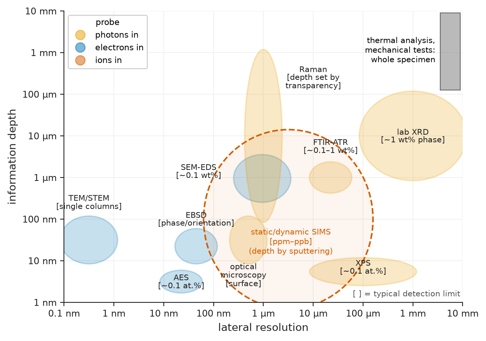
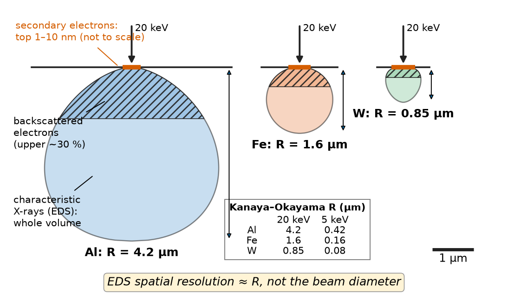
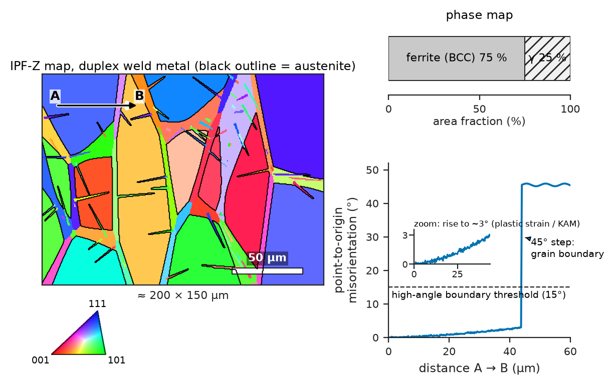
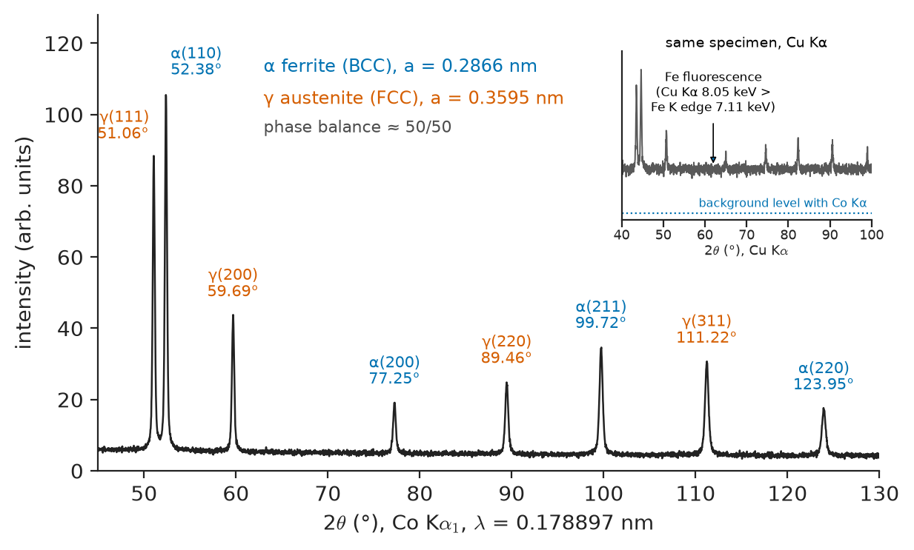
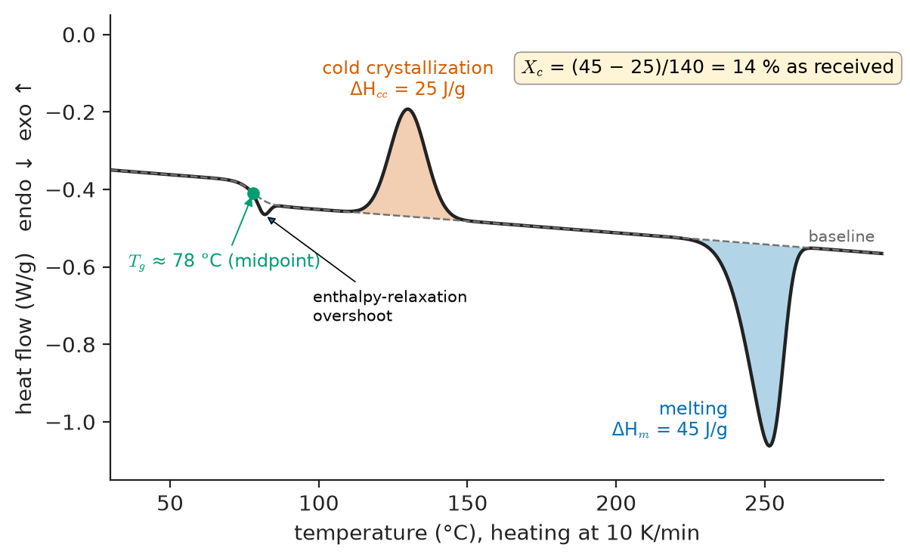
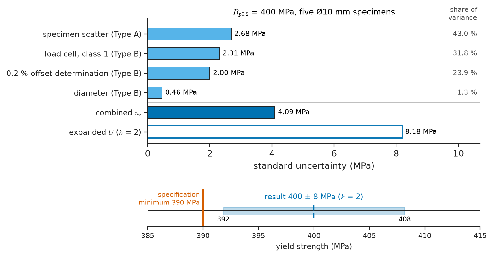

# Chapter 52 — Materials Characterization: The Laboratory Toolkit

*Part XI · Characterization, Computation and Design*

Six months after start-up, a girth weld in a duplex stainless-steel line on an offshore gas platform leaks. The pipe is cut out and sent to the laboratory. An optical microscope on a polished, etched section shows that the weld metal is about 75 % ferrite, where the specification allows 35–65 %. An electron backscatter diffraction map shows large ferrite grains with very little austenite along their boundaries; a scanning electron microscope shows that the crack ran through the ferrite in branched, river-like facets; its X-ray detector finds chlorine in the deposits on the crack walls. X-ray diffraction confirms the phase balance and measures 300 MPa of tensile residual stress near the weld root. Photoelectron spectroscopy of the inner surface shows a passive film thinner and poorer in chromium than on the parent pipe. Hardness traverses and a Charpy test complete the picture: a weld cooled too fast to form enough austenite, left tensile stress, and cracked by chloride stress corrosion (Chapter 43). Every statement in that diagnosis is a measurement with its own sampled volume, model and uncertainty. This chapter is the laboratory toolkit that produces them.

> **What does each technique probe, from what volume of material, and with what detection limit?**
> **How is a raw signal (an intensity, a heat flow, a voltage) turned into a property, and what model sits in between?**
> **How large is the uncertainty on the final number, and which input dominates it?**

| Concept | Engineering destination |
|---|---|
| Optical microscopy, metallography, stereology | Grain size and phase fractions for specifications; weld, casting and coating sections |
| SEM imaging, EDS, EBSD | Fractography, inclusion and corrosion-product analysis, texture and grain-boundary maps |
| TEM and electron diffraction | Precipitates, dislocations, interfaces in alloys, ceramics and devices |
| XRD: phase ID, Rietveld, residual stress, texture | Retained austenite, cement phases, coating stress, sheet-metal texture |
| XPS, AES, SIMS | Passive films, adhesion and contamination failures, grain-boundary segregation, hydrogen and dopant profiles |
| Raman, FTIR, UV–Vis | Zirconia implant aging, polymer identification and oxidation, optical band gaps |
| DSC, TGA, TMA, DMA, laser flash | Polymer crystallinity and $T_g$, filler content, cement hydration, CTE, damping, conductivity |
| Mechanical and electrical testing | Design allowables, toughness qualification, sheet resistance and conductivity |
| GUM uncertainty budgets | Defensible numbers in certificates, qualification reports and failure investigations |

**Roadmap.** The common anatomy of a measurement (52.1) → seeing structure with light, electrons and diffraction (52.2–52.5) → surface composition (52.6) → vibrational and optical spectroscopy (52.7) → thermal analysis (52.8) → mechanical and electrical tests (52.9) → how much to believe the number (52.10).

---

## 52.1 The anatomy of a measurement

Every technique in this chapter has the same structure. A **probe** (photons, electrons, ions, heat, force, a current) interacts with a **sampled volume** and produces a **signal**; a **model** converts signal into property. Three figures of merit follow: **lateral resolution** (the smallest feature distinguished side by side), **information depth** (how deep the signal comes from) and **detection limit** (the smallest concentration detected). They trade against each other: techniques that see single atoms sample tiny volumes, and those that detect parts per billion average over micrometres. Figure 52.1 maps the toolkit.

The habit worth acquiring is to ask, for every number: *which volume, which signal, which model?* A grain size measured on one plane, an EDS analysis of a 0.5 µm layer with a 1 µm interaction volume, or a DSC crystallinity calculated with the wrong reference enthalpy are all correct readings of wrong models.

<!-- FIGURE 52.1 | figures/ch52/fig-52-1-technique-map.png | map | Laboratory characterization techniques placed by lateral resolution and information depth, with detection limits indicated. | Content: log-log map. x-axis lateral resolution from 0.1 nm to 10 mm; y-axis information depth from 1 nm to 10 mm. Ellipses labelled with typical detection limit in brackets: XPS (lateral 10 µm-1 mm, depth 3-10 nm, ~0.1 at.%), AES (10-50 nm, 2-5 nm, ~0.1 at.%), static/dynamic SIMS (0.1-100 µm, 1 nm-10 µm by sputtering, ppm-ppb), SEM-EDS (~1 µm, ~1 µm, ~0.1 wt%), EBSD (20-100 nm, 10-50 nm, phase/orientation), TEM/STEM (0.1-1 nm, foil thickness <100 nm), optical microscopy (0.25-1 µm, surface), Raman (~1 µm, 0.1 µm-mm depending on transparency), FTIR-ATR (10-50 µm, 0.5-2 µm), lab XRD (0.1-10 mm, 1-100 µm, ~1 wt% phase), thermal analysis and mechanical tests as bulk bar at right (whole specimen). Colour by probe type: photons, electrons, ions. -->

*Figure 52.1 — Laboratory characterization techniques placed by lateral resolution and information depth, with detection limits indicated.*

---

## 52.2 Optical microscopy and metallography

### Resolution and contrast

An objective collects light diffracted by the specimen; two points are resolved when their Airy discs separate by at least

$$
d=\frac{0.61\,\lambda}{\mathrm{NA}},\qquad \mathrm{NA}=n\sin\alpha
$$

For green light (550 nm) and a dry objective of NA 0.95, $d\approx350$ nm; oil immersion (NA 1.4) gives about 240 nm. Magnification beyond about $1000\times\mathrm{NA}$ adds no detail. Depth of field shrinks as $\lambda n/\mathrm{NA}^2$ (about 0.6 µm at NA 0.95), which is why rough fracture surfaces go to the SEM.

> **Status of the principle: Rayleigh resolution limit**
> *Derived.* Fraunhofer diffraction at a circular aperture under incoherent illumination; 0.61 is a convention for "just resolved", and confocal, structured-illumination and near-field methods beat it.

Reflected-light metallographic microscopes offer **bright field** (flat regions bright, grooves and inclusions dark), **dark field** (scattered light only: scratches, cracks), **polarized light** (optically anisotropic phases such as titanium, zinc, magnesium, graphite and many intermetallics show grain contrast unetched) and **differential interference contrast** (nanometre height steps as colour). Transmitted polarized light on 20–30 µm thin sections identifies minerals in rocks, clinker and concrete, and spherulites in polymers.

### Preparing a section

Most microstructure is seen by cutting, mounting, grinding, polishing and etching, each step a source of artefacts.

| Material | Key preparation points | Typical etch or contrast |
|---|---|---|
| Carbon and low-alloy steel | Wet abrasive cutting; SiC grinding; diamond 3 then 1 µm | 2 % nital (ferrite boundaries, pearlite); picral for carbides |
| Stainless and duplex steel | Avoid smearing of soft austenite | Electrolytic oxalic or NaOH (ferrite/austenite contrast); Beraha tints |
| Aluminium alloys | Very soft; final colloidal silica; avoid embedded abrasive | Keller's reagent; Barker's anodizing for polarized grain contrast |
| Titanium alloys | Chemo-mechanical final polish | Kroll's reagent (HF–HNO$_3$) for α/β |
| Ceramics | Diamond throughout; pull-out mimics porosity | Thermal etch 100–200 °C below sintering temperature |
| Polymers and composites | Low-temperature mounting; fibres pull out | Permanganic etch for spherulites; polarized light |
| Concrete | Vacuum epoxy impregnation with fluorescent dye | UV light reveals cracks and porosity |

Hot mounting at about 150 °C can age solders and polymers; overetching widens cracks; edge rounding hides coatings unless the specimen is backed. A section is also a single plane: a crack seen in one plane may not be continuous, and only random sections give unbiased statistics.

### Quantitative metallography

**Stereology** (Chapter 5) turns plane measurements into volume quantities. The **point fraction** equals the volume fraction, $P_P=V_V$: a grid of points is laid over the image and the fraction falling on the phase is counted. Grain size is measured by the **linear intercept** method: test lines of total length $L$ cross $N$ grain boundaries, the mean intercept is $\bar\ell=L/N$, and the ASTM grain-size number is

$$
G=-6.6439\log_{10}\bar\ell-3.288\qquad(\bar\ell\ \text{in mm})
$$

> **Status of the principle: $P_P=V_V$ and intercept grain size**
> *Derived.* Geometric-probability identities exact for isotropic, uniform random sampling; anisotropic or banded microstructures need oriented sections, and the mean intercept is about 0.67 of the mean 3D grain diameter for equiaxed grains.

**Worked example — grain size and pearlite fraction of a structural steel.** On an etched section of a 0.18 % C steel, five test lines with a total true length of 2.50 mm cross 125 ferrite grain boundaries: $\bar\ell=2.50/125=0.020$ mm and $G=-6.6439\log_{10}0.020-3.288=8.0$. A 400-point grid lands on pearlite 92 times: $V_V=0.23$, with a binomial standard error $\sqrt{0.23\times0.77/400}=0.021$, so $V_V=0.23\pm0.02$. The lever rule on the Fe–C diagram (Chapter 7) predicts $(0.18-0.02)/(0.77-0.02)=0.21$, consistent within the counting error. Note that halving the error would need four times as many points; counting statistics, not the microscope, usually limit such measurements. Automated image analysis does the same counting on thousands of fields, but its thresholds must be checked against manual counts.

---

## 52.3 SEM, EDS and EBSD

### Electrons and the interaction volume

An electron accelerated through $V$ has wavelength $\lambda=h/\sqrt{2m_eeV(1+eV/2m_ec^2)}$: 8.6 pm at 20 kV, 2.5 pm at 200 kV. Lens aberrations, not wavelength, limit resolution, but SEMs still reach about 1 nm and TEMs below 0.1 nm.

A **scanning electron microscope (SEM)** rasters a 1–30 keV beam focused to a few nanometres. The beam spreads inside the specimen into an **interaction volume** whose depth is estimated by the Kanaya–Okayama range

$$
R\ (\mu\mathrm{m})=\frac{0.0276\,A\,E_0^{1.67}}{Z^{0.889}\,\rho}
$$

($A$ in g/mol, $E_0$ in keV, $\rho$ in g/cm$^3$).

> **Status of the principle: Kanaya–Okayama range**
> *Empirical.* A fit to transmission and Monte Carlo data for bulk elements, good to about ±20 % from carbon to gold at 5–30 keV; only indicative for compounds and layered specimens.

**Worked example — where does the signal come from?** At 20 keV, aluminium ($A=26.98$, $Z=13$, $\rho=2.70$) gives $R=4.2$ µm, iron ($55.85$, 26, 7.87) 1.6 µm and tungsten 0.85 µm; a polymer approximated as carbon of density 0.95 g/cm$^3$ gives about 10 µm. At 5 keV the same numbers are 0.42, 0.16, 0.08 and 1.0 µm. An EDS analysis of a 1 µm corrosion layer on aluminium at 20 keV is therefore mostly substrate; dropping to 5–7 keV confines the signal but may not excite the K lines of heavier elements. Figure 52.2 shows the volumes.

<!-- FIGURE 52.2 | figures/ch52/fig-52-2-interaction-volumes.png | schematic | Electron interaction volumes at 20 keV in aluminium, iron and tungsten, and the depths from which SE, BSE and X-ray signals come. | Content: three teardrop cross-sections on a common 1 µm scale bar: Al (depth 4.2 µm), Fe (1.6 µm), W (0.85 µm). In each, shaded zones: surface skin of ~1-10 nm labelled 'secondary electrons', upper ~30 % labelled 'backscattered electrons', full teardrop labelled 'characteristic X-rays (EDS)'. Small inset table: R at 5 keV = 0.42, 0.16, 0.08 µm. Annotation: 'EDS spatial resolution ~ R, not the beam diameter'. -->

*Figure 52.2 — Electron interaction volumes at 20 keV in aluminium, iron and tungsten, and the depths from which SE, BSE and X-ray signals come.*

### Imaging signals

**Secondary electrons (SE)** (below 50 eV) escape only from the top few nanometres, and their yield rises at inclined surfaces, so SE images show topography with a large depth of field: fracture surfaces, wear tracks, powder morphology, cell attachment on scaffolds. **Backscattered electrons (BSE)** are beam electrons scattered back with a yield that rises with atomic number (about 0.06 for carbon, 0.15 for aluminium, 0.28 for iron, 0.50 for gold), giving **atomic-number contrast**: carbides in tool steel, intermetallics in aluminium castings and unreacted clinker in concrete stand out without etching. Insulators (ceramics, polymers, biological tissue) charge; remedies are a thin carbon or gold coat, low voltage, or a variable-pressure SEM.

**Fractography** reads the fracture mode from SE images: dimples for ductile microvoid coalescence, flat facets with river lines for cleavage, rock-candy grain faces for intergranular fracture, and striations whose spacing equals the crack advance per cycle in fatigue (Chapters 14 and 44).

### Energy-dispersive X-ray spectroscopy

Beam electrons eject inner-shell electrons, and the characteristic X-rays emitted as the vacancies fill identify the elements. A silicon drift detector resolves about 125–130 eV at Mn K$\alpha$. EDS detects about 0.1 wt% in minutes; light elements (B, C, N, O) are only semi-quantitative; quantification with ZAF or φ(ρz) corrections assumes a flat, polished, homogeneous region larger than the interaction volume. Peak overlaps cause classic errors: S K$\alpha$ (2.31 keV), Mo L$\alpha$ (2.29) and Pb M$\alpha$ (2.35); Ti K$\alpha$ (4.51) and Ba L$\alpha$ (4.47); Si K$\alpha$ (1.74) and W M$\alpha$ (1.78). **Wavelength-dispersive spectroscopy (WDS)** in an electron microprobe resolves such overlaps with 5–10 eV resolution and detects about 0.01 wt%, at the cost of speed.

### Electron backscatter diffraction

When the beam strikes a specimen tilted 70°, backscattered electrons diffract from lattice planes and form **Kikuchi bands** on a phosphor screen; each band is a lattice plane, and the pattern is indexed automatically to give crystal phase and orientation to about 0.5°. Scanning gives an **orientation map** with 20–100 nm resolution: grain size by true grain-boundary detection (rather than etching), misorientation and twin boundaries, phase maps (ferrite versus austenite, α versus β titanium), and texture over thousands of grains. Small orientation gradients within grains, plotted as **kernel average misorientation**, reveal plastic strain and geometrically necessary dislocations, useful for locating cold-worked regions near welds, cracks or forming defects. EBSD needs a deformation-free surface (final polish with colloidal silica or electropolishing), because the signal comes from the top 10–50 nm (Figure 52.3).

<!-- FIGURE 52.3 | figures/ch52/fig-52-3-ebsd-map.png | micrograph-style | EBSD orientation map of a duplex stainless-steel weld metal with misorientation profile. | Content: left panel, schematic inverse-pole-figure (IPF-Z) coloured map ~200 x 150 µm: large ferrite grains (70-80 % area) with thin grain-boundary and Widmanstätten austenite (overlay phase outline in black), colour key triangle (001 red, 101 green, 111 blue). Scale bar 50 µm. Right top: phase-fraction bar 'ferrite 75 %, austenite 25 %'. Right bottom: misorientation profile along a 60 µm line across one grain: point-to-origin misorientation rising gradually to ~3° near the fusion boundary (labelled 'plastic strain / KAM') and a step of 45° at a high-angle boundary; dashed line at 15° labelled 'high-angle boundary threshold'. -->

*Figure 52.3 — EBSD orientation map of a duplex stainless-steel weld metal with misorientation profile.*

---

## 52.4 TEM and electron diffraction

A **transmission electron microscope (TEM)** sends an 80–300 keV beam through a foil thinner than about 100 nm, prepared by electropolishing (metals), ion milling (ceramics), ultramicrotomy (polymers, tissue) or focused-ion-beam lift-out (site-specific sections).

**Diffraction contrast.** An aperture selecting only the transmitted beam (bright field) or one diffracted beam (dark field) makes regions that diffract strongly appear dark or bright. Dislocations, stacking faults, precipitates and strain fields are visible because they locally bend the planes into or out of the Bragg condition. A dislocation is invisible when $\mathbf g\cdot\mathbf b=0$, with $\mathbf g$ the operating reflection; tilting to two such conditions determines its Burgers vector (Chapter 12).

**Selected-area electron diffraction (SAED).** Because $\lambda$ is tiny, Bragg angles are a fraction of a degree, and a spot or ring at distance $R$ on the detector corresponds to plane spacing

$$
Rd=\lambda L
$$

with $L$ the camera length; $\lambda L$ is the **camera constant**. Single crystals give spot patterns, fine polycrystals rings, glasses diffuse halos.

**Worked example — indexing a ring pattern.** A nanocrystalline aluminium film is examined at 200 kV ($\lambda=2.508$ pm) with $L=1.00$ m, so $\lambda L=2.508\times10^{-12}$ m$^2$. The innermost ring is at 10.73 mm: $d=2.508\times10^{-12}/10.73\times10^{-3}=0.2337$ nm, which matches Al(111) ($0.4049/\sqrt3=0.2338$ nm). The next ring at 12.39 mm gives $d=0.2024$ nm = Al(200). For an FCC lattice the ratios $R^2$ run 3 : 4 : 8 : 11 : 12, so the following rings fall at 17.52 and 20.54 mm for (220) and (311). An extra ring at a spacing absent from the FCC sequence would signal a second phase, for example an oxide or an Al$_3$X precipitate. In practice the camera constant is calibrated on a standard to about 1 %, which limits SAED lattice parameters to that accuracy; XRD is a hundred times more precise.

**High-resolution TEM and STEM.** Phase-contrast lattice imaging shows atomic columns at interfaces, but bright spots are not necessarily atoms, and interpretation needs simulation. Scanning TEM with annular dark-field detection, spectroscopy and pixelated detectors, and the aberration correctors that take resolution below 0.1 nm, are the subject of Chapter 53. TEM's limitation is statistical: a few square micrometres of foil may not represent a component, so TEM conclusions are paired with bulk methods such as XRD and SANS.

> **Boundary.** Electron optics and scattering theory belong to Engineering Physics; diffraction geometry (reciprocal lattice, structure factor, Ewald sphere) is in Chapter 4.

---

## 52.5 X-ray diffraction in practice

Chapter 4 derived Bragg's law $n\lambda=2d\sin\theta$, the structure factor and peak broadening. This section is about using a laboratory diffractometer.

### Instrument choices

The common **Bragg–Brentano** geometry moves source and detector symmetrically, so only planes parallel to the surface diffract; a flat, randomly oriented powder or polycrystal of 10–20 mm is irradiated to a depth of 1–100 µm depending on absorption. The **anode** matters. Cu K$\alpha$ ($\lambda=0.15406$ nm) is standard, but its photons (8.05 keV) lie just above the iron K absorption edge (7.11 keV), so iron-bearing specimens fluoresce and give a high background; steels are therefore measured with Co K$\alpha$ (6.93 keV, below the edge) or Cr K$\alpha$, or with an energy-discriminating detector. Mo and Ag anodes give short wavelengths for transmission through thicker specimens and for total scattering (Chapter 53).

### Phase identification and quantification

The set of $d$-spacings and intensities is a fingerprint matched against the ICDD Powder Diffraction File. XRD distinguishes phases, not just elements: ferrite from austenite, anatase from rutile, α- from γ-alumina, tetragonal from monoclinic zirconia, alite from belite in cement clinker. **Rietveld refinement** fits the whole pattern from crystal-structure models and returns phase fractions (to about 1 wt% for well-crystallized phases), lattice parameters (to $10^{-4}$ relative) and crystallite size and microstrain (Scherrer and Williamson–Hall, Chapter 4). Amorphous content appears as a broad hump and is quantified by adding a known internal standard. Detection limits for minor phases are about 0.5–2 wt%.

Figure 52.4 shows a duplex stainless-steel pattern. The two phases' strongest peaks lie only 1.3° apart with Co radiation, and the austenite (200) and (220) peaks are well separated from ferrite peaks, which is why quantitative retained-austenite and duplex-balance measurements (an important specification for bearings, carburized gears and duplex welds) use them.

<!-- FIGURE 52.4 | figures/ch52/fig-52-4-xrd-duplex.png | plot | X-ray diffraction pattern of a duplex stainless steel recorded with Co Kα radiation, with peaks indexed for ferrite (BCC) and austenite (FCC). | Content: intensity (arbitrary units) vs 2θ from 45° to 130°, Co Kα1 λ = 0.178897 nm. Ferrite a = 0.2866 nm: (110) 52.38° (strongest), (200) 77.25°, (211) 99.72°, (220) 123.95°. Austenite a = 0.3595 nm: γ(111) 51.06°, γ(200) 59.69°, γ(220) 89.46°, γ(311) 111.22°. Ferrite peaks labelled α in one colour, austenite γ in another; peak heights consistent with ~50/50 phase balance. Inset at top right: the same specimen measured with Cu Kα showing raised flat background labelled 'Fe fluorescence (Cu Kα 8.05 keV > Fe K edge 7.11 keV)'. -->

*Figure 52.4 — X-ray diffraction pattern of a duplex stainless steel recorded with Co Kα radiation, with peaks indexed for ferrite (BCC) and austenite (FCC).*

### Residual stress by the $\sin^2\psi$ method

Stress changes lattice spacings, and XRD measures spacings to about $10^{-5}$, so the lattice is a strain gauge. For a biaxial surface stress $\sigma$ and isotropic elasticity, the spacing of planes whose normal is tilted by $\psi$ from the surface normal varies as

$$
\frac{d_\psi-d_0}{d_0}=\frac{1+\nu}{E}\,\sigma\sin^2\psi-\frac{2\nu}{E}\,\sigma
\qquad\Longrightarrow\qquad
\sigma=\frac{E}{1+\nu}\,\frac{1}{d_0}\,\frac{\partial d_\psi}{\partial\sin^2\psi}
$$

Because the slope is divided by $d_0$, an imprecise unstressed spacing hardly matters. High-angle reflections are used because $\Delta\theta=-\varepsilon\tan\theta$ grows toward 2θ = 180°.

> **Status of the principle: $\sin^2\psi$ stress analysis**
> *Approximate.* Assumes plane stress in the 10–20 µm sampled layer, isotropic elasticity and a linear $d$ versus $\sin^2\psi$ plot; texture, steep stress gradients or shear stresses curve or split the plot and need diffraction elastic constants or more general analysis.

**Worked example — a shot-peened spring steel.** The Fe(211) reflection measured with Cr K$\alpha_1$ ($\lambda=0.22897$ nm) has $d_0=0.28665/\sqrt6=0.11702$ nm and $2\theta\approx156.1^\circ$. A least-squares line through $d_\psi$ at seven tilts has slope $-2.0\times10^{-4}$ nm. With $E=210$ GPa and $\nu=0.28$:

$$
\sigma=\frac{210\times10^9}{1.28}\times\frac{-2.0\times10^{-4}}{0.11702}=-2.8\times10^{8}\ \mathrm{Pa}=-280\ \mathrm{MPa}
$$

Compressive surface stress of this size is what shot peening is for: it closes surface fatigue cracks in springs, gears and aircraft landing gear (Chapter 14). The same measurement on the duplex weld of the opening found $+300$ MPa, tensile, which is what drove the stress-corrosion cracking. Laboratory X-rays sample only the top 5–20 µm in steel; depth profiles need electropolishing layer by layer, and through-thickness stresses need neutrons or high-energy synchrotron X-rays (Chapter 53).

### Texture and thin films

Relative peak intensities that differ from the powder file indicate **crystallographic texture**. Tilting and rotating the specimen records **pole figures**, from which the orientation distribution function is calculated. Texture governs the earing of deep-drawn aluminium cans, the $r$-value (formability) of steel sheet, the magnetic loss of grain-oriented electrical steel and the anisotropy of additively manufactured parts (Chapters 13, 28 and 48). For thin films, **grazing-incidence XRD** fixes the incident angle at 0.5–2° to confine the beam to the top 10–500 nm, and **X-ray reflectivity** measures film thickness, density and roughness from interference fringes at very low angles.

---

## 52.6 Surface analysis: XPS, AES and SIMS

Adhesion, corrosion resistance, wetting, catalysis and biocompatibility are decided in the top few nanometres. The techniques here are surface-sensitive because the particles they detect (electrons of tens to hundreds of eV, or sputtered ions) escape only from the outermost layers, and they need ultra-high vacuum to keep the surface clean during analysis (Chapter 49).

### X-ray photoelectron spectroscopy

Monochromatic Al K$\alpha$ X-rays ($h\nu=1486.6$ eV) eject core electrons, whose kinetic energy gives the binding energy

$$
E_B=h\nu-E_K-\phi
$$

with $\phi$ the spectrometer work function. Photoelectrons of about 1 keV have an inelastic mean free path $\lambda$ of 2–3 nm, and 95 % of the signal comes from within $3\lambda$, so XPS samples the top 5–10 nm. Its power is **chemical state**: binding energies shift by 1–5 eV with oxidation state and bonding. Typical values: Al 2p 72.7 eV (metal) and about 75.5 eV (oxide); Ti 2p$_{3/2}$ 454.0 (metal) and 458.8 eV (TiO$_2$); Cr 2p$_{3/2}$ 574.2 (metal) and 576.6 eV (Cr$_2$O$_3$); Si 2p 99.4 (Si) and 103.4 eV (SiO$_2$); C 1s 284.8 eV (adventitious hydrocarbon, used for charge referencing on insulators). XPS quantifies all elements except H and He to about 0.1 at.% with relative accuracy of 10–20 %, and works on metals, ceramics, polymers and biomaterials alike.

**Worked example — thickness of a native oxide.** The Al 2p spectrum of an aluminium sheet, recorded at normal emission, shows oxide and metal peaks with intensity ratio $I_{ox}/I_m=0.80$. For an oxide of thickness $d$ on metal, with attenuation lengths $\lambda_{ox}=2.8$ nm and $\lambda_m=2.6$ nm and an Al atom density ratio $N_m/N_{ox}\approx1.6$ (metal 2.70 g/cm$^3$, oxide about 3.2 g/cm$^3$), the Strohmeier relation gives

$$
d=\lambda_{ox}\sin\theta\,\ln\!\left(\frac{N_m\lambda_m}{N_{ox}\lambda_{ox}}\,\frac{I_{ox}}{I_m}+1\right)=2.8\ \mathrm{nm}\times\ln(1.6\times0.929\times0.80+1)=2.2\ \mathrm{nm}
$$

with $\theta=90^\circ$ the take-off angle from the surface. A native oxide of 2–4 nm is normal; a 10 nm hydrated oxide from storage in humid air would hide the metal peak entirely and would also degrade adhesive bonding of aerospace aluminium (Chapter 47), which is why bonding surfaces are etched or anodized just before use. The same overlayer logic measures passive films on stainless steel and the chromium enrichment that makes them protective, as in the duplex weld of the opening.

### Auger electron spectroscopy

In **AES** an electron beam creates core holes that relax by emitting Auger electrons of element-specific energy, from the top 2–5 nm. Because the probe is an electron beam, lateral resolution reaches 10–20 nm, far better than XPS. A classic application is **grain-boundary segregation**: a temper-embrittled steel is fractured inside the vacuum along its embrittled boundaries, and AES shows phosphorus or tin concentrated in a monolayer on the fresh intergranular facets. Combined with ion sputtering, AES and XPS give depth profiles through coatings and oxides.

### Secondary ion mass spectrometry

**SIMS** sputters the surface with a focused primary ion beam (O$_2^+$, Cs$^+$, Bi$_n^+$) and analyses the ejected secondary ions in a mass spectrometer. It detects every element including hydrogen, distinguishes isotopes, and reaches parts per million to parts per billion. **Dynamic SIMS** erodes continuously and records concentration versus depth with nanometre resolution: dopant profiles in semiconductors, hydrogen and deuterium in titanium, zirconium and steels, and $^{18}$O tracer profiles from which oxygen diffusion coefficients in oxides and fuel-cell electrolytes are measured (Chapter 8). **Static SIMS** (time-of-flight) uses a tiny dose to analyse molecular fragments from the outermost monolayer: silicone release agents on a delaminated paint, lubricant films, protein layers on implants. SIMS yields vary by orders of magnitude between matrices, so quantification requires implanted or certified standards of the same matrix.

---

## 52.7 Spectroscopy: Raman, FTIR and UV–Vis

### Raman spectroscopy

Monochromatic laser light scattered inelastically by molecular or lattice vibrations is shifted by the vibrational frequency (the **Raman shift**, in cm$^{-1}$; 520 cm$^{-1}$ corresponds to 64.5 meV). A confocal Raman microscope analyses a spot of about 1 µm without contact or vacuum, through glass and in water. The spectrum identifies **phases and polymorphs**: silicon 520.7 cm$^{-1}$; diamond 1332 cm$^{-1}$; graphitic carbon G band at about 1580 and defect D band at about 1350 cm$^{-1}$, whose intensity ratio measures disorder in carbon fibres and graphene; anatase TiO$_2$ 144 cm$^{-1}$ versus rutile 447 and 612 cm$^{-1}$; tetragonal zirconia (bands near 148 and 264 cm$^{-1}$) versus monoclinic (a doublet at about 181 and 192 cm$^{-1}$). The last is used to map the low-temperature degradation of zirconia femoral heads and dental crowns, where the tetragonal-to-monoclinic transformation in body fluids roughens the surface (Chapter 39). Peak shifts measure **stress**: the silicon line moves by roughly 2 cm$^{-1}$ per GPa, mapping stress around through-silicon vias and in MEMS. In polymers and composites, the shift of a carbon-fibre or aramid band under load gives the fibre strain in situ.

### Fourier-transform infrared spectroscopy

Infrared absorption excites vibrations with a changing dipole moment, so FTIR complements Raman (symmetric, non-polar vibrations are Raman-active; polar groups absorb strongly in IR). It is the standard identification method for **polymers**, adhesives, coatings and contaminants: C–H stretching near 2900 cm$^{-1}$, O–H near 3300 cm$^{-1}$, carbonyl C=O near 1715–1740 cm$^{-1}$, Si–O near 1000–1100 cm$^{-1}$. The **attenuated total reflectance (ATR)** accessory presses the sample on a diamond or germanium crystal and probes the top 0.5–2 µm without preparation. Absorbance follows the Beer–Lambert law $A=\varepsilon cl$, so band ratios are quantitative: the **carbonyl index** (area of the C=O band relative to a reference CH$_2$ band) tracks oxidation of polyethylene geomembranes, cable insulation and UHMWPE joint-replacement bearings after gamma sterilization (Chapters 39 and 44).

### UV–Vis spectroscopy

Transmission and reflectance from 200 to 1100 nm (or 2500 nm with an NIR extension) characterize glasses, transparent ceramics, polymers, pigments and coatings: solar transmittance of low-E glass, yellowing of polycarbonate, absorption edge of semiconductors. Near the edge, the absorption coefficient of a semiconductor follows the Tauc relation $(\alpha h\nu)^{1/r}\propto h\nu-E_g$, with $r=1/2$ for direct and 2 for indirect allowed transitions; extrapolating the linear part to zero gives the **optical band gap**. Anatase TiO$_2$ (3.2 eV) absorbs below 387 nm and ZnO (3.37 eV) below 368 nm, which is why both are UV absorbers in sunscreens and polymer stabilizers (Chapter 36). Integrating spheres collect diffuse light from powders and rough coatings; the Kubelka–Munk function converts diffuse reflectance into an absorption-like quantity.

---

## 52.8 Thermal analysis: DSC, TGA, TMA and DMA

Thermal analysis measures a property while temperature is ramped, typically at 5–20 K/min. It is fast, needs milligrams, and is the workhorse of polymer, pharmaceutical and ceramic laboratories.

### Differential scanning calorimetry

**DSC** measures the heat flow into a sample relative to a reference. Its trace (Figure 52.5) shows a step at the **glass transition** (a change in heat capacity), exothermic peaks for **crystallization** and curing, and endothermic peaks for **melting**. The degree of crystallinity of a semicrystalline polymer follows from the melting enthalpy:

$$
X_c=\frac{\Delta H_m-\Delta H_{cc}}{\Delta H_m^0}
$$

where $\Delta H_{cc}$ is any cold-crystallization exotherm formed during the scan and $\Delta H_m^0$ the enthalpy of a 100 % crystalline polymer (about 293 J/g for polyethylene, 207 J/g for polypropylene, 140 J/g for PET).

> **Status of the principle: DSC crystallinity**
> *Approximate.* Assumes the crystalline phase has the same enthalpy as a perfect crystal at every melting temperature and that no reorganization occurs during the scan; literature values of $\Delta H_m^0$ themselves vary by about 10 %.

**Worked example — crystallinity of HDPE and of a PET bottle wall.** An HDPE pipe sample shows a melting endotherm of 175 J/g and no cold crystallization: $X_c=175/293=0.60$, or 60 %, typical for pipe grades. A PET bottle-wall sample shows $T_g$ at about 78 °C, a cold-crystallization exotherm of 25 J/g near 130 °C and a melting endotherm of 45 J/g near 250 °C; its crystallinity *as received* is $(45-25)/140=14$ %. Reporting 45/140 = 32 % would mistake crystals formed in the instrument for crystals present in the bottle. DSC also measures the **oxidation induction time** of stabilized polyolefins, the cure state of epoxy composites (residual exotherm), precipitation and dissolution in aluminium alloys, and the transformation temperatures of NiTi shape-memory alloys (Chapter 37).

<!-- FIGURE 52.5 | figures/ch52/fig-52-5-dsc-pet.png | plot | DSC heating trace of a partly crystalline PET sample, showing glass transition, cold crystallization and melting. | Content: x-axis temperature 30 to 290 °C at 10 K/min; y-axis heat flow in W/g, endotherm down (label convention on axis). Features: step at Tg ~78 °C (midpoint marked) with small enthalpy-relaxation overshoot; exothermic cold-crystallization peak centred ~130 °C, area shaded and labelled 'ΔHcc = 25 J/g'; endothermic melting peak ~250 °C, area shaded and labelled 'ΔHm = 45 J/g'. Annotation box: 'Xc = (45 - 25)/140 = 14 % as received'. Baseline dashed. -->

*Figure 52.5 — DSC heating trace of a partly crystalline PET sample, showing glass transition, cold crystallization and melting.*

### Thermogravimetric analysis

**TGA** records mass versus temperature in a controlled atmosphere: moisture loss, polymer decomposition, the residue (glass fibre, mineral filler, ash) left after burn-off, and oxidation kinetics of metals. Stoichiometry turns steps into quantities. CaCO$_3$ → CaO + CO$_2$ loses 44.0 % of the carbonate mass near 700–800 °C; Ca(OH)$_2$ → CaO + H$_2$O loses 24.3 % near 400–500 °C.

**Worked example — portlandite in hydrated cement.** A dried cement paste loses 4.2 % of its mass between 400 and 500 °C. Attributing this to portlandite, the paste contains $4.2/0.243=17$ wt% Ca(OH)$_2$. Tracking this number with age shows how far hydration has progressed and, in blended cements, how much portlandite pozzolanic fly ash or slag has consumed (Chapter 18). In a glass-fibre-reinforced PA66 housing, the residue after burn-off in air (for example 30.2 %) gives the fibre fraction directly, checking a 30 % specification.

### TMA, DMA and laser flash

**Thermomechanical analysis (TMA)** measures dimension versus temperature under a small load: the coefficient of thermal expansion, softening and $T_g$ as a change of slope, and through-thickness expansion of laminates and coatings. **Dynamic mechanical analysis (DMA)** applies an oscillating stress and resolves the response into a storage modulus $E'$ and a loss modulus $E''$, with $\tan\delta=E''/E'$. The $\tan\delta$ peak locates $T_g$ (usually 5–15 K above the DSC value and frequency-dependent), secondary relaxations and damping (Chapter 21). For a carbon-fibre epoxy, the temperature at which $E'$ begins to fall sets the service ceiling of an aircraft part.

The **laser flash** method heats one face of a thin disc with a short pulse and records the rear-face temperature rise. The thermal diffusivity follows from the half-rise time, $\alpha=0.1388L^2/t_{1/2}$ (Parker), and conductivity from $k=\alpha\rho c_p$. For a 2.0 mm alumina disc with $t_{1/2}=52$ ms, $\alpha=0.1388\times(2.0\times10^{-3})^2/0.052=1.07\times10^{-5}$ m$^2$/s, and with $\rho=3950$ kg/m$^3$ and $c_p=775$ J kg$^{-1}$K$^{-1}$, $k=33$ W m$^{-1}$K$^{-1}$, typical of 99.5 % alumina (Chapter 24).

---

## 52.9 Mechanical and electrical testing

### Mechanical tests

Chapter 11 introduced the tensile, hardness, impact and bend tests, and Chapter 14 fracture, fatigue and creep. In the laboratory, standard specimens and procedures (ISO 6892 and ASTM E8 for metals in tension, ISO 527 for plastics, EN 12390 for concrete, ASTM D3039 for composites) make numbers comparable. Practical points that often decide whether a number is right:

| Test | Measured | Common pitfalls |
|---|---|---|
| Tensile (metals) | $E$, $R_{p0.2}$, UTS, elongation | Crosshead displacement includes machine compliance: modulus needs an extensometer; strain rate affects yield of mild steel and Ti |
| Tensile (polymers) | Modulus, yield, elongation | Strong rate and temperature dependence; conditioning of moisture in nylons |
| Hardness (HV, HB, HRC) | Resistance to indentation | Load-dependent at low loads; for steels UTS ≈ 3.3 HV (MPa) only as a conversion estimate |
| Charpy impact | Absorbed energy (J) | Transition curve, not a single value, for ferritic steels; notch machining quality |
| Fracture toughness $K_{Ic}$ | Plane-strain toughness | Validity needs thickness $B\ge2.5(K_{Ic}/\sigma_y)^2$ |
| Fatigue (S–N, $da/dN$) | Life, crack growth rate | Surface finish, mean stress, frequency effects on polymers |
| Compression (concrete) | Characteristic strength | Cube versus cylinder; curing and loading rate |
| Short-beam shear, open-hole (composites) | Interlaminar shear, notched strength | Failure mode must be checked, not just load |
| Nanoindentation | Hardness, reduced modulus | Tip-area calibration, pile-up, substrate effect beyond ~10 % of film thickness |

The $K_{Ic}$ thickness criterion shows how strongly specimen geometry can matter. For a high-strength steel with $K_{Ic}=50$ MPa√m and $\sigma_y=1400$ MPa, $B\ge2.5\times(50/1400)^2$ m = 3.2 mm, an easy specimen. For a structural steel with $K\approx150$ MPa√m and $\sigma_y=250$ MPa, $B\ge2.5\times0.36=0.9$ m: no valid plane-strain test exists, and elastic–plastic toughness ($J$ or CTOD) must be measured instead.

**Nanoindentation** records load against depth to micronewton and nanometre resolution. Oliver–Pharr analysis takes the unloading stiffness $S$ and contact area $A$ (from depth and a calibrated tip shape) to give hardness $H=P_{max}/A$ and reduced modulus $E_r=(\sqrt\pi/2)S/\sqrt A$. It measures thin films, individual phases and biological tissue (bone lamellae, dentine), and maps properties across welds and coatings.

### Electrical tests

A two-probe measurement includes contact and lead resistance; separating current and voltage contacts removes them. For a thin layer measured with a collinear **four-point probe** whose spacing is much larger than the thickness $t$, the sheet resistance is

$$
R_s=\frac{\pi}{\ln2}\,\frac{V}{I}=4.532\,\frac{V}{I},\qquad\rho=R_st
$$

For a 200 nm copper film with $V/I=0.0207$ Ω, $R_s=0.094$ Ω/sq and $\rho=1.9\times10^{-8}$ Ω m, about 12 % above bulk copper (1.68 × 10⁻⁸ Ω m), as expected from grain-boundary and surface scattering. The **van der Pauw** method handles arbitrary sample shapes, and with a magnetic field the **Hall effect** gives carrier type, density and mobility (Chapter 32). Eddy-current probes measure the conductivity of aluminium alloys non-destructively, which is used to verify heat-treatment temper and detect overheating of aircraft skins. **Impedance spectroscopy** separates bulk, grain-boundary and electrode contributions in ionic conductors and coatings (Chapters 25 and 43), and dielectric spectroscopy gives permittivity and loss of insulating polymers and ceramics.

> **Boundary.** The derivations of four-point-probe correction factors, van der Pauw and Hall analysis, and magnetic hysteresis measurements are developed for electronic materials in Chapters 25, 28 and 32.

---

## 52.10 Measurement uncertainty

### A number without an uncertainty is incomplete

A certificate stating a yield strength of 400 MPa cannot tell an engineer whether the steel meets a 390 MPa minimum. The internationally agreed method, the *Guide to the Expression of Uncertainty in Measurement* (GUM), does so in four steps.

1. **Measurement model.** Write the result as a function of inputs, $y=f(x_1,x_2,\dots)$: for yield strength, $R_p=4F/(\pi d^2)$.
2. **Standard uncertainties of inputs.** **Type A** uncertainties come from statistics of repeated observations: the standard deviation of the mean, $s/\sqrt n$. **Type B** come from other knowledge: calibration certificates, instrument class, resolution. A tolerance $\pm a$ with no further information is treated as a rectangular distribution with $u=a/\sqrt3$.
3. **Propagation.** For uncorrelated inputs, $u_c^2(y)=\sum_i(\partial f/\partial x_i)^2u^2(x_i)$. For products and powers it is simpler in relative terms: if $y\propto x_1x_2^{-2}$, then $(u_c/y)^2=(u_1/x_1)^2+(2u_2/x_2)^2$.
4. **Expanded uncertainty.** $U=ku_c$ with coverage factor $k=2$ gives about 95 % coverage for an approximately normal result.

> **Status of the principle: GUM law of propagation of uncertainty**
> *Approximate.* A first-order Taylor expansion valid when the model is close to linear over the uncertainty ranges and inputs are uncorrelated (or correlations included); strongly non-linear models use Monte Carlo propagation (GUM Supplement 1).

**Worked example — uncertainty budget for a yield strength.** Five specimens of 10.00 mm diameter from one plate give a mean yield load of 31.4 kN, i.e. $R_{p0.2}=4\times31\,400/(\pi\times10.00^2)=400$ MPa, with a standard deviation of 6 MPa between specimens. The contributions are:

- Specimen-to-specimen scatter (Type A): $6/\sqrt5=2.68$ MPa.
- Load cell, class 1 (±1 %, rectangular): $u_{rel}=0.01/\sqrt3=0.577$ %, giving 2.31 MPa.
- Diameter, micrometer ±0.01 mm (rectangular): $u=0.0058$ mm, relative 0.058 %, doubled because $d$ is squared: 0.12 %, giving 0.46 MPa.
- Determination of the 0.2 % offset point from the curve (extensometer class and curve-fitting, estimated): 0.5 %, giving 2.00 MPa.

Combined: $u_c=\sqrt{2.68^2+2.31^2+0.46^2+2.00^2}=4.1$ MPa, and $U=2u_c=8.2$ MPa. The result is $R_{p0.2}=400\pm8$ MPa ($k=2$). The budget (Figure 52.6) shows where effort pays: material scatter (43 % of the variance), the load cell (32 %) and offset determination (24 %) dominate, while the diameter measurement, the one most carefully done, contributes about 1 %. Against a 390 MPa minimum, the lower end of the interval, 392 MPa, still complies, but with little margin; ISO 14253-1 and similar decision rules specify how such guard bands are applied.

<!-- FIGURE 52.6 | figures/ch52/fig-52-6-uncertainty-budget.png | plot | Uncertainty budget for a tensile yield strength of 400 MPa: contributions and combined expanded uncertainty. | Content: horizontal bar chart. Bars (standard uncertainty in MPa): specimen scatter (Type A) 2.68; load cell class 1 (Type B) 2.31; 0.2 % offset determination (Type B) 2.00; diameter (Type B) 0.46; combined u_c 4.09 (darker bar); expanded U (k = 2) 8.19 (outlined bar). Secondary labels on right giving share of variance: 42.8 %, 31.8 %, 23.9 %, 1.3 %. Vertical dashed line annotation: 'result 400 ± 8 MPa (k = 2)' and small number line beneath from 385 to 415 MPa showing interval 392-408 and specification minimum 390 MPa. -->

*Figure 52.6 — Uncertainty budget for a tensile yield strength of 400 MPa: contributions and combined expanded uncertainty.*

### Related ideas

**Accuracy and precision** differ: a miscalibrated hardness tester can be precise and wrong; only calibration traceable to national standards (through certified reference blocks, weights and reference materials) controls accuracy. **Repeatability** (same operator, instrument and short time) and **reproducibility** (different laboratories) are quantified by interlaboratory round robins (ISO 5725), and reproducibility is typically two to three times worse. **Sampling** often dominates everything else: a hardness value from one location in a casting, an EDS spot on one inclusion, or one TEM foil may be precisely measured and unrepresentative. In materials testing the property itself is frequently a distribution, not a value, as for the strength of ceramics, described by Weibull statistics (Chapters 11 and 44).

---

## What remains open

| Open question | Where it is answered |
|---|---|
| How are single atoms, light elements and nanometre clusters located in three dimensions? | Chapter 53 (atom-probe tomography, aberration-corrected STEM) |
| How do synchrotron X-rays and neutrons measure stress deep inside components and oxidation states of dilute elements? | Chapter 53 |
| How is a microstructure followed while it is heated, strained or electrochemically cycled? | Chapter 54 (in-situ and operando methods) |
| How are measured spectra and patterns linked to calculated structures? | Chapters 55 and 56 |
| How can automated analysis of thousands of micrographs and spectra feed data-driven models? | Chapters 54 and 57 |
| Where do Bragg's law, structure factors and peak-broadening analysis come from? | Chapter 4 (back reference) |
| How are fracture surfaces and characterization results combined into a root-cause analysis? | Chapter 44 (back reference) |

**Next:** Chapter 53 goes beyond the laboratory bench to synchrotrons, neutron sources, atom probes and aberration-corrected microscopes, the instruments that see what the toolkit of this chapter cannot.
