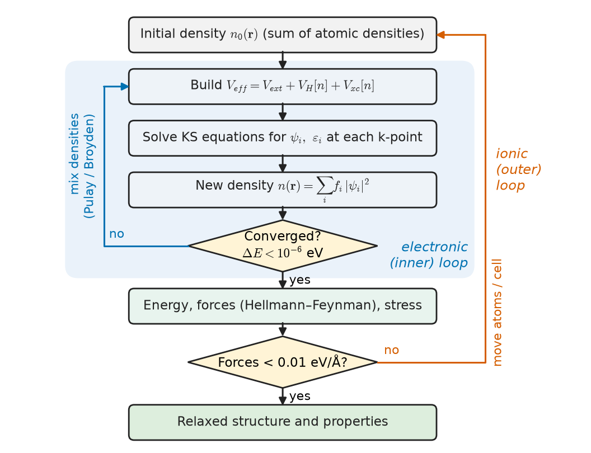
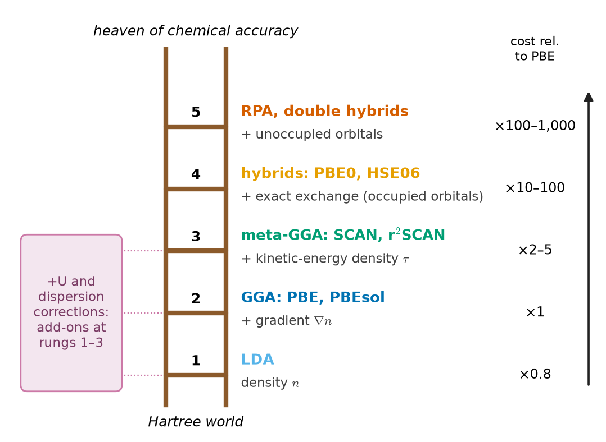
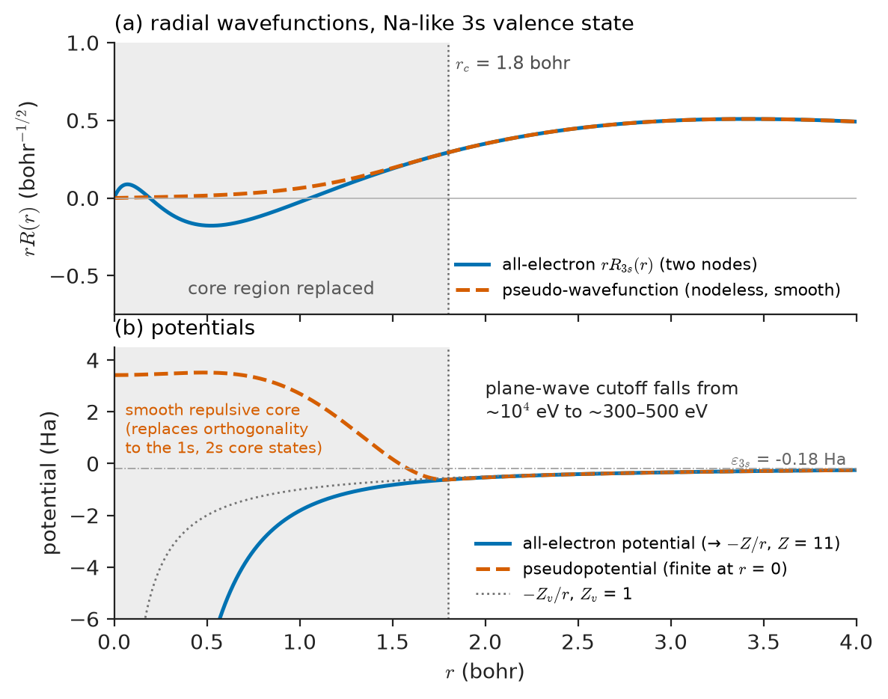
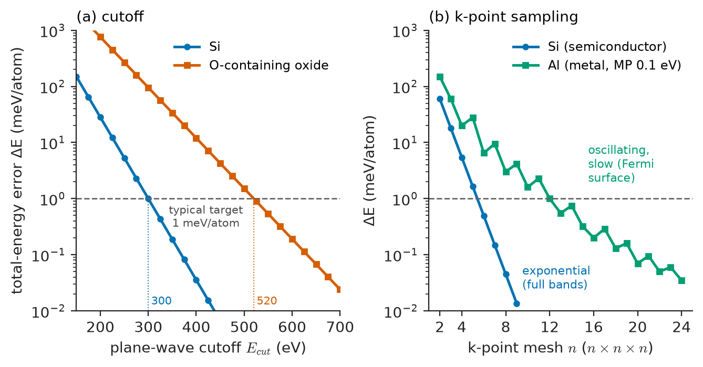
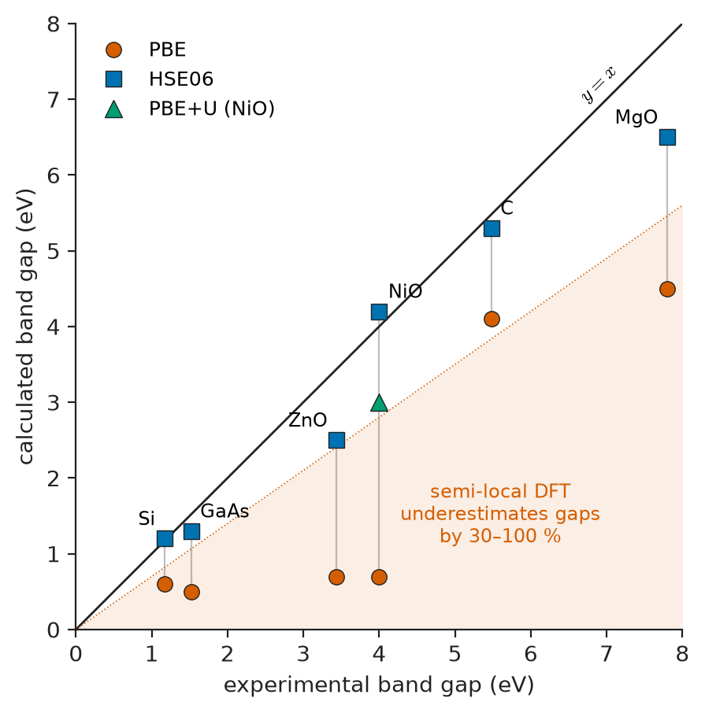
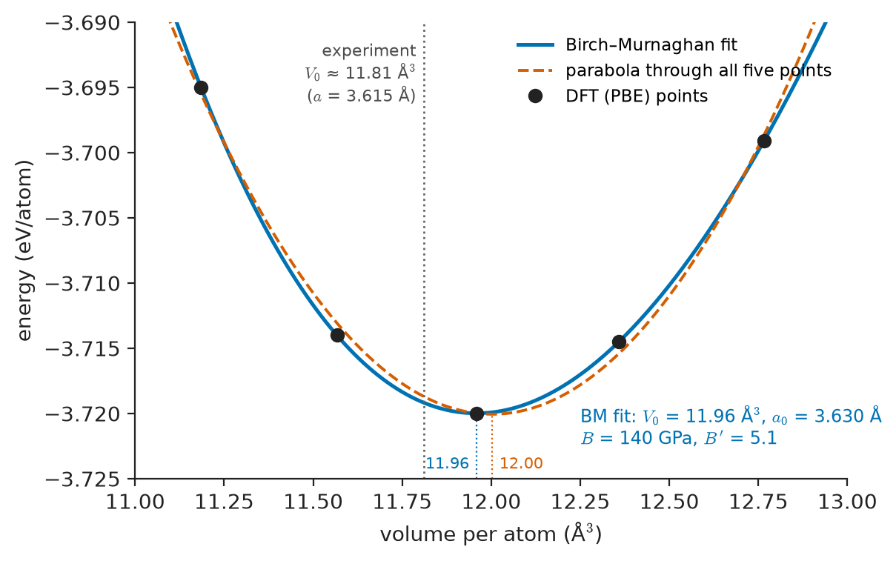

# Chapter 55 — Electronic-Structure Methods

*Part XI · Characterization, Computation and Design*

A team designing a new high-strength steel for automotive crash structures has a hydrogen problem. Above about 1,200 MPa tensile strength, martensitic steels absorb hydrogen from paint-shop pickling, galvanizing and road salt, and a part that passes every static test can crack days after assembly. One proposed remedy is to disperse fine vanadium or titanium carbides that trap hydrogen so tightly it cannot diffuse to crack tips. Which carbide traps most strongly, at which site — the carbide–ferrite interface, a carbon vacancy inside the carbide, or the misfit dislocations around it? Each candidate would take months to make and test, and the trapping sites are a few atoms across, beyond direct measurement. A chemist screening cathode oxides for sodium-ion batteries, a semiconductor engineer predicting which dopant will be a shallow donor in a wide-gap oxide, and a catalysis group asking why a platinum–nickel alloy outperforms platinum face the same situation: the decisive quantity is an energy difference at the atomic scale, and the cheapest instrument to measure it is a computer solving for the electrons.

This chapter explains how that is done. It is a practitioner's account of electronic-structure methods — chiefly density-functional theory (DFT) — written for materials engineers who will run, commission or read such calculations: what the approximations are, how numerical parameters are converged, which predictions can be trusted and which cannot.

> **How can the energy of an arrangement of atoms be calculated from quantum mechanics without solving an impossible many-electron problem?**
> **Which approximations make density-functional theory practical, and how does an engineer know when its predictions are good enough to act on?**

| Concept | Engineering destination |
|---|---|
| Born–Oppenheimer approximation | Separating atomic motion (structures, vibrations, diffusion) from electronic structure |
| Hartree–Fock | Molecular chemistry, the exchange term in hybrid functionals |
| Density-functional theory | Formation energies, phase stability, defect energies, surface energies |
| Kohn–Sham equations | Band structures, densities of states, charge densities |
| Exchange–correlation functionals | Accuracy trade-offs: lattice constants, band gaps, reaction energies |
| DFT+U | Transition-metal oxides: battery cathodes, catalysts, magnetic oxides |
| Plane waves, pseudopotentials, PAW | Efficient and systematic calculations on periodic solids |
| k-point sampling | Reliable energies of metals and semiconductors |
| Known successes and failures | Deciding when DFT can guide design and when it cannot |
| Workflows and validation | Reproducible calculations, high-throughput screening, inputs to simulation and databases |

**Roadmap.** The many-body problem and the Born–Oppenheimer separation (55.1) → Hartree–Fock and why density-functional theory replaced it for solids (55.2) → the Kohn–Sham equations (55.3) → exchange–correlation functionals from LDA to hybrids and DFT+U (55.4) → basis sets: plane waves, pseudopotentials and PAW (55.5) → Brillouin-zone sampling and convergence (55.6) → what DFT predicts well and badly (55.7) → practical workflows (55.8).

---

## 55.1 The many-body problem and the Born–Oppenheimer approximation

### The equation everyone knows and no one solves

A piece of material is a collection of nuclei and electrons interacting by Coulomb forces. Its non-relativistic Hamiltonian contains the kinetic energy of every nucleus and every electron, the attraction of each electron to each nucleus, the repulsion between every pair of electrons and between every pair of nuclei. For a cubic micrometre of silicon that is roughly $5\times10^{10}$ atoms and $7\times10^{11}$ electrons; the wavefunction is a function of $3\times7\times10^{11}$ electronic coordinates. Even a 100-atom supercell of copper, with 2,900 electrons, has a wavefunction in 8,700 dimensions. Storing such a function on even a coarse grid of ten points per dimension would require $10^{8700}$ numbers. The exact equation is not solvable; every electronic-structure method is a strategy for approximating it.

> **Boundary.** The Schrödinger equation, the Pauli principle, spin and the band theory of solids are developed in the Engineering Physics book. This chapter states what it needs and concentrates on how the approximations are made and used in materials work.

### Separating nuclei from electrons

A proton is 1,836 times heavier than an electron; nuclei therefore move far more slowly. In the time a nucleus vibrates once (about $10^{-13}$ s), the electrons adjust to its new position many times over. The **Born–Oppenheimer approximation** exploits this: the nuclear positions $\{\mathbf R_I\}$ are treated as fixed parameters, the electronic problem is solved for each configuration, and the resulting electronic ground-state energy $E_0(\{\mathbf R_I\})$, plus the nuclear–nuclear repulsion, becomes the **potential-energy surface** on which the nuclei move:

$$
\hat H_{el}\,\Psi(\{\mathbf r_i\};\{\mathbf R_I\})=E_0(\{\mathbf R_I\})\,\Psi(\{\mathbf r_i\};\{\mathbf R_I\})
$$

Everything in this chapter and the next rests on this separation. Equilibrium crystal structures are minima of the potential-energy surface; elastic constants are its curvatures with respect to strain; phonon frequencies its curvatures with respect to atomic displacements; diffusion barriers the heights of saddle points between minima; and the interatomic potentials of molecular dynamics (Chapter 56) are fits to it.

> **Status of the principle: Born–Oppenheimer approximation**
> *Approximate.* Justified by the small electron-to-nuclear mass ratio; excellent for ground-state structure, elasticity, phonons and most diffusion, but it breaks down when electronic states cross or lie close in energy — in photochemistry, some radiation-damage events, electron–phonon effects in superconductors, and fast ion–solid collisions.

---

## 55.2 Hartree–Fock and why density-functional theory

### The Hartree–Fock approach

The first systematic approximation, Hartree–Fock (HF), writes the many-electron wavefunction as a single Slater determinant of one-electron orbitals, a form that automatically satisfies the Pauli principle. Minimizing the energy gives one-electron equations in which each electron moves in the average electrostatic (Hartree) field of the others plus an **exchange** term that keeps electrons of like spin apart. Exchange is treated exactly; what is missing is **correlation** — the further tendency of electrons of any spin to avoid each other dynamically, beyond what a single determinant can represent.

For molecules HF is a good starting point and the foundation of the hierarchy of quantum-chemistry methods (Møller–Plesset perturbation theory, coupled cluster), which add correlation systematically. For solids it has three handicaps:

- **Missing correlation matters.** HF overestimates band gaps by factors of two or more (silicon about 6–8 eV in HF against 1.17 eV measured) and, for metals, predicts a vanishing density of states at the Fermi level — a qualitatively wrong answer.
- **Cost.** The exact exchange integral couples every orbital to every other, and HF costs scale as roughly $N^4$ with system size $N$; the correlated methods that fix it scale as $N^5$ to $N^7$. Coupled-cluster calculations on a 100-atom metallic supercell are not routine.
- **Metals and slow decay.** In a periodic metal, the exchange interaction is long-ranged and badly behaved without screening.

### The density as the basic variable

The key idea that made accurate calculations on solids routine was to abandon the wavefunction as the central object. The **Hohenberg–Kohn theorems** (1964) state that, for electrons in an external potential (the potential of the nuclei):

1. The ground-state electron density $n(\mathbf r)$ uniquely determines the external potential, and hence every property of the ground state.
2. There exists a universal energy functional $E[n]$ whose minimum over all physical densities is the exact ground-state energy, reached at the exact ground-state density.

> **Status of the principle: Hohenberg–Kohn theorems**
> *Fundamental.* Exact theorems of non-relativistic quantum mechanics for the ground state; they prove the functional exists but do not say what it is, so every practical DFT calculation introduces an approximation to it.

The density is a function of only three variables, whatever the number of electrons. The theorems replace an impossibly large problem with a tractable one, provided a good approximation to the functional can be found. That is the subject of the next two sections, and the reason that DFT became, by a large margin, the most widely used method in computational materials science.

---

## 55.3 The Kohn–Sham equations

### A fictitious system of non-interacting electrons

The hardest part of $E[n]$ to approximate is the kinetic energy. Kohn and Sham (1965) sidestepped this by introducing an auxiliary system of non-interacting electrons constructed to have the same density as the real system. Their kinetic energy $T_s$ can be computed exactly from one-electron orbitals $\psi_i$. The total energy functional becomes

$$
E[n]=T_s[n]+\int V_{ext}(\mathbf r)\,n(\mathbf r)\,d\mathbf r+E_H[n]+E_{xc}[n]
$$

where $E_H=\tfrac{e^2}{8\pi\varepsilon_0}\iint \frac{n(\mathbf r)n(\mathbf r')}{\lvert\mathbf r-\mathbf r'\rvert}d\mathbf r\,d\mathbf r'$ is the classical Hartree electrostatic energy and $E_{xc}$, the **exchange–correlation energy**, collects everything else: exchange, correlation and the difference between the true and the non-interacting kinetic energy. Minimizing with respect to the orbitals gives the **Kohn–Sham equations**:

$$
\left[-\frac{\hbar^2}{2m_e}\nabla^2+V_{ext}(\mathbf r)+V_H(\mathbf r)+V_{xc}(\mathbf r)\right]\psi_i(\mathbf r)=\varepsilon_i\,\psi_i(\mathbf r)
$$

$$
n(\mathbf r)=\sum_i f_i\,\lvert\psi_i(\mathbf r)\rvert^2,\qquad V_{xc}(\mathbf r)=\frac{\delta E_{xc}[n]}{\delta n(\mathbf r)}
$$

with occupations $f_i$ (0 to 2 per orbital including spin). If the exact $E_{xc}$ were known, Kohn–Sham DFT would give the exact ground-state energy and density.

> **Status of the principle: Kohn–Sham equations**
> *Derived.* An exact reformulation of the Hohenberg–Kohn variational principle; all the approximation lies in the choice of exchange–correlation functional, plus the numerical basis and sampling.

### Self-consistency

The effective potential depends on the density, which depends on the orbitals, which depend on the potential. The equations are therefore solved iteratively (Figure 55.1): guess a density (usually a superposition of atomic densities), build the potential, solve for orbitals, form a new density, mix it with the old one to damp oscillations, and repeat until input and output densities agree — typically to an energy change below $10^{-6}$ eV per cell. Charge "sloshing" between distant regions makes this slow for large metallic cells and surfaces, which is why density-mixing schemes (Pulay/DIIS, Broyden, Kerker preconditioning) matter in practice.

<!-- FIGURE 55.1 | figures/ch55/fig-55-1-kohn-sham-scf-loop.png | flowchart | The Kohn–Sham self-consistent field cycle, with the outer loop for relaxing atomic positions. | Content: vertical cycle of boxes: "Initial density n0(r) (sum of atomic densities)" → "Build V_eff = V_ext + V_H[n] + V_xc[n]" → "Solve KS equations for ψi, εi at each k-point" → "New density n(r) = Σ fi |ψi|²" → diamond "Converged? ΔE < 10^-6 eV" with "no: mix densities (Pulay/Broyden)" arrow back to second box; "yes" → "Energy, forces (Hellmann–Feynman), stress" → diamond "Forces < 0.01 eV/Å?" with "no: move atoms / cell" back to the start; "yes" → "Relaxed structure and properties". Annotate the inner loop "electronic" and outer loop "ionic". -->

*Figure 55.1 — The Kohn–Sham self-consistent field cycle, with the outer loop for relaxing atomic positions.*

### What the Kohn–Sham quantities mean

The total energy and the density are, in principle, exact properties. The Kohn–Sham eigenvalues $\varepsilon_i$ are not, strictly, electron addition or removal energies; only the highest occupied eigenvalue has a rigorous meaning (it equals minus the ionization energy for the exact functional). In practice Kohn–Sham band structures reproduce band shapes, effective masses and Fermi surfaces of most metals and semiconductors well, but systematically underestimate band gaps — part of the gap comes from a discontinuity in the exact exchange–correlation potential that approximate functionals lack (Section 55.7).

Forces on nuclei follow cheaply from the converged density by the **Hellmann–Feynman theorem**, $\mathbf F_I=-\partial E/\partial \mathbf R_I$, so atomic positions and cell shape can be relaxed, and ab-initio molecular dynamics (Born–Oppenheimer MD) can be run on the computed potential-energy surface.

---

## 55.4 Exchange–correlation functionals

### The local density approximation

The simplest approximation, the **local density approximation (LDA)**, assumes that each small volume contributes the exchange–correlation energy per electron of a uniform electron gas of the same density:

$$
E_{xc}^{LDA}[n]=\int n(\mathbf r)\,\varepsilon_{xc}^{hom}\!\left(n(\mathbf r)\right)d\mathbf r
$$

The exchange part of $\varepsilon_{xc}^{hom}$ is known analytically ($\propto n^{1/3}$); the correlation part was obtained from quantum Monte Carlo calculations of the electron gas and fitted. LDA works surprisingly well for solids with slowly varying densities — simple metals, covalent semiconductors — because of a fortunate cancellation of errors between exchange and correlation. Its systematic tendency is **overbinding**: lattice constants 1–3 % too small, bulk moduli 5–20 % too large, cohesive energies 10–30 % too large.

### Generalized-gradient approximations

**Generalized-gradient approximations (GGAs)** add a dependence on the density gradient, $\varepsilon_{xc}(n,\nabla n)$. The most widely used in materials science is **PBE** (Perdew–Burke–Ernzerhof, 1996), built to satisfy exact constraints rather than fitted to data. PBE corrects much of LDA's overbinding, often slightly overshooting: lattice constants typically 0.5–2 % too large. It famously gets the ground state of iron right — ferromagnetic BCC — where LDA wrongly predicts non-magnetic close-packed iron to be more stable. **PBEsol** re-tunes the gradient correction for solids and gives better lattice constants and surface energies than PBE at some cost in molecular binding energies.

**Meta-GGAs** add the kinetic-energy density of the orbitals; **SCAN** (2015) and its numerically better-behaved variant r²SCAN satisfy all 17 known exact constraints a meta-GGA can obey and improve formation enthalpies of compounds and the description of intermediate-range bonding, at about two to five times the cost of PBE.

### Hybrid functionals

**Hybrid functionals** mix a fraction of exact (Hartree–Fock) exchange into a GGA:

$$
E_{xc}^{hyb}=a\,E_x^{HF}+(1-a)\,E_x^{GGA}+E_c^{GGA}
$$

PBE0 uses $a=0.25$. **HSE06** applies the HF exchange only at short range (screening length about 5 Å), which makes it far cheaper for solids and more physical for metals. Hybrids correct much of the band-gap error of semi-local functionals and improve the localization of electrons and holes at defects and polarons. Their price is 10–100 times the cost of a GGA calculation for the same system.

### DFT+U for localized electrons

In transition-metal oxides and rare-earth compounds, partially filled $3d$ or $4f$ shells hold electrons in localized orbitals. Semi-local functionals spread them out, because each electron spuriously interacts with its own density (**self-interaction error**). The result: NiO, CoO and FeO are predicted to be metals or nearly so, although they are insulators with gaps of 2–4 eV, and redox energies of battery cathodes are wrong by up to 1 V. **DFT+U** adds a Hubbard-like penalty on fractional occupation of the localized orbitals; in the widely used simplified (Dudarev) form,

$$
E_{DFT+U}=E_{DFT}+\frac{U_{eff}}{2}\sum_{\sigma}\mathrm{Tr}\left[\boldsymbol\rho^{\sigma}-\boldsymbol\rho^{\sigma}\boldsymbol\rho^{\sigma}\right],\qquad U_{eff}=U-J
$$

where $\boldsymbol\rho^{\sigma}$ is the occupation matrix of the localized orbitals for spin $\sigma$. The penalty vanishes for integer occupations (0 or 1) and is maximal at half-filling, so it drives orbitals towards localized, integer-occupied states. Typical $U_{eff}$ values for $3d$ oxides lie between 3 and 7 eV.

> **Status of the principle: DFT+U correction**
> *Empirical.* $U_{eff}$ is usually chosen to reproduce measured gaps, lattice parameters or oxidation enthalpies (or computed by linear response); results depend on the chosen value and on the projector, and energies computed with different $U$ values cannot be combined without correction schemes.

### Dispersion corrections

None of the semi-local functionals describes van der Waals (dispersion) attraction, which arises from correlated charge fluctuations between distant regions. Layered materials (graphite, MoS₂, clays), molecular crystals, polymers and the adsorption of molecules on surfaces need **dispersion corrections**: pairwise $C_6/r^6$ terms (DFT-D3, Tkatchenko–Scheffler, many-body dispersion) or non-local correlation functionals (vdW-DF, rVV10). Without them PBE predicts graphite's interlayer spacing far too large and its interlayer binding nearly zero.

### Jacob's ladder

Perdew's metaphor of **Jacob's ladder** arranges functionals in rungs of increasing ingredients and cost (Figure 55.2): LDA (density), GGA (gradient), meta-GGA (kinetic-energy density), hybrids (occupied orbitals through exact exchange), and the fifth rung of the random-phase approximation and double hybrids (unoccupied orbitals). Climbing usually, but not always, improves accuracy; the choice is driven by the property needed and the budget available.

<!-- FIGURE 55.2 | figures/ch55/fig-55-2-jacobs-ladder.png | schematic | Jacob's ladder of exchange–correlation functionals, from the Hartree world to chemical accuracy. | Content: ladder with five rungs from bottom to top: 1 LDA (ingredient n), 2 GGA: PBE, PBEsol (∇n), 3 meta-GGA: SCAN, r2SCAN (τ), 4 hybrids: PBE0, HSE06 (exact exchange), 5 RPA, double hybrids (unoccupied orbitals). Bottom labelled "Hartree world", top "heaven of chemical accuracy". Right-side arrow "cost relative to PBE: 0.8, 1, 2–5, 10–100, 100–1000". Left-side side-bar: "+U and dispersion corrections are add-ons applicable at rungs 1–3". -->

*Figure 55.2 — Jacob's ladder of exchange–correlation functionals, from the Hartree world to chemical accuracy.*

---

## 55.5 Basis sets: plane waves, pseudopotentials and PAW

### Plane waves and Bloch's theorem

To solve the Kohn–Sham equations numerically, orbitals are expanded in a basis. In a periodic crystal Bloch's theorem allows each orbital to be labelled by a wavevector $\mathbf k$ in the first Brillouin zone (Chapter 4) and written as a periodic function times a phase. The natural basis is then **plane waves**:

$$
\psi_{n\mathbf k}(\mathbf r)=\sum_{\mathbf G}c_{n,\mathbf k+\mathbf G}\;e^{i(\mathbf k+\mathbf G)\cdot\mathbf r}
$$

summed over reciprocal-lattice vectors $\mathbf G$. The expansion is truncated at a **kinetic-energy cutoff**,

$$
\frac{\hbar^2\lvert\mathbf k+\mathbf G\rvert^2}{2m_e}\le E_{cut}
$$

which keeps all plane waves inside a sphere of radius $k_{max}=\sqrt{2m_eE_{cut}}/\hbar$. Since each plane wave occupies a reciprocal-space volume $(2\pi)^3/V$ for a cell of volume $V$, the number of plane waves is approximately

$$
N_{pw}\approx\frac{V\,k_{max}^3}{6\pi^2}
$$

Plane waves have three major advantages: the basis is unbiased (it does not presuppose where the atoms are), its completeness is controlled by a single number, and forces and stresses are free of the "Pulay" errors that plague atom-centred bases. Their disadvantages: they describe vacuum (surfaces, molecules) as expensively as matter, and they are hopeless for the rapidly oscillating wavefunctions near atomic nuclei.

### Pseudopotentials

Core electrons (1s in carbon; 1s–2p in silicon; up to 3p in iron) are chemically inert in most materials problems, but the valence wavefunctions oscillate rapidly in the core region to remain orthogonal to them, requiring enormous cutoffs. A **pseudopotential** replaces the nucleus and core electrons by a smooth effective potential acting on smooth pseudo-wavefunctions that coincide with the true valence wavefunctions outside a core radius $r_c$ (Figure 55.3):

- **Norm-conserving** pseudopotentials preserve the charge inside $r_c$; they are accurate and simple but need high cutoffs for $2p$, $3d$ and $4f$ elements.
- **Ultrasoft** pseudopotentials (Vanderbilt) relax norm conservation and add augmentation charges, allowing much lower cutoffs.

The choice of which electrons to put in the core matters: for transition metals, including the semicore $3p$ states as valence improves results under pressure and in oxides; for lithium and sodium, including the $1s$ or $2p$ electrons is often needed.

<!-- FIGURE 55.3 | figures/ch55/fig-55-3-pseudopotential.png | plot | All-electron and pseudo radial wavefunctions and potentials for a valence state; they coincide beyond the core radius rc. | Content: two stacked panels sharing x-axis r from 0 to 4 bohr. Top: radial wavefunction r·R(r) for a 3s-like valence orbital: all-electron curve (solid) with two nodes inside r < 1.2 bohr, pseudo-wavefunction (dashed) nodeless and smooth, matching beyond rc = 1.8 bohr (vertical dotted line labelled rc). Bottom: potentials: all-electron −Z/r (solid, diverging at r → 0) vs smooth pseudopotential (dashed) finite at the origin, merging with −Zv/r beyond rc. Annotation "core region replaced; plane-wave cutoff falls from ~10^4 eV to ~300–500 eV". -->

*Figure 55.3 — All-electron and pseudo radial wavefunctions and potentials for a valence state; they coincide beyond the core radius rc.*

### The projector augmented-wave method

The **projector augmented-wave (PAW)** method of Blöchl (1994), used by VASP, GPAW, ABINIT and Quantum ESPRESSO among others, keeps the efficiency of ultrasoft pseudopotentials but restores the all-electron wavefunction through a linear transformation: smooth pseudo-wavefunctions are expanded in plane waves, and inside atom-centred spheres they are corrected using stored atomic partial waves. PAW gives access to the full valence density near the nucleus, which is needed for hyperfine parameters, NMR chemical shifts, Mössbauer isomer shifts and electric-field gradients (Chapter 54) and core-level spectra (Chapter 53), with the frozen-core approximation as the main residual error.

### Other bases

**All-electron** methods — the linearized augmented plane-wave (LAPW) method (WIEN2k, exciting) and atom-centred numerical orbitals (FHI-aims) — remain the accuracy references against which pseudopotential codes are tested. **Localized bases** — Gaussian-type orbitals (CRYSTAL, CP2K's mixed Gaussian and plane-wave scheme) and numerical atomic orbitals (SIESTA, OpenMX) — are compact and efficient for large, low-density or partly vacuum systems, and make hybrid functionals cheaper, but their completeness is harder to control. **Real-space grids** and wavelets (GPAW, BigDFT, Octopus) parallelize well and suit large finite systems.

**Worked example — size of a plane-wave basis.** Diamond-cubic silicon has $a=5.431$ Å and a primitive cell volume $V=a^3/4=40.05\ \mathrm{Å^3}$. For a cutoff of $E_{cut}=250$ eV,

$$
k_{max}=\frac{\sqrt{2\times9.109\times10^{-31}\times250\times1.602\times10^{-19}}}{1.0546\times10^{-34}}=8.10\times10^{10}\ \mathrm{m^{-1}}=8.10\ \mathrm{Å^{-1}}
$$

so $N_{pw}\approx40.05\times8.10^3/(6\pi^2)=359$ plane waves per $\mathbf k$-point. Raising the cutoff to 400 eV multiplies $k_{max}$ by $(400/250)^{1/2}$ and $N_{pw}$ by $(400/250)^{3/2}=2.02$, to about 728; 500 eV gives about 1,017. These are tiny numbers. Now consider a $3\times3\times3$ supercell of the conventional cubic cell containing 216 atoms to model a vacancy or a dopant: $V$ grows 108-fold and $N_{pw}$ at 400 eV reaches about 78,600 per $\mathbf k$-point. With 4 valence electrons per atom there are 432 occupied bands; storing their coefficients as double-precision complex numbers (16 bytes each) needs $432\times78{,}600\times16\approx5.4\times10^{8}$ bytes, about 0.54 GB per $\mathbf k$-point and spin — manageable. But the cost of orthogonalizing and diagonalizing scales roughly as $N^3$ with the number of atoms, so going from 2 to 216 atoms raises the work per $\mathbf k$-point by a factor of order $108^3\approx1.3\times10^6$, partly offset by needing far fewer $\mathbf k$-points in the larger cell (Section 55.6). This cubic scaling is why routine DFT stops at a few hundred to a few thousand atoms.

---

## 55.6 k-point sampling and convergence

### Integrating over the Brillouin zone

Total energies, densities and densities of states are integrals over all occupied states, which in a crystal means an integral over $\mathbf k$ throughout the Brillouin zone. Numerically, the integral becomes a weighted sum over a finite set of $\mathbf k$-points. The standard choice is the **Monkhorst–Pack** grid, an evenly spaced $n_1\times n_2\times n_3$ mesh, reduced by the crystal's point-group symmetry (Chapter 3) to the irreducible set; a $12\times12\times12$ grid for an FCC metal reduces from 1,728 points to 72.

The required density depends on the electronic structure:

- In **insulators and semiconductors**, all bands are completely full or empty; the integrand is smooth and converges exponentially with grid density. A $6\times6\times6$ grid for silicon's two-atom cell is often adequate for 1 meV/atom.
- In **metals**, the occupation drops from 1 to 0 at the Fermi surface, a discontinuity that makes convergence slow and erratic. Two cures are used together: denser grids and **smearing** — replacing the step function by a smooth one (Fermi–Dirac, Gaussian, Methfessel–Paxton or Marzari–Vanderbilt "cold" smearing) of width 0.05–0.2 eV, with the total energy extrapolated to zero width. The **tetrahedron method** with Blöchl corrections is preferred for accurate densities of states.

Because the reciprocal-lattice spacing scales as $1/a$, a supercell $n$ times larger in each direction needs $n$ times fewer divisions per direction for the same sampling density. Codes and databases therefore specify $\mathbf k$-point density as a spacing in reciprocal space (for example 0.15–0.25 Å⁻¹, including the $2\pi$) or as $\mathbf k$-points per reciprocal atom (often 1,000–8,000).

### Convergence testing

Every plane-wave calculation has at least two numerical parameters — cutoff and $\mathbf k$-mesh — that must be converged for the property of interest. Total energies converge from above as the cutoff rises (the variational principle) but energy *differences* between similar structures converge much faster because errors cancel. Stresses and elastic constants need higher cutoffs than energies, because the basis changes with cell volume (Pulay stress). Table 55.1 shows representative behaviour for an FCC metal, and Figure 55.4 contrasts the rapid convergence of a semiconductor with the slow, oscillating convergence of a metal.

| $\mathbf k$-mesh (FCC Al, primitive cell) | Irreducible points | Representative error in total energy (meV/atom) |
|---|---|---|
| $4\times4\times4$ | 8 | ~20 |
| $8\times8\times8$ | 29 | ~3 |
| $12\times12\times12$ | 72 | ~1 |
| $16\times16\times16$ | 145 | ~0.2 |
| $20\times20\times20$ | 256 | < 0.1 |

The numbers are illustrative of a metal with Methfessel–Paxton smearing of 0.1 eV; the actual errors oscillate and must be checked for each system.

<!-- FIGURE 55.4 | figures/ch55/fig-55-4-convergence-cutoff-kpoints.png | plot | Convergence of a plane-wave DFT calculation with cutoff energy and k-point mesh for a semiconductor and a metal. | Content: (a) total-energy error ΔE (meV/atom, log axis 0.01–1000) vs plane-wave cutoff 150–700 eV for Si (smooth monotonic decrease, ~1 meV/atom near 300 eV) and for an O-containing oxide (slower, ~1 meV/atom near 520 eV); horizontal dashed line at 1 meV/atom labelled "typical target". (b) ΔE (meV/atom, log axis) vs k-mesh n (n×n×n, 2–24) for Si (rapid exponential convergence, <1 meV/atom by n = 6) and for Al (oscillating decay: ~20 at 4, ~3 at 8, ~1 at 12, ~0.2 at 16, <0.1 at 20). -->

*Figure 55.4 — Convergence of a plane-wave DFT calculation with cutoff energy and k-point mesh for a semiconductor and a metal.*

> **Status of the principle: Numerical convergence of DFT results**
> *Derived.* With a complete basis and dense sampling, the result converges to the exact answer *for the chosen functional*; convergence controls numerical error only and says nothing about the physical error of the functional, which must be judged separately (Section 55.7).

### Supercell convergence

For defects, surfaces and interfaces, the simulation cell is itself a parameter. A vacancy in a 32-atom cell interacts elastically and electronically with its periodic images; a surface slab of five layers may not have a bulk-like middle; a vacuum layer of 8 Å may let two surfaces interact. These finite-size errors are tested by increasing cell size. **Charged defects** in semiconductors and insulators add a long-range electrostatic interaction between images that decays only as $1/L$, requiring correction schemes (Makov–Payne, Freysoldt–Neugebauer–Van de Walle) to obtain defect levels relevant to doping and compensation.

**Worked example — vacancy formation energy in aluminium.** A PBE calculation, converged to 1 meV/atom in cutoff and $\mathbf k$-mesh (illustrative values, typical of published calculations), gives a total energy of $E_{bulk}=-401.83$ eV for a perfect $3\times3\times3$ supercell of the conventional FCC cell (108 atoms), so $-3.721$ eV/atom. Removing one atom and relaxing the 107 remaining atoms at fixed cell gives $E_{vac}=-397.45$ eV. The vacancy formation energy compares the defective cell with the same number of atoms in perfect crystal:

$$
E_f^{v}=E_{vac}-\frac{N-1}{N}E_{bulk}=-397.45-\frac{107}{108}(-401.83)=-397.45+398.11=0.66\ \mathrm{eV}
$$

close to the measured 0.67 eV. With a formation entropy of about $1\,k_B$, the equilibrium vacancy fraction (Chapter 5) is

$$
c_v=\exp\!\left(\frac{S_f}{k_B}\right)\exp\!\left(-\frac{E_f^v}{k_BT}\right)
$$

which gives $c_v=2.7\times\exp(-0.66/(8.617\times10^{-5}\times923))=6.8\times10^{-4}$ at 923 K, just below the melting point, and $2.3\times10^{-11}$ at 300 K. The numbers show the scale on which quench rates, ageing kinetics and positron-annihilation measurements (Chapter 54) operate. Two cautions: the 108-atom cell must be checked against a larger one, because the elastic relaxation around the vacancy reaches several neighbour shells; and the agreement with experiment is partly fortunate — PBE vacancy energies are systematically low because of surface-like errors at the internal surface of the vacancy, which functionals like PBEsol or SCAN partly correct.

---

## 55.7 What DFT predicts well and badly

### The record

After more than three decades of comparison with experiment, the strengths and weaknesses of standard functionals are well documented. Table 55.2 compares lattice constants and band gaps.

| Material | Lattice constant: exp. (Å) | LDA (Å) | PBE (Å) | Band gap: exp. (eV) | PBE (eV) | HSE06 (eV) |
|---|---|---|---|---|---|---|
| Al | 4.05 | 3.98 | 4.04 | metal | metal | metal |
| Cu | 3.61 | 3.52 | 3.63 | metal | metal | metal |
| Fe (BCC) | 2.87 | 2.75 | 2.83 | metal | metal | metal |
| Si | 5.43 | 5.40 | 5.47 | 1.17 | 0.6 | 1.2 |
| GaAs | 5.65 | 5.62 | 5.75 | 1.52 | 0.5 | 1.3 |
| MgO | 4.21 | 4.17 | 4.26 | 7.8 | 4.5 | 6.5 |
| ZnO | 3.25 ($a$) | 3.20 | 3.29 | 3.44 | 0.7 | 2.5 |
| C (diamond) | 3.57 | 3.53 | 3.57 | 5.48 | 4.1 | 5.3 |
| NiO | 4.18 | 4.06 | 4.19 | ~4.0 | ~0.5–1.0 | ~4.2 |

Values are typical of published calculations and vary by a few hundredths of an ångström and a few tenths of an eV with pseudopotential, code and treatment of zero-point motion.

<!-- FIGURE 55.5 | figures/ch55/fig-55-5-band-gap-parity.png | plot | Calculated versus measured band gaps for common semiconductors and insulators with PBE, HSE06 and PBE+U. | Content: parity plot, x-axis experimental gap 0–8 eV, y-axis calculated gap 0–8 eV, diagonal y = x line. PBE points (circles) for Si (1.17, 0.6), GaAs (1.52, 0.5), ZnO (3.44, 0.7), C (5.48, 4.1), MgO (7.8, 4.5), NiO (4.0, 0.7); HSE06 points (squares) for the same materials at (1.17, 1.2), (1.52, 1.3), (3.44, 2.5), (5.48, 5.3), (7.8, 6.5), (4.0, 4.2); one PBE+U point for NiO (4.0, 3.0) as a triangle. Shaded band below diagonal labelled "semi-local DFT underestimates gaps by 30–100 %". -->

*Figure 55.5 — Calculated versus measured band gaps for common semiconductors and insulators with PBE, HSE06 and PBE+U.*

### What is reliable

- **Structures.** Lattice parameters within about 1–2 % (LDA low, PBE high, PBEsol and SCAN often within 1 %); bond lengths and angles; relative stability of polymorphs when energy differences exceed about 20–50 meV/atom.
- **Elastic and vibrational properties.** Bulk moduli within about 10–15 % (they inherit the lattice-constant error through the strong volume dependence), elastic constants, phonon dispersions within a few percent, and hence thermal expansion and heat capacity in the quasi-harmonic approximation (Chapter 24).
- **Trends.** Even where absolute numbers err, trends across a series — which solute segregates more strongly to a grain boundary, which dopant raises a migration barrier, which surface is most stable — are usually right because errors are systematic and cancel.
- **Formation enthalpies** of intermetallics and many compounds within about 0.05–0.1 eV/atom, improved by fitted corrections for elemental reference states (for example the O₂ molecule, which GGA overbinds by over 1 eV per molecule).
- **Magnetic moments** of ferromagnetic metals and many ordered magnetic compounds.

### What is unreliable

- **Band gaps** are underestimated by semi-local functionals, typically by 25–85 % (Table 55.2), and by most for strongly correlated oxides (Table 55.2, Figure 55.5). Hybrids, DFT+U for localized states, or many-body $GW$ calculations are used where gaps matter, as in photovoltaic absorbers and dopant-level predictions.
- **Strongly correlated materials.** Mott insulators, heavy-fermion compounds, and the high-temperature superconducting cuprates are beyond semi-local DFT; DFT+U is a patch, and dynamical mean-field theory (DMFT) is the research-level tool.
- **Dispersion-bound systems** without corrections (Section 55.4).
- **Reaction barriers** are typically underestimated by GGAs, because self-interaction error over-stabilizes the stretched bonds of transition states; hybrids help.
- **Excited states and optics.** Kohn–Sham DFT is a ground-state theory. Optical spectra need time-dependent DFT or the Bethe–Salpeter equation.
- **Finite temperature.** A static DFT calculation is at 0 K. Free energies need vibrational (phonon), electronic, magnetic and configurational entropy added — through phonon calculations, ab-initio MD, or cluster expansion and Monte Carlo (Chapter 56). Phases stabilized by entropy, such as high-temperature BCC titanium and zirconium or paramagnetic iron, are therefore not ground states in plain DFT.
- **Length and time scales.** Hundreds to a few thousand atoms and tens of picoseconds of ab-initio MD. Microstructural phenomena, dislocation networks and long-time diffusion need the methods of Chapter 56.

> **Status of the principle: Accuracy of semi-local DFT**
> *Empirical.* The error ranges quoted are statistical summaries of comparisons with experiment over large benchmark sets; they apply to the classes of material they were measured on and cannot be assumed for new chemistries, unusual bonding or strongly correlated electrons.

**Worked example — equation of state and bulk modulus of copper.** A PBE calculation gives the following energies per atom for FCC copper at five lattice constants (illustrative values, typical of published calculations):

| $a$ (Å) | 3.55 | 3.59 | 3.63 | 3.67 | 3.71 |
|---|---|---|---|---|---|
| $V=a^3/4$ (ų/atom) | 11.185 | 11.567 | 11.958 | 12.358 | 12.766 |
| $E$ (eV/atom) | −3.6950 | −3.7140 | −3.7200 | −3.7145 | −3.6991 |

Fitting a parabola $E=c_0+c_1V+c_2V^2$ through the three central points gives a minimum at $V_0=11.97\ \mathrm{Å^3}$, so $a_0=(4V_0)^{1/3}=3.631$ Å, and a curvature from which the bulk modulus

$$
B=V_0\frac{d^2E}{dV^2}\bigg\vert_{V_0}=V_0\cdot2c_2=0.881\ \mathrm{eV\,Å^{-3}}=0.881\times160.2\ \mathrm{GPa}=141\ \mathrm{GPa}
$$

against measured values of 3.61 Å and about 140 GPa. Fitting the parabola to all five points instead shifts the minimum to 12.00 ų ($a_0=3.635$ Å), because the energy curve is asymmetric — stiffer in compression than in tension, the same anharmonicity that causes thermal expansion (Chapter 24). That is why production work fits a physically motivated form such as the Birch–Murnaghan equation of state, which also yields the pressure derivative $B'$ (about 5 for copper), and why the points should span no more than a few percent in volume (Figure 55.6).

<!-- FIGURE 55.6 | figures/ch55/fig-55-6-eos-copper.png | plot | Energy–volume curve of FCC copper from DFT, with Birch–Murnaghan and parabolic fits. | Content: x-axis volume per atom 11.0–13.0 ų, y-axis energy −3.725 to −3.690 eV/atom. Five data points at (11.185, −3.6950), (11.567, −3.7140), (11.958, −3.7200), (12.358, −3.7145), (12.766, −3.6991). Solid curve: Birch–Murnaghan fit with V0 = 11.96 ų, B = 140 GPa, B' = 5. Dashed: parabola through all five points with minimum shifted to 12.00 ų. Vertical dotted line at experimental V0 ≈ 11.81 ų (a = 3.615 Å) labelled "experiment". Annotation of fitted a0 and B. -->

*Figure 55.6 — Energy–volume curve of FCC copper from DFT, with Birch–Murnaghan and parabolic fits.*

---

## 55.8 Practical workflows: codes, inputs, outputs, validation

### Codes

Table 55.3 lists widely used codes. The choice depends on the basis, the functionals and properties supported, licence and the local expertise.

| Code | Basis | Licence | Typical strengths |
|---|---|---|---|
| VASP | Plane waves, PAW | Commercial | Robust for solids, hybrids, MD, the reference for most databases |
| Quantum ESPRESSO | Plane waves, NC/US/PAW | Open source | Phonons by perturbation theory, broad features, large community |
| ABINIT | Plane waves, NC/PAW | Open source | Response functions, many-body perturbation theory |
| CASTEP | Plane waves, ultrasoft | Academic/commercial | NMR (GIPAW), spectroscopy |
| CP2K | Gaussians and plane waves | Open source | Large systems, liquids, ab-initio MD |
| GPAW | Real space/plane waves/LCAO, PAW | Open source | Python integration with ASE, catalysis |
| SIESTA | Numerical atomic orbitals | Open source | Thousands of atoms, linear-scaling options |
| WIEN2k, FHI-aims | All-electron LAPW, numerical orbitals | Academic/commercial | Accuracy benchmarks, hyperfine and core properties |

### Inputs

A calculation is specified by:

1. **Structure**: lattice vectors, atomic species and positions, magnetic configuration (initial moments; antiferromagnets need an appropriate supercell), and for defects the supercell and charge state.
2. **Physics**: functional, $U$ values, dispersion correction, spin polarization, spin–orbit coupling (needed for heavy elements, magnetic anisotropy and topological materials).
3. **Numerics**: pseudopotential or PAW data sets, cutoff, $\mathbf k$-mesh, smearing, convergence criteria for the electronic loop (typically $10^{-6}$ eV) and for ionic relaxation (forces below 0.01–0.02 eV/Å, stresses below about 0.1 GPa).
4. **Task**: single point, relaxation of positions and/or cell, molecular dynamics, nudged-elastic-band barrier search, phonons (finite displacements or density-functional perturbation theory), response properties.

### Outputs and derived quantities

The direct outputs are total energy, forces, stress tensor, eigenvalues and the electron density. Most engineering quantities are *differences* or *derivatives* of these:

| Quantity | How it is computed | Engineering use |
|---|---|---|
| Formation enthalpy and convex hull | Energy of compound minus elemental references | Phase stability, new-compound screening (Chapter 57) |
| Defect formation energy | Supercell difference with chemical potentials | Dopability, vacancy diffusion, radiation damage |
| Migration barrier | Nudged elastic band (NEB) | Diffusion coefficients, ionic conductivity of electrolytes |
| Elastic constants | Stress–strain or energy–strain | Moduli for alloy design and composite inputs |
| Surface and interface energies | Slab minus bulk | Wulff shapes, wetting, adhesion, grain-boundary segregation |
| Segregation and trapping energies | Solute or H at boundary vs bulk | Temper embrittlement, hydrogen trapping (opening problem) |
| Intercalation voltage | Energy of lithiation per electron transferred | Cathode screening for batteries |
| Phonons | Second derivatives of energy | Thermal properties, dynamic stability, free energies |
| Spectroscopic parameters | NMR shifts (GIPAW), electric-field gradients, core-level shifts | Assigning NMR, Mössbauer and XPS spectra (Chapters 53 and 54) |

### Validation and reproducibility

Three levels of validation are needed before a DFT number informs a design decision.

**Numerical validation.** Convergence with cutoff, $\mathbf k$-mesh, smearing, supercell size and vacuum thickness, documented for the property in question.

**Code and data-set validation.** A community-wide comparison published in 2016 compared the equations of state of 71 elemental crystals computed by 40 codes and pseudopotential libraries. Modern all-electron and well-made PAW and pseudopotential sets agreed with each other to within about 1 meV/atom on average in a measure of equation-of-state difference — comparable to the difference between careful experiments — whereas older data sets differed by an order of magnitude more. Using tested pseudopotential libraries is now standard practice.

**Physical validation.** Comparison with experiment for a related, well-known system using the same settings: if the chosen functional misplaces the band gap of the parent oxide or the formation enthalpy of a known carbide, its predictions for the new ones should be read accordingly.

### Automation

Hand-built input files do not scale to thousands of calculations. Python frameworks — ASE (Atomic Simulation Environment), pymatgen and its workflow tools, AiiDA with full provenance tracking — build inputs, submit jobs, parse outputs and record exactly how every number was obtained. Such workflows built the large DFT databases (Materials Project, AFLOW, OQMD) used in Chapter 57 and are the backbone of high-throughput screening. The same provenance discipline is what makes a single calculation reproducible years later.

### Returning to the opening problem

The hydrogen-trapping question that opened this chapter shows how the pieces fit together. The workflow is: (1) relax bulk ferrite and the carbide with PBE, checking lattice constants against experiment; (2) build a supercell of a coherent or semi-coherent carbide–ferrite interface large enough that the interface strain field is captured, typically 100–300 atoms; (3) place a hydrogen atom at each candidate site — the tetrahedral interstitial of bulk ferrite as the reference, interfacial sites, carbon vacancies inside the carbide — and relax; (4) compute the binding energy $E_b=E(\mathrm{H@bulk})-E(\mathrm{H@trap})$, correcting for zero-point energy, which is large for so light an atom (about 0.1–0.2 eV per H); (5) check convergence with supercell size and compare a known trap, such as a vacancy in iron, with experiment.

In equilibrium (Oriani's model) the ratio of trap to lattice occupancy grows as $\exp(E_b/k_BT)$. At 300 K, $k_BT=0.0259$ eV, so a binding energy of 0.3 eV raises the local occupancy ratio by a factor $\exp(0.3/0.0259)\approx1.1\times10^{5}$ — but an error of only 0.1 eV, typical of GGA trapping energies, changes that factor by $\exp(0.1/0.0259)\approx48$. DFT can therefore rank candidate traps and reject weak ones with confidence; it cannot by itself decide between two traps whose binding energies differ by less than about 0.1 eV. That is precisely the right role for it in an alloy-design programme: narrowing a long list of carbides and sites to a short list for synthesis, thermal-desorption spectroscopy and mechanical testing.

### Beyond standard DFT

When DFT is not accurate enough, more expensive methods serve as benchmarks or replace it for small systems. The **GW approximation** of many-body perturbation theory computes quasiparticle energies and gives band gaps typically within 0.1–0.3 eV of experiment for semiconductors. **Quantum Monte Carlo** samples the many-electron wavefunction stochastically and gives near-exact energies for a few hundred electrons at large cost. **Coupled-cluster** methods, the gold standard of molecular chemistry, are now being applied to periodic solids. **Dynamical mean-field theory**, usually combined with DFT, treats strongly correlated $d$ and $f$ electrons. None of these is a routine engineering tool; their role is to set reference values against which functionals, and the machine-learned potentials of Chapter 57, are judged.

> **Status of the principle: DFT as a design tool**
> *Approximate.* DFT energies guide design reliably when the relevant energy differences exceed the known functional error for that class of material (typically 0.05–0.1 eV/atom for formation energies, 0.1–0.2 eV for barriers and defect energies with GGA), when calculations are numerically converged and validated against a known reference, and when finite-temperature and kinetic effects are added where they matter.

---

## What remains open

| Open question | Where it is answered |
|---|---|
| What crystal structures, Brillouin zones and symmetries enter DFT inputs? | Chapters 2, 3 and 4 |
| How do vacancy and solute energies from DFT set diffusion rates and segregation? | Chapters 5 and 8 |
| How are phonons converted into thermal expansion, heat capacity and conductivity? | Chapter 24 |
| How do band structures determine semiconductor and optical behaviour? | Chapters 31 and 36 |
| How are DFT energies used to fit interatomic potentials and drive molecular dynamics, Monte Carlo and CALPHAD? | Chapter 56 |
| How do databases of DFT results and machine-learned potentials accelerate discovery? | Chapter 57 |
| How are computed spectroscopic parameters compared with NMR, Mössbauer and XAS data? | Chapters 53 and 54 |
| How do computed intercalation voltages and barriers guide battery and catalyst design? | Chapter 40 |
| How does hydrogen trapping relate to embrittlement in steels? | Chapters 15 and 44 |

**Next:** Chapter 56 climbs from electrons to atoms and microstructures, showing how molecular dynamics, Monte Carlo, phase-field, dislocation-dynamics, crystal-plasticity and CALPHAD methods carry the energies computed here to the length and time scales of engineering components.
