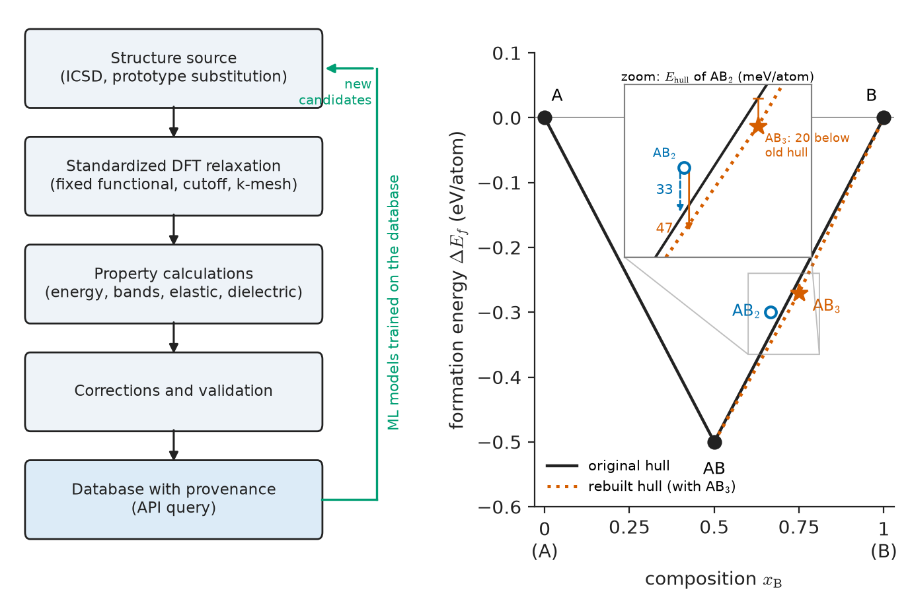
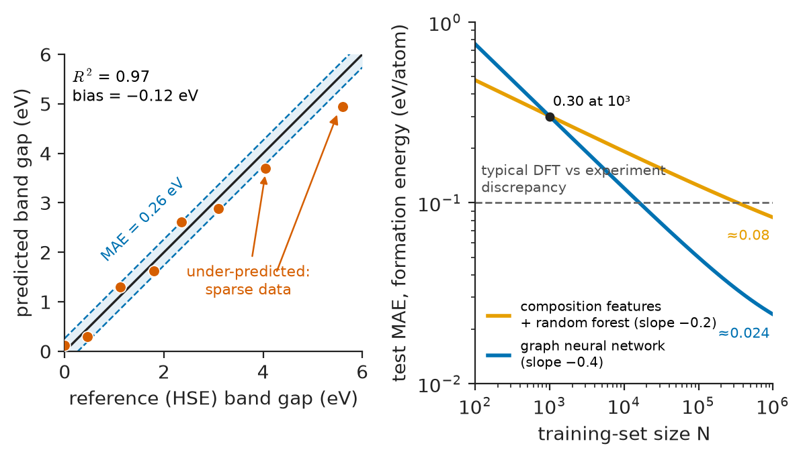
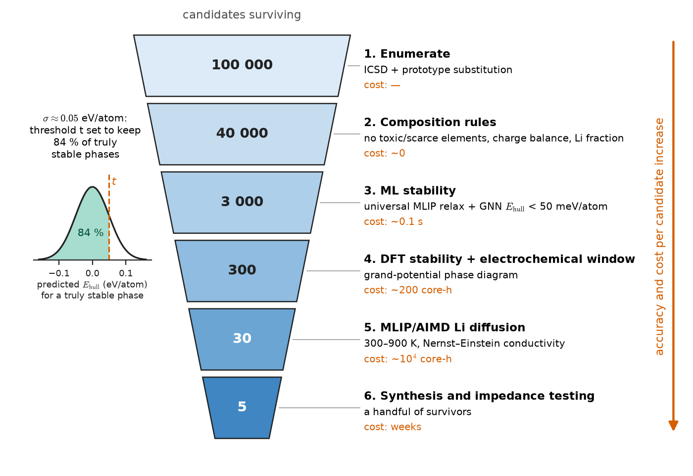
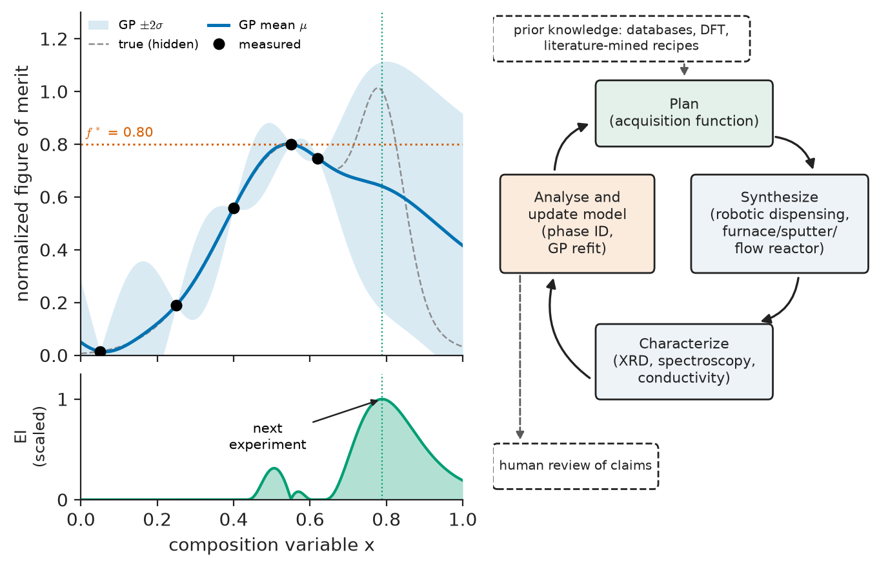

# Chapter 57 — Materials Informatics

*Part XI · Characterization, Computation and Design*

A battery company wants a solid electrolyte for a lithium-metal cell: a crystalline solid that conducts lithium ions almost as well as a liquid, does not react with lithium metal at 0 V, does not oxidize at the 4.3 V cathode, can be sintered below 1000 °C and contains no germanium or other scarce elements. The design space is enormous. With five elements chosen from about sixty that are cheap and non-toxic, there are more than five million chemical systems before a single composition ratio or crystal structure is chosen. A synthesis chemist can make and test perhaps two hundred compositions a year; a density-functional calculation (Chapter 55) of one structure takes hours to days of computer time; a molecular-dynamics simulation of ionic conductivity (Chapter 56) takes longer still. Historically, the solid electrolytes now in prototype cells — garnet Li$_7$La$_3$Zr$_2$O$_{12}$, the thiophosphate Li$_{10}$GeP$_2$S$_{12}$ and the argyrodites — were found by chemical intuition, analogy and luck, each after years of work. The question that defines this chapter is whether the accumulated data of the discipline, organized in databases and learned by statistical models, can search such a space faster and more reliably than intuition alone, and how an engineer can tell when a data-driven prediction should be trusted.

> **What do materials databases contain, and how is a material turned into numbers that a learning algorithm can use?**
> **How accurate can machine-learned predictions of properties and interatomic forces be, and how are they used to screen, explore and invert the design problem?**
> **Where do data-driven methods fail, and how is that failure detected before it reaches a product?**

| Concept | Engineering destination |
|---|---|
| Computed and experimental materials databases | Rapid estimates of stability, elastic constants, band gaps; choosing candidates before synthesis |
| Formation energy and energy above the convex hull | Will a new alloy phase, ceramic or electrolyte decompose? |
| Descriptors and features | Turning compositions, structures and processing routes into model inputs |
| Machine-learning property prediction, graph neural networks | Fast surrogates for DFT and for slow experiments (fatigue, creep, corrosion) |
| Machine-learned interatomic potentials | Near-DFT accuracy molecular dynamics of interfaces, diffusion, radiation damage |
| High-throughput screening and active learning | Battery, catalyst, thermoelectric and alloy discovery campaigns |
| Autonomous laboratories | Closed-loop synthesis and testing of coatings, thin films, polymers |
| Inverse design | Specifying the property and generating the material |
| Uncertainty quantification, domain of applicability | Deciding when a prediction may be used for design and when it must be tested |

**Roadmap.** Where the data come from (57.1) → how materials become numbers (57.2) → learning properties from those numbers, from regression to graph networks (57.3) → learning the forces themselves (57.4) → using models to search: screening, active learning, autonomous labs (57.5) → running the problem backwards (57.6) → what the models cannot know (57.7).

---

## 57.1 Materials databases

### From handbooks to queryable data

Materials engineers have always worked from compiled data: the steel handbooks, the ASM volumes, the JANAF thermochemical tables, the powder-diffraction files used in every X-ray laboratory (Chapter 52). What changed after about 2010 is that two kinds of data became available in quantity and in machine-readable form. The first is **computed data**: density-functional calculations (Chapter 55) run automatically, with identical settings, on hundreds of thousands to millions of crystal structures. The second is **curated experimental data** that had existed for decades but became accessible through programming interfaces. A database differs from a handbook in that it can be queried by property ("all oxides with band gap above 3 eV, energy above hull below 25 meV/atom, and no element with supply risk") and fed directly to a model.

### The main inorganic databases

| Database | Content (order of magnitude, mid-2020s) | Origin of data | Typical use |
|---|---|---|---|
| ICSD (Inorganic Crystal Structure Database) | ~3×10$^5$ experimentally determined crystal structures | Published diffraction studies, curated; licensed | Starting structures for calculations; "is this compound known?" |
| Materials Project | ~1.5×10$^5$ inorganic compounds, with derived properties for many | High-throughput DFT (GGA, GGA+U, increasingly r$^2$SCAN) | Phase stability, elastic tensors, band structures, battery voltages, Pourbaix diagrams |
| AFLOW | ~3×10$^6$ compounds, many hypothetical alloy prototypes | High-throughput DFT, prototype decoration | Alloy and intermetallic screening, thermal and elastic descriptors |
| OQMD (Open Quantum Materials Database) | ~10$^6$ compounds | High-throughput DFT on ICSD and prototype structures | Formation energies, convex hulls, stability of hypothetical phases |
| Others | JARVIS (DFT and ML, including 2D materials), NOMAD (archive of raw calculations, >10$^8$ entries), Pauling File, NIST and Citrination-type experimental collections, Cambridge Structural Database for molecular crystals, PolyInfo for polymers | Mixed | Specialized properties, raw-data reuse |

The computed databases share a workflow (Figure 57.1, left): take a structure from ICSD or generate it by substituting elements into a known prototype; relax it with a standard DFT recipe; compute total energy, and often band structure, elastic constants, dielectric tensor or phonons; and store the result with its full provenance (code version, functional, pseudopotentials, convergence settings). Uniform settings are the point. Two DFT energies can only be compared if computed the same way, and the databases add empirical energy corrections (for example for the over-binding of O$_2$ in GGA and for the GGA+U treatment of transition-metal oxides) so that oxides, metals and mixed systems can appear on one energy scale.

> **Boundary.** The DFT methods that generate these data, their functionals and their known errors are developed in Chapter 55; the thermodynamics of phase equilibria in Chapters 6 and 7. This chapter uses their outputs.

### Formation energy and the convex hull

The most-used quantity in computed databases is the **formation energy** per atom: the energy of the compound minus the energies of its elements in their reference states, divided by the number of atoms. For a binary compound A$_{1-x}$B$_x$:

$$
\Delta E_f(x)=\frac{E(\mathrm{A}_{n_A}\mathrm{B}_{n_B})-n_A\,\mu_A^0-n_B\,\mu_B^0}{n_A+n_B}
$$

A negative formation energy says only that the compound is more stable than the separated elements. It does not say that the compound is stable, because it may be less stable than a mixture of *other compounds*. The correct test is the **convex hull**: plot $\Delta E_f$ against composition for every known phase in the system and construct the lower convex envelope (Figure 57.1, right). Phases on the hull are stable at 0 K; a phase above the hull will, given the kinetic opportunity, decompose into the hull phases at its composition. The vertical distance to the hull, the **energy above hull** $E_{\rm hull}$, measures the driving force for that decomposition. It is the computational counterpart of the common-tangent construction on free-energy curves (Chapter 7), taken at 0 K and without entropy.

<!-- FIGURE 57.1 | figures/ch57/fig-57-1-database-workflow-convex-hull.png | schematic | Left: the high-throughput workflow that fills a computed materials database. Right: the 0 K convex hull of a binary A–B system, showing how the energy above hull is read. | Content: two panels. Left panel, flowchart boxes top to bottom: 'Structure source (ICSD, prototype substitution)' → 'Standardized DFT relaxation (fixed functional, cutoff, k-mesh)' → 'Property calculations (energy, bands, elastic, dielectric)' → 'Corrections and validation' → 'Database with provenance (API query)'; side arrow 'ML models trained on the database' feeding back to 'Structure source' labelled 'new candidates'. Right panel: x-axis composition x_B from 0 (A) to 1 (B); y-axis formation energy from -0.6 to +0.1 eV/atom. Filled circles on hull: A (0, 0), AB (0.5, -0.50), B (1, 0); solid hull lines connecting them. Open circle AB2 at (0.667, -0.30) with vertical dashed arrow down to hull at -0.333 labelled 'E_hull = 33 meV/atom'. Second inset or dashed construction: AB3 at (0.75, -0.27) shown as a filled star below the original hull, with the rebuilt hull (dotted) AB–AB3–B, and AB2's new distance labelled '47 meV/atom'. -->

*Figure 57.1 — Left: the high-throughput workflow that fills a computed materials database. Right: the 0 K convex hull of a binary A–B system, showing how the energy above hull is read.*

**Worked example — energy above hull, and why it depends on the database.** In a binary A–B system the database contains elemental A and B (formation energy zero by definition) and the compound AB with $\Delta E_f=-0.50$ eV/atom at $x_B=0.5$. A new calculation gives $\Delta E_f=-0.30$ eV/atom for AB$_2$ ($x_B=2/3$). Is AB$_2$ stable?

The hull between AB and B is a straight line; at $x_B=2/3$ it lies at

$$
E_{\rm hull\ line}=-0.50+\frac{2/3-1/2}{1-1/2}\,(0-(-0.50))=-0.50+0.1667=-0.333\ \mathrm{eV/atom}
$$

so $E_{\rm hull}=-0.30-(-0.333)=+0.033$ eV/atom, or 33 meV/atom. AB$_2$ is predicted to decompose into AB and B; the lever rule gives the fractions of atoms in each product as $(1-2/3)/(1-1/2)=2/3$ in AB and $1/3$ in B. The formation energy of $-0.30$ eV/atom is strongly negative, yet the compound is metastable.

Now suppose a later calculation finds AB$_3$ at $x_B=0.75$ with $\Delta E_f=-0.27$ eV/atom. The old hull at $x_B=0.75$ lies at $-0.50+0.5\times0.50=-0.25$ eV/atom, so AB$_3$ is 20 meV/atom *below* it: it is a new stable phase, and the hull must be rebuilt through AB, AB$_3$ and B. On the new hull, at $x_B=2/3$,

$$
E_{\rm hull\ line}=-0.50+\frac{2/3-1/2}{3/4-1/2}\,(-0.27+0.50)=-0.50+0.153=-0.347\ \mathrm{eV/atom}
$$

and AB$_2$ now sits 47 meV/atom above the hull. Nothing about AB$_2$ changed; its stability label changed because the database learned about a competitor. Every $E_{\rm hull}$ in every database is therefore an upper bound on stability conditional on the completeness of that chemical system, and systems with few calculated phases give optimistic answers.

> **Status of the principle: convex-hull stability criterion**
> *Derived.* It follows exactly from minimizing the 0 K energy of a closed system at fixed composition; it is approximate as a statement about real materials because it neglects entropy (vibrational, configurational, magnetic), temperature and pressure, inherits the DFT functional error, and is only as complete as the set of competing phases computed.

### How far above the hull is too far?

Many known, useful materials are metastable: diamond, martensite (Chapter 15), most glasses (Chapter 17), many thin-film phases grown by kinetic routes (Chapter 49). Statistical analysis of the ICSD against computed hulls shows that the large majority of experimentally reported inorganic compounds lie within about 50–70 meV/atom of the hull for their chemical system, with oxides tighter than nitrides and metastable polymorphs reaching 100 meV/atom or more. Screening studies therefore use a threshold of order 25–100 meV/atom rather than zero, chosen to balance missed metastable phases against wasted synthesis attempts. Synthesizability is not the same as thermodynamic stability; it also depends on a synthesis route that avoids competing phases, a point returned to in Section 57.7.

### Data quality, provenance and FAIR principles

Experimental databases mix measurements made with different methods, sample purities, grain sizes and test standards. A reported yield strength without the heat-treatment condition, a thermal conductivity without the porosity, a band gap without stating optical or electrical measurement: each is a number whose meaning has been lost. Computed databases have a different problem: values are internally consistent but systematically biased (GGA band gaps underestimated by 30–50 %, Chapter 55; lattice parameters overestimated by 1–2 %). The community response is summarized as **FAIR** data: findable, accessible, interoperable (standard formats and vocabularies) and reusable (with enough metadata to know what was measured or computed, and how). For an engineer, the practical rule is to know which of these two failure modes a dataset is exposed to before trusting any model trained on it.

---

## 57.2 Descriptors and features

### The representation problem

A learning algorithm needs a fixed-length vector of numbers, or a graph, for each material. A crystal is a periodic arrangement of an arbitrary number of atoms; an alloy is a composition plus a processing history plus a microstructure; a polymer is a distribution of chain lengths with tacticity and branching (Chapter 19). The choice of **representation**, the mapping from material to numbers, often matters more than the choice of algorithm. A good representation is:

- **complete enough** that different materials with different properties map to different vectors;
- **invariant** to changes that do not change the material: translation and rotation of the structure, choice of unit cell, ordering of atoms in the input file;
- **smooth**, so that small changes in structure give small changes in the representation, which lets a model interpolate;
- **cheap**, at least much cheaper than the property it is used to predict.

### Composition-based descriptors

When only the chemical formula is known, as at the start of a discovery campaign, the representation is built from elemental properties. For a compound with atomic fractions $c_i$ and an elemental property $p_i$ (atomic number, mass, period and group, Pauling electronegativity, covalent radius, number of valence electrons, melting point of the element), one forms statistics such as

$$
\bar p=\sum_i c_i\,p_i,\qquad \delta p=\sqrt{\sum_i c_i\,(p_i-\bar p)^2},\qquad \max_i p_i-\min_i p_i
$$

A typical composition feature set (the widely used "Magpie" set is an example) has about 130 such numbers. Several are classical metallurgical descriptors in disguise: the mean valence electron concentration sets the stability of Hume-Rothery phases and the fcc/bcc competition in high-entropy alloys (Chapter 16); the atomic-size mismatch $\delta r$ is the Hume-Rothery size criterion (Chapter 7) and the solid-solution strengthening parameter (Chapter 13); the electronegativity spread distinguishes ionic from metallic compounds. Composition models cannot distinguish polymorphs (graphite and diamond have the same formula) and are blind to processing, which limits them to properties dominated by chemistry.

### Structure-based descriptors

When atomic positions are known, the representation can describe local environments:

- **Radial distribution and coordination features**: counts of neighbours within shells, bond-length and bond-angle histograms, Voronoi coordination numbers.
- **The Coulomb matrix and its periodic extensions**: entries $Z_iZ_j/\lvert\mathbf r_i-\mathbf r_j\rvert$, sorted or diagonalized to remove atom-ordering dependence.
- **Smooth Overlap of Atomic Positions (SOAP)**: each atom's neighbourhood within a cutoff radius (typically 4–6 Å) is represented as a sum of Gaussians on the neighbours, expanded in radial functions and spherical harmonics; the rotationally invariant **power spectrum** of the expansion coefficients is the descriptor. Two environments can then be compared through a kernel, the normalized overlap of their power spectra. SOAP is complete enough for most purposes and underlies the GAP potentials of Section 57.4.
- **Symmetry functions** (Behler–Parrinello): sums over neighbours of radial Gaussians and angular terms, with a smooth cutoff, giving a fixed-length vector per atom.

The common idea is **locality**: the energy and many properties of a solid are, to a good approximation, sums of contributions from atoms in their local environments. This is the same nearsightedness that makes linear-scaling electronic-structure methods possible, and it fails where long-range physics dominates (Section 57.4).

### Descriptors beyond the crystal

For engineering alloys, the most important variables are often not atomic at all: solution-treatment temperature, cooling rate, ageing time, cold work, grain size, inclusion content, specimen orientation. Datasets for steel fatigue, nickel-superalloy creep or aluminium-alloy strength use these processing parameters directly as features, sometimes with physically motivated combinations (the Larson–Miller parameter of Chapter 14 is a hand-built feature that collapses time and temperature into one number; the Hollomon–Jaffe tempering parameter of Chapter 15 is another). Polymer informatics uses fingerprints of the repeat unit (counts of chemical fragments, SMILES-string encodings) together with molecular weight. Microstructures enter as images, through two-point correlation functions or features learned by convolutional networks from micrographs (Chapter 52). Building such features is where materials knowledge enters a data-driven model most directly, and a model with a few physically chosen features frequently beats one with hundreds of generic ones on a small dataset.

> **Status of the principle: locality of atomic contributions**
> *Approximate.* Valid when electronic screening confines interactions to a few ångström (most metals, covalent solids, many ionic solids at the level of short-range forces); it fails for long-range electrostatics, charge transfer across interfaces, van der Waals interactions in layered materials and properties set by delocalized electronic states unless those terms are added explicitly.

---

## 57.3 Machine-learning property prediction

### Supervised learning in one paragraph

Given $N$ examples $(\mathbf x_i,y_i)$, with $\mathbf x_i$ the representation and $y_i$ a property (formation energy, band gap, bulk modulus, yield strength, glass-transition temperature), supervised learning finds a function $f(\mathbf x)$ that minimizes a loss on the training data plus a penalty on complexity, for example

$$
\min_f\ \frac1N\sum_{i=1}^N\big(y_i-f(\mathbf x_i)\big)^2+\lambda\,\Omega(f)
$$

The regularization term $\lambda\,\Omega(f)$ keeps the function smooth enough to generalize. The algorithms used in materials work, in rough order of data appetite:

| Method | How it works | Data needed (typical) | Strengths and weaknesses |
|---|---|---|---|
| Linear and sparse regression (LASSO, SISSO) | Linear combination of features, or of algebraic combinations of features selected for sparsity | 10–10$^3$ | Interpretable formulas; misses complex interactions |
| Kernel ridge regression, Gaussian process (GP) | Prediction as weighted sum of similarities (kernels) to training points | 10$^2$–10$^4$ | Smooth; GP gives uncertainty; cost grows as $N^3$ |
| Random forest, gradient-boosted trees | Ensembles of decision trees on features | 10$^2$–10$^5$ | Robust on tabular processing data; cannot extrapolate beyond training range |
| Neural networks on descriptors | Layers of linear maps and nonlinear activations | 10$^3$–10$^6$ | Flexible; need care to avoid overfitting |
| Graph neural networks (GNNs) | Learn the representation itself from the atomic graph | 10$^4$–10$^7$ | State of the art for structure–property prediction on large DFT sets |

The Gaussian process deserves a sentence more because Section 57.5 depends on it. A GP treats the unknown function as a random function whose values at any set of points are jointly Gaussian with covariance given by a kernel $k(\mathbf x,\mathbf x')$, for example $k=\sigma_f^2\exp(-\lvert\mathbf x-\mathbf x'\rvert^2/2\ell^2)$. Conditioning on the training data gives, at a new point, both a mean prediction $\mu(\mathbf x)$ and a standard deviation $\sigma(\mathbf x)$. The standard deviation is small near training data and grows toward the prior value far from them: the model knows, in a limited sense, where it has not looked.

### Training, validation and the metrics that matter

A model is judged on data it has not seen. The data are split into training and test sets, or rotated through $k$-fold cross-validation, and three metrics are reported:

$$
\mathrm{MAE}=\frac1N\sum_i\lvert\hat y_i-y_i\rvert,\qquad \mathrm{RMSE}=\sqrt{\frac1N\sum_i(\hat y_i-y_i)^2},\qquad R^2=1-\frac{\sum_i(\hat y_i-y_i)^2}{\sum_i(y_i-\bar y)^2}
$$

The MAE is in the units of the property and is the easiest to interpret; the RMSE weights large errors more heavily; $R^2$ compares the model with the trivial predictor that always returns the mean. A high $R^2$ on a property spanning a wide range can hide errors that are large for the decision at hand, so MAE should always be compared with the **resolution the application requires**.

**Worked example — reading a parity plot.** A graph-network model predicts band gaps for eight test compounds whose DFT (HSE) gaps are 0.00, 0.45, 1.12, 1.80, 2.35, 3.10, 4.05 and 5.60 eV; the model returns 0.12, 0.30, 1.30, 1.62, 2.61, 2.88, 3.70 and 4.95 eV (Figure 57.2, left). The errors $\hat y-y$ are $+0.12,-0.15,+0.18,-0.18,+0.26,-0.22,-0.35,-0.65$ eV. Then

$$
\mathrm{MAE}=\frac{2.11}{8}=0.264\ \mathrm{eV},\qquad \mathrm{RMSE}=\sqrt{\frac{0.763}{8}}=0.309\ \mathrm{eV}
$$

The mean of the reference gaps is 2.309 eV and their total sum of squares 24.95 eV$^2$, so $R^2=1-0.763/24.95=0.969$. The baseline that always predicts 2.31 eV has an MAE of 1.47 eV, so the model is far better than knowing nothing. But three further observations matter more than the headline $R^2$. The RMSE exceeds the MAE noticeably, a sign that a few errors are large. The mean error is $-0.12$ eV and the two largest-gap compounds are both under-predicted, by 0.35 and 0.65 eV: a systematic bias at the edge of the data, where wide-gap materials are rare in the training set. And for an application that must distinguish a 1.1 eV absorber for photovoltaics from a 1.6 eV one for a tandem top cell (Chapter 40), an MAE of 0.26 eV is a coarse filter, not an answer.

### How error falls with data: learning curves

For a fixed model and representation, test error typically falls as a power of the training-set size,

$$
\mathrm{MAE}(N)\approx a\,N^{-b}
$$

with $b$ between about 0.2 and 0.5 for materials properties (Figure 57.2, right). With $b=0.3$, ten times more data cuts the error by a factor $10^{-0.3}=0.50$; a hundred times more cuts it by a factor $10^{-0.6}=0.25$, to a quarter. A better representation shifts the curve down or steepens it; data with irreducible noise make it flatten at the noise floor. For DFT-trained models the floor is not the DFT-versus-experiment error; that error is invisible to the model, which learns DFT, not nature. Graph networks trained on 10$^5$ Materials Project entries reach formation-energy MAEs of about 0.02–0.04 eV/atom against DFT, well below the typical DFT-versus-experiment discrepancy of about 0.1 eV/atom for formation enthalpies.

<!-- FIGURE 57.2 | figures/ch57/fig-57-2-parity-and-learning-curve.png | plot | Left: parity plot of predicted against reference band gaps for the worked example. Right: learning curves showing test error falling as a power of training-set size for two representations. | Content: two panels. Left: x-axis reference (HSE) band gap 0 to 6 eV, y-axis predicted band gap 0 to 6 eV; diagonal y = x solid; dashed band y = x ± 0.26 eV labelled 'MAE = 0.26 eV'; eight points (0.00,0.12), (0.45,0.30), (1.12,1.30), (1.80,1.62), (2.35,2.61), (3.10,2.88), (4.05,3.70), (5.60,4.95); annotation 'R² = 0.97, bias −0.12 eV' and arrow to the two high-gap points 'under-predicted: sparse data'. Right: log-log axes; x-axis training-set size N from 10² to 10⁶; y-axis test MAE in formation energy from 0.01 to 1 eV/atom. Line 1 'composition features + random forest': MAE 0.30 at N = 10³ with slope −0.2, flattening near 0.08 by 10⁶. Line 2 'graph neural network': MAE 0.30 at N = 10³ with slope −0.4, reaching ~0.025 at 10⁶. Horizontal dashed line at 0.1 eV/atom labelled 'typical DFT vs experiment discrepancy'. -->

*Figure 57.2 — Left: parity plot of predicted against reference band gaps for the worked example. Right: learning curves showing test error falling as a power of training-set size for two representations.*

### Graph neural networks

A crystal is naturally a graph: atoms are nodes, and edges join atoms closer than a cutoff radius (typically 5–8 Å), including periodic images. **Graph neural networks** learn the representation instead of having it designed. Each atom $i$ starts with a feature vector $\mathbf h_i^{(0)}$ encoding its element; each edge carries the interatomic distance (expanded in Gaussian or Bessel basis functions) and, in some architectures, angles. In each **message-passing** layer, every atom collects messages from its neighbours and updates its state:

$$
\mathbf h_i^{(t+1)}=U\!\left(\mathbf h_i^{(t)},\ \sum_{j\in\mathcal N(i)}M\big(\mathbf h_i^{(t)},\mathbf h_j^{(t)},\mathbf e_{ij}\big)\right)
$$

where $M$ and $U$ are small neural networks with learned weights shared across all atoms. After $T$ layers (typically three to six), each atom's state encodes its environment out to roughly $T$ times the cutoff. A **readout** sums or averages the atomic states and maps them to the property. Because the sum over neighbours is unordered and uses only distances (and angles), the output is automatically invariant to atom ordering, translation and rotation.

The first widely used models, CGCNN (2018) and MEGNet (2019), demonstrated DFT-level accuracy for formation energies across the Materials Project; later models (ALIGNN with explicit bond angles, equivariant networks of the kind in Section 57.4) improved accuracy further. Graph networks are now the default for properties of crystals where the training set has more than about 10$^4$ entries. On small experimental datasets, a few hundred measured toughness or creep values, they offer little over random forests with good features, and the representation-learning advantage disappears.

> **Status of the principle: power-law learning curves**
> *Empirical.* Observed across many datasets and model families for interpolation within a fixed distribution of materials; the exponent is not universal, and the curve says nothing about error on materials unlike the training set.

### Pitfalls that make models look better than they are

- **Data leakage.** If the test set contains near-duplicates of training entries (the same compound at slightly different relaxation, polymorphs of one composition, the same alloy at two test temperatures), the test error measures memorization. Splitting by chemical system, by structure prototype or by alloy family (grouped cross-validation) gives an honest, and usually larger, error.
- **Target leakage.** A feature that encodes the answer (using measured density to predict porosity-dependent conductivity, or a processing step that is only applied to the best alloys) produces impressive and useless models.
- **Selection bias.** Published data over-represent successes. A model trained on reported superconductors has seen few non-superconductors, so it learns to predict high $T_c$ for nearly everything.
- **Distribution shift.** A model trained on bulk oxides applied to sulfide surfaces, or on wrought alloys applied to additively manufactured ones (Chapter 48, where porosity and texture differ), is extrapolating, whatever the test error was.

---

## 57.4 Machine-learned interatomic potentials

### The gap they fill

Molecular dynamics (Chapter 56) needs forces on every atom at every time step, for $10^6$–$10^9$ steps. DFT gives accurate forces but its cost scales roughly as $N^3$ with the number of atoms and limits simulations to a few hundred atoms for tens of picoseconds. Classical potentials (Lennard-Jones, EAM, Tersoff, ReaxFF; Chapter 56) scale linearly and reach millions of atoms, but their fixed functional forms limit accuracy and transferability: an EAM potential fitted for bulk aluminium may give poor surface energies, stacking-fault energies or liquid structure. **Machine-learned interatomic potentials (MLIPs)** keep the linear scaling and locality of classical potentials but replace the fixed functional form by a flexible regression fitted to DFT energies, forces and stresses.

### The common structure

All MLIPs write the total energy as a sum of atomic contributions, each a learned function of the local environment within a cutoff $r_c$:

$$
E=\sum_{i=1}^{N}\varepsilon\big(\{\mathbf r_{ij}\}_{r_{ij}<r_c}\big),\qquad \mathbf F_i=-\frac{\partial E}{\partial\mathbf r_i}
$$

Forces are obtained by differentiating the energy, so energy is conserved in dynamics. Training minimizes a weighted loss over a DFT dataset, typically

$$
\mathcal L=w_E\sum_{\rm configs}\left(\frac{E-E^{\rm DFT}}{N}\right)^2+w_F\sum_{\rm atoms}\lvert\mathbf F_i-\mathbf F_i^{\rm DFT}\rvert^2+w_\sigma\sum_{\rm configs}\Vert\boldsymbol\sigma-\boldsymbol\sigma^{\rm DFT}\Vert^2
$$

Forces are especially valuable training data: one DFT calculation on a 100-atom cell gives one energy but 300 force components.

### Three generations of models

| Potential | Representation and regression | Characteristics |
|---|---|---|
| Behler–Parrinello neural network (2007) | Atom-centred symmetry functions → per-element feed-forward network | First general MLIP; needs careful choice of symmetry functions |
| GAP (Gaussian Approximation Potential, 2010) | SOAP descriptors → Gaussian-process (kernel) regression on sparse set of reference environments | Data-efficient; gives a variance that flags unfamiliar environments; used for Si, C, W, Fe, amorphous phases, radiation damage |
| Moment Tensor Potentials, ACE (Atomic Cluster Expansion) | Systematic many-body polynomial expansions with linear fitting | Fast, systematically improvable, close relatives of the equivariant networks |
| NequIP (2022) | E(3)-equivariant message-passing network: features carry vector and tensor character that rotates with the structure | Very data-efficient: chemical accuracy from a few hundred to a few thousand configurations |
| MACE (2022) | Equivariant message passing with higher body-order messages built on the ACE basis; typically two layers | High accuracy with short effective receptive field; basis of widely used "foundation" potentials |

**Equivariance** is the key idea of the latest generation. The energy is invariant under rotation, but forces are vectors that rotate with the structure. Earlier networks built only invariant features (distances, angles) and lost directional information; equivariant networks carry internal features that transform like vectors and tensors under rotation, so that geometric information is preserved through the layers and the model needs far fewer examples to learn it. Typical accuracies for a well-trained MLIP on its target system are 1–5 meV/atom in energy and 0.03–0.1 eV/Å in force against the reference DFT.

### Universal potentials

Trained on the relaxation trajectories stored in databases such as the Materials Project (about 1.5 million configurations), models such as M3GNet, CHGNet and MACE-MP-0 cover most of the periodic table. They are less accurate on any particular system than a dedicated potential, with typical force errors of 0.05–0.1 eV/Å and a systematic softening of phonon frequencies inherited from training data dominated by near-equilibrium structures, but they run stable molecular dynamics on almost any inorganic material out of the box. They are used for pre-relaxing candidate structures before DFT, for screening stability and ionic diffusion, and as starting points that are fine-tuned with a few hundred system-specific DFT calculations.

### What MLIPs make possible, and their failure modes

Speed is the reason they matter. A MACE or NequIP evaluation costs of order 10$^{-5}$–10$^{-4}$ s per atom per step on a GPU, against of order 0.1–10 s per atom per step for DFT molecular dynamics; with linear scaling, systems of 10$^5$–10$^6$ atoms and nanosecond times become practical. That opens problems that are out of reach for DFT and beyond the accuracy of classical potentials: dislocation core structure and mobility in tungsten and high-entropy alloys (Chapters 12 and 16), lithium diffusion and interface reactions in solid electrolytes (Chapter 40), amorphous silicon and carbon structures, phase transitions in perovskites, hydrogen embrittlement mechanisms (Chapter 44), and primary radiation damage cascades in reactor steels (Chapter 41).

Failure modes follow from the construction:

- **Extrapolation**: an MLIP has no physics outside its training data. A potential trained on bulk crystals may let atoms collapse together at short distances never sampled, so short-range repulsion is often added by hand (a ZBL screened Coulomb term for radiation damage).
- **Long-range effects**: a strictly local model misses long-range electrostatics and charge transfer. Space-charge layers at electrode interfaces, polar surfaces and charged defects need explicit electrostatic terms or charge-equilibration schemes.
- **Inherited DFT error**: the potential is at best as good as its functional. A GGA-trained potential for water or for magnetic iron carries GGA's errors faithfully.

**Active learning** is the standard remedy for extrapolation: run dynamics with the current potential, monitor an uncertainty indicator (GP variance in GAP, disagreement among an ensemble of networks, or a descriptor-space distance), stop when it exceeds a threshold, compute the flagged configurations with DFT, add them to the training set and retrain. The same loop drives materials discovery in the next section.

> **Status of the principle: machine-learned interatomic potentials**
> *Approximate.* They reproduce the reference electronic-structure method within stated errors for configurations similar to their training data, under the locality assumption; accuracy elsewhere is not guaranteed and must be tested, not assumed.

---

## 57.5 High-throughput screening, active learning and autonomous laboratories

### The screening funnel

High-throughput screening applies a sequence of filters of increasing cost and accuracy to a large candidate set (Figure 57.3). For a solid lithium electrolyte the funnel might be:

1. **Enumerate** candidates: known ICSD lithium compounds plus hypothetical ones generated by substituting elements into known structure prototypes, perhaps 10$^5$ structures.
2. **Composition and rule filters** (cost: negligible): exclude toxic, scarce or radioactive elements; require charge neutrality and lithium content above a threshold.
3. **ML stability filter** (cost: milliseconds to a second per structure): a universal potential relaxes each structure and a GNN predicts $E_{\rm hull}$; keep those below a threshold.
4. **DFT stability and electrochemical window** (hours per structure): compute $E_{\rm hull}$ and the voltage range in which the compound is stable against lithium uptake or loss, using the grand-potential phase diagram.
5. **Ionic conductivity** (days per structure): MLIP or ab initio molecular dynamics to compute the lithium diffusion coefficient and, through the Nernst–Einstein relation, the conductivity (Chapters 8 and 40).
6. **Synthesis and testing** of a handful of survivors.

Each stage removes most of the remaining candidates, so expensive methods are used only where they matter. The funnel is the computational form of the screening and ranking stages of materials selection (Chapter 58).

<!-- FIGURE 57.3 | figures/ch57/fig-57-3-screening-funnel.png | flowchart | A high-throughput screening funnel for solid lithium electrolytes: each stage is more expensive and more accurate, and passes fewer candidates. | Content: an inverted funnel of six horizontal bands, top to bottom, each labelled with stage, method, cost per candidate and number surviving: 'Enumerate (ICSD + prototype substitution) — 100 000'; 'Composition rules (no toxic/scarce elements, charge balance, Li fraction) — 40 000, ~0 cost'; 'ML stability (universal MLIP relax + GNN E_hull < 50 meV/atom) — 3 000, ~0.1 s'; 'DFT stability + electrochemical window — 300, ~200 core-h'; 'MLIP/AIMD Li diffusion at 300–900 K — 30, ~10⁴ core-h'; 'Synthesis and impedance testing — 5, weeks'. Right-hand axis arrow labelled 'accuracy and cost per candidate increase'. Left-hand side, a small Gaussian error curve beside the ML stage annotated 'σ ≈ 0.05 eV/atom: threshold set to keep 84 % of truly stable phases'. -->

*Figure 57.3 — A high-throughput screening funnel for solid lithium electrolytes: each stage is more expensive and more accurate, and passes fewer candidates.*

**Worked example — setting a screening threshold that does not discard the answer.** In the funnel above, the ML stage predicts $E_{\rm hull}$ for 10$^5$ structures with an error that is approximately Gaussian with standard deviation $\sigma=0.05$ eV/atom. The team wants every truly stable compound ($E_{\rm hull}=0$) to reach the DFT stage. If the threshold were set at 0, a truly stable compound would pass with probability $\Phi(0/\sigma)=0.50$: half of the answers would be thrown away by the cheapest filter. With threshold $t$, a truly stable compound passes with probability $\Phi(t/\sigma)$:

| Threshold $t$ (eV/atom) | $t/\sigma$ | Probability a truly stable compound passes |
|---|---|---|
| 0.00 | 0 | 0.50 |
| 0.05 | 1 | 0.84 |
| 0.10 | 2 | 0.977 |

Raising the threshold also passes more unstable compounds. Suppose 3000 structures pass at $t=0.05$ and 7000 at $t=0.10$. At about 200 core-hours per DFT stability calculation (relaxation plus a static calculation, Chapter 55), the DFT stage costs $3000\times200=6\times10^5$ core-hours at the lower threshold and $1.4\times10^6$ at the higher one, against $2\times10^7$ core-hours to compute all 10$^5$ structures directly. The ML stage itself, at about 0.1 s per structure, takes $10^5\times0.1/3600\approx2.8$ GPU-hours. The decision is an engineering trade: more than doubling the DFT budget (×2.3) raises the recall of stable phases from 84 % to about 98 %. A cheap filter is only useful if its threshold is set from its error, not from the target value.

### Active learning and Bayesian optimization

Screening evaluates everything that passes each filter. When each evaluation is expensive (a synthesis, a fatigue test, a week of molecular dynamics) and the candidate space is continuous (alloy compositions, processing temperatures and times), it is better to choose each next experiment so that it is maximally informative. This is **active learning**, and when the aim is to find the best material rather than to map the whole space, **Bayesian optimization**:

1. Fit a surrogate model, usually a Gaussian process, to the measurements so far; it gives a mean $\mu(\mathbf x)$ and uncertainty $\sigma(\mathbf x)$ everywhere.
2. Compute an **acquisition function** that scores each untested candidate by how useful testing it would be.
3. Test the candidate with the highest score, add the result, refit, and repeat.

The acquisition function balances **exploitation** (test where $\mu$ is high) and **exploration** (test where $\sigma$ is large). The most common choice, **expected improvement**, is the expected amount by which a candidate will beat the best value $f^*$ found so far, for a property to be maximized:

$$
\mathrm{EI}(\mathbf x)=(\mu-f^*)\,\Phi(z)+\sigma\,\phi(z),\qquad z=\frac{\mu-f^*}{\sigma}
$$

with $\Phi$ and $\phi$ the standard normal cumulative distribution and density. The **upper confidence bound** $\mu+\kappa\sigma$ is a simpler alternative with an explicit exploration weight $\kappa$.

**Worked example — which experiment next?** A team optimizing the composition of a thermoelectric is maximizing a normalized figure of merit; the best measured so far is $f^*=0.80$. The GP proposes three candidates:

| Candidate | $\mu$ | $\sigma$ | $z$ | EI |
|---|---|---|---|---|
| A (near the current best) | 0.82 | 0.10 | 0.20 | 0.051 |
| B (unexplored corner) | 0.70 | 0.25 | −0.40 | 0.058 |
| C (between two tested points) | 0.79 | 0.02 | −0.50 | 0.004 |

For A, $\mathrm{EI}=0.02\,\Phi(0.2)+0.10\,\phi(0.2)=0.02\times0.579+0.10\times0.391=0.051$. For B, $\mathrm{EI}=-0.10\,\Phi(-0.4)+0.25\,\phi(-0.4)=-0.10\times0.345+0.25\times0.368=0.058$. For C, $\mathrm{EI}=-0.01\times0.309+0.02\times0.352=0.004$. Candidate B has the lowest predicted value but the highest expected improvement, because its large uncertainty leaves a real chance of a much better result. Candidate C, almost certain to be slightly worse than the best, is nearly worthless to test. Over many iterations this logic finds optima in tens of experiments where grid searches need hundreds; reported campaigns on alloy compositions, perovskite film processing and polymer formulations have typically needed three to ten times fewer experiments than one-factor-at-a-time or grid designs. The result depends on the surrogate's uncertainty being honest (Section 57.7).

> **Status of the principle: Bayesian optimization**
> *Approximate.* A principled decision rule given the surrogate model; its efficiency depends on whether the GP kernel and noise model describe the real property landscape, and it degrades in high-dimensional spaces (more than about 10–20 variables) unless the representation is reduced.

### Autonomous laboratories

An **autonomous** or **self-driving laboratory** closes the loop physically: robots dispense precursors, synthesize (by solid-state reaction, spin coating, sputtering, electrodeposition or polymerization), characterize (X-ray diffraction, optical spectroscopy, conductivity, Chapter 52), and an algorithm analyses the data and chooses the next experiment without human intervention (Figure 57.4). Systems in operation include flow reactors for polymers and nanoparticles, combinatorial sputtering with automated diffraction for thin-film alloys, robot arms handling powders and furnaces for inorganic synthesis, and automated electrochemistry for corrosion and battery-electrolyte formulations.

<!-- FIGURE 57.4 | figures/ch57/fig-57-4-active-learning-loop.png | plot | Bayesian optimization in one dimension, and the closed loop of an autonomous laboratory. | Content: two panels. Left (plot): x-axis composition variable 0 to 1; y-axis property (normalized figure of merit) 0 to 1.2. Hidden true function (thin grey dashed) with a broad maximum ~1.0 near x = 0.78. Five measured points (black dots) at x = 0.05, 0.25, 0.40, 0.55, 0.62 with best value 0.80 at x = 0.55. GP mean (solid line) and ±2σ band (shaded), narrow near data and wide for x > 0.7. Lower strip: expected improvement curve with peak at x ≈ 0.80, arrow 'next experiment'. Horizontal dotted line at f* = 0.80. Right (schematic loop): four boxes in a cycle: 'Plan (acquisition function)' → 'Synthesize (robotic dispensing, furnace/sputter/flow reactor)' → 'Characterize (XRD, spectroscopy, conductivity)' → 'Analyse and update model (phase ID, GP refit)' → back to 'Plan'; a dashed side input 'prior knowledge: databases, DFT, literature-mined recipes' feeding 'Plan'; a dashed side output 'human review of claims'. -->

*Figure 57.4 — Bayesian optimization in one dimension, and the closed loop of an autonomous laboratory.*

The benefit is throughput and reproducibility: a robotic platform runs day and night, records every parameter, and logs failures as faithfully as successes, which gives the unbiased data that literature-trained models lack. The limitations are equally concrete. Each platform automates a narrow chemistry and set of processes; solids handling (grinding, pelletizing, sintering) is much harder to automate than liquids; and automated analysis of characterization data is a weak link. A widely publicized 2023 autonomous synthesis campaign reported that most of its several dozen target inorganic compounds had been made, and subsequent re-analysis of its diffraction data questioned many of the phase identifications. The episode is a reminder that automation accelerates mistakes as efficiently as discoveries: claims of new phases still need the standard of evidence of Chapter 52, including refinement of diffraction patterns and independent confirmation.

---

## 57.6 Inverse design

### Running the structure–property map backwards

The rest of this book runs from structure to property: given a microstructure or crystal structure, predict the modulus, conductivity or toughness. Engineering usually needs the inverse: given the required properties, find a structure (and a process to make it) that delivers them. The forward map is many-to-one and the inverse is ill-posed: many structures may satisfy the specification, or none, and small changes in requirement can jump between unrelated solutions. Three approaches are in use.

**Optimization in a parameterized space.** If the design space can be described by continuous variables (alloy composition, layer thicknesses of a coating, volume fraction and aspect ratio of a reinforcement, lattice-architecture parameters for an additively manufactured part), a surrogate model plus an optimizer (Bayesian optimization, genetic algorithms, gradient methods if the surrogate is differentiable) searches it directly. Topology optimization of structures and multilayer optical coating design are mature examples. Most alloy-design successes of data-driven methods are of this kind: compositions of high-entropy alloys with targeted phase stability and strength, low-expansion Invar-type alloys, and nickel superalloys balancing $\gamma'$ fraction, density and cost, often with CALPHAD (Chapter 56) providing physics-based features or constraints.

**Generative models.** For discrete crystal structures, generative models learn the distribution of known stable materials and sample new ones from it. Variational autoencoders map structures to a continuous latent space in which one can move and decode; **diffusion models**, which learn to reverse a process that progressively adds noise to atomic positions, lattice and species, generate periodic structures directly and can be conditioned on target properties (band gap, magnetic density, bulk modulus, chemical system, symmetry). Generated candidates are relaxed with an MLIP, checked against the convex hull with DFT, and screened for novelty against databases. Reported success rates, the fraction of generated structures that are stable, unique and new after DFT, are of order tens of percent for recent models, much higher than random substitution, though still dominated by close relatives of known structural families.

**Property-to-structure for microstructure and architecture.** At larger scales, inverse design specifies a microstructure or architecture: the lattice geometry of a 3D-printed bone scaffold with a target modulus near that of trabecular bone (Chapter 39), the fibre layup of a composite wing skin (Chapter 23), the pore structure of a catalyst support. Here the forward model is usually homogenization or finite elements, and the inverse step is classical optimization.

### Why inverse design is harder than it sounds

A target property is only part of a specification. The generated material must also be thermodynamically accessible, synthesizable with available precursors, stable in service (against oxidation, moisture, radiation), processable into the required form, and made of affordable, non-critical elements (Chapter 59). Most of these are not in the model's training data. In practice inverse design proposes, and the screening funnel, the experimental loop and the documentation stage of materials selection (Chapter 58) dispose.

> **Status of the principle: generative inverse design**
> *Approximate.* A sampling method whose outputs are hypotheses; their stability is checked by DFT within its errors and their existence by synthesis, and the generator cannot reliably propose chemistries far outside the distribution it was trained on.

---

## 57.7 Uncertainty and the limits of data-driven discovery

### Two kinds of uncertainty

Every prediction carries two kinds of uncertainty:

- **Aleatoric** uncertainty is noise in the data themselves: scatter in measured fatigue lives (Chapter 14), sample-to-sample variation in thermal conductivity, numerical noise in DFT. It cannot be reduced by more data of the same kind, only by better measurements.
- **Epistemic** uncertainty is the model's ignorance: lack of training data near the query, or a model form that cannot represent the true function. It shrinks with more relevant data.

Methods for estimating epistemic uncertainty include Gaussian-process variances, the spread of an **ensemble** of models trained on different data subsets or with different initializations, Monte Carlo dropout in neural networks, and distance-based measures (how far is the query from its nearest training neighbours in descriptor space?). None is perfect: ensembles can agree confidently while all being wrong, and GP variances depend on the kernel assumed. **Calibration** checks whether stated uncertainties are honest: of the predictions made with a stated 90 % interval, about 90 % of test values should fall inside. Many published models are overconfident far from their data.

**Conformal prediction** offers a distribution-free alternative for calibration: hold out a calibration set, compute the residuals, and use their quantiles to put intervals around new predictions, with guaranteed coverage on average, provided new queries come from the same distribution as the calibration data. That proviso is the whole difficulty.

### Interpolation versus discovery

The deepest limitation is structural. Discovery means finding materials unlike those already known, whereas statistical learning works best on materials like those in the training set. A model trained on known superconductors would not have predicted the cuprates in 1986 or MgB$_2$ in 2001; a model trained on oxide electrolytes would not propose sulfide argyrodites. Data-driven methods therefore excel at **interpolation and dense search** within known families (optimizing a composition, finding the best member of a structure type, mapping a processing window) and are weakest at the conceptual leaps that create new families. The **domain of applicability** of a model, the region of descriptor space where its errors have been measured, should accompany every prediction used for design, and a prediction outside it should be treated as a hypothesis.

### Biases in the data

- **Publication bias**: failed syntheses and non-functional compositions are rarely reported, so training data over-represent success.
- **Anthropogenic bias**: research attention concentrates on fashionable chemistries; a few thousand compounds account for a large share of literature data.
- **Method bias**: DFT databases inherit functional errors (band gaps, magnetic and strongly correlated systems, van der Waals layered structures, Chapter 55); experimental databases mix test methods.
- **Condition bias**: computed properties are for perfect crystals at 0 K; engineering properties depend on defects, microstructure and temperature (Chapters 5, 13 and 14). No database of perfect crystals can predict fatigue strength, which is controlled by inclusions and surface finish.

### Synthesizability and processing

A material predicted to be stable, with excellent properties, may still be impossible to make with the required phase purity, grain size, density or form. Models trained on text-mined synthesis recipes can suggest precursors and temperatures, but synthesis outcomes depend on kinetics, nucleation and competing phases (Chapters 9 and 10) that are poorly represented in data. For engineering materials, processing defines the structure, and the structure defines most of the properties that matter in service. That is the main reason why informatics has so far had more impact on functional materials, where properties follow chemistry and crystal structure fairly directly, than on structural ones, where they follow microstructure.

### The engineer's checklist

Before a data-driven prediction is used to commit time or money:

1. What data was the model trained on, and does the query lie within that distribution?
2. How was the test error measured: random split or grouped by chemistry or family?
3. Is the error small compared with the difference the decision depends on?
4. Is an uncertainty reported, and has it been calibrated?
5. Does the prediction violate known physics (negative elastic constants, a band gap above the ionization energy, a density above the close-packed limit)?
6. Has the top candidate been confirmed by the next level of the hierarchy: DFT for an ML prediction, experiment for a DFT prediction?

> **Status of the principle: data-driven property prediction**
> *Empirical.* Machine-learned models are fitted to observation (computed or measured); their reliability is established only by testing on held-out data from the same distribution, and does not transfer to new chemistries, structures or processing routes without new evidence.

### Where informatics fits in the discipline

Informatics does not replace the physical understanding developed in the rest of this book; it depends on it. The descriptors that work best are the classical ones (size mismatch, electron concentration, electronegativity, the Larson–Miller parameter); the most reliable training data come from the physics-based methods of Chapters 55 and 56 or from careful characterization (Chapters 52–54); and the predictions must be filtered by thermodynamics, kinetics, processing and selection criteria that the models do not know. Used this way, as a fast and statistically honest layer on top of physical models and experiments, it shortens the path from requirement to material from decades to years, and in favourable cases to months.

---

## What remains open

| Open question | Where it is answered |
|---|---|
| How the DFT energies, band gaps and elastic constants in the databases are computed, and their systematic errors | Chapter 55 |
| Classical potentials, molecular dynamics, kinetic Monte Carlo, phase-field and CALPHAD, which MLIPs and ML surrogates accelerate | Chapter 56 |
| Common-tangent construction and phase diagrams behind the convex hull | Chapters 6 and 7 |
| Why stability is not synthesizability: nucleation, growth and metastable phase formation | Chapters 9 and 10 |
| Turning predicted properties into a ranked material choice with costs, shapes and processes | Chapter 58 |
| Adding embodied carbon, criticality and recyclability as objectives and constraints in screening | Chapter 59 |
| Characterization data that train and validate models, and automated analysis of diffraction and microscopy | Chapters 52–54 |
| Statistical learning theory, Gaussian processes and Bayesian inference in full | The Mathematics Universe |
| Quantum-mechanical foundations of the electronic structure that the models learn | Engineering Physics |

**Next:** Chapter 58 turns from finding materials to choosing among them, deriving the performance indices, charts, shape factors and cost models by which a design requirement becomes a ranked list of materials and processes.
