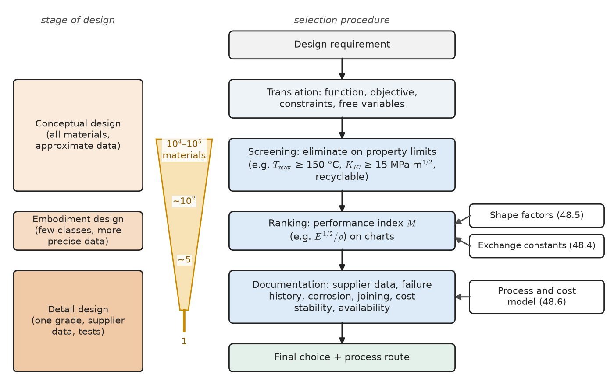
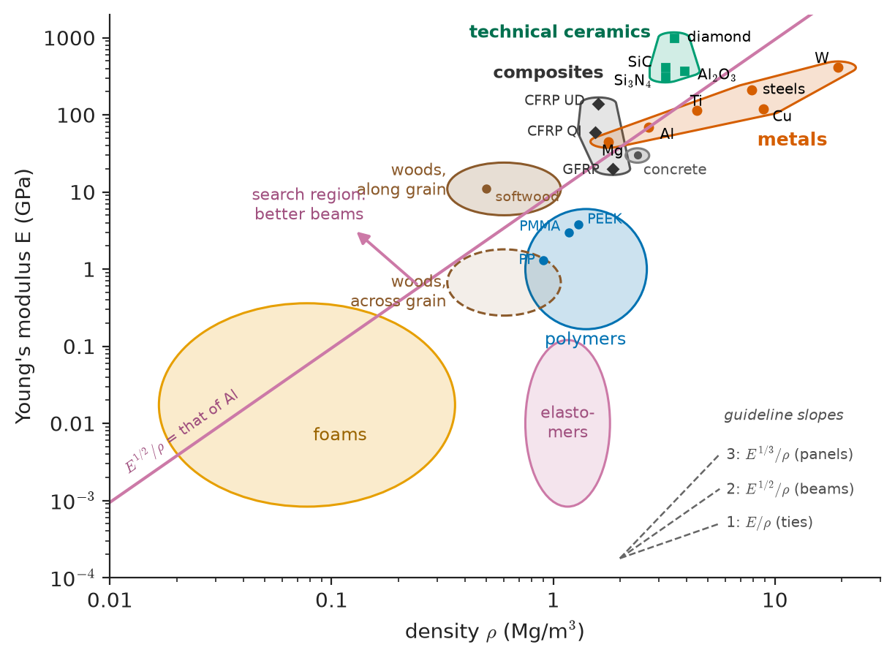
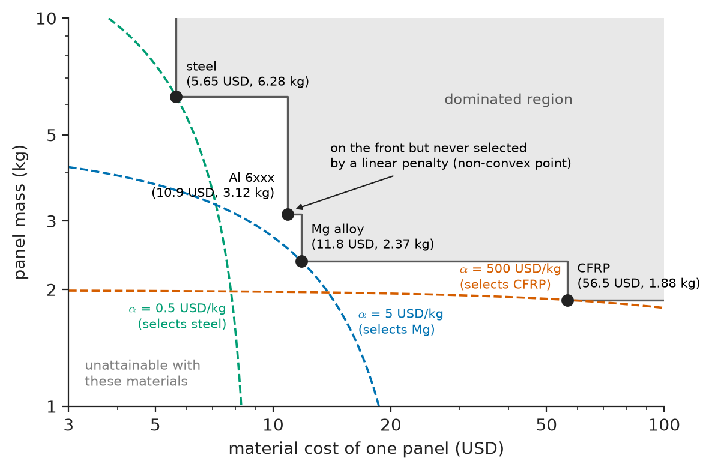
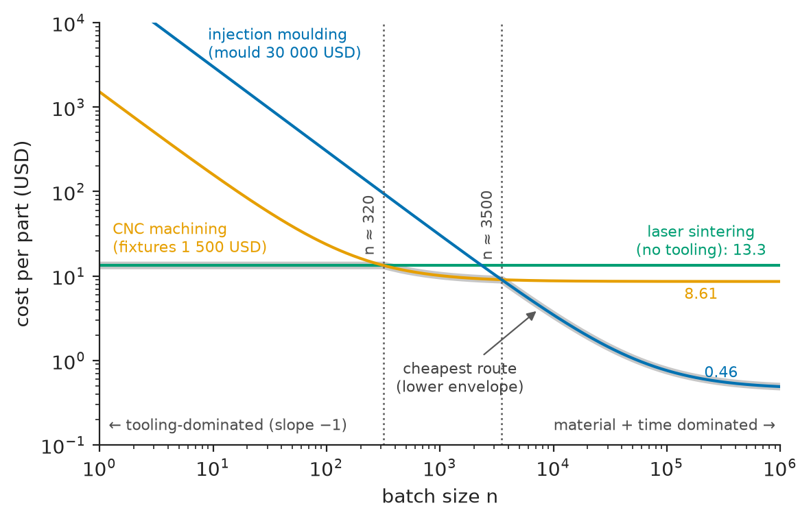
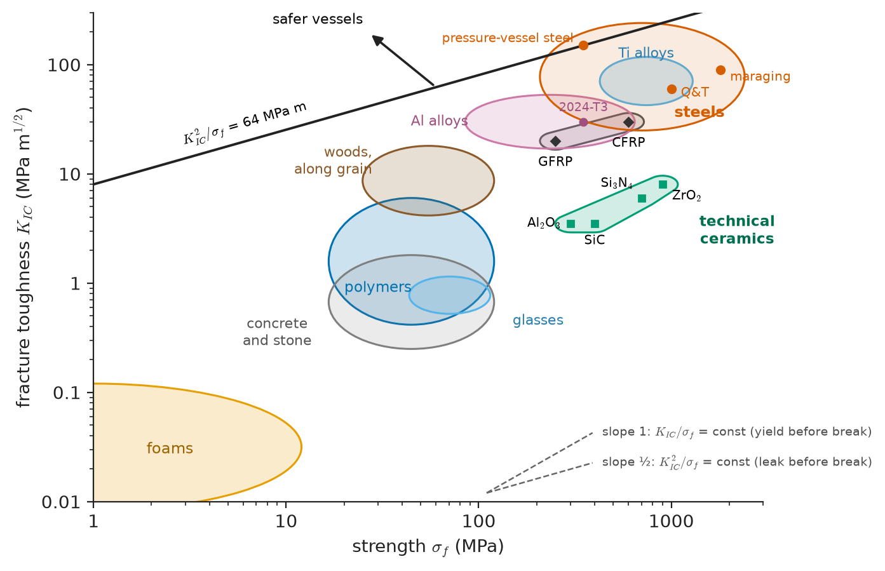

# Chapter 58 — Materials Selection and Design

*Part XI · Characterization, Computation and Design*

A car maker redesigning the bonnet of a mid-size saloon has four candidates on the table: the incumbent bake-hardening steel, a 6xxx-series aluminium sheet, a magnesium alloy, and carbon-fibre-reinforced epoxy. Each has a champion in the company. The steel engineers point out that their panel is the cheapest, welds on the existing line and is recycled at over 90 %. The aluminium team says their panel is half the mass. The composites group says theirs is lighter still. The pedestrian-safety team asks which bonnet absorbs a head impact best; the paint shop asks which survives the 180 °C bake; the corrosion engineers ask what happens where aluminium touches the steel hinge; the finance department asks what a kilogram saved is actually worth. All four claims are true and none settles the question, because each answers a different question. This chapter provides the method that makes such debates resolvable: translate the design into a function, an objective and constraints; derive the combination of properties that controls performance; display every candidate on property charts; put a price on each competing objective; account for the shape the material can be given and the process that gives it; and only then go into the detail that decides the final choice.

> **How does a design requirement become a ranked list of candidate materials, and why is "the strongest" or "the lightest" usually the wrong criterion?**
> **How are mass, cost, shape and manufacturing combined into one defensible decision?**
> **Do the same methods choose materials for a bridge, a hip implant, a pressure vessel and an aircraft?**

| Concept | Engineering destination |
|---|---|
| Function, objective, constraints, free variables | Writing a selection specification for any component |
| Screening, ranking, documentation | Narrowing tens of thousands of materials to a few candidates |
| Performance indices ($E^{1/2}/\rho$, $\sigma_f^{2/3}/\rho$, $K_{IC}^2/\sigma_f$, $\sigma_f^2/E$, $k/\rho$) | Light stiff beams and panels, strong shafts, safe pressure vessels, springs, heat sinks |
| Ashby property charts | Seeing all candidates and trade-offs at once; spotting gaps for new materials |
| Pareto fronts, penalty functions, exchange constants | Mass versus cost in cars, aircraft and spacecraft; carbon versus cost |
| Shape factors | Tubes, I-beams, sandwich panels; why wood and polymers are rarely made into thin-walled sections |
| Process selection and cost modelling | Choosing moulding, machining, casting or additive manufacture for a batch size |
| Case studies | Aerospace spars, civil floor beams, flywheels, pressure vessels, hip implants, busbars |

**Roadmap.** How design proceeds and what it asks of materials (58.1) → indices derived from objective and constraint (58.2) → charts that show all materials at once (58.3) → several objectives at once (58.4) → shape as a second free variable (58.5) → the process and its cost (58.6) → the method applied across engineering (58.7).

---

## 58.1 The design process and material requirements

### Stages of design

Engineering design is usually described in three stages, and the questions asked of materials sharpen as it proceeds:

1. **Conceptual design** chooses the working principle: a bridge as a suspension, arch or girder; energy storage as a battery, flywheel or compressed air; a hip replacement as a cemented or cementless stem. Here *all* materials are candidates and the data needed are approximate: a modulus to within a factor of two, a cost to within a factor of three.
2. **Embodiment design** sizes the components and settles their layout. Candidate materials narrow to a few classes, and the data needed are more precise: the yield strength of a particular alloy family, the creep strength at 600 °C, the fatigue limit of a grade of steel.
3. **Detail design** specifies one material in one condition (6061-T6 extruded, not "aluminium"), with tolerances, surface finish, process route and test methods. The data needed are those of a specific supplier's product, often supplemented by the company's own tests.

The materials engineer's errors at each stage are different. At the conceptual stage the error is to consider too few materials ("we always use steel"); at the detail stage it is to rely on generic data for a property, such as fatigue strength or toughness, that is controlled by processing (Chapters 13–15).

<!-- FIGURE 58.1 | figures/ch58/fig-58-1-selection-procedure.png | flowchart | The materials-selection procedure: translation of the design requirement, then screening, ranking and documentation, run alongside the stages of design. | Content: left column, three stacked boxes 'Conceptual design (all materials, approximate data)', 'Embodiment design (few classes, more precise data)', 'Detail design (one grade, supplier data, tests)'. Right column, main flow top to bottom: 'Design requirement' → 'Translation: function, objective, constraints, free variables' → 'Screening: eliminate on property limits (e.g. T_max ≥ 150 °C, K_IC ≥ 15 MPa m^½, recyclable)' → 'Ranking: performance index M (e.g. E^½/ρ) on charts' → 'Documentation: supplier data, failure history, corrosion, joining, cost stability, availability' → 'Final choice + process route'. Side inputs feeding 'Ranking': 'Shape factors (48.5)', 'Exchange constants (48.4)'; feeding 'Documentation': 'Process and cost model (48.6)'. Funnel graphic beside screening–ranking–documentation with numbers ~ '10⁴–10⁵ materials → ~10² → ~5 → 1'. -->

*Figure 58.1 — The materials-selection procedure: translation of the design requirement, then screening, ranking and documentation, run alongside the stages of design.*

### Translation: function, objective, constraints, free variables

Every selection problem is written in four parts:

- **Function**: what the component does: carry a bending load, contain pressure, store elastic or kinetic energy, conduct heat or current, support a body tissue, insulate.
- **Objective**: what is to be minimized or maximized: mass, cost, volume, embodied carbon (Chapter 59), thermal resistance, energy stored.
- **Constraints**: requirements that must be met but need not be exceeded. Some are **geometric** (span fixed by the building grid, outer diameter fixed by the bore), some are **property limits** (service temperature above 200 °C, corrosion resistance in seawater, biocompatibility, electrical insulation), and some are **performance constraints** (stiffness not less than $S^*$, no yield at load $F^*$, resistance not more than $R^*$) that couple to the objective through a free variable.
- **Free variables**: what the designer may change: a cross-sectional area, a wall thickness, a section shape, and the choice of material.

Writing these four lists is not bureaucracy. It exposes the most common error in selection, which is to optimize the wrong thing: maximizing strength when the component is stiffness-limited, or minimizing mass when the objective is cost.

### Screening, ranking, documentation

With the translation in hand, selection proceeds in three steps (Figure 58.1):

1. **Screening** eliminates every material that fails a property-limit constraint, whatever its other merits: a turbine-disc material must retain strength at 650 °C; an implant material must be biocompatible; a seawater pump must resist chloride pitting (Chapter 43). Screening uses simple attribute limits and removes most of the 10$^4$–10$^5$ engineering materials in commercial databases.
2. **Ranking** orders the survivors by how well they meet the objective. Because the objective usually depends on a *combination* of properties, ranking uses performance indices (Section 58.2).
3. **Documentation** examines the top few candidates in depth: supplier data and their scatter, processing experience, failure history (Chapter 44), corrosion and joining behaviour, price stability, supply security and recyclability. Many final choices are made here, on information that does not fit in a property table.

### Compatibility with regulation

Electronics are among the most regulated products for material content.

**RoHS** (the EU Restriction of Hazardous Substances directive, with equivalents in China, Korea, Japan, several US states and elsewhere) limits ten substances in each *homogeneous material* (a material that cannot be mechanically separated: a plating, a solder, a resin), not in the product as a whole:

| Substance | Maximum concentration in homogeneous material | Former EEE use |
|---|---|---|
| Lead (Pb) | 0.1 wt % | SnPb solder, glass, PVC stabilizers, brass and steel additives |
| Mercury (Hg) | 0.1 wt % | Tilt switches, fluorescent lamps |
| Cadmium (Cd) | 0.01 wt % | Ag–CdO contacts, NiCd batteries, pigments, platings |
| Hexavalent chromium (Cr VI) | 0.1 wt % | Chromate conversion coatings on Zn and Al |
| PBB, PBDE | 0.1 wt % | Brominated flame retardants in plastics |
| DEHP, BBP, DBP, DIBP (phthalates) | 0.1 wt % each | Plasticizers in PVC cable insulation |

Exemptions with expiry dates cover uses with no substitute yet, for example lead in high-melting-temperature solders (more than 85 % Pb) used for die attach in power devices, and lead in certain glasses and ceramics of electronic components. The transition to lead-free solder (SAC alloys, Chapter 51) was the largest materials change in the history of electronics assembly; it raised reflow temperatures by about 30 K, which then forced changes in laminates ($T_d$ and $T_g$), component moisture sensitivity, finishes and reliability models.

**REACH** (EU regulation on Registration, Evaluation, Authorisation and Restriction of Chemicals) works differently: substances are registered by manufacturers and importers; **Substances of Very High Concern (SVHC)** are listed on a Candidate List that grows each year; any article containing an SVHC above 0.1 wt % triggers obligations to inform customers (and to notify a database), and some substances move to an authorization or restriction list that limits their use. A component supplier's REACH declaration is therefore a moving target that must be tracked across the product's life.

**Conflict minerals**: tin, tantalum, tungsten and gold (3TG) from regions where mining finances armed conflict are subject to supply-chain due-diligence and reporting requirements (US Dodd–Frank Act section 1502; EU Conflict Minerals Regulation applying to importers from 2021). Every one of these four elements is in nearly every electronic product: tin in solder, tantalum in capacitors, tungsten in vias and contacts, gold in bond wires and platings. Smelter-level traceability programmes are the industry's response.

Related regulations cover end-of-life (WEEE collection and recycling targets), batteries, packaging, halogen-free requirements set by customers, and persistent pollutants. Their effect on selection is to add screening constraints and, often, to remove the material with the best engineering properties: Ag–CdO contacts, SnPb solder, chromate coatings and PVC with phthalates were all technically excellent.

---

## 58.2 Performance indices derived

### The method: separating the problem

The performance of a component depends on three groups of things: the functional requirements $F$ (loads, stiffness, pressure), the geometry $G$ (lengths, fixed dimensions), and the material properties $M$. If the performance $P$ can be written as a product

$$
P=f_1(F)\,f_2(G)\,f_3(M)
$$

then the best material is the one that optimizes $f_3(M)$, whatever the loads and dimensions. The function $f_3(M)$ is the **material performance index**. The derivation is always the same: write the objective as an equation, write the performance constraint as an equation, use the constraint to eliminate the free variable from the objective, and read off the group of material properties that remains.

### Light, stiff tie

A tie of fixed length $L$ and free cross-sectional area $A$ must have axial stiffness $S=EA/L$ of at least $S^*$; the objective is minimum mass $m=AL\rho$. From the constraint $A=S^*L/E$, so

$$
m=S^*L^2\left(\frac{\rho}{E}\right)\qquad\Longrightarrow\qquad \text{maximize } M_1=\frac{E}{\rho}
$$

### Light, stiff beam

A beam of length $L$, square cross-section of side $b$ ($A=b^2$, second moment of area $I=b^4/12=A^2/12$), loaded in bending, must have stiffness $S=C_1EI/L^3$ of at least $S^*$, where $C_1$ depends on the loading and end conditions (48 for a simply supported beam with central load). Eliminating $A$:

$$
A=\left(\frac{12S^*L^3}{C_1E}\right)^{1/2}\qquad\Longrightarrow\qquad m=\left(\frac{12S^*}{C_1}\right)^{1/2}L^{5/2}\left(\frac{\rho}{E^{1/2}}\right)
$$

so the index is $M_2=E^{1/2}/\rho$. The square-root appears because the free variable enters the stiffness as $A^2$: doubling the area quadruples the stiffness, so a low modulus can be compensated by a modest increase of section.

### Light, stiff panel

A flat panel of fixed length $L$ and width $b$, free thickness $t$, loaded in bending, has $I=bt^3/12$. With $m=bLt\rho$ and $S=C_1EI/L^3\ge S^*$:

$$
t=\left(\frac{12S^*L^3}{C_1Eb}\right)^{1/3}\qquad\Longrightarrow\qquad m=\left(\frac{12S^*}{C_1b}\right)^{1/3}bL^2\left(\frac{\rho}{E^{1/3}}\right)
$$

and the index is $M_3=E^{1/3}/\rho$. The cube root rewards low density even more strongly. This is why low-density materials, wood, magnesium, polymer foams and composites, are so effective in panels, and why the bonnet of the opening paragraph is a panel problem.

### Strength-limited designs

If the constraint is that the component must not yield (or fracture) rather than that it must not deflect, replace stiffness by strength $\sigma_f$. A tie that must carry $F^*$ without yield needs $A=F^*/\sigma_f$, giving $M=\sigma_f/\rho$. For a square beam, failure occurs when the maximum surface stress $\sigma=\mathcal M c/I$ reaches $\sigma_f$; the section modulus is $Z=I/c=A^{3/2}/6$ and the failure load $F_f=C_2Z\sigma_f/L$. Then

$$
A=\left(\frac{6F^*L}{C_2\sigma_f}\right)^{2/3}\qquad\Longrightarrow\qquad m=\left(\frac{6F^*}{C_2}\right)^{2/3}L^{5/3}\left(\frac{\rho}{\sigma_f^{2/3}}\right)
$$

so $M=\sigma_f^{2/3}/\rho$, and the same argument for a panel gives $\sigma_f^{1/2}/\rho$.

### Indices for other functions

The method extends to any function for which the performance equation is known:

| Function, objective, constraint | Index to maximize | Where it is used |
|---|---|---|
| Tie, minimum mass, stiffness specified | $E/\rho$ | Cables, truss members, tension rods |
| Beam, minimum mass, stiffness specified | $E^{1/2}/\rho$ | Spars, floor joists, robot arms, bicycle tubes |
| Panel, minimum mass, stiffness specified | $E^{1/3}/\rho$ | Car body panels, aircraft floors, laptop cases |
| Tie, minimum mass, strength specified | $\sigma_f/\rho$ | Tethers, rotating rims (flywheels, centrifuge rotors) |
| Beam, minimum mass, strength specified | $\sigma_f^{2/3}/\rho$ | Shafts, crane booms, wing spars |
| Panel, minimum mass, strength specified | $\sigma_f^{1/2}/\rho$ | Floor panels, hatches |
| Spring, maximum stored energy per unit volume | $\sigma_f^2/E$ | Valve and suspension springs, clips |
| Elastic hinge, maximum bending without yield | $\sigma_f/E$ | Snap fits, flexures, living hinges |
| Pressure vessel, yield before fracture | $K_{IC}/\sigma_f$ | Boilers, reactors, gas cylinders |
| Pressure vessel, leak before break | $K_{IC}^2/\sigma_f$ | Pressurized pipes, nuclear and chemical plant |
| Thermal shock resistance (quench $\Delta T$ without fracture) | $\sigma_f/(E\alpha)$ | Furnace linings, cookware, turbine components |
| Heat sink or spreader, minimum mass for given thermal resistance | $k/\rho$ | Electronics cooling, battery thermal plates |
| Minimum thermal distortion under heat flux | $k/\alpha$ | Precision instruments, optical benches, mirror substrates |
| Conductor, minimum mass for given resistance | $1/(\rho\,\rho_e)$ | Overhead lines, busbars, aircraft wiring |
| Any of the above, minimum cost | Replace $\rho$ by $C_m\rho$ | Most civil and consumer products |
| Any of the above, minimum embodied carbon | Replace $\rho$ by $H_c\rho$ | Low-carbon design (Chapter 59) |

Here $\sigma_f$ is the failure strength appropriate to the material (yield strength for metals and polymers, modulus of rupture or compressive strength for ceramics), $C_m$ the price per kilogram and $H_c$ the embodied carbon per kilogram.

> **Status of the principle: material performance indices**
> *Derived.* Each index is an exact consequence of its stated objective, constraint, loading and free variable; it is only as general as those assumptions, and a change of failure mode (yield to buckling), loading or free variable changes the index.

### A first ranking

| Material (typical) | $E$ (GPa) | $\rho$ (Mg/m$^3$) | $\sigma_y$ (MPa) | $E/\rho$ | $E^{1/2}/\rho$ | $E^{1/3}/\rho$ | $\sigma_y/\rho$ | $\sigma_y^{2/3}/\rho$ |
|---|---|---|---|---|---|---|---|---|
| Low-carbon steel | 210 | 7.85 | 250 | 26.8 | 1.85 | 0.76 | 32 | 5.1 |
| Advanced high-strength steel | 210 | 7.85 | 600 | 26.8 | 1.85 | 0.76 | 76 | 9.1 |
| Al 6061-T6 | 69 | 2.70 | 275 | 25.6 | 3.08 | 1.52 | 102 | 15.7 |
| Mg AZ31 | 45 | 1.77 | 200 | 25.4 | 3.79 | 2.01 | 113 | 19.3 |
| Ti-6Al-4V | 114 | 4.43 | 880 | 25.7 | 2.41 | 1.09 | 199 | 20.7 |
| CFRP, quasi-isotropic | 60 | 1.55 | 600 | 38.7 | 5.00 | 2.53 | 387 | 45.9 |
| GFRP | 20 | 1.85 | 250 | 10.8 | 2.42 | 1.47 | 135 | 21.5 |
| Softwood, along grain | 11 | 0.50 | 40 | 22.0 | 6.63 | 4.45 | 80 | 23.4 |
| Alumina | 370 | 3.90 | 300 (flexural) | 94.9 | 4.93 | 1.84 | 77 | 11.5 |
| Polypropylene | 1.3 | 0.905 | 30 | 1.4 | 1.26 | 1.21 | 33 | 10.7 |

(Units: $E$ in GPa, $\rho$ in Mg/m$^3$, $\sigma_y$ in MPa; the indices are in the corresponding units, and only ratios between materials matter.)

The table teaches three lessons. First, steel, aluminium, magnesium and titanium have almost the same $E/\rho$, so as ties none is lighter than the others; the light alloys win only in bending, where the exponent rewards low density. Second, wood along the grain is, for a beam or panel of given stiffness, the most mass-efficient material in the table: its $E^{1/2}/\rho$ exceeds that of CFRP. That is why aircraft were built of spruce for thirty years, and why timber floors are competitive. Third, the strength of advanced high-strength steels raises $\sigma_y^{2/3}/\rho$ by about 80 % relative to mild steel but leaves stiffness indices unchanged: strength-limited parts (bumper beams, door-intrusion beams) benefit from AHSS, stiffness-limited panels do not, which is the materials reason why outer panels are the first steel parts to be replaced by aluminium.

---

## 58.3 Ashby charts and selection

### Property charts

A table lists a few materials; a **property chart** shows all of them. Ashby charts plot one property against another on logarithmic axes, with each material class occupying a field and each family within it a bubble whose extent shows the range of grades and conditions (Figure 58.2). The charts show at once how widely properties span (Young's modulus from about 10$^{-4}$ GPa for soft foams to 1000 GPa for diamond, seven orders of magnitude), how the classes cluster (metals dense and stiff, polymers light and compliant, ceramics stiff and light but brittle, composites and woods filling the gaps), and where no material exists.

<!-- FIGURE 58.2 | figures/ch58/fig-58-2-ashby-modulus-density.png | map | Young's modulus against density for all material classes, with guidelines for light, stiff ties, beams and panels. | Content: log-log axes; x-axis density 0.01 to 30 Mg/m³; y-axis Young's modulus 10⁻⁴ to 1000 GPa. Shaded labelled envelopes: foams (polymer foams 0.02–0.3 Mg/m³, 10⁻³–0.3 GPa), elastomers (0.9–1.5, 10⁻³–0.1), polymers (0.9–2.2, 0.2–5; PP 0.905/1.3, PMMA 1.18/3.0, PEEK 1.30/3.8 labelled), woods along grain (0.4–0.9, 6–20; softwood 0.50/11 labelled) and across grain (0.4–0.9, 0.3–1.5), composites (GFRP 1.85/20, CFRP QI 1.55/60, CFRP UD 1.6/140), concrete (2.4/30), metals (Mg 1.77/45, Al 2.70/69, Ti 4.43/114, steels 7.85/210, Cu 8.9/120, W 19.3/410), technical ceramics (Al2O3 3.90/370, SiC 3.2/410, Si3N4 3.2/310, diamond 3.5/1000). Dashed guideline families: slope 1 'E/ρ (ties)', slope 2 'E^½/ρ (beams)', slope 3 'E^⅓/ρ (panels)'. One slope-2 selection line drawn through Al (2.70, 69) with arrow to upper left 'search region: better beams'; CFRP and wood lie above it, steel below. -->

*Figure 58.2 — Young's modulus against density for all material classes, with guidelines for light, stiff ties, beams and panels.*

### Selection lines

Because indices are power laws, a line of constant index is a straight line on a log–log chart. For $M=E^{1/2}/\rho$,

$$
\log E=2\log\rho+2\log M
$$

a family of parallel lines of slope 2, one for each value of $M$. All materials on one line perform equally well as light stiff beams; those above it perform better. Selection consists of sliding the line toward the upper left until only a handful of materials remain above it. Lines of slope 1 select for ties ($E/\rho$), slope 3 for panels ($E^{1/3}/\rho$). A property limit appears as a horizontal or vertical line: "modulus at least 10 GPa" removes everything below $E=10$ GPa whatever its index.

The commonly used charts include:

| Chart | Indices read from it | Typical applications |
|---|---|---|
| $E$ against $\rho$ | $E/\rho$, $E^{1/2}/\rho$, $E^{1/3}/\rho$ | Light stiff structures |
| $\sigma_f$ against $\rho$ | $\sigma_f/\rho$, $\sigma_f^{2/3}/\rho$, $\sigma_f^{1/2}/\rho$ | Light strong structures, rotors |
| $K_{IC}$ against $\sigma_f$ | $K_{IC}/\sigma_f$, $K_{IC}^2/\sigma_f$ | Damage-tolerant design, pressure vessels |
| $E$ against $\sigma_f$ | $\sigma_f^2/E$, $\sigma_f/E$ | Springs, hinges, seals |
| $k$ against $\alpha$ | $k/\alpha$ | Thermal distortion, thermal management |
| $E$ against cost per unit volume | $E^{1/2}/(C_m\rho)$, etc. | Cost-limited structures |
| Embodied energy or carbon against modulus or strength | $E^{1/2}/(H_c\rho)$, etc. | Low-carbon design (Chapter 59) |
| Maximum service temperature against strength | Property limits | High-temperature design (Chapter 41) |

### What the charts show beyond the ranking

The empty regions of a chart are as informative as the occupied ones. There is no material with the stiffness of steel and the density of a polymer, none with the toughness of steel and the hardness and temperature capability of alumina, none with high thermal conductivity, low density and a CTE matched to silicon. Each gap is a target for material development: composites, foams and lattice materials (Chapter 48) are, in a sense, ways of filling chart space by combining a material with shape and with another material. Hybrid and architected materials are best understood as the deliberate occupation of chart regions that no monolithic material reaches.

> **Status of the principle: chart-based selection**
> *Derived.* The selection lines are exact images of the derived indices; the conclusions are as reliable as the property ranges plotted, which are typical values for generic families and must be replaced by grade-specific data at the documentation stage.

---

## 58.4 Multi-objective selection

### Conflicting objectives and the Pareto front

Real designs have several objectives that conflict: low mass and low cost; low cost and low embodied carbon; high stiffness and high damping. A solution (a material, or a material plus a design) is **dominated** if another solution is at least as good in every objective and better in one. The non-dominated solutions form the **Pareto front**, or trade-off surface (Figure 58.3). Every solution on the front is defensible; every solution off it is not, because something else is better in every respect. Finding the front removes most candidates, but it does not choose among the survivors. That requires a statement of how much one objective is worth in units of another.

### Penalty functions and exchange constants

The simplest way to make that statement is a linear **penalty function**,

$$
Z=C+\alpha\,m
$$

where $C$ is cost, $m$ is mass and the **exchange constant** $\alpha$ is the value, in currency per kilogram, of saving one kilogram. The best solution minimizes $Z$. On a plot of $m$ against $C$, contours of constant $Z$ are straight lines of slope $-1/\alpha$; the optimum is the point where the lowest such line touches the front. A small $\alpha$ selects the cheap end of the front, a large $\alpha$ the light end.

Exchange constants are not material properties; they depend on the use of the product. Typical orders of magnitude:

| Sector | Exchange constant $\alpha$ (USD per kg saved, order of magnitude) | Basis |
|---|---|---|
| Civil structures, domestic appliances | ~0–1 | Mass barely matters |
| Family car | ~1–10 | Fuel or battery cost over vehicle life |
| Heavy truck | ~5–20 | Payload revenue |
| Civil aircraft | ~100–1000 | Fuel and payload over 25–30 year life |
| Military aircraft | ~1000 | Performance |
| Spacecraft | ~10$^4$ and above | Launch cost per kg to orbit |

The same construction works for any pair of objectives: cost against embodied carbon (with $\alpha$ a carbon price), cost against energy losses over life (Section 58.7), cost against volume in a crowded engine bay.

<!-- FIGURE 58.3 | figures/ch58/fig-58-3-pareto-bonnet.png | plot | Mass against material cost for a car bonnet of equal bending stiffness: the Pareto front and lines of constant penalty for three exchange constants. | Content: log-log axes; x-axis material cost of one panel (USD, 3 to 100); y-axis panel mass (kg, 1 to 10). Points from the worked example: steel (5.65 USD, 6.28 kg), Al 6xxx (10.9, 3.12), Mg (11.8, 2.37), CFRP (56.5, 1.88). All four on the Pareto front (connected by a step line). Dashed lines Z = C + αm for α = 0.5 USD/kg (touches steel), α = 5 USD/kg (touches Mg), α = 500 USD/kg (touches CFRP), each labelled. Annotation near Al: 'on the front but never selected by a linear penalty (non-convex point)'. Shaded dominated region up and to the right of the front. -->

*Figure 58.3 — Mass against material cost for a car bonnet of equal bending stiffness: the Pareto front and lines of constant penalty for three exchange constants.*

**Worked example — choosing a bonnet material.** The bonnet is treated as a flat panel of area 1.0 m$^2$ that must match the bending stiffness of the current 0.80 mm steel panel. For equal stiffness, $Et^3$ is constant, so $t=t_{\rm steel}(E_{\rm steel}/E)^{1/3}$. Using indicative sheet prices (steel 0.9, aluminium 3.5, magnesium 5.0, CFRP 30 USD/kg; material only):

| Material | $E$ (GPa) | $\rho$ (kg/m$^3$) | $t$ (mm) | Mass (kg) | Material cost (USD) |
|---|---|---|---|---|---|
| Steel | 210 | 7850 | 0.80 | 6.28 | 5.65 |
| Al 6xxx | 70 | 2700 | 1.15 | 3.12 | 10.9 |
| Mg alloy | 45 | 1770 | 1.34 | 2.37 | 11.8 |
| CFRP | 60 | 1550 | 1.22 | 1.88 | 56.5 |

For aluminium, $t=0.80\times(210/70)^{1/3}=0.80\times1.442=1.154$ mm and $m=2700\times1.0\times1.154\times10^{-3}=3.12$ kg. No material is dominated: each lighter one is dearer. The penalties for three exchange constants are:

| | Steel | Al | Mg | CFRP |
|---|---|---|---|---|
| $Z$ at $\alpha=0$ (cost only) | **5.7** | 10.9 | 11.8 | 56.5 |
| $Z$ at $\alpha=5$ USD/kg (car) | 37.1 | 26.5 | **23.7** | 65.9 |
| $Z$ at $\alpha=500$ USD/kg (aircraft) | 3146 | 1569 | 1195 | **998** |

The switch-over values follow from equating penalties: aluminium beats steel when $\alpha>(10.9-5.65)/(6.28-3.12)=1.7$ USD/kg; magnesium beats steel when $\alpha>1.6$ USD/kg and beats aluminium when $\alpha>1.2$ USD/kg; CFRP beats magnesium only when $\alpha>(56.5-11.8)/(2.37-1.88)\approx91$ USD/kg. Two conclusions follow. For a car, with $\alpha$ of a few USD per kilogram, a light alloy is justified on material cost, and CFRP is not; CFRP bonnets appear on cars where mass is valued like aircraft mass (racing, some premium sports models). And aluminium, although on the Pareto front, is never the minimum of a linear penalty with these numbers: magnesium overtakes it before it overtakes steel. Points in a non-convex part of the front can only be selected by a non-linear value function or by other criteria. In practice those other criteria decide: magnesium's corrosion, formability at room temperature and paint-bake behaviour are worse, and processing costs (stamping, joining, painting) are not in this material-only model, so aluminium is the common industrial choice. The penalty function narrows the debate to a number, $\alpha$, and to a short list of documentation questions.

> **Status of the principle: linear penalty functions**
> *Approximate.* Exact for a linear value of mass (or other objective), which is a reasonable local approximation; real value functions are non-linear (the first kilogram saved in a spacecraft enables a mission, the last one does not), and a linear penalty cannot select points in non-convex regions of the front.

### Other multi-objective methods

Where exchange constants cannot be agreed, **weighted-sum scoring** (each property normalized and weighted by importance, as in the weighted decision matrices used in design reviews) is common but hides arbitrary choices in the weights. **Constraint methods** optimize one objective with the others as limits (minimize cost subject to $m\le m_{\max}$), which trace the front point by point including non-convex parts. **Multi-objective evolutionary algorithms** construct the whole front numerically when a design model is available, and are widely used in combination with finite-element models of components and with the informatics tools of Chapter 57.

---

## 58.5 Shape factors

### Shape as a free variable

Indices derived so far fixed the shape of the cross-section (solid square) and left only its size free. But the designer can also choose the shape: a tube, an I-beam, a box, a sandwich panel. Shape changes stiffness and strength in bending and torsion enormously at the same mass, while leaving axial (tie) stiffness unchanged. Its efficiency is measured by a dimensionless **shape factor**, defined relative to a solid square section of the same area. For elastic bending,

$$
\phi_B^e=\frac{I}{I_{\rm square}}=\frac{12\,I}{A^2}
$$

so $\phi_B^e=1$ for a solid square. For failure in bending the corresponding factor is $\phi_B^f=6Z/A^{3/2}$.

| Section (thin-walled limits) | $I$ | $A$ | $\phi_B^e$ |
|---|---|---|---|
| Solid square, side $b$ | $b^4/12$ | $b^2$ | 1 |
| Solid circle, radius $r$ | $\pi r^4/4$ | $\pi r^2$ | $3/\pi=0.95$ |
| Thin-walled tube, radius $r$, wall $t$ | $\pi r^3t$ | $2\pi rt$ | $3r/(\pi t)$ |
| Thin-walled square box, side $h$, wall $t$ | $2h^3t/3$ | $4ht$ | $h/(2t)$ |
| Rolled I-sections | — | — | typically 10–50 |
| Sandwich panel with thin faces | — | — | can exceed 100 |

A tube with $r/t=10$ has $\phi_B^e=30/\pi=9.5$: it is 9.5 times stiffer in bending than a solid square bar of the same mass. Its strength shape factor grows more slowly, $\phi_B^f=(3/\sqrt{2\pi})(r/t)^{1/2}$, which is 3.8 at $r/t=10$ and 5.4 at $r/t=20$.

### Combined material-and-shape indices

Repeating the derivation of Section 58.2 with $I=\phi_B^eA^2/12$ gives the mass of a light stiff beam of given shape as

$$
m=\left(\frac{12S^*}{C_1}\right)^{1/2}L^{5/2}\left(\frac{\rho}{(\phi_B^eE)^{1/2}}\right)\qquad\Longrightarrow\qquad \text{maximize } \frac{(\phi_B^eE)^{1/2}}{\rho}
$$

The shape factor multiplies the modulus: a shaped material behaves like a solid one of modulus $\phi_B^eE$ and the same density. On the $E$–$\rho$ chart, shaping moves a material vertically upward by the factor $\phi$; a tube of steel with $\phi=20$ behaves, in bending, like a solid material of modulus 4200 GPa.

### Why shape efficiency is material-dependent

If shape gives such gains, why not use thin walls everywhere? Because thin walls fail by **local buckling** (wrinkling of the wall, crippling of a flange) before they reach their design load, and because manufacturing limits how thin a section can be rolled, extruded, moulded or laid up. The maximum practical shape factor is therefore a property of the material and its process:

| Material class | Practical maximum $\phi_B^e$ (typical) | Reason |
|---|---|---|
| Structural steels | ~65 | High $E$ resists local buckling; rolled and welded sections |
| Aluminium alloys | ~45 | Extrusion allows complex thin sections; lower $E$ |
| CFRP, GFRP | ~40 | Laid-up and pultruded sections; buckling and delamination |
| Engineering polymers | ~10–12 | Low $E$, creep; mouldable but buckling-limited |
| Wood | ~5–8 | Natural sections; glued and box sections extend this |
| Concrete (reinforced and prestressed) | ~10–20 | Cast T- and box sections; tension carried by steel |

Local buckling of a tube wall begins at a stress proportional to $Et/r$, so a material of higher modulus can be made thinner before buckling. This is why high-modulus metals reach the highest practical shape factors, and why low-modulus materials gain less from shaping than their density advantage suggests.

> **Status of the principle: shape factors**
> *Derived.* Exact consequences of beam theory for linear-elastic, thin-walled sections; they hold until local buckling, shear deformation of the web or core, or manufacturing limits intervene, which set material-dependent upper bounds on $\phi$.

**Worked example — material and shape for a light stiff tube.** A bicycle down-tube or a light aircraft strut is a beam of fixed length that must meet a bending stiffness at minimum mass. Compare a solid steel bar, a steel tube with $r/t=20$, an aluminium tube with $r/t=15$ and a CFRP tube with $r/t=12$ (each within the practical limits above). The mass for equal stiffness is proportional to $\rho/(\phi E)^{1/2}$, with $\phi=3(r/t)/\pi$:

| Section | $E$ (GPa) | $\rho$ (Mg/m$^3$) | $\phi_B^e$ | $\rho/(\phi E)^{1/2}$ | Mass relative to solid steel |
|---|---|---|---|---|---|
| Solid steel bar | 210 | 7.85 | 1.0 | 0.542 | 1.00 |
| Steel tube, $r/t=20$ | 210 | 7.85 | 19.1 | 0.124 | 0.23 |
| Al tube, $r/t=15$ | 70 | 2.70 | 14.3 | 0.085 | 0.16 |
| CFRP tube, $r/t=12$ | 60 | 1.55 | 11.5 | 0.059 | 0.11 |

Shape alone cuts the steel bar's mass by more than a factor of four; changing the material to CFRP and keeping the best feasible shape cuts it by a further factor of two. Because steel can be made thinner than aluminium before its wall buckles, the shaped steel tube recovers part of steel's disadvantage in density: the ratio of aluminium to steel mass is 0.69 for tubes, compared with $0.323/0.542=0.60$ for solid bars. This is the materials logic of the bicycle industry: thin-walled steel (Cr-Mo) frames, aluminium frames with larger-diameter tubes, and CFRP frames that are lightest of all, in that order of mass and of cost.

---

## 58.6 Process selection and cost modelling

### Process attributes and screening

A material is only a candidate if a process exists to give it the required shape, size, tolerance, surface finish and microstructure at an acceptable cost. Processes (Chapters 46–49) are screened in the same way as materials, by attribute limits:

| Attribute | Example constraint | Processes it eliminates |
|---|---|---|
| Material compatibility | Titanium alloy | Die casting (reaction with dies), conventional sand casting |
| Shape class | Hollow, re-entrant, 3D | Rolling, simple extrusion, sheet stamping |
| Mass or size | 0.05 kg or 50 t | Powder metallurgy for very large parts; investment casting for very large parts |
| Section thickness | 0.5 mm walls | Sand casting (~3 mm minimum) |
| Tolerance | ±0.02 mm | Sand casting (±1 mm), most moulding without machining |
| Surface roughness | $R_a<0.4$ µm | As-cast and as-printed surfaces without finishing |
| Microstructure and properties | Fatigue-critical, no porosity | High-pressure die casting without HIP, as-built AM without HIP (Chapter 48) |
| Economic batch size | 200 parts | Injection moulding, die casting, forging (tooling not amortized) |

Ranking among the survivors is usually by cost.

### A cost model

The cost of making one part combines three contributions: material, dedicated tooling shared among the batch, and capital and labour charged by the time taken. A simple model that captures the essential behaviour is

$$
C=\frac{m\,C_m}{1-f}+\frac{C_t}{n}+\frac{\dot C_{\rm oh}}{\dot n}
$$

with $m$ the part mass, $C_m$ the material price per kilogram, $f$ the scrap fraction (material removed, gates and runners, failed parts), $C_t$ the cost of dedicated tooling (dies, moulds, fixtures), $n$ the batch size, $\dot C_{\rm oh}$ the overhead rate (capital write-off of the equipment, labour, energy, floor space) per hour and $\dot n$ the production rate in parts per hour. The first and third terms are independent of batch size; the tooling term falls as $1/n$. On a log–log plot of cost against batch size, each process is a horizontal line at large $n$ joined to a line of slope $-1$ at small $n$ (Figure 58.4).

> **Status of the principle: process cost model**
> *Approximate.* A first-order model that captures the scaling of material, tooling and time costs; it omits set-up and inspection costs, learning effects, tooling life (dies wear out after 10$^4$–10$^6$ shots), and the strong dependence of overhead rates on location and utilization.

**Worked example — moulding, machining or printing?** A 50 g polyamide bracket can be made by injection moulding (PA6 granules at 3 USD/kg, 5 % scrap, mould 30 000 USD, 200 parts/h, overhead 60 USD/h), by CNC machining from rod (4 USD/kg, 67 % of the rod machined away, fixtures 1500 USD, 10 parts/h, 80 USD/h), or by selective laser sintering of PA12 powder (60 USD/kg, 10 % powder lost, no tooling, an effective 3 parts/h, 30 USD/h).

The batch-independent cost per part is

| | Material $mC_m/(1-f)$ | Time $\dot C_{\rm oh}/\dot n$ | Sum (USD) | Tooling $C_t$ (USD) |
|---|---|---|---|---|
| Injection moulding | $0.05\times3/0.95=0.16$ | $60/200=0.30$ | 0.46 | 30 000 |
| CNC machining | $0.05\times4/0.33=0.61$ | $80/10=8.00$ | 8.61 | 1 500 |
| Laser sintering | $0.05\times60/0.90=3.33$ | $30/3=10.00$ | 13.33 | 0 |

Cost per part at several batch sizes:

| Batch size $n$ | 10 | 100 | 1000 | 10 000 | 100 000 |
|---|---|---|---|---|---|
| Injection moulding | 3000 | 300 | 30.5 | 3.46 | 0.76 |
| CNC machining | 159 | 23.6 | 10.1 | 8.76 | 8.62 |
| Laser sintering | 13.3 | 13.3 | 13.3 | 13.3 | 13.3 |

The crossovers follow from equating costs: laser sintering is cheapest below $n=1500/(13.33-8.61)\approx320$ parts, machining between about 320 and $n=(30\,000-1500)/(8.61-0.46)\approx3500$ parts, and injection moulding above. The same structure recurs in every manufacturing sector: sand casting against die casting for aluminium housings, open-die against closed-die forging for steel shafts, hand lay-up against resin transfer moulding for composite panels. Additive manufacturing wins at small batch sizes and for shapes that other processes cannot make; its higher material and machine-time costs keep it out of high-volume production unless the geometry it enables saves more elsewhere (consolidating an assembly of twenty parts into one, or reducing the mass of an aircraft bracket where $\alpha$ is large).

<!-- FIGURE 58.4 | figures/ch58/fig-58-4-cost-batch-size.png | plot | Cost per part against batch size for a 50 g polymer bracket made by laser sintering, CNC machining and injection moulding. | Content: log-log axes; x-axis batch size n from 1 to 10⁶; y-axis cost per part (USD) from 0.1 to 10⁴. Three curves C = a + C_t/n: laser sintering flat at 13.3 USD (C_t = 0); CNC machining a = 8.61, C_t = 1500 (slope −1 at small n, flattening near 8.6); injection moulding a = 0.46, C_t = 30 000 (slope −1, flattening to 0.46 above ~10⁵). Vertical dotted lines at crossovers n ≈ 320 (SLS/CNC) and n ≈ 3500 (CNC/IM), with the lower envelope highlighted (thick line) and labelled 'cheapest route'. Horizontal annotations 'tooling-dominated' (left) and 'material + time dominated' (right). -->

*Figure 58.4 — Cost per part against batch size for a 50 g polymer bracket made by laser sintering, CNC machining and injection moulding.*

### Cost in the selection procedure

Cost enters selection in three ways: as an objective (minimize $C$ through indices such as $E^{1/2}/(C_m\rho)$, Section 58.7); as a term in a penalty function with mass or carbon (Section 58.4); and through the process model, which converts material price into part cost. For high-volume products, processing often costs more than material: a stamped steel panel costs perhaps two to three times its steel content once press time, dies and scrap are included; an investment-cast titanium part may cost ten times its alloy content. Material price alone is a poor guide whenever the cheaper material requires a dearer process.

---

## 58.7 Selection case studies across engineering fields

### Aerospace: wing spars, skins and the value of a kilogram

A wing spar is a beam loaded in bending, designed against both stiffness (aeroelastic deflection, flutter) and strength; the skin is a panel loaded in bending and buckling. With $\alpha$ of hundreds of USD per kilogram, mass dominates, so the indices are $E^{1/2}/\rho$ and $\sigma_f^{2/3}/\rho$ for spars and $E^{1/3}/\rho$ for skins and floors. From the table in Section 58.2, $\sigma_y^{2/3}/\rho$ is 45.9 for quasi-isotropic CFRP against 15.7 for Al 6061-T6 and about 20 for the high-strength 7xxx alloys used in wings, so a strength-limited CFRP spar has roughly half the mass of a 7xxx aluminium one and a third that of a 6061 one. This is why wide-body airliners designed after 2005 have CFRP wings and fuselages comprising about half of their structural mass. Documentation then raises the questions that indices miss: damage tolerance and barely visible impact damage (Chapter 23), lightning-strike protection (CFRP conducts poorly compared with aluminium), repair methods, and inspection. Al–Li alloys (Chapter 16), which reduce density by about 3 % and raise modulus by about 6 % per percent of lithium, are aluminium's response, keeping metallic structures competitive where established manufacturing and repairability matter.

### Civil: a floor beam at minimum cost

In buildings, mass is cheap ($\alpha\approx0$) and the objective is cost. For a stiffness-limited beam, the index becomes $E^{1/2}/(C_m\rho)$; equivalently, minimize $C_m\rho/E^{1/2}$:

| Material (typical) | $E$ (GPa) | $\rho$ (Mg/m$^3$) | $C_m$ (USD/kg) | $C_m\rho/E^{1/2}$ (relative units) |
|---|---|---|---|---|
| Reinforced concrete | 30 | 2.40 | 0.12 | 0.053 |
| Glulam (softwood) | 12 | 0.48 | 1.0 | 0.139 |
| Structural steel | 210 | 7.85 | 1.0 | 0.54 |
| Aluminium 6063 extrusion | 69 | 2.70 | 3.5 | 1.14 |
| Pultruded GFRP | 25 | 1.90 | 5.0 | 1.90 |

Concrete wins by a factor of three over timber and ten over steel; this ordering is why concrete is the most-used material on Earth by mass (Chapter 59). But concrete is weak in tension (Chapter 18), so it needs steel reinforcement, which the simple index omits; steel wins where spans are long and mass matters for the supporting structure (the self-weight of a long-span concrete beam becomes the dominant load); timber wins in low-rise construction where speed of erection and embodied carbon are valued (Chapter 59 repeats this ranking with carbon instead of cost). Fire resistance, durability in exposure classes, construction time and the cost of the foundations carrying the dead load are documentation-stage questions that often decide.

### Mechanical: flywheels and why the densest material is wrong

A flywheel stores kinetic energy; the objective is maximum energy per unit mass, and the constraint is that the rim must not burst. For a thin rim of radius $r$ rotating at angular velocity $\omega$, the hoop stress is $\sigma=\rho r^2\omega^2$ and the stored energy per unit mass is $U/m=\tfrac12r^2\omega^2$. Setting $\sigma=\sigma_f$:

$$
\frac{U}{m}=\frac12\,\frac{\sigma_f}{\rho}
$$

so the index is $\sigma_f/\rho$. With $\sigma_f$ in MPa and $\rho$ in Mg/m$^3$, $\sigma_f/\rho$ is directly in kJ/kg. Maraging steel (1800 MPa, 8.0 Mg/m$^3$) stores at most about 110 kJ/kg; Al 7075 (500 MPa, 2.8 Mg/m$^3$) about 90 kJ/kg; hoop-wound CFRP (about 1500 MPa in the hoop direction, 1.6 Mg/m$^3$) about 470 kJ/kg, or 130 Wh/kg before safety factors. Lead, the traditional "heavy" flywheel material, stores less than 1 kJ/kg at bursting. Density appears in the denominator, not the numerator: when the speed is free, the best flywheel is light and strong. Heavy flywheels are right only when the speed is fixed (an engine flywheel smoothing torque at a given rpm), where energy per unit volume $\tfrac12\rho r^2\omega^2$ rewards density. Composite rotors also fail more benignly, delaminating into fibrous debris rather than ejecting large fragments, a documentation-stage advantage for containment design.

### Chemical and energy: pressure vessels that leak before they break

A pressure vessel must not fail by fast fracture. Two design philosophies lead to two indices. **Yield before break**: the vessel should yield (and visibly deform) before a crack of the largest size that inspection can miss becomes critical; with $K_{IC}=\sigma\sqrt{\pi a}$ (Chapter 14) at $\sigma=\sigma_y$, the critical crack length is proportional to $(K_{IC}/\sigma_y)^2$, so the index is $K_{IC}/\sigma_y$. **Leak before break**: a crack growing through the wall should leak, and be detected, before it becomes unstable; this requires that a through-wall crack of length about equal to the wall thickness $t$ be stable at the operating stress.

**Worked example — leak before break.** A thin-walled spherical or cylindrical vessel of radius $R$ under pressure $p$ carries a wall stress $\sigma=pR/t$ (taking the cylindrical hoop stress for simplicity). A through-crack of total length $2a=t$ is stable if $\sigma\sqrt{\pi t/2}\le K_{IC}$. Substituting $t=pR/\sigma$ and solving for $p$:

$$
p\le\frac{2}{\pi R}\,\frac{K_{IC}^2}{\sigma}
$$

The largest pressure that can be contained with leak-before-break, at a given working stress, scales with $K_{IC}^2/\sigma$. For $R=1.0$ m and the wall working at its yield stress:

| Material (typical) | $\sigma_y$ (MPa) | $K_{IC}$ (MPa m$^{1/2}$) | $K_{IC}^2/\sigma_y$ (MPa m) | Max. pressure for LBB (MPa) | Wall thickness at that pressure (mm) |
|---|---|---|---|---|---|
| Pressure-vessel steel (C–Mn, normalized) | 350 | 150 | 64 | 41 | 117 |
| Quenched-and-tempered high-strength steel | 1000 | 60 | 3.6 | 2.3 | 2.3 |
| Al 2024-T3 | 350 | 30 | 2.6 | 1.6 | 4.7 |

For the tough steel, $p=2\times64.3/(\pi\times1.0)=40.9$ MPa. The high-strength steel, nearly three times stronger, can guarantee leak-before-break only up to 2.3 MPa in a 1 m vessel: above that its thin wall would break before it leaked. Strength and toughness are inversely related in most alloy families (Chapters 13–15), so the ranking by $\sigma_y$ is reversed when the index is $K_{IC}^2/\sigma_y$. This is the reason why boilers, nuclear pressure vessels and chemical reactors use moderate-strength, high-toughness steels, with real designs adding safety factors, temperature effects (the ductile-to-brittle transition, Chapter 15) and fatigue crack growth (Chapter 14). On a $K_{IC}$–$\sigma_f$ chart (Figure 58.5), lines of slope 1 and slope 1/2 select the two criteria.

<!-- FIGURE 58.5 | figures/ch58/fig-58-5-toughness-strength-chart.png | map | Fracture toughness against strength, with guidelines for yield-before-break and leak-before-break design. | Content: log-log axes; x-axis strength σ_f 1 to 3000 MPa; y-axis fracture toughness K_IC 0.01 to 300 MPa m^½. Envelopes: foams (0.1–10 MPa, 0.01–0.1), polymers (20–100 MPa, 0.5–5), woods along grain (30–100, 5–15), concrete and stone (compressive 20–100 but toughness 0.3–1.5), glasses (50–100, 0.6–1), technical ceramics (Al2O3 300/3.5, SiC 400/3.5, Si3N4 700/6, ZrO2 900/8), composites (GFRP 250/20, CFRP 600/30), Al alloys (100–550, 20–45; Al 2024-T3 350/30 marked), Ti alloys (500–1100, 50–100), steels (250–2000, 30–200; points: pressure-vessel steel 350/150, Q&T 1000/60, maraging 1800/90). Guideline families: slope 1 'K_IC/σ_f = const (yield before break)', slope ½ 'K_IC²/σ_f = const (leak before break)'. One leak-before-break line through K²/σ = 64 MPa m (passing through the pressure-vessel steel point); arrow to upper left labelled 'safer vessels'. -->

*Figure 58.5 — Fracture toughness against strength, with guidelines for yield-before-break and leak-before-break design.*

### Biomedical: a hip stem where modulus is a constraint, not an objective

A femoral stem replaces the head and neck of the femur and is inserted into the bone canal. It must not fatigue in 10$^7$–10$^8$ gait cycles (about 1–2 million per year for ten years and more), must not corrode in body fluid, and must be biocompatible (Chapter 39). Its stiffness creates a problem absent from structural design: a very stiff stem carries load that the surrounding bone would otherwise carry, and bone that is not loaded is resorbed. This **stress shielding** loosens implants. The stem modulus should therefore be as close to cortical bone (about 15–20 GPa) as strength allows: here modulus enters as an upper limit, not something to maximize.

| Stem material (typical) | $E$ (GPa) | Ratio to cortical bone (18 GPa) | Fatigue strength at 10$^7$ cycles (MPa) |
|---|---|---|---|
| Co–Cr–Mo alloy | 230 | 12.8 | 400–600 |
| 316L stainless steel (cold worked) | 193 | 10.7 | 300–450 |
| Ti-6Al-4V | 114 | 6.3 | 500–600 |
| β-titanium (Ti–Nb–Zr–Ta type) | 55–65 | ~3.3 | 300–500 |
| Cortical bone | 15–20 | 1 | — |

Screening removes non-biocompatible and corrosion-prone alloys; ranking by fatigue strength with a modulus ceiling selects titanium alloys, and β-titanium alloys were developed specifically to fill the chart region of low modulus with adequate fatigue strength. Shape enters as well: a hollow or tapered stem lowers bending stiffness at the same material modulus. The cobalt alloy remains the material of choice for the bearing head, where wear resistance (Chapter 45), not modulus, is the governing requirement: one implant, two components, two different indices.

### Energy and electrical: busbars and conductors

A busbar of length $L$ must have resistance at most $R^*$. With $R=\rho_eL/A$, the area is $A=\rho_eL/R^*$ and the mass $m=(L^2/R^*)\,\rho\rho_e$; minimum mass means minimum $\rho\rho_e$, and minimum cost minimum $C_m\rho\rho_e$. For a 1.00 m bar with $R^*=50$ µΩ:

| | Copper | Aluminium |
|---|---|---|
| $\rho_e$ (Ω m, 20 °C) | $1.72\times10^{-8}$ | $2.82\times10^{-8}$ |
| Area $A=\rho_eL/R^*$ | 344 mm$^2$ | 564 mm$^2$ |
| Mass ($\rho=8960$ and 2700 kg/m$^3$) | 3.08 kg | 1.52 kg |
| Material cost (indicative 9.5 and 2.5 USD/kg) | 29 USD | 3.8 USD |

Aluminium halves the mass and costs about one-eighth as much, for a 64 % larger section. This is why overhead lines and, increasingly, battery busbars in electric vehicles are aluminium; copper keeps the applications where volume is constrained, joints are numerous, or the higher creep resistance of copper under bolt load matters. The busbar is also the clearest example of a selection where the use phase dominates both cost and environmental impact, because resistive losses over twenty years far exceed the material's cost and embodied energy; Chapter 59 returns to it.

> **Boundary.** The EEE-specific selection of substrates, laminates, solders and insulation, with the reliability statistics that go with them, is treated in more depth in Chapters 26 and 51.

### Electronics and thermal management: a heat sink

A heat-sink base of fixed length $L$ along the heat path must have thermal resistance $L/(kA)$ at most $R_{\rm th}^*$; minimum mass gives the index $k/\rho$. Aluminium alloys ($k\approx200$ W/(m K), $\rho=2.7$ Mg/m$^3$, $k/\rho\approx74$) beat copper ($k\approx400$, $\rho=8.96$, $k/\rho\approx45$), so heat sinks are extruded aluminium unless volume is constrained, when copper's higher $k$ wins (vapour-chamber and heat-pipe bases, compact processor coolers). For a substrate bonded to a silicon or silicon-carbide die, CTE matching (Chapter 24) is a constraint that eliminates both metals and leads to aluminium nitride, silicon nitride or metal–ceramic composites such as AlSiC: again an index ranks, but a constraint decides.

### The pattern across fields

The same steps appear in every case: a translation into function, objective, constraints and free variables; an index derived from the governing equation; a chart or table that ranks; an exchange constant or a constraint that resolves conflicts; a shape and a process that the material must accept; and a documentation stage where corrosion, joining, fatigue, supply and regulation decide among the last few. What differs between fields is not the method but the values of the exchange constants and which constraints bind.

> **Status of the principle: systematic materials selection**
> *Derived.* The procedure is a logical consequence of stating objectives and constraints explicitly; its results are as good as the property data, the exchange constants and the completeness of the constraint list, and the most frequent failures in practice come from a constraint that was never written down.

---

## What remains open

| Open question | Where it is answered |
|---|---|
| Elastic moduli, yield strength and their measurement, which feed every index | Chapters 11 and 13 |
| Fracture toughness, fatigue and creep data used in damage-tolerant and high-temperature selection | Chapter 14 |
| Why strength and toughness trade off in steels, aluminium and titanium alloys | Chapters 13, 15 and 16 |
| Composite laminate stiffness and damage tolerance behind CFRP indices | Chapters 22 and 23 |
| Processes, their attribute limits and the microstructures they produce | Chapters 46–49 |
| Corrosion behaviour that decides many documentation-stage choices | Chapters 42 and 43 |
| Biocompatibility and implant materials | Chapter 39 |
| Data-driven discovery of candidates before selection | Chapter 57 |
| Embodied energy, carbon, criticality and recyclability as objectives and constraints | Chapter 59 |
| Optimization theory and multi-objective algorithms in general | The Mathematics Universe |

**Next:** Chapter 59 widens the frame from one component to the whole life of materials in society, adding embodied energy and carbon, lifecycle assessment, criticality and recycling to the selection tools developed here.
