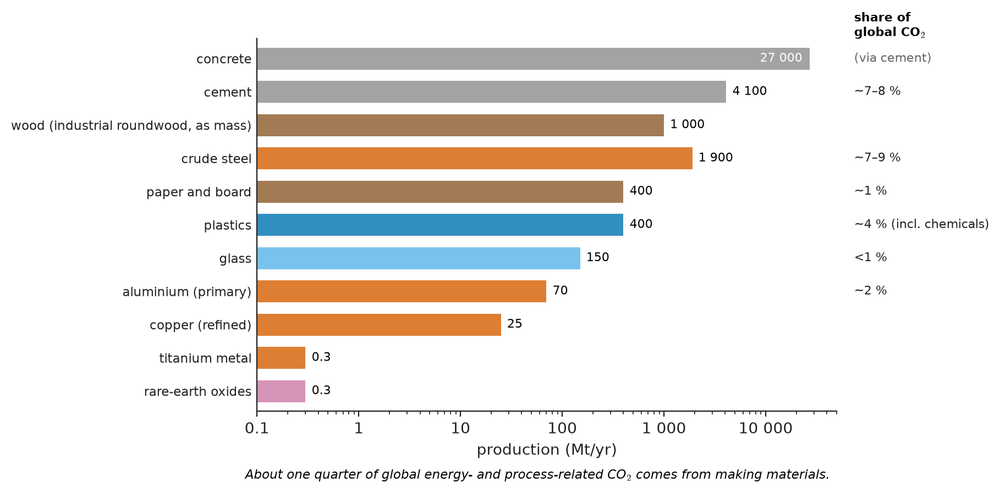
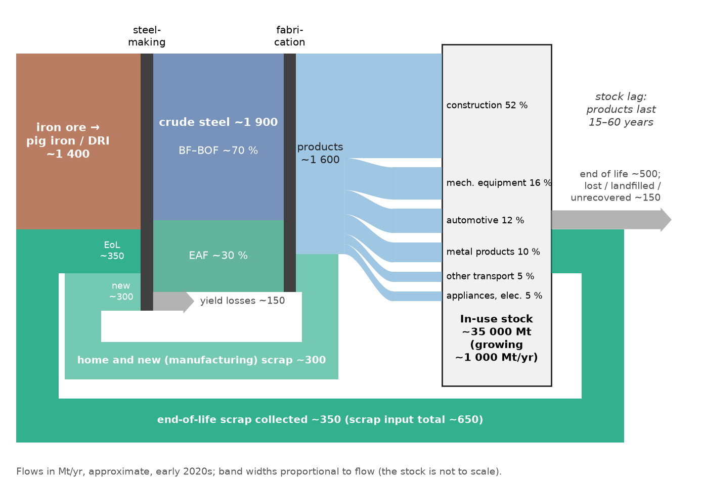
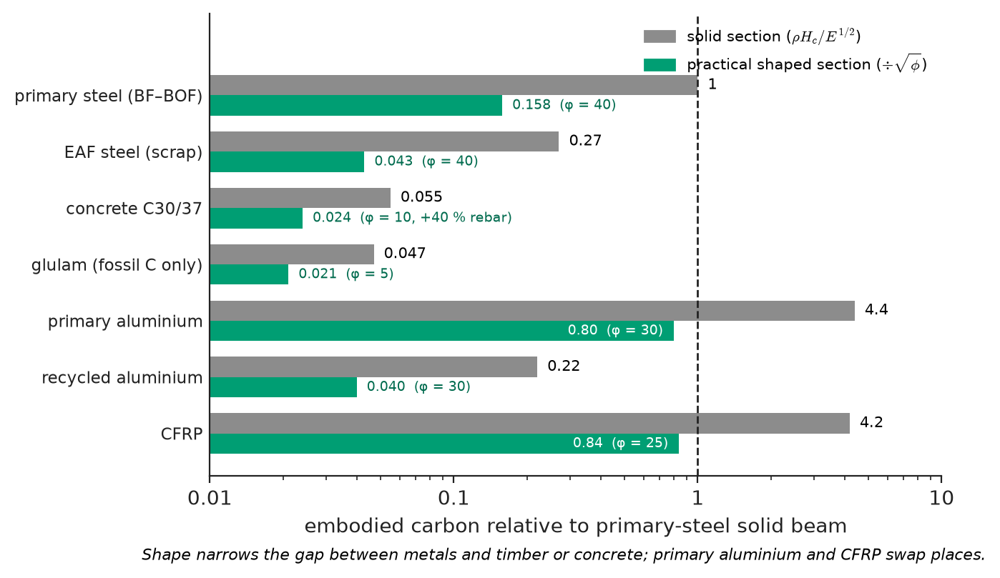
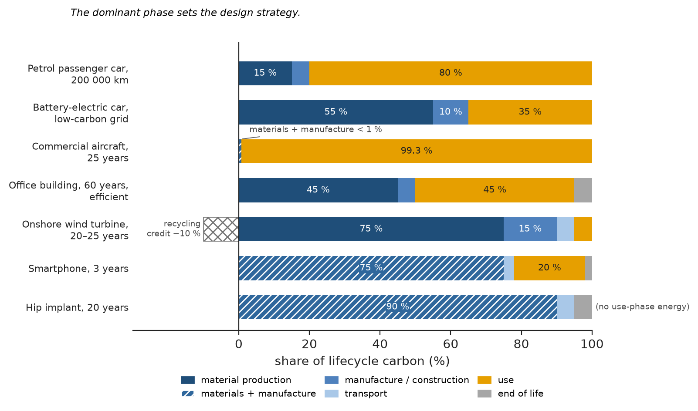
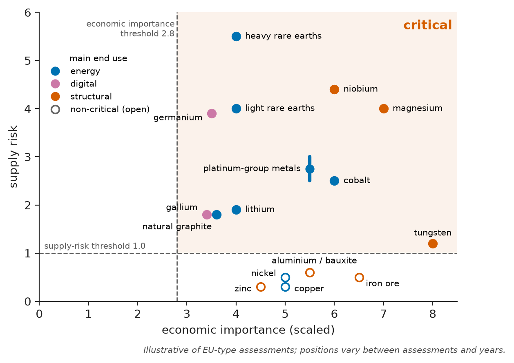
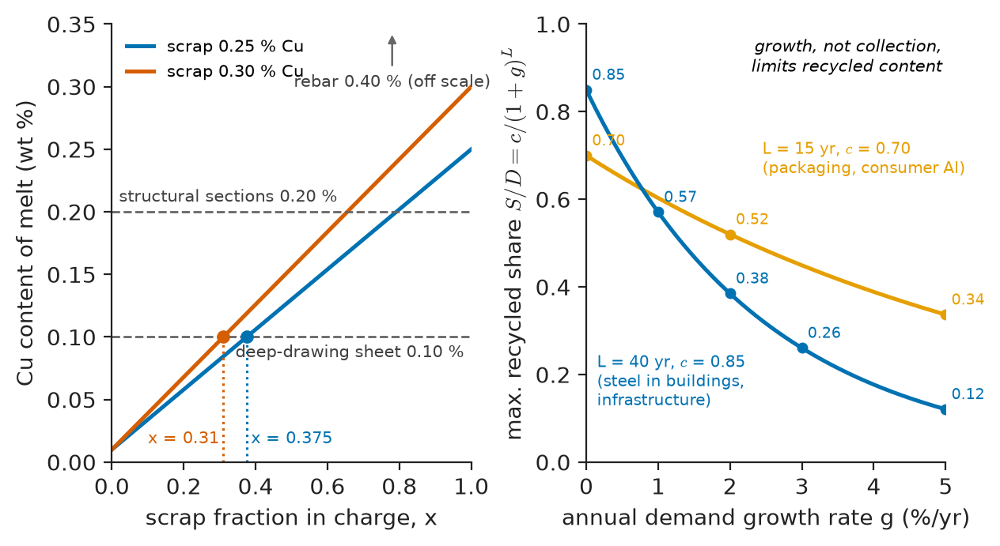

# Chapter 59 — Sustainability, Lifecycle and the Circular Economy

*Part XI · Characterization, Computation and Design*

A city council commissions a twelve-storey office building and asks the design team for the lowest-carbon structure. The structural engineer proposes a post-tensioned concrete frame, the cheapest option. The architect proposes cross-laminated timber floors on glulam columns, pointing out that the wood stores carbon. The steel fabricator proposes a frame of electric-arc-furnace sections made from scrap, almost all of which will be recovered when the building is demolished. A consultant then reports that, over a sixty-year life, the energy to heat, cool and light the building will emit more carbon than its structure, so the façade and the heat pumps matter more than the frame. A second consultant replies that the grid will be largely decarbonized within twenty years, so the carbon emitted *now*, to make the materials, is what counts. Each statement can be supported by a published lifecycle assessment. The council is not facing an engineering failure in the usual sense: nothing has cracked, crept or corroded. It is facing the question that now sits over every chapter of this book: what does it cost the planet to make, use and discard the materials we choose, and how should that cost change the choice?

> **How much material does society use, where does it go, and what fraction of global energy and emissions does making it account for?**
> **How are embodied energy, carbon and lifecycle impacts measured, and how reliable are the numbers?**
> **Which materials are critical, and how can products and processes be designed so that materials circulate rather than being used once?**

| Concept | Engineering destination |
|---|---|
| Material flows, stocks and the materials footprint | Planning capacity, scrap supply and infrastructure demand |
| Embodied energy and embodied carbon | Low-carbon structural, vehicle and product design |
| Lifecycle assessment (LCA), eco-audit | Comparing design options over the whole life; environmental product declarations |
| Critical and conflict materials | Supply-risk management for magnets, batteries, catalysts, alloys |
| Design for recycling, reuse and remanufacture | Products and buildings whose materials can be recovered |
| Recycling metallurgy, polymer recycling, construction-waste recovery | Steel, aluminium, plastics and concrete in second and later lives |
| Green materials and the circular economy | Hydrogen steel, low-clinker cement, mass timber, bio-based polymers |
| The future of the discipline | Where materials science and engineering is going |

**Roadmap.** How much material and where it flows (59.1) → the energy and carbon embodied in it (59.2) → measuring impacts over the whole life (59.3) → materials whose supply is at risk (59.4) → designing so that materials can come back (59.5) → how they are actually recovered (59.6) → new materials and the circular economy (59.7) → where the discipline is going (59.8) → a synthesis of the book (59.9).

---

## 59.1 Materials flows and the materials footprint of society

### The scale of material use

Humanity now extracts of order 100 billion tonnes of materials per year: about half non-metallic minerals (sand, gravel, crushed stone, limestone and clay for construction), a quarter biomass (food, feed and wood), and the rest fossil fuels and metal ores. Per person, that is roughly 12 tonnes a year, or 35 kg a day. The engineered materials of this book are a subset, but a large one:

| Material | Global production (order of magnitude, early 2020s) | Comment |
|---|---|---|
| Concrete | ~25–30 Gt/yr | Most-used manufactured material, about 3–4 t per person per year |
| Cement | ~4 Gt/yr | Binder for concrete (Chapter 18) |
| Crude steel | ~1.9 Gt/yr | About 30 % via electric-arc furnaces, mostly from scrap |
| Wood (industrial roundwood) | ~2 billion m$^3$/yr (~1 Gt) | Construction, paper, panels |
| Paper and board | ~0.4 Gt/yr | High recycling rates in many regions |
| Plastics | ~0.4 Gt/yr | About 9 % of plastic waste recycled globally |
| Glass | ~0.15 Gt/yr | Flat and container glass |
| Primary aluminium | ~70 Mt/yr | Plus ~30 Mt/yr from recycled scrap |
| Refined copper | ~25 Mt/yr | About a third from recycled sources |
| Titanium metal | ~0.3 Mt/yr | (Most titanium mined becomes TiO$_2$ pigment) |
| Rare-earth oxides | ~0.3 Mt/yr | Small tonnage, large strategic importance |

<!-- FIGURE 59.1 | figures/ch59/fig-59-1-global-material-production.png | plot | Annual global production of major engineering materials, with the share of global CO2 emissions attributed to their production. | Content: horizontal bar chart, log x-axis 'production (Mt/yr)' from 0.1 to 50 000. Bars, top to bottom: concrete 27 000; cement 4 100; wood (industrial roundwood, as mass) 1 000; crude steel 1 900; paper and board 400; plastics 400; glass 150; aluminium (primary) 70; copper (refined) 25; titanium metal 0.3; rare-earth oxides 0.3. Right-hand column of numbers 'share of global CO2': cement ~7–8 %, steel ~7–9 %, plastics and chemicals ~4 %, aluminium ~2 %, paper ~1 %, glass <1 %. Note below chart: 'about one quarter of global energy- and process-related CO2 comes from making materials'. -->

*Figure 59.1 — Annual global production of major engineering materials, with the share of global CO2 emissions attributed to their production.*

Two materials dominate the environmental account because of their tonnage. Steel production emits about 1.9–2.2 kg CO$_2$ per kg via the blast-furnace route and accounts for roughly 7–9 % of global CO$_2$ emissions; cement production, through fuel combustion and the calcination of limestone ($\mathrm{CaCO_3}\rightarrow\mathrm{CaO}+\mathrm{CO_2}$), accounts for another 7–8 %. Together with aluminium, plastics, chemicals, paper and glass, the production of materials accounts for about a quarter of global energy- and process-related CO$_2$ emissions (Figure 59.1).

### Stocks and flows

Materials do not disappear when they are used; they accumulate as **in-use stocks**: buildings, bridges, pipelines, vehicles, machines. Industrialized economies hold about 10–15 tonnes of steel per person in use, and the global average is around 4 tonnes. Stocks grow while a society builds its infrastructure and then saturate; the steel stock per person of most mature economies has levelled off. The flow of a material through society can be mapped as a **Sankey diagram** (Figure 59.2): from ore and scrap, through production, fabrication and products, into the in-use stock, and out, decades later, as end-of-life scrap, losses and landfill.

<!-- FIGURE 59.2 | figures/ch59/fig-59-2-steel-sankey.png | schematic | Global steel flows from ore and scrap to products, in-use stock and end of life (approximate, early 2020s). | Content: Sankey diagram, flows in Mt/yr, widths proportional. Left inputs: 'Iron ore → pig iron/DRI ~1 400' and 'Scrap ~650' (split: 'home and new (manufacturing) scrap ~300', 'end-of-life scrap ~350'). Middle: 'Crude steel ~1 900' (BF-BOF ~70 %, EAF ~30 %, shown as two streams). 'Fabrication' with 'manufacturing scrap ~300' looping back to scrap input. Products by sector: construction ~52 %, mechanical equipment ~16 %, automotive ~12 %, other metal products ~10 %, other transport ~5 %, domestic appliances and electrical ~5 %. Then 'In-use stock ~35 000 Mt (growing ~1 000 Mt/yr)' box. Right outputs: 'End-of-life ~500' splitting into 'collected scrap ~350' (loops back to the scrap input) and 'lost/landfilled/unrecovered ~150'. Annotation: 'stock lag: products last 15–60 years'. -->

*Figure 59.2 — Global steel flows from ore and scrap to products, in-use stock and end of life (approximate, early 2020s).*

Three facts follow. Scrap available today reflects what was put into use decades ago, when production was smaller, so recycled supply lags demand (Section 59.7). The largest flow, into construction, is also the longest-lived, so buildings are both the biggest consumers and the largest future mines of materials. And losses occur at every stage: dissipative uses (pigments, coatings, wear debris), dispersed small components and corrosion (Chapters 42 and 43) remove material from circulation permanently.

### The materials footprint and the drivers of demand

The environmental impact of materials use is often written as the product

$$
I=P\times A\times T
$$

impact equals population times affluence (consumption per person) times technology (impact per unit of consumption). Materials engineering acts on the last factor: less material per unit of service (**material efficiency**), lower impact per kilogram, and recovery at end of life. History adds a sobering lesson: efficiency gains have repeatedly been overtaken by growth in demand, the **rebound effect** noted for coal by Jevons in 1865.

> **Status of the principle: IPAT identity**
> *Approximate.* An accounting identity that is exact by definition, but the factors are not independent (affluence changes technology, efficiency changes demand), so it describes rather than predicts.

---

## 59.2 Embodied energy and carbon

### Definitions

The **embodied energy** of a material is the primary energy used to make one kilogram of it, from extraction of the raw materials to the factory gate (**cradle-to-gate**), including the energy of fuels used as feedstock where relevant. The **embodied carbon** (more precisely, the cradle-to-gate global warming potential) is the mass of CO$_2$-equivalent greenhouse gases emitted in the same process, with other gases converted to CO$_2$ equivalents by their 100-year global warming potentials (methane about 28–30, nitrous oxide about 270). Embodied carbon depends on the energy mix as well as the energy quantity, and in cement and iron-making it also includes **process emissions** from chemical reactions that release CO$_2$ irrespective of the fuel used.

| Material (typical, cradle-to-gate) | Embodied energy (MJ/kg) | Embodied carbon (kg CO$_2$e/kg) | Main contributors |
|---|---|---|---|
| Steel, blast furnace–basic oxygen furnace | 20–30 | 1.9–2.3 | Coke and coal as reductant, ore sintering |
| Steel, electric-arc furnace from scrap | 6–10 | 0.3–0.7 (grid-dependent) | Electricity for melting |
| Aluminium, primary | 190–220 | 8–20 (hydropower ~4–5; coal-based ~18–20) | Electrolysis, ~14 kWh/kg; anode consumption |
| Aluminium, recycled | 10–25 | 0.5–1.0 | Remelting, ~5–10 % of primary energy |
| Copper, primary | 50–70 | 3–5 | Mining and concentrating low-grade ore |
| Titanium alloy | 500–750 | 35–45 | Kroll process, vacuum remelting |
| Cement (Portland, CEM I) | 4–5.5 | 0.8–0.9 | Calcination (~0.52 kg/kg clinker) and kiln fuel |
| Concrete, C30/37 with CEM I | 1.0–1.5 | 0.12–0.16 (300–380 kg/m$^3$) | Cement content |
| Brick | 2–3 | 0.2–0.25 | Kiln firing |
| Soda-lime glass | 10–15 | 0.7–1.0 | Melting, carbonate decomposition |
| Sawn softwood, glulam | 2–10 | 0.2–0.4 fossil (biogenic storage ~1.6–1.8 not included) | Drying, processing, adhesive |
| Polyethylene | 75–85 (incl. feedstock) | 1.8–2.0 (plus ~3.1 if incinerated at end of life) | Cracking, polymerization |
| PET | 80–90 | 2.2–3.0 | Monomer synthesis |
| Carbon-fibre composite (CFRP) | 200–400 | 15–30 | Carbon-fibre production (precursor, oxidation, carbonization) |

The values are typical ranges; they vary with ore grade, process, plant efficiency, and above all the electricity mix. Aluminium smelted with hydropower in Norway or Canada has a quarter of the carbon footprint of aluminium smelted with coal-fired electricity. Embodied values for the same material from two databases commonly differ by 20–50 %, and a comparison of two materials is only meaningful if both come from the same source and boundary.

The structure of the table follows from the thermodynamics of Chapter 6: the energy needed to reduce an ore to metal is at least the free energy of formation of the oxide (Ellingham diagram), and the more stable the oxide, the higher the minimum. Aluminium and titanium oxides are far more stable than iron oxide, so aluminium and titanium cost several times more energy per kilogram than steel, while remelting a metal that is already reduced needs only the energy to heat and melt it. That simple fact is the strongest argument for metal recycling.

### Carbon as an objective in selection

Embodied carbon enters materials selection exactly as cost does (Chapter 58): replace the price $C_m$ in a performance index by the embodied carbon $H_c$. For a beam of given bending stiffness, the embodied carbon is proportional to $H_c\rho/E^{1/2}$.

**Worked example — embodied carbon of a stiffness-limited floor beam.** Using mid-range values from the table, compare candidate materials for a beam that must meet a given bending stiffness, with a solid section of free size:

| Material | $E$ (GPa) | $\rho$ (Mg/m$^3$) | $H_c$ (kg CO$_2$e/kg) | $\rho H_c/E^{1/2}$ | Relative to primary steel |
|---|---|---|---|---|---|
| Steel, primary (BF–BOF) | 210 | 7.85 | 2.2 | 1.192 | 1.00 |
| Steel, EAF from scrap | 210 | 7.85 | 0.6 | 0.325 | 0.27 |
| Concrete C30/37 (plain) | 30 | 2.40 | 0.15 | 0.066 | 0.055 |
| Glulam (fossil carbon only) | 12 | 0.48 | 0.4 | 0.055 | 0.047 |
| Aluminium, primary (global average) | 69 | 2.70 | 16 | 5.20 | 4.4 |
| Aluminium, recycled | 69 | 2.70 | 0.8 | 0.260 | 0.22 |
| CFRP | 60 | 1.55 | 25 | 5.00 | 4.2 |

For primary steel, $7.85\times2.2/\sqrt{210}=17.27/14.49=1.192$; for glulam, $0.48\times0.4/\sqrt{12}=0.192/3.464=0.055$. Several conclusions follow, and each has caveats that the documentation stage must resolve (Figure 59.3). Timber and concrete are an order of magnitude better than primary steel, and timber is better still if the carbon stored in the wood is counted (Section 59.3). But concrete cannot carry tension: reinforcement steel, typically 1–2 % by volume, adds roughly 30–50 % to the carbon of a real reinforced-concrete beam, and the index treats the beam as a solid section, whereas steel's higher modulus lets it reach shape factors of 30–60 (Chapter 58), which cuts its mass, and carbon, for the same stiffness by a factor of five or more. The recycling route matters as much as the material: recycled aluminium is twenty times lower in carbon than primary, and EAF steel nearly four times lower than BF–BOF steel. Primary aluminium and CFRP, which win on mass, lose on embodied carbon by a factor of four to five, a cost that must be repaid in the use phase if they are to be justified, the subject of the next worked example.

<!-- FIGURE 59.3 | figures/ch59/fig-59-3-beam-embodied-carbon.png | plot | Embodied carbon of a stiffness-limited beam relative to primary steel, for a solid section and for practical shaped sections. | Content: horizontal bar chart, log x-axis 'embodied carbon relative to primary-steel solid beam' from 0.01 to 10. Pairs of bars for each material: solid section (index ρH_c/E^½, values from the worked example: primary steel 1.00, EAF steel 0.27, concrete 0.055, glulam 0.047, primary Al 4.4, recycled Al 0.22, CFRP 4.2) and shaped section (divided by √φ with φ = 40 steel, 30 Al, 25 CFRP, 10 concrete (incl. +40 % for rebar), 5 glulam: steel 0.158, EAF 0.043, concrete 0.024, glulam 0.021, primary Al 0.80, recycled Al 0.040, CFRP 0.84). Vertical dashed line at 1. Note: 'shape changes the ranking among metals and narrows the gap to timber and concrete'. -->

*Figure 59.3 — Embodied carbon of a stiffness-limited beam relative to primary steel, for a solid section and for practical shaped sections.*

### Use-phase energy and the lightweighting balance

Embodied carbon is half of the story for anything that moves or consumes energy. Lighter vehicles use less fuel; a lighter aircraft burns less kerosene; a better insulated building uses less heating. A material with higher embodied carbon may repay it in use. The calculation is a **break-even** analysis.

**Worked example — when does an aluminium car body repay its carbon?** A steel body-in-white of 300 kg is replaced by an aluminium one of 180 kg (a 40 % mass saving, typical of such substitutions). Take steel at 2.2 kg CO$_2$e/kg and primary aluminium at 16 kg CO$_2$e/kg (global average), and assume that each 100 kg of mass saved reduces fuel consumption by 0.35 L/100 km when the powertrain is resized to match (secondary savings included), with petrol emitting about 2.8 kg CO$_2$e per litre well-to-wheel.

- Extra embodied carbon: $180\times16-300\times2.2=2880-660=2220$ kg CO$_2$e.
- Fuel saved: $0.35\times1.20=0.42$ L/100 km, or $0.42\times2.8/100=0.01176$ kg CO$_2$e/km.
- Break-even distance: $2220/0.01176\approx189\,000$ km.

That is about the whole life of a typical car (150 000–200 000 km): with primary aluminium from an average grid, the lightweight body barely pays back. If half the aluminium is recycled (average $H_c=0.5\times16+0.5\times0.8=8.4$ kg/kg), the extra carbon is $180\times8.4-660=852$ kg and the break-even falls to about 72 000 km, a third of the vehicle's life. With fully recycled aluminium the aluminium body is lower in carbon than the steel one before the car has moved. For a battery-electric car on a low-carbon grid, the use-phase saving per kilogram is several times smaller, so the break-even moves out and lightweighting with high-carbon materials may never pay back; for an aircraft, where each kilogram saved avoids of order 5–10 tonnes of CO$_2$ over a 25-year service life, almost any lightweighting pays back within months. The same material substitution is right in one application and wrong in another, and the recycled content of the material is often the deciding variable.

> **Status of the principle: embodied-versus-use-phase break-even**
> *Approximate.* A linear balance between embodied and operational impacts; it depends strongly on assumed fuel-reduction values, electricity mixes (which change over the product's life), recycled content and end-of-life credits, and is robust only when one term exceeds the other by a large factor.

---

## 59.3 Lifecycle assessment

### The method

**Lifecycle assessment (LCA)** quantifies the environmental impacts of a product or service over its life cycle. It is standardized in ISO 14040 and 14044, in four phases:

1. **Goal and scope definition.** What question is asked, for whom, and how the result will be used. Central choices are the **functional unit**, the quantity of service on which comparison is based ("one square metre of floor supporting 3 kPa for 60 years", "transporting one passenger 100 000 km", "one hip replacement lasting 20 years", never "one kilogram of material"), and the **system boundary**: cradle-to-gate (production only), cradle-to-grave (including use and disposal) or cradle-to-cradle (with recycling into new products).
2. **Lifecycle inventory (LCI).** Every input (materials, energy, water, land) and output (emissions to air, water and soil, wastes) for every process within the boundary, scaled to the functional unit. Most inventories combine primary data for the processes under study with **background databases** for electricity, transport and commodity materials.
3. **Lifecycle impact assessment (LCIA).** The inventory is converted to impact categories using characterization factors: global warming potential (kg CO$_2$e), acidification (kg SO$_2$e), eutrophication (kg PO$_4^{3-}$e or N-e), photochemical ozone formation, ozone depletion, human and eco-toxicity, abiotic resource depletion (kg Sb-e), water use and land use.
4. **Interpretation.** Identify the dominant life phases and processes, test the sensitivity of conclusions to uncertain assumptions, and check completeness and consistency.

An **eco-audit** is a simplified LCA used early in design: it estimates energy or carbon for five phases (material, manufacture, transport, use, end of life) from tabulated data and asks which phase dominates (Figure 59.4).

<!-- FIGURE 59.4 | figures/ch59/fig-59-4-life-phase-breakdown.png | plot | Share of lifecycle carbon by life phase for products from different engineering fields. | Content: horizontal 100 % stacked bars; segments: material production (dark), manufacture (medium), transport (light), use (accent), end of life (grey; negative credit shown left of zero where relevant). Bars, with approximate shares: 'Petrol passenger car, 200 000 km' materials ~15 %, manufacture ~5 %, use ~80 %; 'Battery-electric car, low-carbon grid' materials incl. battery ~55 %, manufacture ~10 %, use ~35 %; 'Commercial aircraft, 25 years' materials+manufacture <1 %, use >99 %; 'Office building, 60 years, efficient' materials ~45 %, construction ~5 %, use ~45 %, end of life ~5 %; 'Onshore wind turbine, 20–25 years' materials ~75 %, manufacture and installation ~15 %, transport ~5 %, use (maintenance) ~5 %, recycling credit −10 %; 'Smartphone, 3 years' materials+manufacture ~75 %, transport ~3 %, use ~20 %, end of life ~2 %; 'Hip implant, 20 years' materials+manufacture ~90 %, transport ~5 %, end of life ~5 % (no use-phase energy). Caption note: 'the dominant phase sets the design strategy'. -->

*Figure 59.4 — Share of lifecycle carbon by life phase for products from different engineering fields.*

### The dominant phase decides the strategy

The pattern in Figure 59.4 is general. Where the **use phase** dominates (aircraft, conventional vehicles, motors, transformers, cables, older buildings), the materials strategy is to reduce operating energy, even at the cost of more embodied impact: lightweight alloys and composites in aircraft, premium electrical steels and amorphous cores in transformers (Chapter 29), thicker conductors (Chapter 58), better insulation in buildings. Where **material production** dominates (wind turbines, solar panels, efficient buildings, electronics, implants and every passive structure), the strategy is to use less material, lower-carbon materials, longer lives and recovery at end of life. As energy grids decarbonize, use-phase impacts fall and the embodied share rises across almost all products. That shift is why embodied carbon, a minor topic in 2000, has become a design specification in construction and vehicles.

### Methodological choices that change the answer

LCA is standardized, but several choices legitimately change its results:

- **Allocation.** When a process makes several products (a refinery, a zinc smelter that also yields germanium and indium, a sawmill producing timber and wood chips), its impacts must be divided among them, by mass, by economic value or by system expansion. Allocation by value makes by-product metals look cheap in carbon until they become valuable.
- **Recycling credits.** In the **cut-off** (recycled-content) approach, recycled material enters free of primary burdens, and no credit is given for recycling at end of life. In the **avoided-burden** (end-of-life) approach, material recycled at end of life earns a credit for the primary material it replaces. Metals with high recycling rates look much better under avoided burden; the two approaches can differ by a factor of two for aluminium.
- **Biogenic carbon.** Wood stores about 1.6–1.8 kg of CO$_2$ per kilogram of dry mass, absorbed from the air as the tree grew. Whether that storage is counted as a benefit depends on whether the wood is assumed to stay stored at end of life (reused, landfilled) or be burned, and on forest management. Including it can make timber structures net carbon-negative cradle-to-gate; excluding it does not.
- **Timing.** Standard LCA gives emissions now and in fifty years the same weight; dynamic LCA does not, and the council debate of the opening paragraph is partly a debate about this choice.
- **Data quality and representativeness.** Background databases give averages; a specific supplier's product may differ by a factor of two. **Environmental product declarations (EPDs)**, product-specific LCA results verified to standard rules, are increasingly required in construction procurement.

> **Status of the principle: lifecycle assessment**
> *Approximate.* A standardized accounting method whose results depend on functional unit, boundaries, allocation, recycling-credit rules, characterization models and background data; conclusions are robust only when a difference survives sensitivity analysis across these choices.

---

## 59.4 Critical and conflict materials

### What makes a material critical

A material is **critical** when it is economically important and its supply is at risk. The European Union's method, used with variations in the United States, Japan and elsewhere, scores each raw material on two axes:

- **Economic importance**: the value added of the end-use sectors that depend on it, corrected for the possibility of substitution;
- **Supply risk**: the concentration of global supply in few countries, weighted by their governance and trade policies, reduced by recycling and substitution.

Materials above thresholds on both axes are listed as critical (Figure 59.5); the EU's 2023 list included 34 critical raw materials, 17 of them also designated strategic for the energy and digital transitions.

Concentration of supply is measured by the **Herfindahl–Hirschman index**, the sum of the squares of the percentage shares of supplying countries:

$$
\mathrm{HHI}=\sum_i s_i^2
$$

ranging from near 0 (many small suppliers) to 10 000 (a single supplier). Markets above about 2500 are considered highly concentrated. Cobalt mine supply (about 70 % from the Democratic Republic of the Congo, the rest from Indonesia, Russia, Australia and others) gives an HHI of about 5000; gallium, with about 98 % produced in China, about 9600; lithium mining, spread over Australia (~47 %), Chile (~24 %), China (~15 %) and others, about 3000. Concentration is often greater in refining than in mining: China performs about 90 % of rare-earth separation and magnet production, most graphite anode processing, and around two-thirds of lithium and three-quarters of cobalt refining.

### Why supply is fragile

- **By-product (companion) metals.** Gallium is recovered from alumina refining, germanium and indium from zinc refining, tellurium from copper anode slimes, cobalt mostly from copper and nickel mining. Their supply depends on the main product's market, not on their own price: doubling the gallium price does not cause more bauxite to be mined.
- **Concentration and lead times.** Platinum-group metals come mainly from South Africa and Russia, niobium from Brazil; a new mine takes ten to twenty years from discovery to production.
- **Policy.** Export restrictions on gallium, germanium and graphite (2023) showed that supply can be withdrawn by decision as well as by shortage.

| Material | Key engineering uses (chapters) | Main supply concern |
|---|---|---|
| Rare earths (Nd, Pr, Dy, Tb) | NdFeB magnets for EV motors and wind generators (27), phosphors, catalysts | Concentrated separation and magnet manufacture; Dy and Tb scarcity |
| Cobalt | Battery cathodes (32), superalloys (16, 33), hard metals | Concentrated mining; artisanal mining conditions |
| Lithium | Batteries (32), glass-ceramics (17) | Rapid demand growth; concentrated refining |
| Natural graphite | Battery anodes (32), refractories | Concentrated processing; export controls |
| Gallium, germanium | GaN and GaAs devices (26), infrared optics (28), fibre-optic preforms | By-product supply; near-monopoly production |
| Platinum-group metals | Catalysts (automotive, chemical, fuel-cell, electrolyser), sensors | Geographic concentration |
| Niobium, tantalum | Microalloyed steels (15), superconductors (25), capacitors | Concentrated supply; tantalum conflict sourcing |
| Tungsten | Hard metals, high-temperature and fusion components (33) | Concentrated supply |
| Helium | Cryogenics for superconducting magnets, MRI | Non-renewable, by-product of natural gas |

<!-- FIGURE 59.5 | figures/ch59/fig-59-5-criticality-matrix.png | map | Criticality assessment: supply risk against economic importance, with the threshold region for critical raw materials. | Content: linear axes; x-axis economic importance (scaled 0 to 8); y-axis supply risk (0 to 6). Dashed threshold lines at economic importance 2.8 and supply risk 1.0; upper-right region shaded and labelled 'critical'. Approximate positions (illustrative of EU-type assessments): heavy rare earths (EI 4, SR 5.5), light rare earths (EI 4, SR 4), magnesium (EI 7, SR 4), gallium (EI 3.5, SR 1.8), germanium (EI 3.5, SR 3.9), niobium (EI 6, SR 4.4), tungsten (EI 8, SR 1.2), cobalt (EI 6, SR 2.5), natural graphite (EI 3.5, SR 1.8), lithium (EI 4, SR 1.9), platinum group metals (EI 5.5, SR 2.5–3); non-critical for comparison: iron ore (EI 6.5, SR 0.5), aluminium (EI 5.5, SR 0.6; bauxite itself is on the EU critical list since 2020), copper (EI 5, SR 0.3), nickel (EI 5, SR 0.5), zinc (EI 4.5, SR 0.3). Bubble size optional by global production; colour by end-use family (energy, digital, structural). Footnote: 'positions vary between assessments and years'. -->

*Figure 59.5 — Criticality assessment: supply risk against economic importance, with the threshold region for critical raw materials.*

### Conflict materials and responsible sourcing

**Conflict minerals** are those whose mining finances armed groups or involves severe human-rights abuses. Legislation centres on the "3TG": tin, tantalum, tungsten and gold, which are in nearly every electronic product and in many alloys, solders, catalysts and tools. The US Dodd–Frank Act (section 1502, 2010) requires listed companies to report their sourcing from the Democratic Republic of the Congo and neighbouring countries; the EU Conflict Minerals Regulation (applying from 2021) requires importers to carry out supply-chain due diligence following OECD guidance. Cobalt, although outside the 3TG definition, raises similar concerns about artisanal mining and child labour, and battery regulations now require due diligence and, from the late 2020s, digital "battery passports" that record origin and recycled content. For a materials engineer these are hard constraints in the sense of Chapter 58: a material without traceable, responsible sourcing may be legally or commercially excluded however good its properties.

### Engineering responses

Materials engineering responds to criticality in five ways, each drawing on earlier chapters:

1. **Substitution of the element**: rare-earth-free motors (induction, switched-reluctance, ferrite-assisted designs), sodium-ion batteries avoiding lithium and cobalt, iron-based (LFP) cathodes avoiding cobalt and nickel (Chapter 40), base-metal nickel electrodes replacing palladium in multilayer capacitors.
2. **Thrifting**: using less of the critical element for the same function: grain-boundary diffusion of dysprosium into NdFeB magnets cuts its use severalfold (Chapter 29); nanostructured catalysts reduce platinum loading in fuel cells; lower-cobalt NMC cathodes.
3. **Diversification** of mines, refineries and by-product recovery.
4. **Recycling**: of magnets, batteries, catalysts and hard metals, where recycling rates are high for some (catalytic-converter platinum, tungsten carbide) and below 1 % for others (rare earths, gallium, indium).
5. **Longevity**: longer-lasting products reduce demand for all materials at once.

> **Status of the principle: criticality assessment**
> *Empirical.* Criticality scores combine market, geological and policy indicators by agreed conventions; they rank materials usefully but change with time, demand and politics, and do not predict when or whether a disruption will occur.

---

## 59.5 Design for recycling, reuse and remanufacture

### The waste hierarchy and the R-ladder

Not all forms of recovery are equal. The **waste hierarchy** ranks options by how much of the material's value and embodied energy they preserve, from best to worst: prevent (do not use the material at all), reuse, repair and refurbish, remanufacture, recycle, recover energy, dispose. A more detailed **R-ladder** lists refuse, rethink, reduce, reuse, repair, refurbish, remanufacture, repurpose, recycle, recover. The higher rungs keep products and components intact and so preserve the energy that went into shaping, joining and finishing them, not just the energy of the raw material. Recycling, the rung that materials science most directly enables, is near the bottom: it saves the extraction and reduction energy but repeats all the processing.

### Reuse and remanufacture

**Reuse** keeps a product or component in service for the same function: steel sections recovered from a dismantled building and re-erected, bricks cleaned of lime mortar, an electric motor reinstalled. Reused structural steel avoids most of its embodied carbon; the obstacles are practical (unknown grade and history, welded connections, certification) rather than physical, and portable spectrometry (Chapter 52) is lowering them.

**Remanufacture** restores a used product to as-new specification with a warranty: engines, gearboxes, turbochargers, aircraft landing gear, industrial pumps. Typically 60–80 % of the mass of a remanufactured engine is recovered components, and the energy and carbon savings are of order 50–80 % relative to a new unit. Materials science enters through damage assessment (is the crankshaft's fatigue life consumed? Chapter 14), restoration of worn surfaces (thermal spraying, laser cladding and additive repair, Chapters 45, 48 and 49), and non-destructive inspection.

### Design for disassembly and recycling

Whether materials can be recovered at end of life is decided at the design stage. The principles are:

- **Minimize the number of different materials**, and prefer mono-material constructions where possible: a polypropylene car bumper with polypropylene clips, not a PC/ABS blend with steel inserts.
- **Use compatible combinations** where materials cannot be separated: materials that can be recycled together without harming each other (the recyclate of a steel–zinc coating combination is acceptable; copper in steel is not, Section 59.6).
- **Make separation possible**: reversible fasteners (screws, snap fits) rather than adhesives and welds between dissimilar materials; accessible fixing points; avoidance of overmoulded metal inserts and of laminates of incompatible polymers.
- **Identify materials**: polymer identification codes moulded into parts, alloy markings, digital product passports.
- **Avoid contaminants**: halogenated flame retardants, problematic pigments and fillers that prevent recycling, and hazardous substances (lead, cadmium, mercury, hexavalent chromium) restricted by regulation.
- **Concentrate valuable and critical materials** in modules that can be removed quickly: magnets in a removable rotor assembly, a battery that can be removed without tools, precious-metal-rich boards that can be cut out.

Design for longevity complements these: a product that lasts twice as long halves its embodied impact per year of service, a gain no recycling process can match.

> **Status of the principle: the waste hierarchy**
> *Approximate.* A general ordering that holds when higher-rung options preserve more embodied energy and value than they consume; exceptions arise when reuse requires much transport or reconditioning, or when a reused product (an old motor, an old boiler) is far less efficient in use than a new one.

---

## 59.6 Recycling metallurgy, polymer recycling and construction-waste recovery

### Metals: why some cycle forever and some do not

Metals can in principle be recycled indefinitely without loss of properties, because remelting restores their structure: processing, not composition, sets the microstructure (Chapters 13, 15 and 16). The limit is **composition**. In a melt, every element present distributes between the metal, the slag (oxide phase) and the gas according to its oxygen affinity (Ellingham diagram, Chapter 6). In steelmaking, elements with a stronger affinity for oxygen than iron (Al, Si, Ti, Mn, Cr partly, C, P) can be oxidized into the slag; elements more noble than iron (Cu, Sn, Ni, Mo, Co, Sb) cannot be removed by oxidation and stay in the steel. In aluminium recycling the situation is worse: aluminium has a higher oxygen affinity than almost every alloying element, so iron, silicon, copper, zinc and manganese cannot be removed by oxidation at all; only magnesium and alkali metals are partly removed by fluxing and chlorination.

These **tramp elements** accumulate with each cycle. Copper above about 0.1–0.2 wt % in steel causes **hot shortness**: during reheating for rolling, iron is oxidized preferentially at the surface, copper enriches beneath the scale, melts (Cu melts at 1085 °C, below hot-rolling temperatures), and penetrates austenite grain boundaries, so the surface cracks. Tin aggravates the effect. Flat products for deep drawing tolerate the least copper, reinforcing bar and sections the most. In aluminium, iron forms brittle intermetallic phases (β-AlFeSi needles) that reduce ductility and fatigue strength in wrought alloys (Chapter 16).

**Worked example — how much scrap can a flat-steel melt take?** End-of-life steel scrap in a region contains on average 0.25 wt % Cu, mainly from motor windings and wiring that escaped separation. A flat-product grade for deep drawing allows at most 0.10 wt % Cu. The diluent is iron from a direct-reduction plant or blast furnace, with 0.01 wt % Cu. With a scrap fraction $x$ in the charge, the copper content is

$$
c=x\,(0.25)+(1-x)(0.01)\le0.10\qquad\Longrightarrow\qquad x\le\frac{0.10-0.01}{0.25-0.01}=0.375
$$

At most 37.5 % of the charge can be this scrap; the rest must be virgin iron. If careless shredding raises average scrap copper to 0.30 %, the limit falls to $(0.09)/(0.29)=31$ %. Reinforcing bar, which tolerates about 0.4 % Cu, can be made from 100 % of the same scrap. Steel recycling therefore tends to flow from high-quality to low-quality products (**downcycling**) unless copper is removed mechanically before melting; better shredding and sensor-based sorting are among the steel industry's most effective decarbonization tools, because they let scrap-based EAF steel enter the flat-product market.

Aluminium shows the same pattern. Mixed scrap, rich in silicon, iron, copper and zinc, is absorbed by casting alloys (A380, A356-type alloys tolerate several percent silicon and around 1 % iron), mainly for engine blocks and gearbox housings. As vehicle electrification reduces demand for cast engine parts, this traditional sink for mixed scrap shrinks, and the value of sorting scrap by alloy family (by laser-induced breakdown spectroscopy or X-ray fluorescence on the scrap belt) rises. Remelting aluminium needs about 5–10 % of the energy of primary production, so recycling is economically and environmentally compelling when composition can be controlled.

<!-- FIGURE 59.6 | figures/ch59/fig-59-6-recycled-content-limits.png | plot | Two limits on recycled content: dilution of tramp copper in steel, and scrap availability when demand grows. | Content: two panels. Left: x-axis scrap fraction in charge (0 to 1); y-axis Cu content of melt (wt %) 0 to 0.35. Straight lines c = 0.01 + 0.24x (scrap 0.25 % Cu) and c = 0.01 + 0.29x (scrap 0.30 % Cu). Horizontal dashed limits: 0.10 % 'deep-drawing sheet', 0.40 % 'rebar' (off-scale arrow), 0.20 % 'structural sections'. Intersections marked x = 0.375 and x = 0.31 at the sheet limit. Right: x-axis annual demand growth rate g (0 to 5 %/yr); y-axis maximum recycled share of supply S/D = c_coll/(1+g)^L, from 0 to 1. Curves: L = 15 yr, c_coll = 0.70 (e.g. packaging/consumer aluminium): 0.70 at g = 0, 0.52 at 2 %, 0.34 at 5 %; L = 40 yr, c_coll = 0.85 (steel in buildings and infrastructure): 0.85 at g = 0, 0.57 at 1 %, 0.39 at 2 %, 0.26 at 3 %, 0.12 at 5 %. Annotation 'growth, not collection, limits recycled content'. -->

*Figure 59.6 — Two limits on recycled content: dilution of tramp copper in steel, and scrap availability when demand grows.*

**Precious and specialty metals** follow copper or lead in smelting and are recovered electrolytically; elements that report to the slag (rare earths, tantalum, gallium, lithium) are lost and need **hydrometallurgical** routes (leaching, solvent extraction) on pre-separated components. Lithium-ion battery recycling shreds cells to "black mass", then recovers cobalt, nickel and copper pyro- or hydrometallurgically and lithium hydrometallurgically; direct regeneration of cathode material, which preserves more embodied energy, is under development.

### Polymers: why most plastic is not recycled

Only about 9 % of the plastic waste generated globally has been recycled; the rest is incinerated, landfilled or leaks into the environment. The reasons are partly economic (virgin polymer is cheap) and partly materials science.

**Mechanical recycling** (sort, wash, shred, melt, re-pellet) is the most efficient route, but each pass through the extruder breaks chains (thermo-mechanical and thermo-oxidative degradation, Chapter 21), lowering molecular weight; the melt-flow index rises and toughness falls (Chapter 20). Polyolefins tolerate several cycles with stabilizers; PET is hydrolysed during melt processing unless rigorously dried, but its molecular weight can be restored by **solid-state polycondensation** below the melting point, which is why bottle-to-bottle PET recycling works. The harder problem is **contamination and mixing**: most polymer pairs are immiscible (Chapter 20), so a blend of recycled PE and PP, or PET contaminated with PVC (a few hundred ppm of PVC degrades PET melts), has poor properties. Sorting relies on near-infrared spectroscopy, which cannot see carbon-black-pigmented parts; multilayer packaging (PE/PET/aluminium foil laminates) is essentially unrecyclable mechanically. Food-contact applications impose decontamination requirements that only some processes meet.

**Chemical recycling** breaks the polymer back to monomers or to hydrocarbon feedstocks:

- **Depolymerization** works well for condensation polymers and for polymers with low ceiling temperatures: PET by glycolysis or methanolysis to monomers, polyamide 6 to caprolactam, PMMA and polystyrene by thermal unzipping to monomer.
- **Pyrolysis** of mixed polyolefins at 400–600 °C produces a hydrocarbon oil that can feed a steam cracker; it accepts mixed and contaminated waste but consumes much energy, and the yield of new polymer per kilogram of waste is modest.
- **Solvent-based purification** dissolves one polymer selectively from a mixture and reprecipitates it, removing additives and contaminants.

**Thermosets and composites**, which cannot be remelted (Chapter 19), are the hardest case. Glass-fibre wind-turbine blades, tens of thousands of tonnes per year reaching end of life, are mostly landfilled or co-processed in cement kilns, where the glass becomes clinker raw material and the resin fuel. Carbon fibres are valuable enough to recover by pyrolysis or solvolysis of the matrix; recycled fibres retain about 90 % of their strength but are short and randomly oriented, so they go into non-structural or moulding-compound applications. **Vitrimers** and other covalent adaptable networks, thermosets whose crosslinks can exchange at high temperature, and resins with cleavable linkages are being developed to make future composites recyclable.

### Construction and demolition waste

Construction and demolition waste is the largest waste stream by mass in many countries, about a third of all waste in the EU. Steel reinforcement and sections are recovered magnetically and recycled at high rates (above 85 % for structural steel). Asphalt pavement is recycled at high rates back into new pavement. Concrete is crushed to **recycled concrete aggregate (RCA)**, most of which goes into road sub-base and fill, a valid use but a downcycling one.

Using RCA in new structural concrete is limited by the **adhered mortar** on the recycled particles (Chapter 18): it makes the aggregate more porous (water absorption typically 3–10 % against 0.5–1 % for natural aggregate), less dense and weaker, raising the water demand of the mix and the shrinkage and creep of the concrete. Standards in many countries permit replacement of 20–30 % of coarse aggregate in structural concrete without significant loss of strength, with higher replacement allowed in lower strength classes. Recycled fines are harder to use; they contain unhydrated cement and calcium hydroxide that can be carbonated (taking up CO$_2$) or used as supplementary binder. RCA saves quarry aggregate and landfill, but its carbon benefit is small, because the carbon of concrete lies in the cement, not in the aggregate. The bigger gains in construction come from higher rungs of the hierarchy: keeping buildings in use, adapting rather than demolishing, and designing structural elements for reuse.

---

## 59.7 Green materials and the circular economy

### Lower-carbon production routes

Because steel and cement dominate material emissions, their production routes are the largest single opportunity:

- **Hydrogen direct reduction of iron (H$_2$-DRI)** replaces coke as reductant with hydrogen ($\mathrm{Fe_2O_3}+3\mathrm{H_2}\rightarrow2\mathrm{Fe}+3\mathrm{H_2O}$), followed by melting in an electric-arc furnace. With hydrogen from renewable electrolysis, emissions fall from about 2 to about 0.3–0.7 t CO$_2$ per tonne of steel, depending on the electricity used. The route requires about 50–55 kg of hydrogen per tonne of iron and high-grade ore. Pilot and first commercial plants have been built in Europe; scale-up is limited by the cost and availability of green hydrogen and electricity.
- **More scrap-based EAF steel**, limited by scrap supply (below) and tramp elements (Section 59.6).
- **Aluminium smelting with inert anodes**, eliminating the CO$_2$ from consumption of carbon anodes (about 1.5 kg CO$_2$ per kg of aluminium), plus decarbonized electricity, which dominates aluminium's footprint.
- **Low-clinker cements**: replacing part of the clinker with supplementary cementitious materials (ground granulated blast-furnace slag, fly ash, calcined clay, limestone; Chapter 18). **LC$^3$** (limestone calcined clay cement), with about 50 % clinker, cuts cement CO$_2$ by 30–40 % with similar performance. Alkali-activated binders (geopolymers) avoid clinker altogether in some applications. **Carbon capture and storage** at the kiln is the only route to near-zero emissions for the calcination CO$_2$ of the clinker that remains.
- **Using less concrete**: optimized structural forms (variable-depth beams, shell floors), higher-strength concrete in columns, and specification of strength at 56 or 90 days rather than 28 to allow slower-gaining, lower-clinker mixes.

### Bio-based and renewable materials

**Mass timber** (cross-laminated timber, glulam, laminated veneer lumber; Chapter 18) allows timber buildings of ten to twenty storeys and more, with low embodied carbon (Section 59.2) and biogenic storage. Its challenges are fire design, moisture durability, acoustics, connections and sustainable forest supply.

**Bio-based polymers** are made from renewable feedstocks: polylactide (PLA) from fermented sugars, polyhydroxyalkanoates (PHA) made by bacteria, bio-polyethylene from sugar-cane ethanol (chemically identical to fossil PE), and polymers from lignin, cellulose and plant oils. "Bio-based" and "biodegradable" are different properties: bio-PE is bio-based but not biodegradable; PLA is bio-based and compostable, but only in industrial composting conditions (around 58 °C), not in soil or sea. Biodegradable polymers suit uses where recovery is impossible (mulch films, some medical devices, Chapter 39) but contaminate recycling streams elsewhere. **Natural-fibre composites** (flax, hemp) approach the specific stiffness of GFRP with lower embodied energy.
### The circular economy

The **circular economy** is an economic model in which materials and products are kept at their highest value for as long as possible: resources flow in closed loops rather than the linear path of take, make, use and dispose. Its widely used diagram (the "butterfly") separates two cycles: a **biological cycle**, in which renewable materials return safely to the biosphere (composting, anaerobic digestion), and a **technical cycle**, in which metals, minerals and synthetic polymers circulate through maintenance, reuse, remanufacture and recycling, with the inner loops preferred because they retain more value. The materials science of each loop is in this chapter and the preceding ones: durability and degradation (Chapters 42–45) for maintenance and life extension; damage assessment and surface restoration for remanufacture; separation thermodynamics, contamination tolerance and reprocessing for recycling.

### Limits of circularity

Circularity is bounded by physics and by growth, and both bounds are quantifiable.

**The growth limit.** Products last for years or decades before they return as scrap. If demand $D$ grows at a rate $g$ per year and products last $L$ years with a collection-and-recovery fraction $c$, the scrap available now comes from products made $L$ years ago, when demand was $D/(1+g)^L$. The maximum recycled share of current supply is therefore

$$
\frac{S}{D}=\frac{c}{(1+g)^L}
$$

**Worked example — how much of our steel and aluminium can come from scrap?** For steel in buildings and infrastructure, take $L=40$ years and $c=0.85$. With no growth, 85 % of supply could be recycled. With 2 % annual growth, $(1.02)^{40}=2.21$ and $S/D=0.85/2.21=0.39$; with 3 % growth, $(1.03)^{40}=3.26$ and $S/D=0.26$. For short-lived aluminium products (packaging, consumer goods; $L=15$ years, $c=0.70$), 2 % growth gives $0.70/1.02^{15}=0.70/1.346=0.52$. Even perfect collection cannot supply a growing demand from scrap: in a growing economy, primary production remains necessary, and its decarbonization (lower-carbon production routes, later in this chapter) cannot be avoided by recycling alone. Recycled share rises toward the collection rate only as stocks saturate, which is what has happened to steel in mature economies, where scrap-based EAF production now supplies 40–70 % of steel (Figure 59.6, right).

> **Status of the principle: scrap-availability limit on recycled content**
> *Derived.* Follows from conservation of mass with a fixed product lifetime, steady exponential growth and constant collection; real lifetimes are distributed and growth varies, which smooths the result without changing the conclusion that growth, not collection, limits recycled content in an expanding system.

**The thermodynamic limit.** Every recycling loop loses material (dissipation, oxidation into slag, contamination beyond tolerance) and requires energy for collection and separation. The energy for separation grows as the target material becomes more dilute, roughly with the logarithm of dilution at the thermodynamic minimum and much faster in practice. Very dilute uses (a few milligrams of indium in a display, gallium in an LED, rare earths in a phosphor) may never be economically recoverable, so substitution and thrifting matter more for them than recycling.

**The rebound limit.** A circular economy reduces material demand only if its loops displace primary production rather than cheapen, and so enlarge, total consumption.

---

## 59.8 The future of the discipline

Materials science and engineering began as metallurgy and ceramics, grew to include polymers, semiconductors and composites in the twentieth century, and has become, in this book, a single discipline built on one chain: structure, set by thermodynamics and kinetics, produces properties; processing controls structure; characterization measures it; computation predicts it; selection matches it to function. Several directions are reshaping that discipline.

**Materials for the energy transition.** Decarbonizing energy is largely a materials problem: batteries without scarce elements (Chapter 40), electrolyser catalysts and membranes, magnets with less rare earth (Chapter 29), new photovoltaic absorbers (Chapter 36), fusion and fission structural materials (Chapter 41), superconducting magnets (Chapter 30), and the zero-carbon steel and cement of this chapter, at tonnages that demand abundant, recyclable, responsibly sourced elements.

**Materials designed by computation and data.** Electronic-structure methods (Chapter 55), multiscale simulation and ICME (Chapter 56), machine-learned potentials and informatics (Chapter 57), and autonomous experimentation are shortening the path from concept to material. The discipline's long ambition, to design a material and its process from the requirement backward, is becoming routine for some alloy and functional-material classes, with characterization (Chapters 52–54) as the indispensable check on what the models claim.

**Architected and hierarchical materials.** Additive manufacturing (Chapter 48) allows structure to be designed at every scale at once: lattices that fill empty regions of property charts, graded compositions, point-to-point microstructure. Bone, nacre and wood remain the models for building toughness from weak constituents.

**Materials that last, adapt and heal.** Self-healing polymers and concretes, structural health monitoring and degradation models coupled to digital twins of components (Chapter 44) aim to extend service life, the highest rung of the circular hierarchy.

**Responsibility.** The materials engineer increasingly answers for the whole life of a material: where its elements were mined and by whom, the carbon emitted to make it, how long it will last, and where it will go afterwards. These are specifications as quantifiable as yield strength (Chapter 58).

---

## 59.9 Synthesis: the discipline in one view

This book has followed one argument across forty-nine chapters. **Structure** comes first: atoms, bonded into crystals or glasses or chains, arranged with defects into grains, phases and interfaces (Part I). **Thermodynamics and kinetics** decide which structures are stable and which form in the time available, through phase diagrams, diffusion, nucleation and transformation (Part II). **Properties** follow from structure: stiffness from bonding, strength from the obstacles to dislocations, toughness from the mechanisms that blunt cracks, creep and fatigue from the time-dependent motion of defects (Part III), and conductivity, permittivity, magnetism and optical response from electrons and their interaction with the lattice (Parts VI and VII). **Materials classes**, metals, ceramics, cements, polymers, composites and the advanced materials of Part VIII, are the families in which particular combinations of structure and property are realized (Parts IV, V and VIII). **Degradation** is structure changing in service, by corrosion, wear and damage accumulation (Part IX). **Processing** sets structure, and therefore everything else (Part X). **Characterization, computation and design** close the loop: they measure structure, predict it, and choose among materials and processes so that a component performs, lasts, can be made and can be recovered (Part XI).

The chain runs in both directions. Forward, an engineer moves from a composition and a process to a microstructure, a property, a component and a service life. Backward, a failed part leads through fractography and microscopy to a microstructure and a processing error; a design requirement leads through an index and a chart to a material, and through a cost model and a lifecycle assessment to a responsible choice. The council's twelve-storey building of this chapter's opening, the bonnet of Chapter 58 and the solid electrolyte of Chapter 57 are the same problem at different scales: each asks which structure, made by which process, will do the job, for how long, at what cost, and at what cost to the world that supplies and receives the material.

---

## What remains open

| Open question | Where it is answered |
|---|---|
| Thermodynamics of reduction and the Ellingham diagram behind embodied energy and recycling separation | Chapter 6; Advanced Chemistry |
| Cement chemistry, supplementary cementitious materials and recycled-aggregate concrete | Chapter 18 |
| Steel and aluminium metallurgy affected by tramp elements | Chapters 15 and 16 |
| Polymer degradation in reprocessing, miscibility of blends, thermoset networks | Chapters 19–21 |
| Energy materials whose supply and recycling this chapter assesses | Chapter 40 |
| Corrosion and degradation that set service life and dissipative losses | Chapters 42–44 |
| Selection procedures that take carbon, criticality and recyclability as objectives and constraints | Chapter 58 |
| Data-driven discovery of substitutes for critical elements | Chapter 57 |
| LCA databases, environmental economics, policy and regulation of materials | Sustainability and engineering-management study, beyond this book |
| Statistics of stock-and-flow models and uncertainty in LCA | The Mathematics Universe |

Materials science and engineering is the knowledge of how structure becomes performance; its task in this century is to deliver that performance for everyone, for longer, from materials the planet can supply and take back.
