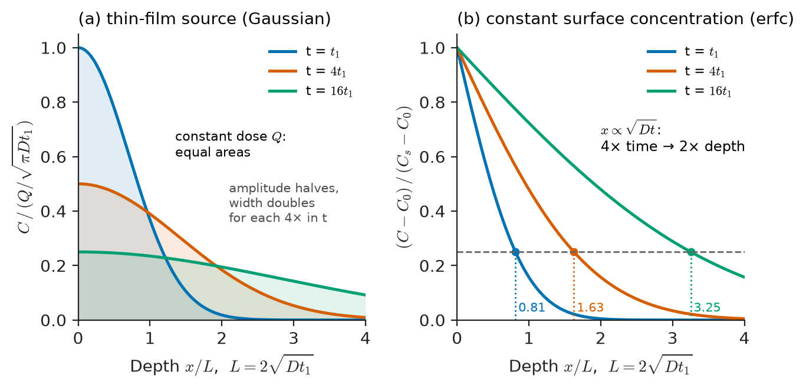
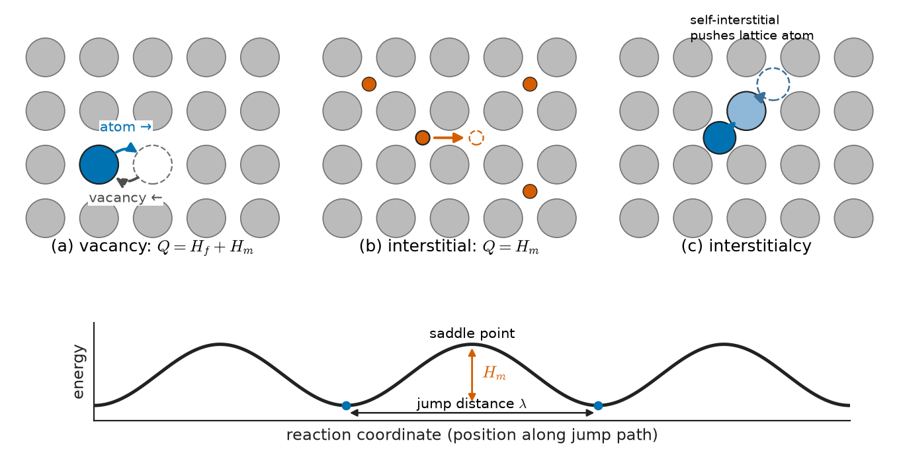
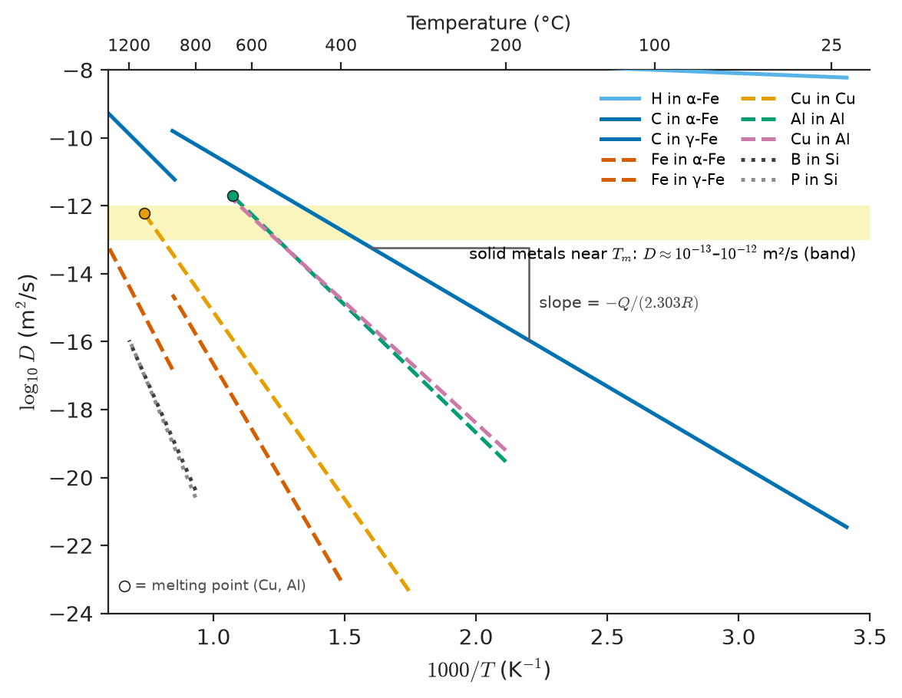
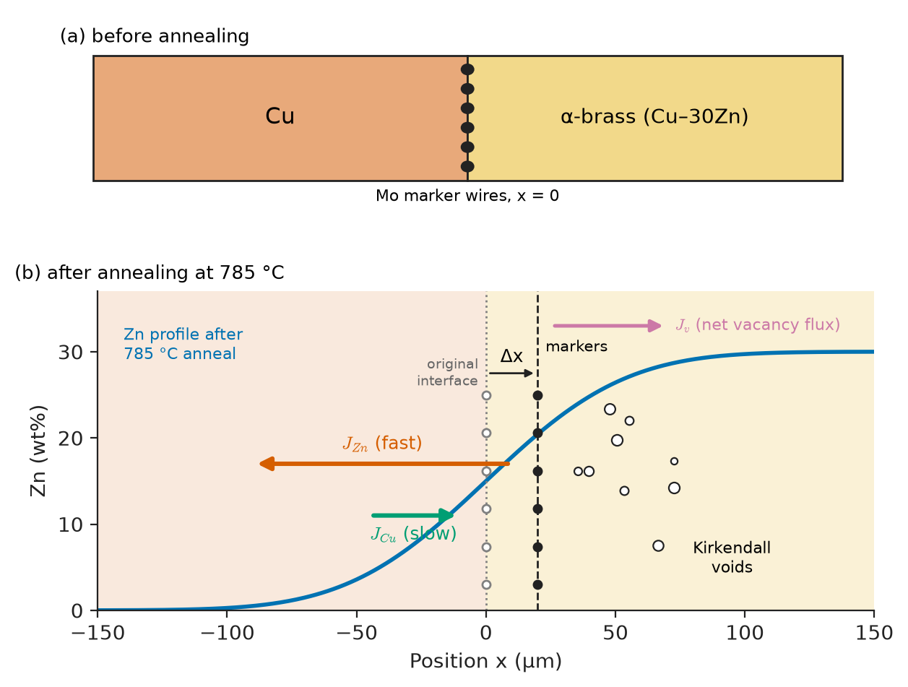
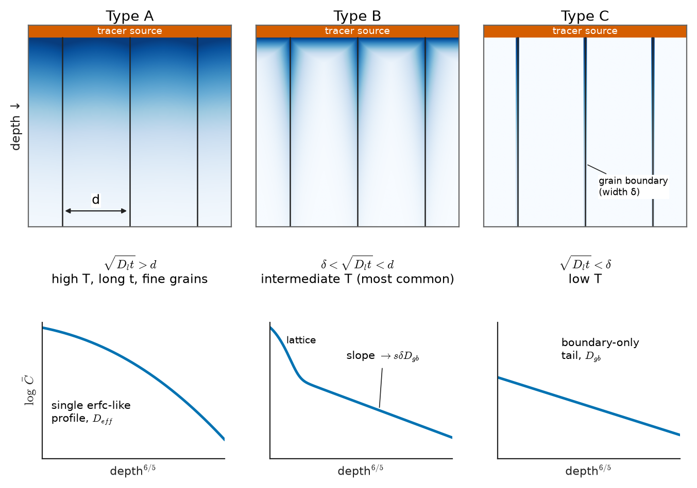
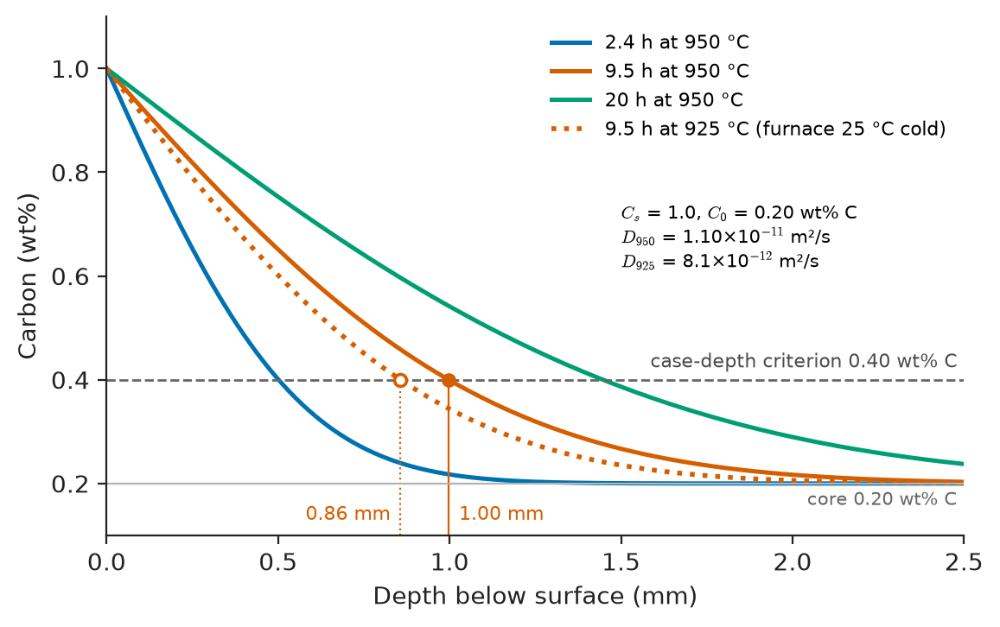

# Chapter 8 — Diffusion in Solids

*Part II · Thermodynamics and Kinetics*

A gearbox manufacturer for wind turbines changes its heat-treatment supplier. The new supplier carburizes the gears at the same temperature, with the same furnace atmosphere, for the specified time. Six months later several gearboxes in an offshore park show pitting on the gear teeth. Sectioning shows that the hardened case is about 0.85 mm deep instead of the 1.0 mm on the drawing. The supplier's thermocouple read 25 °C high, so the parts were actually treated 25 °C colder than they should have been. That small temperature error cut the carbon diffusion coefficient by about a quarter, and the case depth, which grows with the square root of the diffusion coefficient times time, fell short. Diffusion turned a thermocouple error into a field failure.

The same physics operates in a silicon wafer where boron must penetrate exactly 1 µm, in a solid-oxide fuel cell whose power depends on how fast oxide ions hop through zirconia, in a smartphone cover glass strengthened by exchanging sodium for potassium, in a carbon-fibre aircraft panel that slowly absorbs water, and in a solder joint where unequal diffusion rates leave a line of voids. Phase diagrams (Chapter 7) tell where a system wants to go; diffusion tells how long it takes to get there.

> **How fast do atoms move through a solid, and how far do they get in the time a process or a service life allows?**
> **Why is diffusion so sensitive to temperature, to the crystal and its defects, and to the chemistry of the diffusing species?**

| Concept | Engineering destination |
|---|---|
| Fick's first law, flux and permeability | Hydrogen permeation through pipeline steel, gas barriers in packaging, membranes |
| Fick's second law and its solutions | Case depth in carburizing and nitriding, dopant profiles, homogenization time |
| Atomic mechanisms | Why carbon moves $10^5$–$10^9$ times faster than iron in steel |
| Random walk and Arrhenius law | Temperature sensitivity of every heat-treatment specification |
| Kirkendall effect, Darken equations | Voids in solder joints and wire bonds, diffusion bonding, coatings |
| Short-circuit paths | Low-temperature creep, interconnect electromigration, grain-boundary embrittlement |
| Ionic diffusion, Nernst–Einstein | Fuel-cell electrolytes, oxygen sensors, battery electrodes, oxidation scales |
| Diffusion in polymers and glasses | Moisture uptake of composites, barrier packaging, chemically strengthened glass |
| Uphill diffusion | Carbon redistribution across dissimilar welds, spinodal decomposition |

**Roadmap.** Flux and Fick's first law (8.1) → Fick's second law and its classic solutions (8.2) → how atoms jump (8.3) → random walks and the Arrhenius law (8.4) → self-diffusion, interdiffusion and the Kirkendall effect (8.5) → fast paths (8.6) → ionic solids (8.7) → polymers and glasses (8.8) → diffusion driven by chemical potential (8.9) → engineering applications (8.10).

---

## 8.1 Fick's first law

### Flux

Diffusion is the net transport of atoms by random thermal motion. Its rate is measured by the **flux** $J$, the number of atoms (or moles, or kilograms) crossing unit area per unit time, with units such as atoms m⁻² s⁻¹ or kg m⁻² s⁻¹. In 1855 Adolf Fick proposed, by analogy with heat conduction, that the flux is proportional to the concentration gradient:

$$
J=-D\,\frac{\partial C}{\partial x}
$$

The **diffusion coefficient** (diffusivity) $D$ has units of m²/s. The minus sign says that atoms flow from high to low concentration. In three dimensions $\mathbf J=-D\nabla C$, and in an anisotropic crystal $D$ is a second-rank tensor (Chapter 4); in cubic crystals it reduces to a scalar.

> **Status of the principle: Fick's first law**
> *Approximate.* It is a linear-response law, valid when the concentration gradient is the only driving force and is small on the scale of the jump distance; the deeper driving force is the gradient of chemical potential (Section 8.9), and $D$ itself can depend on concentration.

### Steady state and permeation

When the concentration at every point stops changing, the flux is uniform and the concentration profile across a slab is linear. This is the situation in a membrane separating two gas reservoirs. Hydrogen dissolving in the wall of a steel pipeline or a pressure vessel, nitrogen through a polymer liner of a hydrogen tank, and oxygen through a food-packaging film are all steady-state permeation problems. For a slab of thickness $h$ with surface concentrations $C_1$ and $C_2$,

$$
J=D\,\frac{C_1-C_2}{h}
$$

For a gas that dissolves according to a solubility law (Henry's law $C=Sp$ in polymers; Sieverts' law $C=S\sqrt p$ for diatomic gases that dissociate in metals, such as H₂ in steel), the flux is written in terms of pressure, and the product of diffusivity and solubility is the **permeability** $P=DS$. Barrier materials need low $D$, low $S$ or both. Section 8.8 returns to polymers, where this is the main design variable.

A classic industrial use of steady-state diffusion is hydrogen purification: Pd–23Ag membranes a few micrometres thick pass hydrogen (which dissolves and diffuses rapidly as atoms) and block every other gas, giving hydrogen of 99.9999 % purity for semiconductor fabs and fuel cells.

---

## 8.2 Fick's second law and its solutions

### The diffusion equation

When the concentration changes with time, mass conservation links the time derivative of concentration to the divergence of flux: what flows into a thin slice and does not flow out accumulates there. Combining this with Fick's first law gives **Fick's second law**:

$$
\frac{\partial C}{\partial t}=\frac{\partial}{\partial x}\left(D\,\frac{\partial C}{\partial x}\right)\ \ \xrightarrow{D\ \text{const}}\ \ \frac{\partial C}{\partial t}=D\,\frac{\partial^2 C}{\partial x^2}
$$

> **Status of the principle: Fick's second law**
> *Derived.* It is Fick's first law plus conservation of matter; the constant-$D$ form is an approximation that fails when $D$ depends strongly on composition, as it does for carbon in austenite and for water in polymers.

This is the same equation as transient heat conduction (Figure 8.1 shows its two most used solutions), so the whole mathematical toolkit of heat transfer applies. One result follows by dimensional analysis alone: the only length scale that can be built from $D$ and $t$ is $\sqrt{Dt}$. Every diffusion distance is some multiple of it, so **doubling a diffusion depth takes four times as long**. A useful rule of thumb is that atoms penetrate a distance of order

$$
x\approx\sqrt{Dt}\quad\text{to}\quad 2\sqrt{Dt}
$$

Three classes of solution cover most engineering problems.

### Thin-film (instantaneous source) solution

A fixed amount $Q$ of solute per unit area is deposited on the surface of a semi-infinite solid and allowed to diffuse inward with no further supply. The solution is a half-Gaussian:

$$
C(x,t)=\frac{Q}{\sqrt{\pi Dt}}\exp\!\left(-\frac{x^2}{4Dt}\right)
$$

The total amount stays constant, the surface concentration falls as $t^{-1/2}$ and the profile broadens. (For a film sandwiched between two semi-infinite blocks, the solution has $2\sqrt{\pi Dt}$ in the denominator, and the Gaussian extends to both sides.) This is the profile used to measure diffusion coefficients with radioactive tracers: deposit a thin layer, anneal, section and fit $\ln C$ against $x^2$; the slope is $-1/(4Dt)$. It is also the profile of a semiconductor **drive-in** step, where an implanted dose redistributes during a high-temperature anneal.

### Error-function solution (constant surface concentration)

If instead the surface is held at a constant concentration $C_s$ by a gas, salt bath or liquid, and the solid initially contains $C_0$ uniformly, the solution is

$$
\frac{C(x,t)-C_0}{C_s-C_0}=1-\mathrm{erf}\!\left(\frac{x}{2\sqrt{Dt}}\right)=\mathrm{erfc}\!\left(\frac{x}{2\sqrt{Dt}}\right)
$$

where $\mathrm{erf}(z)=\frac{2}{\sqrt\pi}\int_0^z e^{-u^2}du$. Carburizing, nitriding, decarburization, boriding, dopant predeposition and the joining of two semi-infinite blocks of different composition (a diffusion couple, where the same function appears with $C_s$ replaced by the mean of the two compositions) all follow this form.

| $z$ | $\mathrm{erf}(z)$ | $z$ | $\mathrm{erf}(z)$ |
|---|---|---|---|
| 0.10 | 0.1125 | 0.80 | 0.7421 |
| 0.20 | 0.2227 | 0.90 | 0.7969 |
| 0.30 | 0.3286 | 1.00 | 0.8427 |
| 0.40 | 0.4284 | 1.20 | 0.9103 |
| 0.50 | 0.5205 | 1.50 | 0.9661 |
| 0.60 | 0.6039 | 2.00 | 0.9953 |
| 0.70 | 0.6778 | 2.50 | 0.9996 |

<!-- FIGURE 8.1 | figures/ch08/fig-8-1-fick-solutions.png | plot | The two classic solutions of Fick's second law: a thin-film source spreading as a Gaussian and a constant-surface-concentration (error-function) profile, each at three times. | Content: two side-by-side panels sharing x-axis depth x in units of a reference length L = 2√(D t1), range 0–4. Left: thin-film Gaussian C/(Q/√(πDt1)) for t = t1, 4t1, 16t1 (amplitude halves each step, width doubles), shaded areas equal and labelled "constant dose Q". Right: erfc profiles (C−C0)/(Cs−C0) for t = t1, 4t1, 16t1, with horizontal dashed line at 0.25 showing the depth of a given concentration doubling for each fourfold increase of time; label "x ∝ √(Dt)". -->

*Figure 8.1 — The two classic solutions of Fick's second law: a thin-film source spreading as a Gaussian and a constant-surface-concentration (error-function) profile, each at three times.*

### Separation of variables: finite bodies and homogenization

For finite geometries the solution is a sum of decaying spatial modes. Consider a cored casting in which the solute concentration varies sinusoidally between dendrite centres and the interdendritic regions, with half-wavelength $l$ (half the dendrite arm spacing):

$$
C(x,0)=\bar C+\beta_0\sin\frac{\pi x}{l}
$$

Substituting $C=\bar C+\beta(t)\sin(\pi x/l)$ into Fick's second law gives

$$
\beta(t)=\beta_0\exp\!\left(-\frac{t}{\tau}\right),\qquad \tau=\frac{l^2}{\pi^2D}
$$

Any initial profile can be expanded as a Fourier series, and each harmonic decays with its own $\tau_n=l^2/(n^2\pi^2D)$; the higher harmonics vanish first, so after a short time only the fundamental remains. The same method gives the classic slab, cylinder and sphere solutions for degassing, drying, outgassing of vacuum parts and moisture uptake of a composite panel (Section 8.8).

> **Status of the principle: Classic solutions of the diffusion equation**
> *Derived.* Exact solutions of Fick's second law for constant $D$ and idealized boundary conditions (semi-infinite body, fixed surface concentration or fixed dose); they are approximations wherever $D$ varies with composition, the surface concentration drifts, or the body is not effectively semi-infinite ($x\gtrsim$ thickness).

---

## 8.3 Atomic mechanisms

Atoms in a crystal vibrate about their sites at about $10^{13}$ Hz. Occasionally, a fluctuation gives one enough energy to squeeze past its neighbours into an adjacent site. How it does that depends on where it sits.

**Vacancy mechanism.** A substitutional atom (an iron atom in iron, a zinc atom in copper) can move only if a neighbouring lattice site is empty. It exchanges places with the vacancy, and the vacancy moves the opposite way. The atom's jump rate is therefore the product of the probability that a neighbour site is vacant (the equilibrium vacancy fraction of Chapter 6, $x_v=\exp(S_f/k)\exp(-H_f/kT)$, typically $10^{-4}$ near the melting point of a metal) and the rate at which a vacancy jumps once present. The activation energy for diffusion is the sum of vacancy formation and migration enthalpies, $Q=H_f+H_m$; in copper, for example, $H_f\approx1.3$ eV and $H_m\approx0.7$ eV give $Q\approx2.0$ eV (about 190 kJ/mol), close to the measured 2.1–2.2 eV for self-diffusion.

**Interstitial mechanism.** Small atoms that sit in the interstices between host atoms (H, C, N, O, B in metals) jump from one interstice to the next. Neighbouring interstices are almost always empty, so no defect needs to be formed and $Q=H_m$ only. This is why carbon diffuses in iron about $10^5$ to $10^9$ times faster than iron itself at 500–1000 °C (the ratio depends on temperature and phase), and why hydrogen diffuses in ferritic steel at room temperature about as fast as solutes diffuse in a liquid.

**Interstitialcy mechanism.** A self-interstitial (an extra host atom squeezed into an interstice, usually as a dumbbell sharing a site) pushes a neighbouring lattice atom into an interstitial position and takes its place. In metals self-interstitials are too costly to form in equilibrium, but they are created in large numbers by neutron irradiation in nuclear reactors and dominate radiation-enhanced diffusion (Chapter 41). In silicon, dopants such as boron and phosphorus diffuse largely through interstitialcy-type mechanisms, which is why oxidizing the surface (injecting self-interstitials) speeds up boron diffusion, a well-known process effect in chip manufacturing.

Figure 8.2 compares the three mechanisms. Other mechanisms occur in special cases: direct exchange or ring rotation (energetically costly, not observed in practice), and the **dissociative** or kick-out mechanisms of fast-diffusing metals such as Cu, Ni and Au in silicon, which switch between substitutional and interstitial sites and contaminate whole wafers in minutes.

<!-- FIGURE 8.2 | figures/ch08/fig-8-2-diffusion-mechanisms.png | schematic | Atomic mechanisms of diffusion: vacancy exchange, interstitial jumping and the interstitialcy mechanism, each with its energy barrier. | Content: three panels on a square 2D lattice of grey host atoms. (a) Vacancy: an atom (blue) jumping into an adjacent empty site, arrow labelled "atom →", dashed arrow "vacancy ←"; caption Q = Hf + Hm. (b) Interstitial: small red atom moving between interstices, Q = Hm. (c) Interstitialcy: an extra host atom in an interstice pushing a lattice atom into the next interstice (two arrows). Bottom strip: potential energy versus reaction coordinate showing the saddle-point barrier Hm between equivalent sites, with jump distance λ marked. -->

*Figure 8.2 — Atomic mechanisms of diffusion: vacancy exchange, interstitial jumping and the interstitialcy mechanism, each with its energy barrier.*

---

## 8.4 Random walk and the Arrhenius law

### From jumps to D

Each atomic jump is random: an atom does not know where the concentration is high. Yet random jumps produce a net flux down a concentration gradient, simply because more atoms are available to jump from the crowded side. Consider two adjacent atomic planes, 1 and 2, separated by the jump distance $\lambda$, containing $n_1$ and $n_2$ solute atoms per unit area. If each atom jumps $\Gamma$ times per second in random directions, and in a cubic lattice a fraction $1/6$ of jumps go from plane 1 to plane 2 (one of six directions), the net flux is

$$
J=\tfrac16\Gamma\,(n_1-n_2)
$$

With concentrations $C=n/\lambda$ and $n_1-n_2=-\lambda^2\,\partial C/\partial x$,

$$
J=-\tfrac16\Gamma\lambda^2\,\frac{\partial C}{\partial x}\qquad\Longrightarrow\qquad D=\tfrac16\Gamma\lambda^2
$$

Fick's law has emerged from random motion, and the diffusivity is a jump frequency times a jump distance squared. The same picture gives the mean-square displacement of a single atom after $N=\Gamma t$ random jumps in three dimensions,

$$
\langle r^2\rangle=N\lambda^2=6Dt
$$

which is the microscopic meaning of the $\sqrt{Dt}$ length. For vacancy diffusion, successive jumps of a tracer atom are not independent (an atom that has just exchanged with a vacancy is likely to jump straight back), and a **correlation factor** $f$ (0.78 for FCC, 0.73 for BCC) multiplies $D$.

### Thermal activation

To jump, an atom must pass over a saddle point of energy $\Delta G_m$ above its site. The fraction of time it has enough energy is a Boltzmann factor, so

$$
\Gamma=z\,\nu_0\exp\!\left(-\frac{\Delta G_m}{kT}\right)
$$

where $z$ is the number of neighbouring sites and $\nu_0\approx10^{13}$ s⁻¹ the attempt frequency. For vacancy diffusion, the vacancy probability adds another Boltzmann factor. Writing $\Delta G=\Delta H-T\Delta S$ and collecting the temperature-independent terms gives the **Arrhenius law**

$$
D=D_0\exp\!\left(-\frac{Q}{RT}\right)
$$

with pre-exponential factor $D_0$ (typically $10^{-6}$ to $10^{-4}$ m²/s) and activation energy $Q$ per mole (or $E_a$ per atom, in eV, with $k$ in place of $R$).

> **Status of the principle: Arrhenius law for diffusion**
> *Derived.* It follows from transition-state theory for thermally activated jumps with a single dominant mechanism; it is approximate when two mechanisms or paths compete (curved Arrhenius plots), near magnetic or structural transitions, and at low temperatures where defect concentrations are frozen in rather than at equilibrium.

### Representative data

| Diffusing species in host | $D_0$ (m²/s) | $Q$ (kJ/mol) | $T$ | $D(T)$ (m²/s) |
|---|---|---|---|---|
| H in α-Fe (interstitial) | $7\times10^{-8}$ | 6 | 25 °C | $6\times10^{-9}$ |
| C in α-Fe (interstitial) | $1.1\times10^{-6}$ | 87 | 500 °C | $1.4\times10^{-12}$ |
| C in γ-Fe (interstitial) | $2.3\times10^{-5}$ | 148 | 950 °C | $1.1\times10^{-11}$ |
| Fe in α-Fe (vacancy) | $2.8\times10^{-4}$ | 251 | 500 °C | $3\times10^{-21}$ |
| Fe in γ-Fe (vacancy) | $5.0\times10^{-5}$ | 284 | 1000 °C | $1.1\times10^{-16}$ |
| Cu in Cu | $7.8\times10^{-5}$ | 211 | 500 °C | $4\times10^{-19}$ |
| Zn in Cu | $2.4\times10^{-5}$ | 189 | 500 °C | $4\times10^{-18}$ |
| Al in Al | $2.3\times10^{-4}$ | 144 | 500 °C | $4\times10^{-14}$ |
| Cu in Al | $6.5\times10^{-5}$ | 136 | 500 °C | $4\times10^{-14}$ |
| B in Si | $7.6\times10^{-5}$ | 334 (3.46 eV) | 1100 °C | $1.5\times10^{-17}$ |
| P in Si | $3.9\times10^{-4}$ | 353 (3.66 eV) | 1100 °C | $1.4\times10^{-17}$ |

Values are typical literature values; measured parameters scatter by tens of percent between sources. Two patterns stand out. Interstitial diffusion is fast and has low activation energy. Substitutional diffusion in metals has $Q$ that scales with the melting point (an empirical rule puts $Q\approx18RT_m$ for many FCC and BCC metals), so that at the same **homologous temperature** $T/T_m$ most metals have similar diffusivities, about $10^{-12}$ m²/s near the melting point. Figure 8.3 collects these lines. That is why aluminium alloys are heat-treated near 500 °C and steels near 1000 °C, and why creep (which is diffusion-controlled) becomes a design concern above roughly $0.4T_m$ (Chapter 14).

<!-- FIGURE 8.3 | figures/ch08/fig-8-3-arrhenius-plot.png | plot | Arrhenius plot of diffusion coefficients for interstitial and substitutional diffusion in metals and dopant diffusion in silicon. | Content: x-axis 1000/T (K⁻¹) from 0.6 to 3.5 with a top axis in °C; y-axis log10 D (m²/s) from −24 to −8. Straight lines from D0, Q in the table: H in α-Fe, C in α-Fe, C in γ-Fe (plotted 900–1400 °C), Fe in α-Fe (below 912 °C), Fe in γ-Fe (912–1394 °C), Cu in Cu, Al in Al, Cu in Al, B in Si and P in Si (800–1200 °C). Annotate slope = −Q/(2.303R). Shade the band D ≈ 1e−12 to 1e−13 at the melting point labelled "solid metals near Tm". -->

*Figure 8.3 — Arrhenius plot of diffusion coefficients for interstitial and substitutional diffusion in metals and dopant diffusion in silicon.*

**Worked example — Jumps and distances for carbon in austenite.** At 1000 °C, $D$ for carbon in γ-iron is $2.3\times10^{-5}\exp[-148000/(8.314\times1273)]=1.95\times10^{-11}$ m²/s. Carbon jumps between octahedral sites of FCC iron separated by $\lambda=a/\sqrt2$, with $a\approx0.365$ nm at this temperature, so $\lambda=0.258$ nm.

*Jump frequency.*

$$
\Gamma=\frac{6D}{\lambda^2}=\frac{6\times1.95\times10^{-11}}{(2.58\times10^{-10})^2}=1.8\times10^{9}\ \mathrm{s^{-1}}
$$

Each carbon atom jumps almost two billion times per second.

*Distance in one second.* The root-mean-square displacement is $\sqrt{6Dt}=\sqrt{6\times1.95\times10^{-11}\times1}=1.1\times10^{-5}$ m, about 11 µm. The total path length travelled is $\Gamma t\lambda=1.8\times10^9\times2.58\times10^{-10}=0.45$ m.

*Temperature sensitivity.* For carbon in ferrite, $D$ at 900 °C ($1.4\times10^{-10}$ m²/s) is about $4\times10^{11}$ times larger than at 20 °C ($3.5\times10^{-22}$ m²/s). At room temperature a carbon atom in ferrite moves about $\sqrt{6Dt}\approx0.26$ µm per year.

The atom travels half a metre to get 11 µm, which is what a random walk means. And the Arrhenius factor makes processes that take minutes at heat-treatment temperatures effectively frozen at room temperature; that is why a quenched or tempered microstructure is stable in service, while the same steel used above 400–500 °C in a power plant slowly changes over decades.

---

## 8.5 Self-diffusion, interdiffusion and the Kirkendall effect

### Self-diffusion and tracer diffusion

In a pure metal, atoms continually exchange places with vacancies even though there is no concentration gradient. This **self-diffusion** is measured by depositing a radioactive isotope (⁶⁴Cu on copper, ⁵⁹Fe on iron) and using the thin-film solution; the result is the tracer diffusivity $D^*$. Self-diffusion controls high-temperature creep, sintering, grain growth and the climb of dislocations.

### Intrinsic diffusion and interdiffusion

In a binary alloy with a composition gradient, each component has its own **intrinsic diffusivity**, $D_A$ and $D_B$, measured relative to the crystal lattice. They are generally different. In α-brass, zinc diffuses faster than copper. If, across a diffusion couple of copper and brass, zinc atoms flow into the copper faster than copper atoms flow back, more atoms cross one way than the other. With the vacancy mechanism, the net flux of atoms is balanced by an opposite flux of vacancies, so lattice planes are created on one side and destroyed on the other. The lattice itself moves.

### The Kirkendall experiment

In 1947 Smigelskas and Kirkendall wound molybdenum wires around a block of α-brass (Cu–30 wt% Zn), electroplated copper over it and annealed the couple at 785 °C. The inert Mo wires, marking the original interface, moved toward the brass: the brass side lost volume as zinc left faster than copper arrived. This **Kirkendall effect** (Figure 8.4) proved that diffusion in metals proceeds by a vacancy mechanism (a direct exchange mechanism would give equal fluxes), and overturned the then-common view.

<!-- FIGURE 8.4 | figures/ch08/fig-8-4-kirkendall-effect.png | schematic | The Kirkendall effect in a Cu/Cu–Zn diffusion couple: unequal intrinsic fluxes shift inert markers and can leave voids on the fast-diffuser side. | Content: top panel: block diagram before annealing, copper on the left, α-brass (Cu–30Zn) on the right, row of Mo marker wires at the interface x = 0. Bottom panel after annealing at 785 °C: concentration profile of Zn (S-shaped), arrows J_Zn (long, to the left) and J_Cu (short, to the right), net vacancy flux J_v toward the brass; markers displaced to the right by Δx into the brass side; small voids drawn in the brass side near the markers, labelled "Kirkendall voids". -->

*Figure 8.4 — The Kirkendall effect in a Cu/Cu–Zn diffusion couple: unequal intrinsic fluxes shift inert markers and can leave voids on the fast-diffuser side.*

### Darken's equations

Darken analysed the experiment by separating the motion into diffusion relative to the lattice and the motion of the lattice relative to the ends of the specimen. The **marker velocity** is

$$
v=(D_A-D_B)\,\frac{\partial X_A}{\partial x}
$$

and the composition evolves with a single **interdiffusion coefficient**

$$
\tilde D=X_BD_A+X_AD_B
$$

where $X_A$ and $X_B$ are mole fractions. $\tilde D$ is what is measured from the concentration profile of a diffusion couple (by the Boltzmann–Matano analysis, which extracts $\tilde D$ as a function of composition from one experiment). The intrinsic diffusivities are related to the tracer diffusivities by the **thermodynamic factor** $\phi=1+d\ln\gamma_A/d\ln X_A$ (Chapter 6): $D_A=D_A^*\phi$, so that

$$
\tilde D=\left(X_BD_A^*+X_AD_B^*\right)\phi
$$

> **Status of the principle: Darken equations**
> *Approximate.* They assume vacancies are kept at equilibrium everywhere by sources and sinks, and they neglect correlation and vacancy-wind effects (Manning's corrections of a few tens of percent); they capture the marker shift and the composition dependence of $\tilde D$ well.

### Engineering consequences of unequal diffusion

When vacancies flowing toward the faster diffuser's side cannot all be absorbed by dislocations and boundaries, they condense into **Kirkendall voids**. Examples are common and costly:

- **Wire bonds.** Gold wire bonded to aluminium pads forms Au–Al intermetallics; at 150–200 °C unequal diffusion leaves a line of voids that weakens and eventually opens the bond ("purple plague").
- **Solder joints.** Between copper pads and tin-based solder, Cu₃Sn grows at the copper side, and Kirkendall voids in it, especially with impurities in electroplated copper, cause brittle interfacial fracture under drop impact (Chapter 51).
- **Coatings.** Aluminide coatings on nickel superalloys degrade by interdiffusion with the substrate; voids at the interface promote spallation (Chapter 41).
- **Deliberate use.** Oxidizing or sulphidizing metal nanoparticles, where the metal diffuses outward faster than oxygen or sulphur diffuses inward, produces hollow nanoshells for catalysis and drug delivery (Chapter 38).

---

## 8.6 Short-circuit paths: grain boundaries, dislocations and surfaces

### Why fast paths matter

A grain boundary is a slab of disordered material about $\delta\approx0.5$ nm thick. Atoms there are less tightly bound, and vacancy-like free volume is abundant, so the activation energy for boundary diffusion $Q_{gb}$ is typically 0.4–0.6 times the lattice value and $D_{gb}$ is enormously larger. Dislocation cores act as pipes of radius about 0.5 nm (**pipe diffusion**), and free surfaces are faster still, with $Q_s$ about a quarter to a half of the lattice value. The ordering for the same material and temperature is

$$
D_{lattice}\ll D_{dislocation}<D_{gb}<D_{surface}
$$

Because the activation energies differ, the ratio between them grows rapidly as temperature falls. At high temperature the volume of the lattice dominates total transport, since fast paths are a tiny fraction of the cross-section; below roughly $0.5$–$0.6\,T_m$, fast paths carry most of the flux. That is why grain-boundary diffusion controls low-temperature sintering of powders, Coble creep of fine-grained materials, grain-boundary oxidation and embrittlement, the interdiffusion of thin-film stacks in microelectronics (Chapter 49), and electromigration in copper interconnects, where atoms move along interfaces with the cap layer (Chapter 50).

### Harrison's A, B and C regimes

When a tracer diffuses into a polycrystal from the surface, the shape of the profile depends on how far atoms leak out of the boundaries into the grains, $\sqrt{D_lt}$, compared with the grain size $d$ and the boundary width $\delta$. Harrison (1961) classified three kinetic regimes (Figure 8.5):

- **Type A** ($\sqrt{D_lt}\gtrsim d$): lattice diffusion fields of neighbouring boundaries overlap. The polycrystal behaves as a homogeneous medium with an effective diffusivity $D_{eff}=gD_{gb}+(1-g)D_l$, where $g\approx3\delta/d$ is the volume fraction of boundary material. High temperature, long times, fine grains.
- **Type B** ($\delta\ll\sqrt{D_lt}\ll d$): each boundary is an isolated fast channel that leaks into the grain on either side. The profile has a near-surface lattice part and a long tail whose slope, analysed with the Whipple–Suzuoka solution, gives the product $s\delta D_{gb}$ ($s$ is a segregation factor). Intermediate temperatures; the most commonly measured regime.
- **Type C** ($\sqrt{D_lt}<\delta$): essentially no leakage; transport is confined to the boundaries, and $D_{gb}$ is measured directly. Low temperatures, requiring very sensitive detection.

<!-- FIGURE 8.5 | figures/ch08/fig-8-5-harrison-regimes.png | schematic | Harrison's A, B and C regimes of grain-boundary diffusion in a polycrystal, with the corresponding penetration profiles. | Content: top row: three cross-sections of a polycrystal with vertical grain boundaries (spacing d, width δ) and the tracer source on top; diffusion fields shaded. A: overlapping fields forming a nearly flat front; B: deep thin wedges along boundaries with lateral leakage; C: penetration only inside boundaries. Bottom row: log(average concentration) versus depth (or depth^(6/5)) for each, A: single erfc-like curve; B: steep near-surface lattice part plus long linear tail labelled "slope → sδD_gb"; C: boundary-only tail. Criteria printed under each: √(D_l t) > d; δ < √(D_l t) < d; √(D_l t) < δ. -->

*Figure 8.5 — Harrison's A, B and C regimes of grain-boundary diffusion in a polycrystal, with the corresponding penetration profiles.*

**Worked example — Grain boundaries versus lattice in copper at 400 °C.** Take lattice self-diffusion in copper $D_l=7.8\times10^{-5}\exp(-211000/RT)$ and an illustrative boundary diffusivity $D_{gb}=1\times10^{-5}\exp(-105000/RT)$ m²/s (activation energy half the lattice value). At $T=673$ K,

$$
D_l=3.3\times10^{-21}\ \mathrm{m^2/s},\qquad D_{gb}=7.1\times10^{-14}\ \mathrm{m^2/s}
$$

a ratio of about $2\times10^7$. After 1 h ($t=3600$ s) the characteristic distances are $\sqrt{D_lt}=3.4$ nm in the lattice and $\sqrt{D_{gb}t}=16$ µm along boundaries. For a grain size of 50 µm, $\delta\,(0.5\ \mathrm{nm})<\sqrt{D_lt}\,(3.4\ \mathrm{nm})\ll d$: this is the type-B regime. Even after 1000 h, lattice diffusion moves atoms only about 0.1 µm, while boundary transport covers about 0.5 mm.

The result explains a common observation: a copper part annealed at 400 °C can show oxidation, solder-element penetration or tracer uptake along grain boundaries hundreds of micrometres deep while the grain interiors are untouched. The specific numbers depend on the boundary parameters chosen, but the order-of-magnitude conclusion holds for most metals below about half their melting temperature.

---

## 8.7 Diffusion in ionic solids

### Charged defects and conductivity

In an ionic crystal, diffusion of cations and anions is mediated by point defects that carry charge: Schottky pairs (vacancies on both sublattices), Frenkel pairs (a vacancy and an interstitial on one sublattice), and defects created by aliovalent dopants (Chapter 5). Because the moving species are charged, diffusion and electrical conduction are two views of the same jumps. A field $E$ biases the random walk, producing a drift velocity $v=uE$, where $u$ is the mobility. The **Nernst–Einstein relation** links the mobility to the diffusivity:

$$
\frac{u}{D}=\frac{zq}{kT}\qquad\Longrightarrow\qquad \sigma=\frac{n\,(zq)^2D}{kT}
$$

where $n$ is the concentration of mobile species of charge $zq$ and $\sigma$ the ionic conductivity.

> **Status of the principle: Nernst–Einstein relation**
> *Derived.* It follows from requiring that drift and diffusion fluxes balance in equilibrium (Einstein relation); tracer and conductivity diffusivities differ by the correlation factor and a "Haven ratio" (typically 0.3–1), and the relation breaks down when ions move in correlated groups.

### Defect-controlled diffusion

Ionic diffusion is controlled by the concentration of defects, which can be set by temperature (**intrinsic** regime) or fixed by dopants (**extrinsic** regime). In NaCl, adding CdCl₂ creates one cation vacancy per Cd²⁺ and raises sodium diffusion at moderate temperatures by orders of magnitude; on an Arrhenius plot a "knee" separates the extrinsic region (slope $H_m$ only) from the intrinsic region (slope $H_m+H_f/2$).

The same principle, defect engineering by doping, is the basis of solid electrolytes. In yttria-stabilized zirconia (Chapter 7), each Y₂O₃ unit replacing two ZrO₂ creates one oxygen vacancy, and oxide ions hop through these vacancies. In 8YSZ, Zr₀.₈₅₂Y₀.₁₄₈O₁.₉₂₆, about 3.7 % of oxygen sites are empty.

**Worked example — Vacancy diffusivity in a fuel-cell electrolyte.** 8YSZ has a fluorite cell with lattice parameter $a=0.514$ nm and four cations per cell; its ionic conductivity is about 3 S/m at 800 °C. Find the diffusivity of oxygen vacancies.

*Vacancy concentration.* There are 0.074 vacancies per cation, so per cell $4\times0.074=0.296$, and

$$
n_v=\frac{0.296}{(0.514\times10^{-9})^3}=2.18\times10^{27}\ \mathrm{m^{-3}}
$$

*Nernst–Einstein*, with vacancy charge $2q=3.20\times10^{-19}$ C and $kT=1.381\times10^{-23}\times1073=1.48\times10^{-20}$ J:

$$
D_v=\frac{\sigma kT}{n_v(2q)^2}=\frac{3\times1.48\times10^{-20}}{2.18\times10^{27}\times(3.20\times10^{-19})^2}=2.0\times10^{-10}\ \mathrm{m^2/s}
$$

The vacancies are almost as mobile as carbon in austenite at 1000 °C. Spread over all oxide ions ($n_O=5.7\times10^{28}$ m⁻³), the equivalent oxygen diffusivity is about $8\times10^{-12}$ m²/s.

This is why an SOFC electrolyte must be thin (5–20 µm in anode-supported cells): its area-specific resistance is $h/\sigma$, so a 10 µm 8YSZ layer at 800 °C contributes $10^{-5}/3\approx3\times10^{-6}\ \Omega\,\mathrm{m^2}$ (0.03 Ω cm²), small next to the electrodes. Below 600 °C, the Arrhenius fall in $D$ makes YSZ too resistive, which drives the search for gadolinia-doped ceria and other electrolytes (Chapter 40). The same physics governs the oxide scales that protect high-temperature alloys: alumina and chromia grow slowly because ion diffusion through them is slow (Chapter 42), and lithium-ion battery electrodes are limited by Li diffusion over particle radii of micrometres (Chapter 40).

---

## 8.8 Diffusion in polymers and glasses

### Polymers

Small molecules (water, oxygen, CO₂, solvents, plasticizers) diffuse through polymers by jumping between transient holes created by the thermal motion of chain segments. Diffusivity therefore depends on the **free volume**, which increases sharply above the glass transition temperature $T_g$ (Chapter 20). Typical values at room temperature range from about $10^{-9}$ m²/s for small gases in rubbers to $10^{-13}$ m²/s for water in glassy epoxies.

For packaging and barrier applications, the property that matters is permeability $P=DS$:

| Polymer | O₂ permeability (relative, LDPE = 1) | Typical use |
|---|---|---|
| Silicone rubber (PDMS) | ~200 | Contact lenses, gas-exchange membranes |
| LDPE | 1 | Films, bags |
| HDPE | ~0.3 | Bottles, pipes |
| PET | ~0.02 | Drink bottles |
| PVDC | ~0.002 | Food barrier films |
| EVOH (dry) | ~0.0002 | Barrier layer in multilayer packaging |

Semicrystalline polymers are better barriers than amorphous ones because crystallites are nearly impermeable and lengthen the diffusion path; a PET bottle loses CO₂ slowly enough for a shelf life of months, while an LDPE bottle would not keep carbonation for days. Multilayer films with a thin EVOH core (protected from moisture, which plasticizes it) combine low cost and excellent barrier properties.

**Moisture in composites and electronics.** Epoxy matrices in carbon- and glass-fibre composites absorb 1–3 wt% water at saturation, which lowers $T_g$ and matrix-dominated strength. Uptake follows Fickian kinetics in a plate of thickness $h$ exposed on both faces:

$$
\frac{M_t}{M_\infty}\approx\frac{4}{h}\sqrt{\frac{Dt}{\pi}}\qquad(\text{for } M_t/M_\infty\lesssim0.6)
$$

With $D=1\times10^{-12}$ m²/s and $h=2$ mm, half saturation takes $t=\pi(0.5h/4)^2/D=2.0\times10^5$ s, about 2.3 days, and near-saturation takes several weeks ($h^2/D\approx46$ days is the characteristic time). Aerospace qualification of composite parts uses accelerated conditioning (70 °C, 85 % relative humidity) to reach saturation before testing hot–wet properties. The same equation governs moisture in IC mould compounds, which turns to steam during reflow soldering and cracks packages ("popcorning").

**Case II diffusion.** When a solvent diffuses into a glassy polymer and plasticizes it, a sharp front moves at constant velocity rather than as $\sqrt t$; this non-Fickian behaviour causes solvent crazing of polycarbonate and PMMA and is used in controlled drug release from hydrogels (Chapter 39).

### Inorganic glasses

In silicate glasses, network-forming silicon and oxygen move very slowly, but network-modifying alkali ions (Na⁺, K⁺, Li⁺) hop relatively easily through the open network. This gives soda-lime glass its small ionic conductivity and makes **chemical strengthening** possible: a sheet of aluminosilicate glass is immersed in molten KNO₃ at about 400–450 °C, and K⁺ ions from the salt exchange with Na⁺ ions in the glass. The larger potassium ions are stuffed into sites sized for sodium, creating a compressive surface layer of several hundred MPa. With an interdiffusion coefficient of order $10^{-14}$ m²/s, the exchanged layer reaches $2\sqrt{Dt}\approx34$ µm in 8 h, the order of the tens of micrometres used in phone cover glass. Because cracks must first overcome the compression, strength and scratch-induced fracture resistance rise several-fold (Chapter 17).

Gas permeation through glasses matters in vacuum and cryogenic systems: helium permeates fused silica fast enough to limit the life of some sealed devices, while hydrogen and water diffusion into silica optical fibres raises their optical loss.

---

## 8.9 Uphill diffusion and chemical-potential gradients

### The true driving force

Fick's law says atoms flow down concentration gradients. But at equilibrium what must be uniform is not concentration but chemical potential (Chapter 6). The general flux equation is

$$
J_i=-M_iC_i\,\frac{\partial\mu_i}{\partial x}
$$

where $M_i$ is a mobility. For an ideal dilute solution, $\mu_i=\mu_i^\circ+RT\ln C_i$ and this reduces to Fick's law with $D_i=M_iRT$. For non-ideal solutions it gives Fick's law with the thermodynamic factor of Section 8.5. When the thermodynamic factor becomes negative, or when a second element changes the activity of the first, atoms can diffuse **up** their own concentration gradient.

> **Status of the principle: Chemical-potential-driven diffusion**
> *Fundamental.* Linear irreversible thermodynamics identifies the chemical-potential gradient as the driving force for mass transport; Fick's law is its special case for ideal or dilute solutions with no cross effects.

### Darken's uphill-diffusion experiment

In 1949 Darken welded together two steels with nearly the same carbon content (about 0.45 and 0.48 wt% C), one of which contained 3.8 wt% Si. Silicon raises the activity of carbon in austenite. After annealing at 1050 °C for 13 days, carbon had flowed out of the silicon-bearing steel into the other, building a large step in carbon concentration at the weld: carbon diffused up its concentration gradient but down its chemical-potential gradient. Silicon itself, a slow substitutional diffuser, barely moved.

### Engineering consequences

- **Dissimilar welds.** In welds between low-alloy ferritic steel and austenitic stainless steel or nickel alloys in power plants, chromium in the stainless side lowers carbon activity. Carbon migrates across the fusion line during service at 500–600 °C, leaving a soft decarburized band in the ferritic steel and a hard carbide-rich band on the other side; creep cracks start there (Chapter 47).
- **Spinodal decomposition.** Inside a miscibility gap, where $\partial^2G/\partial X^2<0$, the effective interdiffusion coefficient is negative: small composition fluctuations grow instead of decaying. This is how Fe–Cr stainless steels embrittle at 475 °C and how Alnico magnets and some glass-ceramics form their fine two-phase structures (Chapter 10).
- **Stress-driven diffusion.** A gradient of hydrostatic stress changes chemical potential: hydrogen accumulates in the tensile region ahead of a crack tip in high-strength steel and causes hydrogen embrittlement (Chapter 44). Under an electric current, the "electron wind" adds a force that drives electromigration in interconnects.
- **Thermal gradients (Soret effect)** drive species separation in nuclear fuel pellets and in solders under steep temperature gradients.

---

## 8.10 Engineering applications

### Carburizing

Gears, camshafts, bearings and transmission shafts need a hard, wear- and fatigue-resistant surface on a tough core. Low-carbon steels (0.15–0.25 wt% C, such as 8620 or 20MnCr5) are heated into the austenite field, typically 900–950 °C, in an atmosphere whose carbon potential holds the surface at 0.8–1.0 wt% C. Carbon diffuses inward following the error-function solution; after quenching the high-carbon case becomes hard martensite (about 60 HRC) and the core stays tough. Case depth is commonly defined as the depth to 0.40 wt% C or to a hardness of 50 HRC.

**Worked example — Carburizing time and the cost of a cold furnace.** A 0.20 wt% C gear steel is carburized at 950 °C with the surface held at 1.0 wt% C. How long does it take to reach 0.40 wt% C at a depth of 1.0 mm, and what case depth results if the furnace is actually at 925 °C?

*Diffusivity.* $D=2.3\times10^{-5}\exp[-148000/(8.314\times1223)]=1.10\times10^{-11}$ m²/s.

*Error function.*

$$
\frac{C_x-C_0}{C_s-C_0}=\frac{0.40-0.20}{1.0-0.20}=0.25=1-\mathrm{erf}(z)\ \Rightarrow\ \mathrm{erf}(z)=0.75,\ z=0.813
$$

*Time.* With $z=x/(2\sqrt{Dt})$,

$$
t=\frac{x^2}{4Dz^2}=\frac{(1.0\times10^{-3})^2}{4\times1.10\times10^{-11}\times0.813^2}=3.44\times10^4\ \mathrm{s}\approx9.5\ \mathrm{h}
$$

*Cold furnace.* At 925 °C (1198 K), $D=8.1\times10^{-12}$ m²/s, 26 % lower. After the same 9.5 h, the depth to 0.40 wt% C is $x=2z\sqrt{Dt}=2\times0.813\times\sqrt{8.1\times10^{-12}\times3.44\times10^4}=0.86$ mm.

*Hotter furnace.* At 1000 °C, $D=1.95\times10^{-11}$ m²/s and the same 1.0 mm case takes 5.4 h, which is why vacuum (low-pressure) carburizing at 980–1050 °C is attractive, limited by austenite grain growth.

A 25 °C error removed 14 % of the case depth (Figure 8.6), the failure described at the start of the chapter. In practice the case-depth reduction is somewhat worse than the error-function estimate, because $D$ of carbon in austenite increases with carbon content, and the case is defined by hardness rather than carbon alone; carburizing simulation software solves Fick's second law with concentration-dependent $D$ and a surface mass-transfer coefficient. Related thermochemical treatments are nitriding (500–570 °C, in ferrite, forming hard nitrides, no quench needed, for crankshafts and extrusion dies), carbonitriding and boriding.

<!-- FIGURE 8.6 | figures/ch08/fig-8-6-carburizing-profiles.png | plot | Carbon profiles in a carburized 0.20 wt% C steel at 950 °C for several times, and the effect of a 25 °C temperature error on case depth. | Content: x-axis depth 0–2.5 mm, y-axis wt% C 0.1–1.1. erfc profiles with Cs = 1.0 wt% C, C0 = 0.20 wt% C, D = 1.10e−11 m²/s at 950 °C, for t = 2.4 h, 9.5 h and 20 h; horizontal dashed line at 0.40 wt% C labelled "case-depth criterion"; the 9.5 h curve crosses 0.40 at 1.0 mm (marked). Additional dotted curve for 9.5 h at 925 °C (D = 8.1e−12 m²/s) crossing 0.40 at ~0.86 mm, labelled "furnace 25 °C cold". -->

*Figure 8.6 — Carbon profiles in a carburized 0.20 wt% C steel at 950 °C for several times, and the effect of a 25 °C temperature error on case depth.*

### Doping semiconductors

Before ion implantation became dominant, silicon devices were doped by diffusion in two steps: a **predeposition** at constant surface concentration (erfc profile), then a **drive-in** with the source removed (Gaussian profile). Today ions are implanted and then annealed, and the anneal still redistributes the dopant by diffusion.

At 1100 °C boron has $D\approx1.5\times10^{-17}$ m²/s (table above). A 1 h drive-in gives $2\sqrt{Dt}=0.47$ µm. If a dose $Q=10^{15}$ cm⁻² ($10^{19}$ m⁻²) is driven in, the Gaussian solution gives a surface concentration $Q/\sqrt{\pi Dt}=2.4\times10^{19}$ cm⁻³ and the depth at which boron falls to a background of $10^{16}$ cm⁻³ (the p–n junction) is

$$
x_j=\sqrt{4Dt\ln\frac{C_{surface}}{C_B}}=1.3\ \mu\mathrm m
$$

Modern transistors need junctions only tens of nanometres deep, so thermal budgets ($\sum Dt$ over all hot steps) are minimized with millisecond flash and laser anneals that activate dopants while moving them only a few nanometres (Chapters 32 and 50).

### Homogenization

Cast ingots of aluminium, copper, nickel and steel alloys are cored (Chapter 7). Before hot working, they are homogenized: held at high temperature until the segregation decays. The separation-of-variables solution gives the time directly.

**Worked example — Homogenizing an aluminium–copper ingot.** A direct-chill-cast Al–Cu ingot has a secondary dendrite arm spacing of 50 µm, so the segregation half-wavelength is $l=25$ µm. It is homogenized at 500 °C, where $D_{Cu\ in\ Al}=6.5\times10^{-5}\exp[-136000/(8.314\times773)]=4.2\times10^{-14}$ m²/s. How long does it take to reduce the segregation amplitude to 1 % of its initial value?

*Relaxation time.*

$$
\tau=\frac{l^2}{\pi^2D}=\frac{(25\times10^{-6})^2}{9.87\times4.2\times10^{-14}}=1.5\times10^3\ \mathrm{s}
$$

*Time to 1 %.* $\beta/\beta_0=\exp(-t/\tau)=0.01$, so $t=\tau\ln100=4.6\tau=6.9\times10^3$ s $\approx1.9$ h. At 530 °C the time falls to about 0.9 h.

In practice industrial homogenization of aluminium alloys takes 4–24 h. The difference is instructive: real ingots have coarser spacing near the centre (time scales as $l^2$: doubling the spacing quadruples the time), the slowest-diffusing elements such as Mn and Cr are the ones that must be homogenized, and the soak also dissolves non-equilibrium eutectic particles and precipitates dispersoids. The simple solution gives the scaling; the specification adds the metallurgy.

### Other applications at a glance

| Process or failure | Diffusing species | Typical conditions |
|---|---|---|
| Nitriding of tool and crankshaft steels | N in α-Fe | 500–570 °C, 10–80 h, case 0.1–0.6 mm |
| Decarburization during forging | C out of steel | 1100–1250 °C, minutes; soft surface, fatigue loss |
| Diffusion bonding of Ti fan blades | Ti self-diffusion, creep | 900–950 °C, a few MPa, hours |
| Sintering of ceramics and powder metals | Boundary and lattice diffusion | 0.6–0.9 $T_m$ |
| Hydrogen embrittlement of high-strength bolts | H in α-Fe | Room temperature, hours to days |
| Interdiffusion in thermal-barrier coatings | Al, Ni, Cr | 1000–1150 °C, thousands of hours |
| Dopant diffusion and gettering in Si wafers | B, P, As, Fe, Cu | 800–1100 °C |
| Ion exchange in cover glass | K⁺/Na⁺ | 400–450 °C, hours |

> **Boundary.** The statistical-mechanical basis of the Boltzmann factor and of transition-state theory belongs to the Engineering Physics and Advanced Chemistry books; this chapter uses their results. Diffusion of charge carriers (electrons and holes) in semiconductors follows the same mathematics and is treated in Chapter 32.

---

## What remains open

| Open question | Where it is answered |
|---|---|
| What sets the equilibrium vacancy concentration and the chemical potentials that drive diffusion? | Chapters 5 and 6 |
| What phases and compositions does diffusion move a system toward? | Chapter 7 |
| How does diffusion control the growth of nuclei, dendrites and solidification segregation? | Chapter 9 |
| How do precipitation, coarsening, spinodal decomposition and pearlite growth depend on diffusion? | Chapter 10 |
| How does diffusion produce creep, and how are creep mechanisms mapped? | Chapter 14 |
| How are carburizing, nitriding and heat treatments specified for steels? | Chapter 15 |
| How do ionic conductors serve in fuel cells and batteries? | Chapter 40 |
| How do oxide scales grow by diffusion, and how is hydrogen embrittlement controlled? | Chapters 42 and 44 |
| How are diffusion profiles measured (SIMS, EPMA, tracer methods)? | Chapters 52 and 53 |
| How are jump barriers computed from first principles and diffusion simulated atom by atom? | Chapters 55 and 56 |

**Next:** Chapter 9 combines the driving forces of Chapter 6 with the atomic mobility of this chapter to explain how new phases are born and grow, from the first nucleus in an undercooled melt to the grains of a casting.
